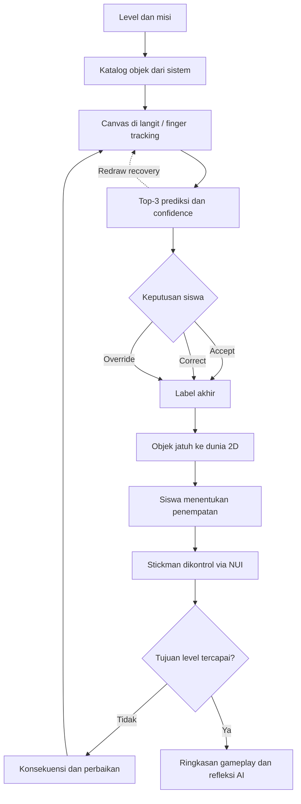

# Catatan Keputusan: PA Sketchbook Universe / AI HITL

Berkas ini (dulu bernama `CHANGELOG.md`) adalah **catatan keputusan Owner**: apa yang diputuskan Owner (CAN), kapan, kenapa, dan statusnya. Isinya hanya keputusan Owner. AI tidak membuat keputusan sendiri di sini; AI hanya mencatat keputusan Owner dan menghubungkannya ke perubahan teknisnya.

| Berkas | Isi |
|---|---|
| `DECISIONS.md` (ini) | Keputusan Owner: Aktif, Direvisi, Dicabut, Belum dikunci, Riset. Sumber kebenaran keputusan. |
| `implementation/CHANGELOG.md` | Setiap perubahan di dalam folder `implementation/` (kode, test, e2e, aset runtime, struktur folder), per versi. |
| `project/OWNER_MANDATES.md` | Instruksi Owner dalam kata-kata Owner, berurutan. |
| `NOW.md` | Keadaan paling baru dalam satu halaman. |

**Hubungan `DECISIONS.md` dan `implementation/CHANGELOG.md`:**
- Keputusan Owner masuk ke sini. Kebanyakan keputusan Owner mengubah `implementation/` (teknis, folder, kode). Keputusan seperti itu **wajib** menyebut versi changelog yang mengerjakannya, contoh: "Teknis: `implementation/CHANGELOG.md` 0.0.15".
- Setiap entri changelog **wajib** menyebut ID keputusan yang melatarinya, contoh: "Decision: D-20261105-19". Jadi dari keputusan bisa dilacak ke perubahan teknis, dan dari perubahan teknis ke keputusannya.
- Perubahan teknis tanpa keputusan baru dari Owner (perbaikan bug, refactor, test) cukup di changelog, tetap ditulis "Decision: -" atau ID keputusan lama yang dijalankan.
- Keputusan yang tidak menyentuh `implementation/` (dokumen, aset di `academic/`, `project/`, alur kerja seperti push) hanya dicatat di sini, ditulis "Teknis: tidak ada".

## Cara pakai

- Baca bagian **Keputusan Aktif** sebelum mengerjakan proposal, desain, kode, atau presentasi.
- Setiap keputusan baru dari pengguna/notulensi bimbingan harus ditambahkan di atas, dengan tanggal dan status.
- Backup percakapan bukan sumber kebenaran otomatis. Nomor backup yang lebih besar memang lebih baru, tetapi jawaban AI di dalamnya tetap bukan keputusan pengguna kecuali ada bukti eksplisit.
- Jika satu hal belum jelas, letakkan di **Belum Dikunci**, jangan difinalkan oleh AI.

## Protokol Pembaruan Semi-Otomatis

1. Tambahkan notulensi/transkrip atau hasil diskusi baru ke proyek.
2. Minta AI menjalankan **Audit Perubahan**, lalu minta **Patch Keputusan Usulan**, bukan langsung menulis ulang catatan keputusan.
3. Setujui atau tolak patch dengan ID, misalnya `SETUJUI D-20260711-01` atau `TOLAK D-20260711-02`.
4. Setelah disetujui, AI mengeluarkan satu versi lengkap pengganti `DECISIONS.md`. Jadikan versi itu satu-satunya catatan keputusan aktif di Sources; arsipkan versi sebelumnya.

Format patch yang wajib:

```md
### D-YYYYMMDD-XX — [Usulan Aktif / Usulan Direvisi / Usulan Dicabut / Belum dikunci]

- Keputusan/ubahannya:
- Mengubah entri lama:
- Bukti: sumber + pernyataan pengguna/dosen yang relevan
- Dampak: proposal / desain / kode / presentasi
- Alasan status: keputusan eksplisit / arahan bersyarat / saran AI / informasi belum cukup
- Menunggu: SETUJUI atau TOLAK pengguna
```

Aturan: AI tidak boleh mengganti keputusan master hanya karena satu notulensi, jawaban AI, atau kalimat dosen yang ambigu. Kalau tidak ada perubahan substantif, hasil audit harus berbunyi `Tidak ada perubahan changelog`.

## Keputusan Aktif

| Area | Keputusan aktif | Status |
|---|---|---|
| Identitas proyek | Satu sistem PA terpadu untuk literasi kecerdasan buatan siswa SMP; bukan dua aplikasi terpisah. Nama internal/IP: **Sketchbook Universe**. | Aktif |
| Judul/branding | "Escape the Sketchbook" tidak dipakai sebagai judul formal. Judul formal final tetap mengikuti dokumen/MIS terbaru yang disetujui. | Aktif |
| Pengguna sasaran | Siswa SMP kelas 7–9. | Aktif |
| Core loop | Gambar objek → Top-3 prediksi + confidence → **Accept / Correct / Override** → final label/behavior → konsekuensi gameplay 2D → pencatatan interaksi. | Aktif |
| Redraw/retry | Redraw adalah jalur iterasi/recovery kembali ke fase gambar untuk merevisi objek atau menindaklanjuti fail/feedback. Redraw bukan otomatis tombol keputusan keempat yang setara dengan Accept/Correct/Override pada Probe UI. | Aktif |
| Tujuan pembelajaran | Membiasakan siswa menilai dan memvalidasi keluaran AI, bukan menerima prediksi sebagai jawaban final. | Aktif |
| Hierarki pengalaman | Interaksi → Gameplay/Storyline → Edukasi. Edukasi muncul lewat pengalaman bermain. | Aktif |
| Lore pengguna | Pengguna adalah Illustrator dari luar sketchbook, satu-satunya pencipta objek dan penentu keputusan akhir. | Aktif |
| Lore Momo | Momo adalah pendamping/pembaca pola. Momo tidak bisa menggambar atau menciptakan objek; ia hanya dapat merespons/menebak/mendorong elemen sesuai desain gameplay. Respons edukasi/panduan cukup melalui text bubble kontekstual tanpa suara, NLP, LLM, atau percakapan bebas. | Aktif |
| Visual Momo | Artwork animasi milik Owner (`momo-ekspresi_1.html`, 12 ekspresi) dipakai sebagai Momo di prototype sejak 2026-11-05 (D-20261105-05). Variasi lama di backup tetap eksplorasi. | Aktif (prototype) |
| Kategori gameplay | Semantik **Solid** dan **Danger** tetap dipakai untuk konsekuensi gameplay. Jangan menganggap contoh kategori/objek lama berlaku universal tanpa desain level terbaru. | Aktif |
| Level | Progresi level merepresentasikan pengalaman literasi AI: dasar, membandingkan ambiguitas/Top-3, lalu validasi kritis. Detail objek, rintangan, confidence band, dan skrip level belum dikunci. | Aktif / detail belum dikunci |
| Peran penulis | Interaksi, UI/UX, canvas dan finger tracking bila benar-benar digunakan, tampilan Top-3/confidence, UI keputusan, gameplay 2D, Momo, event flow, mockup. | Aktif |
| Fokus penulis dari bimbingan | Maksimalkan UI, kuatkan preprocessing input gambar, level progression, serta alasan pemilihan tema, warna, dan keputusan visual. | Aktif |
| Peran partner | Model klasifikasi sketsa, output Top-3/confidence, kontrak data, logging/database, dashboard/export, analisis pola keputusan. | Aktif |
| Integrasi | Input canvas → output model → keputusan/final label siswa → respons gameplay → log. | Aktif |
| User flow | Dibagi menjadi tiga fase: pembuatan input/gambar → evaluasi Top-3 dan penentuan label → gameplay/konsekuensi. Wajib memperlihatkan jalur fail, revisi/retry, pengulangan level, dan selesai. | Aktif |
| Use case | Use case menampilkan aktor dan aktivitas/akses, bukan urutan proses. Aktor siswa/user ditempatkan terpisah dari admin; kebutuhan admin/superadmin mengikuti versi sistem terbaru. | Aktif |
| Desain sistem proposal | Gunakan satu diagram sistem global agar pekerjaan penulis dan partner terbaca sebagai satu sistem. Bedakan ownership dengan warna/legenda; breakdown rinci dibuat bila diperlukan. | Aktif |
| Urutan desain | Matangkan user flow terlebih dahulu, lalu turunkan input–process–output dan design system. | Aktif |
| Presentasi vs buku | Buku PA boleh memuat flow/detail teknis lebih lengkap. PPT/paper harus menampilkan metodologi, desain sistem, dan diagram yang ringkas serta terbaca. | Aktif |
| Onboarding tutorial | Onboarding awal menggunakan **tiga kartu tutorial berurutan**: kartu masuk sebagai stack → menyebar 1–2–3 → kartu aktif flip → membuka menjadi **brosur bifold**. Brosur memakai **panel kiri sebagai guide** dan **panel kanan sebagai visual/interaktif playground**. | Aktif |
| Isi tutorial Kartu 1 | **Stickman/navigation**: pengguna menggerakkan Stickman ke kiri/kanan menuju target sebagai pengenalan kontrol pada tutorial. | Aktif |
| Isi tutorial Kartu 2 | **Aman vs Bahaya**: tutorial memperkenalkan semantik gameplay **Solid/Aman** dibanding **Danger/Sobek** melalui benda padat seperti balok/tangga dan benda tajam seperti duri/pisau. | Aktif |
| Isi tutorial Kartu 3 | **Canvas \& gesture**: pengguna mencoba Coret, Hapus, Undo, dan Redo melalui live canvas interaktif pada prototype onboarding. | Aktif |
| Arah visual tutorial | Gunakan prinsip **less is more** dan hindari tampilan generik/"AI soft": prioritaskan ilustrasi dan interaksi; kurangi badge, box dekoratif, copy berulang, rounded container, gradient, dan ornamentasi yang tidak punya fungsi. | Aktif |
| Onboarding camera / cover visual | Onboarding camera diposisikan secara visual sebagai **cover dari Sketchbook Universe**. Karena fungsi tersebut, layar onboarding camera boleh menggunakan **dominasi hijau secara keseluruhan** sebagai treatment khusus cover dan tidak harus mengikuti treatment paper/dotted pada tutorial. Dominasi hijau ini tidak otomatis menjadi background global untuk page lain. | Aktif |
| Copy \& kontras tutorial | Copy tutorial prototype onboarding dan aturan kontras panel guide dikunci sesuai spesifikasi pengguna saat ini. Judul: **Kenalin Stickman**, **Pijakan Aman vs Bahaya**, **Tes Coret \& Gestur Jarimu**. CTA: **Lanjut**, **Lanjut**, **Mulai Level 1**. Teks utama panel kiri menggunakan hitam solid berkontras tinggi pada latar hijau. | Aktif |
| Evaluasi | Gunakan log untuk menggambarkan pola keputusan yang teramati. Jangan mengklaim perubahan psikologis/kognitif atau hasil pre/post tanpa rancangan dan bukti evaluasi yang sah. | Aktif |
| Metodologi | Fishbone: Concept, Design, Material Collecting, Assembly, User Testing, Distribution. | Aktif |
| Sistem visual | Warna oranye/hijau, dots di belakang, outline dan bayangan yang ada sekarang **dikunci Owner**. "Anti-slop" = perbaikan detail, bukan ganti palet/tipografi (D-20261105-01). | Aktif |
| Alur keputusan HITL di UI | Terima/Pilih lain/Bukan semua langsung berlaku (tanpa tombol "Wujudkan Objek"); lalu tawaran "Masukkan ke dunia" (D-20261105-02). | Aktif |
| Ringkasan level | Pop-up di dalam dunia game dengan Momo yang merayakan, bukan layar penuh (D-20261105-04). | Aktif |
| Label asal prediksi | Kalimat biasa dan jujur: "Mode demo: tebakan masih simulasi" / "Demo: tebakan simulasi" (D-20261105-07). | Aktif |

## Yang Sengaja Tidak Difinalkan

| Area | Batas saat ini |
|---|---|
| Stack/model detail | KAPLAY.js, MediaPipe, HTML Canvas, CNN/MobileNet, TensorFlow.js, SQLite/REST, dan K-Means pernah dibahas. Pakai hanya yang benar-benar ada pada proposal/repo terbaru atau telah dikonfirmasi pengguna/partner. |
| Skema logging/dashboard | Jenis field, cluster, dan bentuk dashboard belum boleh diklaim final tanpa kesepakatan implementasi partner. |
| MediaPipe/camera | Dipakai hanya bila benar-benar diimplementasikan; jangan dipertahankan di judul/dokumen hanya karena pernah direncanakan. |
| Login/history | Notulensi menggeser rancangan dari session-only menuju identitas/login bila progres dan returning-user history harus disimpan. Mekanisme login, ID, durasi sesi, dan penyimpanan final harus mengikuti dokumen/repo terbaru; jangan memilih sendiri. |
| Manipulasi kesalahan AI | Gagasan menurunkan confidence, memaksa prediksi salah, atau membuat jebakan automation-bias pernah dibahas, tetapi belum boleh disebut keputusan final atau persetujuan dosen tanpa rancangan evaluasi dan konfirmasi terbaru. |
| Kontrol karakter | Kiri/kanan/lompat pernah disarankan dalam eksplorasi. Status aktual harus mengikuti prototype dan desain gameplay terbaru. |
| Implementasi gesture/camera tutorial | Pemetaan gesture tutorial sudah ditetapkan pada UI sebagai **🤏 Coret, ✊ Hapus, ✌️ Undo/Batal, 🖐️ Redo/Ulang**, dan pointer/mouse dapat dipakai pada prototype. Namun pipeline camera/MediaPipe sebagai input aktual **belum dikunci** hanya karena gesture tampil di UI. |
| Cakupan kontrol Stickman | Gerak kiri/kanan Stickman pada Kartu 1 adalah interaksi tutorial aktif, tetapi **belum cukup bukti** untuk menyimpulkan kontrol karakter gameplay global hanya kiri/kanan atau mencakup lompat. |
| Detail proposal | Struktur bab, judul final, daftar referensi, nama lengkap pembimbing, dan status persetujuan mengikuti dokumen resmi terbaru, bukan template/backup AI. |

## Keputusan yang Dicabut atau Tidak Boleh Dihidupkan Lagi

| Item lama | Perlakuan |
|---|---|
| "Escape the Sketchbook" sebagai nama/judul formal | Jangan gunakan. Hanya boleh disebut sebagai riwayat bila pengguna meminta. |
| Momo sebagai karakter yang dapat menggambar/menciptakan objek | Salah. Pencipta objek adalah pengguna/Illustrator. |
| Chatbot, LLM/RAG/NLP, voice assistant, atau percakapan bebas sebagai fitur inti | Di luar scope inti saat ini. |
| Tema space/planet dan variasi maskot lama | Eksplorasi historis sebelum arah Sketchbook Universe dimatangkan; jangan dihidupkan sebagai arah visual aktif tanpa keputusan baru. |
| Pre/post test sebagai evaluasi utama | Jangan jadikan default. |
| Detail contoh yang muncul dari debat internal AI | Jangan masukkan ke dokumen final hanya karena pernah muncul dalam backup. |
| Klaim referensi, hasil uji, atau persetujuan tanpa verifikasi | Jangan gunakan. |

## Riwayat Ringkas

| Periode | Perubahan/penegasan | Status sekarang |
|---|---|---|
| Awal perumusan | Konsep berkembang menjadi sistem literasi AI berbasis simulasi interaktif dan HITL untuk SMP. | Dipertahankan |
| Pengembangan lore | Dunia Sketchbook Universe dikunci sebagai payung IP; pengguna/Illustrator adalah kreator, Momo bukan kreator. | Dipertahankan |
| Penyatuan scope | Peran frontend/interaksi dan model/backend dipisah per orang, tetapi alurnya tetap satu sistem terpadu. | Dipertahankan |
| Perapian interaksi | Loop inti dipersempit ke Top-3 + confidence dan Accept/Correct/Override. | Dipertahankan |
| Penyaringan klaim | Jawaban AI, detail stack, skema analitik, referensi, serta "final" versi lama harus diverifikasi sebelum dipakai. | Aturan aktif |
| 2026-09-28 — Penguncian onboarding prototype | Layout tutorial bifold tiga kartu, isi fungsional tiga kartu, arah visual less-is-more, serta copy/kontras panel guide dikunci untuk prototype onboarding saat ini. Implementasi camera/MediaPipe dan generalisasi kontrol Stickman ke gameplay global tetap belum dikunci. | Aktif / sebagian detail belum dikunci |
| 2026-10-05 — Penegasan visual cover onboarding | Onboarding camera ditegaskan sebagai cover Sketchbook Universe sehingga dominasi hijau pada keseluruhan layar adalah treatment khusus cover, bukan aturan background global untuk page lain. | Aktif |

## Entri Perubahan Terbaru

### D-20261105-23 — Belum dikunci (status: RENCANA) — PRD Revisi 0.0.16 (Momo, jempol, buku, penutup)
- Teknis: belum ada (nanti `implementation/CHANGELOG.md` 0.0.16).
- Keputusan/ubahannya: feedback Owner atas video full run dijadikan satu rencana: `project/PRD_REVISI_0.0.16.md`. Isi: lambaian (bukan kamera nyala) yang membangunkan Momo; transisi buka buku semi 3D (kanan bawah ke kiri atas); penggaris tanpa tombol, Momo menanyakan angka yang dipilih; semua jempol punya cincin progres (2 detik konfirmasi, 1 detik percakapan) dengan deteksi jempol nyata; Thinman tutorial pakai animasi jalan; pita mental ke atas lalu buku membuka ke dunia, kembali = buku menutup; Thinman lebih pelan; panel tebakan dan HUD sekunder dikecilkan ("Gambar lagi" tetap); video bukti wajib memperlihatkan Momo terbang ke kanvas di langit dan mode gambar; penutup L3 (A + B) digabung ke PRD ini tetapi tetap RISET (D-20261105-15). Jawaban Owner 2026-11-07: Terima = jempol 2 detik, gestur Pilih lain dan Bukan semua harus diriset (R4b); tanpa webcam tidak didukung (wajib NUI); Thinman lebih pelan dengan syarat Level 1 minimal butuh 2 gambar; Momo mengarahkan benda yang bisa digambar tanpa memaksa (R10, choice architecture).  Jawaban kedua: daftar benda dan minimal gambar cukup dummy untuk partner; IT memakai katalog level saat ini (K1) dan minimal 2 gambar per level (K2).
- Mengubah entri lama: akan mengubah D-20261105-19 (cover: kamera nyala tidak lagi membangunkan Momo) dan D-20261105-13 (masuk level) setelah disetujui.
- Bukti: instruksi Owner 2026-11-07 (M-019).
- Alasan status: Owner meminta rencana dulu, jangan langsung implementasi. **Jangan dikerjakan sebelum Owner menulis `SETUJUI PRD 0.0.16`.**

### D-20261105-22 — Aktif (instruksi eksplisit Owner, M-018) — Commit hanya atas nama Owner
- Teknis: tidak ada (aturan kerja di root: `AGENTS.md`, `CLAUDE.md` baru).
- Keputusan/ubahannya: semua commit dan push memakai identitas yang Owner pasang di environment Claude Code (`GIT_AUTHOR_*`, `GIT_COMMITTER_*`). Tidak ada AI sebagai author, co-author, atau kontributor: tanpa baris `Co-Authored-By`, `Claude-Session`, atau atribusi AI lain; author tidak pernah direset ke Claude walau hook meminta. Aturan ditulis di `AGENTS.md` (bagian "Git commits and push") dan `CLAUDE.md` baru yang memuat `AGENTS.md`, supaya setiap sesi Claude Code membacanya.
- Mengubah entri lama: memperkuat M-008. Commit lama di `can` masih memuat baris `Co-Authored-By`; menulis ulang riwayat (force push) menunggu persetujuan Owner.
- Bukti: instruksi Owner 2026-11-05 (screenshot GitHub "2 people authored").
- Dampak: semua sesi AI berikutnya.

### D-20261105-21 — Aktif (instruksi eksplisit Owner, M-017) — Aturan DECISIONS.md dan implementation/CHANGELOG.md
- Teknis: `implementation/CHANGELOG.md` 0.0.15 (Docs).
- Keputusan/ubahannya: `DECISIONS.md` (root) berisi **keputusan dari Owner** saja. `implementation/CHANGELOG.md` berisi **setiap perubahan di dalam folder `implementation/`**. Kebanyakan keputusan Owner mengubah `implementation/` (teknis, folder, kode), jadi keputusan dan changelog **saling terhubung**: tiap keputusan menulis baris "Teknis:" ke versi changelog, tiap versi changelog menulis baris "Decision:" ke ID keputusan. Panduan di atas kedua berkas ditulis ulang dengan aturan ini, dan semua entri D-20261105-01..23 serta versi 0.0.13..0.0.15 sudah dihubungkan.
- Catatan Owner: **Owner marah besar** karena AI tidak membaca berkas dan salah menangkap aturan ini berkali-kali (catatan teknis tenggelam di versi lama; catatan push dimasukkan ke changelog; panduan berkas tidak jelas). Pelajaran untuk AI berikutnya: baca panduan di atas `DECISIONS.md` dan `implementation/CHANGELOG.md` sebelum mencatat; catatan baru di changelog selalu di versi paling atas; jangan masukkan hal di luar `implementation/` ke changelog.
- Mengubah entri lama: memperjelas D-20261105-10 (pembagian dokumen) dan header kedua berkas.
- Bukti: instruksi Owner 2026-11-05 (M-017).
- Dampak: cara semua AI mencatat kerja di repo ini.

### D-20261105-20 — Aktif (instruksi eksplisit Owner) — Push revisi 0.0.14 ke branch `can`
- Teknis: tidak ada (alur kerja).
- Keputusan/ubahannya: Owner menyuruh push ("gas push") setelah wing fix (D-20261105-17), audit semua Momo, dan Momo sebagai pemandu (D-20261105-19). Push ke `origin/can` memakai environment sesi ini. Commit tetap atas nama Owner (`Farchan Deano Muhammad`, M-008); GitHub bisa menampilkan "Unverified" karena tidak ditandatangani, dan itu sengaja diterima: author tidak direset ke Claude. Push hanya terjadi karena perintah eksplisit ini; aturan "jangan push tanpa diminta" tetap berlaku untuk sesi berikutnya.
- Mengubah entri lama: tidak ada.
- Bukti: perintah Owner 2026-11-05 (tidak dicatat di `implementation/CHANGELOG.md` karena bukan perubahan isi `implementation/`); commit `46d2330`, `eb3c053`, `5c05cc3` dan commit catatan ini.
- Dampak: remote `can` memuat semua kerja sesi ini; sesi baru yang di-clone dari remote ikut melihatnya.

### D-20261105-19 — Aktif (instruksi eksplisit Owner, M-016) — Momo memandu setiap halaman, dimulai dari cover
- Teknis: `implementation/CHANGELOG.md` 0.0.15 (Added, Changed).
- Keputusan/ubahannya: **Momo memandu semua sesi dan halaman**, bukan hanya di dalam level. **Cover (kamera):** Momo tidur di cover (mata tertutup, Zzz). Kamera menyala = Momo bangun kaget (loncat dan kepak), lalu menyapa dengan satu sayap (dada-dada), menyebut dirinya, lalu memandu ke langkah berikutnya: "pilih nomor absenmu pakai penggaris" dengan satu isyarat jempol. **Alasan kamera menyala = bangun:** NUI belum ada; kelak yang membangunkan Momo adalah lambaian tangan (pelacak lambaian tetap jalan; lambaian sekarang berarti "lanjut"). **Halaman berikutnya:** penggaris (Momo menjelaskan, dan bingung kalau nomor sudah diambil), tutorial tiga kartu (Momo mengikuti apa yang dilakukan siswa: ajak Thinman jalan, lalu "Thinman sampai", lalu pijakan aman dan bahaya, lalu coret dan mundur, lalu "kamu sudah siap"), daftar level (menunjuk bab terbaru yang terbuka), lalu cerita intro, halaman gambar, dunia, menang dan gagal yang sudah dipandu Momo (D-20261105-12/13). Momo tetap tampilan saja: tidak menerima input, tidak memutuskan, tidak membuat objek (invarian lore). Gaya: chat satu bubble per giliran, tanpa teks dalam kurung (D-20261105-14). Sayap tetap menempel saat menyapa (D-20261105-17): hanya ujung sayap kiri yang naik-turun.
- Mengubah entri lama: memperluas D-20261105-12/13 (Momo sebagai pemandu) ke cover, penggaris, tutorial, dan daftar level; menggantikan teks panduan statis cover yang hanya berupa judul dan subteks.
- Bukti: instruksi Owner 2026-11-05; `implementation/e2e/guide-flow.mjs` (14 pemeriksaan) dan video di `implementation/docs/execution/evidence/momo-guide-2026-11-05/`; `implementation/CHANGELOG.md` 0.0.15 (Added, Changed).
- Dampak: copy Momo di `implementation/src/domain/guide-script.ts` (placeholder seperti lainnya; suara final belum dikunci). Layout HP 390 px untuk cover masih kasar (bubble menutup sebagian kartu kamera).

### D-20261105-18 — Rekap klasifikasi percakapan sesi 2026-11-05 (Owner minta diklasifikasikan sendiri)
- Teknis: tidak ada (rekap).
Satu tabel supaya AI lain tahu mana yang sudah keputusan, mana yang masih riset, dan di mana jejaknya. Detail tiap butir ada di entri yang ditunjuk; tabel ini tidak mengubah status apa pun.

| Butir dari percakapan | Klasifikasi | Rujukan |
|---|---|---|
| UI game konsisten (neo-brutalism intuitif, bayangan hanya elemen utama, tanpa teks dalam kurung, ikon SVG satu bahasa, resolusi tinggi) | Aktif | D-20261105-14, M-012, M-013 |
| Momo sebagai kontak chat (satu bubble per giliran, tanpa pill nama); akhir level langsung ke pilih level; isyarat jempol/panah | Aktif | D-20261105-12 |
| Tarik pita, intro cerita Momo, kamera naik ke langit, petunjuk misi oleh Momo, kartu tutorial/brosur, cover, pilih kamera, penggaris | Aktif | D-20261105-13, D-20261105-14 |
| Thinman yang tampil di mana pun harus Thinman asli (Character A), bukan stickman polos | Aktif | D-20261105-14, M-013 |
| Label demo boleh dilepas nanti lewat satu flag (`config/demo.ts`) | Aktif (opsional) | `implementation/CHANGELOG.md` 0.0.14 |
| Penutup permainan setelah Level 3: Opsi A + B (objek pilihan siswa + kategori Solid/Danger); Opsi C ditunda; kekhawatiran gambar tidak pantas | **RISET, belum dikunci**; jangan diimplementasikan sebelum `SETUJUI D-20261105-15` | D-20261105-15, `project/OPSI_PENUTUP_PERMAINAN.md` |
| Buku progres PA: dua papan 1:1 (Thinman, Momo), PNG/MP4/GIF/HTML dalam satu folder | Aktif | D-20261105-16, M-014, `academic/progress-book/` |
| Sayap Momo tidak boleh terlihat putus di animasi mana pun; hanya ujung bawah yang bergerak | Aktif | D-20261105-17, M-015 |
| Momo tidur di cover, bangun saat kamera menyala (kelak lambaian), menyapa dada-dada satu sayap, dan memandu semua halaman | Aktif | D-20261105-19, M-016 |
| Aturan dokumen: keputusan dan dokumen di luar `implementation/` ke `DECISIONS.md`; perubahan di dalam `implementation/` ke `implementation/CHANGELOG.md` | Aktif (aturan kerja) | header `DECISIONS.md`, header `implementation/CHANGELOG.md` |
| Push ke GitHub hanya jika Owner minta eksplisit; commit memakai identitas Owner | Aktif (aturan kerja) | M-008 |
| Belum ada: model prediksi nyata, logging backend, layout 390 px di HP, ratifikasi coyote time, hapus objek | Terbuka | `NOW.md` bagian Masih terbuka |

### D-20261105-17 — Aktif (instruksi eksplisit Owner, M-015) — Animasi sayap Momo
- Teknis: `implementation/CHANGELOG.md` 0.0.15 (Fixed).
- Keputusan/ubahannya: pada **semua** Momo dan **semua** animasi (mengambang, kepak, terbang, ekspresi, chat), sayap tidak boleh terlihat putus dari badan. **Sudut segitiga atas sayap (yang menempel di badan) dan tepi tempel ke badan tidak pernah bergerak; hanya ujung bawah ("kaki" segitiga) yang bergerak ke atas dan ke bawah.** Bukan hanya pada screenshot atau gambar diam. Implementasi: sayap digeser (shear) sepanjang tepi tempel, bukan diputar pada poros, jadi bagian yang menempel tidak dikorbankan. Dua sayap kini bergerak simetris (sebelumnya tendangan kepak memutar sayap kiri dan kanan berlawanan arah).
- Mengubah entri lama: memperbaiki perilaku animasi sayap hasil porting artwork Owner (poros rotasi lama berada sekitar 90 satuan di bawah sudut atas, sehingga sudut atas ikut terangkat dan sayap tampak putus). Catatan di D-20261105-16 soal sayap terpotong (clip) di papan buku hanyalah gejala; penyebab sebenarnya animasi ini.
- Bukti: instruksi Owner 2026-11-05; `implementation/src/components/momo/momo-wing.ts` + `implementation/tests/components/momo-wing.test.ts` (sudut atas dan tepi tempel tidak bergeser pada semua sudut); `implementation/CHANGELOG.md` 0.0.15 (Fixed); papan Momo diekspor ulang di `academic/progress-book/karakter/`; audit semua Momo di aplikasi (satu-satunya renderer Momo adalah `MomoEngine`, jadi berlaku di chat, intro, gambar, dunia, menang/gagal): `implementation/e2e/audit-momo-wings.mjs` dan video `implementation/docs/execution/evidence/momo-wings-2026-11-05/`.
- Dampak: semua tampilan Momo di game, buku progres, PPT/Word.

### D-20261105-16 — Aktif (instruksi eksplisit Owner) — Buku karakter (Thinman dan Momo) dan lokasinya
- Teknis: tidak ada (alat di `tools/character-book/`, hasil di `academic/`).
- Keputusan/ubahannya: elemen "pengenalan karakter" untuk Buku Progres PA dibuat sebagai **dua papan persegi 1:1, satu per karakter** (Thinman dan Momo), tanpa scroll di dalam papan, supaya bisa ditempel ke PPT dan Word sebagai gambar/video. Lokasi: satu folder `academic/progress-book/karakter/` (daftar berkas dan cara membangun ada di `academic/progress-book/README.md`). Berkas di folder itu: `karakter-thinman-momo.html` (mandiri; desktop 16:9 dua papan kiri-kanan, HP atas-bawah), `karakter-{thinman,momo}-1x1.png` (2400 px, diam), `.mp4` (PPT) dan `.gif` (Word) beranimasi. Isi papan Thinman: karakter besar di kiri; tampak kiri, kanan, depan, belakang; animasi lari, loncat, lari + loncat; pose rig. Isi papan Momo: karakter besar di kiri; 12 ekspresi dengan status pemakaian di aplikasi (dipakai: Tenang, Senang, Penasaran, Berpikir, Bingung, Khawatir, Sedih, Semangat; ada di skrip tapi belum tampil: Kaget; belum dipakai: Ngantuk, Malu, Kedip); gerak (mengambang, kepak sayap, terbang); palet. Catatan reverse engineering dan tabel pemakaian ekspresi ada di bawah papan (bukan bagian papan).
- Cara dibuat: dibangun otomatis dari kode (`tools/character-book/build.mjs` untuk HTML dan `export.mjs` untuk PNG/MP4/GIF; membaca `implementation/src`), sehingga gambar dan animasi sama dengan game. File HTML asli Owner (`stickman-ab.html`, `momo-ekspresi_1.html`) tidak ada di repo; halaman ini rekonstruksi dari kode hasil porting. Jika file asli ditemukan, taruh di `design/visual/` untuk dibandingkan.
- Mengubah entri lama: tidak ada. Tidak ada perubahan di dalam `implementation/` (hanya dibaca), jadi tidak ada entri `implementation/CHANGELOG.md`.
- Bukti: instruksi Owner 2026-11-05 (M-014); hasil build dan screenshot desktop/mobile diperiksa.
- Dampak: materi buku progres/PPT dan diskusi dosen; penjelasan karakter untuk AI/anggota baru.


### D-20261105-15 — Belum dikunci (status: RISET) — Penutup permainan setelah Level 3
- Teknis: tidak ada (masih riset, belum dikerjakan).
- Keputusan/ubahannya: **belum ada keputusan; masih tahap riset.** Arah yang sedang dikaji: penutup memakai **gabungan Opsi A + Opsi B**. Thinman berjalan sendiri di atas tiga benda gambaran siswa (menuntaskan janji intro "supaya dia bisa jalan sendiri tanpa bantuanmu"). Di atas tiap benda tampil ikon keputusan siswa (Terima / Pilih lain / Bukan semua) dan tebakan pertama Momo, ditutup satu kalimat Momo. Opsi C (halaman bebas/sandbox, Momo tetap menebak) **ditunda** sampai model partner tersedia dan pengaman konten disetujui. Ketiga opsi tidak dipasang sekaligus. Penutup penuh hanya pada kemenangan pertama. **Detail gabungan A + B yang dikaji (saran Claude, arah Owner):** layar penutup menampilkan **objek-objek hasil pilihan siswa** (goresan asli siswa per level, label akhir yang dipilih, dan **kategori perilaku Solid/Danger** yang diberikan konteks level), berikut ikon jenis keputusan (Terima / Pilih lain / Bukan semua) dan tebakan pertama Momo; Thinman berjalan di atas objek-objek itu; ditutup satu kalimat Momo. Data sumber sudah ada di alur (label akhir, perilaku, keputusan).
- Mengubah entri lama: butir "akhir permainan setelah Level 3" di "Belum dikunci (2026-11-05)"; butir "Level" di Keputusan Aktif (detail skrip level belum dikunci) tetap berlaku.
- Bukti: diskusi Owner 2026-11-05 ("opsi A digabung opsi B", "A, B, C itu masih terlalu brutal", kekhawatiran gambar tidak pantas di Opsi C). Dokumen lengkap dengan kelebihan/kekurangan, kajian risiko konten, dan sumber: `project/OPSI_PENUTUP_PERMAINAN.md`.
- Dampak: desain level/penutup, kode gameplay (belum dikerjakan), materi diskusi dosen.
- Alasan status: masih riset. Preferensi Owner (A + B) hanya bahan kajian, bukan keputusan; akan didiskusikan dengan dosen. **Jangan diimplementasikan sebelum Owner menulis `SETUJUI D-20261105-15`.**

### D-20261105-14 — Aktif (instruksi eksplisit Owner, M-012/M-013) — Bahasa visual
- Teknis: `implementation/CHANGELOG.md` 0.0.14.
- Keputusan/ubahannya: gaya neo-brutalism diterapkan secara intuitif: **bayangan keras hanya pada elemen utama** (kartu, toolbar, pita, tombol aksi utama), **tidak pernah pada teks** (tanpa `text-shadow` atau outline teks); elemen bersarang (chip, badge, baris tebakan, tombol di dalam toolbar) flat dengan border; isian warna flat tanpa gradasi. Tidak ada teks dalam kurung di UI. Ikon satu bahasa (SVG, tanpa emoji), termasuk glyph gestur tangan. Thinman yang tampil di mana pun (intro, tutorial, HUD) adalah Thinman asli dari game (Character A), bukan stickman polos. Cover, pilih kamera, nomor absen (penggaris), tutorial, level select, dan layar game memakai kit yang sama.
- Mengubah entri lama: memperjelas D-20261105-01 (sistem visual dikunci; ini cara memakainya, bukan sistem baru). Pemetaan gestur emoji di "Yang Sengaja Tidak Difinalkan" kini tampil sebagai ikon SVG (statusnya tetap belum dikunci sebagai input kamera).
- Bukti: instruksi Owner 2026-11-05; `implementation/CHANGELOG.md` 0.0.14 (round 1-3); evidence `implementation/docs/execution/evidence/ui-pass-2026-11-05/`.
- Dampak: semua UI. Label "Mode demo: tebakan masih simulasi" tetap satu pita dan dihapus saat model asli tersedia (`implementation/src/config/demo.ts`).

### D-20261105-13 — Aktif (instruksi eksplisit Owner, M-012/M-013) — Masuk level dan cerita
- Teknis: `implementation/CHANGELOG.md` 0.0.14.
- Keputusan/ubahannya: level dipilih dengan **menarik pita bookmark** (mouse untuk prototype; gestur jempol untuk NUI nanti). Pita tertarik, berbunyi "tek-tek" per takik, bergoyang, lalu halaman dunia Thinman jatuh. Momo datang dan bercerita (Thinman harus mencapai tujuan supaya bisa jalan sendiri tanpa bantuanmu), lalu Momo terbang ke atas dan kamera mengikutinya melewati awan ke **halaman gambar di langit** (halaman gambar sendiri tanpa awan). Pada masuk berikutnya ke level yang sama dalam satu sesi, intro tidak diulang. Petunjuk misi dibuka lewat ikon dan disampaikan Momo sebagai chat dengan ikon benda dan tombol jempol "Mulai Menggambar", tanpa tombol Lewati, tanpa kotak, hanya satu Momo di layar.
- Mengubah entri lama: D-20261101-01 (usulan "petunjuk misi oleh sistem, bukan ucapan Momo", status belum aktif) **tidak dipakai**; instruksi Owner terbaru menempatkan cerita dan petunjuk pada Momo. Lore Momo tetap: Momo hanya bercerita/menebak, tidak memutuskan dan tidak menggambar.
- Bukti: instruksi Owner 2026-11-05 (M-012, M-013).
- Dampak: alur level, onboarding cerita, komponen `LevelIntro`, `LevelRibbonBookmark`, `MissionBriefing`.

### D-20261105-12 — Aktif (instruksi eksplisit Owner, M-012/M-013) — Momo sebagai chat, akhir level, progres
- Teknis: `implementation/CHANGELOG.md` 0.0.14.
- Keputusan/ubahannya: semua ucapan Momo tampil seperti chat: avatar Momo dan **satu bubble per giliran** (saling menggantikan, tanpa label nama "Momo"); hanya petunjuk misi yang menampilkan semua baris sekaligus. Saat menang, **tidak ada kartu dan tidak ada tombol Lanjut/Pilih level**: Momo mengucapkan selamat di dunia yang digelapkan, lalu aplikasi langsung kembali ke pilih level (isyarat jempol untuk mempercepat). Saat gagal: Momo chat satu-satu (belum berhasil, alasan) lalu tiga aksi ikon. Menang Level N langsung membuka Level N+1 (progres ditulis saat kemenangan tampil); pita yang baru terbuka menampilkan animasi membuka kunci.
- Mengubah entri lama: **Direvisi** D-20261105-04 (kartu "Selamat, berhasil!" dengan Lanjut / Pilih level diganti chat Momo + kembali otomatis ke pilih level).
- Bukti: instruksi Owner 2026-11-05; E2E `implementation/e2e/normal-journey.mjs` (L1→L2→L3 dengan progres asli).
- Dampak: UI dunia, progres level, event flow.

### D-20261105-11 — Aktif (instruksi eksplisit Owner)
- Teknis: tidak ada (penggantian nama dokumen di root).
- Keputusan/ubahannya: `INSTRUCTION.md` diganti nama menjadi **`SOUL.md`** (gaya Hermes). Isinya diganti dengan versi terbaru dari project GPT Owner (2026-11-02). Riwayat keputusan GPT (`CHANGELOG.md` v2026.11.05-audit.7, 14 entri bertanggal 2026-07-11 sampai 2026-11-02) digabung ke `DECISIONS.md` secara **tambah-saja**: tidak ada baris repo maupun GPT yang dihapus; konflik diselesaikan menurut timeline yang lebih baru (lihat "Peta konflik" di Lampiran). `WORKING_STATE.md` GPT tidak diimpor ke repo (isinya log tooling/infrastruktur, 250 KB, berpotensi memuat detail sensitif); `Notes_Notulensi Bimbingan.md` identik dengan `meetings/source-notes/`.
- Mengubah entri lama: D-20261105-10 (nama berkas); baris "Visual Momo" diganti (lama disimpan di Lampiran).
- Bukti: instruksi Owner 2026-11-05 + zip project GPT; pemeriksaan mekanis semua baris dan 59 ID.
- Dampak: semua rujukan `INSTRUCTION.md` di repo menjadi `SOUL.md`. **Tindakan Owner:** di project GPT ganti nama berkas Project Sources dan teks instruksi native (versi siap tempel: `docs/ai-workflow/GPT_PROJECT_INSTRUCTION.md`).

### D-20261105-01 — Aktif (instruksi eksplisit Owner)
- Teknis: `implementation/CHANGELOG.md` 0.0.13.
- Keputusan/ubahannya: sistem visual yang ada (oranye/hijau, dots, outline, bayangan, background) tidak boleh diubah. Redesign palet "squared notebook" oleh agen UI ditolak.
- Mengubah entri lama: tidak ada; menegaskan arah visual yang sudah dipakai.
- Bukti: instruksi Owner 2026-11-05 ("jangan diubah warnanya; yang diubah tempat/alur yang intuitif").
- Dampak: desain/kode UI. Redesign yang ditolak hanya tersimpan sebagai branch lokal `claude/tolol` (jangan dipakai).

### D-20261105-02 — Aktif (instruksi eksplisit Owner)
- Teknis: `implementation/CHANGELOG.md` 0.0.13.
- Keputusan/ubahannya: tombol "Wujudkan Objek" dihapus. Terima = langsung membuat objek; Pilih lain = ketuk peringkat 2 atau 3; Bukan semua = pilih label lalu "Pakai". Sesudahnya muncul pop-up "Masukkan ke dunia" (preview sketsa asli siswa). Redraw tetap jalur pemulihan di luar tiga keputusan.
- Mengubah entri lama: **Direvisi**: komit eksplisit lewat CTA "Wujudkan Objek" (alur Probe 0.0.9-0.0.11).
- Bukti: instruksi Owner 2026-11-05; E2E `implementation/e2e/recovery-paths.mjs`.
- Dampak: UI keputusan, state flow, event log.

### D-20261105-03 — Aktif
- Teknis: `implementation/CHANGELOG.md` 0.0.13.
- Keputusan/ubahannya: panel "Tebakan Momo" dikecilkan (440 menjadi 300 px), tiga aksi satu baris, Momo ditempatkan tepat di sampingnya.
- Bukti: instruksi Owner 2026-11-05.

### D-20261105-04 — Aktif
- Teknis: `implementation/CHANGELOG.md` 0.0.13.
- Keputusan/ubahannya: layar ringkasan penuh diganti pop-up di dalam dunia game. Saat berhasil Momo masuk dari atas ke tengah dan merayakan; kartu "Selamat, berhasil!" (hasil gameplay, keputusan, satu kalimat literasi) dengan Lanjut / Pilih level; latar digelapkan sehingga hanya Momo dan kartu yang terang.
- Bukti: instruksi Owner 2026-11-05; screenshot `implementation/docs/execution/evidence/final-383c3bc/`.

### D-20261105-05 — Aktif
- Teknis: `implementation/CHANGELOG.md` 0.0.13.
- Keputusan/ubahannya: artwork animasi Owner (`momo-ekspresi_1.html`) menjadi Momo di prototype. Momo adalah maskot interaktif yang lebih besar dari Thinman (150 px saat menggambar/Top-3, 170-210 px saat menempatkan/bermain dan mengikuti objek yang digeser, 300 px saat merayakan), tidak dikurung kotak. Thinman diperkecil sedikit (skala visual 0.88, collider tidak berubah).
- Mengubah entri lama: menggantikan placeholder Momo; baris "Visual Momo" diperbarui.
- Bukti: instruksi Owner 2026-11-05.

### D-20261105-06 — Aktif
- Teknis: `implementation/CHANGELOG.md` 0.0.13.
- Keputusan/ubahannya: "Gambar ulang" + "Ciptakan objek lagi" digabung jadi satu tombol "Gambar lagi" (setelah gagal tercatat sebagai redraw, selain itu sebagai objek tambahan). "Petunjuk misi" dipindah ke kanan atas agar tidak tertimbun panel Top-3. Pilihan input jadi satu kontrol "Mouse | Kamera".
- Bukti: instruksi Owner 2026-11-05.

### D-20261105-07 — Aktif
- Teknis: `implementation/CHANGELOG.md` 0.0.13.
- Keputusan/ubahannya: label asal prediksi ditulis dengan kalimat biasa ("Mode demo: tebakan masih simulasi", "Demo: tebakan simulasi") menggantikan "DEV / MOCK - BUKAN KELUARAN MODEL SUNGGUHAN" dan "DEMO / PREDIKSI SIMULASI". Tetap jujur bahwa tebakan adalah MOCK.
- Mengubah entri lama: **Direvisi**: butir "Label Provenance Konsisten" (0.0.11) di riwayat rilis teknis.

### D-20261105-08 — Aktif
- Teknis: `implementation/CHANGELOG.md` 0.0.13.
- Keputusan/ubahannya: kode frontend dimodularisasi tanpa mengubah perilaku atau tampilan.

### D-20261105-09 — Aktif
- Teknis: `implementation/CHANGELOG.md` 0.0.13.
- Keputusan/ubahannya: kerja dilakukan di branch terisolasi; tidak ada push/merge/deploy ke `can` tanpa persetujuan Owner; Ujang tetap pemilik infrastruktur, `can`, backup, deploy.

### D-20261105-10 — Aktif (instruksi eksplisit Owner)
- Teknis: `implementation/CHANGELOG.md` 0.0.13.
- Keputusan/ubahannya: `CHANGELOG.md` diganti nama menjadi `DECISIONS.md` karena isinya catatan keputusan dari alur ChatGPT Owner, bukan catatan perubahan teknis. Perubahan teknis per versi berada di `implementation/CHANGELOG.md`. Semua instruksi Owner dicatat di `project/OWNER_MANDATES.md`. Keadaan terbaru di `NOW.md` (format dari Ujang: header "Base ancestry").
- Dampak: `AGENTS.md`, `INSTRUCTION.md`, `SOURCE_OF_TRUTH.md`, `PROJECT_MEMORY.md`, `.hermes.md`, skill/rule agen disesuaikan. **Tindakan Owner:** unggah ulang `INSTRUCTION.md` dan `DECISIONS.md` ke Project Sources chat GPT dan beri tahu bahwa keputusan kini masuk `DECISIONS.md`.

### Belum dikunci (2026-11-05)
- Coyote time + jump buffer 100 ms sudah diimplementasikan (bukti trajektori) tetapi belum diratifikasi Owner.
- Perilaku Momo yang benar-benar bergerak maju-mundur sendiri (mengikuti Thinman, mendekat/menjauh layar).
- Fitur hapus objek; akhir permainan setelah Level 3 (opsi dan preferensi Owner: D-20261105-15, `project/OPSI_PENUTUP_PERMAINAN.md`); input tangan di gameplay (saat ini opt-in "Kontrol tangan", tangan nyata belum diuji).


### 2026-08-29 — RECOVERY & VISUAL QA COMPLETE

- **Area:** Governance, Implementation, Visual QA, Testing
- **Keputusan:**
  - Recovery defect (t_35ee2d2c) dan Browser Visual QA (t_da5209a5) diselesaikan 100%. 
  - Runtime loop KAPLAY (kaplay-runtime.ts) dan defect memory leak dieksekusi dengan perbaikan lifecycle yang lebih resilien (`destroy()` tidak lagi memutus singleton di Next.js).
  - Unit test / vitest patch environment Node 26 (localstorage) diaplikasikan secara permanen di tests/setup-vitest.ts.
  - Automasi UI testing di-audit, dan E2E berhasil PASS tanpa contention port.
  - E2E Tests: 19/19 passing.
  - Visual QA Suite: 31/31 checks passing (validasi Solid/Danger/Unresolved fallback, rejeksi input kosong, layout mobile 390px, Keyboard trap).
  - Screenshot Visual QA fresh 2026-08-29 (Desktop + Mobile) terlampir utuh di `.ops/results/t_da5209a5-20260829/screenshots/`.
- **Sisa Scope (Human/Physical Only):** Hand landmark physical webcam feed flag HUMAN QA REQUIRED.
- **Bukti/sumber:** Jenkins/Hermes Worker Log di `.ops/results/t_da5209a5-20260829/` (e2e, build-final, visual-qa).
- **Dampak:** Kode utama stabil, E2E solid, screenshot visual QA terkunci dan updated untuk laporan, tidak ada defact memori game yang tertinggal.
- **Menggantikan keputusan lama:** Ya, menutup block defect Kanban minggu lalu sepenuhnya dan menuntaskan Campaign PA.

### 2026-08-27 — Reconciliation Complete: UI Implementation Batch 1 (Correct Parents)

- **Area:** Reconciliation, Governance, Visual QA
- **Keputusan:** All six implementation cards reviewed and verified:
  - t_5732b3d0 (CSS design tokens & component styles) — passed; work already completed in parent t_cfd4898e.
  - t_1c6bd0fb (Level Entry Dossier layout) — passed; work already completed in parent t_cfd4898e.
  - t_7339dd5e (Drawing Studio & Evaluation Lab layout) — passed; camera label fixed to "Gunakan Kamera", touch targets (min-height:44px), safe area, DrawingPreview component, all gates pass.
  - t_3ac351dd (Gameplay Consequence Stage layout) — passed; stage container framing, decision chip data attributes, slide-up overlay animation, E2E screenshots captured.
  - t_82a424e5 (Level Entry mojibake + affordance) — passed; zero mojibake matches in first-party source, child-friendly copy ("Misi Utama", simplified Indonesian), action cue "Mulai Bab →" as non-interactive visual element inside semantic button, desktop/mobile screenshots verified.
  - t_a5a6455c (gameplay/evaluation visual-proof correction) — passed; doubled-border fixed, overlay positioning fixed, all 10 E2E screenshots captured.
- **Verification gates:** typecheck PASS, unit tests 76/76 PASS, lint PASS, build PASS, E2E PASS. Independent verification reports all PASS.
- **Promoted facts:** Updated CHANGELOG.md, WORKING_CONTEXT.md, .ops/TASK_BOARD.md, created PREVIEW_STATE.md with NetBird URL and screenshot list.
- **Remaining:** Physical camera (MediaPipe) — HUMAN QA required. CAN visual audit of new design system at http://100.115.156.202:3000.
- **Bukti/sumber:** Worker artifacts for each card, independent verification reports, source inspection, screenshots at .ops/results/t_a5a6455c/screenshots/.
- **Dampak:** Governance docs, task board, preview state. Engineering complete; ready for CAN audit.

### 2026-08-27 — [PA RECONCILIATION CORRECTION] Audit genuine fallback/danger evidence and amend canonical claims

- **Area:** Reconciliation, Visual Evidence, Governance
- **Keputusan:** Corrected evidence for fallback and danger states verified from t_abac7f8e. Two new genuine screenshots captured: `gameplay-danger-failure-desktop.png` and `gameplay-controlled-fallback-desktop.png`. Retracted false claims associated with `06-gameplay-fallback-desktop.png` and `07-gameplay-danger-desktop.png` from t_a5a6455c. All gates pass: typecheck, tests, lint, build, E2E. Desktop visual captures use 1280x900 (despite earlier objective mentioning 1280x720). Physical camera/hand remains HUMAN QA.
- **Bukti/sumber:** Worker artifacts `.ops/results/t_abac7f8e/{WORKER_LOG.md,WORKER_CHANGELOG.md,REPORT.md,INDEPENDENT_VERIFICATION.md}`; screenshots in `.ops/results/t_abac7f8e/screenshots/`.
- **Dampak:** Governance docs; canonical state no longer relies on false screenshots.
- **Menggantikan keputusan lama:** Corrects screenshot references from t_a5a6455c.

### 2026-08-27 — UI Redesign Campaign Complete: "Junior Illustrator's Field Desk & Living Sketchbook"

- **Area:** Visual Design, CSS Design System, Responsive UI, Anti-Slop Audit, Accessibility
- **Keputusan:** Complete UI redesign campaign implemented and verified. New design system "Junior Illustrator's Field Desk & Living Sketchbook" applied across all 4 core screens:
  - **Level Entry:** Mission Brief Banner + asymmetrical dossier grid with 5px colored stage spines, rubber stamp stage tags, "Siap Dimainkan" status pills.
  - **Drawing Studio:** Studio Easel layout (65% canvas, 35% instrument rack), cartridge paper surface with drafting grid, optical camera PIP, emoji-labeled mode toggle, gesture HUD, Momo comic bubble.
  - **Evaluation/Decision:** "Tebakan Momo — Top-3 Hipotesis" with HITL micro-copy ("Confidence bukan jaminan benar — ini hipotesis, bukan fakta"), cobalt-highlighted rank #1, physical stamp decision buttons (✅ Accept, 🔵 Correct, 🟡 Override, ↩ Gambar Ulang).
  - **Gameplay Theater:** "Konsekuensi di Dalam Buku Sketsa" with KEPUTUSANMU decision ribbon, 🎉/💥 outcome titles, "Lanjut →" directional button.
- **Design tokens:** Charcoal ink `#162032`, warm kraft desk `#f5efeb`, ivory sketchbook `#fffdf8`, pure white canvas `#ffffff`, studio cobalt `#2563eb`, forest ink `#059669`, amber ochre `#d97706`, crimson `#dc2626`, momo amber `#f59e0b`. Plus Jakarta Sans 800/700/600/500 hierarchy, JetBrains Mono for scores. Tactile 2px borders, translateY press states, 44px touch targets.
- **Anti-slop audit:** 0/10 on all 10 tells — Feature-tile grid eliminated (dossier grid), center stack eliminated (2-column split), wrong surface eliminated (tactile paper layers), AI glow eliminated (charcoal ink palette), glassmorphism eliminated (100% opaque paper), generic pills eliminated (stamp badges), sterile typography eliminated (Plus Jakarta Sans), uniform button weight eliminated (strict hierarchy), low contrast eliminated (13:1 contrast), gratuitous motion eliminated (prefers-reduced-motion respected).
- **Verification gates:** Typecheck PASS, Unit tests PASS (76/76), Lint PASS, Build PASS (static export 54kB), E2E PASS (19/19).
- **Visual QA:** Screenshots captured for level entry and drawing screen at desktop (1280×720) and mobile (390px). Evaluation and gameplay fully covered by E2E.
- **Bukti/sumber:** Worker artifacts `.ops/results/t_cfd4898e/{WORKER_LOG.md, WORKER_CHANGELOG.md, REPORT.md, INDEPENDENT_VERIFICATION.md}` + 4 screenshots in `.ops/results/t_cfd4898e/screenshots/`. Research blueprint at `DESIGN_RESEARCH.md`.
- **Dampak:** Implementation, visual design, responsive design, accessibility, working context, task board, preview state.
- **Menggantikan keputusan lama:** Tidak ada keputusan visual sebelumnya yang dikunci.

### 2026-08-27 — UI Redesign Applied (Kids-Friendly Design System)

- Area: UI/UX, Design System, Visual Design
- Keputusan: Applied the complete "Junior Illustrator's Field Desk" design system from DESIGN_RESEARCH.md to all screens. Replaced generic CSS with 420-line design tokens (surface materiality, ink palette, functional colors, tactile buttons, dossier grid, stamp badges, comic Momo bubble). Updated components: SketchbookApp (Mission Brief + level status), DrawingScreen (emoji labels), DecisionPanel (stamp emoji labels), GameStage (theater headings). Eliminated all 10 AI slop tells. Verified: typecheck PASS, tests 76/76 PASS, lint PASS, build PASS, E2E 19/19 PASS. Visual screenshots captured (desktop/mobile).
- Bukti/sumber: Worker artifacts .ops/results/t_cfd4898e/{WORKER_LOG.md,WORKER_CHANGELOG.md,REPORT.md}; independent verification PASS.
- Dampak: Implementation, design, testing, working context, task board.
- Menggantikan keputusan lama: Tidak ada.

### 2026-08-25 — Final Browser/Visual QA Complete (Full Core Flow)

- Area: Automated QA, Visual Regression, Responsive Design, Playwright
- Keputusan: Comprehensive automated browser QA executed against canonical static build (out/). All 7 core flows verified: Level entry → Drawing → Top-3 Prediction → Decision (Accept/Correct/Override) → KAPLAY Gameplay (Solid/Fallback/Hazard/Unresolved) → Fail/Retry/Recovery → Completion. Mobile viewport (390px) horizontal overflow defect on KAPLAY canvas/overlay fixed in `app/globals.css` with responsive `aspect-ratio` and `max-width` constraints. 19 screenshots captured for all states and viewports. Zero critical console errors. All verification gates PASS: typecheck (0 errors), unit tests (67/67), build (static export), E2E (19/19), visual QA suite (31/31). Physical MediaPipe camera remains HUMAN_QA_REQUIRED.
- Bukti/sumber: Worker artifacts `.ops/results/t_da5209a5/{WORKER_LOG.md,WORKER_CHANGELOG.md,REPORT.md}` + 19 screenshots in `.ops/results/t_da5209a5/screenshots/`; independent verification: typecheck/test/build/E2E all PASS.
- Dampak: Testing, visual QA, responsive design, working context, task board. Minimal CSS fix in `app/globals.css` only.
- Menggantikan keputusan lama: Tidak ada.

### 2026-08-25 — E2E Tests Fixed (Playwright + Dev Server)

- Area: E2E testing, Playwright, dev server lifecycle, MediaPipe hand landmark injection
- Keputusan: Fixed E2E test suite to pass completely (19/19 checks, exit 0). Root causes: (1) Synthetic hand landmark geometry in `e2e/run.mjs` had zero hand span (wrist and middleMCP identical coordinates), causing `isPinched()` to return false; fixed with anatomically valid coordinates. (2) Dev server lifecycle in `e2e/run.mjs` unconditionally spawned duplicate server; fixed with `isServerUp()` probe to reuse existing server on port 3210. Added `.env.development` and `.env.local` with `NEXT_PUBLIC_TEST_HOOKS=1` and `NEXT_PUBLIC_PREDICTION_MODE=mock`. Product source (`src/`) untouched.
- Bukti/sumber: Worker artifacts `.ops/results/t_e611cc7e/{WORKER_LOG.md,WORKER_CHANGELOG.md,REPORT.md}`; independent verification: E2E command exit 0, `npm run typecheck` PASS, `npm run test` PASS (67/67), `npm run build` PASS.
- Dampak: Testing, E2E, CI/CD, working context, task board. No product source changes.
- Menggantikan keputusan lama: Tidak ada.

### 2026-08-25 — Component Test Restored (JSX Transform Fix)

- Area: Testing, Vitest configuration, CI/CD
- Keputusan: Fixed Vitest config ESM incompatibility with `@vitejs/plugin-react-swc`. Renamed `vitest.config.ts` → `vitest.config.mts` (forces ESM load path). Applied `chmod +x node_modules/.bin/vitest`. All 10 test suites (67 tests) now pass. Component test suite (`tests/components/components.test.tsx` — 6 tests for Top3Panel, DecisionPanel, PredictingScreen) restored.
- Bukti/sumber: Worker artifacts `.ops/results/t_cd8d4939/{WORKER_LOG.md,WORKER_CHANGELOG.md,REPORT.md}`; independent verification: `npm run test` (exit 0), `npm run typecheck` (exit 0), `npm run build` (exit 0).
- Dampak: Implementation, testing, working context, task board. No product source changes.
- Menggantikan keputusan lama: Tidak ada.

### 2026-08-24 — Rekonsiliasi State Implementasi + Baseline Restored

- Area: Operational state, implementation stack, ownership
- Keputusan: Baseline restored. Typecheck fixed via CSS module declaration. Build and dev server verified on Linux. One component test skipped temporarily (JSX transform issue); 9/10 test suites pass. Preview running at http://localhost:3000.
- Bukti/sumber: Inspeksi source langsung (2026-08-24) dan instruksi CAN.
- Dampak: Working context, task board, ownership docs diperbarui. Regresi teridentifikasi: typecheck gagal (TS2882), 1 test gagal. Belum ada implementasi baru.
- Menggantikan keputusan lama: Tidak ada.

- Area: Operational state, implementation stack, ownership
- Keputusan: Mencatat state implementasi aktual dari source: Next.js 14.2.35, KAPLAY 3001, MediaPipe Tasks Vision 0.10. Ownership diperbarui: CAN = frontend/web, KAPLAY, MediaPipe, HITL UI, client adapter; Partner = ML/model; Backend/database/logging = unassigned.
- Bukti/sumber: Inspeksi source langsung (2026-08-24) dan instruksi CAN.
- Dampak: Working context, task board, ownership docs diperbarui. Regresi teridentifikasi: typecheck gagal (TS2882), 1 test gagal. Belum ada implementasi baru.
- Menggantikan keputusan lama: Tidak ada.

### 2026-07-11 — Direvisi berdasarkan notulensi bimbingan

- Sumber: `Notes_Notulensi Bimbingan (1).txt`, 1.408 baris logis; berisi transkrip Pak Tri Budi dan Bu Hesti serta rangkuman/analisis AI yang harus dibedakan.
- Redraw dikoreksi menjadi jalur recovery/iterasi, bukan fitur yang ditahan total dan bukan otomatis opsi keempat Probe UI.
- Ditambahkan arahan satu desain sistem global dengan pembagian scope melalui warna/legenda.
- Ditambahkan struktur user flow tiga fase, fail path, aturan use case, urutan user flow → design system, dan perbedaan detail buku PA vs PPT/paper.
- Dipertegas fokus penulis pada UI, preprocessing input gambar, progression, serta justifikasi tema/warna.
- Dipertegas Momo sebagai text-bubble companion tanpa voice/NLP/LLM.
- Session/login, kontrol karakter, manipulasi confidence, stack, dan detail analitik tetap harus diverifikasi terhadap dokumen/repo terbaru karena pembahasannya bersifat kondisional atau berubah sepanjang bimbingan.

## Template Entri Baru

Tambahkan paling atas di bawah bagian ini ketika ada keputusan baru.

```md
### YYYY-MM-DD — [Aktif / Direvisi / Dicabut / Belum dikunci]

- Area:
- Keputusan:
- Bukti/sumber: instruksi pengguna / notulensi bimbingan / dokumen resmi / repo
- Dampak: proposal / desain / kode / presentasi
- Menggantikan keputusan lama: ya/tidak; sebutkan bila ada
```
### 2026-08-28 - Unified Research Dashboard

- **Implemented:** Research Dashboard core framework in `app/dashboard/`.
- **Added Modules:**
  - Project Overview
  - Experiment Tracker
  - Computer Vision live pipeline view
  - Interaction / Rigging Panel
  - AI Model Experiment Panel
  - Bimbingan / Report Mode timeline
  - Proposal Alignment mapping
  - Basic automatic report generator skeleton
- **Verified:** Build, tests, and typechecks pass (`Next.js 14.2.35`). Follows "Junior Illustrator's Field Desk" visual identity.

---

# Lampiran: riwayat keputusan dari project GPT (diimpor 2026-11-05)

Sumber: `CHANGELOG.md` project GPT Owner, versi `v2026.11.05-audit.7` (dasar `v2026.11.02-audit.6`). Diimpor **tanpa menghapus apa pun**: baris tabel yang belum ada ditambahkan ke tabel di atas, dan seluruh riwayat bernomor 1-14 beserta aturan prosedurnya ditambahkan di bawah ini apa adanya (hanya nama berkas `CHANGELOG.md` menjadi `DECISIONS.md`, `INSTRUCTION.md` menjadi `SOUL.md`; level heading digeser satu tingkat). ID `D-...` tidak diubah. Berkas `implementation/CHANGELOG.md` TIDAK sama dengan ini (itu catatan rilis teknis).

## Peta konflik dan aturan baca (yang lebih baru berlaku, yang lama tetap tersimpan)

| Topik | Versi GPT (2026-11-02 ke bawah) | Versi repo / Owner (2026-11-05) | Yang berlaku |
|---|---|---|---|
| Visual Momo | #14.2: "Visual Momo belum dikunci", desain layang-layang masih dieksplorasi | D-20261105-05: artwork animasi Owner (`momo-ekspresi_1.html`) dipakai sebagai Momo di prototype | Yang lebih baru: Aktif untuk prototype; baris "Visual Momo" di tabel Keputusan Aktif sudah diperbarui |
| Summary level | #14.2: "Summary final belum dipilih" (D-20261029-06, D-20261026-04) | D-20261105-04: ringkasan jadi pop-up di dalam dunia, bukan layar penuh | Yang lebih baru berlaku untuk bentuk summary; kebutuhan jalur menang/lanjut tetap |
| Karakter A/B | D-20261102-01: usulan implementasi prototype, bentuk final belum dikunci | Karakter A dipakai di prototype; Thinman diperkecil (skala 0.88) | Tetap berstatus usulan di sisi desain PA sampai Owner menulis SETUJUI D-20261102-01; implementasinya ada |
| Gesture | 2026-09-28: pemetaan gesture tutorial ditetapkan di UI, pipeline camera belum dikunci | 2026-11-05: tulisan "Gesture Genggam/2 Jari/3 Jari" pada toolbar menggambar dihapus (title/aria) karena tidak diimplementasikan; hanya pinch-gambar yang nyata | Tidak bertentangan: pemetaan di tutorial tetap, pipeline tetap belum dikunci |
| Sistem visual | 2026-09-28 "less is more", hindari tampilan AI soft | D-20261105-01: warna/dots/outline yang ada dikunci Owner | Selaras; keduanya berlaku |
| Label asal prediksi | (riwayat teknis 0.0.11) "DEMO / PREDIKSI SIMULASI" | D-20261105-07: kalimat biasa "Demo: tebakan simulasi" | Yang lebih baru |

Baris lama yang digantikan, disimpan apa adanya (dari GPT, sebelum 2026-11-05): `| Visual Momo | Wujud visual Momo belum final; variasi dalam backup adalah eksplorasi, bukan desain terkunci. | Belum dikunci |`

Catatan: audit.7 GPT menyatakan tidak ada keputusan PA baru sampai 2026-11-05. Keputusan `D-20261105-01..11` di repo lahir dari mandat Owner di sesi eksekusi dan **belum pernah masuk ke project GPT**; Owner perlu mengunggah `DECISIONS.md` ini ke Project Sources GPT.

## Lampiran A. Aturan tetap dan prosedur pembaruan (dari project GPT)

**Metadata sumber (apa adanya dari berkas GPT):**

# DECISIONS.md — Sketchbook Universe / AI HITL

**Jenis dokumen:** Salinan kerja CHANGELOG lengkap untuk mengganti Project Sources secara manual; keputusan Aktif dan usulan tetap dipisahkan.
**Tanggal audit:** 2026-11-05 (audit lanjutan terhadap percakapan 3–5 November 2026; tidak ada keputusan produk PA baru yang memenuhi syarat entri D).
**Versi salinan:** `v2026.11.05-audit.7` (salinan utuh berbasis `v2026.11.02-audit.6`; **tidak ada perubahan keputusan/ID/status pada audit ini**).
**Sumber yang diklon:** `DECISIONS.md` v2026.11.02-audit.6 yang tersedia sebagai berkas sumber pada sesi 5 November 2026. Salinan v2026.11.02-audit.6 sendiri berasal dari `DECISIONS.md` di Project Sources pada 2 November 2026, **berlabel `v2026.10.30-audit.4`**. Koreksi dari salinan `audit.5` yang sebelumnya pernah dihasilkan dalam percakapan direkonsiliasi sebelum entri 31 Oktober–2 November ditambahkan. Label `audit.5` pada artefak lama **tidak dianggap bukti Project Sources sudah diganti**. Histori keputusan lama dipertahankan.
**Audit penambahan 5 November 2026:** **Tidak ada perubahan changelog.** Materi tambahan di sesi sejak 2 November berupa handoff Git, Claude Code lokal, Duplicacy, Telegram Projects, Hermes Watchdog, insiden SSH, dan pengujian patch, yang merupakan **cara kerja/tooling** dan dicatat dalam `WORKING_STATE.md` v3.10.0. Tidak ada instruksi baru yang mengesahkan revisi produk PA, sehingga tidak dibuat ID `D-20261105-XX` dan seluruh entri Aktif/Usulan/Belum dikunci tetap sebagaimana sumber. Perubahan dokumen ini hanya metadata pemeriksaan dan catatan klasifikasi.

**Aturan persetujuan tetap berlaku:** Entri `[Usulan ...]` dan `[Belum dikunci]` **bukan** keputusan `Aktif` sampai pengguna menulis `SETUJUI D-...`. File ini boleh dijadikan satu-satunya CHANGELOG Project Sources setelah pengguna menggantinya secara manual; **tidak mengandung persetujuan otomatis atau sumber master bayangan**.

> **ATURAN URUTAN TERBARU (usulan tata kelola diterapkan pada salinan ini).** Keputusan dan hasil audit BARU ditambahkan paling atas pada bagian perubahan bernomor terbaru setelah bagian `0`, urutan tanggal/ID **terbaru → terlama**. Jangan append entri baru ke akhir. Bagian `Keputusan Aktif` tetap berupa tabel ringkasan nonkronologis, bukan tempat memaksa usulan menjadi aktif. Bila pengguna menyetujui ID, tulis perubahan status pada entri terkait dan perbarui ringkasan Aktif tanpa menghilangkan histori/bukti. Jika status historis berbeda dengan instruksi chat terbaru, catat konflik sebelum mengganti. Prinsip ini mengikuti urutan newest-first dari WORKING_STATE dan permintaan pengguna 26 Oktober 2026.

**Penanda prioritas:** `TINGGI` berarti perlu diprioritaskan dalam **peninjauan keputusan**, bukan otomatis harus segera diimplementasikan, disetujui dosen, atau menjadi keputusan `Aktif`. Urutan pengerjaan tetap mengikuti instruksi pengguna terbaru dan dependensi teknis.

### 0. Aturan tetap, prosedur pembaruan, dan referensi keputusan

**ATURAN STRUKTUR CHANGELOG (berlaku untuk pembaruan selanjutnya):** Bagian `0` selalu paling atas sebagai panduan tetap. Setelah itu, urutkan **bagian perubahan bernomor menurun berdasarkan tanggal**, yaitu nomor terbaru tepat di bawah bagian `0` dan **nomor `1` paling bawah**. Setiap pembaruan lintas tanggal membuat `## N. YYYY-MM-DD — ...` baru dengan nomor `N` lebih besar dari nomor perubahan sebelumnya. Pembaruan pada tanggal yang sama ditambahkan di paling atas kelompok tanggal tersebut; ID keputusan tetap asli dan tidak diubah. Jangan menambahkan perubahan di akhir berkas, jangan mengurutkan seluruh berkas secara naik, dan jangan menyatakan usulan sebagai keputusan aktif tanpa persetujuan. Isi keputusan, bukti, dan tabel lama tidak boleh dihapus.

**Status proposal:** Proposal PA telah digunakan untuk sempro dan tetap menjadi acuan. Catatan ketidakcocokan metadata Dapus yang tersimpan di audit di bawah adalah riwayat pemeriksaan sumber, **bukan instruksi otomatis untuk merevisi proposal**.

#### 0.3 Panduan status dan urutan kebenaran

1. Instruksi chat terbaru → `DECISIONS.md` Aktif/Belum dikunci → proposal aktif dan pernyataan langsung di notulensi → repo/aset terverifikasi → arsip chat. Bagian interpretasi AI dalam notulensi **bukan persetujuan dosen**.
2. **Keputusan aktif eksisting** tidak berubah karena pembaruan dokumen ini. Semua usulan baru dicatat sebagai kandidat perubahan dengan ID, bukti, dampak, dan konflik.
3. Literatur mendukung **prinsip** desain, bukan otomatis memvalidasi UI, gestur, nama karakter, jumlah objek atau efektifnya level tertentu. Usulan produk tidak boleh diam-diam dinyatakan teruji.
4. Bukti gambar browser menunjukkan tampilan terimplementasi pada screenshot, bukan fungsi end-to-end atau kualitas data. Klaim worker/partner = laporan, sampai ada inspeksi repo/runtime.
5. **Sumber sitasi akademik resmi tetap folder Dapus pengguna.** Studi luar Dapus yang ditemukan di internet dicatat sebagai kandidat bacaan maksimal tahun 2021, belum menjadi daftar pustaka proposal otomatis.

#### 0.2 Kontrak penambahan CHANGELOG berikutnya

1. Salin file master/salinan terbaru dan audit instruksi chat, sumber aktif, proposal, notulensi, dan bukti repo yang relevan.
2. Tambahkan semua entri baru **di PALING ATAS setelah bagian 0 sebagai section perubahan dengan nomor terbaru** dengan tanggal dan ID terbaru. Jangan menaruhnya di EOF. ID yang telah ada **tidak boleh diganti atau diduplikasi**.
3. Pada tiap entri, tulis area, keputusan/arah, entri lama terdampak, sumber bukti primer atau ingatan pengguna, literatur yang mendukung beserta batasnya, dampak, status, dan menunggu persetujuan.
4. Bila terjadi konflik dengan entri lama, tampilkan konflik eksplisit. Jangan mencabut/mengaktifkan entri lama secara diam-diam.
5. Pertahankan tabel `Keputusan Aktif` pada bagian 0.1 sebagai konsolidasi keputusan **yang memang sudah aktif**. Perbarui hanya setelah `SETUJUI D-...` atau instruksi persetujuan eksplisit yang setara dari pengguna.
6. Penelitian dari luar Dapus dicatat sebagai **KANDIDAT** sampai PDF/metadata diperiksa dan dimasukkan pengguna ke folder Dapus. Angka tanpa dasar diposisikan sebagai parameter prototype.
7. File ini hanya salinan di artefak chat, **bukan** pembaruan otomatis Project Sources atau file di perangkat pengguna.

##### 0.2.1 Format pembaruan

```md
### D-YYYYMMDD-XX — [Usulan Aktif / Usulan Direvisi / Usulan Dicabut / Belum dikunci] — Area
- Keputusan/arah yang dicatat:
- Entri lama terdampak:
- Bukti:
- Dasar riset dan batasnya:
- Dampak:
- Status bukti:
- Menunggu: SETUJUI D-YYYYMMDD-XX / TOLAK D-YYYYMMDD-XX
```
#### 0.2.2 Kewajiban kloning sumber Project Sources untuk pembaruan lintas sesi

Aturan operasional ini **bukan keputusan fitur PA**, melainkan prosedur menjaga kesinambungan dokumen; detail utamanya disimpan di `SOUL.md` bagian 6.1.

1. Setiap permintaan **update/ubah/benahi/clone `DECISIONS.md`** atau **`UPDATE STATE`/update `WORKING_STATE.md`** mewajibkan agen membuka dan **menduplikasi versi lengkap yang benar-benar tersedia di Project Sources pada sesi berjalan**, bukan menyusun ulang dari memori atau memakai artefak hasil sesi sebelumnya tanpa rekonsiliasi.
2. Audit isi sumber dengan **instruksi pengguna terbaru**, percakapan relevan sampai pesan terakhir, dan bukti yang tersedia. Catat bila versi yang terpasang berbeda dari versi yang pernah disebut dalam chat; jangan menutupi mismatch.
3. **Klasifikasikan** keputusan/scope/flow/peran produk sebagai kandidat CHANGELOG; tooling, branch, deployment, test, video, output worker sebagai WORKING_STATE, dengan tag `KATA-TOOL` atau `BELUM-TERBUKTI` sesuai bukti. Satu kejadian bisa berdampak pada keduanya, tetapi jangan menjadikan implementasi sebagai pengesahan desain.
4. Keluarkan **berkas utuh pengganti**, bukan patch/potongan; untuk CHANGELOG gunakan newest-first setelah bagian 0, simpan tabel Aktif dan histori lama; untuk STATE gunakan newest-first, metadata, dan riwayat update. Hanya naikkan status kandidat menjadi Aktif jika pengguna memberi persetujuan eksplisit.
5. File hasil chat **tidak otomatis mengganti Project Sources**. Bila sumber tidak dapat dibuka, nyatakan kendalanya dan jangan mengaku sudah mengkloningnya.


## Lampiran B. Riwayat keputusan bernomor 14 ke 1 (dari project GPT, terbaru di atas)

### 14. 2026-11-02 — Integrasi kandidat karakter baru dan mandat revisi prototype (USULAN, BELUM AKTIF)

> **BATAS KEPUTUSAN.** Perintah pengguna untuk menguji/mengimplementasikan prototype **bukan persetujuan bahwa karakter, nama, desain misi, atau animasi akhirnya sudah dipilih sebagai keputusan PA Aktif**. Rincian dispatch Ujang, Git, tes, video, dan backup dicatat dalam WORKING_STATE ketika diperbarui.

#### 14.3 Perlu disetujui jika akan menjadi keputusan desain PA

##### D-20261102-01 — [USULAN IMPLEMENTASI PROTOTYPE / BELUM AKTIF] — Kandidat visual karakter A dari HTML Claude

- **Arah pengguna:** Prototype `stickman-ab.html` buatan Claude berisi **Karakter A dan B** dengan tampak depan/kanan/kiri/belakang serta gerak idle, berjalan, melompat, jatuh, dan mendarat. Pengguna meminta sumber HTML tersebut diserahkan ke Ujang dan diujikan sebagai pengganti tampilan Stickman dalam game, bersama revisi gameplay dan petunjuk misi. **Karakter A menjadi default untuk eksperimen berdasarkan evaluasi asisten sebelumnya; B pembanding, bukan otomatis karakter final.**
- **Batas implementasi:** KAPLAY tetap pemilik input, posisi, gravitasi, jump, dan collision. SVG/rig/pose dari HTML digunakan sebagai **lapisan visual** yang mengikuti state KAPLAY, bukan membawa loop physics demo GSAP menjadi physics kedua. Perbandingan A/B dilakukan di sandbox, tidak mengubah live dev tanpa izin. Aset final, proporsi, preferensi siswa, dan teknik renderer belum dipilih pengguna.
- **Entri lama terdampak:** `D-20261026-02` (eksplorasi visual Stickman/GSAP), `D-20261026-03` (nama karakter), `D-20261027-02` (level), keputusan aktif game dan tutorial. Tidak mengganti inti HITL dan tidak mewajibkan rekonstruksi KAPLAY.
- **Bukti:** Pengguna menyerahkan `stickman-ab.html`, meminta review, kemudian pada 2 November secara eksplisit meminta satu mandat implementasi terintegrasi untuk Ujang dengan HTML tersebut sebagai sumber visual. Rekomendasi A adalah **saran evaluasi AI**, bukan persetujuan pengguna terhadap bentuk final.
- **Dampak:** Rig/SVG karakter, animation state, pose jump/walk/land, skala dan collider visual, konsistensi dialog/tutorial jika nama dipilih, QA gerak di Level 1–3.
- **Status bukti:** **Keputusan eksplisit untuk mengerjakan prototype terisolasi**; bentuk final dan penerimaan hasil implementasi **belum dikunci**.
- **Menunggu:** Review hasil visual A/B pada skala gameplay, penerimaan Owner, keputusan nama, dan penetapan apakah bentuk baru menggantikan aset lama dalam produk final. `SETUJUI D-20261102-01` / `TOLAK D-20261102-01` untuk pengesahan PA.

#### 14.2 Penegasan keputusan lama yang tetap berlaku

- **Visual Momo belum dikunci.** Pengguna masih mengerjakan/mengeksplorasi desain layang-layang Momo; Ujang diminta mempertahankan visual sementara dan gerak popup yang sudah diterima sebagai baseline prototype. Rujukan `D-20261029-05`, `D-20261030-01`, dan `D-20261030-04`. Tidak boleh membuat visual final baru berdasarkan tebakan.
- **Level tetap berbeda secara fungsi.** Level 1 berupa celah horizontal, Level 2 tantangan vertikal/menara, Level 3 hazard; evaluasi AI dan konsekuensi objek berbeda menurut konteks, tetapi kurasi label dan kesulitan model belum dipilih oleh penulis sendirian. Rujukan `D-20261027-02` dan keputusan aktif level.
- **Summary final belum dipilih.** Kebutuhan jalur kemenangan/lanjut tetap ada; tata visual akhir, adegan Momo, dan refleksi lengkap masih `D-20261029-06`/`D-20261026-04`.

#### 14.1 Tidak masuk keputusan PA dari sesi 2 November

- Commit `efbb3cb` dan status perbaikan ground, audit video E2E, laporan 19/19 atau 252/252 test, Duplicacy Revision 41, branch milestone, jalur `stickman-ab.html` di perangkat, prompt Ujang, `parsing-optimize`, dan routing model worker merupakan **hasil/status teknis** untuk `WORKING_STATE.md`, bukan keputusan fitur PA.
- Tinjauan video terakhir menunjukkan kekurangan bukti kemenangan Level 3→Summary pada satu rekaman; ini **status QA**, bukan keputusan untuk mengganti storyline atau desain level secara sepihak.

### 13. 2026-11-01 — Penajaman revisi bimbingan tentang nama karakter dan petunjuk pra-canvas (USULAN, BELUM AKTIF)

> **Sumber bukti:** Pernyataan pengguna dalam percakapan 1 November mengenai masukan Pak TWS dan Prof. TB. Sumber notulensi yang tersedia belum menyediakan kutipan langsung dosen yang mengonfirmasi redaksi tersebut. Jangan menaikkan laporan pengguna menjadi kutipan verbatim dosen.

#### 13.3 Perlu disetujui jika menjadi keputusan PA

##### D-20261101-01 — [USULAN DIREVISI / BELUM AKTIF] — Petunjuk Misi oleh sistem sebelum menggambar

- **Arah pengguna:** Sebelum siswa menggambar, **UI sistem** menjelaskan tujuan misi, bahwa gambar siswa dapat membantu karakter menyelesaikan level, dan contoh objek relevan yang dapat dicoba. Petunjuk **bukan ucapan Momo**, tidak menghilangkan kebebasan siswa bereksplorasi, dan tidak boleh menjadi katalog DEMO besar yang menumpuk pada Drawing Screen.
- **Keterkaitan dengan entri lama:** **Memperinci, bukan membuat fitur terpisah dari** `D-20261026-11`, yang sudah menyebut informasi objek dari sistem sebelum stage. Terkait `D-20261026-10` (label model), `D-20261027-02` (tantangan level), dan pembagian peran Momo dalam Keputusan Aktif. Bentuk petunjuk baru **tidak membatalkan** tutorial tiga kartu bifold.
- **Bukti:** Pengguna secara langsung menyampaikan arahan Prof. TB mengenai contoh objek untuk membantu Stickman dan mempertegas bahwa penyampaiannya oleh sistem, bukan Momo. Konfirmasi kata demi kata Prof. TB dari transkrip langsung **belum tersedia**.
- **Konflik sumber:** Penyajian konteks misi yang sempat diarahkan ke Momo dalam naskah/interpretasi proposal harus dipisahkan dari **petunjuk objektif oleh sistem**. Dialog Momo tetap untuk menebak dan mendampingi siswa. Daftar objek DEMO yang sebelumnya sengaja dihapus dari **canvas** tidak otomatis kembali sebagai panel menghalangi gambar; briefing pra-canvas adalah lokasi/fungsi berbeda.
- **Dampak:** UI briefing sebelum DRAW, copy/aksesibilitas, sinkronisasi konten misi per level, tautan manifest label partner, alur kembali melihat petunjuk bila dibutuhkan.
- **Status bukti:** **Keputusan eksplisit pengguna tentang pemisahan sumber informasi dan arah petunjuk prototype**, tetapi presentasi final, jumlah objek, pilihan objek, frekuensi muncul, dan copy akhir belum dikunci.
- **Menunggu:** Review desain briefing, contoh objek yang sungguh didukung partner, dan `SETUJUI D-20261101-01` / `TOLAK D-20261101-01` untuk pengesahan PA.

#### 13.2 Belum dikunci

##### D-20261101-02 — [BELUM DIKUNCI] — Nama dekat Stickman, kandidat `Thinman`

- **Arah pengguna:** Karakter Stickman diberi nama yang masih berkaitan dengan bentuk garis/tipis tanpa menambah lore rumit. Kandidat yang diajukan pengguna adalah **`Thinman` (T-H-I-N-M-A-N)**; `Tinman` dan `Thickman` muncul dalam percakapan eksploratif, **bukan** nama yang diputuskan.
- **Entri lama terdampak:** `D-20261026-03`, tutorial aktif berjudul `Kenalin Stickman`, dialog Momo, dan label gameplay. Penggantian teks **bukan** perintah mengubah physics, route, state, atau struktur data bernama Stickman.
- **Bukti:** Pernyataan pengguna 1 November yang mengaitkan kebutuhan penamaan dengan masukan Pak TWS. Changelog historis `D-20261026-03` sebelumnya mengaitkan masukan sejenis dengan Bu Hesti berdasarkan ingatan pengguna. **Atribusi dosen masih bertentangan dan belum dapat dipastikan dari transkrip langsung; jangan diam-diam menghapus atribusi historis.**
- **Dampak:** Token nama karakter pada UI/tutorial/dialog, bukan pengembangan storyline asal-usul nama.
- **Status bukti:** **Kandidat dari pengguna, belum dipilih sebagai nama final.** Preview `Thinman` boleh diuji pada prototype secara mudah diganti; tidak otomatis merevisi judul tutorial aktif dalam naskah proposal.
- **Menunggu:** Pilihan ejaan/nama dan penerimaan Owner. `SETUJUI D-20261101-02` / `TOLAK D-20261101-02` bila akan dikunci.

#### 13.1 Tidak dipakai sebagai keputusan PA

- Detail copy contoh `Kenalin Thinman`, jumlah kartu petunjuk, CSS atau CTA desain tertentu adalah usulan implementasi, **bukan** naskah akhir yang disetujui.
- Perubahan nama karakter tidak perlu menciptakan kisah baru, cutscene, atau mengubah storyline yang sudah ada.
- Model classifier partner, dataset dan threshold belum dipilih dalam revisi penamaan/petunjuk ini.

### 12. 2026-10-31 — Penegasan identitas coretan siswa dan peran gameplay terhadap model (USULAN, BELUM AKTIF)

#### 12.2 Perlu disetujui

##### D-20261031-01 — [USULAN IMPLEMENTASI PROTOTYPE / BELUM AKTIF] — Coretan asli siswa sebagai visual objek di dunia game

- **Arah pengguna:** Bukan hanya label AI memunculkan gambar/aset template; **gambar asli yang dibuat siswa** harus tetap dapat dikenali ketika menjadi objek di dunia Sketchbook Universe setelah Accept/Correct/Override dan commit. Gambar tersebut berinteraksi melalui placement, collision, dan konsekuensi level. Animasi masuk ke world perlu terasa sebagai kelanjutan dari aktivitas menggambar, bukan penggantian benda secara tiba-tiba.
- **Pemisahan semantik dan visual:** **Coretan siswa adalah identitas visual objek; label akhir keputusan siswa adalah semantiknya; Solid/Danger dan collider adalah perilaku yang ditentukan aturan gameplay sesuai level.** Hasil classifier partner tidak otomatis menentukan Solid/Danger universal, bentuk collider pixel-perfect, atau mengganti coretan dengan template.
- **Entri lama terdampak:** Memperinci `D-20261026-09` (canvas langit, objek jatuh dan placement), `D-20261027-04` (siklus komit objek), dan keputusan aktif tentang user/Illustrator pencipta objek. Tidak mengubah kontrak Accept/Correct/Override atau Redraw.
- **Bukti:** Pernyataan langsung pengguna pada pembahasan 31 Oktober mengenai ketidakpuasan terhadap objek template dan keinginan gambar siswa menjadi objek nyata dalam gameplay. Pengguna kemudian secara eksplisit meminta implementasi seluruh requirement gameplay prototype dengan prioritas ini.
- **Dampak:** Penyimpanan stroke/snapshot, rendering visual sprite/texture, koordinat world, sinkronisasi physics, framing, resiliensi retry dan progresi, QA input gambar asli.
- **Status bukti:** **Keputusan eksplisit untuk arah implementasi prototype**, bukan bukti pengesahan PA Aktif atau keberhasilan code/runtime pada seluruh level.
- **Menunggu:** Uji integrasi Level 1–3, visual fidelity pada input siswa berbeda, kesepakatan collider per kategori, dan `SETUJUI D-20261031-01` / `TOLAK D-20261031-01`.

#### 12.1 Penegasan scope lama dan catatan pemilahan

- **Gameplay tiga level milik scope penulis**, termasuk tantangan/jurang/menara/hazard, placement dan collision, animasi objek, level fail/win/retry, serta hubungan behavior objek dengan konteks level. **Model klasifikasi, Top-3/confidence dan training milik partner.** Keduanya dapat dikembangkan paralel dengan kontrak data bersama; keputusan bahwa setiap level memerlukan model classifier berbeda **tidak pernah dikunci**.
- Perintah pengguna agar Ujang mengerjakan secara otonom melalui Hermes subagent, membuat branch milestone, verifikasi GitHub, dan Duplicacy bersifat **cara mengerjakan** dan hasil teknis; tempat pencatatannya `WORKING_STATE.md`, bukan keputusan gameplay.
- Masalah service `next dev` dari checkout lawas, commit hybrid, mismatch deployment, rekaman E2E yang gagal, bypass test, dan rollback adalah catatan **tooling dan bukti implementasi**, bukan usulan fitur PA.

### 11. 2026-10-30 — Audit lanjutan keputusan UI 29 Oktober malam–30 Oktober (USULAN, BELUM AKTIF)

> **STATUS KELOMPOK: USULAN DAN BELUM DIKUNCI.** Bagian 11 melanjutkan bagian 10 (audit sampai 29 Okt ~19.44 WIB). Bukti utama adalah pernyataan langsung pengguna di sesi ini dan screenshot UI. Status teknis sampai instruksi awal Momo tercatat dalam `WORKING_STATE.md` bagian 17. Laporan Ujang tentang implementasi dan koreksi motion terbaru perlu dicatat pada pembaruan WORKING_STATE berikutnya. **Menggabungkan usulan ke CHANGELOG bukan tindakan `SETUJUI D-...`** dan tidak mengubah tabel keputusan Aktif bagian 0.1.4.

#### 11.6 Audit lanjutan pengalaman Momo dan transisi prediksi, 30 Oktober 2026

> STATUS: USULAN / BELUM AKTIF. Bagian ini melanjutkan D-20261030-01/02/03 setelah review visual dan koreksi Ujang pada 30 Oktober. Perubahan produk dipisahkan dari detail implementasi teknis. Belum ada persetujuan untuk menjadikan seluruh rincian sebagai keputusan PA Aktif.

##### PERLU DISETUJUI

###### D-20261030-04 — [USULAN / BELUM AKTIF] — Pengalaman Momo saat proses prediksi

- Keputusan/arah pengguna:
  - Momo menyampaikan proses menebak melalui text bubble yang natural, bukan bahasa status sistem.
  - Saat PREDICTING, tidak ada panel loading besar yang mengulang informasi dari bubble Momo.
  - Saat hasil tersedia, popup Top-3 muncul tanpa menutupi karakter atau mengganggu gerakan Momo.
  - Dialog Momo berubah mengikuti DRAW, PREDICTING, EVALUATING, ERROR, dan REDRAW.
  - Tidak ada animasi loading berlebihan maupun penundaan inferensi palsu.
  - Identitas prediksi DEMO/MOCK harus dibedakan dari prediksi model partner yang nyata.

- Contoh copy prototype:
  - DRAW/REDRAW: "Gambar objekmu dulu, ya. Nanti aku coba tebak!"
  - PREDICTING: "Hmm... ini gambar apa, ya?"
  - EVALUATING: "Aku punya tiga tebakan. Coba lihat dulu, yuk!"
  - ERROR: "Hmm, aku belum bisa membaca gambarmu. Mau coba lagi?"

- Status copy: Sudah digunakan dalam prototype yang dilaporkan Ujang, tetapi belum dikunci sebagai naskah akhir PA.

- Entri lama terdampak: D-20261030-01, D-20261030-02, D-20261027-03, serta keputusan aktif mengenai Momo sebagai pendamping text bubble.

- Bukti: Keluhan eksplisit pengguna mengenai dialog yang kaku, panel loading berulang, dan motion glitch. Screenshot serta video koreksi diperlihatkan pada 30 Oktober. Hasil pengujian dan rincian source tetap dicatat di WORKING_STATE.

- Dampak: UX PREDICTING, presentasi Top-3, feedback kontekstual Momo, keterbacaan, motion, serta transparansi status DEMO/MOCK.

- Status bukti: Keputusan eksplisit pengguna untuk arah pengalaman prototype; detail motion dan copy masih memerlukan penerimaan akhir Owner.

- Menunggu: SETUJUI D-20261030-04 / TOLAK D-20261030-04.

##### PENEGASAN ENTRI YANG SUDAH ADA

**D-20261030-01, posisi dan motion Momo**
- Posisi DRAW tetap kiri atas.
- Saat PROBE, Momo berpindah langsung ke sebelah kanan popup Top-3, bukan pojok kanan viewport.
- Perpindahan menuju satu target posisi, tidak melakukan koreksi posisi kedua ketika PREDICTING berubah menjadi EVALUATING.
- Popup Top-3 tidak ditampilkan menutupi lintasan perpindahan Momo.
- REDRAW mengembalikan Momo ke kiri atas.
- Reduced-motion tetap didukung.
- Detail CSS, durasi, koordinat, dan metode pengukuran bukan keputusan PA yang dikunci.

**D-20261030-02, popup Top-3**
- Popup tetap berada di Drawing Screen yang sama, bukan halaman fullscreen.
- Panel loading besar tidak diperlukan sebagai presentasi fase PREDICTING.
- Popup Top-3 tampil ketika hasil prediksi siap dan transisi visual memungkinkan tampil tanpa overlap.
- Accept, Correct, Override, commit objek, dan Redraw tetap mengikuti kontrak HITL yang berlaku.

**D-20261030-03, stabilitas kamera**
- Kamera harus berada di pojok kiri bawah sejak Drawing Screen pertama kali terlihat.
- Tidak boleh ada gerakan sementara dari tengah ke kiri bawah.
- Posisi tidak berubah akibat DRAW, PREDICTING, EVALUATING, atau REDRAW.
- Ketentuan ini menyangkut pengalaman visual, bukan kewajiban memakai atau membuang library animasi tertentu.

##### BELUM DIKUNCI

- Penerimaan akhir Owner terhadap seluruh motion hasil koreksi.
- Copy dialog Momo sebagai naskah produk akhir.
- Detail animasi karakter Momo setelah desain maskot diperbarui.
- Pengalaman Level Selesai dengan Momo tetap mengacu pada D-20261029-06 dan belum menjadi bagian pekerjaan ini.

##### TIDAK DIPAKAI SEBAGAI KEPUTUSAN PA

- GSAP FLIP, RAF recorder, target koordinat 484px, durasi transition, nama komponen, hasil unit test, Git branch, dan port QA adalah detail implementasi untuk WORKING_STATE.
- Saran AI untuk menghapus salah satu dari dua label DEMO yang terlihat berulang belum dipilih pengguna.
- Hasil unit test atau Playwright bukan bukti efektivitas pedagogis bagi siswa SMP.

#### 11.5 Ringkasan terbaru dan prioritas

| ID | Area | Status keputusan PA | Prioritas pekerjaan prototype sampai 30 Okt |
|---|---|---|---|
| `D-20261030-04` | Pengalaman PREDICTING dengan bubble Momo natural, tanpa panel loading besar | **Usulan, belum Aktif** | Koreksi prototype dilaporkan Ujang; menunggu review Owner. |
| `D-20261030-01` | Momo bergerak sesuai DRAW → PROBE → REDRAW, berada **di kanan langsung popup** saat PROBE | **Usulan prioritas tinggi; belum Aktif** | Implementasi dan koreksi motion dilaporkan Ujang; penerimaan akhir Owner masih menunggu. |
| `D-20261030-02` | Koreksi Top-3 dari kandidat *inline* menjadi **floating popup kecil/menengah**, tetap satu Drawing Screen | **Usulan revisi D-20261029-04; belum Aktif** | UI sudah dipilih pengguna dan hasil implementasi dilaporkan Ujang; bukan task baru. |
| `D-20261030-03` | Komposisi drawing, toolbar kanan, kamera kiri bawah, katalog placeholder tidak dirender | **Usulan prioritas tinggi; belum Aktif** | Tampilan sudah diterima pengguna; jaga sebagai baseline, jangan redesign. |
| `D-20261029-06` (eksisting) | Pengalaman ringkasan/win dengan Momo | **Belum dikunci** | **DITUNDA** sampai setelah task Momo DRAW/PROBE; jangan otomatis implementasi. |

**Prioritas tinggi untuk pencatatan/peninjauan tidak berarti seluruh usulan adalah tugas sekarang.** Pengguna secara eksplisit memilih pengerjaan satu per satu. Keputusan aktif inti AI HITL, Redraw sebagai recovery, peran Momo tanpa voice/NLP/LLM, dan visual cover onboarding hijau tetap berlaku.

#### 11.4 Perlu disetujui sebagai keputusan PA resmi

##### D-20261030-01 — [USULAN PRIORITAS TINGGI / BELUM AKTIF] — Posisi dan motion Momo kontekstual pada Drawing Screen

- **Keputusan/arah pengguna:** Dalam fase **DRAW**, Momo + text bubble berada di **kiri atas**. Saat `PREDICTING/EVALUATING` menampilkan popup Top-3 di kiri atas, Momo **bergeser pendek ke sebelah kanan langsung dari tepi popup**, bukan ke pojok kanan viewport. Pada **REDRAW**, Momo kembali ke kiri atas. Popup tidak ikut bergeser. Bubble mengikuti posisi serta konteks fase. Gerakan terjadi pada transisi fase saja, tidak looping terus ketika siswa menilai prediksi.
- **Batas implementasi:** Gunakan aset Momo yang sudah ada dan status flow existing, jangan menduplikasi Momo/state machine. Hormati `prefers-reduced-motion`; hindari overlap dengan popup/keputusan, kamera kiri bawah, toolbar kanan tengah, dan kanvas. Angka contoh `popup.left=28px`, `popup.width=440px`, gap `12–24px` serta durasi `200–300ms` **hanya parameter prototype**, bukan ketentuan visual PA yang dikunci.
- **Entri lama terdampak:** `D-20261005-08` (penempatan Momo tidak harus statis), `D-20261029-04` (Top-3 di kiri atas), `D-20261029-05` (rupa Momo belum final), dan `D-20261029-06` (Summary tetap pekerjaan terpisah).
- **Konflik yang diselesaikan:** Prompt awal dapat ditafsirkan memindah Momo ke kanan viewport. **Instruksi terbaru secara eksplisit menyatakan kanan langsung dari popup**. Bentuk Momo layang-layang dari usulan lain tidak dipersyaratkan untuk tugas gerak sekarang.
- **Bukti primer:** Permintaan, klarifikasi posisi, dan instruksi implementasi eksplisit pengguna pada 30 Oktober 2026. Setelah audit awal, Ujang melaporkan implementasi dan koreksi motion Momo disertai screenshot serta video. Pemeriksaan video oleh asisten mendukung perbaikan pergeseran dua tahap dan gerakan kamera yang tidak diinginkan; laporan source/Git/tes tetap berstatus `KATA-TOOL` sampai diperiksa independen. **Penerimaan akhir Owner terhadap keseluruhan motion belum dinyatakan eksplisit.**
- **Dasar riset dan batasnya:** Dapus [16] Schroeder dkk. (2025) mengenai pedagogical agent dan [15] Karran dkk. (2022) mengenai informasi untuk evaluasi AI hanya mendukung pertimbangan umum agen/komunikasi keputusan, **bukan membuktikan koordinat, durasi animasi, atau efek hasil belajar Momo di kanan popup**. Prinsip proximity dan pengurangan gerakan mengganggu adalah justifikasi UX, belum uji pengguna SMP.
- **Dampak:** Drawing/PROBE layout, React motion, copy bubble kontekstual, reduced-motion, fokus siswa, QA lintas desktop, dan visual regression HITL.
- **Status bukti:** **Keputusan eksplisit pengguna untuk implementasi prototype; usulan keputusan PA resmi, belum Aktif.**
- **Menunggu:** `SETUJUI D-20261030-01` / `TOLAK D-20261030-01` bila akan ditetapkan sebagai keputusan PA.

##### D-20261030-02 — [USULAN DIREVISI / BELUM AKTIF] — Top-3 sebagai popup floating, bukan layar PROBE baru

- **Keputusan/arah pengguna:** Saat siswa selesai menggambar dan meminta prediksi, **Top-3 + confidence serta Accept/Correct/Override** muncul sebagai **popup floating di kiri atas dari Drawing Screen yang sama**, bukan halaman/route/section fullscreen baru. Kanvas dan goresan siswa tetap terlihat. Popup belum muncul sebelum prediksi diminta; fase `PROBE` internal boleh tetap dipakai. Pemilihan label tidak otomatis mem-spawn objek; keputusan valid dikomit melalui alur existing; Redraw tetap recovery, bukan pilihan keputusan keempat.
- **Entri lama terdampak:** **Memperjelas/merevisi `D-20261029-04`** yang memakai frasa *inline kiri atas*, terkait `D-20261027-04` dan `D-20261026-09`. Koreksi istilah penting supaya tidak ada AI/worker yang menghidupkan lagi fullscreen PROBE.
- **Bukti primer:** Koreksi eksplisit pengguna 29 Oktober ketika prompt pertama dianggap keliru, lalu penerimaan screenshot hasil popup 29–30 Oktober. Ujang melaporkan penggantian `screen-evaluating` menjadi `Top3PredictionPopup` dengan `isDrawingFlow`, tetapi itu **KATA-TOOL status implementasi**, bukan persetujuan PA.
- **Dasar riset dan batasnya:** Dapus [4] Wu dkk. (2021) mendukung HITL dan [15] Karran dkk. (2022) kehati-hatian menyajikan confidence. Keduanya **tidak menentukan posisi popup, modal/nonmodal, ukuran, atau CTA tertentu**.
- **Dampak:** State rendering, Draw→Predict→Evaluate→Commit→Fall/Place, aksesibilitas/fokus, preservasi stroke, tampilan Top-3/confidence dan regresi gameplay.
- **Status bukti:** **Keputusan eksplisit pengguna untuk prototype, sudah dipilih secara visual; usulan revisi PA belum Aktif.**
- **Menunggu:** `SETUJUI D-20261030-02` / `TOLAK D-20261030-02` setelah mempertimbangkan dampak pada `D-20261029-04`.

##### D-20261030-03 — [USULAN PRIORITAS TINGGI / BELUM AKTIF] — Komposisi Drawing Screen tanpa UI bertumpuk

- **Keputusan/arah pengguna:** Toolbar `Gambar/Hapus/Mundur/Maju` berada **di kanan tengah**. Preview kamera harus **tetap di pojok kiri bawah** dan tidak drift menuju tengah ketika DRAW/PREDICTING/EVALUATING/REDRAW. Popup Top-3 memakai kiri atas hanya ketika siswa meminta prediksi. Sebelum itu, **jangan render panel `Katalog DEMO · placeholder`** yang menumpuk di tempat popup. Jangan menambah dashboard/HUD yang tidak dibutuhkan.
- **Batas:** Penghilangan **presentasi katalog placeholder di Drawing Screen** **tidak sama** dengan pembatalan katalog objek sebelum stage, `level.catalog`, vocabulary sah, atau daftar kelas model partner. Konsistensi pada area tertutup/viewport desktop harus diuji. Ini penyempurnaan UI prototype, bukan penguncian semua komponen produk lain.
- **Entri lama terdampak:** `D-20261029-04`, `D-20260928-03` (less is more), `D-20261026-11` (katalog objek), `D-20261026-09` (alur canvas).
- **Konflik:** Panel placeholder yang sebelumnya tampil di kiri atas dinilai tidak perlu dan bersaing dengan popup; data katalog tetap mungkin diperlukan pada flow pra-level. Keputusan cover onboarding hijau tidak berubah oleh komposisi Drawing Screen.
- **Bukti primer:** Screenshot dan instruksi langsung pengguna 29 Okt, penerimaan gambar kedua/ketiga 29 Okt ~22.19. Ujang melaporkan penghapusan elemen DOM, pemindahan toolbar, serta 205/205 test, tetapi itu `KATA-TOOL`.
- **Dasar riset dan batasnya:** Gaya visual less-is-more sudah keputusan aktif prototype tutorial, bukan bukti bahwa menghapus semua katalog akan meningkatkan hasil belajar. Tidak ada studi Dapus yang menetapkan koordinat toolbar atau preview kamera.
- **Dampak:** Layout drawing, anchor kamera, keterbacaan/overlay, responsif desktop dan QA DOM/visual regression.
- **Status bukti:** **Keputusan eksplisit pengguna untuk prototype, usulan PA belum Aktif.**
- **Menunggu:** `SETUJUI D-20261030-03` / `TOLAK D-20261030-03`.

#### 11.3 Belum dikunci, jangan dicampur dengan task Momo saat ini

- **`D-20261029-06` Summary setelah Level WIN:** Screenshot 30 Okt menunjukkan halaman/ringkasan oranye lama masih ada. Pengguna pernah mengusulkan popup di atas world atau animasi Momo mendekat/menyambut lalu mengajak ke level berikut; sempat mempertimbangkan mengerjakan ini berikutnya, tetapi **mengubah prioritas ke penempatan Momo pada DRAW/PROBE terlebih dahulu**. **Belum ada format final, animasi final, copy final, atau instruksi implementasi Summary** dalam fase baru ini. Pertahankan kandidat lama tanpa mengunci solusi “harus popup”.
- **`D-20261029-05` Rupa Momo:** Sketsa layang-layang, ekor, dan tangan kecil merupakan arah visual masa depan. **Task motion memakai aset Momo existing.** Jangan mengganti rupa untuk menyelesaikan positioning.
- **NUI/MediaPipe dan model partner REAL:** tetap tujuan integrasi berikutnya sesuai status yang berlaku, tidak terbukti hanya karena popup dan keyboard E2E lulus. Preferensi tanpa KAPLAY hanyalah hipotesis, bukan keputusan migrasi.
- **Skenario pedagogis & confidence:** rank dan persentase yang dilihat dari fixture DEMO tidak boleh dijadikan bukti kualitas model REAL atau dikarang untuk animasi Momo. Momo tidak memperoleh kemampuan menciptakan objek, suara, NLP, LLM, atau obrolan bebas.

#### 11.2 Tidak dipakai sebagai keputusan PA baru (tooling/saran AI)

- Commit `8f9e553`, branch `feat/hitl-prediction-popup`, git bundle/tag, GitHub remote, Duplicacy Rev22, port `5555`, `isDrawingFlow`, `Top3PredictionPopup`, `.drawing-tools-right`, 196/196 dan 205/205 unit PASS, screenshot Playwright dan hasil worker adalah **status teknis/QA** untuk `WORKING_STATE.md`, bukan keputusan PA tersendiri.
- Memilih **task Momo sekarang** alih-alih Summary adalah **prioritas kerja prototype**, bukan keputusan bahwa Summary dicabut atau tidak dibutuhkan.
- Kisaran gap/durasi gerak Momo dan copy teks bubble yang dicontohkan dalam prompt adalah **parameter dan copy prototype**, bukan nilai yang divalidasi riset atau wajib ditulis sebagai spesifikasi akademik final.
- Pengguna secara eksplisit menginginkan **prompt self-contained untuk Ujang**, karena Project Sources ChatGPT tidak otomatis tersedia di Hermes VM/WSL. Ini aturan koordinasi kerja, bukan fitur produk.

#### 11.1 Kontrak status dan next review

1. Empat ID baru `D-20261030-01/02/03/04` berstatus **Usulan / Belum Aktif** di master decision log ini; belum ada instruksi `SETUJUI D-...` atau `TOLAK D-...` untuk keempat ID tersebut.
2. **Tidak ada perubahan pada bagian Keputusan Aktif 0.1.4**, termasuk core HITL, Redraw, onboarding tutorial bifold, Momo text-bubble dan cover hijau.
3. Rencana Momo terbaru boleh dieksekusi sebagai prototype berdasarkan instruksi langsung pengguna **tanpa** mengklaim seluruh rincian telah disahkan untuk PA.
4. Laporan dan rekaman koreksi motion Ujang sudah diterima dan ditinjau; bedakan bukti visual dari laporan tes/source yang belum diverifikasi independen. Detail teknisnya dicatat pada pembaruan WORKING_STATE berikutnya. Jangan menaikkan usulan menjadi Aktif hanya karena unit test hijau.

---

### 10. 2026-10-29 — Integrasi kandidat perubahan dari percakapan 27–29 Oktober (USULAN PRIORITAS TINGGI)

> **STATUS KELOMPOK: DRAF AUDIT / BELUM DIKUNCI.** Keenam kandidat di bawah dimasukkan atas **permintaan eksplisit pengguna untuk menggabungkan patch ke dalam salinan CHANGELOG lengkap**. Ini adalah persetujuan untuk **mencatat usulan**, **bukan** persetujuan `Aktif` atas setiap ID. Tidak ada perubahan terhadap entri Aktif pada bagian 0.1.4 ataupun status keputusan lama. Implementasi teknis yang dilaporkan Ujang tetap `KATA-TOOL` dan berada di `WORKING_STATE.md`.

#### 10.8 Ringkasan prioritas, konflik, dan batas implementasi

| ID | Pokok usulan | Prioritas peninjauan | Status keputusan | Eksekusi saat dicatat |
| --- | --- | --- | --- | --- |
| `D-20261029-01` | Visual world SVG sebagai acuan prototype; pisahkan kontrol presentasi | **TINGGI** | **Usulan, belum Aktif** | Baseline prototype sudah dipilih pengguna; bukti implementasi mengikuti runtime |
| `D-20261029-02` | Satu dot-grid global untuk halaman interior | **TINGGI** | **Usulan, belum Aktif** | Sudah diminta pada prototype; cover hijau tetap pengecualian aktif |
| `D-20261029-03` | Framing desktop-first, edge-to-edge, tanpa crop start Level 1 / box dalam box Level 3 | **TINGGI** | **Usulan, belum Aktif** | **Prioritas bugfix prototype saat 29 Oktober**, bukan keputusan desktop-only PA |
| `D-20261029-04` | Top-3 dan keputusan inline di area kiri atas | **TINGGI** | **Usulan, belum Aktif** | **Arah UI berikutnya**, bukan bagian dari tugas framing sekarang |
| `D-20261029-05` | Momo mirip layang-layang, ekor dan tangan kecil | **TINGGI untuk review desain** | **Belum dikunci** | **Ditunda**; sketsa pengguna belum diperiksa |
| `D-20261029-06` | Ringkasan/animasi kemenangan bersama Momo | **TINGGI untuk review UX** | **Belum dikunci** | **Ditunda**; copy, motion dan bentuk UI belum dipilih |

**Konflik dan pemisahan status yang wajib dipertahankan:**

1. Arah dot-grid global **bukan** pencabutan keputusan Aktif `D-20261005-01` tentang cover onboarding kamera hijau. Untuk saat ini yang dimaksud adalah **halaman interior**. Usulan perubahan cover membutuhkan keputusan terpisah.
2. Desktop-first berlaku untuk **prototype/playtest dan pembenahan framing sekarang**, **bukan** mengubah pengguna sasaran SMP atau menghapus kebutuhan NUI/MediaPipe di produk nanti.
3. Baseline world SVG yang dipilih untuk prototype **tidak otomatis mengunci** detail gameplay, nama level, mapping model, lore, serta layout seluruh layar PA. Preview storyboard dan gameplay siswa harus tetap dibedakan.
4. Top-3 tetap boleh memakai **fase internal `PROBE`** pada state machine, tanpa wajib membuat route/halaman UI terpisah. Core Accept/Correct/Override tetap aktif; Redraw tetap recovery.
5. Efek kabut atau ekspresi Momo **bukan alasan** memalsukan confidence model. Versi demonstrasi/fixture tidak menjadi bukti model partner sudah terintegrasi.
6. `D-20261029-01` s.d. `D-20261029-06` seluruhnya **belum disetujui sebagai keputusan PA baru**. Untuk mengaktifkan setiap ID gunakan `SETUJUI D-...` atau instruksi persetujuan eksplisit setara setelah review. Permintaan menyimpan usulan dalam file ini tidak mengubah statusnya.

#### 10.7 Perlu disetujui bila menjadi keputusan PA resmi

##### D-20261029-01 — [USULAN PRIORITAS TINGGI / BELUM AKTIF] — Acuan world SVG tiga level dan pemisahan presentasi versus gameplay

- **Arah pengguna:** World dari storyboard SVG tiga stage dipilih sebagai **acuan tampilan prototype React**; slide Drawing lama diabaikan; world siswa tidak boleh menampilkan counter slideshow, tombol prev/next/fullscreen presentasi, ribbon/caption presentasi, atau debug metadata permanen. Scene 0 adalah overview, bukan playable level keempat.
- **Entri lama terdampak:** `D-20260928-03`, `D-20261027-02`, `D-20261025-01`, dan arahan visual world.
- **Konflik:** Prototype HTML awal dengan dashboard dan panel tambahan ditolak; world papercraft SVG minimal adalah pilihan terbaru untuk **prototype**, bukan kunci layout semua layar PA.
- **Bukti:** Pernyataan dan koreksi eksplisit pengguna, wireframe, storyboard, serta screenshot React yang disampaikan pengguna. Status implementasi penuh Ujang tetap mengikuti bukti runtime, bukan ditarik dari keputusan visual.
- **Dampak:** Batas komponen `StageWorld`, pemisahan route preview/student world, konsistensi aset SVG, QA visual, dan adapter dengan KAPLAY.
- **Status:** **Usulan prioritas tinggi; belum menjadi keputusan Aktif**. Penerimaan acuan prototype tidak otomatis menjadi pengesahan akademik.
- **Menunggu:** `SETUJUI D-20261029-01` / `TOLAK D-20261029-01` jika hendak mengubah status resmi.

##### D-20261029-02 — [USULAN PRIORITAS TINGGI / BELUM AKTIF] — Satu dot-grid interior bersama

- **Arah pengguna:** Kertas bertitik menjadi satu background bersama yang stabil di **halaman interior** Sketchbook Universe; tidak diulang dan tidak berubah skala/posisi tiap perpindahan page.
- **Entri lama terdampak:** `D-20260928-03`, `D-20261005-01` (cover hijau khusus), serta keputusan visual tutorial/interior.
- **Konflik:** Permintaan awal “semua halaman” harus diselaraskan dengan keputusan cover hijau yang masih Aktif. **Cover hijau tidak otomatis dihapus** dan tidak boleh terjadi dot-grid bocor pada cover.
- **Bukti:** Pernyataan langsung pengguna; laporan Ujang tentang `body::before`, container transparan, dan tes visual adalah `KATA-TOOL` teknis.
- **Dampak:** App shell, global CSS, stacking context, route transitions, dan screenshot regression.
- **Status:** **Usulan prioritas tinggi; belum menjadi keputusan Aktif**, sekalipun arah prototype sudah diperintahkan dan dilaporkan terimplementasi.
- **Menunggu:** `SETUJUI D-20261029-02` / `TOLAK D-20261029-02`.

##### D-20261029-03 — [USULAN PRIORITAS TINGGI / BELUM AKTIF] — Framing desktop-first edge-to-edge pada prototype gameplay

- **Arah pengguna:** Untuk prototype yang diuji saat ini, scene di desktop harus memenuhi sisi kiri/kanan secara responsif tanpa distorsi. **Level 1** menampilkan start di sisi kiri secara utuh, tanpa bagian Stickman atau daratan terpotong. **Level 3** tidak tampak sebagai “kotak di dalam kotak”. Posisi awal Level 2 yang lebih ke tengah telah diterima.
- **Entri lama terdampak:** `D-20261027-02`, `D-20260928-03`, serta rancangan geometri world dan user flow.
- **Konflik:** `xMidYMid slice` 16:9 yang pernah diterima sebagai framing visual **bukan izin untuk crop start Level 1** pada beragam ukuran desktop. Penyesuaian artwork/terrain/viewport harus mempertahankan keselarasan collider dan pointer. Desktop-first **bukan desktop-only permanen**.
- **Bukti:** Screenshot playtest pengguna 29 Oktober dan arahan langsungnya. Patch Ujang terbaru untuk dua masalah ini **BELUM-TERBUKTI di sesi ini**.
- **Dampak:** Framing world, ekstensi batas tanah bila diperlukan, geometri gameplay, koordinat physics, QA desktop multi-viewport.
- **Status:** **Usulan prioritas tinggi untuk keputusan PA**; **task perbaikan prototype saat itu telah diperintahkan** secara langsung. Keduanya bukan status yang sama.
- **Menunggu:** `SETUJUI D-20261029-03` / `TOLAK D-20261029-03` bila hendak menguncinya sebagai ketentuan produk.

##### D-20261029-04 — [USULAN PRIORITAS TINGGI / BELUM AKTIF] — Top-3 dan keputusan dalam layar yang sama

- **Arah pengguna:** Setelah menggambar, hasil Top-3 dan keputusan siswa ditampilkan secara inline di area **kiri atas**, bukan berpindah ke page/route baru.
- **Entri lama terdampak:** `D-20261027-04`, `D-20261026-09`, user flow dan Probe UI.
- **Batas:** Fase internal `PROBE` tetap boleh dipakai; yang diusulkan adalah **presentasi UI dalam satu layar**. Ukuran panel, transisi, dan affordance final belum dikunci.
- **Bukti:** Pernyataan langsung pengguna saat membedakan task layout sekarang dan rencana UI berikutnya.
- **Dampak:** Tata letak panel Top-3, visibility Momo, keputusan Accept/Correct/Override, fokus interaksi, UX desktop/mobile.
- **Status:** **Usulan prioritas tinggi untuk review**, **belum task implementasi pada batch framing 29 Oktober**.
- **Menunggu:** `SETUJUI D-20261029-04` / `TOLAK D-20261029-04`.

#### 10.6 Belum dikunci, rencana desain pengguna untuk tahap berikutnya

##### D-20261029-05 — [BELUM DIKUNCI / PRIORITAS TINJAU TINGGI] — Momo sebagai maskot layang-layang

- **Arah pengguna:** Momo dibayangkan sebagai maskot mirip **layang-layang dengan ekor dan tangan kecil**, memakai gerakan ekspresi sederhana seperti ikon/maskot. Pengguna menyatakan sudah mempunyai sketsa, tetapi **sketsa spesifik belum ditinjau di sesi ini**.
- **Entri lama terdampak:** `D-20261026-02`, `D-20261027-01`, dan batas Momo sebagai pendamping text bubble.
- **Bukti:** Pernyataan langsung pengguna, bukan gambar final yang telah dikonfirmasi.
- **Dampak:** Asset karakter, ekspresi, animasi, motion guide, storytelling; tidak mengubah kemampuan Momo, serta tidak menambahkan voice, LLM, NLP, atau percakapan bebas.
- **Status:** **Belum dikunci; prioritas review tinggi tetapi implementasi ditunda**.
- **Menunggu:** `SETUJUI D-20261029-05` / `TOLAK D-20261029-05` setelah sketsa dan detail gerak direview.

##### D-20261029-06 — [BELUM DIKUNCI / PRIORITAS TINJAU TINGGI] — Ringkasan kemenangan dengan kehadiran Momo

- **Arah pengguna:** Setelah berhasil melewati level, ringkasan dapat muncul sebagai popup atau disertai animasi **Momo mendekat** lalu memberi ucapan dan ajakan melanjutkan. Kalimat yang dicontohkan pengguna **bukan copy final**.
- **Entri lama terdampak:** `D-20261026-04`, `D-20261027-02`, serta rencana ekspresi/motion Momo.
- **Bukti:** Opsi dan contoh narasi langsung dari pengguna, belum pemilihan format final.
- **Dampak:** Summary/feedback gameplay dan literasi AI, microinteraction, CTA Next, flow layar akhir.
- **Status:** **Belum dikunci; prioritas review tinggi tetapi implementasi ditunda**.
- **Menunggu:** `SETUJUI D-20261029-06` / `TOLAK D-20261029-06` setelah opsi UI, copy, dan motion dipilih.

#### 10.5 Tidak dipakai sebagai keputusan PA baru dalam audit ini

- **Visual terasa lebih sketchbook nanti:** arah estetika eksploratif jangka lanjut; tidak berarti izin mengubah stage yang sudah dipilih pada task framing desktop.
- **Kemungkinan melepas KAPLAY/pure script:** preferensi bersyarat, **bukan keputusan migrasi engine**. KAPLAY tetap runtime prototype yang digunakan menurut laporan teknis; perbandingan alternatif butuh bukti tersendiri.
- **MediaPipe/NUI dan interaksi seluruh UI nanti:** penegasan target yang sudah dibahas dalam `D-20261026-08` dan `D-20261027-05`, bukan bukti implementasi kamera fisik atau keputusan menghapus fallback keyboard.
- **`tangga: solid` khusus Level 2, `tali: danger` khusus Level 3**, angka physics, Git SHA, port 5555/5556, jumlah unit test PASS, Duplicacy, dan SVG/React adalah rincian implementasi/progres; sumber kebenaran statusnya `WORKING_STATE.md` dan bukti repo/runtime, **bukan otomatis keputusan pedagogis produk**.
- Nama dan bentuk level, mapping label, rintangan, serta parameter physics yang belum dikunci tidak berubah menjadi keputusan aktif hanya karena demo atau automation test berhasil.

#### 10.4 Tindak lanjut dan aturan status

1. Prioritas **TINGGI** berlaku untuk **review kandidat**, bukan instruksi mengerjakan semuanya sekarang. Pada akhir sesi sumber, task Ujang yang benar-benar diperintahkan adalah **framing desktop Level 1 dan Level 3**.
2. Pemberian nama status `Usulan` atau `Belum dikunci` tetap berlaku meskipun file ini menggantikan salinan CHANGELOG di Project Sources. **Mengunggah file bukan tindakan `SETUJUI D-...`.**
3. Perubahan status `Aktif`, `Direvisi`, atau `Dicabut` baru dilakukan setelah persetujuan eksplisit per ID dan audit konflik terhadap entri lama. Entri lama tidak dihapus demi menjaga jejak keputusan.
4. Bukti implementasi Ujang, klaim QA, hasil backup, serta roadmap tooling tetap dicatat di `WORKING_STATE.md`; ini bukan versi baru proposal PA.

---

### 9. 2026-10-27 — Pengembangan gameplay tiga level, kontrol NUI, dan audit regresi UI

> **STATUS KELOMPOK:** AUDIT PERUBAHAN / USULAN, belum persetujuan keputusan baru. Bagian ini merekam perkembangan sejak percakapan rancangan 26 Oktober hingga pemeriksaan visual Playwright 27 Oktober sekitar 15.28 WIB. Bagian 8 telah memuat 13 kandidat dari 26 Oktober; **tidak diduplikasi atau diam-diam diaktifkan** di sini. Bukti implementasi yang dilaporkan Ujang dan tooling QA dibahas lebih lengkap dalam `WORKING_STATE.md` bagian 14.

#### 9.10 Ringkasan pergerakan dan konflik dengan keputusan yang sudah ada

| Area | Dasar yang sudah berlaku | Perkembangan sesi 27 Oktober | Status / perlakuan |
|---|---|---|---|
| Core HITL | Top-3 + confidence → Accept / Correct / Override → objek/konsekuensi; Redraw recovery | Pengguna meminta tombol keputusan dan submit benar-benar menurunkan objek ke permainan; Ujang melaporkan jalur fallback telah diuji | **Tidak mengganti core loop**; perincian UI/kontrak masih kandidat D-20261027-04; hasil Ujang = `KATA-TOOL` |
| Input dan kontrol | Arah kontrol NUI/MediaPipe pada D-20261026-08 dan canvas pada D-20261026-09 | Pengguna menegaskan interaksi inti siswa di dev harus bisa melalui kamera, tidak berhenti pada mouse/keyboard | Kandidat penguatan cakupan D-20261027-05; bukti NUI fisik belum tersedia |
| Level | Progresi dasar → bandingkan Top-3 → validasi kritis; bentuk dunia belum terkunci | Tiga setting berbeda dirancang sebagai **Halaman yang Sobek**, **Menara Lipatan**, **Lorong Kabut Penghapus** | Kandidat D-20261027-02; skenario detail belum persetujuan final |
| Momo | Companion text bubble; bukan pencipta objek; visual belum terkunci; D-20261026-06 tentang progresi kabut | Konsep **Kabut Penghapus** dan sumbernya dari residu penghapusan dikembangkan untuk mengaitkan storyline dan tantangan AI | Kandidat naratif D-20261027-01, **bukan** kemampuan model yang berubah pasti |
| Tutorial | `D-20260928-01` aktif mewajibkan **stack → spread → flip → bifold**; `D-20260928-02–04` aktif mengatur isi dan tampilan | Pengguna melaporkan animasi stacked hilang/tidak terlihat dan gaya UI dev tidak konsisten | **Audit kemungkinan regresi terhadap keputusan aktif**, bukan persetujuan mengganti animasi; belum lolos pemeriksaan live Playwright |
| Makna hasil uji | Bukti repo/runtime mengalahkan klaim agent | Ujang melaporkan E2E Level 1 fallback PASS, namun kamera fisik dan model nyata belum teruji | Status teknis di WORKING_STATE; **bukan** keputusan baru atau hasil evaluasi siswa |
| Proposal | Proposal sudah digunakan untuk sempro dan menjadi acuan, bukan dokumen yang sedang direvisi | Pengguna menuntut progres implementasi untuk bimbingan/sidang progres 1 Desember 2026 | Tidak mengubah proposal secara otomatis |

#### 9.9 Pemilahan hasil audit

**Perlu disetujui sebagai keputusan produk (kandidat, belum Aktif):**

- `D-20261027-02` rancangan tantangan tiga level yang berbeda, sebagai sasaran implementasi.
- `D-20261027-04` kejelasan mekanisme submit prediksi, komit keputusan, objek jatuh, penempatan, serta pemisahan recovery.
- `D-20261027-05` kelengkapan jalur kontrol berbasis kamera di seluruh interaksi inti siswa.

**Belum dikunci / memerlukan bukti desain atau runtime tambahan:**

- `D-20261027-01` sumber, rupa, efek, dan ending Kabut Penghapus.
- `D-20261027-03` aturan fixture vs prediksi nyata dan bila nantinya ada skenario terkontrol untuk kesalahan Momo.
- `D-20261027-06` rincian input mode dan pengujian teknis lintas perangkat.
- Manifest label model partner, affordance serta collision per objek, batas jumlah objek, dan mapping gesture final tetap terbuka sesuai entri 26 Oktober.

**Tidak dipakai sebagai keputusan karena laporan tool atau saran AI:**

- Laporan `123/124` test, smoke `5/5` dan `8/8`, build PASS, tunnel HTTP 200, serta screenshot/video worker adalah **informasi progres KATA-TOOL**, bukan keputusan desain yang disetujui atau uji runtime yang telah diulang secara independen.
- Penggunaan Playwright, model worker/subagent, virtual webcam, driver fixture, dan lint/typecheck/build adalah cara kerja serta validasi teknis di `WORKING_STATE.md`, bukan alasan merevisi hierarki gameplay.
- Angka slot objek 1/2/3, confidence palsu tanpa provenance, karakter auto-walk, karakter Momo dapat menggambar, dan desain ulang tutorial yang menghilangkan animasi aktif **tidak dihidupkan kembali**.

#### 9.8 D-20261027-06 — [Belum dikunci] — Kontrak mode input NUI dan pengujian end-to-end

- **Keputusan/arah yang dicatat:** Secara teknis perlu pemisahan input eksklusif antara menggambar, membaca/memilih prediksi, menempatkan objek, dan memainkan Stickman supaya satu gesture tidak memicu beberapa aksi. Recovery ketika tracking hilang, klik ganda, dan transisi mode perlu diuji. Ini **sintesis implementasi dan QA**, bukan mapping gesture final yang disetujui.
- **Entri lama terdampak:** `MediaPipe/camera`, `User flow`, D-20261026-08/09, D-20260928-05/06, serta `Integrasi`.
- **Bukti:** Penegasan pengguna tentang NUI dan permintaan autonomous testing; laporan Ujang 27 Oktober menyebut input router `DRAW/PROBE/PLACE/PLAY` serta driver MediaPipe tetapi pengujian kamera fisik **NOT VERIFIED**.
- **Dasar riset dan batas:** Dapus [11] Zhang dkk. (2020) dan [12] Sung dkk. (2021) mendukung hand tracking/gesture classification secara umum; tidak menentukan mapping gesture, hasil runtime, atau kenyamanan siswa pada perangkat target.
- **Dampak:** Implementasi NUI, state machine, keamanan transisi, test adapter dan QA kamera.
- **Status bukti:** Belum cukup bukti untuk mengunci mapping dan implementasi; kebutuhan menghindari aksi ganda merupakan rasional rekayasa.
- **Menunggu:** `SETUJUI D-20261027-06` / `TOLAK D-20261027-06` bila rincian dipilih; bukti camera-first end-to-end terpisah dari fallback.

#### 9.7 D-20261027-05 — [Usulan Aktif / detail belum dikunci] — Cakupan kamera pada semua interaksi inti siswa

- **Keputusan/arah yang dicatat:** Pengguna secara eksplisit mensyaratkan seluruh interaksi inti yang tersedia bagi siswa di environment dev mempunyai jalur penggunaan kamera/MediaPipe yang berfungsi, bukan hanya canvas gambar atau display ikon. Mouse, keyboard, dan gesture replay tetap boleh menjadi fallback/alat tes dengan status jelas, **bukan pengganti pembuktian NUI**.
- **Entri lama terdampak:** D-20261026-08, D-20261026-09, `MediaPipe/camera`, `Kontrol karakter`, `User flow`, dan tutorial gesture D-20260928-05.
- **Bukti:** Permintaan eksplisit pengguna saat memerintahkan eksekusi tiga level dan tes autonom 27 Oktober. Laporan Ujang sendiri menyebut Level 1 fallback playable sedangkan kamera fisik **NOT VERIFIED**.
- **Dasar riset dan batas:** Dapus [10] ActiveAI (konsistensi vocabulary interaksi target kelas 7–9), [11] MediaPipe Hands, [12] gesture recognition; belum ada pengujian langsung atas keseluruhan gestur Sketchbook Universe.
- **Dampak:** Scope integrasi frontend, persyaratan demo bimbingan, kontrol aksesibilitas/fallback, QA tiap level.
- **Status bukti:** Kebutuhan eksplisit pengguna; perilaku dan mapping detail belum dikunci/diuji.
- **Menunggu:** `SETUJUI D-20261027-05` / `TOLAK D-20261027-05`; demonstrasi kamera nyata masih perlu dibuat dan diperiksa.

#### 9.6 D-20261027-04 — [Usulan Aktif / rincian UI belum dikunci] — Komit keputusan HITL dan siklus objek dalam dunia game

- **Keputusan/arah yang dicatat:** Setelah siswa selesai menggambar pada canvas langit, prediksi tampil bersama confidence, siswa menentukan Accept / Correct / Override, kemudian melakukan konfirmasi yang sah agar **satu keputusan membentuk satu objek**. Objek turun dengan collider tidak aktif selama animasi, lalu ditempatkan di world sebelum gameplay dimulai. Redraw tidak menambah objek. Pengguna menegaskan bahwa tampilan Top-3 saja tanpa submit dan transisi ke dunia game **tidak cukup**.
- **Entri lama terdampak:** `Core loop`, `Redraw/retry`, `User flow`, D-20261026-09, D-20261026-11.
- **Bukti:** Screenshot gameplay pengguna 27 Oktober sekitar 10.29 WIB memperlihatkan panel `TEBAKAN AI`, contoh Top-3, dan canvas, tetapi tidak menunjukkan aksi commit; laporan Ujang berikutnya mengklaim alur DRAW→PREDICTING→PROBE→FALL→PLACE→PLAY→SUMMARY pada fallback.
- **Dasar riset dan batas:** Dapus [4] Wu dkk. (2021) mendukung keterlibatan manusia dalam pengambilan keputusan; riset tidak menentukan CTA `Tebak Gambarku`, `Wujudkan Objek`, durasi jatuh, atau posisi collider.
- **Dampak:** Interaksi keputusan, UI probe, kontrol duplikasi, transisi scene dan pengujian E2E.
- **Status bukti:** Arah mekanik ditegaskan pengguna; nama CTA dan rincian fisik contoh implementasi, bukan seluruhnya keputusan final.
- **Menunggu:** `SETUJUI D-20261027-04` / `TOLAK D-20261027-04`; pastikan bukti NUI dan prediksi asli tidak disimpulkan dari fallback.

#### 9.5 D-20261027-03 — [Belum dikunci] — Prediksi REAL, fixture DEMO, dan provenance skenario Momo

- **Keputusan/arah yang dicatat:** Dalam proses prototyping, model fixture boleh dipakai untuk menguji antarmuka dan physics sepanjang **ditandai DEV/MOCK atau DEMO** dan tidak dipresentasikan sebagai inferensi partner. Prediksi asli, mock, serta manipulasi terkontrol bila kelak dipakai harus bisa dibedakan dalam data dan materi pengujian.
- **Entri lama terdampak:** `Integrasi`, `Evaluasi`, D-20261026-05, D-20261026-06, `Peran partner`.
- **Bukti:** Instruksi teknis yang diberikan kepada Ujang 27 Oktober; laporan Ujang menyebut adapter `DEV/MOCK` dan tidak ada bukti endpoint prediksi model asli.
- **Dasar riset dan batas:** Dapus [14] Liao dkk. (2020) dan [15] Karran dkk. (2022) membahas kebutuhan memeriksa AI/confidence; keduanya tidak membenarkan penggunaan confidence sintetis sebagai hasil model nyata.
- **Dampak:** Transparansi demo, logging, klaim penelitian, kontrak integrasi partner.
- **Status bukti:** Praktik QA dan batas kejujuran implementasi; kebijakan final manipulasi output masih belum dikunci.
- **Menunggu:** `SETUJUI D-20261027-03` / `TOLAK D-20261027-03`; integrasi model nyata butuh bukti repo/runtime.

#### 9.4 D-20261027-02 — [Usulan Aktif / detail level belum dikunci] — Tiga jenis tantangan berbeda untuk progresi gameplay

- **Keputusan/arah yang dicatat:** Rancangan implementasi yang diminta pengguna dikembangkan menjadi tiga level dengan masalah lingkungan yang berbeda, **bukan tiga jurang yang semakin lebar**. **Level 1 `Halaman yang Sobek`** berfokus pada membangun jalan/pijakan melewati sobekan. **Level 2 `Menara Lipatan`** berfokus pada ketinggian, susunan objek, dan jalur naik. **Level 3 `Lorong Kabut Penghapus`** berfokus pada penghalang, risiko, penempatan, dan strategi aman. Semua level mempertahankan core HITL, katalog sebagai informasi pilihan bukan perintah, objek turun lalu ditempatkan, kontrol siswa melalui NUI, recovery, dan pesan refleksi game + literasi AI.
- **Entri lama terdampak:** `Level`, `Kategori gameplay`, `User flow`, `Lore Momo`, D-20261026-04/06/07/09/10/11.
- **Bukti:** Pengguna menolak desain berulang berbasis jurang, meminta eksplorasi cerita yang masuk akal, lalu secara eksplisit mendelegasikan pematangan rencana dan pembuatan instruksi implementasi kepada asisten serta Ujang pada 27 Oktober. Blueprint dan prompt tiga level telah dibuat sebagai **rancangan AI untuk diuji**, bukan laporan implementasi tiga level.
- **Dasar riset dan batas:** Proposal Bab 3.2.5–3.2.6 untuk progresi literasi dasar→bandingkan→validasi kritis dan konsekuensi objek berdasarkan konteks. Dapus [10], [20] hanya mendukung pendekatan berbasis aktivitas/tujuan, bukan memvalidasi nama dan layout rintangan.
- **Dampak:** Struktur level, level board, desain misi, scene 2D, desain QA dan script refleksi.
- **Status bukti:** Arah umum tiga jenis tantangan diambil sebagai rancangan kerja atas mandat pengguna; **belum ada SETUJUI ber-ID atau bukti semua level playable**. Nama/jumlah rintangan dan desain level tetap kandidat.
- **Menunggu:** `SETUJUI D-20261027-02` / `TOLAK D-20261027-02`; bukti E2E terpisah Level 1, 2, 3.

#### 9.3 D-20261027-01 — [Belum dikunci] — Lore Kabut Penghapus, perkembangan Momo, dan penutup cerita

- **Keputusan/arah yang dicatat:** Sebagai eksplorasi storyline, residu coretan/penghapusan di dalam sketchbook membentuk **Kabut Penghapus**. Kabut muncul tipis pada Level 1, mengganggu pembacaan pola Momo di Level 2, dan menjadi ancaman utama lingkungan di Level 3. Momo tetap pendamping text bubble tanpa kemampuan menggambar/voice/LLM; keputusan siswa tetap menentukan label dan tindakan. Kabut **tidak harus** mengubah confidence model dan tidak boleh mengganggu keterbacaan Top-3/canvas.
- **Entri lama terdampak:** `Lore Momo`, `Visual Momo`, `Level`, `Evaluasi`, D-20261026-05/06, D-20261026-03 (identitas Stickman).
- **Bukti:** Pengguna meminta alasan cerita bagi Momo yang makin 'halu', menanyakan kesesuaian dengan masukan dosen, dan meminta konsep tersebut dimatangkan untuk Ujang. Nama sumber kabut dan detail ending pertama kali diajukan oleh AI; belum ada pernyataan pengguna mengunci nama tersebut sebagai lore final.
- **Dasar riset dan batas:** Dapus [14], [15], [16] berkaitan dengan evaluasi AI, tampilan confidence, dan pedagogical agents; tidak ada bukti dari sumber tersebut bahwa metafora kabut tertentu efektif untuk literasi AI siswa SMP.
- **Dampak:** Lore, storyboard, visual feedback Momo, dialog, motion, dan cerita Level 1–3.
- **Status bukti:** Eksplorasi yang masuk blueprint implementasi; keputusan naratif final **belum dikunci**.
- **Menunggu:** `SETUJUI D-20261027-01` / `TOLAK D-20261027-01`; nama Stickman, rupa Momo dan asal kabut masih terbuka.

#### 9.2 Audit konsistensi visual terhadap keputusan yang SUDAH aktif (bukan keputusan baru)

- **FAKTA-USER:** Pada 27 Oktober pengguna menyatakan UI di `dev.momominum.tech` tidak konsisten dan animasi tutorial *stacked* tidak tampak. Ini laporan masalah nyata dari pengguna, **belum menjadi bukti penyebab kode**.
- **Keputusan tetap:** D-20260928-01 mewajibkan `stack → spread → flip → bifold`; D-20260928-02 memuat tiga tutorial; D-20260928-03 gaya less-is-more; D-20260928-04 copy dan kontras. Dominasi hijau khusus cover dari D-20261005-01 **bukan bug** hanya karena berbeda dari halaman gameplay cream/dotted.
- **Aset historis yang diperiksa dalam percakapan:** `TutorialBrochure.tsx` dilaporkan memiliki transisi `entrance → spread → focus → unfold → open`. Adanya source lama tidak membuktikan route/build dev saat ini masih memakai implementasi tersebut.
- **Batas audit 27 Oktober:** Percobaan Playwright/Chromium pada environment asisten berhasil menjalankan browser lokal, tetapi akses sepuluh variasi route dev terblokir oleh `ERR_BLOCKED_BY_ADMINISTRATOR`; **tidak boleh menyimpulkan seluruh UI dev sudah diamati, situs down, atau animasi pasti rusak dari percobaan tersebut**.
- **Tindakan teknis yang diperlukan:** audit wiring route/component/CSS/animasi, ambil rekaman dari browser yang benar-benar bisa mengakses dev, cocokkan visual desktop/mobile, lalu lakukan regresi seluruh flow tanpa mendesain ulang aset yang sudah dikunci.

#### 9.1 Artefak desain dan batas pembuktian hasil sesi

- **Riset 26 Oktober:** Pemetaan Dapus [1]–[23] (22 PDF yang tersedia pada sesi; `[18]` belum tersedia) dan lima kandidat studi luar Dapus ≤2021 **telah dicatat di bagian 8**. Jangan memindahkan temuan metadata ke kewajiban revisi proposal yang sudah sempro.
- **Blueprint 26–27 Oktober:** Spesifikasi arsitektur/admin, gameplay 3 level, prompt Ujang, instruksi autonomous QA, instruksi revisi NUI/Level 1–3, serta audit visual adalah **artefak perencanaan dan instruksi**. Keberadaan file tidak membuktikan kode sudah dibuild/dijalankan.
- **Laporan terakhir Ujang 27 Oktober ~11.24 WIB:** fallback Level 1 E2E, PROBE `5/5`, WORLD `8/8`, `npm run build` PASS, `tsc --noEmit` PASS, `next lint` PASS, unit `123/124`. MediaPipe fisik **NOT VERIFIED**, classifier **DEV/MOCK**, mobile masih ada gangguan. Semua berasal dari **KATA-TOOL**, bukan tes yang dijalankan langsung dalam audit changelog.
- **Status Level 2/3:** Ada instruksi implementasi berkelanjutan, **BELUM-TERBUKTI** telah selesai atau playable. Status dashboard partner juga hanya laporan bahwa sebagian sudah dikerjakan, belum audit integrasi.

---

### 8. 2026-10-26 — Audit riset, rumusan gameplay, dan kandidat keputusan PA

#### 8.18 Ringkasan audit 26 Oktober 2026

**Kesimpulan audit:** perubahan substansial dari sesi ini telah dipilah menjadi entri usulan terbaru dalam log, tanpa mencabut core loop yang aktif. Tidak ada dasar untuk mengunci angka slot per level, daftar 32 objek, membuat Momo selalu salah, atau menyatakan kualitas literasi AI siswa terbukti meningkat.

##### 8.18.1 Konflik yang ditemukan

| Konflik | Sumber yang dibandingkan | Perlakuan sampai keputusan baru |
| --- | --- | --- |
| Kontrol karakter tutorial kiri/kanan versus deskripsi Stickman awal hanya bisa melirik | D-20260928-02 dan ingatan/narasi pengguna 26 Oktober | Bedakan adegan prolog dari kemampuan kontrol saat tutorial/game. Transisi cerita belum dikunci. |
| Kontrol gameplay otomatis pada usulan AI sebelumnya versus NUI/MediaPipe | Penegasan langsung pengguna 26 Oktober dan proposal | Usulan auto-run ditarik; kendali NUI menjadi kandidat keputusan, gesture spesifik belum dikunci. |
| Angka slot objek 1/2/3 dari AI versus kebebasan menggambar siswa | Usulan AI vs penegasan pengguna | Angka slot **dicabut sebagai usulan**, bukan keputusan produk. |
| Nama/lore Momo makin 'halu' versus keluaran classifier asli | Pengguna dan proposal Bab 3; notulensi berisi ringkasan AI tentang controller | Progresi cerita dapat dirancang, tetapi manipulasi confidence harus diputuskan dan dilabeli terpisah dari inference nyata. |
| Daftar 345 kategori Quick, Draw! versus subset model partner | Dataset resmi dan pembatasan terbaru pengguna | Jangan menayangkan item yang tidak didukung model/engine; manifest kelas partner belum tersedia. |
| Dashboard partner yang sudah ada versus blueprint yang baru disusun | Laporan langsung pengguna 26 Oktober vs rancangan AI | Audit dan integrasi dulu; jangan reset dashboard atau mengarang skema DB final. |
| Alur identitas/link untuk penelitian sekali versus bisa kembali | Pernyataan pengguna dan kandidat admin lama | Satu aplikasi mendukung dua pola penggunaan, desain login/session/claim masih perlu keputusan. |

#### 8.17 Audit bahan riset dan batas klaim

**Inventaris yang benar:** proposal aktif berisi **23 entri daftar pustaka bernomor [1]–[23]**. Folder Dapus yang tersedia pada audit ini berisi **22 PDF bernomor [1]–[17] serta [19]–[23]**; PDF `[18]` tidak tersedia dalam folder unggahan sesi ini. Tidak benar menyebut seluruh 23 PDF telah dibaca. Untuk tambahan **di luar Dapus**, batas waktu pencarian adalah **tahun publikasi maksimal 2021** sesuai permintaan pengguna; Dapus asli tetap boleh memuat karya sesudah 2021.

##### 8.17.3 Pemetaan klaim desain dan tingkat dukungannya

| Perkara yang diuji | Sumber Dapus yang ditinjau | Apa yang didukung | Apa yang **tidak** dibuktikan |
| --- | --- | --- | --- |
| Progresi literasi AI tiga level | [20] Lee dkk. 2021; [10] Tseng & Yadav 2023; [8] Videnovik dkk. 2023 | Pengalaman belajar berbasis masalah/goal dan game berpotensi mendukung aktivitas AI literacy. Proposal Bab 3.2.5 menetapkan progresi dasar → bandingkan → validasi. | Tidak menetapkan skenario jurang, jumlah rintangan, atau level ketiga wajib penuh prediksi salah. |
| Katalog objek sebelum menggambar sebagai scaffolding | [20] Lee dkk. 2021 dan [10] ActiveAI 2023 (secara tidak langsung) | Skenario bertujuan dan petunjuk membantu orientasi aktivitas belajar. | Tidak membuktikan grid 32 kotak, enam pilihan, ikon tertentu, atau jumlah optimum. |
| Quick, Draw! sebagai sumber kelas/sketsa | [21] Ha & Eck 2017; [22] Fernandez-Fernandez dkk. 2019 | Dataset sketsa multikelas, bentuk stroke, variasi kompleksitas; studi Quick, Stat! **menganalisis 3 kelas**, tidak semua 345. | Model partner pasti melatih 345 kelas; semua gambar sederhana pasti dikenali; threshold goresan optimal. |
| Restriksi nonmakhluk hidup kecuali tumbuhan | Keputusan pengguna + sumber dataset [21], [22] | Restriksi adalah **kebijakan desain produk**, bukan rekomendasi yang diterbitkan oleh Quick, Draw!. | Tidak ada dasar jurnal yang mengharuskan larangan semua hewan/manusia. |
| Finger tracking untuk menggambar dan kontrol karakter | [11] Zhang dkk. 2020; [12] Sung dkk. 2021; [13] Uboweja dkk. 2023 | Kelayakan tracking landmark dan gesture recognition dari kamera RGB. | Mapping spesifik kiri/kanan/lompat, akurasi pada perangkat sekolah, kenyamanan siswa, dan runtime gabungan terverifikasi. |
| HITL Top-3, keputusan, dan Redraw | [4] Wu dkk. 2021, [14] Liao dkk. 2020; [15] Karran dkk. 2022 | Peran manusia dalam proses ML, kebutuhan informasi untuk memeriksa AI, pengaruh desain visualisasi keputusan. | Perlu tombol keempat; Override selalu lebih baik daripada Accept; UI sudah tervalidasi untuk SMP. |
| Momo 'makin halu' dan ketergantungan pada AI | [14] Liao dkk. 2020, [15] Karran dkk. 2022; [16] Schroeder dkk. 2025 untuk pedagogical agents | Perancangan komunikasi AI dan agen pendamping dapat dipertimbangkan, tetapi visual agen bukan solusi universal. | Kabut/gangguan visual tertentu efektif, penurunan akurasi harus linear, atau maskot salah selalu mendorong evaluasi kritis. |
| Confidence tinggi bisa keliru | [15] Karran dkk. 2022 (dampak tampilan confidence) | Perlu hati-hati cara confidence disajikan dan ditafsirkan. | Skor confidence model partner sudah terkalibrasi; confidence 90% artinya benar 90% pada gambar siswa. |
| Data evaluasi dan konsekuensi game | [9] Gomez dkk. 2022; [7] Alfredo dkk. 2023; [20] Lee dkk. 2021 | Peluang game-based assessment dan prinsip human-centred learning analytics. | Banyak Override = naiknya literasi AI, pencapaian level = bukti psikologis/kognitif, atau event log sama dengan pre/post teruji. |
| Kustomisasi visual Stickman, Momo, GSAP | [16] Schroeder dkk. 2025 (pedagogical agents secara umum) | Agent dapat memiliki pengaruh kecil pada sebagian outcome, namun desain optimal kontekstual belum diketahui. | Siluet Stik, lipatan kertas, GSAP, animasi kabut atau nama tertentu memiliki efek belajar yang terbukti. |
| Penempatan objek pada dunia 2D | Proposal Bab 3.2.6, bukan studi validasi physics | Label akhir dipetakan menurut kebutuhan level, bukan baik/buruk absolut. | Klasifikasi gambar sudah menghasilkan bentuk collision; objek jatuh/drag otomatis stabil tanpa implementasi physics. |

##### 8.17.2 Riset tambahan luar Dapus, tahun ≤2021 (KANDIDAT, bukan sitasi proposal aktif)

1. **Kirschner, Sweller & Clark (2006)**, *Why Minimal Guidance During Instruction Does Not Work*, `Educational Psychologist` 41(2), 75–86. DOI `10.1207/s15326985ep4102_1`. Mendukung perlunya bimbingan bagi pembelajar pemula, **bukan** pembatasan kreatif ke satu objek atau kewajiban 32 ikon. https://doi.org/10.1207/s15326985ep4102_1
2. **Long & Magerko (2020)**, *What is AI Literacy? Competencies and Design Considerations*, CHI 2020. DOI `10.1145/3313831.3376727`. Kompetensi AI literacy termasuk mengevaluasi AI secara kritis; mendukung prioritas HITL, bukan angka skor keberhasilan gameplay. https://doi.org/10.1145/3313831.3376727
3. **Parasuraman & Manzey (2010)**, *Complacency and Bias in Human Use of Automation: An Attentional Integration*, `Human Factors` 52(3), 381–410. DOI `10.1177/0018720810376055`. Automation bias dapat terjadi ketika bantuan otomatis tidak sempurna; mendukung perlunya siswa mengevaluasi rekomendasi. Tidak membuktikan Momo wajib makin sering salah. https://doi.org/10.1177/0018720810376055
4. **Buçinca, Malaya & Gajos (2021)**, *To Trust or to Think: Cognitive Forcing Functions Can Reduce Overreliance on AI in AI-Assisted Decision-Making*, `Proc. ACM Hum.-Comput. Interact.` 5(CSCW1). Studi N=199 menemukan intervensi tertentu mengurangi overreliance dengan tradeoff pengalaman pengguna. **Bukan eksperimen siswa SMP** dan tidak membuktikan harus memaksa jawaban salah. https://www.eecs.harvard.edu/~kgajos/papers/2021/bucinca2021trust.shtml
5. **Guo, Pleiss, Sun & Weinberger (2017)**, *On Calibration of Modern Neural Networks*, ICML/PMLR 70, 1321–1330. Menunjukkan neural network dapat poorly calibrated dan memperkenalkan teknik kalibrasi; bukan alasan untuk memalsukan confidence. https://proceedings.mlr.press/v70/guo17a.html

**Tindakan sitasi:** Tambahkan PDF/metadata kelima sumber melalui kurasi pengguna ke folder Dapus sebelum dipakai sebagai rujukan resmi dalam proposal. Penelusuran web tidak otomatis mengubah daftar pustaka yang telah dipilih.

##### 8.17.1 Audit integritas metadata Dapus dan proposal

| Nomor | Temuan langsung dari berkas | Tindakan yang diperlukan |
| --- | --- | --- |
| **[1] Ng dkk. 2021** | PDF berlabel `[1] Ng ...` ternyata halaman pembukanya berbunyi **“A Neural Representation of Sketch Drawings” oleh David Ha dan Douglas Eck (2017)**, mirip [21], bukan artikel Ng. **SALAH ISI FILE**. | Ganti PDF [1] dengan artikel Ng dkk. yang sesuai DOI `10.1016/j.caeai.2021.100041`; hingga itu, jangan menyatakan sudah membaca PDF Ng dari Dapus. Metadata proposal [1] sejalan dengan artikel yang ada di penerbit, tetapi file lokal salah. |
| **[17] Norsworthy dkk. 2021** | DOI dalam PDF yang tersedia `10.1037/bul0000337`, sedangkan daftar pustaka proposal menulis `10.1037/bul0000331`. | Perbaiki DOI di proposal setelah verifikasi bibliografi resmi, jangan salin DOI keliru. |
| **[19] Ocak dkk. 2023** | PDF lokal menyebut `Computers and Education: Artificial Intelligence`, **vol. 5, 100146**, sedangkan daftar pustaka proposal menulis **vol. 4, 100155**. | Rekonsiliasi metadata nomor volume dan article number sebelum sitasi formal. |
| **[16] Schroeder dkk. 2025** | PDF menyebut **Noah L. Schroeder, Robert O. Davis, Eunbyul Yang**; metadata proposal menyebut nama pengarang berbeda. | Perbaiki nama pengarang berdasarkan PDF/penerbit; jangan ambil nama dari ringkasan AI. |
| **[18] Shokeen dkk. 2022** | Ada sebagai referensi [18] di proposal tetapi **PDF [18] tidak tersedia pada set berkas Dapus sesi ini**. | Jangan mengklaim telah menelaah full text. Tambahkan PDF jika akan dipakai sebagai bukti desain sketsa. |
| **[23] MIT Media Lab** | PDF sebenarnya disertasi Shruti Dhariwal (2025) *To Co- Is Human*, dengan bab “Little Language Models”. Label file `Little Language Models` merujuk ke bab, bukan judul keseluruhan publikasi. | Gunakan sitasi disertasi seperti pada proposal, bukan menjadikannya artikel jurnal tersendiri. |

**Dampak:** Salah lampiran sumber dan DOI/metadata merupakan masalah integritas referensi, bukan keputusan gameplay baru. Harus dikoreksi sebelum menggunakan sitasi dalam revisi proposal dan pembahasan akademik.

#### 8.16 Skema gameplay hasil sintesis untuk evaluasi, BUKAN keputusan aktif



**Konsep Level 1–3 yang tetap mengacu proposal Bab 3.2.5:**

| Level | Fokus aktif yang sudah tercatat | Progresi Momo yang sedang ditinjau | Pesan refleksi (DRAF, belum dikunci) |
| --- | --- | --- | --- |
| 1 | Alur gambar → prediksi → keputusan → konsekuensi | Momo relatif jelas pada pengantar mekanik | “AI dapat menebak, tetapi keputusan ada pada pengguna.” |
| 2 | Membandingkan Top-3 dan confidence | Momo dapat tampak lebih ragu/kabur sebagai metafora | “Bandingkan beberapa kemungkinan sebelum memilih.” |
| 3 | Memvalidasi keluaran AI secara kritis | Kabut/persepsi Momo semakin kuat sebagai kemungkinan naratif, bukan bukti model kurang akurat | “Keyakinan AI bukan jaminan benar; periksa konteksnya.” |

**Penanda penting:** Redraw bukan opsi keputusan keempat. Tidak ada batas objek per level yang telah ditetapkan. Kelas model partner dan perilaku collision belum diverifikasi. Momo tidak menciptakan objek atau berbicara bebas. Pemetaan label → Solid/Danger bersifat kontekstual sebagaimana proposal Bab 3.2.6. Skenario yang memodifikasi prediksi harus dibedakan dari keluaran model sebenarnya. Tidak ada metrik literasi AI yang boleh diklaim meningkat tanpa data dan rancangan evaluasi valid.

#### 8.15 LOG PERUBAHAN KRONOLOGIS (TERBARU DI ATAS)

**PERLU DISETUJUI DAN BELUM DIKUNCI:** Log mempertahankan entri lama, menggabungkan hasil audit sesi ini dan menempatkan tanggal terbaru lebih dulu. Judul `Usulan Aktif` bermakna kandidat untuk disetujui, **bukan** keputusan yang telah dinyatakan aktif. Entri dengan tanggal sama diurutkan ID menurun. Tabel `Keputusan Aktif` di bagian 0.1 tetap berlaku sampai persetujuan.

#### 8.14 D-20261026-13 — [Usulan Aktif] — Penggunaan produk berkelanjutan dan sesi penelitian

- **Keputusan/arah yang dicatat:** Satu aplikasi melayani penggunaan saat penelitian dan kemungkinan siswa kembali bermain di hari lain. Identitas peserta, sesi bermain, dan lingkup pengujian harus dibedakan sebagai kebutuhan konsep; detail data dan kebijakan retensi belum diputuskan.
- **Entri lama terdampak:** `Login/history`, `Evaluasi`, `User flow`, kandidat D-20261005-05, D-20261005-12 dan D-20261006-02.
- **Bukti:** Pengguna menyatakan kedua pola digunakan, bukan hanya sekali uji. Blueprint integrasi 26 Oktober adalah rancangan AI, bukan spesifikasi backend yang disetujui.
- **Dasar riset dan batasnya:** Proposal Bab 3 fase gameplay dan log; [4] Wu dkk. tentang HITL; [20] Lee dkk. tentang game-based AI learning. Literatur tidak menentukan struktur database yang tepat.
- **Dampak:** Proposal / arsitektur konsep / user flow / integrasi partner.
- **Status bukti:** Keputusan eksplisit pengguna untuk arah umum, detail belum dikunci.
- **Menunggu:** Aturan penggunaan lintas perangkat, identitas kembali, research-run, dan izin sekolah masih terbuka. Persetujuan atau penolakan ID dapat diberikan melalui `SETUJUI D-20261026-13` atau `TOLAK D-20261026-13` setelah rincian yang belum terkunci dipastikan.

#### 8.13 D-20261026-12 — [Usulan Aktif] — Keamanan akses, invitation, dan integritas data sebagai kebutuhan

- **Keputusan/arah yang dicatat:** Sistem admin, sekolah, kelas, undangan, pemilihan nomor absen, dan data penelitian harus dilindungi dengan otorisasi sesuai konteks, proteksi duplikasi, dan pelacakan sesi. Ini kebutuhan keamanan, **bukan** keputusan implementasi akun, token, skema tabel, atau algoritme autentikasi tertentu.
- **Entri lama terdampak:** D-20261005-02/03/04/05/06/10/11/12/13, D-20261006-01/02.
- **Bukti:** Diskusi pengguna tentang produk dan keamanan invitation/query/database 25-26 Oktober; dashboard partner dilaporkan sudah dikerjakan, tanpa audit kode.
- **Dasar riset dan batasnya:** [4] Wu dkk. hanya membantu konsep HITL, bukan sumber rekayasa keamanan. Standar keamanan eksternal bukan referensi pedagogis Dapus; detail harus ditinjau partner.
- **Dampak:** Rancangan sistem, kontrak partner dan pengujian keamanan.
- **Status bukti:** Keputusan eksplisit pengguna untuk arah umum, detail belum dikunci.
- **Menunggu:** Akun admin pasca-aktivasi, handoff domain, uniqueness, recovery siswa dan hak akses ekspor belum dikunci. Persetujuan atau penolakan ID dapat diberikan melalui `SETUJUI D-20261026-12` atau `TOLAK D-20261026-12` setelah rincian yang belum terkunci dipastikan.

#### 8.12 D-20261026-11 — [Usulan Aktif] — Pengalaman pemilihan objek sebelum stage

- **Keputusan/arah yang dicatat:** Sistem memberi informasi objek apa saja yang **boleh** digambar pada stage, bukan mewajibkan satu jawaban atau memerintahkan siswa menyalin contoh. Informasi datang dari UI sistem, **bukan klaim Momo**, dan ditujukan mengurangi kebingungan siswa dan coretan asal.
- **Entri lama terdampak:** `Level`, `User flow`, `Arah visual tutorial`; memperinci D-20261011-01 tanpa mengubah core HITL.
- **Bukti:** Permintaan langsung pengguna dan ilustrasi grid 32 placeholder pada 26 Oktober; arahan Pak TB disampaikan melalui ingatan pengguna, belum ada kutipan transkrip dosen terverifikasi.
- **Dasar riset dan batasnya:** [10] ActiveAI 2023 untuk goal-based scenario pada kelas 7-9; [20] Lee 2021 untuk pembelajaran berbasis masalah; **sumber luar Dapus** Kirschner dkk. 2006 mendukung scaffolding, bukan angka pilihan tertentu.
- **Dampak:** Informasi misi, UI pra-level, kurasi objek dan koordinasi model.
- **Status bukti:** Keputusan eksplisit pengguna untuk arah umum, detail belum dikunci.
- **Menunggu:** Jumlah item tampil, filter stage, apakah grid dapat diklik, serta langkah setelah meninjau katalog belum dikunci. Persetujuan atau penolakan ID dapat diberikan melalui `SETUJUI D-20261026-11` atau `TOLAK D-20261026-11` setelah rincian yang belum terkunci dipastikan.

#### 8.11 D-20261026-10 — [Usulan Aktif] — Batas kategori Quick, Draw! dan kelas model riil

- **Keputusan/arah yang dicatat:** Objek drawable dibatasi benda sederhana nonmakhluk hidup, dengan **tumbuhan diperbolehkan**. Kandidat katalog dibangun hanya dari irisan label Quick, Draw! yang memang dilatih/didukung model partner dan benda yang punya perilaku gameplay, bukan dari keseluruhan 345 kategori dataset.
- **Entri lama terdampak:** `Level`, `Kategori gameplay`, `Peran partner`, `Integrasi`.
- **Bukti:** Pembatasan objek dinyatakan langsung pengguna 26 Oktober. Jumlah dan label kelas model partner belum diberikan sehingga tidak boleh dibuatkan whitelist final.
- **Dasar riset dan batasnya:** [21] Ha & Eck 2017, [22] Fernandez-Fernandez dkk. 2019; dataset resmi Google Quick, Draw! ~50 juta sketsa/345 kategori. Ini data cakupan dataset, bukan cakupan model partner.
- **Dampak:** Rancangan objek / integrasi prediksi / validasi katalog / proposal.
- **Status bukti:** Keputusan eksplisit pengguna untuk arah umum, detail belum dikunci.
- **Menunggu:** Perlu daftar label training/inference versi model partner, alias Indonesia, hasil uji per-class, dan daftar aset fisika. Persetujuan atau penolakan ID dapat diberikan melalui `SETUJUI D-20261026-10` atau `TOLAK D-20261026-10` setelah rincian yang belum terkunci dipastikan.

#### 8.10 D-20261026-09 — [Usulan Aktif / detail belum dikunci] — Canvas di langit, validasi, objek jatuh dan placement

- **Keputusan/arah yang dicatat:** Alur interaksi yang ditegaskan adalah menggambar pada canvas di langit, meninjau Top-3 dan mengambil keputusan HITL, lalu objek muncul/jatuh ke dunia permainan untuk diatur penempatannya oleh siswa. Redraw tetap recovery, tidak menjadi keputusan keempat.
- **Entri lama terdampak:** `Core loop`, `User flow`, `Kategori gameplay`, `Kontrol karakter`.
- **Bukti:** Penegasan eksplisit pengguna pada 26 Oktober; proposal Bab 3 Phase 1-3 mendukung menggambar → validasi → objek memasuki simulasi, namun detail 'langit/jatuh/digeser' berasal dari pengguna, belum diurai spesifik pada naskah.
- **Dasar riset dan batasnya:** [4] Wu dkk. 2021 untuk HITL; [21] dan [22] untuk karakter data sketsa, **tidak** menguji akurasi/UX objek jatuh atau drag placement.
- **Dampak:** Desain interaksi, animasi transisi, controller objek 2D.
- **Status bukti:** Keputusan eksplisit pengguna untuk arah umum, detail belum dikunci.
- **Menunggu:** Mapping label→render/collision, posisi legal dan recovery penempatan masih belum dikunci. Persetujuan atau penolakan ID dapat diberikan melalui `SETUJUI D-20261026-09` atau `TOLAK D-20261026-09` setelah rincian yang belum terkunci dipastikan.

#### 8.9 D-20261026-08 — [Usulan Aktif / detail belum dikunci] — Kontrol Stickman menggunakan NUI/MediaPipe

- **Keputusan/arah yang dicatat:** Pengguna menegaskan siswa **mengontrol Stickman melalui NUI/finger tracking MediaPipe**, bukan karakter auto-run. Mapping gesture spesifik, ketersediaan fallback dan kontrol akhir gerak/lompat tetap harus diuji dan ditetapkan.
- **Entri lama terdampak:** `Kontrol karakter`, `MediaPipe/camera`, `Cakupan kontrol Stickman`; memperinci batas prototipe tutorial.
- **Bukti:** Penegasan langsung pengguna 26 Oktober; proposal Bab 2-3 memuat finger tracking untuk input, tetapi kontrol gameplay global melalui gesture terinci belum ditunjukkan sebagai runtime terbukti.
- **Dasar riset dan batasnya:** [11] Zhang dkk. 2020 dan [12] Sung dkk. 2021 mendukung feasibility pelacakan/klasifikasi gesture, bukan jaminan mapping game nyaman untuk siswa.
- **Dampak:** Gameplay, accessibility/fallback, tes kamera dan gesture.
- **Status bukti:** Keputusan eksplisit pengguna untuk arah umum, detail belum dikunci.
- **Menunggu:** Aturan mapping, kehilangan tracking, collision-input timing, serta fallback perangkat belum dikunci. Persetujuan atau penolakan ID dapat diberikan melalui `SETUJUI D-20261026-08` atau `TOLAK D-20261026-08` setelah rincian yang belum terkunci dipastikan.

#### 8.8 D-20261026-07 — [Belum dikunci] — Kebebasan menggambar dan batas objek aktif

- **Keputusan/arah yang dicatat:** Arah kreatif awal pengguna adalah memperbolehkan siswa menghasilkan sebanyak objek yang diperlukan untuk membantu Stickman; tidak ada kesepakatan batas slot 1/2/3. Bedakan percobaan gambar, objek yang sudah ditempatkan, dan jumlah objek aktif agar tidak diam-diam memberlakukan batas dari saran AI.
- **Entri lama terdampak:** `Level`, `Redraw/retry`, `Kategori gameplay`.
- **Bukti:** Pengguna menegaskan gagasan menggambar bebas; angka slot 1/2/3 adalah saran AI yang kemudian **ditarik**, bukan keputusan.
- **Dasar riset dan batasnya:** [20] Lee dkk. 2021 mendukung pembelajaran berbasis masalah; tidak membuktikan unlimited objects lebih baik atau angka optimum.
- **Dampak:** Balance stage, kinerja engine, interaksi placement, scope implementasi.
- **Status bukti:** Belum cukup bukti untuk menetapkan mekanisme final.
- **Menunggu:** Jumlah maksimum simultan, undo/remove, pembatasan spam, dan retry belum dikunci. Persetujuan atau penolakan ID dapat diberikan melalui `SETUJUI D-20261026-07` atau `TOLAK D-20261026-07` setelah rincian yang belum terkunci dipastikan.

#### 8.7 D-20261026-06 — [Usulan Aktif / mekanisme belum dikunci] — Progresi Momo makin kabur dan tantangan literasi AI

- **Keputusan/arah yang dicatat:** Pengguna menegaskan arah naratif Momo tampak makin kesulitan/makin 'halu' pada level lebih tinggi. Progresi produk tetap Level 1 mengenali prediksi, Level 2 membandingkan Top-3/confidence, Level 3 mengevaluasi kritis. Metafora persepsi kabur/berawan masih alternatif visual, **bukan** fakta bahwa model makin tidak akurat.
- **Entri lama terdampak:** `Level`, `Lore Momo`, `Tujuan pembelajaran`, `Visual Momo`, `Manipulasi kesalahan AI`.
- **Bukti:** Pernyataan eksplisit pengguna 26 Oktober tentang arah naratif dari bimbingan. Dalam notulensi yang tersedia, mekanisme 'makin bego' muncul sebagai rangkuman/master plan AI, bukan pernyataan dosen yang terpisah dan bisa diverifikasi.
- **Dasar riset dan batasnya:** [14] Liao dkk. 2020 tentang kebutuhan penjelasan AI; [15] Karran dkk. 2022 tentang dampak visualisasi confidence. **Tambahan luar Dapus** Parasuraman & Manzey 2010 dan Buçinca dkk. 2021 tentang automation bias/overreliance; tidak membuktikan bentuk kabut paling efektif.
- **Dampak:** Storyline, visual Momo, tingkat tantangan dan QA penelitian.
- **Status bukti:** Keputusan eksplisit pengguna untuk arah umum, detail belum dikunci.
- **Menunggu:** Cara menghadirkan ketidakpastian (kasus alami vs simulasi controller), frekuensi salah, dan treatment visual belum dikunci. Persetujuan atau penolakan ID dapat diberikan melalui `SETUJUI D-20261026-06` atau `TOLAK D-20261026-06` setelah rincian yang belum terkunci dipastikan.

#### 8.6 D-20261026-05 — [Belum dikunci] — Keluaran prediksi asli versus kesalahan terkontrol

- **Keputusan/arah yang dicatat:** Belum diputuskan apakah Level 2-3 memilih sampel yang menantang dari model apa adanya atau memakai controller untuk memodifikasi urutan dan confidence. Bila output diubah untuk simulasi, harus bisa dibedakan secara eksplisit dari prediksi model asli dan dicatat asalnya; jangan menyebut angka sintetis sebagai kalibrasi model.
- **Entri lama terdampak:** `Manipulasi kesalahan AI`, `Evaluasi`, `Top-3 + confidence`, `Level`.
- **Bukti:** Pembahasan pengguna mengenai Momo makin halu; proposal hanya mengunci progresi evaluasi AI, bukan algoritme penyuntikan error atau confidence sintetis. Instruksi manipulasi pada notulensi berasal dari interpretasi/master plan AI.
- **Dasar riset dan batasnya:** [15] Karran dkk. 2022 tentang tampilan confidence; **tambahan luar Dapus** Guo dkk. 2017 tentang neural network calibration dan Buçinca dkk. 2021 tentang overreliance. Tidak ada paper yang mengesahkan pemalsuan confidence tanpa pelabelan.
- **Dampak:** Kontrak model, metodologi studi, kejujuran UI, logging.
- **Status bukti:** Belum cukup bukti untuk menetapkan mekanisme final.
- **Menunggu:** Tentukan provenance raw-prediction, simulated condition, kondisi pemicu dan review pembimbing/partner. Persetujuan atau penolakan ID dapat diberikan melalui `SETUJUI D-20261026-05` atau `TOLAK D-20261026-05` setelah rincian yang belum terkunci dipastikan.

#### 8.5 D-20261026-04 — [Usulan Aktif / copy belum dikunci] — Feedback reflektif setelah level selesai

- **Keputusan/arah yang dicatat:** Setiap level menampilkan penutup yang menghubungkan (1) hasil tindakan/gameplay dan (2) pesan utama literasi AI. Format dan copy final tidak ditetapkan sampai desain dan uji interaksi disetujui.
- **Entri lama terdampak:** `Level`, `Evaluasi`, `Lore Momo`, `User flow`.
- **Bukti:** Pengguna menegaskan tiap level punya pesan ketika selesai. Proposal Bab 3 Phase 3 dan tabel fungsi maskot secara eksplisit memuat level summary/refleksi.
- **Dasar riset dan batasnya:** [10] Tseng & Yadav 2023 immediate feedback; [20] Lee dkk. 2021 problem/inquiry learning. Tidak ada bukti satu copy pesan tertentu meningkatkan literasi.
- **Dampak:** End-screen, Momo bubble, event flow, refleksi.
- **Status bukti:** Keputusan eksplisit pengguna untuk arah umum, detail belum dikunci.
- **Menunggu:** Struktur dan kalimat ringkas tiap level perlu dipilih; jangan membuat klaim hasil belajar pasti. Persetujuan atau penolakan ID dapat diberikan melalui `SETUJUI D-20261026-04` atau `TOLAK D-20261026-04` setelah rincian yang belum terkunci dipastikan.

#### 8.4 D-20261026-03 — [Belum dikunci] — Nama Stickman dan kondisi cerita sebelum mendapat bantuan

- **Keputusan/arah yang dicatat:** Ada arahan yang diingat pengguna agar Stickman diberi nama dekat dari kata 'Stickman'. Pengguna juga menjelaskan keadaan awal Stickman hanya mampu melihat/bergerak matanya sebelum dibantu Illustrator. Nama 'Stik' dan pilihan karakter lain hanyalah usulan AI; konflik potensial dengan tutorial yang sudah mengajarkan kontrol kiri/kanan wajib dirapikan tanpa mengganti lore diam-diam.
- **Entri lama terdampak:** `Lore pengguna`, `Level`, `Isi tutorial Kartu 1`, `Kontrol karakter`.
- **Bukti:** Ingatan pengguna tentang masukan Bu Hesti dan narasi awal Stickman, bukan kutipan transkrip dosen yang dapat dipastikan melalui notulensi yang tersedia.
- **Dasar riset dan batasnya:** [20] Lee dkk. 2021 tentang konteks karakter/game learning, tidak menguji efektivitas nama karakter. [16] Schroeder dkk. 2025 tentang pedagogical agent tidak menetapkan nama/siluet spesifik.
- **Dampak:** Penamaan, naskah tutorial, cutscene awal, emosi karakter.
- **Status bukti:** Belum cukup bukti untuk menetapkan mekanisme final.
- **Menunggu:** Nama, kondisi terjebak, momen bisa bergerak dan kaitannya dengan tutorial belum dikunci. Persetujuan atau penolakan ID dapat diberikan melalui `SETUJUI D-20261026-03` atau `TOLAK D-20261026-03` setelah rincian yang belum terkunci dipastikan.

#### 8.3 D-20261026-02 — [Belum dikunci] — Desain visual Momo, Stickman dan GSAP

- **Keputusan/arah yang dicatat:** Pengguna hendak mengeksplorasi ulang gaya visual maskot dan Stickman serta mempertimbangkan animasi seperti GSAP. Peran Momo tetap text-bubble companion tanpa voice/LLM/chat, sedangkan karakter dalam permainan dikendalikan siswa. Penggunaan GSAP, Rive, SVG, perubahan siluet, dan pergantian engine bukan keputusan yang dikunci.
- **Entri lama terdampak:** `Visual Momo`, `Lore Momo`, `Kontrol karakter`, `Stack/model detail`.
- **Bukti:** Diskusi eksplorasi maskot dan library animasi 26 Oktober; belum ada pilihan aset atau teknologi spesifik yang ditetapkan.
- **Dasar riset dan batasnya:** [16] Schroeder dkk. 2025 mereview pengaruh pedagogical agents secara umum, tetapi tidak menunjukkan GSAP/siluet tertentu unggul; sumber ini tidak membuktikan kualitas motion prototype.
- **Dampak:** Desain aset, motion, interface/gameplay integration.
- **Status bukti:** Belum cukup bukti untuk menetapkan mekanisme final.
- **Menunggu:** Perlu storyboard ekspresi dan pengujian dengan siswa; engine existing jangan dirombak tanpa bukti. Persetujuan atau penolakan ID dapat diberikan melalui `SETUJUI D-20261026-02` atau `TOLAK D-20261026-02` setelah rincian yang belum terkunci dipastikan.

#### 8.2 D-20261026-01 — [Belum dikunci] — Pemisahan ukuran keberhasilan penelitian dan gameplay

- **Keputusan/arah yang dicatat:** Perlu membedakan evaluasi perilaku memeriksa AI dari performa model terhadap maksud siswa dan keberhasilan penempatan/penyelesaian permainan. Accept tidak otomatis buruk dan Override tidak otomatis baik. Ini **rekomendasi analisis**, belum rumusan metrik atau skema logging yang disetujui.
- **Entri lama terdampak:** `Evaluasi`, `Integrasi`, `Peran partner`, `Level`.
- **Bukti:** Usulan kritik AI pada diskusi 26 Oktober; diadopsi sebagai area masalah untuk ditinjau, bukan hasil penelitian atau keputusan metrik.
- **Dasar riset dan batasnya:** [4] Wu dkk. 2021, [9] Gomez dkk. 2022 untuk batasan game-based assessment; [14] Liao dkk. 2020 tentang kebutuhan penjelasan. Koreksi gambar siswa bukan otomatis ground truth eksternal.
- **Dampak:** Rencana penelitian, kontrak data dan QA partner.
- **Status bukti:** Belum cukup bukti untuk menetapkan mekanisme final.
- **Menunggu:** Definisi unit analisis, ground truth, dan indikator perilaku belum dikunci. Persetujuan atau penolakan ID dapat diberikan melalui `SETUJUI D-20261026-01` atau `TOLAK D-20261026-01` setelah rincian yang belum terkunci dipastikan.

#### 8.1 Audit usulan yang tidak menjadi keputusan produk

##### 8.1.2 Tidak dipakai sebagai keputusan PA baru (output/saran AI dan bukti teknis)

- **Living Sketchbook + kertas kalkir**, pembatas bab, sticky note, stamp, dan sobekan sebagai rekomendasi AI tidak otomatis menjadi keputusan desain tanpa pilihan eksplisit pengguna.
- **Toolbar pada `/level1`** (Gambar, Hapus, Mundur, Maju), panel tebakan AI, Momo, dan tombol Keluar Level **terlihat pada screenshot**. Ini bukti progres frontend yang dicatat di `WORKING_STATE.md`, bukan keputusan baru untuk mengganti core HITL. Pemetaan Coret/Hapus/Undo/Redo sebelumnya sudah tercakup dalam tutorial aktif.
- **Klaim OMP tentang tes, build, collision, camera, dan review** merupakan output tooling yang tidak boleh mengubah keputusan produk. Untuk status implementasi, bukti runtime/repo mutakhir lebih kuat daripada laporan lama.
- **Gesture NUI nomor absen, mekanisme konfirmasi dua tahap, atomic claim dan uniqueness** tetap mengikuti batas ketidakpastian D-20261006-01/02. Screenshot penggaris dan CTA tidak membuktikan fungsi tersebut.

---

##### 8.1.1 Usulan AI sesi 26 Oktober yang TIDAK otomatis mengubah keputusan aktif

- Limit objek aktif 1/2/3 untuk level 1/2/3 adalah rekomendasi AI sebelumnya yang **ditarik**. Tidak berlaku.
- Stik sebagai nama final, Momo sebagai lipatan kertas/penghapus, kabut sebagai indikator numerik confidence, pilihan GSAP/Rive, angka enam atau 32 objek, dan contoh objek tertentu **belum dipilih sebagai produk**.
- Mengubah confidence atau label keluaran model untuk membuat kejadian “Momo salah” adalah **opsi eksperimen yang belum dikunci**, bukan mekanisme aktif atau persetujuan pembimbing.
- Otomatis berjalan tanpa kontrol NUI bertentangan dengan penegasan terbaru pengguna; jangan menghidupkannya sebagai default.
- Kategori contoh dari AI seperti papan, balok, atau objek tertentu tidak otomatis valid sebagai label pelatihan Quick, Draw! versi model partner.
- Screenshot level board bookmark, input penggaris absen, dan toolbar adalah **bukti tampilan** saja; jangan menyamakan dengan validasi gesture, backend, atau penelitian.
- Hasil literatur eksternal yang ditemukan sekarang adalah **temuan riset**, bukan keputusan produk, hasil uji desain, atau sitasi Dapus yang sudah disahkan.

### 7. 2026-10-25 — Arah pengembangan dengan visual aplikasi yang ada

#### 7.1 D-20261025-01 — [Usulan Aktif] — Implementasi berbasis prompt dengan visual existing

- **Keputusan/arah yang dicatat:** Pengguna mengarahkan pengembangan UI produk menggunakan prompt matang dan referensi visual aplikasi yang telah ada, tanpa keharusan membuat wireframe manual baru untuk setiap fitur. Ini aturan konsistensi desain, bukan bukti AI implementer bisa meniru semua aset secara otomatis.
- **Entri lama terdampak:** `Urutan desain`, `Arah visual tutorial`, `Fokus penulis dari bimbingan`.
- **Bukti:** Pernyataan eksplisit pengguna 25 Oktober mengenai proses desain dan gaya visual yang telah sesuai kebutuhan; bukan keputusan mengubah metodologi Fishbone.
- **Dasar riset dan batasnya:** Prinsip konsistensi visual didukung evaluasi UX umum; tidak ada uji bahwa prompt-driven lebih baik dari wireframe.
- **Dampak:** Workflow perancangan dan visual QA.
- **Status bukti:** Keputusan eksplisit pengguna untuk arah umum, detail belum dikunci.
- **Menunggu:** Masih membutuhkan review hasil runtime dan dokumentasi state interaksi; bukan pelarangan wireframe untuk kasus kompleks. Persetujuan atau penolakan ID dapat diberikan melalui `SETUJUI D-20261025-01` atau `TOLAK D-20261025-01` setelah rincian yang belum terkunci dipastikan.

### 6. 2026-10-18 — Audit implementasi UI dan alur nomor absen

#### 6.1 D-20261018-01 — [Usulan Direvisi]

- **Area:** Penempatan checkpoint nomor absen dalam onboarding siswa.
- **Keputusan/ubahannya:** Tampilan yang diimplementasikan saat ini menempatkan halaman penggaris nomor absen pada route `/onboarding/number` dengan CTA `Lanjut ke Tutorial`, sehingga urutan antarmuka yang *ditampilkan* mengarah dari checkpoint nomor absen ke tutorial. Usulan revisi placement perlu ditetapkan secara eksplisit sebelum dianggap flow aktif resmi.
- **Mengubah entri lama:** Berkaitan dengan D-20261005-05 (posisi lama sesudah tutorial) dan D-20261006-01 (kandidat setelah onboarding kamera). Perlu meninjau D-20261005-09 terkait CTA Kartu 3. Tidak otomatis mengesahkan NUI gesture/konfirmasi atau role/backend.
- **Bukti:** Screenshot browser `/onboarding/number` yang diberikan pengguna 2026-10-18 memperlihatkan penggaris oranye, nomor 23, dan tombol `Lanjut ke Tutorial`; pengguna mengonfirmasi halaman nomor absen sebagai progres implementasi.
- **Dampak:** User flow onboarding, navigasi, copy tutorial, identifikasi siswa, visual dan pengujian transisi.
- **Alasan status:** Ada implementasi tampilan yang berpotensi merevisi placement lama. Belum ada bukti user flow end-to-end atau penguncian mekanisme NUI.
- **Menunggu:** `SETUJUI D-20261018-01` atau `TOLAK D-20261018-01`.

### 5. 2026-10-11 — Pilihan objek level board dan konsistensi desain

#### 5.2 D-20261011-02 — [Belum dikunci]

- **Area:** Metafora objek dan visual level board.
- **Keputusan/ubahannya:** Dalam eksplorasi, dipertimbangkan lima objek yaitu divider/index tab, bookmark/pita, sticky note, chapter stamp, dan sobekan halaman. Pengguna meminta variasi warna dominan oranye dengan aksen cream dan sedikit hijau. Screenshot 2026-10-18 menunjukkan implementasi pita bookmark vertikal, Level 1 oranye dengan ikon Play, dan Level 2–3 abu-abu dengan gembok. Ini dicatat sebagai **arah yang sudah terlihat dalam implementasi**, bukan penguncian desain final.
- **Mengubah entri lama:** Memperjelas keadaan desain `Level` dan prinsip visual D-20260928-03. Tidak membatalkan eksplorasi alternatif dan tidak mengubah konten/mekanika bab.
- **Bukti:** Diskusi lima opsi dan rangkaian gambar eksplorasi 2026-10-11; screenshot halaman `/levels` pada 2026-10-18 beserta konfirmasi progres implementasi dari pengguna.
- **Dampak:** Desain komponen level board, status ketersediaan level, panduan visual dan aksesibilitas.
- **Alasan status:** Pemilihan akhir belum dinyatakan eksplisit; screenshot tidak cukup membuktikan drag/release atau sistem unlocking berjalan. Kata `terkunci` di UI juga belum boleh disamakan dengan sistem unlock progresif. Warna screenshot bukan palette global terkunci.
- **Menunggu:** Penetapan bentuk objek final dan perilaku bab yang belum tersedia; `SETUJUI D-20261011-02` hanya bila detailnya telah dipastikan.

#### 5.1 D-20261011-01 — [Usulan Aktif]

- **Area:** Desain dan informasi level board / pemilihan bab.
- **Keputusan/ubahannya:** Level board harus dibedakan secara visual dari tutorial tiga kartu bifold. Informasi pemilihan bab dibuat ringkas agar siswa SMP dapat mengenali opsi dengan cepat. Status bab yang dapat dimainkan dan yang belum dapat dimainkan ditampilkan jelas dan berbeda.
- **Mengubah entri lama:** Memperinci baris `Level` dan `Arah visual tutorial` pada Keputusan Aktif, serta entri D-20260928-01/03. **Tidak** mengubah tiga tahap progresi literasi AI dan tidak mencabut tutorial bifold.
- **Bukti:** Pernyataan pengguna pada chat 2026-10-11 yang secara eksplisit meminta objek selain kartu pada board pemilihan level, informasi lebih sederhana, serta pembeda bab playable/non-playable.
- **Dampak:** Desain UI/UX level board, arsitektur informasi, komponen status dan visual QA. Tidak menetapkan sistem unlock otomatis.
- **Alasan status:** Keputusan desain eksplisit dari pengguna, tetapi belum ada perintah persetujuan patch ber-ID.
- **Menunggu:** `SETUJUI D-20261011-01` atau `TOLAK D-20261011-01`.

### 4. 2026-10-06 — Nomor absen, NUI, dan keunikan peserta

#### 4.2 2026-10-06 — Usulan Aktif / detail belum dikunci — D-20261006-02

- **Area:** Konfirmasi dan uniqueness nomor absen pada flow NUI.
- **Keputusan/arah:** setelah nomor berhenti pada slider dan gesture konfirmasi terdeteksi, sistem menampilkan confirmation state seperti `Nomor 12, benar?`. Nilai slider dibekukan pada snapshot nomor tersebut agar tracking/sensitivity tidak terus mengubah pilihan. Nomor baru dianggap terpilih setelah konfirmasi kedua. Setelah claim berhasil, nomor yang sama tidak boleh dapat di-claim oleh participant baru dalam scope uniqueness yang berlaku.
- **Proteksi duplicate:** UI boleh menandai nomor yang sudah terpakai sebagai unavailable, tetapi source of truth harus berada pada proses claim backend/atomic agar dua participant yang memilih nomor yang sama hampir bersamaan tidak menghasilkan duplicate. Jika claim kalah, participant menerima konflik dan kembali memilih nomor lain.
- **Gesture:** `ThumbUp` tetap kandidat gesture konfirmasi karena punya dukungan recognition pada Sung et al. (2021); mapping final belum dikunci. Gesture harus di-debounce/state-lock agar satu pose tidak memicu confirmation berkali-kali.
- **Terkait:** D-20261006-01 dan D-20261005-12.
- **Belum dikunci:** scope uniqueness nomor (per kelas permanen vs per sesi), reconnect/returning-user behavior, admin reset/reclaim flow, dan implementasi backend exact.
- **Bukti/sumber:** keputusan eksplisit pengguna 2026-10-06 bahwa konfirmasi nomor perlu popup kedua dan nomor yang sudah dipilih tidak boleh dipilih lagi untuk mencegah double assignment. Dasar gesture ThumbUp tetap memakai `[12] Sung et al. 2021`; atomic claim adalah kebutuhan correctness sistem, bukan klaim pedagogis dari Dapus.
- **Dampak:** onboarding NUI, participant identity, backend validation, prototype state, dan logging.
- **Status internal:** usulan belum disinkron ke Project Source.

#### 4.1 2026-10-06 — Belum dikunci — D-20261006-01

- **Area:** Identifikasi siswa / NUI setelah camera onboarding.
- **Keputusan/arah:** input nomor absen diarahkan menjadi interaksi **NUI berbasis slider horizontal yang dikendalikan gerak tangan**, sehingga siswa tidak perlu beralih ke keyboard/mouse setelah kamera aktif. Kandidat flow adalah camera aktif → tracking tangan → slider nomor absen → konfirmasi → lanjut ke tutorial/flow berikutnya.
- **Mengubah/terkait:** `Login/history`, `User flow`, `MediaPipe/camera`, dan kandidat D-20261005-05 mengenai posisi checkpoint nomor absen.
- **Dampak:** onboarding, interaction design, accessibility/usability, event logging, prototype camera.

**Dasar literatur yang mendukung keputusan arah:**

| Bagian desain | Dasar literatur | Status bukti |
| --- | --- | --- |
| Slider untuk siswa SMP | Tseng & Yadav (2023), **ActiveAI**, p.3, memakai slider, stepper, dan collector pada target grade 7-9 serta membatasi interaction type untuk menjaga konsistensi/familiaritas dan menurunkan learning curve. | Kuat sebagai dasar interaction vocabulary dan penggunaan slider pada target umur yang dekat. |
| Gerak tangan horizontal sebagai input kontinu | Zhang et al. (2020), **MediaPipe Hands**, pp.2,4, menghasilkan 21 landmark tangan 2.5D secara real-time; sequence landmark dapat digunakan untuk dynamic gesture. | Kuat secara teknis untuk continuous hand tracking, bukan bukti UX slider. |
| ThumbUp sebagai confirm | Sung et al. (2021), pp.2-3, memasukkan ThumbUp dalam enam gesture utama yang dievaluasi; classifier melaporkan average recall **87.9% pada false-positive rate 1%** untuk keenam kelas tersebut. | Cukup kuat untuk feasibility gesture statis sebagai kandidat konfirmasi. |
| Pinch | `PinchedFingers` tercantum pada appendix dataset Sung et al., tetapi **bukan** salah satu enam gesture utama yang mendapat angka performa 87.9%. | Lemah untuk klaim performa pinch. Jangan meminjam angka 87.9% untuk pinch. |
| Custom pinch bila perlu classifier khusus | Uboweja et al. (2023), p.2, menunjukkan custom gesture classifier dapat dilatih dengan data relatif kecil, disebut serendah sekitar **50 image per gesture**, dan pipeline berjalan **30+ FPS** pada perangkat mobile. | Kuat untuk feasibility custom gesture, bukan bukti UX atau optimalitas pinch-clutch. |

**Batas klaim / belum dikunci:**

- `Pinch as clutch` masih design synthesis, belum keputusan final dan belum didukung paper sebagai mekanisme terbaik untuk nomor absen.
- ThumbUp sebagai gesture konfirmasi masih kandidat, walaupun evidence recognition-nya lebih kuat daripada pinch.
- EMA/moving-average smoothing, dead zone, hysteresis, step size, sensitivity, threshold pinch, dan acceleration adalah **parameter prototype**, bukan angka berbasis literatur aktif.
- Tidak ada paper Dapus yang secara langsung menguji "input nomor absen siswa SMP dengan air slider". Keputusan akhirnya harus diposisikan sebagai synthesis desain berbasis beberapa bukti komponen lalu diuji lewat prototype/user testing.

- **Sumber Dapus:** `[10] Tseng & Yadav 2023 - ActiveAI`, `[11] Zhang et al. 2020 - MediaPipe Hands`, `[12] Sung et al. 2021 - Hand gesture recognition`, `[13] Uboweja et al. 2023 - Custom hand gesture`.
- **Status internal:** **Belum dikunci** sampai pengguna menetapkan mekanisme final.

### 3. 2026-10-05 — Admin sekolah, invitation, survei, dan onboarding

#### 3.14 2026-10-05 — Belum dikunci — D-20261005-14

- **Area:** Instrumen survei.
- **Keputusan/arah:** level pemicu, pertanyaan, skala jawaban, persistence, dan aggregate chart belum dikunci. Contoh empat pertanyaan/skala 1-5 dari DeepSeek bukan keputusan produk.
- **Status internal:** belum dikunci.

#### 3.13 2026-10-05 — Belum dikunci — D-20261005-13

- **Area:** Analytics dashboard.
- **Keputusan/arah:** chart exact, agregasi, filter, drill-down, export, dan layout final belum dikunci walaupun arah research dashboard sudah jelas.
- **Status internal:** belum dikunci.

#### 3.12 2026-10-05 — Belum dikunci — D-20261005-12

- **Area:** Roster dan validasi nomor absen.
- **Keputusan/arah:** belum ditentukan apakah roster dibuat admin lebih dulu, dibentuk saat first join, atau memakai mekanisme lain.
- **Status internal:** belum dikunci.

#### 3.11 2026-10-05 — Belum dikunci — D-20261005-11

- **Area:** Mekanisme teknis invitation/session.
- **Keputusan/arah:** invitation harus mempertahankan class context saat redirect ke aplikasi. Session cookie, one-time handoff, JWT, server session, expiry, dan struktur token exact belum dikunci.
- **Status internal:** belum dikunci.

#### 3.10 2026-10-05 — Belum dikunci — D-20261005-10

- **Area:** Access code Admin Sekolah.
- **Keputusan/arah:** panjang, character set, expiry, regenerate, dan proteksi percobaan login belum dikunci. Enam karakter hanya pernah dibahas sebagai opsi.
- **Status internal:** belum dikunci.

#### 3.9 2026-10-05 — Belum dikunci — D-20261005-09

- **Area:** CTA Kartu 3.
- **Keputusan/arah:** CTA `Mulai Level 1` perlu ditinjau jika checkpoint identitas siswa ditempatkan setelah tutorial. Jika identitas dipindah sebelum tutorial, konflik ini dapat hilang.
- **Dampak:** copy tutorial dan transisi onboarding.
- **Status internal:** belum dikunci.

#### 3.8 2026-10-05 — Usulan Aktif — D-20261005-08

- **Area:** Placement Momo.
- **Keputusan/arah:** Momo tidak harus statis. Placement Momo dapat berpindah mengikuti state atau fokus interaksi.
- **Bukti/sumber:** koreksi eksplisit pengguna pada prototype gameplay 2026-10-05.
- **Dampak:** UI/UX, composition gameplay, event flow.
- **Status internal:** usulan belum disinkron.

#### 3.7 2026-10-05 — Usulan Aktif — D-20261005-07

- **Area:** Kontrol survei penelitian.
- **Keputusan/arah:** Superadmin memiliki toggle survei penelitian. Ketika aktif, survei menjadi checkpoint wajib pada tahap yang ditentukan.
- **Bukti/sumber:** pernyataan eksplisit pengguna dalam diskusi 2026-10-05.
- **Dampak:** dashboard Superadmin, flow siswa, evaluasi, logging.
- **Status internal:** usulan belum disinkron; instrumen, skala, dan trigger exact belum dikunci.

#### 3.6 2026-10-05 — Usulan Aktif — D-20261005-06

- **Area:** Dashboard Superadmin dan Admin Sekolah.
- **Keputusan/arah:** Admin Sekolah adalah operational dashboard untuk kelas/siswa. Superadmin adalah research dashboard lintas sekolah/kelas yang memprioritaskan data yang menjawab tujuan penelitian, terutama pola Accept/Correct/Override, hubungan keputusan dengan confidence dan posisi Top-3, retry/redraw, serta progres level. Dashboard tidak dipenuhi chart hanya untuk memperbanyak metrik.
- **Bukti/sumber:** keputusan eksplisit pengguna pada diskusi dashboard 2026-10-05.
- **Dampak:** analytics UI, kebutuhan logging, dashboard/export partner.
- **Status internal:** usulan belum disinkron; chart exact dan kontrak data masih belum dikunci.

#### 3.5 2026-10-05 — Usulan Direvisi / Dibuka Kembali — D-20261005-05

- **Area:** Identifikasi siswa dengan nomor absen.
- **Keputusan sebelumnya:** nomor absen dipakai sebagai identitas siswa dalam konteks kelas yang sudah ditentukan invitation.
- **Posisi flow sebelumnya:** setelah tutorial kartu dan sebelum Level 1.
- **Perubahan terbaru:** placement sedang dibuka kembali pada 2026-10-06 karena arah NUI mendorong identifikasi segera setelah camera onboarding. Lihat D-20261006-01.
- **Bukti/sumber:** keputusan eksplisit pengguna pada diskusi 2026-10-05 dan diskusi revisi NUI 2026-10-06.
- **Dampak:** onboarding, identifikasi siswa, logging, CTA tutorial.
- **Status internal:** konsep `class context + nomor absen` tetap kandidat kuat; posisi exact belum dikunci.

#### 3.4 2026-10-05 — Usulan Direvisi — D-20261005-04

- **Area:** Invitation dan routing siswa.
- **Keputusan/arah:** Siswa masuk melalui invitation pada domain utama, misalnya `momominum.tech/invite/<token>`, lalu diarahkan ke `app.momominum.tech` dengan konteks kelas dipertahankan. Siswa tidak perlu memilih atau memasukkan class code lagi di aplikasi.
- **Bukti/sumber:** keputusan eksplisit pengguna yang mengoreksi route invitation harus berasal dari domain utama, bukan `app.domain.tech`.
- **Dampak:** routing, class context, onboarding siswa, integrasi backend.
- **Status internal:** usulan belum disinkron. Implementasi session/handoff exact belum dikunci.

#### 3.3 2026-10-05 — Usulan Aktif — D-20261005-03

- **Area:** Hierarki pengelolaan.
- **Keputusan/arah:** Hierarki pengelolaan adalah **Superadmin → Sekolah → Kelas**. Superadmin membuat sekolah dan akses administrasinya. Admin Sekolah mengelola sekolahnya, membuat kelas, dan menghasilkan invitation kelas.
- **Bukti/sumber:** keputusan eksplisit pengguna pada diskusi 2026-10-05.
- **Dampak:** arsitektur informasi, dashboard admin, struktur data konseptual, routing.
- **Status internal:** usulan belum disinkron.

#### 3.2 2026-10-05 — Usulan Direvisi — D-20261005-02

- **Area:** Role dan akses administrasi.
- **Keputusan/arah:** Superadmin adalah peneliti dan masuk memakai akun. Admin Sekolah masuk melalui `admin.momominum.tech` memakai access code sekolah yang dibuat Superadmin. Admin Sekolah tidak memiliki akses ke area Superadmin. Superadmin dapat membuka tampilan/dashboard sekolah.
- **Bukti/sumber:** keputusan eksplisit pengguna pada diskusi 2026-10-05.
- **Dampak:** user flow administrasi, authorization, desain dashboard, routing.
- **Status internal:** usulan belum disinkron.

#### 3.1 2026-10-05 — Aktif — D-20261005-01

- **Area:** Onboarding camera / arah visual cover.
- **Keputusan:** Onboarding camera diposisikan secara visual sebagai **cover dari Sketchbook Universe**. Karena fungsi tersebut, onboarding camera boleh menggunakan **dominasi hijau pada keseluruhan layar** sebagai treatment khusus cover dan tidak harus mengikuti treatment paper/dotted pada tutorial. Dominasi hijau onboarding tidak otomatis diwariskan sebagai background global untuk page lain.
- **Bukti/sumber:** keputusan eksplisit pengguna pada chat 2026-10-05 bahwa onboarding “memang ijo sendiri secara keseluruhan” karena diposisikan sebagai “cover dari buku ... sketchbooknya”. Implementasi `prototype-camera.css` saat ini juga menggunakan environment hijau khusus untuk onboarding camera, sedangkan `prototype-tutorial.css` menggunakan paper/off-white dan dotted grid.
- **Dampak:** design system, onboarding, konsistensi visual lintas page, implementasi UI.
- **Menggantikan keputusan lama:** tidak; menambahkan klarifikasi visual yang sebelumnya belum tercatat eksplisit.

### 2. 2026-09-28 — Tutorial bifold, gesture, dan gaya visual

#### 2.6 2026-09-28 — Belum dikunci — D-20260928-06

- **Area:** Kontrol karakter.
- **Keputusan:** Gerak kiri/kanan Stickman pada Kartu 1 adalah interaksi tutorial aktif, tetapi belum cukup bukti untuk menyimpulkan bahwa kontrol karakter gameplay global hanya kiri/kanan atau mencakup lompat.
- **Bukti/sumber:** prototype tutorial menggunakan gerak kiri/kanan; desain kontrol gameplay global belum dikunci pada keputusan aktif terbaru.
- **Dampak:** user flow gameplay, dokumentasi kontrol, implementasi karakter.
- **Menggantikan keputusan lama:** tidak; mempertahankan batas pada entri `Kontrol karakter` agar tutorial tidak digeneralisasi menjadi aturan seluruh game.

#### 2.5 2026-09-28 — Belum dikunci — D-20260928-05

- **Area:** Gesture tutorial dan input camera/MediaPipe.
- **Keputusan:** Pemetaan gesture tutorial pada UI adalah **🤏 Coret, ✊ Hapus, ✌️ Undo/Batal, 🖐️ Redo/Ulang**. Pointer/mouse juga dipakai untuk demonstrasi prototype. Namun implementasi camera/MediaPipe sebagai input aktual belum boleh dianggap terkunci hanya karena gesture tersebut tampil di UI.
- **Bukti/sumber:** spesifikasi interaksi pengguna; belum ada bukti aktif yang cukup bahwa pipeline camera/MediaPipe telah menjadi stack implementasi yang dikunci.
- **Dampak:** proposal teknis, stack, implementation scope.
- **Menggantikan keputusan lama:** tidak; memperjelas entri `MediaPipe/camera` yang memang belum dikunci.

#### 2.4 2026-09-28 — Aktif — D-20260928-04

- **Area:** Copywriting dan kontras panel guide tutorial.
- **Keputusan:** Copy tutorial dan aturan kontras panel kiri dikunci untuk prototype onboarding saat ini. Judul tiga kartu adalah **Kenalin Stickman**, **Pijakan Aman vs Bahaya**, dan **Tes Coret \& Gestur Jarimu**. CTA berturut-turut **Lanjut**, **Lanjut**, dan **Mulai Level 1**. Teks utama panel kiri menggunakan hitam solid berkontras tinggi pada latar hijau.
- **Bukti/sumber:** spesifikasi copy dan CSS eksplisit pengguna; pengguna menyatakan layout visual dan animasi tidak boleh diubah pada revisi tersebut.
- **Dampak:** copywriting, accessibility/contrast, prototype.
- **Menggantikan keputusan lama:** ya, menggantikan copy sementara/eksploratif pada prototype sebelumnya; tidak mengubah layout atau animasi.

#### 2.3 2026-09-28 — Aktif — D-20260928-03

- **Area:** Arah visual tutorial.
- **Keputusan:** Gunakan prinsip **less is more** dan hindari tampilan generik/"AI soft". Informasi utama disampaikan melalui ilustrasi dan interaksi; badge, box dekoratif, copy berulang, rounded container, gradient, dan ornamentasi yang tidak punya fungsi dikurangi.
- **Bukti/sumber:** keputusan eksplisit pengguna setelah audit visual prototype dan revisi de-AI/less-is-more.
- **Dampak:** design system, UI tutorial, konsistensi visual.
- **Menggantikan keputusan lama:** tidak; memperjelas alasan keputusan visual yang sebelumnya hanya diwajibkan memiliki justifikasi.

#### 2.2 2026-09-28 — Aktif — D-20260928-02

- **Area:** Isi fungsional tiga kartu tutorial.
- Keputusan:

  - **Kartu 1 — Stickman/navigation:** pengguna menggerakkan Stickman ke kiri/kanan menuju target sebagai pengenalan kontrol.
  - **Kartu 2 — Aman vs Bahaya:** menunjukkan semantik gameplay **Solid/Aman** dibanding **Danger/Sobek** melalui benda padat seperti balok/tangga dan benda tajam seperti duri/pisau.
  - **Kartu 3 — Canvas \& gesture:** pengguna mencoba Coret, Hapus, Undo, dan Redo; prototype menyediakan live canvas interaktif.
- **Bukti/sumber:** PRD visual/interaksi yang diberikan pengguna dan revisi prototype yang kemudian diterima pengguna.
- **Dampak:** onboarding, interaction design, gameplay tutorial, prototype.
- **Menggantikan keputusan lama:** tidak; memperjelas `Kategori gameplay`, `Kontrol karakter`, dan detail tutorial tanpa menggeneralisasi kontrol tutorial menjadi aturan gameplay global.

#### 2.1 2026-09-28 — Aktif — D-20260928-01

- **Area:** Onboarding tutorial / layout interaksi.
- **Keputusan:** Onboarding awal menggunakan **tiga kartu tutorial berurutan**. Kartu masuk sebagai stack → menyebar 1–2–3 → kartu aktif flip → membuka menjadi **brosur bifold**. Brosur memakai **panel kiri sebagai guide** dan **panel kanan sebagai visual/interaktif playground**.
- **Bukti/sumber:** keputusan eksplisit pengguna pada sesi pengembangan prototype; pengguna kemudian mengunci layout bifold dan melarang perubahan layout/animasi ketika meminta revisi copy.
- **Dampak:** desain UI/UX, prototype, user flow awal sebelum gameplay.
- **Menggantikan keputusan lama:** tidak; menambahkan detail onboarding/UI yang sebelumnya belum tercatat sebagai keputusan aktif.

### 1. 2026-07-11 — Arahan bimbingan dan penegasan peran

#### 1.1 2026-07-11 — Direvisi berdasarkan notulensi bimbingan

- **Sumber:** `Notes\_Notulensi Bimbingan (1).txt`, 1.408 baris logis; berisi transkrip Pak Tri Budi dan Bu Hesti serta rangkuman/analisis AI yang harus dibedakan.
- Redraw dikoreksi menjadi jalur recovery/iterasi, bukan fitur yang ditahan total dan bukan otomatis opsi keempat Probe UI.
- Ditambahkan arahan satu desain sistem global dengan pembagian scope melalui warna/legenda.
- Ditambahkan struktur user flow tiga fase, fail path, aturan use case, urutan user flow → design system, dan perbedaan detail buku PA vs PPT/paper.
- Dipertegas fokus penulis pada UI, preprocessing input gambar, progression, serta justifikasi tema/warna.
- Dipertegas Momo sebagai text-bubble companion tanpa voice/NLP/LLM.
- Session/login, kontrol karakter, manipulasi confidence, stack, dan detail analitik tetap harus diverifikasi terhadap dokumen/repo terbaru karena pembahasannya bersifat kondisional atau berubah sepanjang bimbingan.


