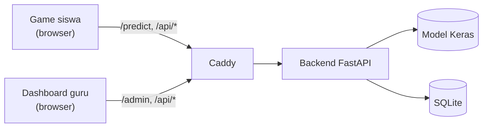

# Sketchbook Universe

Game belajar AI untuk siswa SMP kelas 7–9. Siswa menggambar objek, AI menebak (tiga tebakan beserta tingkat keyakinan), lalu **siswa yang memutuskan**: terima, koreksi, atau ganti. Keputusan itu menentukan perilaku objek di dunia game 2D. Guru memantau keputusan siswa lewat dashboard.

Repo ini menggabungkan dua pekerjaan yang tadinya terpisah:

- **Game siswa** (Can): `frontend/implementation/`
- **Backend, model, dashboard guru, dan deployment** (Dias): `backend/`, `weights/`, `frontend/admin/`, `deploy/`

> **Status: integrasi, belum rilis.** Alur kelas dari ujung ke ujung sudah jalan dan diuji. Build image Docker belum terbukti, dan perubahan kontrak antara game dan backend belum disetujui Can dan Dias. Lihat [Yang terbukti dan yang belum](#yang-terbukti-dan-yang-belum).

## Latar belakang

Siswa SMP rentan terjebak **automation bias**: menerima keluaran AI mentah-mentah tanpa menilainya. Sketchbook Universe melatih siswa memahami bahwa AI bersifat probabilistik, bisa ragu, bisa salah, dan tetap butuh keputusan manusia.

Alur inti: **gambar, AI menebak, siswa menilai, konsekuensi di game, dicatat**.

1. **Gambar.** Siswa menggambar objek di canvas.
2. **AI menebak.** Model menampilkan tiga tebakan beserta tingkat keyakinan. Momo, teman bermain siswa, menyampaikannya lewat gelembung teks.
3. **Siswa memutuskan.** Terima (Accept), koreksi label (Correct), atau tolak dan pilih sendiri (Override).
4. **Konsekuensi.** Objek berlabel yang benar menjadi penolong (solid). Objek yang salah menjadi bahaya (danger) dan siswa gagal di level itu.
5. **Gambar ulang** bukan keputusan keempat. Itu jalur pemulihan: siswa kembali ke fase menggambar.

| Level | Fokus |
|---|---|
| 1, Trust Build | Mengenalkan hubungan gambar, prediksi, dan konsekuensi |
| 2, Ambiguity | Membandingkan tiga tebakan dan tingkat keyakinannya |
| 3, Override | Berani menolak prediksi AI yang keliru |

Proyek Akhir program Sarjana Terapan Teknologi Rekayasa Multimedia, Politeknik Elektronika Negeri Surabaya (PENS). Tim: **Farchan Deano Muhammad** (desain produk dan game) dan **Muhammad Dias Al Izzat** (AI, backend, dashboard). Dosen pembimbing: Dr. Tri Budi Santoso, S.T., M.T. dan Dr. Ing. Hestiasari Rante, S.T., M.Sc. Lisensi MIT (`LICENSE.md`).

> README sebelumnya di `main` berisi rencana awal (React + Vite, Node.js + Express, TensorFlow.js di sisi klien). Implementasi sekarang berbeda: game Next.js, backend FastAPI, model Keras yang berjalan **di server**. README lama disimpan apa adanya di [`docs/history/main/README.pre-monorepo.md`](docs/history/main/README.pre-monorepo.md). Dokumen proposal tetap di folder `Proposal/`.

## Untuk Dias: baca ini dulu

1. **[`docs/architecture/README.md`](docs/architecture/README.md)** menjelaskan arsitektur, alur data, tabel database, dan keamanan, lengkap dengan diagram.
2. **Bagian 8 dokumen itu** berisi daftar file di area Dias yang berubah dan alasannya. Hanya `backend/app/classroom.py`, `db.py`, `main.py`, dan `docker-compose.yml` yang berubah. Dashboard, model, dan training tidak disentuh.
3. **[`contracts/API_INVENTORY.md`](contracts/API_INVENTORY.md)** adalah daftar endpoint dan aturan auth. **[`contracts/fixtures/`](contracts/fixtures/)** adalah contoh payload yang dicek oleh test backend dan test game, jadi kalau salah satu sisi berubah, test sisi lain gagal.
4. **[`docs/migration/UNRESOLVED.md`](docs/migration/UNRESOLVED.md)** adalah daftar keputusan yang masih menunggu.

## Cara kerjanya dalam satu gambar



Gameplay dan state machine berjalan **di browser**. Server hanya menjawab prediksi, mengurus identitas kelas dan siswa, dan menyimpan hasil. Penjelasan lengkap ada di dokumen arsitektur.

## Isi repo

```text
frontend/implementation/   game siswa (Can): Next.js static export, canvas, KAPLAY, MediaPipe
frontend/admin/            dashboard guru dan admin (Dias): Next.js
backend/                   FastAPI, SQLite, inferensi model (Dias)
weights/                   bobot model Keras (file biner asli, bukan Git LFS)
train/                     skrip training, dijalankan manual (Dias)
contracts/                 kontrak REST: API_INVENTORY.md, openapi.json, fixtures/
deploy/Caddyfile           reverse proxy
docker-compose.yml         service backend, admin, web
tests/integration/         test kontrak backend, probe runtime, seed untuk E2E
contexts/can/              governance dan konteks Can (SOUL, DECISIONS, riset, desain)
contexts/dias/             catatan dan arsip Dias
docs/architecture/         arsitektur dan diagram
docs/migration/            laporan integrasi, audit, peta file sumber, bukti pengujian
docs/history/              changelog dan dokumen lama, tidak aktif
```

Kepemilikan: `frontend/implementation/` milik Can. `backend/`, `weights/`, `train/`, `frontend/admin/` milik Dias. `contracts/`, `deploy/`, dan dokumen di root dimiliki bersama.

## Prasyarat

| Alat | Versi yang diuji | Catatan |
|---|---|---|
| Node.js dan npm | 22 dan 10.9 | Dockerfile memakai `node:20-alpine`. Belum diuji dengan 20 |
| Python | 3.13 | Dockerfile memakai `python:3.12-slim`. Belum diuji dengan 3.12 |
| TensorFlow, Keras, FastAPI | 2.21.0, 3.15.1, 0.141.1 | `backend/requirements.txt` |
| Caddy | 2.10.2 | opsional, untuk menjalankan seperti produksi |
| Docker Compose | tidak diuji | hanya `docker compose config` yang diuji |

## Menjalankan di lokal (tanpa Docker)

Semua perintah dari root repo. Empat proses terpisah: backend, game, dashboard.

**1. Backend** (port 8000):

```bash
python3 -m venv .venv && . .venv/bin/activate
pip install -r backend/requirements.txt
python backend/create_superadmin.py --email guru@contoh.test --name "Guru Uji"   # minta password
uvicorn backend.app.main:app --host 127.0.0.1 --port 8000
```

Database dibuat di `backend/data/momo.sqlite` (ubah dengan `MOMO_DB_PATH`). Model: `weights/model_4_mobilenetv2_best.keras` (ubah dengan `MODEL_PATH`).

**2. Game** (port 3000), prediksi dari backend sungguhan:

```bash
cd frontend/implementation && npm ci
NEXT_PUBLIC_PREDICTION_MODE=partner \
NEXT_PUBLIC_PREDICTION_ENDPOINT=http://localhost:8000/predict \
NEXT_PUBLIC_API_BASE_URL=http://localhost:8000 \
npm run dev -- -p 3000
```

Tanpa `NEXT_PUBLIC_PREDICTION_MODE=partner`, game memakai prediksi tiruan (mock) dan tidak memanggil model.

**3. Dashboard** (port 3002):

```bash
cd frontend/admin && npm ci
NEXT_PUBLIC_API_URL=http://localhost:8000 NEXT_PUBLIC_GAME_URL=http://localhost:3000 npm run dev
```

**4. Coba alur kelas:** buka `http://localhost:3002/login`, masuk dengan akun tadi, buat sekolah lalu kelas, salin link kelas (bentuknya `<GAME_URL>/?kelas=<token>`), buka di tab lain, pilih nomor absen, gambar, dan putuskan. Jawaban muncul di halaman kelas di dashboard.

Origin `localhost:3000` dan `localhost:3002` sudah ada di daftar CORS bawaan backend. Untuk origin lain, isi `CORS_ORIGINS`.

## Menjalankan seperti produksi

Satu pintu masuk lewat Caddy, semua satu origin, jadi CORS tidak terpakai.

```bash
# build game dan admin dengan alamat publik yang sama (contoh: http://localhost:8080)
cd frontend/implementation && NEXT_PUBLIC_PREDICTION_MODE=partner \
  NEXT_PUBLIC_PREDICTION_ENDPOINT=http://localhost:8080/predict npm run build     # hasil: out/
cd ../admin && NEXT_PUBLIC_API_URL=http://localhost:8080 NEXT_PUBLIC_GAME_URL=http://localhost:8080 \
  NEXT_BASE_PATH=/admin npm run build

# Caddyfile memakai host "backend" dan "admin" dan root /srv/game:
# arahkan nama itu ke 127.0.0.1 dan tautkan /srv/game ke frontend/implementation/out
SITE_ADDRESS=:8080 caddy run --config deploy/Caddyfile --adapter caddyfile
```

Dengan Docker Compose:

```bash
cp .env.example .env       # isi PUBLIC_URL. Jangan commit .env
docker compose config -q   # valid (sudah diuji)
docker compose up -d --build   # BELUM DIUJI: lingkungan pengujian tidak punya daemon Docker
```

## Kontrol gestur di game

Mode kamera memakai satu pembaca tangan (MediaPipe) per layar. Mode fallback memakai mouse, sentuh, dan keyboard.

| Gestur | Fungsi |
|---|---|
| Cubit (jempol + telunjuk) | Coret di kanvas. Di tutorial: cincin cubit untuk maju |
| Kepal | Hapus sebagian goresan. Tangan kedua mencubit untuk mengatur ukuran penghapus |
| Dua jari | Mundur (undo) |
| Telapak terbelah | Maju (redo) |
| Jempol, tahan 2 detik | Selesai gambar. Baru setelah itu model menebak dan Top-3 muncul |
| Telunjuk melayang di tombol ±1,2 detik | Memilih (Top-3, keputusan, layar gagal, sudut layar, Tebak, misi) |
| Gameplay: telunjuk di sepertiga kiri atau kanan, cubit tahan | Thinman ke kiri, ke kanan, lompat |

Semua ini baru terbukti dengan landmark sintetis dan test hook. Belum diuji dengan kamera fisik. Ambang gestur adalah tebakan awal dan perlu kalibrasi.

## Test

| Perintah | Membuktikan |
|---|---|
| `python -m pytest tests/integration/test_classroom_contract.py -q` | Kontrak classroom: token sesi, idempotensi, outcome, CORS, pembersihan sesi kedaluwarsa, batas titik `/predict`. 14 test |
| `python tests/integration/verify_backend.py "$PWD" /tmp/backend_verify.json` | 20 pemeriksaan runtime terhadap backend dengan **bobot model asli**. Menulis ulang `contracts/openapi.json` |
| `cd frontend/implementation && npx vitest run` | 151 file, 1144 test unit game, termasuk test kontrak dengan fixture bersama dan test pemulihan outbox |
| `cd frontend/implementation && npm run typecheck` | Tipe game |
| `cd frontend/admin && npm run typecheck` | Tipe dashboard |
| `node e2e/classroom-e2e.mjs` (dari `frontend/implementation`) | E2E classroom 17 cek: join, prediksi model asli, submit yang di-retry, database, dashboard. Butuh game ter-build, backend, dashboard, dan env di komentar awal file |
| `node e2e/normal-journey.mjs`, `node e2e/recovery-paths.mjs` | Gameplay penuh dengan prediksi tiruan (mock) |

`npm run e2e` memanggil `e2e/run.mjs` yang berstatus LEGACY. Jangan dipakai.

Menjalankan skrip Python yang mengimpor `config.py` membuat folder `data/` dan `output/` kosong di root. Hapus bila tidak perlu.

## Konfigurasi

Backend (env saat menjalankan):

| Variabel | Arti | Bawaan |
|---|---|---|
| `MODEL_PATH` | file model Keras | `weights/model_4_mobilenetv2_best.keras` |
| `MOMO_DB_PATH` | file SQLite | `backend/data/momo.sqlite` |
| `CORS_ORIGINS` | origin browser yang boleh memanggil API, dipisah koma | `localhost` port 3344, 3002, 3000 |

Game (env **saat build**, nilainya tertanam di file statis dan terlihat siapa pun):

| Variabel | Arti |
|---|---|
| `NEXT_PUBLIC_PREDICTION_MODE` | `partner` memakai backend. Selain itu memakai prediksi tiruan |
| `NEXT_PUBLIC_PREDICTION_ENDPOINT` | alamat penuh `/predict` |
| `NEXT_PUBLIC_API_BASE_URL` | alamat API untuk join dan submission. Kosong berarti origin yang sama |
| `NEXT_PUBLIC_DRAW_INPUT_MODE` | `pointer` (bawaan) atau mode kamera |

Dashboard (env saat build): `NEXT_PUBLIC_API_URL`, `NEXT_PUBLIC_GAME_URL`, `NEXT_BASE_PATH` (`/admin` di belakang Caddy).

Compose (`.env`): `PUBLIC_URL` (wajib), `SITE_ADDRESS`, `HTTP_PORT`, `HTTPS_PORT`, `DRAW_INPUT_MODE`, `MODEL_FILE`. `.env.example` hanya berisi contoh, tidak ada rahasia.

## Kontrak REST ringkas

| Endpoint | Auth | Fungsi |
|---|---|---|
| `GET /health` | tidak ada | cek hidup |
| `POST /predict` | tidak ada | Top-3 label dan confidence dari model |
| `GET /api/join/{token}` | token kelas di path | info kelas |
| `POST /api/join/{token}/students` | token kelas di path | gabung kelas, mengembalikan `student_session_token` |
| `POST /api/submissions` | Bearer token siswa | simpan keputusan. 201 `created`, atau 200 `duplicate` untuk `submission_key` yang sama |
| `PATCH /api/submissions/{id}/outcome` | Bearer token siswa | simpan hasil gameplay |
| `/api/auth/*`, `/api/schools`, `/api/classes/*` | Bearer token guru | dashboard |

Rinciannya, termasuk kode status dan perubahan terbaru: [`contracts/API_INVENTORY.md`](contracts/API_INVENTORY.md).

## Yang terbukti dan yang belum

**Terbukti** (bukti dan log di `docs/migration/evidence/`):

- Alur kelas dari ujung ke ujung, langsung dan lewat Caddy, dengan model asli.
- Retry yang aman: respons pertama sengaja dijatuhkan setelah server menyimpan, retry dijawab `duplicate`, database tetap satu baris.
- Kontrak sama di dua sisi (fixture bersama), backend 14 test, game 681 test, probe 20 pemeriksaan.
- Gameplay dengan prediksi tiruan: 3 level dan 16 skenario pemulihan.
- Dev server game dan dashboard hidup. Build produksi game dan dashboard sukses.

**Belum:**

- Build image Docker dan `docker compose up`.
- Outcome gameplay dari browser (endpoint dan client sudah diuji lewat test, belum lewat game sungguhan).
- Kamera fisik dan MediaPipe.
- Persetujuan formal Can dan Dias atas perubahan kontrak.
- Logika game dipindah ke server: belum dikerjakan, konflik dengan keputusan produk.

## Aturan kerja bersama

- Satu fitur, satu branch pendek, lewat pull request.
- Perubahan breaking di `contracts/` butuh persetujuan Can **dan** Dias, dan fixture serta `openapi.json` ikut diperbarui.
- Perubahan tampilan atau alur gameplay dikonsultasikan ke Can. Perubahan model, skema database, dan dashboard ke Dias.
- Satu `CHANGELOG.md` di root. Arsip lama di `docs/history/`.
- Jangan commit `.env`, file `*.sqlite`, atau data siswa. Database SQLite menyimpan data siswa dan kelas.
- Agen AI mulai dari [`AGENTS.md`](AGENTS.md). Bahan Can ada di `contexts/can/`, bahan Dias di `contexts/dias/`.

## Troubleshooting

- **401 saat submit:** token siswa berlaku 8 jam atau tidak ada. Siswa harus bergabung lagi. Kiriman yang tertahan karena 401 dikirim ulang otomatis setelah siswa bergabung kembali.
- **File baru di `contexts/can/` tidak ikut `git add`:** `contexts/can/.gitignore` (dari Can) mengabaikan nama seperti `scratch/`, `archive/`, `build/`, `.ops/results/`. Cek dengan `git status --ignored`, tambahkan dengan `git add -f`.
- **CORS ditolak di lokal:** tambahkan origin ke `CORS_ORIGINS`.
- **Dashboard memuat chunk lama atau kosong:** build dan proses server harus dari build yang sama. Restart proses setelah rebuild.
- **Game memakai prediksi tiruan padahal backend jalan:** `NEXT_PUBLIC_PREDICTION_MODE=partner` harus ada saat build atau saat `npm run dev`.
- **Keputusan tidak muncul di dashboard:** siswa harus masuk lewat link kelas. Di luar kelas, keputusan tidak dikirim.
- **Import Python gagal:** jalankan dari root repo, bukan dari `backend/`.

## Dokumen lain

- Arsitektur: [`docs/architecture/README.md`](docs/architecture/README.md)
- Laporan dan bukti integrasi: [`docs/migration/INTEGRATION_REPORT.md`](docs/migration/INTEGRATION_REPORT.md), [`docs/migration/evidence/`](docs/migration/evidence/)
- Asal setiap file: [`docs/migration/SOURCE_MAP.csv`](docs/migration/SOURCE_MAP.csv), [`docs/migration/SOURCE_MANIFEST.md`](docs/migration/SOURCE_MANIFEST.md)
- Status singkat: [`NOW.md`](NOW.md)
