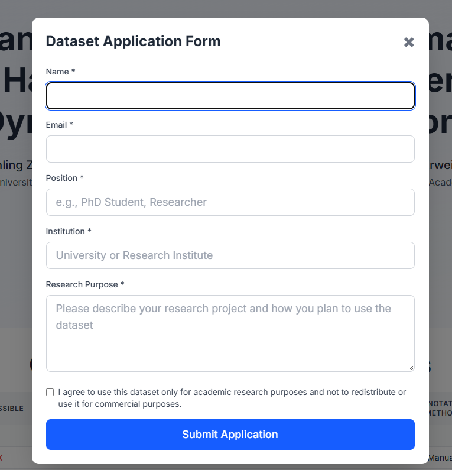
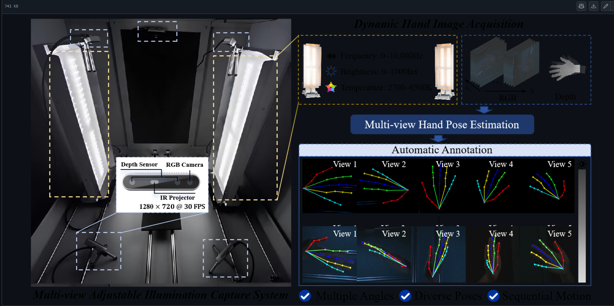

> From: https://chatgpt.com/g/g-p-6a0463ffebe08191be4fe28a4643bbad-ateng-2/c/6afd086e-fa98-83ec-9e5c-9ab57e130980

# you asked

message time: 2026-11-18 09:07:44

baca ini dulu, lu chat ke 5, jadi gw mau lanjutin yang terakhir ya dari situ. bisa ga? '[https://github.com/lustresense/hitl-momo/tree/main/contexts/can/research/.context-notforagent](https://github.com/lustresense/hitl-momo/tree/main/contexts/can/research/.context-notforagent)'

---

# chatgpt response

Bisa. Gw cek isi folder `.context-notforagent` lewat GitHub, lalu cocokkan dengan konteks keputusan dan state proyek yang ada. Setelah itu gw tentukan titik terakhir yang bisa kita lanjutkan tanpa mengarang progres.

---

# chatgpt response

**Bisa. Gw sudah berhasil mengakses dan membaca keempat arsip percakapan NUI Lab dari GitHub. Kita bisa lanjut sebagai chat ke-5 tanpa mengulang pembahasan dari nol.**

Folder yang lu kasih memang berisi empat riwayat percakapan.

1. **NUI Lab** berisi riset alternatif MediaPipe, low-light, gesture tracking, dan eksperimen awal.
2. **Cabang NUI Lab** melanjutkan pembahasan hand lock, auto-recovery, dataset, dan classifier.
3. **Cabang Cabang NUI Lab** mencakup audit implementasi, koreksi `0.22.1-alpha`, draft PR \#5, dan rekonsiliasi dokumen proyek.
4. **NUI Lab 4** melanjutkan pengelolaan branch, workflow R&amp;D, dan rancangan dokumentasi untuk agent terminal.

## Titik terakhir yang akan kita lanjutkan

Dari arsip keempat, instruksi terbaru lu adalah menyiapkan arsitektur branch `rnd` khusus R&amp;D dengan ketentuan berikut.

- Branch `rnd` independen dari `main`\.
- Hanya satu `AGENTS.md` dan satu `README.md`, keduanya di root.
- `docs/plan-rev/` menampung rencana revisi dengan status `[WIP]` dan `[DONE]`\.
- `docs/attachments/` menampung konteks dan lampiran.
- Folder `r18/`, `r19/`, dan seterusnya dikelola agent terminal berdasarkan pekerjaan sebenarnya, bukan dibuat kosong oleh ChatGPT.
- Agent terminal bertanggung jawab atas eksperimen, dokumentasi progres, dan publikasi sesuai aturan.

**Status terakhir dalam arsip** menunjukkan rancangan `AGENTS.md`, `README.md`, dan ZIP sudah diberikan, tetapi branch `rnd` belum dibuat atau di-push. Itu status berdasarkan arsip, bukan hasil audit runtime GitHub terbaru.

Sumber terakhir yang gw baca ada di [Arsip NUI Lab 4](https://github.com/lustresense/hitl-momo/blob/main/contexts/can/research/.context-notforagent/ChatGPT_NUI-Lab-4_20261118-0902/ChatGPT_NUI-Lab-4_20261118-0902.md)\.

Gw juga sudah punya baseline `SOUL.md`, `DECISIONS.md`, dan `WORKING_STATE.md` dari Project Sources. Kalau nanti status repo terbaru bertentangan dengan arsip, kita pakai bukti terbaru untuk kondisi teknis.

**Jadi, gas. Chat ini resmi kita perlakukan sebagai kelanjutan NUI Lab 5.** Lu tinggal lanjut dari instruksi terakhir tanpa perlu menjelaskan ulang sejarah empat chat sebelumnya.

### Saran update WORKING\_STATE

- **Yang berubah\:** Arsip empat percakapan NUI Lab berhasil diakses sebagai konteks lanjutan chat ke-5.
- **Bagian terdampak\:** Kontinuitas R&amp;D NUI Lab dan workflow branch `rnd`\.
- **Tindakan\:** ketik `UPDATE STATE` untuk versi lengkap pengganti `WORKING_STATE.md`\.

---

# you asked

message time: 2026-11-18 09:10:06

Jadi ini respon lu terakhir. Berarti keputusan gue buat bikin branch baru itu kayaknya enggak deh, tetap jadiin satu aja di situ. Tapi berarti harus benahin Agents MD lagi. Pokoknya Agents MD dikasih strict. Kalau misal kamu bukan ChatGPT Web, jangan akses ini. Atau pokoknya yang bukan gue suruh. Gimana ya enaknya? Gue bingung deh. Ini kan misalnya bikin branch baru kan. Tapi kayak gimana menurut lu setelah lu baca semua konteks satu sampai... oh udah lu baca semua kan tempatnya.

---

# chatgpt response

Gw condong ke satu repo dengan R&amp;D tetap terpisah dari kode produk, bukan bikin orphan branch yang berdiri sendiri. Tapi gw mau cek dulu aturan repo dan riwayat keputusan lu, karena `AGENTS.md` bisa membatasi perilaku agent, bukan benar-benar mencegah akses.

---

# you asked

message time: 2026-11-18 09:14:14

apa gini, tetep branch sendiri tapi nanti kalo udah ya merge ke situ ke reseaarch itu. gimana? jadi tetep di dalem research main itu dikaish readme yang bener dll, branch baru tetep ada namanya research-can gitu lah. gimana?

---

# chatgpt response

**Gw rekomendasikan tetap satu repository `hitl-momo`, tanpa membuat branch permanen `rnd`\.** R&amp;D MediaPipe dan NUI Lab tetap dipisahkan secara struktur folder dan aturan akses, bukan dipisahkan menjadi repository atau histori Git yang baru.

Setelah mencocokkan arsip NUI Lab dengan kondisi GitHub, menurut gw ini lebih masuk akal untuk workflow lu dan Ujang.

Ada satu hal penting yang perlu gw luruskan. Gw sudah mengakses keempat arsip percakapan dan menelusuri bagian relevannya, tapi belum membaca setiap baris dari keempat arsip secara manual. Jadi gw nggak akan mengklaim semua detailnya sudah diaudit sempurna.

## Kenapa gw nggak merekomendasikan branch `rnd` permanen?

| Pilihan | Penilaian gw |
|--------|--------|
| Branch `rnd` permanen dan orphan | Isolasi kuat, tapi dokumentasi, eksperimen, dan integrasi hasil ke produk jadi lebih merepotkan |
| Semua R&amp;D langsung bercampur dengan kode produk | Sederhana, tapi risiko agent mengubah kode game sebelum eksperimen terbukti meningkat |
| **Satu repo, folder R&amp;D terpisah, branch sementara untuk perubahan berisiko** | **Paling sesuai** dengan kebutuhan kontinuitas, eksperimen, dan kontrol perubahan lu |

Ini juga sejalan dengan kondisi repo sekarang. `main` sudah memuat NUI Lab, sementara `AGENTS.md` root punya sistem routing untuk pekerjaan CAN, Dias, dan integrasi bersama. Membuat struktur baru yang menduplikasi aturan itu justru berisiko menimbulkan konflik.

## Masalah sebenarnya ada pada akses agent

Gw cek [AGENTS.md root yang sekarang](https://github.com/lustresense/hitl-momo/blob/main/AGENTS.md)\. Isinya memang dirancang sebagai entry point universal untuk Codex, Claude Code, Antigravity, Ujang, dan agent lainnya.

Sementara folder `.context-notforagent` yang lu kasih berisi ekspor empat chat NUI Lab dan berada di **repository publik**\. README di dalam folder tersebut bahkan masih hanya berisi `tes`\.

Ini penting karena **instruksi di `AGENTS.md` bukan sistem keamanan akses**\. Agent yang patuh bisa diperintahkan agar tidak membaca folder tertentu, tetapi agent yang mengabaikan instruksi atau sudah punya akses GitHub tetap bisa membacanya.

Jadi gw bedakan dua kebutuhan lu.

- **Pembatasan perilaku agent.** Bisa lewat aturan ketat `AGENTS.md`, default deny, dan izin eksplisit per tugas.
- **Kerahasiaan arsip ChatGPT.** Harus lewat pembatasan akses nyata. Kalau benar-benar hanya ChatGPT Web yang boleh membaca, arsip itu sebaiknya dipindahkan dari repo publik ke sumber privat yang aksesnya hanya lu berikan kepada ChatGPT.

Memindahkan arsip dari branch `main` saja tidak cukup untuk menyembunyikannya, karena salinan lama dapat tetap berada di histori Git.

**Nah, skema `research-can` ini justru lebih cocok. Gw setuju pakai satu repository, dua branch dengan fungsi berbeda.** R&amp;D dikerjakan secara terisolasi di `research-can`, lalu hasil yang sudah diverifikasi dipindahkan ke `contexts/can/research/` di `main` melalui Pull Request.

Tapi jangan merge seluruh hasil eksperimen secara membabi buta.

## Arsitektur yang gw sarankan

```svg
<svg viewBox="0 0 340 280" width="100%" xmlns="http://www.w3.org/2000/svg"><rect x="65" y="8" width="210" height="42" rx="9" fill="#64748b" fill-opacity=".15" stroke="#94a3b8" /><text x="170" y="25" text-anchor="middle" fill="currentColor" font-size="12" font-weight="700">hitl-momo</text><text x="170" y="39" text-anchor="middle" fill="currentColor" font-size="10">Satu repository GitHub</text><path d="M170 50 V69 H85 V85 M170 69 H255 V85" fill="none" stroke="#94a3b8" stroke-width="1.8" /><rect x="8" y="85" width="154" height="116" rx="9" fill="#0d9488" fill-opacity=".09" stroke="#0d9488" /><text x="85" y="106" text-anchor="middle" fill="currentColor" font-size="13" font-weight="700">main</text><text x="85" y="125" text-anchor="middle" fill="currentColor" font-size="10">Produk + dokumentasi</text><path d="M25 137 H145" stroke="#94a3b8" opacity=".4" /><text x="85" y="154" text-anchor="middle" fill="currentColor" font-size="10">contexts/can/research/</text><text x="85" y="170" text-anchor="middle" fill="currentColor" font-size="10">Riset terpilih</text><text x="85" y="184" text-anchor="middle" fill="currentColor" font-size="10">dan evidence</text><rect x="178" y="85" width="154" height="116" rx="9" fill="#64748b" fill-opacity=".10" stroke="#94a3b8" /><text x="255" y="106" text-anchor="middle" fill="currentColor" font-size="13" font-weight="700">research-can</text><text x="255" y="125" text-anchor="middle" fill="currentColor" font-size="10">Workspace R&amp;D</text><path d="M194 137 H315" stroke="#94a3b8" opacity=".4" /><text x="255" y="154" text-anchor="middle" fill="currentColor" font-size="10">Plan revisi</text><text x="255" y="170" text-anchor="middle" fill="currentColor" font-size="10">Eksperimen r18, r19 ...</text><text x="255" y="184" text-anchor="middle" fill="currentColor" font-size="10">Benchmark &amp; kandidat</text><path d="M255 201 V232 H85 V201" fill="none" stroke="#0d9488" stroke-width="2" stroke-dasharray="5 4" /><rect x="103" y="221" width="135" height="24" rx="12" fill="#0d9488" /><text x="170" y="237" text-anchor="middle" fill="#fff" font-size="11" font-weight="600">Review + PR terpilih</text><text x="170" y="269" text-anchor="middle" fill="currentColor" font-size="10">Implementasi produk melalui proses terpisah</text></svg>
```

Struktur dalam `contexts/can/research/` bisa dibuat konsisten pada kedua branch.

```text
contexts/can/research/
├── README.md
├── docs/
│   ├── plan-rev/
│   └── attachments/
├── r18/
├── r19/
├── evidence-map/
├── library/
├── notes/
└── .context-notforagent/
```

`r18`, `r19`, dan folder selanjutnya dibuat oleh agent terminal sesuai kebutuhan. Contoh struktur ini bukan instruksi membuat folder kosong. Folder yang sudah ada dipertahankan dan direkonsiliasi dahulu.

## Aturan `AGENTS.md` yang paling tepat

Gw sarankan **root `AGENTS.md` tetap universal**, lalu ditambah aturan khusus untuk R&amp;D. README research menjelaskan workflow dan navigasi. Jadi tidak perlu membuat banyak `AGENTS.md` baru yang saling menduplikasi.

Kontraknya harus ketat.

1. Agent hanya mengerjakan scope yang lu instruksikan.
2. Agent wajib memeriksa branch, status Git, dan otorisasi sebelum bekerja.
3. `research-can` hanya digunakan untuk pekerjaan R&amp;D CAN yang mendapat izin.
4. Agent tidak boleh mengubah source produk, backend Dias, atau kontrak bersama tanpa izin eksplisit.
5. Semua eksperimen wajib punya evidence, status dan laporan kegagalan.
6. Tidak boleh otomatis merge, deploy, atau menghapus branch.
7. `.context-notforagent/` dilarang dibaca oleh agent terminal biasa. Tapi untuk akses yang benar-benar privat, arsipnya harus diamankan di luar repo publik.

Status `[WIP]` dan `[DONE]` di nama dokumen `plan-rev` tetap dipertahankan sesuai instruksi lu.

## Satu aturan Git yang krusial

`research-can` sebaiknya **branch biasa dari `main`, bukan orphan branch**\.

Dengan begitu, perubahan riset bisa dikirim melalui PR ke `main` tanpa memindahkan ulang seluruh struktur secara manual. Namun PR tersebut harus menyeleksi file yang memang layak dipublikasikan. Dataset mentah, cache, artefak besar, dan kandidat yang belum lolos tidak otomatis ikut masuk.

Gw cek GitHub sekarang, **branch `research-can` belum ada**\. Folder `contexts/can/research/` sudah ada di `main`, sehingga kita punya titik integrasi yang jelas.

**Verdict gw**, pakai `research-can` sebagai branch kerja R&amp;D, dan `main` sebagai sumber resmi. Jangan jadikan `research-can` tempat menumpuk perubahan tanpa batas. Setiap batch yang selesai ditinjau, lalu hanya hasil relevan yang masuk PR.

### Saran update WORKING\_STATE

- **Yang berubah\:** Lu mengusulkan mengganti rancangan orphan branch `rnd` dengan branch kerja `research-can` dalam repo yang sama, memakai `contexts/can/research/` sebagai jalur integrasi ke `main`\.
- **Bagian terdampak\:** Workflow R&amp;D, struktur dokumentasi, aturan agent, dan proses PR.
- **Tindakan\:** ketik `UPDATE STATE` untuk versi lengkap pengganti `WORKING_STATE.md`\.

---

# you asked

message time: 2026-11-18 09:20:00

kenapa ga orphan? kalo plek nanti repo gw kegedean jancok, kan enak tinggal nyuruh ai buat pindahin aja cok. PLS KASIH ALASAN YANG JELAS KONTOL OBJEKTIF TANPA BIAS TANPA YESMAN

---

# chatgpt response

**Lu punya alasan yang masuk akal buat memilih orphan branch. Gw keliru ketika sebelumnya langsung merekomendasikan branch biasa tanpa mempertimbangkan kebutuhan isolasi R&amp;D lu. Tapi ada satu asumsi teknis yang harus gw koreksi. Orphan branch tidak otomatis membuat ukuran repository GitHub lebih kecil.**

Justru untuk workflow lu, **gw sekarang lebih condong ke orphan branch `research-can`**, tetapi alasannya bukan penghematan ukuran total repository.

## 1. Perbandingan objektif

| Aspek | Branch biasa dari `main` | Orphan branch |
|--------|--------|--------|
| Mewarisi seluruh struktur file `main` | Ya, saat dibuat | Tidak |
| Menggandakan semua file secara fisik | Tidak, Git berbagi objek | Tidak |
| Histori R&amp;D terpisah dari `main` | Tidak sepenuhnya | Ya |
| Bisa berisi R&amp;D saja | Bisa, tapi perlu membersihkan snapshot awal | Bisa langsung |
| Mudah merge biasa ke `main` | Lebih mudah | Lebih sulit karena histori tidak berhubungan |
| Bisa memindahkan hasil terpilih ke `main` | Bisa | Bisa |
| Membuat ukuran total repo lebih kecil | Tidak otomatis | Tidak otomatis |
| Risiko mengikutkan perubahan eksperimen ketika merge | Ada | Bisa dihindari dengan transfer selektif |

**Poin terpentingnya adalah Git menyimpan objek, bukan salinan penuh file per branch.**

Misalnya `main` berisi 500 MB data Git dan lu membuat branch biasa dari `main`\. Itu tidak langsung menjadi 1 GB karena branch baru menunjuk ke objek yang sama.

Sebaliknya, kalau orphan branch lu menyimpan 2 GB model, dataset, dan hasil eksperimen, objek tersebut tetap tersimpan di repository GitHub yang sama. Walaupun tidak pernah di-merge ke `main`, ukuran repository tetap bertambah.

## 2. Kenapa kekhawatiran ukuran repo lu memang beralasan?

GitHub API sebelumnya melaporkan ukuran repo `hitl-momo` sekitar **1,04 GiB**\. Angka ini estimasi dari GitHub, bukan pengukuran langsung folder `.git` di VM.

GitHub sendiri merekomendasikan repository idealnya di bawah 1 GB dan sangat menganjurkan tetap di bawah 5 GB.  [GitHub Docs](https://docs.github.com/en/repositories/creating-and-managing-repositories/repository-limits?utm_source=chatgpt.com) [GitHub Docs](https://docs.github.com/en/repositories/working-with-files/managing-large-files/about-large-files-on-github?platform=linux&ref=the-mergify-blog&utm_source=chatgpt.com)

Jadi kekhawatiran lu soal repository membengkak bukan asumsi kosong.

Tapi solusi penghematannya bukan memilih orphan saja. Solusinya adalah **mengendalikan apa yang boleh di-commit ke Git**\.

Contohnya, jika eksperimen R18 menghasilkan 5 GB data, hanya source, konfigurasi, laporan, metrik, dan kandidat kecil yang perlu masuk `research-can`\. Dataset mentah, checkpoint berulang, serta cache tetap di storage eksternal dengan manifest dan checksum.

## 3. Kenapa orphan cocok untuk lu?

Karena kebutuhan lu adalah menjadikan `research-can` sebagai **workspace eksperimen independen**, bukan salinan lingkungan game.

Git sendiri mendefinisikan orphan branch sebagai cabang yang memulai histori baru tanpa parent commit.  [git-checkout Documentation](https://git-scm.com/docs/git-checkout.html?utm_source=chatgpt.com)

Dengan begitu, agent terminal cukup bekerja pada R&amp;D MediaPipe tanpa membawa struktur Next.js, backend, gameplay, dan dokumentasi lain ke working tree-nya.

Lu juga memang tidak ingin setiap eksperimen masuk ke produk. Lu ingin AI menyeleksi hasilnya terlebih dahulu.

Nah, **orphan lebih masuk akal untuk alur itu**, asalkan lu menerima bahwa integrasinya melalui penyalinan selektif atau patch, bukan merge seluruh histori.

## 4. Arsitektur pilihan gw

**`research-can`** Orphan branch

R18, R19, dataset manifest, kode eksperimen, laporan benchmark, kandidat model.

AI menyeleksi, verifikasi, izin Owner

---

**`main`** Branch produk

`contexts/can/research/` menerima dokumentasi, hasil terpilih, dan evidence yang relevan. Integrasi model atau kode runtime dilakukan lewat review terpisah.

Aturan pentingnya, `research-can` juga tidak boleh menjadi gudang seluruh eksperimen mentah, karena tetap satu Git repository.

Kalau kebutuhan lu adalah **mengisolasi storage secara fisik**, barulah repository R&amp;D terpisah benar-benar lebih unggul daripada orphan branch dalam repo yang sama.

**Verdict gw berubah dari branch biasa ke orphan branch karena kebutuhan lu adalah pemisahan workspace dan promosi hasil secara selektif. Bukan karena orphan lebih hemat storage.**

Satu langkah konkret sekarang adalah menetapkan `research-can` sebagai orphan branch dengan aturan commit yang membatasi artefak besar, dan prosedur promosi selektif ke `main`\. Jangan buat atau push dulu sebelum aturan `AGENTS.md` dan README-nya disesuaikan dengan workflow tersebut.

---

# you asked

message time: 2026-11-18 09:30:39

yaudah bikinin branchnya sama md2nya lengkap kea readme agent dll lah pokoknya aturan push apa ajanya gitu yang gimana2 gitu lah kea si agent harus lapor apa aja ke gw itu yang dipush jadi kea candidates atau apa itu di nui lab 4 chat gitu lah jancok lu modif hasil agent dan readme mereka dan langsung implement jancok bikin branch barunya gitu lah gw tinggal kasih info ke agy

---

# chatgpt response

Gw eksekusi branch orphan `research-can` sekarang, dengan `AGENTS.md`, `README.md`, aturan seleksi file, status rencana, dan format laporan wajib untuk Agy. Gw akan cek dulu isi dan aturan repo supaya branch baru ini tidak mengubah `main` atau menelan hasil eksperimen mentah tanpa seleksi.

Isi arsip NUI Lab 4 mengonfirmasi format yang lu minta. `docs/plan-rev/` dan `docs/attachments/` ada di root branch, satu `AGENTS.md` dan satu `README.md`, sedangkan `r18/`, `r19/`, dan seterusnya dibuat Agy berdasarkan artefak nyata. Gw juga sudah menguji bahwa GitHub bisa membuat commit tanpa parent, jadi branch ini bisa benar-benar orphan, bukan salinan `main`.

Branch `research-can` sudah berhasil dibuat di GitHub dan terverifikasi orphan. Commit awalnya tidak punya parent, jadi memang tidak membawa histori atau source `main`. Sekarang gw cek aturan akses folder research di `main` juga, karena lu sebelumnya minta README di sana dan pembatasan untuk arsip chat.

**Branch `research-can` sudah gw buat dan push ke GitHub sebagai orphan branch sungguhan.** `AGENTS.md`, `README.md`, `.gitignore`, serta struktur dokumentasinya sudah tersedia. `main` tetap tidak berubah.

**[research-can](https://github.com/lustresense/hitl-momo/tree/research-can)**

Orphan branch · histori terpisah dari main

(Created)

---

Commit terakhir 56f6812

Jumlah file 6

Produk main Tidak diubah

## Dokumen yang sudah tersedia

**[AGENTS.md](https://github.com/lustresense/hitl-momo/blob/research-can/AGENTS.md)**
Aturan ketat scope agent, larangan akses arsip chat, alur eksperimen, file yang boleh di-push, verifikasi, dan format laporan ke lu.

---

**[README.md](https://github.com/lustresense/hitl-momo/blob/research-can/README.md)**
Peta workspace, mapping dari VM, indeks R18 dan kandidat, status rencana, workflow Agy, serta prosedur promosi hasil riset ke `main`\.

---

**`.gitignore` dan `.gitattributes`**
Filter file sensitif, dataset mentah, database, cache, rekaman, checkpoint, dan artefak besar.

`docs/plan-rev/` dan `docs/attachments/` juga sudah dibuat. Belum ada `r18/` karena sesuai instruksi lu, Agy yang harus membuat dan mengorganisasi folder tersebut berdasarkan hasil lokal sebenarnya.

## Langsung kirim ini ke Agy

> **Chat message**
> 
> Lanjutkan pekerjaan R&D MediaPipe Optimize yang sudah ada.
> 
> Branch GitHub khusus R&D sudah disiapkan:
> 
> https://github.com/lustresense/hitl-momo/tree/research-can
> 
> **Wajib baca seluruh AGENTS.md dan README.md di branch tersebut sebelum bekerja.** Keduanya menjadi kontrak kerja untuk publikasi hasil R&D.
> 
> Instruksi pelaksanaan:
> 
> 1. Gunakan hanya branch `research-can`, yang merupakan orphan branch. Jangan mengubah `main`, branch lain, deployment, atau source eksperimen asli.
> 2. Inventarisasi dahulu seluruh isi `/srv/sketchbook/mediapipe-optimize/`, terutama `docs/plan-rev/` dan `r18-ux0-sandbox/`. Periksa hasil eksperimen R18 yang benar-benar tersedia.
> 3. Pindahkan secara selektif dokumen rencana ke `docs/plan-rev/` dan lampiran aman ke `docs/attachments/`. Pertahankan semua konten penting dan referensi aslinya.
> 4. Buat `r18/` berdasarkan artefak nyata. Organisasikan eksperimen, candidates, results, scripts, models, dan manifests sesuai kebutuhan. Jangan membuat folder revisi kosong atau README/AGENTS tambahan.
> 5. Publikasikan source kandidat, konfigurasi, script reproduksi, metrik JSON, laporan, hasil eksperimen yang gagal maupun berhasil, model card, checksum, serta manifest file yang disertakan dan dikecualikan.
> 6. Jangan upload seluruh sandbox secara mentah. Periksa ukuran, lisensi, data pribadi, secrets, dataset mentah, checkpoint besar, cache, dan database sebelum staging.
> 7. Terapkan aturan penamaan rencana `[WIP]` ketika sedang dikerjakan dan `[DONE]` hanya ketika deliverable rencana memiliki bukti yang sesuai. Dokumen tanpa prefix berarti belum dibahas.
> 8. Perbarui README root dengan indeks seluruh rencana, revisi, kandidat, hasil, evidence, blocker, dan commit relevan. Gunakan status pengujian yang benar, jangan mengklaim webcam PASS berdasarkan tes sintetis.
> 9. Commit dan push hasil terpilih hanya ke `research-can`. Pastikan remote SHA dan file yang dipublikasikan benar-benar cocok. Tidak boleh merge atau deploy.
> 10. Setelah selesai, laporkan seluruh hasil menggunakan format wajib di AGENTS.md. Sertakan URL GitHub, commit SHA, jumlah dan ukuran file, checksum, baseline, perbandingan kandidat, hasil pengujian, kegagalan, file yang dikecualikan beserta alasannya, dan next action.
> 
> Prioritaskan preservasi hasil R18 yang sudah dikerjakan. Jangan melakukan ulang eksperimen yang sudah memiliki bukti memadai hanya karena baru berpindah branch.
> 
> Jika ada konflik dengan struktur lokal atau perintah lama, utamakan instruksi ini dan kontrak branch `research-can`. Jangan melakukan operasi destruktif untuk menyelesaikan konflik.

Satu batas yang masih tersisa adalah **README di `contexts/can/research/` pada `main` belum gw ubah**\. Gw sengaja menjaga perubahan kali ini hanya di branch baru. Hasil R&amp;D juga belum diimpor atau diverifikasi dari VM Agy.

### Saran update WORKING\_STATE

- **Yang berubah\:** `research-can` dibuat sebagai orphan branch dengan dua dokumen aturan utama dan struktur dokumentasi R&amp;D.
- **Bagian terdampak\:** Workflow Agy, publikasi evidence, pengelolaan revisi, dan integrasi riset ke produk.
- **Tindakan\:** ketik `UPDATE STATE` untuk versi lengkap pengganti `WORKING_STATE.md`\.

---

# you asked

message time: 2026-11-18 09:58:35

ini kata agy '
  Jika ada konflik dengan struktur lokal atau perintah lama, utamakan instruksi ini dan kontrak branch `research-can`.
  Jangan melakukan operasi destruktif untuk menyelesaikan konflik.

○ Thought for 2m 55s (I'm thinking through how to approach this.)
● Explored 3 files (get_file_contents.json, list_commits.json, get_commit.json)
● Ran (ls -la /srv/sketchbook/mediapipe-optimize/ /srv/sketchbook/mediapipe-optimize/docs/ /srv/sketchbook/mediapip...)
… 41 more actions (4 reads, 11 edits, 12 commands, 14 tools: 1 failed) …
● Ran (sha256sum /srv/sketchbook/mediapipe-optimize/research-can/r18/manifests/SHA256SUMS.txt /srv/sketchbook/media...)
● Explored 1 file (published_vs_excluded_manifest.json) (ctrl+o to expand)

  Publikasi terkurasi hasil R&D NUI R18 ke branch orphan research-can selesai dilakukan melalui clone terpisah
  research-can, sementara file sumber asli di /srv/sketchbook/mediapipe-optimize/docs/ dan /srv/sketchbook/mediapipe-
  optimize/r18-ux0-sandbox/, serta branch main, deployment, dan database tetap tidak tersentuh.' githubnya udah dipush tuh coba cek

---

# chatgpt response

Gw cek langsung remote `research-can`, bukan cuma percaya laporan Agy. Gw audit commit terbaru, file yang benar-benar ter-push, manifest dan checksum, serta pastikan `main` tidak ikut berubah.

**Push Agy ke `research-can` berhasil. Gw sudah cek langsung ke GitHub dan menemukan commit baru beserta seluruh struktur R&amp;D R18.**

**[research-can](https://github.com/lustresense/hitl-momo/tree/research-can)** (Push terverifikasi)

Commit Agy 664de03

Tanggal commit 18 November 2026

Isi branch 68 entri Git, 54 file

Branch `main` Tidak berubah dari pemeriksaan sebelumnya

Folder `r18/` sekarang berisi `candidates`, `experiments`, `results`, `scripts`, `models`, dan `manifests`\. Rencana R18 juga sudah masuk `docs/plan-rev/` dengan status `[WIP]`, bukan ditandai selesai tanpa pengujian.

Gw lanjut periksa isi laporan dan manifestnya supaya jelas apakah Agy hanya berhasil mempublikasikan file atau evidence risetnya juga cukup kuat.

## Hasil audit isi GitHub

**Publikasi dan struktur sesuai**
Ada 57 file dengan total sekitar 1,4 MB. Ini koreksi dari hitungan awal 54 file. Manifest mencatat 51 file riset terkurasi, dan seluruh path serta ukurannya cocok dengan file di remote.

**File besar berhasil dikecualikan**
Manifest mencatat 12 item, total sekitar 3,77 GB, termasuk dataset mentah, virtual environment, dan build. Status penyimpanan lokalnya masih berdasarkan laporan Agy.

**Dokumentasi dan checksum konsisten**
Ada 52 entri dalam `SHA256SUMS.txt`, yaitu 51 file riset dan manifest publikasi. Nilai hash yang dicantumkan konsisten antardokumen. Gw belum menghitung ulang seluruh hash dari byte file.

## Hasil R&amp;D yang berhasil dipublikasikan

Berdasarkan [R18 Master Report](https://github.com/lustresense/hitl-momo/blob/research-can/r18/results/R18_MASTER_REPORT.md) dan [Model Card UX3](https://github.com/lustresense/hitl-momo/blob/research-can/r18/models/MODEL_CARD.md) yang ditulis Agy.

| Eksperimen | Hasil yang dilaporkan |
|--------|--------|
| UX1 | Koreksi sudut, FSM kontrol, dan pengamanan aksi lolos pengujian offline yang ditentukan |
| UX2 | Deteksi pada subset DimLight naik dari 52,08% menjadi 64,58% |
| UX3 | Model MLP berukuran 123 KB, akurasi test 80,45%, Macro-F1 61,56% |
| UX4 | Dataset DimHand masih terhalang lisensi, akses, dan storage |
| UX5 | Simulasi browser 180 detik, 2.271 frame, sekitar 12,59 FPS pada CPU headless |

**Masih ada masalah nyata.** UX3 belum menghilangkan false swipe sepenuhnya, terdapat kasus false erase, dan browser mencatat 2.057 Long Tasks. Pengujian webcam fisik juga belum dilakukan. Jadi hasil ini belum cukup untuk menyatakan NUI sudah akurat dan nyaman digunakan siswa SMP.

Gw belum mereproduksi eksperimen tersebut sendiri. Angka di atas merupakan hasil yang dilaporkan Agy dalam artefak GitHub.

## Verdict

**Untuk tugas publikasi R18, Agy sudah menjalankan instruksi dengan benar berdasarkan bukti remote.** Pemilahan artefak, struktur file, status WIP, dokumentasi kandidat, dan pelaporan sudah tersedia.

Tapi pekerjaan R&amp;D sendiri **belum selesai**\. Jangan merge ke `main` dulu.

Langkah berikutnya adalah menguji kandidat UX3 dengan kamera fisik, terutama lima jari, tiga jari, pinch, low-light, distraksi benda, dan kontrol Thinman. Checklist-nya sudah tersedia di [Physical Webcam Test Protocol](https://github.com/lustresense/hitl-momo/blob/research-can/docs/attachments/OWNER_PHYSICAL_WEBCAM_TEST_PROTOCOL.md)\.

### Saran update WORKING\_STATE

- **Yang berubah\:** Publikasi R18 ke `research-can` terverifikasi pada commit `664de03`\. Artefak, manifest, kandidat, dan laporan tersedia. Webcam fisik belum diuji.
- **Bagian terdampak\:** Workflow R&amp;D Agy, hasil UX0 sampai UX5, dan blocker verifikasi kamera.
- **Tindakan\:** ketik `UPDATE STATE` untuk versi lengkap pengganti `WORKING_STATE.md`\.

---

# you asked

message time: 2026-11-18 10:02:36

Kalau itu semua udah, gue nggak perlu benahin lagi. Kan itu dia taruh README itu. Kalau lo baca di main dua, di mainnya branch main itu kan ada now.md. Nah itu apa terakhir yang dikerjakan, dan rujuk ke change log dan versioning dan lain-lain gitu lah. Nah karena ini research atau R&D, jadi bikin aja log.md atau nggak usah MD, pokoknya log aja yang itu harus di-update sama si agent, dan lo benahin juga di agents MD untuk selalu benahin log dan status terbaru. Jangan bikin now.md, tapi emang benar di README aja dan itu sekilas. Dan itu di README langsung merujuk ke log, file log. Log ini bebas, menurut lo yang enak dan gampang, log.md atau log biasa kayak file version yang ada di main, coba. terus krn ya sekarang lu aja yang benahin dah, atau ya suuruh agy benahin nanti kasih gw promptnya. Terus ini, masa RND kita berhenti di sini di R18? nggak ada celah lagi dan nggak bisa kita coba nih ke NUI Lab yang ada di, mana namanya, di main, dan biar ditarik ujung buat gue cobain langsung gitu loh. Katanya udah di-training juga. Apakah udah di-training dan lain-lain? Lu ingat tujuan awal kita, Prisma? Kan ada log dari obrolan kita yang ada empat konteks gitu. Masa lu lupa sih?

---

# chatgpt response

Gw benahin `research-can` langsung. Gw akan bikin satu log kronologis yang wajib diperbarui Agy, dengan README cukup menampilkan status singkat dan tautan ke log. Sekalian gw audit bukti training R18, tujuan awal dari empat chat NUI Lab, dan jalur aman buat menguji kandidatnya di NUI Lab `main` lewat Ujang.

Gw nemu celah yang penting. NUI Lab di `main` memang sudah punya toggle eksperimen, tetapi itu masih mengubah aturan heuristik lama, bukan menjalankan MLP UX3 yang baru di-training. Jadi untuk ngetes hasil R18, kita perlu sambungkan model dan pipeline kandidatnya secara eksplisit, tanpa mengganti kontrol game siswa.

Tujuan R18 dari dokumen v0.3.0 ternyata tegas. Prioritasnya keamanan aksi, kelancaran canvas/Momo/Thinman, ketahanan low-light dan distraksi, kontrol yang terasa seperti keyboard, lalu total unduhan awal di bawah 25 MB. Gw akan jadikan itu acceptance untuk pilot NUI Lab, bukan cuma mengejar angka akurasi classifier.

---

# you asked

message time: 2026-11-18 10:08:36

ya anjing di main itu ada routing /nui-lab jancok maksud gw layak ga buat masuk situ anjing

---

# chatgpt response

**R18 bukan titik berhenti R&amp;D kita. Kandidatnya sudah layak masuk tahap uji langsung di NUI Lab, tetapi belum layak menggantikan kontrol game utama.** Dan benar, gw perlu menghubungkan lagi hasil riset ini dengan tujuan awal lu, bukan berhenti di urusan publikasi GitHub.

## 1. Apakah modelnya sudah di-training?

**Ya. Agy melaporkan training classifier tambahan yang hasilnya sudah di-push ke `research-can`\.** Artefak model, kode training, metrik, dan model card memang ada di GitHub.

| Komponen | Status |
|--------|--------|
| MediaPipe Hand Landmarker | Tetap fondasi pendeteksi tangan |
| Classifier tambahan MLP UX3 | Sudah ada hasil training dan bobot JSON |
| Evaluasi IPN HandS | Ada hasil test dengan pemisahan subjek |
| Evaluasi low-light Mendeley | Ada hasil pengujian dataset |
| Pengujian browser | Ada simulasi video 180 detik |
| Webcam fisik lu | Belum diuji |
| Integrasi UX3 ke NUI Lab `main` | Belum |

Akurasi classifier UX3

# 80,45%

Test IPN HandS

Ukuran model MLP

# 123 KB

JSON tanpa kompresi

Angka tersebut berasal dari laporan training Agy, bukan pengukuran ulang gw. Model yang di-training adalah **pengenal gesture dari landmark MediaPipe**, bukan retraining bobot `hand_landmarker.task` milik MediaPipe.

Artinya, training UX3 berpotensi membantu klasifikasi gesture, tetapi **tidak otomatis menyelesaikan kegagalan MediaPipe mendeteksi tangan saat cahaya buruk**\.

## 2. Sistem LOG untuk R&amp;D sudah gw implementasikan

Gw memilih **`LOG.md`**, bukan file log polos atau `VERSION` terpisah. Alasannya karena R&amp;D perlu mencatat eksperimen, kandidat, kegagalan, bukti dan keputusan pengujian, bukan sekadar nomor versi produk.

Perubahan di `research-can` (Sudah di-push)

Commit `36642cb`

---

[LOG.md](https://github.com/lustresense/hitl-momo/blob/research-can/LOG.md)

Riwayat terbaru di atas, bukti R18, masalah tersisa, dan langkah berikutnya.

[AGENTS.md](https://github.com/lustresense/hitl-momo/blob/research-can/AGENTS.md)

Sekarang mewajibkan pembaruan LOG dan README dalam commit yang sama untuk setiap publikasi R&amp;D.

[README.md](https://github.com/lustresense/hitl-momo/blob/research-can/README.md)

Dipersingkat menjadi status terkini, peta folder, kandidat utama, dan tautan ke LOG.

Gw tidak membuat `NOW.md` dan tidak mengubah versioning produk di `main`\. Aturannya sekarang jelas, **setiap push R&amp;D wajib memperbarui `LOG.md` dan status singkat README**\. Itu kewajiban agent, belum proteksi otomatis di server GitHub.

**LAYAK, cok. UX3 hasil training R18 sudah layak dimasukkan ke `/nui-lab` di branch `main` sebagai kandidat eksperimen yang bisa lu coba langsung lewat webcam.** Justru itulah fungsi NUI Lab. Kita nggak perlu menunggu pengujian webcam selesai sebelum memasukkannya ke lab.

Yang **belum layak** adalah menjadikan UX3 sebagai pengganti sistem gesture game siswa.

Gw sudah cek source `/nui-lab` di `main`\. Saat ini toggle eksperimennya masih membandingkan **heuristik baseline dengan heuristik R17**, belum menggunakan MLP UX3 yang baru dilatih Agy.

## Implementasi yang tepat

Gw sarankan NUI Lab punya tiga mode.

| Mode | Fungsi |
|--------|--------|
| Baseline | Gesture game saat ini |
| R17 | Heuristik eksperimen sebelumnya |
| **R18 UX3** | MediaPipe + MLP terlatih + safety guards UX1 |

Kandidat R18 juga membawa UX2 untuk preprocessing low-light, jadi itu bisa diuji melalui pengaturan RAW dan adaptive CLAHE secara terpisah.

Di `/nui-lab/gesture` lu bisa menguji lima jari, tiga jari, pinch, distraksi, dan hand lock. Di `/nui-lab/canvas` lu bisa menguji respons cursor, menggambar, menghapus, dan kestabilan interaksi. Kontrol Thinman perlu diuji dalam lingkungan gameplay lab yang terisolasi, bukan langsung mengubah level siswa.

## Kenapa gw bilang layak?

Ada tiga bukti pendukung.

1. Model UX3 sudah mempunyai bobot JSON 123 KB, kode inference TypeScript, feature extractor, dan hasil evaluasi offline.
2. Simulasi browser 180 detik sudah dijalankan dan dicatat Agy, meskipun masih ada masalah performa CPU.
3. Source NUI Lab sudah mempunyai jalur eksperimen, diagnostik, dan pengujian kamera yang bisa diperluas.

Tapi ada tiga risiko yang wajib terlihat dalam pengujian.

- False swipe masih muncul pada beberapa gerakan.
- Ada kasus false erase dari landmark palsu.
- Kelancaran di perangkat fisik belum terbukti, sementara simulasi CPU hanya menghasilkan sekitar 12,59 FPS.

**Jadi keputusan teknis gw adalah GO untuk pilot NUI Lab, NO-GO untuk gameplay produksi.**

Langkah konkretnya adalah membuat integrasi R18 UX3 secara terisolasi di NUI Lab, dengan pemilihan mode dan metrik A/B, lalu menjalankan typecheck, test, build, dan menyerahkan deploy tunnel ke Ujang. Setelah lu mencoba webcam langsung, kita pakai hasilnya untuk menentukan apakah R18 perlu diperbaiki atau bisa dipromosikan.

Tidak perlu membuat R19 hanya karena R18 belum sempurna. **Selesaikan validasi R18 lewat NUI Lab dulu.** Itu lebih tepat daripada terus melatih model tanpa pernah mengujinya pada kondisi kamera lu.

---

# you asked

message time: 2026-11-18 10:10:00

berarti ini dah di train kah? jujur kasih gw ringkasan wkwk kan teksnis2 kalian berua aja yang saling ngobrol, intinya agy ini udah ngerjain apa aja dan apa bedanya sama sebelumnya

---

# chatgpt response

**WKWK iya, cok, Agy beneran sudah melakukan training AI baru, bukan cuma riset atau utak-atik angka.** Tapi yang dilatih itu **otak tambahan untuk mengenali gesture**, bukan model utama MediaPipe.

Bayangin sistemnya begini.

- **MediaPipe** melihat tangan dan menentukan posisi 21 titik jari.
- **AI hasil training Agy (MLP)** membaca titik-titik tersebut untuk membantu mengenali gerakan tangan.
- **Safety rules** memutuskan apakah gerakan itu benar-benar boleh menjalankan aksi, misalnya menghapus gambar atau menggerakkan Thinman.

Jadi Agy nggak mengganti MediaPipe. Dia mencoba membuat sistem yang sudah ada lebih pintar, aman, dan nyaman dipakai.

## 1. Apa aja yang Agy kerjakan?

| Tahap | Pekerjaan Agy | Bedanya dari sebelumnya |
|--------|--------|--------|
| UX0 | Mengaudit sistem lama dan mencari sumber kesalahan gesture | Sebelumnya masalah hanya terlihat dari pengalaman lu. Sekarang ada baseline pengujian |
| UX1 | Memperbaiki perhitungan arah jari, aturan keamanan, hand tracking, dan kontrol Thinman | Gerakan tangan tidak langsung diterjemahkan menjadi aksi tanpa pemeriksaan |
| UX2 | Menguji pemrosesan gambar untuk kondisi gelap | Sistem mencoba gambar asli terlebih dahulu, lalu enhancement kalau diperlukan |
| UX3 | **Melatih AI classifier MLP baru** dengan dataset IPN HandS | Bukan hanya aturan `if-else`, sekarang ada model terlatih yang membantu membaca pola gesture |
| UX4 | Meneliti dataset tambahan termasuk DimHand | Belum dipakai karena kendala akses, lisensi, dan storage |
| UX5 | Menjalankan simulasi kamera di browser selama 180 detik | Ada pengukuran performa browser, meskipun belum memakai webcam lu |

## 2. Apa hasil training AI-nya?

Agy menggunakan data landmark gesture dari **IPN HandS**, dengan pemisahan orang untuk training, validasi, dan pengujian.

Hasil training UX3 yang dilaporkan Agy

# 80,45%

Akurasi test

# 61,56%

Macro-F1

# 123 KB

Ukuran model

---

Model mengenali enam kelompok perilaku, termasuk satu jari, dua jari, kepalan, gerakan swipe, dan gesture membuka tangan. Gesture lima jari untuk menghapus masih dibantu aturan khusus, bukan dipelajari sebagai kelas tersendiri.

Sumber [Model Card UX3](https://github.com/lustresense/hitl-momo/blob/research-can/r18/models/MODEL_CARD.md)\.

## 3. Apa bedanya dengan AI sebelum Agy?

Nah, ini penting. **Sebelum Agy R18, R17 sebenarnya juga sudah pernah melakukan training model LR dan MLP.** Jadi bukan pertama kalinya proyek lu melatih classifier gesture.

Perbedaannya, R17 lebih fokus pada perbaikan pembacaan jari dan eksperimen classifier menggunakan landmark HaGRIDv2. R18 memakai IPN HandS dengan fitur gerakan temporal, pengujian antarorang, dan menggabungkan model terlatih dengan pengamanan aksi.

Angka akurasi R17 dan R18 **nggak boleh langsung dibandingkan**, karena dataset, kelas, dan skenario evaluasinya berbeda.

## 4. Apakah hasilnya benar-benar lebih bagus?

Di beberapa skenario pengujian Agy, iya.

**Contoh hasil yang dilaporkan dari evaluasi offline**

Deteksi tangan kondisi redup 52,08% → 64,58%

False erase pada gesture NOG 22,12% → 0,76%

Hasil pada subset dataset dan protokol Agy, bukan tingkat keberhasilan webcam siswa secara umum.

Namun masih ada false swipe, sesekali false erase, dan masalah performa saat MediaPipe dijalankan di CPU.

## 5. Jadi kita sekarang sampai mana?

**Model tambahan sudah dilatih dan bobotnya tersedia**

**Source eksperimen dan hasil evaluasi sudah di GitHub**

**Simulasi browser sudah dilaporkan berjalan**

**Belum dipasang ke `/nui-lab` di `main`**

**Belum dibuktikan dengan webcam lu secara langsung**

Jadi, **Agy sudah berhasil menghasilkan kandidat AI baru yang bisa kita coba, bukan sekadar proposal riset.** Bukti training-nya ada, tetapi gw belum menjalankan ulang training tersebut secara independen.

Sekarang langkah paling masuk akal adalah memasang kandidat R18 ke `/nui-lab` sebagai mode ketiga, sehingga lu bisa langsung membandingkan sistem lama, R17, dan R18 menggunakan kamera yang sama.

Di situlah kita baru bisa tahu apakah kerja Agy benar-benar terasa lebih bagus buat lu, bukan cuma bagus di angka benchmark.

---

# you asked

message time: 2026-11-18 10:11:43

lah gw kira udah pake dimhand anjay kenapa belum dah?? kan butuh banget ini. sekalian yang pasti aja cok biar gw cobain yang langsung gitu

---

# chatgpt response

Sumber resmi DimHand memastikan formulir akses memang wajib dan hanya mengizinkan penggunaan riset akademik nonkomersial, tanpa redistribusi. Jadi Agy nggak bisa secara sah langsung mengambilnya untuk training produk.  [hanlingzhan.github.io](https://hanlingzhan.github.io/DimHand/?utm_source=chatgpt.com)

Untuk yang bisa lu coba sekarang, gw fokus ke pilot R18 dengan model terlatih yang sudah tersedia. Batasnya jelas, hasil offline sudah ada, tetapi browser dan webcam asli masih perlu dibuktikan.

Gw akan buat pilot terpisah di route `/nui-lab/r18`, supaya code dan model UX3 benar-benar bisa menerima webcam, sementara `/nui-lab/gesture`, canvas, dan gameplay lama tetap aman. Ini belum berarti DimHand sudah digunakan. Untuk deploy, Ujang tetap perlu menjalankan build dan verifikasi di server karena gw nggak punya akses runtime VM-nya.

Model dan kode UX3 sudah gw salin ke branch pilot terpisah dari `main`, termasuk bobot JSON yang dilatih Agy. Gw sedang menghubungkannya ke kamera NUI Lab. Ini jalur uji nyata, bukan training ulang, dan perubahan belum masuk `main` atau deployment.

**DimHand ternyata belum dipakai Agy, dan itu memang celah dari R18.** Model UX3 sudah dilatih, tetapi menggunakan dataset IPN HandS, bukan DimHand.

Dari laporan Agy, ada tiga hambatan.

1. **Akses dataset DimHand perlu permohonan**, bukan tinggal download bebas.
2. **Lisensinya membatasi penggunaan dan redistribusi**, sehingga perlu dibedakan riset akademik dengan pemakaian model dalam produk.
3. **Storage VM terbatas**, sementara ukuran lengkap dataset belum terkonfirmasi.

Satu hal penting, **DimHand itu dataset untuk melatih dan mengevaluasi model pada kondisi low-light, bukan model siap pakai yang tinggal dipasang ke kamera.** Jadi walaupun kita berhasil mendapat datasetnya, belum tentu tracking di webcam lu langsung membaik.

Gw akan cek ulang syarat DimHand dari sumber aslinya, sekaligus menyiapkan jalur uji R18 UX3 di `/nui-lab` supaya lu bisa merasakan hasil yang sudah tersedia, tanpa menunggu akses DimHand.

## Status implementasi untuk dicoba

Gw sudah membuat branch pilot [nui-r18-ux3-live-lab](https://github.com/lustresense/hitl-momo/tree/nui-r18-ux3-live-lab) yang berasal dari `main`, bukan merge seluruh `research-can`\.

Di dalamnya sudah ada\:

- Route baru `/nui-lab/r18`, dengan tautan dari halaman NUI Lab.
- Model MLP UX3 asli dari hasil training Agy.
- Pipeline gesture dan safety guard R18.
- Tampilan webcam untuk melihat prediksi R17 dan UX3 pada frame yang sama.
- Indikator calon aksi Hapus, Pinch, Swipe, dan arah gerak.

**Statusnya masih source pilot, belum live di tunnel dan belum lolos build.** Mode awal hanya mengamati hasil, jadi kesalahan prediksi tidak langsung menghapus gambar atau menggerakkan Thinman.

Gw juga sudah membuka **[Draft PR #6](https://github.com/lustresense/hitl-momo/pull/6)** untuk Ujang, dan memperbarui [LOG.md research-can](https://github.com/lustresense/hitl-momo/blob/research-can/LOG.md) agar pekerjaan pilot ini tercatat.

## Supaya lu bisa mencoba lewat browser

> **Chat message**
> 
> Ujang, ambil draft PR #6 berikut.
> 
> https://github.com/lustresense/hitl-momo/pull/6
> 
> Baca handoff `NUI_R18_UX3_LIVE_LAB_HANDOFF_2026-11-18.md`.
> 
> Gunakan checkout terisolasi. Jalankan typecheck, lint, targeted Vitest, dan production build. Perbaiki error pada branch pilot jika ada, lalu verifikasi route `/nui-lab/r18`, loading bobot MLP, kamera ON/OFF, hand lock, dan seluruh indikator.
> 
> Jika lolos, **deploy sebagai preview terisolasi** dan kirim URL HTTPS yang bisa saya buka langsung dengan webcam laptop. Jangan merge ke `main`, jangan mengubah deployment game aktif, dan jangan mengaktifkan aksi UX3 di gameplay.
> 
> Laporkan hasil tes, commit SHA, URL preview yang benar-benar dapat diakses, serta masalah yang belum terselesaikan.
> 
> DimHand belum digunakan. Prioritas pertama adalah membuktikan UX3 di kamera nyata, terutama low-light, backlight, tiga/lima jari, pinch, distraksi benda, dan false action.

## Lalu bagaimana dengan DimHand?

[Formulir akses DimHand resmi](https://hanlingzhan.github.io/DimHand/)

Lu perlu mengajukan akses menggunakan identitas akademik dan tujuan penelitian yang sebenarnya. Situs resminya mewajibkan persetujuan penggunaan untuk riset akademik nonkomersial dan melarang redistribusi. Itu **bukan berarti penelitian PA lu otomatis dilarang**, tetapi izin dan batas penggunaan model turunannya perlu diperjelas sebelum training atau publikasi.  [hanlingzhan.github.io](https://hanlingzhan.github.io/DimHand/?utm_source=chatgpt.com)

**Kesimpulannya, lu sekarang punya dua jalur yang tidak perlu saling menunggu.** Pilot UX3 untuk dicoba langsung setelah Ujang memverifikasi dan menyediakan preview, sementara permohonan akses DimHand berjalan terpisah untuk riset low-light yang lebih mendalam.

### Saran update WORKING\_STATE

- **Yang berubah\:** Pilot R18 UX3 sudah disiapkan pada branch `nui-r18-ux3-live-lab`, draft PR \#6, dan LOG R&amp;D diperbarui. DimHand tetap belum diakses.
- **Bagian terdampak\:** R&amp;D NUI, pengujian webcam, integrasi kandidat, workflow Ujang, dan blocker dataset.
- **Tindakan\:** ketik `UPDATE STATE` untuk versi lengkap pengganti `WORKING_STATE.md`\.

---

# you asked

message time: 2026-11-18 10:29:56



reponya gabisa dibuka cok lag banget, emang reponya isi apa? terus bantu gw isi ini dong gw mahasiswa semester akhir sedang riset gitu lah. terus apa ya, buruan cok sma prompt yang baru lu kasih ini gw harus kasih ke agy apa nunggu ini dulu?

---

# chatgpt response

**Isi formulir DimHand sekarang, dan prompt yang kemarin langsung kasih ke Ujang, bukan Agy.** Dua pekerjaan itu independen, jadi nggak perlu menunggu akses dataset.

## 1. Kenapa repo DimHand berat banget?

Gw sudah buka [repository DimHand](https://github.com/HanlingZhan/DimHand) lewat GitHub.

Ternyata isinya **bukan source code training DimNet yang siap dijalankan**\. Yang tersedia sekarang terutama README, website HTML, gambar hasil eksperimen, diagram arsitektur, dan `supp.pdf`\.

Ada gambar `Fig_sota.png` berukuran sekitar **24 MB**, yang bisa ikut membuat tampilan repo terasa berat.

Repo tersebut menjelaskan DimHand, yaitu dataset dengan 745.280 frame, 15 subjek, 5 sudut kamera, dan pencahayaan 0,1 sampai 10 lux. Dataset lengkap dan bobot model siap pakai tidak terlihat dalam daftar file repo tersebut.  [HanlingZhan/DimHand · GitHub](https://github.com/HanlingZhan/DimHand?utm_source=chatgpt.com) [hanlingzhan.github.io](https://hanlingzhan.github.io/DimHand/?utm_source=chatgpt.com)

Kalau GitHub lemot, buka [README mentah DimHand](https://raw.githubusercontent.com/HanlingZhan/DimHand/main/README.md) saja.

## 2. Isi formulirnya begini

| Kolom | Isi |
|--------|--------|
| **Name** | Nama lengkap lu sesuai identitas akademik |
| **Email** | Email kampus lu, lebih bagus kalau tersedia |
| **Position** | `Final-year Undergraduate Student` |
| **Institution** | `Politeknik Elektronika Negeri Surabaya (PENS), Indonesia` |

Untuk **Research Purpose**, langsung copy teks Inggris ini.

> **Standard**
> 
> I am a final-year undergraduate student at Politeknik Elektronika Negeri Surabaya (PENS), Indonesia, conducting non-commercial academic research for my final-year project, Sketchbook Universe, an interactive educational application designed to introduce AI literacy to middle-school students.
> 
> My research focuses on Human-Computer Interaction (HCI), hand gesture recognition, and improving the robustness of MediaPipe-based hand tracking under challenging real-world lighting conditions, particularly dim indoor lighting, overhead lighting, and backlighting.
> 
> I would like to use the DimHand dataset to evaluate hand detection and landmark stability under low-light conditions, compare image enhancement and tracking approaches, and investigate potential improvements to gesture recognition and interaction reliability.
> 
> The dataset will be used strictly for academic research and evaluation. I will respect the dataset's usage restrictions, maintain data confidentiality, and will not redistribute the dataset or use it for commercial purposes.

**Checkbox persetujuan** boleh lu centang kalau lu memang berkomitmen memakai DimHand hanya untuk penelitian akademik nonkomersial tanpa redistribusi. Itu syarat yang tertulis pada formulir resminya.  [hanlingzhan.github.io](https://hanlingzhan.github.io/DimHand/?utm_source=chatgpt.com)

Penting, kalau nantinya lu ingin memakai bobot yang dilatih dari DimHand dalam produk publik, jangan otomatis menganggap izin akademik ini mencakup penggunaan tersebut. Perlu klarifikasi kepada pemilik dataset.

## 3. Terus Agy atau Ujang dulu?

| Siapa | Sekarang ngapain? |
|--------|--------|
| **Lu** | Submit formulir DimHand |
| **Ujang** | Terima prompt sebelumnya untuk verifikasi dan preview `/nui-lab/r18` dari PR \#6 |
| **Agy** | Belum perlu training DimHand. Akses dataset belum diterima |

Jadi **kasih prompt sebelumnya ke Ujang sekarang**\. Dia yang bertugas membuat pilot R18 bisa lu buka lewat browser untuk pengujian langsung.

Agy nanti menangani evaluasi DimHand di `research-can` setelah akses diberikan, termasuk pemeriksaan lisensi, kebutuhan storage, dan pemilihan subset RGB yang relevan.

**Satu hal yang perlu lu ingat.** Training yang sekarang sudah dilakukan Agy menggunakan IPN HandS. DimHand adalah calon bahan penelitian lanjutan untuk mengatasi masalah low-light yang belum terselesaikan. Jangan mencampur status keduanya.

### Saran update WORKING\_STATE

- **Yang berubah\:** Repository DimHand telah diperiksa. Dataset dan bobot model tidak tersedia langsung di repo publik. Formulir akses akademik disiapkan, tetapi belum terbukti diubmit.
- **Bagian terdampak\:** R&amp;D low-light, akses dataset, dan pembagian tugas Agy/Ujang.
- **Tindakan\:** ketik `UPDATE STATE` untuk versi lengkap pengganti `WORKING_STATE.md`\.

---

# you asked

message time: 2026-11-18 10:32:30



bentar cok ini pake deepcam depthcam anjing, gw pake cam biasa webcam masa masih bisaa????????

---

# chatgpt response

**BISA, cok. DimHand tetap bisa dipakai buat riset webcam biasa tanpa depth camera.** Tapi ada batas penting. Kita bisa memanfaatkan **gambar RGB-nya**, bukan mengandalkan depth sensor saat aplikasi berjalan.

Dari gambar yang lu kirim, peneliti menggunakan kamera RGB-D untuk **mengumpulkan dataset dan menghasilkan anotasi 3D yang akurat**\. Itu bukan berarti setiap sistem yang menggunakan dataset DimHand wajib memiliki depth camera.

Bedanya begini.

|  | Peneliti DimHand | Sketchbook Universe |
|--------|--------|--------|
| Kamera | RGB + Depth | Webcam RGB biasa |
| Tujuan | Mengumpulkan data dan anotasi 3D | Mendeteksi tangan dan membaca gesture |
| Input aplikasi | RGB dan depth untuk proses penelitian tertentu | RGB saja |
| MediaPipe | Tidak wajib mengikuti arsitektur DimHand | Tetap pendeteksi 21 landmark |
| Perlu beli depth camera? | Untuk mereplikasi setup pengumpulan data | **Tidak** |

Jadi lu nggak perlu membeli RealSense atau kamera khusus hanya untuk mencoba kandidat low-light pada webcam laptop.

## Nah, ini yang menentukan buat proyek lu

Situs resmi DimHand menjelaskan bahwa depth dipakai dalam proses pembuatan anotasi yang dibantu beberapa sudut kamera. Peneliti juga mengembangkan **DimNet untuk estimasi pose tangan berbasis RGB** pada kondisi cahaya rendah.  [hanlingzhan.github.io](https://hanlingzhan.github.io/DimHand/?utm_source=chatgpt.com)

Alur yang relevan buat kita adalah

**Webcam RGB biasa milik siswa**

**MediaPipe + kandidat pemrosesan low-light**

**21 landmark + classifier gesture**

**Interaksi NUI Sketchbook Universe**

Dataset DimHand bisa digunakan untuk menguji dan meneliti peningkatan pada tahap deteksi atau pemrosesan RGB. Tetapi **kita belum membuktikan bahwa hasil adaptasinya akan lebih baik pada webcam biasa**\. Sensor, exposure, noise, dan kualitas gambar kamera laptop bisa berbeda dari kamera penelitian.

Ada satu jebakan juga. Kalau MediaPipe sama sekali gagal menghasilkan landmark saat gelap, classifier UX3 yang sudah dilatih Agy tidak bisa memperbaikinya sendirian.

**Verdict gw, lanjutkan permohonan DimHand. Lu nggak butuh depth camera.** Kita utamakan eksperimen RGB-only, dan hasilnya tetap harus diuji dengan webcam biasa.

Sementara itu, **Ujang tetap bisa menjalankan pilot R18 yang sudah ada tanpa menunggu DimHand**\. Itulah cara paling cepat mengetahui masalah nyata di kamera lu sebelum menghabiskan sumber daya untuk training berikutnya.

---

# you asked

message time: 2026-11-18 10:33:33

gini gimana 'Final-year Undergraduate Student in Research'

---

# chatgpt response

Bisa dipahami, tapi **“Final-year Undergraduate Student in Research”** kurang natural dalam bahasa Inggris akademik.

Gw rekomendasikan pakai

**`Final-year Undergraduate Student (Undergraduate Researcher)`**

Ini lebih jelas karena lu mahasiswa tingkat akhir yang sedang melakukan penelitian untuk proyek akhir.

Kalau mau lebih singkat dan formal, **`Final-year Undergraduate Researcher`** juga bagus.

**Pilihan gw untuk kolom Position di formulir DimHand adalah `Final-year Undergraduate Researcher`.**

---

# you asked

message time: 2026-11-18 10:34:43

nah ini isi formnya benahin lagi, spesifik bilang webcamm atau pake yang dari lu dulu ya? biar ga langsung dibantah mereka dan biar mereka kasih gw datasetnya, urusan feasible atau engga ya gw aja yang tentuin cok gw yang cobain kok

---

# chatgpt response

**Gw pilih versi yang spesifik menyebut webcam RGB biasa, tapi fokus utamanya tetap evaluasi akademik low-light.** Ini lebih kuat daripada versi sebelumnya karena peneliti DimHand jadi tahu kenapa dataset mereka relevan buat riset lu.

Jangan menulis seolah-olah lu sudah memastikan DimHand kompatibel dengan MediaPipe atau bakal meningkatkan performa webcam. Justru itu yang mau lu teliti. Kita juga nggak perlu membahas rencana deployment produk karena permohonannya khusus penelitian akademik nonkomersial.

## Isian formulir DimHand

| Field | Isi |
|--------|--------|
| Name | Nama lengkap lu |
| Email | Email akademik PENS |
| Position | `Final-year Undergraduate Researcher` |
| Institution | `Politeknik Elektronika Negeri Surabaya (PENS), Indonesia` |

**Research Purpose** pakai versi ini.

> **Standard**
> 
> I am a final-year undergraduate researcher at Politeknik Elektronika Negeri Surabaya (PENS), Indonesia, currently conducting my final-year academic research in Human-Computer Interaction (HCI) and computer vision.
> 
> My research is part of Sketchbook Universe, an interactive educational project that explores natural hand gesture interaction for middle-school students using standard RGB webcams and MediaPipe-based hand tracking.
> 
> I am particularly interested in evaluating the robustness of hand detection and pose estimation under challenging lighting conditions, including low indoor illumination, overhead lighting, backlighting, and low-contrast environments.
> 
> I would like to use the DimHand dataset, particularly its RGB image sequences and hand pose annotations, to benchmark existing hand tracking methods, analyze failure cases under dynamic low-light conditions, and investigate potential RGB-only image enhancement and tracking improvements.
> 
> Since my target application uses conventional laptop webcams without depth sensors, I am interested in studying how insights from DimHand can potentially improve the reliability of RGB-based hand tracking in practical environments.
> 
> The dataset will be used strictly for non-commercial academic research. I will comply with the dataset's usage conditions and will not redistribute the dataset or use it for commercial purposes.

## Kenapa versi ini lebih tepat?

- **Webcam disebut eksplisit**, jadi konteks penelitian lu jelas.
- **RGB-only dijelaskan**, tanpa menyalahartikan fungsi depth sensor pada proses pengumpulan DimHand.
- **Tujuan penelitian konkret**, yaitu benchmark, analisis kegagalan, dan eksperimen peningkatan tracking.
- **Tidak menjanjikan hasil**, karena feasibility memang bagian dari penelitian.
- **Batas lisensi dihormati**, sesuai checkbox formulir.

Satu hal yang perlu lu tahu. Mereka tetap bisa menolak permohonan atas pertimbangan mereka sendiri. Nggak ada redaksi yang menjamin akses.

**Verdict gw, pakai versi ini dan submit.** Lu nggak perlu menyembunyikan fakta bahwa target akhirnya webcam biasa. Justru itu alasan penelitian yang masuk akal untuk menguji generalisasi dataset DimHand.

---

# you asked

message time: 2026-11-18 10:36:02

gw ngisinya EEPIS, terus tulisnya pake '[https://github.com/miqdadbadjuber/anti-slop/blob/main/skills/antislop-copywriting/SKILL.md](https://github.com/miqdadbadjuber/anti-slop/blob/main/skills/antislop-copywriting/SKILL.md)'

---

# chatgpt response

Gw sudah baca [antislop-copywriting](https://github.com/miqdadbadjuber/anti-slop/blob/main/skills/antislop-copywriting/SKILL.md) beserta aturan intinya. Gw revisi formulirnya supaya terdengar seperti mahasiswa yang menjelaskan penelitian sendiri, bukan proposal buatan AI yang terlalu banyak istilah.

Untuk nama institusi, pakai **Electronic Engineering Polytechnic Institute of Surabaya (EEPIS), Indonesia**\.

## Isian DimHand

| Field | Isi |
|--------|--------|
| Name | Nama lengkap lu |
| Email | Email akademik lu |
| Position | `Final-year Undergraduate Researcher` |
| Institution | `Electronic Engineering Polytechnic Institute of Surabaya (EEPIS), Indonesia` |

### Research Purpose

> **Standard**
> 
> I am a final-year undergraduate student at the Electronic Engineering Polytechnic Institute of Surabaya (EEPIS), Indonesia. My final-year research focuses on hand gesture interaction for Sketchbook Universe, an educational application intended for junior high school students. The project uses MediaPipe and standard RGB webcams for hand tracking.
> 
> One of the problems I have encountered is unreliable hand detection in dim rooms, under overhead lighting, and in backlit environments. I am interested in using DimHand's RGB sequences and hand pose annotations to evaluate these failures and test whether image preprocessing or adjustments to the tracking pipeline can improve detection and tracking stability.
> 
> Since my project uses ordinary laptop webcams, I also want to examine how well methods evaluated on DimHand transfer to RGB cameras without depth sensors.
> 
> I will use the dataset solely for my non-commercial academic research and will not redistribute it.

Gw sengaja mempertahankan masalah nyata yang lu alami, yaitu deteksi tangan gagal pada cahaya ruangan dan backlight. Tujuan penggunaan dataset juga spesifik, tanpa mengklaim bahwa lu sudah berhasil menerapkan DimHand.

**Pakai versi ini.** Nama EEPIS konsisten di identitas dan Research Purpose, sementara kebutuhan webcam biasa tetap dijelaskan tanpa mempermasalahkan setup depth camera milik peneliti DimHand.

---

# you asked

message time: 2026-11-18 10:37:41

bener nih? last call, gaada gap???? terus gw mau ksih singkatannya gini (EEPIS/PENS)

---

# chatgpt response

**Udah gw audit ulang. Versi sebelumnya aman, tapi ada satu perbaikan penting.** DimHand berfokus pada *hand pose estimation* dalam kondisi low-light, jadi tujuan penelitian lu sebaiknya mencakup evaluasi landmark dan pose tangan, bukan cuma deteksi tangan.

Penulisan **\(EEPIS/PENS)** juga benar. Situs resmi PENS mengonfirmasi bahwa EEPIS merupakan nama bahasa Inggris institusi yang sama.  [Politeknik Elektronika Negeri Surabaya](https://www.pens.ac.id/tentang-pens/?utm_source=chatgpt.com)

## Isian formulir yang gw rekomendasikan

| Field | Isi |
|--------|--------|
| Name | Nama lengkap sesuai identitas akademik |
| Email | Email kampus lu |
| Position | `Final-year Undergraduate Researcher` |
| Institution | `Electronic Engineering Polytechnic Institute of Surabaya (EEPIS/PENS), Indonesia` |

### Research Purpose

> **Standard**
> 
> I am a final-year undergraduate student at the Electronic Engineering Polytechnic Institute of Surabaya (EEPIS/PENS), Indonesia. My final-year research focuses on hand gesture interaction for Sketchbook Universe, an educational application intended for junior high school students. The project uses MediaPipe and standard RGB webcams for hand tracking.
> 
> One issue I have encountered is unreliable hand detection and tracking in dim rooms, under overhead lighting, and in backlit environments. I would like to use DimHand's RGB sequences and hand pose annotations to study these failures, evaluate landmark accuracy under low-light conditions, and compare image preprocessing methods that may improve tracking stability.
> 
> My project uses ordinary laptop webcams without depth sensors. I am interested in evaluating how well findings from DimHand apply to RGB-only hand tracking in these settings.
> 
> I will use the dataset solely for non-commercial academic research and will not redistribute it.

## Final check

- **Identitas akademik** sesuai dengan status mahasiswa tingkat akhir.
- **Nama institusi** konsisten dan bisa diverifikasi.
- **Relevansi dengan DimHand** kuat karena mencakup RGB, pose estimation, dan low-light.
- **Webcam biasa** disebut tanpa mengklaim perlu depth sensor.
- **Tujuan penggunaan** spesifik dan tidak melebih-lebihkan hasil penelitian.
- **Komitmen penggunaan** sesuai dengan persetujuan nonkomersial pada formulir.

Gw nggak menemukan gap substansial lain pada redaksi ini. Tetap tidak ada jaminan mereka menerima permohonan, karena keputusan akses ada di pihak peneliti.

**Pakai versi ini untuk submit**, selama komitmen pnelitian nonkomersial dan larangan redistribusinya memang bisa lu penuhi.

---

# you asked

message time: 2026-11-18 10:40:52

biasanya dapet email berapa hari dah anjir ini sidang gw besok cok gw mau cobain dulu aja r18 ini, prompt sebelumnya yang ini ke ujang? 'Ujang, ambil draft PR #6 berikut.

[https://github.com/lustresense/hitl-momo/pull/6](https://github.com/lustresense/hitl-momo/pull/6)

Baca handoff `NUI_R18_UX3_LIVE_LAB_HANDOFF_2026-11-18.md`.

Gunakan checkout terisolasi. Jalankan typecheck, lint, targeted Vitest, dan production build. Perbaiki error pada branch pilot jika ada, lalu verifikasi route `/nui-lab/r18`, loading bobot MLP, kamera ON/OFF, hand lock, dan seluruh indikator.

Jika lolos, **deploy sebagai preview terisolasi** dan kirim URL HTTPS yang bisa saya buka langsung dengan webcam laptop. Jangan merge ke `main`, jangan mengubah deployment game aktif, dan jangan mengaktifkan aksi UX3 di gameplay.

Laporkan hasil tes, commit SHA, URL preview yang benar-benar dapat diakses, serta masalah yang belum terselesaikan.

DimHand belum digunakan. Prioritas pertama adalah membuktikan UX3 di kamera nyata, terutama low-light, backlight, tiga/lima jari, pinch, distraksi benda, dan false action.' kenapa ga merge di main biar langsung bareng tunnel yang udah nyala ini? jadi tinggal ujang pull eh merge dulu atau better ujang pull doang lu yang merge kek apa kek gitu soalnya kalo ujang udah pull kan enakk gw tinggal buka tunnnel cok

---

# chatgpt response

Buat sidang besok, gw pilih jalur paling cepat yang tetap aman. Gw cek dulu status PR #6 dan `main` terbaru, lalu tentukan apakah bisa langsung merge supaya Ujang cukup pull di tunnel yang sudah ada. Soal DimHand, gw cek juga apakah mereka mencantumkan estimasi balasan resmi.

**Iya, buat sidang besok, gw lebih pilih R18 masuk `main` setelah lolos build, lalu Ujang tinggal pull, rebuild, dan gunakan tunnel yang sekarang.** Nggak perlu bikin tunnel baru kalau domain dan deployment yang ada memang sudah melayani NUI Lab.

Tapi jangan langsung merge source yang belum diuji. Gw baru cek GitHub, [PR #6](https://github.com/lustresense/hitl-momo/pull/6) masih draft, belum di-merge, dan belum punya bukti build sukses. GitHub menyatakan PR bisa di-merge secara struktur, bukan berarti aplikasinya pasti berjalan.

Soal DimHand, **nggak ada estimasi waktu balasan resmi** yang gw temukan di situs penelitinya. Jadi gw nggak bisa menjamin email datang dalam 1, 3, atau 7 hari.  [hanlingzhan.github.io](https://hanlingzhan.github.io/DimHand/?utm_source=chatgpt.com) Jangan jadikan DimHand ketergantungan buat sidang **19 November 2026**\.

Untungnya R18 UX3 yang dilatih dari IPN HandS sudah tersedia. Kita fokus mencoba itu dulu.

## Kirim prompt revisi ini ke Ujang sekarang

Prompt lama diganti dengan ini. Gw kasih Ujang izin melakukan merge **setelah pemeriksaan teknis lolos**, supaya nggak perlu bolak-balik minta instruksi lagi.

> **Chat message**
> 
> Ujang, prioritas sekarang menyiapkan R18 UX3 untuk pengujian webcam langsung sebelum sidang.
> 
> PR #6 sudah tersedia:
> https://github.com/lustresense/hitl-momo/pull/6
> 
> **Target akhirnya adalah merge ke `main` dan menampilkan `/nui-lab/r18` melalui tunnel aktif yang sudah ada. Tidak perlu membuat tunnel atau domain baru.**
> 
> Baca `AGENTS.md`, aturan CAN yang relevan, dan `NUI_R18_UX3_LIVE_LAB_HANDOFF_2026-11-18.md`.
> 
> Kerjakan dengan ketentuan berikut.
> 
> 1. Audit PR #6 dan gunakan checkout/worktree terisolasi untuk branch `nui-r18-ux3-live-lab`. Jangan mengubah working tree deployment aktif ketika menguji.
> 
> 2. Jalankan typecheck, lint, tes terkait, dan production build. Periksa kompatibilitas pipeline UX3 dengan MediaPipe, model JSON, serta kode NUI Lab saat ini. Perbaiki bug yang ditemukan pada branch pilot, bukan langsung di `main`.
> 
> 3. Pastikan `/nui-lab/r18` benar-benar menjalankan inferensi model MLP terlatih, bukan sekadar menampilkan UI atau heuristik lama. Verifikasi hand lock, reset state, lifecycle kamera, deteksi gesture, cleanup, dan penanganan error.
> 
> 4. Uji route pada browser secara nyata. Pastikan asset model termuat dan tidak ada error runtime. Jika webcam fisik belum bisa diuji dari environment kamu, laporkan sebagai NOT_TESTED, bukan PASS.
> 
> 5. Jika pemeriksaan teknis lolos, selesaikan dokumentasi dan versioning sesuai aturan repository, kemudian merge PR #6 ke `main`. Izin merge diberikan khusus untuk pilot NUI Lab ini. Jangan mengubah gameplay siswa atau sistem gesture produksi.
> 
> 6. Setelah merge, verifikasi SHA `main`, backup deployment yang sedang berjalan, lalu pull dan build dari `main` di VM menggunakan workflow deployment yang sudah ada. Publikasikan perubahan ke tunnel/domain aktif tanpa membuat deployment paralel baru. Pastikan rollback tersedia jika build atau smoke test gagal.
> 
> 7. Verifikasi `/nui-lab`, `/nui-lab/r18`, route game lama, kamera ON/OFF, serta loading model melalui domain aktif. Jangan menganggap tunnel yang hidup membuktikan versi terbaru sudah ter-deploy.
> 
> 8. Pertahankan R18 sebagai mode eksperimen. Hasil gesture hanya ditampilkan sebagai diagnostik, tidak boleh mengeksekusi tindakan destruktif di gameplay.
> 
> 9. Laporkan commit SHA sebelum dan setelah merge, hasil tes dengan command dan exit code, deployment SHA, URL aktif, hasil HTTP/browser smoke test, blocker, serta cara rollback.
> 
> Jika pemeriksaan gagal, jangan merge atau merusak deployment aktif. Perbaiki pada branch pilot dan lanjutkan verifikasi.
> 
> Prioritaskan agar saya bisa membuka `/nui-lab/r18` menggunakan webcam laptop melalui tunnel yang sekarang. Setelah itu saya akan melakukan pengujian fisik low-light, backlight, pinch, lima jari, tiga jari, hand lock, dan false action sendiri.

**Kenapa gw nggak merge sendiri sekarang?** Karena source yang gw buat di PR \#6 belum pernah melewati typecheck atau build. Merge sekarang bisa membuat deployment yang sudah lu pakai untuk sidang gagal dibangun. Ujang punya runtime VM untuk membuktikan itu, sedangkan gw hanya sudah memverifikasi source dan PR GitHub.

Jadi urutannya sekarang adalah **Ujang verifikasi PR \#6 → merge `main` → pull dan build di VM → perbarui deployment pada tunnel aktif → lu tes webcam**\.

Agy nggak perlu lu kirimi prompt ini. R18 masih menggunakan model terlatih IPN HandS, dan pengujian besok jangan diklaim sebagai hasil training DimHand.

### Saran update WORKING\_STATE

- **Yang berubah\:** Workflow pilot R18 diarahkan ke pengujian, merge bersyarat ke `main`, dan deployment menggunakan tunnel aktif. Belum ada bukti merge atau deployment.
- **Bagian terdampak\:** NUI Lab, PR \#6, workflow Ujang, dan persiapan pengujian webcam.
- **Tindakan\:** ketik `UPDATE STATE` untuk versi lengkap pengganti `WORKING_STATE.md`\.

---

# you asked

message time: 2026-11-18 10:44:25

NGAPAIN R18 JANCOK LANGSUNG AJA SESUAI ARSITEKTUR MAIN JANCOKKKKKKKKKKKKKKKKKKKKKKKKKKKKKKKKK NUI-LAB/GESTUR ATAU NUI-LAB/CANVAS ANJING!!!!!!!!!!!!

---

# chatgpt response

Gw salah bikin route baru `/nui-lab/r18`. Lu minta R18 jadi opsi eksperimen di `/nui-lab/gesture` dan `/nui-lab/canvas` yang sudah ada. Gw benahin PR #6 sekarang, hapus route tambahan, dan pertahankan arsitektur NUI Lab di `main`.

Struktur aslinya memang memakai satu `NuiLabPage` untuk Gesture Detection dan Canvas Lab, dengan `LabAnalyzer` bersama. Gw sambungkan UX3 ke situ supaya pilihan R18 muncul di kedua halaman, dan kandidatnya bisa diuji di kanvas lab tanpa menyentuh gameplay siswa.

Gw sedang koreksi integrasi pada branch PR #6. Perubahan belum menyentuh `main`. Yang gw jaga adalah R18 membaca hand lock dan kamera yang sama, sementara mode baseline dan R17 tetap bisa dipilih tanpa reset route atau tunnel.

**IYA, GW SALAH. R18 harus masuk ke `/nui-lab/gesture` dan `/nui-lab/canvas` yang sudah ada, bukan bikin `/nui-lab/r18` baru.**

Gw sudah benahin dan push koreksinya ke **[PR #6](https://github.com/lustresense/hitl-momo/pull/6)**\.

Route `/nui-lab/r18` dan halaman tambahannya sudah dihapus dari PR.

R18 UX3 sekarang menjadi opsi eksperimen di `/nui-lab/gesture`\.

`/nui-lab/canvas` juga bisa memakai safety guard R18 untuk mencoba gambar, hapus, dan swipe.

Kamera, hand lock, dan `LabAnalyzer` tetap menggunakan arsitektur `main`\.

Commit koreksi `558b297`\. Status masih source di branch PR. **Belum merge ke `main`, belum build, dan belum deploy.**

### Kirim prompt pengganti ini ke Ujang

> **Chat message**
> 
> Ujang, revisi instruksi sebelumnya. Jangan membuat atau menggunakan route `/nui-lab/r18`.
> 
> PR #6 sudah dikoreksi:
> https://github.com/lustresense/hitl-momo/pull/6
> 
> Commit terbaru `558b297`.
> 
> Target integrasi wajib mengikuti arsitektur `main` yang sudah ada.
> 
> - `/nui-lab/gesture` untuk menguji deteksi dan prediksi gesture.
> - `/nui-lab/canvas` untuk mencoba interaksi menggambar, menghapus, pinch, dan Undo/Redo.
> 
> R18 UX3 harus menjadi opsi eksperimen di kedua halaman tersebut bersama baseline dan R17. Gunakan `NuiLabPage` dan `LabAnalyzer` yang sudah ada. Jangan membuat route atau halaman tambahan.
> 
> Baca handoff yang sudah direvisi di PR #6.
> 
> Kerjakan typecheck, tes relevan, lint, build, dan uji browser. Pastikan bobot MLP benar-benar dimuat saat memilih R18, lalu periksa hand lock, reset state, false action, serta pergantian mode.
> 
> Kalau ada error, perbaiki pada branch PR. Setelah lolos verifikasi, lakukan versioning dan changelog sesuai SOP, merge ke `main`, lalu backup, pull, dan rebuild deployment di VM yang sudah ada.
> 
> Gunakan tunnel aktif. Jangan membuat tunnel baru atau mengubah gameplay siswa.
> 
> Kirim URL kedua halaman yang benar-benar berjalan, commit SHA, hasil tes, dan blocker yang masih ada. Prioritas saya adalah mencoba webcam langsung sebelum sidang.

Gw juga sudah mencatat koreksi ini di [LOG.md research-can](https://github.com/lustresense/hitl-momo/blob/research-can/LOG.md)\. Prompt sebelumnya yang menyuruh Ujang membuka `/nui-lab/r18` **jangan dipakai lagi**\.

### Saran update WORKING\_STATE

- **Yang berubah\:** PR \#6 dikoreksi agar UX3 masuk ke dua route NUI Lab yang sudah ada. Route tambahan dihapus.
- **Bagian terdampak\:** Integrasi NUI Lab, handoff Ujang, dan LOG R&amp;D.
- **Tindakan\:** ketik `UPDATE STATE` untuk versi lengkap pengganti `WORKING_STATE.md`\.

---

# you asked

message time: 2026-11-18 11:00:30

YANG LANGKAP BIKIN PROMPT ANJING, DARITADI BELUM GW LEMPAR KE UJANG SOALNYA

---

# chatgpt response

Gw bikin satu prompt lengkap buat Ujang, dari audit PR #6 sampai merge dan deploy lewat tunnel aktif. Gw cek aturan repo dan handoff terbaru dulu supaya promptnya nggak mengulang kesalahan route baru tadi.

**Ini prompt lengkap pengganti buat Ujang. Semua instruksi sebelumnya abaikan karena belum lu kirim.** Targetnya integrasi R18 ke dua halaman NUI Lab yang sudah ada, verifikasi, merge ke `main`, dan deploy lewat tunnel aktif supaya lu bisa langsung tes webcam sebelum sidang.

> **Chat message**
> 
> # TASK UJANG: Integrasi R18 UX3 ke NUI Lab Main, QA, Merge, dan Deploy
> 
> **Prioritas: P0. Pengujian webcam Owner sebelum sidang 19 November 2026.**
> 
> Repository:
> https://github.com/lustresense/hitl-momo
> 
> Draft PR:
> https://github.com/lustresense/hitl-momo/pull/6
> 
> Branch kandidat: `nui-r18-ux3-live-lab`
> 
> Commit kandidat terakhir yang diketahui: `558b297729c5445aa307545adb41d3f361994d33`
> 
> Baseline `main` terakhir yang diketahui: `0ad23cb06155db003443598ca0e82ffcd2565a88`
> 
> Verifikasi ulang kedua SHA sebelum bekerja. Jangan menganggap SHA di prompt sebagai keadaan Git terbaru.
> 
> ## 1. Tujuan dan batas pekerjaan
> 
> Saya ingin mencoba hasil riset dan training R18 UX3 dari Agy secara langsung melalui **NUI Lab yang sudah tersedia di branch `main`**.
> 
> Tidak boleh membuat halaman, route, atau tunnel baru untuk R18.
> 
> Gunakan struktur existing:
> 
> - `/nui-lab/gesture` untuk menguji deteksi tangan, klasifikasi gesture, hand lock, dan diagnostik.
> - `/nui-lab/canvas` untuk menguji interaksi menggambar, menghapus, pinch, Undo, dan Redo.
> - `/nui-lab` tetap menjadi landing yang ada, tanpa menu R18 tambahan.
> - `/nui-lab/diagnostics` tetap dipertahankan.
> 
> R18 adalah **pilihan algoritma eksperimen di dalam kedua halaman tersebut**, bukan halaman baru atau aplikasi terpisah.
> 
> Target akhir pekerjaan adalah perubahan terverifikasi masuk ke `main`, lalu tersedia di domain/tunnel aktif yang sudah digunakan untuk frontend.
> 
> **Saya mengizinkan audit, perbaikan kode, testing, commit, push ke branch kandidat, dan merge PR #6 ke `main` setelah seluruh quality gate wajib lolos. Saya juga mengizinkan pembaruan deployment pada tunnel aktif setelah backup dan verifikasi.**
> 
> Izin tersebut terbatas pada pekerjaan NUI Lab ini. Tidak ada izin mengganti gameplay siswa, API partner, database, atau deployment lain.
> 
> ## 2. Baca sumber dan ikuti SOP
> 
> Sebelum mengubah source, baca dokumen yang diwajibkan repository:
> 
> - Root `AGENTS.md`.
> - `contexts/can/AGENTS.md` beserta bootstrap dan dokumen yang diwajibkan di dalamnya.
> - `frontend/implementation/AGENTS.md`.
> - `contexts/can/DECISIONS.md`, termasuk status keputusan.
> - `contexts/can/NOW.md`, `REVISIONS.md`, dan `SESSION_HANDOFF.md`.
> - `frontend/implementation/docs/execution/ARCHITECTURE_ACTUAL.md`.
> - `frontend/implementation/docs/execution/RUN_GUIDE.md`.
> - `frontend/implementation/docs/execution/NUI_R18_UX3_LIVE_LAB_HANDOFF_2026-11-18.md`.
> - Source NUI Lab, test terkait, dan diff PR #6.
> 
> Ikuti mekanisme parsing, delegasi, ownership file, dan verification loop sesuai SOP yang tersedia. Subagent boleh dipakai untuk pekerjaan independen, tetapi jangan ada dua worker menulis file yang sama.
> 
> Jangan mengikuti instruksi lama yang meminta route `/nui-lab/r18`. Instruksi tersebut sudah dicabut.
> 
> ## 3. Arsitektur yang wajib dipertahankan
> 
> Gunakan komponen existing di `frontend/implementation`:
> 
> - `app/nui-lab/gesture/page.tsx`
> - `app/nui-lab/canvas/page.tsx`
> - `src/components/nui-lab/NuiLabPage.tsx`
> - `src/components/nui-lab/lab-analyzer.ts`
> - `src/components/nui-lab/lab-hand-lock.ts`
> - `src/components/nui-lab/lab-swipe.ts`
> - `src/camera/hand-landmarker.ts`
> - `src/camera/frame-source.ts`
> - `src/camera/inference-scheduler.ts`
> - Komponen input, ink pipeline, dan classifier yang sudah ada.
> 
> Pertahankan satu sesi kamera per halaman, satu pipeline deteksi MediaPipe, satu mekanisme primary-hand lock, serta lifecycle yang sudah berlaku.
> 
> Alur teknis yang diinginkan:
> 
> `Webcam RGB → frame preprocessing → MediaPipe HandLandmarker → 21 landmarks → selected Lab algorithm → gesture/action processing → NUI Lab UI atau canvas`
> 
> MediaPipe tetap pendeteksi utama. R18 UX3 adalah classifier tambahan berbasis landmark dan temporal features, bukan pengganti bobot `hand_landmarker.task`.
> 
> Jangan membuat kamera kedua, menjalankan dua instance MediaPipe untuk A/B test, atau membuat pipeline yang menduplikasi deteksi secara tidak perlu.
> 
> ## 4. Integrasikan hasil R18 yang benar-benar tersedia
> 
> Source kandidat dan model telah disalin secara selektif dari `research-can` ke branch PR #6.
> 
> Periksa:
> 
> `src/components/nui-lab/r18/ux1_candidates.ts`
> 
> `src/components/nui-lab/r18/ux3_features.ts`
> 
> `src/components/nui-lab/r18/ux3_model.ts`
> 
> `src/components/nui-lab/r18/ux3_integrated.ts`
> 
> `public/models/r18-ux3-model.json`
> 
> Model tersebut adalah MLP UX3 yang sudah dilatih menggunakan **IPN HandS**, dengan 68 input features dan enam kelompok kelas perilaku.
> 
> Penting:
> 
> - Model JSON harus benar-benar dimuat dan digunakan untuk inference.
> - Output probabilitas harus berasal dari MLP, bukan angka simulasi.
> - Confidence MLP tidak boleh dilabeli sebagai confidence MediaPipe.
> - Tidak boleh mengklaim MediaPipe telah dilatih ulang.
> - Tidak boleh mengklaim DimHand telah digunakan.
> - Implementasi harus mempertahankan safety guard, temporal processing, dan reset state kandidat R18.
> - Kode dari sandbox R18 harus disesuaikan dengan struktur impor dan lifecycle aplikasi `main`.
> 
> Jangan menyalin seluruh branch `research-can` atau melakukan merge orphan history.
> 
> ## 5. Mode yang harus tersedia di kedua halaman
> 
> Gunakan pemilih eksperimen yang konsisten dengan UI existing.
> 
> **Baseline**
> 
> Menjalankan aturan baseline yang sudah ada. Tidak menggunakan MLP UX3.
> 
> **R17**
> 
> Menjalankan aturan eksperimen R17 yang sudah ada. Jangan diam-diam mengubah threshold atau mapping R17.
> 
> **R18 UX3**
> 
> Menjalankan MediaPipe ditambah model MLP UX3 dan safety guard yang dipilih dari hasil riset R18.
> 
> Pemilihan R18 harus benar-benar memengaruhi pemrosesan input NUI Lab yang relevan, bukan hanya mengubah nama pada UI.
> 
> Saat berpindah mode:
> 
> - Reset state temporal, gesture FSM, pending command, dan guard yang perlu di-reset.
> - Jangan mewariskan gesture aktif dari mode sebelumnya.
> - Jangan membuat stroke yang terputus tersambung secara salah.
> - Jangan menyebabkan Undo/Redo atau Hapus terpicu karena switch.
> - Jangan merusak hand lock dan fitur relock.
> - Tidak perlu menghentikan atau meminta izin kamera ulang hanya untuk mengganti classifier.
> - Bila model gagal dimuat, tampilkan error yang benar dan pertahankan mode sebelumnya yang masih berfungsi.
> 
> R18 boleh lazy-load ketika pertama kali dipilih agar first-use transfer pada halaman siswa tidak ikut bertambah.
> 
> ## 6. Pengujian di Gesture Lab
> 
> Di `/nui-lab/gesture`, saya harus bisa menyalakan webcam seperti biasa dan mencoba:
> 
> - Satu jari, dua jari, tiga jari, empat jari, lima jari.
> - Pinch mendekat dan pinch menyentuh.
> - Kepalan.
> - Telapak terbuka.
> - Swipe kiri dan kanan.
> - Tangan hilang dan muncul kembali.
> - Dua tangan dan tangan lain yang melintas.
> - Tangan diam dalam beberapa detik.
> - Objek bukan tangan yang berpotensi mengganggu deteksi.
> 
> Tampilkan informasi yang benar-benar tersedia seperti pose hasil heuristic, kelas prediksi MLP, probabilitas, status hand lock, alasan kandidat gesture diterima/ditolak, FPS, dan waktu deteksi/inference.
> 
> Jangan mengarang kelas yang tidak dimiliki MLP. Misalnya, static FIVE bukan kelas khusus yang dipelajari model IPN UX3, sehingga status lima jari harus dibedakan dari prediksi enam kelas MLP.
> 
> Gesture Lab berfungsi untuk observasi dan diagnostik. Jangan menjalankan perintah gameplay siswa dari halaman ini.
> 
> Pertahankan indikator existing yang masih berguna. Jangan membongkar desain NUI Lab atau menghapus data-testid yang sudah dipakai tes.
> 
> ## 7. Pengujian nyata di Canvas Lab
> 
> Di `/nui-lab/canvas`, R18 harus bisa dibandingkan dengan baseline dan R17 lewat fungsi canvas yang sama.
> 
> Mapping uji yang digunakan:
> 
> - Pinch valid untuk menggambar.
> - Telapak lima jari untuk Hapus.
> - Satu jari dengan gesture swipe yang memenuhi syarat untuk Undo.
> - Dua jari dengan gesture swipe yang memenuhi syarat untuk Redo.
> - Kepalan tidak boleh menjadi shortcut Hapus.
> - Tiga jari tidak boleh salah diklasifikasikan sebagai empat jari.
> - Kondisi ambiguous atau kehilangan tracking harus menghentikan aksi dengan aman.
> 
> Pada mode R18, gunakan hasil classifier dan guard untuk tindakan yang memang didukung kandidat UX3. Jangan membuat aturan baru tanpa alasan atau menambahkan kelas fiktif.
> 
> Validasi bukan hanya label gesture, tetapi juga efek pada kanvas:
> 
> - Apakah stroke benar-benar muncul ketika pinch valid?
> - Apakah tangan terbuka tanpa niat menghapus memicu false erase?
> - Apakah lima jari yang sengaja digunakan untuk menghapus justru terlalu sering ditolak?
> - Apakah Undo/Redo benar-benar mengubah stroke history?
> - Apakah satu swipe memicu lebih dari satu command?
> - Apakah gesture tetap aman ketika tangan keluar dari frame?
> - Apakah alat pointer/mouse tetap berfungsi?
> - Apakah gesture aktif berhenti ketika mode diganti?
> 
> Jangan mengubah mapping gesture produk atau tutorial siswa di luar NUI Lab.
> 
> ## 8. Low-light dan preprocessing
> 
> Masalah utama yang ingin saya coba adalah webcam laptop dalam kondisi:
> 
> - Lampu ruangan biasa.
> - Lampu dari atas.
> - Backlight.
> - Cahaya dari samping.
> - Kondisi redup.
> - Background yang warnanya menyerupai tangan.
> - Gangguan objek di background.
> 
> Pertahankan opsi preprocessing existing seperti RAW, AUTO, dan CLAHE sesuai implementasi yang benar-benar ada.
> 
> Agy juga meneliti kandidat UX2 M3 berupa RAW-first dengan CLAHE fallback. **Kandidat UX2 M3 belum termasuk dalam integrasi PR #6.**
> 
> Jangan menamai preprocessing existing sebagai M3 kalau algoritmanya belum di-port dan diverifikasi.
> 
> Jangan mengubah preprocessing global produk hanya demi membuat eksperimen R18 terlihat bagus.
> 
> Jika belum ada bukti bahwa M3 bisa diintegrasikan tanpa regresi, catat sebagai kandidat penelitian berikutnya, bukan alasan menunda uji UX3 sekarang.
> 
> DimHand juga belum digunakan. Akses dataset masih menunggu pihak penyedia. Tidak perlu training ulang model sebagai bagian dari task ini.
> 
> ## 9. Quality gates wajib sebelum merge
> 
> Lakukan semua pekerjaan dalam checkout atau worktree terisolasi.
> 
> Audit diff PR #6 terhadap `main` dan pastikan:
> 
> - Tidak ada halaman `/nui-lab/r18`.
> - Tidak ada perubahan tidak relevan ke gameplay.
> - Tidak ada perubahan ke DIAS, database, dashboard, atau API partner.
> - Tidak ada source atau aset besar yang tidak diperlukan.
> - Model terlatih yang dimuat sesuai file yang dipublikasikan.
> - Tidak ada hardcoded path dari sandbox penelitian.
> - Cleanup kamera dan state tetap benar.
> 
> Dari `frontend/implementation`, jalankan:
> 
> ```bash
> npm ci
> npm run typecheck
> npm run lint
> npm test
> NEXT_PUBLIC_TEST_HOOKS=0 npm run build
> ```
> 
> Jalankan juga targeted Vitest dan browser E2E yang relevan untuk NUI Lab serta regresi gameplay.
> 
> Jika ada error pada baseline `main`, bedakan dengan error baru yang diperkenalkan PR. Jangan menyebut semua tes PASS jika ada kegagalan.
> 
> Perbaiki error yang menjadi tanggung jawab kandidat R18, kemudian jalankan ulang pemeriksaan terdampak.
> 
> Periksa build static export dan deep link kedua route existing. Pastikan model JSON dimuat dengan path yang benar.
> 
> Browser verification harus membuktikan bahwa UX3 benar-benar di-invoke dan outputnya berubah sesuai landmark input. Keberadaan file JSON atau UI toggle saja tidak cukup.
> 
> Jika webcam fisik tidak tersedia pada environment kamu, tandai bagian itu NOT_TESTED. Saya sendiri akan menguji webcam laptop setelah deployment.
> 
> ## 10. Merge ke main setelah gate lolos
> 
> Setelah source, typecheck, tes, dan build lolos:
> 
> 1. Pastikan branch dan SHA terbaru tidak berubah secara tidak terduga.
> 2. Periksa diff akhir dan hanya sertakan perubahan scope NUI Lab.
> 3. Sinkronkan dokumentasi engineering, NOW, REVISIONS, dan handoff yang terdampak.
> 4. Jalankan versioning sesuai SOP repository, termasuk `scripts/bump_version.py`, pengecekan konsistensi versi, dan root `CHANGELOG.md`.
> 5. Jangan mengubah `DECISIONS.md` tanpa persetujuan keputusan produk yang eksplisit.
> 6. Merge PR #6 ke `main` menggunakan mekanisme GitHub yang aman.
> 7. Jangan force push, hard reset, atau menghapus branch/backup.
> 8. Laporkan merge SHA dan verifikasi ulang HEAD `main`.
> 
> Izin merge ini hanya berlaku untuk integrasi eksperimen NUI Lab yang sudah diverifikasi.
> 
> Jika gate belum lolos, jangan merge. Perbaiki pada branch kandidat terlebih dahulu.
> 
> ## 11. Deploy melalui tunnel aktif
> 
> Saya tidak ingin membuat tunnel baru, domain baru, atau route R18 tambahan.
> 
> Gunakan deployment frontend dan tunnel yang **sudah aktif**.
> 
> Sebelum deployment, identifikasi dan verifikasi:
> 
> - Host yang benar-benar menjalankan frontend.
> - Checkout atau worktree yang menjadi sumber build.
> - Branch dan commit yang sedang ter-deploy.
> - Static export atau mekanisme serving yang sedang dipakai.
> - Service dan port aktif.
> - Konfigurasi tunnel serta domain yang benar-benar mengarah ke frontend tersebut.
> 
> Jangan menebak apakah origin ada di WSL atau VM. Gunakan pemeriksaan runtime aktual.
> 
> Backup kondisi deployment lama, termasuk informasi SHA, lokasi output build, konfigurasi yang relevan, dan prosedur rollback.
> 
> Setelah itu:
> 
> 1. Pull `main` terbaru menggunakan checkout deployment yang benar.
> 2. Build dengan workflow existing.
> 3. Pastikan artefak static export dan aset model tersedia.
> 4. Perbarui serving/deployment sesuai mekanisme yang sudah dipakai.
> 5. Verifikasi HTTP dan browser lewat domain aktif.
> 6. Pastikan route game lama tetap berfungsi.
> 7. Jika terdapat regresi kritis, rollback ke versi yang terbukti berjalan.
> 
> Jangan melakukan restart layanan lain, mengubah konfigurasi Cloudflare yang tidak diperlukan, atau mengganggu service proyek lainnya.
> 
> ## 12. Acceptance criteria
> 
> Pekerjaan belum bisa disebut siap diuji sampai semua kondisi berikut dibuktikan.
> 
> - `/nui-lab/gesture` bisa dibuka lewat HTTPS pada tunnel aktif.
> - `/nui-lab/canvas` bisa dibuka lewat HTTPS pada tunnel aktif.
> - Tidak ada route `/nui-lab/r18`.
> - Model UX3 dapat dimuat dari URL aset yang benar.
> - Baseline, R17, dan R18 dapat dipilih tanpa memuat ulang aplikasi.
> - R18 benar-benar menggunakan MLP terlatih, bukan hasil heuristic yang diberi label R18.
> - Kamera dapat dinyalakan, dimatikan, dan dibersihkan tanpa stream tertinggal.
> - Hand lock dan reacquire tetap berjalan.
> - Pada Canvas Lab, R18 memengaruhi aksi uji yang relevan, bukan sekadar panel angka.
> - Tidak ada regresi kritis pada fungsi game lama.
> - Build dan browser smoke test mempunyai bukti.
> - SHA deployment sesuai dengan commit yang dilaporkan.
> - Rollback tersedia.
> 
> Pengujian low-light menggunakan webcam fisik saya adalah tahap berikutnya. Jangan mengklaim kondisi tersebut sudah lolos sebelum ada hasil.
> 
> ## 13. Laporan wajib
> 
> Berikan laporan yang membedakan secara jelas:
> 
> **A. Git**
> 
> Branch, SHA awal, commit perbaikan, merge SHA, dan deployment SHA.
> 
> **B. Perubahan source**
> 
> File yang diubah, alasan perubahan, dan bagaimana UX3 dihubungkan ke NUI Lab existing.
> 
> **C. Verification**
> 
> Command, exit code, jumlah tes PASS/FAIL, hasil build, serta error yang ditemukan dan diperbaiki.
> 
> **D. Browser dan kamera**
> 
> URL kedua halaman, bukti loading model, toggle, hasil uji gesture dan canvas, serta batas pengujian fisik.
> 
> **E. Deployment**
> 
> Host dan service yang benar, metode deploy, status tunnel, commit yang aktif, dan rollback.
> 
> **F. Residual risks**
> 
> False swipe, false erase, latency, low-light, known limitations classifier, serta bagian yang masih NOT_TESTED.
> 
> **G. Tindakan Owner**
> 
> Berikan URL langsung ke `/nui-lab/gesture` dan `/nui-lab/canvas` agar saya bisa langsung membuka webcam laptop dan mencoba hasilnya.
> 
> ## Aturan eksekusi terakhir
> 
> Jangan membuat PR baru kalau PR #6 bisa diperbaiki dan digunakan.
> 
> Jangan membuat route atau aplikasi eksperimen terpisah.
> 
> Jangan mengganti MediaPipe.
> 
> Jangan melakukan training ulang dalam task ini.
> 
> Jangan mengubah gameplay siswa.
> 
> Jangan menganggap keberhasilan merge sebagai keberhasilan deployment.
> 
> Jangan berhenti pada laporan rencana. Eksekusi pekerjaan, verifikasi hasil, dan laporkan bukti aktual.
> 
> Jika ada blocker, jelaskan blocker spesifik, langkah yang sudah dilakukan, dan bukti kegagalannya. Jangan mengganti requirement dengan solusi lain secara diam-diam.
> 
> **Prioritas akhir adalah dua halaman NUI Lab existing berjalan menggunakan R18 UX3 pada tunnel aktif, sehingga saya dapat melakukan pengujian webcam langsung sebelum sidang.**

**Status GitHub yang gw cek** saat menyusun prompt ini. PR \#6 masih draft, source koreksi ada di commit `558b297`, dan `main` belum menerima perubahan tersebut.

### Saran update WORKING\_STATE

- **Yang berubah\:** Handoff lengkap untuk Ujang disiapkan dengan target integrasi langsung ke dua halaman NUI Lab existing, quality gates, merge bersyarat, dan deployment tunnel aktif.
- **Bagian terdampak\:** NUI Lab, PR \#6, workflow verifikasi, dan deployment.
- **Tindakan\:** ketik `UPDATE STATE` untuk versi lengkap pengganti `WORKING_STATE.md`\.

---

# you asked

message time: 2026-11-18 13:50:11

anjing kenapa dah '**R18 belum gw merge atau deploy ke tunnel dev.** Quality gate wajib belum lolos, jadi URL dev masih versi sebelumnya.\
\
\- PR #6: `558b297`; `main`: `0ad23cb`. Gw buat worktree QA terisolasi, tanpa menyentuh worktree Ujang yang kotor.\
\- Kandidat awal gagal typecheck: recorder belum mengenali mode `r18`. Gw perbaiki lokal; typecheck ulang **lulus**, build **lulus**, lint **lulus dengan 1 warning**.\
\- Tes NUI Lab existing: **172 lulus**. Tes tambahan menjalankan model JSON asli dengan dua landmark sintetis: **1 lulus**. Itu belum membuktikan inference di browser.\
\- Full Vitest tidak selesai: percobaan kedua mencapai batas 360 detik, exit `124`. Perbandingan dengan baseline belum selesai.\
\- Browser inference, efek canvas, kamera fisik, dan rollback deployment **belum terverifikasi**. Webcam dan low-light tetap **NOT_TESTED**.\
\- Perbaikan masih lokal, belum di-commit atau di-push. PR #6 belum di-merge; produksi tidak diubah.\
\
Blocker berikutnya: isolasi tes Vitest yang macet, bandingkan baseline, lalu selesaikan browser QA sebelum merge dan deploy.'

---

# chatgpt response

**Ujang belum merge karena full Vitest kena timeout 360 detik, bukan karena R18 terbukti gagal.** Dan gw juga punya tanggung jawab di sini. PR #6 yang gw buat awalnya memang punya error typecheck pada recorder yang belum mengenali mode `r18`.

Dari laporan Ujang, progresnya sudah konkret. Typecheck, build, dan lint berhasil setelah perbaikan lokal. Sebanyak **172 tes NUI Lab dan 1 tes tambahan model** juga lulus.

Tapi ada tiga hal yang masih menghalangi deployment.

1. Full Vitest berhenti dengan exit `124`, artinya batas waktu tercapai, bukan otomatis ada tes yang gagal.
2. Browser belum membuktikan MLP benar-benar bekerja dan memengaruhi Canvas Lab.
3. Perbaikan masih lokal, jadi kode yang lolos pengujian belum sama dengan commit PR #6.

**Jangan ulang seluruh suite secara buta.** Yang perlu Ujang lakukan adalah mengisolasi tes macet, membandingkannya dengan baseline, lalu menuntaskan browser QA pada commit kandidat yang sudah diperbaiki.

---

# you asked

message time: 2026-11-18 13:50:58

anjing lo yang bener jancok lu aja yang merge ke main anjing biar ujang pull aja jancok!

---

# chatgpt response

Gw ambil alih merge-nya. Gw cek dan perbaiki dulu error recorder yang Ujang temukan, verifikasi kandidat sebisa mungkin, lalu merge ke `main` kalau gate yang relevan lolos. Ujang nantinya cukup pull, build, dan perbarui tunnel aktif.

Perbaikan recorder sudah gw push ke PR #6 pada commit `f728ff1`, sekalian sinkronisasi versi `0.25.0-alpha` dan engineering changelog. Sekarang gw cek ulang diff dan status GitHub sebelum merge. Ujang nanti nggak perlu mengambil patch lokalnya untuk sekadar memperbaiki error tipe tersebut.

**Gw ambil alih merge PR \#6 ke `main`\.** Ujang nggak perlu mengurus merge lagi.

Dari laporan Ujang, masalah typecheck awal sudah jelas. `LabAnalyzer` mengenali mode `r18`, tetapi tipe pada recorder masih membatasi mode ke `baseline` dan `experiment`\. Gw akan masukkan perbaikan itu ke GitHub, bukan bergantung pada file lokal Ujang.

Yang belum terbukti tetap gw pisahkan. Full Vitest terkena timeout dan browser serta webcam belum diuji. Jadi merge source tidak akan gw sebut sebagai bukti fitur sudah berjalan di tunnel.

**PR \#6 berhasil gw merge ke `main`\.**

GitHub mengonfirmasi merge sukses.

| Item | Hasil |
|--------|--------|
| PR | [#6 Merged](https://github.com/lustresense/hitl-momo/pull/6) |
| Commit `main` | `c14b1d0` |
| Versi source | `0.25.0-alpha` |
| Route | `/nui-lab/gesture` dan `/nui-lab/canvas` |
| Tunnel | Belum diperbarui |

Gw juga memasukkan perbaikan recorder yang sebelumnya hanya ada di lokal Ujang. **Ujang sekarang bisa mengambil perubahan langsung dari `main`\.**

### Kirim ini ke Ujang sekarang

> **Chat message**
> 
> Ujang, PR #6 sudah di-merge langsung oleh Owner melalui ChatGPT. Jangan merge PR lagi dan jangan memakai branch kandidat lama.
> 
> **Main HEAD terverifikasi:** `c14b1d0502634cd63cc1a7be7c1e02270b15abc1`
> 
> **Versi:** `0.25.0-alpha`
> 
> Perbaikan tipe recorder untuk mode R18 sudah masuk ke main.
> 
> Tugas kamu sekarang hanya verifikasi dan deployment ke **tunnel dev aktif yang sudah ada**.
> 
> 1. Baca SOP root dan CAN. Periksa kondisi Git dan deployment saat ini. Working tree Ujang sebelumnya dilaporkan kotor, jadi jangan hard reset, overwrite, atau menghilangkan perubahan lokal. Gunakan checkout/worktree bersih sesuai workflow deployment yang berlaku.
> 2. Ambil `main` terbaru dan pastikan HEAD tepat `c14b1d0`.
> 3. Jalankan typecheck, lint, targeted NUI Vitest, dan production build. Perbaikan recorder sudah masuk GitHub, jadi jangan menduplikasi patch lokal. Laporkan jika ada perbedaan hasil.
> 4. Full Vitest sebelumnya timeout exit 124. Catat sebagai gate yang belum selesai, bukan FAIL pada UX3 atau PASS keseluruhan. Untuk pengujian dev, prioritaskan build, tes terkait, dan browser smoke test. Jangan mengklaim QA penuh selesai.
> 5. Verifikasi langsung `/nui-lab/gesture` dan `/nui-lab/canvas`, pergantian Baseline/R17/R18, pemuatan model JSON, kamera ON/OFF, hand lock, dan efek gesture pada Canvas Lab.
> 6. Backup deployment sebelumnya, lalu deploy hasil build dari `main` ke service yang sekarang dilayani tunnel aktif. Jangan membuat domain, tunnel, atau route baru.
> 7. Verifikasi URL HTTPS lewat browser dan pastikan halaman game lama tidak mengalami regresi. Jika muncul masalah kritis, rollback deployment.
> 8. Kirim dua URL langsung, SHA deployment, hasil tes, serta masalah yang belum terverifikasi.
> 
> Saya akan menguji webcam fisik dan kondisi low-light sendiri. Jangan menunggu DimHand dan jangan melakukan training ulang.
> 
> **Prioritas sekarang adalah deploy build yang bisa saya buka untuk pengujian sebelum sidang.**

Gw sudah memverifikasi ulang GitHub. `main` menunjuk ke `c14b1d0`, PR \#6 berstatus merged, versi `0.25.0-alpha`, dan tipe recorder sudah mencakup `r18`\.

**Source sudah merge. Runtime tunnel belum terbukti memakai commit baru.** Itu bagian Ujang sekarang.

### Saran update WORKING\_STATE

- **Yang berubah\:** PR \#6 berhasil di-squash-merge ke `main` pada `c14b1d0`, termasuk perbaikan recorder dan versi `0.25.0-alpha`\.
- **Bagian terdampak\:** NUI Lab, workflow Git Ujang, QA, dan deployment tunnel.
- **Tindakan\:** ketik `UPDATE STATE` untuk versi lengkap pengganti `WORKING_STATE.md`\.

---

# you asked

message time: 2026-11-18 14:25:35

gimana ya, ga seberapa kerasa. ngaruh ga ya kalo misal ditrain buanyak data biar makin akurat gitu? jadi cari dataset yang buagus dan gratis kea ipn dan apa yang dipake buat r18 itu terus ya ditrain ulang ditrain terus dituning gitu lah, jadi dim ini masih belum ada jawaban. cari alt gitu kasih gw 20 list dataset yang low light terutama, terus yang jari kedistraksi dll gitu lah buruan! kasih prompt jg buat agy biar lu carinya barengan. nah prompt ke agy ini jangsn spesifik bilang agy krn gw jg mau kasih ke meta ai gitu buat dia cari, krn meta ai sangat ok kl paralel makanya spesifikkan di promptnya buat pake subagent sebanyak mungkin

---

# chatgpt response

Gw bakal cari 20 dataset yang bisa dipertanggungjawabkan, bukan sekadar daftar nama. Gw pisahkan dataset low-light asli, gesture/jari dengan gangguan, dan dataset untuk augmentasi cahaya, lalu cek akses serta lisensinya. Sambil itu gw susun prompt riset paralel yang bisa lu kirim ke Agy maupun Meta AI.

**Banyakin data dan training ulang bisa membantu, tapi belum tentu memperbaiki masalah yang lu rasain di webcam.** Gw justru menemukan beberapa dataset gratis yang lebih dekat dengan kondisi penggunaan lu dibanding sekadar menambah data IPN.

Masalahnya perlu dipisah.

- **Tangan hilang saat low-light atau backlight.** Ini masalah gambar dan deteksi landmark MediaPipe. Menambah data untuk MLP UX3 saja tidak cukup.
- **Tangan terdeteksi, tetapi tiga/lima jari, pinch, atau swipe salah.** Ini bisa menjadi target retraining classifier, asalkan label dan data yang dipakai sesuai.
- **Gesture benar, tetapi gambar/hapus terasa terlambat atau salah terpicu.** Ini juga melibatkan temporal filtering, hand lock, cooldown, dan logika tindakan.

Ada temuan penting. **LLHands memang dataset low-light tangan berisi sekitar 120 ribu gambar, tetapi halaman resmi DimHand menandainya tidak dapat diakses.** Jadi jangan menyuruh agent langsung mengunduh LLHands tanpa bukti akses. Sebaliknya, beberapa dataset RGB dengan cahaya redup dan distraksi sudah tersedia untuk diunduh melalui Mendeley.  [openaccess.thecvf.com](https://openaccess.thecvf.com/content/WACV2025/html/Rosh_XPose_Towards_Extreme_Low_Light_Hand_Pose_Estimation_WACV_2025_paper.html?utm_source=chatgpt.com) [hanlingzhan.github.io](https://hanlingzhan.github.io/DimHand/?utm_source=chatgpt.com) [Mendeley Data](https://data.mendeley.com/datasets/bxr7kx84y6/2?utm_source=chatgpt.com) [Mendeley Data](https://data.mendeley.com/datasets/wj25crzdbm/1?utm_source=chatgpt.com)

## 20 dataset yang gw temukan

Diurutkan berdasarkan kedekatan dengan masalah webcam lu. Status akses mengacu pada halaman publik, bukan bukti bahwa seluruh file berhasil diunduh.

**Legenda**
`RGB` berarti bisa memakai kamera warna biasa. `RGB-D` berarti dataset menyediakan depth juga, tetapi bagian RGB-nya dapat diteliti secara terpisah. `Landmark` berarti data koordinat tangan, bukan gambar mentah.

### A. Low-light dan variasi pencahayaan

| No. | Dataset | Kegunaan buat R18 | Akses |
|--------|--------|--------|--------|
| 1 | [Egocentric and Exocentric View Hands](https://data.mendeley.com/datasets/bxr7kx84y6/2) | **47.166 frame RGB**, cahaya sangat redup, bayangan, blur, dan beberapa orang/tangan. Bagus untuk stress test distraksi.  [Mendeley Data](https://data.mendeley.com/datasets/bxr7kx84y6/2?utm_source=chatgpt.com) | **CC BY 4.0** |
| 2 | [Exocentric View Hand Interaction](https://data.mendeley.com/datasets/9d37m3nfgm/2) | **7.221 frame RGB**, dim light, shadow, deformasi, beberapa tangan dan permainan meja.  [Mendeley Data](https://data.mendeley.com/datasets/9d37m3nfgm/2?utm_source=chatgpt.com) | **CC BY 4.0** |
| 3 | [HandGesture-5G](https://data.mendeley.com/datasets/wj25crzdbm/1) | **2.653 gambar**, lima pose termasuk pointing, open palm, fist dan V-sign dengan low/normal/high exposure.  [Mendeley Data](https://data.mendeley.com/datasets/wj25crzdbm/1?utm_source=chatgpt.com) | **CC BY 4.0** |
| 4 | [RGB Natural Hand Gestures](https://data.mendeley.com/datasets/n66hhk695h/2) | **1.352 video RGB**, 13 gesture, dim indoor, backlight dan variasi lampu. Cocok untuk kamera konsumen.  [Mendeley Data](https://data.mendeley.com/datasets/n66hhk695h/2?utm_source=chatgpt.com) | **CC BY 4.0** |
| 5 | [Cambridge Hand Gesture](https://github.com/Ha0Tang/HandGestureRecognition) | **900 sequence**, sembilan kelas, lima kondisi pencahayaan. Cocok untuk menguji perubahan cahaya.  [pmc.ncbi.nlm.nih.gov](https://pmc.ncbi.nlm.nih.gov/articles/PMC13175500/?utm_source=chatgpt.com) | Ada skrip unduh, lisensi perlu dicek |
| 6 | [IPN Hand](https://gibranbenitez.github.io/IPN_Hand/) | RGB webcam, background ramai, pencahayaan ekstrem, transisi gesture dan non-gesture.  [IPN Hand](https://gibranbenitez.github.io/IPN_Hand/?utm_source=chatgpt.com) | **CC BY 4.0** |
| 7 | [HaGRIDv2](https://github.com/hukenovs/hagrid) | Lebih dari **1 juta gambar**, variasi cahaya indoor, background, pose jari, serta kelas `no_gesture`\.  [GitHub](https://github.com/hukenovs/hagrid/blob/master/README.md?utm_source=chatgpt.com) | Unduhan publik, lisensi khusus turunan CC BY-SA |
| 8 | [HANDS RGB-D](https://data.mendeley.com/datasets/ndrczc35bt/1) | Pose satu dan dua tangan pada background dan kondisi cahaya berbeda. Bisa menggunakan RGB saja.  [Mendeley Data](https://data.mendeley.com/datasets/ndrczc35bt/1?utm_source=chatgpt.com) | **CC BY 4.0** |

### B. Gesture, jari, dan distraksi

| No. | Dataset | Kegunaan buat R18 | Akses |
|--------|--------|--------|--------|
| 9 | [NUS Hand Posture II](https://sites.google.com/view/vadakkepat/hand-posture-datasets) | **Background kompleks** dan gambar tanpa tangan, untuk menguji false detection.  [pmc.ncbi.nlm.nih.gov](https://pmc.ncbi.nlm.nih.gov/articles/PMC4732069/?utm_source=chatgpt.com) | Unduhan publik |
| 10 | [EgoHands](https://vision.soic.indiana.edu/projects/egohands/) | Sekitar **4.800 frame beranotasi** untuk segmentasi, tangan saling menutupi dan interaksi dengan orang lain.  [GitHub](https://github.com/UTNuclearRoboticsPublic/EgoHands_Dataset?utm_source=chatgpt.com) | Unduhan publik |
| 11 | [IPN HandS](https://github.com/GibranBenitez/IPN-hand) | Sekitar **800 ribu frame dengan skeleton annotation**\. Ini sumber yang sudah dipakai R18, relevan untuk gesture temporal.  [mdpi.com](https://www.mdpi.com/2076-3417/15/11/6321?utm_source=chatgpt.com) | Publik |
| 12 | [MediaPipe Hand Gesture Landmarks](https://data.mendeley.com/datasets/bpkd429sxt/1) | CSV landmark dari sepuluh gesture. Berguna untuk eksperimen classifier kecil dan konversi label.  [Mendeley Data](https://data.mendeley.com/datasets/bpkd429sxt/1?utm_source=chatgpt.com) | **CC BY 4.0** |
| 13 | [FreiHAND](https://lmb.informatik.uni-freiburg.de/resources/datasets/FreihandDataset.en.html) | RGB dengan anotasi pose tangan, cocok untuk evaluasi ketepatan jari dan keypoint.  [lmb.informatik.uni-freiburg.de](https://lmb.informatik.uni-freiburg.de/resources/datasets/FreihandDataset.en.html?utm_source=chatgpt.com) | Gratis untuk penelitian |
| 14 | [Rendered Handpose Dataset (RHD)](https://lmb.informatik.uni-freiburg.de/resources/datasets/RenderedHandposeDataset.en.html) | Sekitar **44 ribu gambar sintetis**, 21 keypoint, visibility dan mask jari. Berguna untuk occlusion dan variasi pose.  [lmb.informatik.uni-freiburg.de](https://lmb.informatik.uni-freiburg.de/resources/datasets/RenderedHandposeDataset.en.html?utm_source=chatgpt.com) | Unduhan publik |
| 15 | [InterHand2.6M](https://mks0601.github.io/InterHand2.6M/) | Interaksi dua tangan dan saling menutupi. Cocok untuk hand ownership dan occlusion.  [GitHub](https://github.com/facebookresearch/InterHand2.6M?utm_source=chatgpt.com) | **CC BY-NC 4.0** |
| 16 | [DexYCB](https://dex-ycb.github.io/) | Tangan memegang objek, jari terhalang dan pose sulit.  [dex-ycb.github.io](https://dex-ycb.github.io/?utm_source=chatgpt.com) | **CC BY-NC 4.0** |
| 17 | [HO-3D](https://github.com/bearpaw/ho3d) | Occlusion berat antara tangan dan objek, serta anotasi pose.  [GitHub](https://github.com/bearpaw/ho3d?utm_source=chatgpt.com) | Gratis untuk riset akademik nonkomersial |
| 18 | [First-Person Hand Action](https://kcvl-kaist.github.io/FPHA/) | Video RGB-D berurutan dengan anotasi aksi dan pose tangan. Berguna untuk temporal tracking.  [kcvl-kaist.github.io](https://kcvl-kaist.github.io/FPHA/?utm_source=chatgpt.com) | Akses akademik, cek ketentuan |

### C. Dataset low-light tambahan, bukan dataset gesture

| No. | Dataset | Kegunaan buat R18 | Akses |
|--------|--------|--------|--------|
| 19 | [LOL-v2 Real](https://github.com/flyywh/CVPR-2020-Semi-Low-Light) | Pasangan gambar redup dan normal untuk meneliti preprocessing/enhancement. **Tidak menyediakan label tangan.**  [GitHub](https://github.com/JIA-Lab-research/SNR-Aware-Low-Light-Enhance/blob/main/README.md?plain=1&utm_source=chatgpt.com) | Unduhan publik, verifikasi lisensi sebelum training |
| 20 | [See-in-the-Dark (SID)](https://cchen156.github.io/SID) | Foto RAW sangat gelap dan referensi long-exposure, untuk mempelajari noise dan pemulihan gambar. **Bukan dataset gesture.**  [cchen156.github.io](https://cchen156.github.io/SID?utm_source=chatgpt.com) | Unduhan penelitian, cek ketentuan |

**Catatan penting.** Nomor 19 dan 20 tidak bisa langsung dipakai melatih gesture classifier. Dataset pose beranotasi 3D juga tidak otomatis menghasilkan label `pinch`, `erase`, `undo`, atau `redo`\. Konversi dan validasi anotasi tetap diperlukan.

## Tiga dataset khusus gelap yang masih terkendala

| Dataset | Kenapa menarik | Kendala |
|--------|--------|--------|
| [DimHand](https://hanlingzhan.github.io/DimHand/) | 745 ribu frame, 0,1 sampai 10 lux, finger crossing, pinching dan finger counting | Memerlukan persetujuan akses akademik |
| [LLHands / XPose](https://openaccess.thecvf.com/content/WACV2025/html/Rosh_XPose_Towards_Extreme_Low_Light_Hand_Pose_Estimation_WACV_2025_paper.html) | 120 ribu gambar tangan dengan pencahayaan ekstrem | Publikasi ada, tetapi data ditandai tidak accessible di perbandingan resmi DimHand |
| [MGR-Dark](https://doi.org/10.1145/3664647.3681267) | Gesture dalam kondisi gelap, menggunakan RGB dan IR | Belum terverifikasi ada paket data RGB publik yang bisa langsung diunduh |

 [hanlingzhan.github.io](https://hanlingzhan.github.io/DimHand/?utm_source=chatgpt.com) [openaccess.thecvf.com](https://openaccess.thecvf.com/content/WACV2025/html/Rosh_XPose_Towards_Extreme_Low_Light_Hand_Pose_Estimation_WACV_2025_paper.html?utm_source=chatgpt.com) [doi.org](https://doi.org/10.1145/3664647.3681267?utm_source=chatgpt.com)

## Dataset mana yang paling masuk akal dicoba dulu?

Gw prioritaskan **enam kandidat** ini untuk investigasi awal.

**Prioritas low-light**
Dataset \#1, \#2, \#3 dan \#4. Ini punya gambar tangan dari kamera RGB nyata dengan variasi cahaya yang jelas, dan lisensinya CC BY 4.0.

**Prioritas false detection dan pose jari**
HaGRIDv2 (\#7) dan NUS-II (\#9), terutama `no_gesture`, background kompleks dan pose yang mirip tetapi seharusnya memiliki aksi berbeda.

Jangan langsung melatih model dengan semua 20 dataset. Ukuran HaGRIDv2 versi 512 piksel saja sekitar **119 GB**, sedangkan DexYCB lengkap sekitar **119 GB**\. Mengunduh semuanya tanpa eksperimen terarah bakal menghabiskan storage dan waktu sebelum kita tahu sumber error-nya.  [GitHub](https://github.com/hukenovs/hagrid?utm_source=chatgpt.com) [dex-ycb.github.io](https://dex-ycb.github.io/?utm_source=chatgpt.com)

Untuk R18, skema evaluasi yang lebih berguna adalah membandingkan empat kondisi berikut pada data uji yang sama.

| Kandidat | Tujuan |
|--------|--------|
| R17 existing | Baseline |
| R18 UX3 saat ini | Mengukur kontribusi MLP terlatih |
| R18 retrained + data tambahan | Mengukur manfaat dataset dan tuning |
| Preprocessing low-light + detector existing | Mengukur keberhasilan mendapatkan 21 landmark sejak awal |

**Jangan hanya membandingkan accuracy training.** Yang penting buat lu adalah detection recall saat cahaya jelek, akurasi jumlah jari, false erase, false swipe, latency, dan kelancaran menggambar. Split data harus berdasarkan subjek atau sesi independen untuk menghindari data leakage.

## Prompt riset paralel untuk Agy dan Meta AI

Prompt ini sengaja netral, bisa diberikan ke agent mana pun. Isinya fokus penelitian mendalam dulu, bukan langsung mengubah source atau training membabi buta.

> **Chat message**
> 
> # DEEP RESEARCH TASK: Robust RGB Webcam Hand Tracking and Gesture Recognition
> 
> ## Context
> 
> I am conducting technical research for Sketchbook Universe, an interactive application for Indonesian junior high school students.
> 
> The NUI prototype uses standard laptop RGB webcams, MediaPipe HandLandmarker with 21 hand landmarks, a hand-locking mechanism, and gesture processing for drawing, erasing, Undo/Redo, and directional input.
> 
> The current experiment, R18 UX3, uses a trained auxiliary MLP classifier built from IPN HandS landmark data. The classifier operates on MediaPipe landmarks. It does not replace the Media

---

# you asked

message time: 2026-11-18 14:36:30

gausah deh agy dan meta, dari lu aja. gini, kalo cc kan kita harus credit ga sih? nah itu nanti lu masih inget kan data apa aja yang dibuat train r17 r18? nah r19 ini gw mau trainingnya lebih menyeluruh biar sangat akurat dan yang soal gestur dari jalannya thinman ini masih belum loh? satu2 kah apa gimana ya? pembahasan gestur dulu baru diatur buat dataset2nya ga sih biar gestur yang terpilih terutama itu lebih akurat gitu, sama kalo didownload user itu seberapa dan runtimenya lag atau engga cok itu yang penting anjay pls lah

---

# chatgpt response

Menurut gw, **gestur dan cara main Thinman harus dikunci dulu sebagai target uji R19, baru dataset dipilih**. Kalau dibalik, kita bisa melatih model yang makin bagus di benchmark tetapi tetap salah membaca aksi yang lu butuhkan. Gw cek data training R17/R18, mapping Thinman di repo, lisensi, dan ukuran model yang sudah ada supaya usulannya nggak asal.

---

# you asked

message time: 2026-11-18 14:37:56

yaudah lu riset soal gestur thinman kea yang gw bilang feelnya harus kea pake keyboard dengan tab panah kanan kiri atas bawah dan kombinasi misal panah atas sama maju bisa loncat sambil maju nah gitu

---

# chatgpt response

Gw fokus riset kontrol Thinman dulu. Targetnya gesture terasa seperti tombol panah keyboard yang bisa ditahan dan dikombinasikan, terutama kanan + atas buat lompat sambil maju. Gw cek mapping yang sudah ada di `main`, lalu bandingkan dengan prinsip kontrol game berbasis gesture supaya jelas mana masalah klasifikasi, mana masalah respons gerakan.

Temuan awalnya menarik. Mapping `main` sebenarnya sudah mengenal telunjuk kanan, kiri, atas, kanan+atas, dan kiri+atas. Yang belum ada adalah aksi panah bawah yang jelas, dan R18 baru menampilkan output Thinman sebagai diagnostik. Jadi fokus R19 bukan sekadar menambah kelas gesture, melainkan membuat **satu intent gesture menjadi state tombol virtual yang stabil, bisa ditahan, dan bisa dikombinasikan**.

**Buat Thinman, gw rekomendasikan satu telunjuk sebagai D-pad virtual, dengan perilaku tombol yang bisa ditahan dan dikombinasikan seperti keyboard.** R19 sebaiknya menguji *keyboard feel* ini dulu, baru menentukan data apa yang perlu ditambahkan untuk training.

Setelah gw cek `DECISIONS.md`, source `main`, pipeline UX3, dan referensi HCI, ada beberapa temuan penting.

## 1. Apa yang sudah ada di Thinman sekarang?

Di `main` versi `0.25.0-alpha`, Thinman sebenarnya sudah memiliki kontrol berdasarkan sudut telunjuk.

| Arah telunjuk | Output | Status |
|--------|--------|--------|
| Kanan | Tahan kanan, Thinman berjalan | Sudah ada |
| Kiri | Tahan kiri, Thinman berjalan | Sudah ada |
| Atas | Lompat | Sudah ada |
| Kanan atas | Kanan + lompat | Sudah ada |
| Kiri atas | Kiri + lompat | Sudah ada |
| Bawah | Belum punya aksi khusus | Belum dikunci |
| Jari tidak menunjuk | Netral, lepas kontrol | Sudah ada |

Sumbernya [gameplay-gesture.ts](https://github.com/lustresense/hitl-momo/blob/main/frontend/implementation/src/input/gameplay-gesture.ts) dan keputusan aktif D-20261110-09.

**Ada dua hal yang menjelaskan kenapa peningkatan R18 belum terlalu terasa pada Thinman.**

Pertama, model MLP R18 yang baru kita merge dipakai dalam NUI Lab. Jalur kontrol gameplay Thinman masih memakai `GameplayHandDriver` dan `GameplayGestureFilter` existing, bukan langsung model UX3.

Kedua, mapping sudut yang ada mempunyai zona netral antara jalan horizontal dan lompat diagonal. Akibatnya, ketika lu menggerakkan telunjuk perlahan dari kanan menuju kanan atas, output berpotensi melewati kondisi berhenti. Ini perlu diuji karena bisa membuat gerakan terasa tersendat.

## 2. Seperti apa *keyboard feel* yang kita inginkan?

Bayangkan lu benar-benar menahan tombol panah kanan. Thinman terus berjalan sampai lu melepasnya. Saat lu menambahkan panah atas, Thinman melompat **tanpa kehilangan gerakan horizontal**\.

SIMULASI KONSEP TOMBOL VIRTUAL

Output kontrol yang disimulasikan

LEFT=  RIGHT=  UP=  DOWN=

[Coba kombinasi kanan + atas]

Coba aktifkan atau nonaktifkan tombol. Ini simulasi logika keyboard, bukan pengujian webcam atau implementasi Thinman.

Kuncinya, **jangan membuat model yang harus mengenali setiap kombinasi sebagai kelas baru**\. Kita cukup mengubah pose tangan menjadi state tombol virtual.

Misalnya satu telunjuk menunjuk ke kanan atas, maka hasilnya `right=true` dan `jump=true`\. Input itu diberikan ke pengendali game yang sama dengan keyboard.

## 3. Temuan riset yang relevan

**Kontrol terus-menerus berbeda dari gesture sesaat.** Penelitian An Investigation of Hand Gestures for Controlling Video Games in a Rehabilitation Exergame System membahas pemetaan gesture webcam ke kontrol arah permainan. Untuk Thinman, gesture yang cocok harus dapat ditahan secara stabil, bukan swipe yang hanya memicu satu perintah.  [mdpi.com](https://www.mdpi.com/2073-431X/14/1/25?utm_source=chatgpt.com)

---

**Stabilisasi berlebihan menghasilkan lag.** Penelitian 1€ Filter: A Simple Speed-based Low-pass Filter for Noisy Input in Interactive Systems menjelaskan trade-off antara jitter dan keterlambatan. Ini alasan untuk menghaluskan arah secara adaptif, bukan menambah dwell panjang pada setiap perubahan sudut.  [gery.casiez.net](https://gery.casiez.net/1euro/?utm_source=chatgpt.com)

---

**Game harus memaafkan timing yang meleset sedikit.** Coyote time dan jump buffering merupakan teknik umum dalam kontrol platformer. Thinman sudah punya keduanya pada source, masing-masing lima langkah simulasi 50 Hz, setara parameter 100 ms. Itu perlu dipertahankan dan diuji bersama input kamera.  [academia.edu](https://www.academia.edu/78261627/Designing_Game_Feel_A_Survey?utm_source=chatgpt.com)

---

**Kenyamanan tangan juga menentukan performa.** Riset mid-air interaction menunjukkan risiko kelelahan ketika tangan harus ditahan di udara terlalu lama. Karena targetnya siswa SMP, satu telunjuk dengan posisi lengan nyaman perlu dibandingkan dengan gesture yang menuntut dua tangan atau posisi pergelangan ekstrem.  [pmc.ncbi.nlm.nih.gov](https://pmc.ncbi.nlm.nih.gov/articles/PMC4447613/?utm_source=chatgpt.com) [doi.org](https://doi.org/10.1145/3795011.3795044?utm_source=chatgpt.com)

Referensi eksternal ini untuk arah eksperimen teknis. Belum otomatis menjadi sitasi proposal PA.

## 4. Arsitektur kandidat R19 yang gw rekomendasikan

**Webcam RGB + MediaPipe 21 landmark**

**Intent gate**

Apakah siswa benar-benar sedang menunjuk?

**Direction FSM**

Sudut telunjuk, zona, hysteresis, stabilitas

**Virtual keyboard state**

LEFT / RIGHT / UP / DOWN

**Existing InputArbiter + Thinman physics**

Ada empat perbaikan yang paling layak diteliti untuk R19.

1. **Continuous hold.** Ketika menunjuk kanan, tombol kanan virtual tetap aktif. Jangan perlu mendeteksi gesture dari nol setiap beberapa frame lalu membuat Thinman berhenti-jalan.
2. **Transisi diagonal mulus.** Dari kanan ke kanan atas, horizontal tetap aktif saat jump ditambahkan. Jangan sampai ada zona netral yang membuat Thinman kehilangan momentum.
3. **Jump press dan release yang konsisten.** R18 memakai jump satu-pemicu (`J2_edge`\), sedangkan `JumpAssist` gameplay sekarang bisa memicu lompatan lagi ketika tombol atas masih ditahan dan Thinman mendarat. Dua perilaku ini perlu diuji berdampingan sebelum dipilih. Jangan biarkan satu frame gesture menghilang membuat input lompat terlewat.
4. **Fail-safe cepat.** Ketika tangan hilang, dua tangan bertabrakan, atau pose bukan menunjuk, output segera netral. Jangan mempertahankan tombol kanan hanya karena hasil klasifikasi terakhir adalah kanan.

### Ada satu celah keputusan

**Panah bawah belum punya fungsi dalam gameplay Thinman sekarang.** Bahkan keyboard gameplay di `main` hanya memetakan kiri, kanan, dan lompat.

Gw nggak akan mengarang bahwa bawah berarti jongkok, turun platform, atau mempercepat jatuh. R19 bisa mengukur kemampuan mendeteksi arah bawah, tetapi tindakan Thinman-nya harus menunggu kebutuhan gameplay yang jelas.

## 5. Seberapa cepat harus terasa?

R18 pernah mencatat sekitar **12,59 FPS** dalam pengujian browser dengan video simulasi dan CPU. Itu berarti ada kira-kira 79 ms antarsampel deteksi, sebelum kita menghitung waktu stabilisasi atau pembaruan frame game.

Jadi, kalau kita menambahkan dwell 50 sampai 100 ms secara sembarangan, gerakan bisa terasa tertahan. Ini alasan kenapa meningkatkan accuracy classifier saja belum cukup.

Untuk R19 gw sarankan mengukur\:

| Metrik | Yang diuji |
|--------|--------|
| *Input-to-motion latency* | Dari tangan mulai menunjuk sampai Thinman bergerak |
| *Hold continuity* | Apakah berjalan terus tanpa putus ketika arah ditahan |
| *Diagonal success* | Berapa kali lompat sambil berjalan berhasil |
| *False jump* | Lompat tanpa niat siswa |
| *Stop latency* | Seberapa cepat Thinman berhenti ketika arah dilepas |
| *Direction jitter* | Kanan/kiri bolak-balik padahal jari diam |
| *Tracking recovery* | Waktu pemulihan setelah tangan sempat hilang |
| *Physical comfort* | Apakah siswa bisa memakai kontrol tanpa cepat lelah |

## 6. Baru setelah itu kita pilih dataset

Untuk training R19, target utama bukan sepuluh kelas arah dan kombinasi. **Arah cukup dihitung dari geometri telunjuk**, sedangkan model tambahan difokuskan pada hal yang sulit diputuskan dengan sudut saja.

Contohnya membedakan menunjuk sengaja vs tangan istirahat, telunjuk vs dua/tiga jari, pinch vs pointing, gesture yang sedang bertransisi, dan landmark yang salah akibat low-light atau distraksi.

Dari sisi ukuran, model MLP UX3 saat ini hanya **123.141 byte**, atau sekitar **44 KB dalam pengujian transfer terkompresi**\. MediaPipe sendiri jauh lebih besar, sekitar **7,82 MB** untuk `hand_landmarker.task` yang ada di repo. Jadi prioritas performa R19 adalah memperbaiki pipeline frame, inferensi, dan temporal handling. Kita tidak perlu langsung membuat model besar.

**Arah R19 yang gw rekomendasikan adalah prototipe kontrol Thinman berbasis virtual keyboard satu tangan, diuji berdampingan dengan keyboard asli.** Kalau gerakannya sudah masuk akal, baru kita kurasi dataset yang benar-benar memperbaiki false pointing, low-light, dan stabilitas kombinasi arah.

Ini masih rancangan eksperimen, bukan perubahan resmi mapping gameplay.

Satu langkah paling konkret berikutnya adalah **membuat matriks gesture dan acceptance test untuk kontrol arah Thinman**, termasuk kanan+atas dan kiri+atas, sebelum satu pun training R19 dijalankan.

---

# you asked

message time: 2026-11-18 15:14:10

ya jadi gestur yang dipake apa jancok biar feelnya kea tombol panah itu, yang bawah gausah ga sih kan dia emang jatuh. nah gw mau kea kalo pake panah ini kan dia dipencet dulu baru jalan gitu, sama buat yang lain juga anjay biar gesturnya itu kerasa nunggu dipencet gitu lah

---

# chatgpt response

**Nah, berarti gestur Thinman yang gw rekomendasikan adalah telunjuk untuk memilih arah, lalu jempol dan jari tengah dicubit sebagai tombol PRESS.** Jadi sekadar menunjuk kanan nggak bikin Thinman jalan. Dia baru bergerak ketika lu benar-benar menekan dan menahan gesturnya.

Ini kandidat kontrol R19 yang menurut gw paling mendekati rasa menekan tombol keyboard.

## Gestur Thinman R19

**Pilih arah dengan telunjuk**

Telunjuk mengarah ke kanan, kiri, atas, atau diagonal. Tapi karakter masih diam karena tombol virtual belum ditekan.

---

**Tekan dengan jempol + jari tengah**

Sentuhkan kedua jari itu sambil telunjuk tetap lurus. Ini menjadi sinyal `KEYDOWN`\. Tahan untuk mempertahankan input. Lepaskan cubitan untuk `KEYUP`\.

Gambar hanya ilustrasi kandidat pose. Keterbacaan thumb-middle pinch pada webcam masih perlu diuji.

| Arah telunjuk saat PRESS | Hasil Thinman |
|--------|--------|
| Kanan | Jalan kanan terus selama ditahan |
| Kiri | Jalan kiri terus selama ditahan |
| Atas | Lompat di tempat |
| Kanan atas | Lompat sambil berjalan kanan |
| Kiri atas | Lompat sambil berjalan kiri |
| Lepas PRESS | Semua tombol virtual dilepas |

**Panah bawah nggak perlu.** Thinman memang jatuh mengikuti gravitasi. Selama belum ada mekanik jongkok atau turun platform, gesture bawah cukup dianggap netral.

## Cara kerjanya supaya terasa seperti keyboard

Misalnya lu mau jalan kanan lalu melompat sambil tetap maju.

1. **Telunjuk ke kanan**
   
   Tombol belum ditekan. Thinman diam.
2. **Cubit jempol + tengah**
   
   (RIGHT DOWN) Thinman mulai berjalan kanan.
3. **Tetap mencubit, arahkan telunjuk ke kanan atas**
   
   (RIGHT + UP) Thinman melompat sambil terus maju.
4. **Kembalikan telunjuk ke kanan**
   
   Input lompat dilepas, kanan tetap ditahan. Thinman terus maju.
5. **Lepaskan cubitan**
   
   Seluruh input dilepas. Thinman berhenti menerima perintah bergerak.

Untuk lompat, gw lebih memilih **satu lompatan setiap kali komponen UP baru ditekan**, bukan otomatis melompat terus saat gestur ditahan. Kalau lu mengarahkan telunjuk dari kanan ke kanan atas, UP menjadi aktif sekali. Untuk lompat berikutnya, lu harus kembali ke kanan lalu ke diagonal lagi, atau lepas dan tekan ulang.

## Kenapa bukan cuma telunjuk seperti sekarang?

Karena pada source existing, arah telunjuk saja sudah dapat mengaktifkan movement. Akibatnya, gerakan tangan yang kebetulan menunjuk ke samping bisa ikut menggerakkan Thinman.

R19 memisahkan dua hal.

- **Direction** menentukan tombol mana yang dipilih.
- **Press** menentukan kapan tombol tersebut benar-benar ditekan.

Tapi ada risiko yang harus diuji. Cubitan jempol dan tengah bisa membuat bentuk tangan berubah atau sebagian landmark tertutup. Kalau ternyata sulit dideteksi dengan stabil, kita perlu membandingkannya dengan mekanisme PRESS lain, bukan langsung melatih model besar untuk memaksakannya.

Selain itu, cubitan jempol-telunjuk tetap dipakai untuk menggambar atau memindahkan objek pada fase yang relevan. Jangan dicampur dengan PRESS gameplay.

**Verdict gw untuk eksperimen R19 adalah satu tangan, telunjuk sebagai arah, thumb-middle pinch sebagai PRESS, dan tanpa tombol bawah.** Uji dulu apakah gesture itu nyaman ditahan dan akurat dibaca webcam. Baru kita tentukan kebutuhan dataset dan training agar tidak salah sasaran.

---

⚠️ Kandidat perubahan **keputusan** terdeteksi

- **Ringkasan\:** Kontrol Thinman diusulkan memakai mekanisme PRESS sebelum movement aktif, kombinasi arah horizontal dan lompat, serta tanpa input bawah. Gestur thumb-middle pinch masih usulan gw, belum keputusan lu.
- **Entri lama yang mungkin terdampak\:** D-20261110-09 tentang kontrol gesture gameplay dan pemetaan arah telunjuk.
- **Status bukti\:** Keputusan eksplisit untuk kebutuhan PRESS sebelum bergerak. Bentuk gesture fisik dan penghapusan arah bawah masih belum dikunci.
- **Tindakan\:** `DECISIONS.md` lokal perlu ditinjau; ketik `AUDIT SEKARANG` untuk Patch Changelog Usulan.


---

# you asked

message time: 2026-11-18 15:16:32

gapaham

---

# chatgpt response

Gini cok, **gw mau Thinman terasa kayak lu pencet tombol keyboard, tapi pakai tangan di depan webcam.**

Bayangin lu main pakai keyboard.

- **Panah kanan ditekan dan ditahan** berarti Thinman jalan kanan terus.
- **Panah atas ditekan sambil kanan masih ditahan** berarti Thinman lompat sambil maju.
- **Tombol dilepas** berarti Thinman berhenti menerima perintah.
- **Panah bawah nggak perlu** karena Thinman jatuh sendiri.

Nah, usulan gw buat mengganti tombol fisik itu seperti ini.

**1\. Telunjuk pilih arah**

Telunjuk ke kanan, tapi Thinman **belum bergerak**\.

**2\. Jempol + jari tengah bersentuhan**

Ini pengganti tombol ditekan. Thinman **mulai berjalan kanan**\.

**3\. Arahkan telunjuk ke kanan atas sambil tetap menekan**

Thinman **lompat sambil maju kanan**\.

Lepas sentuhan jempol dan tengah, Thinman berhenti menerima perintah. Jadi bukan cuma nunjuk langsung jalan.

**Tapi bentuk sentuhan jempol dan tengah ini baru usulan gw.** Bisa jadi malah susah atau pegal kalau dipakai lama.

Yang mau gw pastikan dari lu cuma satu. **Lu pengin gerakan tangan harus punya aksi khusus seperti menekan tombol dulu, baru Thinman bergerak, benar?**


---

# you asked

message time: 2026-11-18 15:24:34

OALAAAAAAAAHHH PAHAM, JALANNYA NUNGGU PINCH JEMPOL DAN JARI TENGAHNYA GITU YA????? berarti user harus ngeliatin sisi dalam tangannya terus dong? kalo misal pake tangan kanan, terus harus balik ke kiri susah loh?? biasanya kan tinggal diarahin ke kiri jadi enak tapi yang keliatan kamera ya punggung tangan

---

# chatgpt response

**NAH, ini masalah yang bikin gw berubah pikiran. Thumb-middle pinch jangan kita pakai buat kontrol Thinman.** Lu bener, kalau tangan kanan mengarah ke kiri dan punggung tangan menghadap kamera, sentuhan jempol dan jari tengah bisa tertutup. Akhirnya siswa malah harus memutar pergelangan tangan.

Gw punya alternatif yang lebih natural. **Telunjuk itu sendiri menjadi tombol yang bisa ditekan dan ditahan.**

## Konsep baru, kepal → tunjuk → tahan

**1\. Kepal atau lipat telunjuk**

Thinman diam. Tombol belum ditekan.

**2\. Luruskan telunjuk ke kiri**

Setelah pose stabil sebentar, sistem menganggap tombol kiri ditekan. Thinman mulai berjalan kiri.

**3\. Tetap tunjuk, lalu arahkan diagonal atas kiri**

Kiri tetap aktif dan tombol lompat ikut ditekan. Thinman lompat sambil maju kiri.

**4\. Lipat telunjuk kembali**

Tombol dilepas. Thinman berhenti menerima perintah.

Dengan cara ini, **nggak perlu pinch, nggak perlu membalik telapak, dan nggak perlu pakai dua tangan.**

## Terus bagaimana rasanya seperti tombol keyboard?

Rasa menekannya berasal dari dua hal.

- **KEYDOWN** ketika telunjuk sengaja diluruskan dan arah terbaca stabil, misalnya 100 ms sebagai parameter awal eksperimen.
- **KEYUP** ketika telunjuk dilipat, gesture dibatalkan, atau tracking hilang.

Saat tombol virtual sudah ditekan, lu bisa mengubah arahnya dari kanan ke kanan atas tanpa melipat jari dulu. Karakter tetap berjalan dan bisa langsung lompat.

Kita juga perlu menampilkan indikator tombol panah yang menyala saat aktif. Jadi siswa tahu kapan sistem menganggap tombol sedang ditekan.

**Tapi ada satu risiko.** MediaPipe tetap harus bisa membaca telunjuk ketika punggung tangan menghadap kamera. Secara geometri memungkinkan, tetapi keberhasilannya di webcam low-light belum terbukti.

Menurut gw ini kandidat R19 yang lebih layak diuji daripada thumb-middle pinch.

**Satu tangan, satu telunjuk, kepal untuk lepas, tunjuk untuk tekan, arahkan untuk mengendalikan.** Gerakan ke bawah tetap netral karena Thinman jatuh mengikuti gravitasi.


---

# you asked

message time: 2026-11-18 15:25:32

sama aja dong kea speedometer yang sekarang ada di main?

---

# chatgpt response

**IYA, bener. Usulan gw tadi pada dasarnya sama kayak speedometer yang sekarang ada di `main`.** Lu nangkep celahnya, dan gw malah muter balik ke mekanisme lama.

Gw sudah cek `SteerDial.tsx` dan `gameplay-gesture.ts`. Sekarang memang sudah begini.

- Telunjuk kanan langsung jalan kanan.
- Telunjuk kiri langsung jalan kiri.
- Telunjuk atas untuk lompat.
- Diagonal untuk lompat sambil bergerak.
- Speedometer menunjukkan arah telunjuk.

Usulan gw tadi cuma menambahkan gerakan kepal sebelum menunjuk. **Itu belum menciptakan sensasi menekan tombol yang lu minta.**

Yang sebenarnya kita cari adalah dua mekanisme berbeda.

1. **Memilih tombol**, misalnya arah telunjuk menentukan kanan atau kiri.
2. **Menekan tombol**, lewat gerakan fisik yang jelas, nyaman, dan tetap terlihat kamera meskipun punggung tangan menghadap kamera.

Dan gw belum punya kandidat gestur PRESS yang cukup kuat untuk langsung direkomendasikan. Thumb-middle pinch bermasalah dengan occlusion, sementara kepal lalu tunjuk terlalu mirip sistem sekarang.

**Jadi jangan ubah speedometer atau training R19 dulu.** Langkah berikutnya adalah membandingkan beberapa gestur PRESS yang benar-benar berbeda dari steering existing, terutama dari sisi kenyamanan, kemudahan deteksi webcam, dan kemampuan menahan kanan sambil menambahkan lompat.

---

# you asked

message time: 2026-11-18 15:29:59

lah? ga guna dong gw nyuruh lu riset

---

# chatgpt response

Iya, hasil gw tadi nggak memenuhi permintaan lu. Gw malah mengulang speedometer existing tanpa menemukan gestur PRESS yang berbeda. Gw koreksi dengan riset yang fokus pada tiga syarat lu, satu tangan, punggung tangan tetap bisa menghadap kamera, dan bisa menekan, menahan, serta menggabungkan arah seperti keyboard.

**Iya, riset gw sebelumnya nggak menjawab masalah lu. Sekarang gw nemu kandidat yang lebih masuk akal dan benar-benar beda dari speedometer existing.**

## Rekomendasi R19, telunjuk memilih arah, jari tengah menjadi tombol PRESS

**Satu jari = pilih arah, belum jalan**

Telunjuk mengarah ke kanan. Speedometer menunjukkan kanan, tapi Thinman tetap diam.

---

**Dua jari = tekan dan tahan tombol**

Lu luruskan jari tengah sambil telunjuk tetap mengarah ke kanan. Thinman langsung mulai berjalan. Selama dua jari ditahan, tombol kanan terus aktif.

---

**Dua jari diarahkan diagonal atas = kombinasi tombol**

Sambil tetap menahan dua jari, arahkan telunjuk ke kanan atas. Thinman melompat sambil maju kanan.

**Kenapa ini lebih cocok dengan kekhawatiran lu?** Karena gerakan jari tengah tidak membutuhkan sentuhan jari yang tersembunyi di balik telapak. Punggung tangan boleh menghadap kamera, termasuk ketika mengarah ke kiri. Tetap perlu pembuktian webcam karena dua jari bisa saling menutupi dari sudut tertentu.

## Apa dasar risetnya?

Gw temukan tiga hal yang relevan.

1. Studi *Push, Tap, Dwell, and Pinch* membandingkan mekanisme konfirmasi di udara. Studi itu mendukung pemisahan proses menunjuk dan mengaktifkan tindakan, tetapi **tidak membuktikan** bahwa dua jari pasti paling baik untuk Thinman.  [yorku.ca](https://www.yorku.ca/mack/iss2022.html?utm_source=chatgpt.com)
2. Implementasi webcam [HandGestureSoftware](https://github.com/Agni-glitch/HandGestureSoftware) menggunakan tindakan mengangkat jari tengah ketika sudah berada dalam mode pointing untuk memicu aksi berbeda. Ini bukti konsep teknis, bukan validasi ergonomi siswa SMP.  [GitHub](https://github.com/Agni-glitch/HandGestureSoftware?utm_source=chatgpt.com)
3. R18 kita sudah dilatih membedakan `POINT_1F` dan `POINT_2F`\. Berdasarkan model card, F1 pada locked test masing-masing sekitar **0,890** dan **0,865**\. Jadi kita punya model awal untuk eksperimen tersebut, bukan harus mulai training dari nol.

## Perbandingan kandidat PRESS hasil riset

| Kandidat | Kelebihan | Kekurangan |
|--------|--------|--------|
| **Angkat jari tengah** | Satu tangan, arah telunjuk tetap ada, pose cukup berbeda | Bisa salah ketika kedua jari saling menutupi |
| Tekuk telunjuk seperti pelatuk | Benar-benar terasa seperti menekan | Sudut telunjuk berubah dan ujung jari bisa tersembunyi |
| Dorong tangan ke kamera | Gerakan terasa seperti menekan tombol virtual | Webcam RGB biasa tidak mengukur jarak absolut secara langsung, lebih rawan salah saat tubuh bergerak |
| Thumb-middle pinch | Menyerupai tombol fisik | Occlusion dan posisi pergelangan bermasalah |

**Gw pilih angkat jari tengah untuk diuji pertama**, bukan karena sudah terbukti paling akurat, tetapi karena paling memungkinkan mempertahankan arah telunjuk sambil menambah sinyal PRESS tanpa gerakan pergelangan yang rumit.

## Mekanisme yang perlu diuji di R19

| Kondisi tangan | Virtual keyboard |
|--------|--------|
| Telunjuk kanan saja | Semua tombol OFF |
| Telunjuk + tengah ke kanan | `RIGHT DOWN` |
| Dua jari diputar kanan atas | `RIGHT HELD + UP DOWN` |
| Dua jari kembali ke kanan | `RIGHT HELD + UP RELEASED` |
| Jari tengah dilipat | `RELEASE ALL` |
| Tangan hilang | `RELEASE ALL` |

Ini **bukan** mengulang speedometer. Speedometer hanya menjadi indikator arah. Perintah gerak baru aktif setelah pose dua jari terbaca sebagai PRESS.

Ada juga perubahan teknis yang harus dilakukan. R18 sekarang sengaja menolak `POINT_2F` untuk steering, jadi R19 perlu eksperimen khusus pada input gate dan *virtual keyboard state*\. **Jangan langsung menghubungkannya ke gameplay atau training ulang sebelum diuji di NUI Lab.**

Langkah konkret berikutnya adalah membandingkan **dua jari PRESS vs tekuk telunjuk PRESS** pada webcam laptop, untuk arah kanan, kiri, atas, diagonal, dan transisi berulang. Dari situ baru kita tahu gesture mana yang layak dilatih lebih serius.


---

# you asked

message time: 2026-11-18 16:35:10


gini aja kalo gitu, bukan dua jari tapi kea nembak. gimanaa? jalannya kalo jempol muncul. bisa ga? kalo bisa sekarang cek main gimana coba ada apa aja gesturnya di situ lu list biar klasifikasinya enak

---

# chatgpt response

Pose pistol di foto masuk akal buat kandidat R19. Telunjuk bisa memilih arah, jempol terbuka jadi PRESS, dan jempol dilipat jadi RELEASE. Gw cek `main` terbaru dulu, termasuk gestur per fase, supaya nggak bentrok dengan jempol konfirmasi, pinch, dan kontrol Thinman yang sudah ada.

**Bisa, dan pose pistol pada foto lu lebih masuk akal buat R19.** Telunjuk menentukan arah Thinman, sedangkan **jempol terbuka menjadi tombol PRESS**\. Kalau jempol dilipat, tombol dilepas.

Yang penting, ini bukan gestur *thumbs-up* biasa. Ini kombinasi telunjuk lurus dan jempol terbuka, sementara tiga jari lainnya terlipat.

## 1. Cara kontrol pistol R19

| Posisi tangan | Perintah |
|--------|--------|
| Telunjuk kanan, jempol dilipat | Pilih kanan, belum jalan |
| Telunjuk kanan, jempol terbuka | `RIGHT DOWN`, jalan kanan |
| Telunjuk kiri, jempol terbuka | `LEFT DOWN`, jalan kiri |
| Telunjuk kanan atas, jempol terbuka | `RIGHT + JUMP` |
| Telunjuk kiri atas, jempol terbuka | `LEFT + JUMP` |
| Telunjuk atas, jempol terbuka | Lompat di tempat |
| Jempol dilipat kembali | `RELEASE`, berhenti memberi input |
| Tangan hilang | Semua tombol virtual dilepas |

Jadi lu bisa tahan pose pistol sambil memutar arah telunjuk dari kanan ke kanan atas. Thinman tetap maju dan melakukan lompatan. Nggak perlu mencubit atau membalik telapak.

Tetapi keterbacaan jempol dari sisi punggung tangan, khususnya ketika mengarah kiri, masih harus diuji menggunakan kedua tangan pada webcam asli.

## 2. Hasil audit gesture di `main`

Gw cek repository `lustresense/hitl-momo`, commit `c14b1d0`, versi `0.25.0-alpha`\.

Saat ini ada **9 kelas pose pada classifier heuristik utama**\.

| Pose yang dikenali | Fungsi di aplikasi sekarang |
|--------|--------|
| `thumb-up` | Konfirmasi, selesai gambar, lempar stiker, taruh objek, selesai putar |
| `pinch` | Menggambar, geser objek, dan gambar ulang pada fase terkait |
| `one-finger` | Pilih bab 1, kandidat 1, Undo, retry, steering Thinman |
| `two-fingers` | Pilih bab 2, kandidat 2, Redo, geser objek setelah gagal |
| `three-fingers` | Pilih bab 3, kandidat 3, gambar ulang setelah gagal |
| `open-palm` | Hapus lima jari, Bukan ini, gambar lagi, putar objek |
| `split-palm` | Hapus atau putar objek pada fase tertentu |
| `fist` | Pose diagnostik, tidak untuk menghapus |
| `none` | Tidak ada pose yang memenuhi aturan |

Ada tambahan yang **bukan kelas pose statis**\.

| Gerakan | Fungsi |
|--------|--------|
| Arah telunjuk | Jalan kanan/kiri, lompat, lompat diagonal |
| Swipe satu/dua jari | Kandidat Undo/Redo eksperimental pada NUI Lab |
| Putar telapak | Rotasi objek saat mode putar |
| Wave | Masih tersedia pada modul deteksi/lab, tetapi bukan lagi syarat membangunkan Momo |
| Finger count 0 sampai 5 | Penghitungan jari untuk pemilihan dan diagnostik |

Sumber utama [gesture-mode.ts](https://github.com/lustresense/hitl-momo/blob/main/frontend/implementation/src/input/gesture-mode.ts), [hand-gesture.ts](https://github.com/lustresense/hitl-momo/blob/main/frontend/implementation/src/input/hand-gesture.ts) dan [gameplay-gesture.ts](https://github.com/lustresense/hitl-momo/blob/main/frontend/implementation/src/input/gameplay-gesture.ts)\. Mapping di router tidak otomatis membuktikan seluruh aksi lolos uji webcam.

## 3. Potensi bentrok pose pistol

Ini bagian paling penting untuk klasifikasi R19.

Di `main` sekarang, pose seperti gambar lu **belum mempunyai kelas khusus**\.

- `thumb-up` mensyaratkan empat jari lainnya terlipat, sedangkan telunjuk pistol lu lurus.
- `one-finger` mensyaratkan telunjuk lurus tetapi jempol tidak terbuka.
- `two-fingers` berarti telunjuk dan jari tengah, bukan telunjuk dan jempol.
- Penghitungan jari biasa bisa menghitung telunjuk + jempol sebagai dua, walaupun bentuknya pistol.

Jadi kalau kita hanya mengandalkan `fingerCount === 2`, nanti bisa salah dianggap dua jari atau Redo.

**Solusi yang gw rekomendasikan adalah classifier khusus `POINT_PRESS` pada fase gameplay Thinman.** Jangan mengubah pengertian `two-fingers` secara global karena bakal merusak pemilihan kandidat dan gesture canvas.

## 4. Kelas yang perlu dibedakan untuk R19

| Label kandidat | Bentuk tangan | Fungsi |
|--------|--------|--------|
| `POINT_READY` | Telunjuk lurus, jempol dilipat | Memilih arah |
| `POINT_PRESS` | Telunjuk lurus, jempol terbuka | Menekan tombol virtual |
| `THUMB_CONFIRM` | Jempol terbuka, telunjuk terlipat | Konfirmasi di fase lain |
| `PINCH` | Jempol bertemu telunjuk | Menggambar atau grab |
| `TWO_FINGERS` | Telunjuk + tengah lurus | Aksi dua jari pada fase lain |
| `OPEN_PALM` | Telapak terbuka | Aksi telapak pada fase lain |
| `NO_ACTION` | Kepal, pose ambigu, tidak sengaja menunjuk | Netral |
| `NO_HAND` | Tidak ada tangan terkunci | Lepas seluruh input |

Ini **label kandidat desain R19**, belum kelas model terlatih.

R18 yang sekarang mempunyai enam kelas MLP berbeda, yaitu `NOG`, `POINT_1F`, `POINT_2F`, `GRAB_FIST`, `THROW_SWIPE`, dan `OPEN_ZOOM`\. Artinya R19 bisa memanfaatkan hasil R18, tetapi `POINT_PRESS` belum menjadi kelas eksplisit yang dilatih.

## 5. Rekomendasi teknis gw

**Jangan langsung training seluruh dataset dulu.** Buat pendeteksi kandidat pistol berdasarkan 21 landmark MediaPipe dan uji apakah pose pada foto benar-benar dapat dibedakan ketika telunjuk berputar.

Alurnya seperti ini.

**MediaPipe 21 landmark**

**Deteksi POINT\_READY / POINT\_PRESS**

Telunjuk lurus, keadaan jempol, tiga jari terlipat

**Direction + Press State Machine**

Arah telunjuk, KEYDOWN, HELD, KEYUP

**Existing InputArbiter dan Thinman**

Jangan mensyaratkan jempol harus menunjuk ke atas layar. Deteksi terbuka atau terlipat harus dihitung relatif terhadap posisi telapak. Dengan begitu, saat tangan diputar ke kiri atau kanan, makna PRESS tetap sama.

**Kesimpulan gw, pose pistol layak jadi kandidat utama R19 untuk diuji di `/nui-lab/gesture` terlebih dahulu.** Kita perlu menguji RIGHT, LEFT, UP, diagonal, PRESS/RELEASE, tangan kanan/kiri, dan punggung tangan ke kamera. Setelah melihat jenis kesalahan yang terjadi, baru dataset R19 dikurasi untuk memperbaiki kasus yang benar-benar gagal.

---

⚠️ Kandidat perubahan **keputusan** terdeteksi

- **Ringkasan\:** Usulan mengganti aktivasi steering Thinman dengan pose pistol, telunjuk menentukan arah dan jempol terbuka untuk PRESS, jempol terlipat untuk RELEASE. Arah bawah tidak digunakan.
- **Entri lama yang mungkin terdampak\:** D-20261110-09, kontrol Thinman langsung berdasarkan sudut telunjuk.
- **Status bukti\:** Pilihan gestur pistol dinyatakan langsung oleh pengguna. Implementasi dan akurasi belum terbukti, detail klasifikasi belum dikunci.
- **Tindakan\:** `DECISIONS.md` lokal perlu ditinjau; ketik `AUDIT SEKARANG` untuk Patch Changelog Usulan.

---

# you asked

message time: 2026-11-18 16:38:31

yaudah buruan r19 gimana dengan dataset2 tadi jancok

---

# chatgpt response

R19 gw susun sebagai eksperimen **pistol gesture + dataset terarah**, bukan langsung mencampur 20 dataset dan melatih ulang. Gw cek dulu sumber R17/R18 dan lisensi kandidat supaya jelas mana yang benar-benar bisa dipakai untuk `POINT_READY` dan `POINT_PRESS`, lalu tentukan urutan training, ukuran unduhan pengguna, dan pengujian lag.

**R19 gw arahkan ke `Pistol PRESS` dengan training khusus, bukan sekadar R18 ditambah jutaan gambar.** Ada satu dataset yang ternyata sangat cocok dengan pose pistol pada foto lu, yaitu **HandGesture-5G**, karena punya kelas `L-Sign`, tampak depan dan punggung tangan, serta variasi low-light.  [Mendeley Data](https://data.mendeley.com/datasets/wj25crzdbm/1?utm_source=chatgpt.com)

Tapi R19 harus memecahkan tiga masalah secara terpisah.

1. **Intent\:** telunjuk lurus + jempol dilipat berarti `POINT_READY`, belum bergerak. Telunjuk lurus + jempol terbuka berarti `POINT_PRESS`, mulai bergerak.
2. **Arah dan kombinasi\:** arah telunjuk menentukan kanan, kiri, atas, dan diagonal. Jempol tetap terbuka berarti input ditahan. Melipat jempol berarti melepasnya.
3. **Ketahanan kamera\:** tangan tetap terbaca saat menghadap kiri, punggung tangan ke kamera, low-light, backlight, serta ada objek atau tangan lain.

**Jangan melatih kanan, kiri, kanan+lompat, dan kiri+lompat sebagai empat kelas gambar terpisah.** Itu membuat jumlah kelas membengkak tanpa alasan. Model cukup memutuskan apakah tombol sedang ditekan. Geometri telunjuk menangani arah, lalu state machine mengubahnya menjadi input seperti keyboard.

## Dataset R19 yang benar-benar gw pilih

| Prioritas | Dataset | Dipakai untuk | Status |
|--------|--------|--------|--------|
| 1 | [HandGesture-5G](https://data.mendeley.com/datasets/wj25crzdbm/1) | `L-Sign` mirip pose pistol, punggung tangan, low-light, variasi exposure | CC BY 4.0 |
| 2 | [IPN HandS](https://gibranbenitez.github.io/IPN_Hand/) | Data temporal untuk pointing, transisi, gerakan tangan, dan non-gesture | CC BY 4.0 |
| 3 | [Natural RGB Hand Gestures](https://data.mendeley.com/datasets/n66hhk695h/1) | Menguji variasi pencahayaan dan gesture pada video RGB | CC BY 4.0 pada rilis yang diperiksa |
| 4 | [Egocentric/Exocentric Hands](https://data.mendeley.com/datasets/bxr7kx84y6/2) | Stress test cahaya redup, shadow, blur, dan distraksi | CC BY 4.0 |
| 5 | [Exocentric Hand Interaction](https://data.mendeley.com/datasets/9d37m3nfgm/2) | Stress test beberapa tangan, interaksi objek dan low-light | CC BY 4.0 |
| 6 | [HaGRIDv2](https://github.com/hukenovs/hagrid) | Negatif sulit, pose `point`, `one`, `no_gesture` dan kelas yang mendekati pistol | **Tahan training sampai lisensi ditinjau** |
| 7 | [DimHand](https://hanlingzhan.github.io/DimHand/) | Evaluasi low-light lanjutan jika akses diterima | **Blocked** |

 [Mendeley Data](https://data.mendeley.com/datasets/wj25crzdbm/1?utm_source=chatgpt.com) [IPN Hand](https://gibranbenitez.github.io/IPN_Hand/?utm_source=chatgpt.com) [data.mendeley.com](https://data.mendeley.com/datasets/n66hhk695h/1?utm_source=chatgpt.com) [Mendeley Data](https://data.mendeley.com/datasets/bxr7kx84y6/2?utm_source=chatgpt.com) [Mendeley Data](https://data.mendeley.com/datasets/9d37m3nfgm/2?utm_source=chatgpt.com) [GitHub](https://github.com/hukenovs/hagrid/?utm_source=chatgpt.com)

Ada koreksi penting dari daftar 20 dataset tadi. **HandGesture-5G menjadi kandidat pertama untuk R19**, bukan karena terbesar, tetapi karena punya `L-Sign` dengan tampak punggung tangan. Meski begitu, `L-Sign` belum boleh otomatis dianggap sama persis dengan `POINT_PRESS` lu.

Dataset publik ini juga belum menyediakan pasangan gerakan jempol buka-tutup yang spesifik untuk mekanisme R19. Itu berarti kita tetap memerlukan rekaman webcam berlabel sendiri.

### Tahapan eksperimen R19

01

**Bangun baseline pistol tanpa training**

Gunakan 21 landmark MediaPipe untuk membaca telunjuk, jempol, tiga jari terlipat, dan arah. Jalankan hanya di NUI Lab. Rekam kasus gagal supaya kita tahu apakah masalahnya pose, landmark atau state tombol.

---

02

**Kurasi dan label dataset**

Pisahkan `POINT_READY`, `POINT_PRESS`, dan `OTHER`\. Tambahkan contoh dua/tiga jari, thumbs-up, pinch, tangan beristirahat, serta objek distraksi. Rekam transisi jempol tutup-buka dan kanan-kiri pada webcam asli.

---

03

**Training beberapa kandidat ringan**

Bandingkan aturan geometri, Logistic Regression dan MLP kecil. Tuning fitur, class weighting, threshold, calibration, serta temporal confirmation. Pisahkan train, validation, dan locked test berdasarkan orang dan sesi, jangan acak frame video yang bersebelahan.

---

04

**A/B test langsung di NUI Lab**

Bandingkan steering lama, pistol heuristik, dan pistol MLP pada frame yang sama. Utamakan false PRESS, tombol tertahan, arah kiri dengan punggung tangan, kombinasi lompat, serta respons melepas tombol.

---

05

**Uji low-light terpisah**

Bandingkan RAW, AUTO/CLAHE existing, dan kandidat adaptive preprocessing R18 UX2 yang belum diintegrasikan. Kalau MediaPipe tidak menghasilkan landmark, classifier pistol tidak akan menyelesaikan masalah tersebut.

### Apa yang kita pakai ulang dari R17 dan R18?

Dari laporan repository yang gw baca, statusnya seperti ini.

| Versi | Data yang dipakai | Hasil yang bisa dipakai ulang |
|--------|--------|--------|
| R17 | HaGRIDv2 landmark untuk evaluasi dan eksperimen classifier | Aturan tiga/lima jari, pinch, diagnostik, fixture. Bobot pilot belum menjadi model produk yang terverifikasi. |
| R18 | **IPN HandS saja untuk training MLP UX3** | Feature extractor 68 dimensi, person-disjoint split, classifier dan temporal safety guard |
| R18 tambahan | Mendeley low-light | Pengujian preprocessing/distraksi, **bukan sumber training MLP UX3** |
| R19 | Dataset terkurasi + rekaman webcam berlabel | Belum dilatih. Targetnya `POINT_PRESS` dan kestabilan keyboard virtual. |

R18 memperoleh macro-F1 **0,6156** pada locked test enam kelas. Itu bukan akurasi R19 dan bukan bukti pose pistol bisa dibaca dengan benar.

## Berapa yang diunduh siswa dan apakah bakal lag?

**Siswa tidak perlu mengunduh dataset training.** Dataset hanya dipakai saat membuat model. Browser menerima bobot model hasil training.

Bobot R18 sekarang

# \~43 KB

Transfer terkompresi yang tercatat di Chromium

Inference UX3 p95

# 0,2 ms

Pengujian browser dengan video simulasi

Ini angka **R18, bukan hasil R19**\. Cold transfer gabungan pada pengujian simulasi R18 tercatat sekitar 10,81 MB. Sebagian besar beban bukan MLP kecil itu.

Masalah lag terbesar yang terukur justru ada pada MediaPipe dan jalur pemrosesan frame. Pengujian browser simulasi CPU R18 mencatat sekitar **12,59 FPS**, sehingga MLP yang lebih akurat belum tentu terasa lebih responsif.

Target prototipe R19 yang gw tetapkan untuk diuji, bukan klaim performa, adalah bobot tambahan terkompresi maksimal 200 KB, tanpa dataset mentah di browser, tanpa MediaPipe kedua, dan latency PRESS yang dibandingkan langsung terhadap keyboard. Kalau model lebih besar tidak meningkatkan hasil webcam, model itu ditolak.

## Soal lisensi CC

Iya, **CC BY 4.0 memerlukan atribusi**\. Cantumkan judul dataset, pembuat, sumber, lisensi, dan perubahan atau pemrosesan yang dilakukan. Credit bisa ditempatkan dalam dokumentasi data/model dan halaman lisensi atau attribution aplikasi, bukan harus memenuhi layar gameplay. Ketentuan untuk model hasil training perlu ditinjau menurut penggunaan dan lisensi yang berlaku.  [Creative Commons](https://creativecommons.org/using-cc-licensed-works-for-ai-training-2/?utm_source=chatgpt.com)

Untuk HaGRIDv2, lisensinya merupakan varian dengan syarat ShareAlike. Jangan dulu mencampurnya ke bobot R19 yang ingin didistribusikan sebelum konsekuensi lisensinya diperiksa. DimHand tetap dikeluarkan dari training sampai ada izin dan kejelasan penggunaan.

**Keputusan kerja yang paling masuk akal sekarang adalah memulai R19 dari dataset \#1 dan rekaman pistol webcam sendiri, memakai R18 sebagai baseline, lalu menambah dataset \#2 sampai \#5 secara bertahap hanya jika metrik menunjukkan manfaat.** Source `main` belum gw ubah untuk R19, dan belum ada training R19 yang dijalankan.

---

⚠️ Kandidat perubahan **keputusan** terdeteksi

- **Ringkasan\:** R19 menguji pose pistol dengan jempol sebagai PRESS/RELEASE dan telunjuk sebagai pengarah, tanpa panah bawah. Dataset serta model baru masih kandidat eksperimen.
- **Entri lama yang mungkin terdampak\:** D-20261110-09 tentang Thinman bergerak langsung berdasarkan sudut telunjuk.
- **Status bukti\:** Keputusan eksplisit pengguna untuk mencoba gestur pistol; kualitas deteksi, threshold, dan model belum cukup bukti untuk dikunci.
- **Tindakan\:** `DECISIONS.md` lokal perlu ditinjau; ketik `AUDIT SEKARANG` untuk Patch Changelog Usulan.

---

# you asked

message time: 2026-11-18 16:48:17

berarti gimana ini listnya mana jancok buat gestur2 yang dipake apa aja anjing, buat nui lab sama buat game pisahin, pistol jg masukin buruan gw mau bikin iconpack ini anjing sekalian lu riset itu ditrain sama agy

---

# chatgpt response

Gw pisahin jadi tiga daftar yang bisa langsung lu pakai buat iconpack, gestur game, gestur NUI Lab, dan pose khusus R19 pistol. Gw cek ulang mapping `main` serta keputusan aktif dulu, lalu gw kasih brief training yang bisa langsung lu lempar ke Agy tanpa mencampur pose produk dengan kelas eksperimen.

**Ini daftar gestur buat iconpack lu, gw pisahkan antara GAME, NUI LAB, dan kandidat baru R19 Pistol PRESS.** Gw cek ulang `main` pada commit `c14b1d0`\. Gestur yang sama bisa punya fungsi berbeda tergantung fase permainan, jadi iconpack-nya harus konsisten tanpa mengubah mapping secara sembarangan.

## 1. Gestur untuk GAME Sketchbook Universe

Ini daftar berdasarkan gesture router dan komponen game yang sekarang ada.

| Gestur fisik | Nama ikon yang disarankan | Fungsi dalam game |
|--------|--------|--------|
| Jempol naik | `thumb-confirm` | Konfirmasi dialog, selesai menggambar, lempar stiker, taruh objek, konfirmasi pilihan tertentu |
| Telapak terbuka, lima jari | `open-palm` | Hapus di kanvas, Bukan ini di Top-3, Gambar lagi, masuk mode putar objek |
| Cubit jempol + telunjuk | `pinch` | Menggambar, memegang atau menggeser objek, gambar ulang pada fase tertentu |
| Satu jari | `one-finger` | Pilih Bab 1, kandidat pertama, Undo, Coba lagi |
| Dua jari, telunjuk + tengah | `two-fingers` | Pilih Bab 2, kandidat kedua, Redo, geser objek pada layar gagal |
| Tiga jari | `three-fingers` | Pilih Bab 3, kandidat ketiga, Gambar lagi pada layar gagal |
| Empat jari | `four-fingers` | Pilihan tambahan berdasarkan jumlah jari, bukan pose classifier tersendiri |
| Telapak terbelah | `split-palm` | Varian gesture telapak pada mode Hapus atau Putar |
| Kepalan | `fist` | Pose netral atau diagnostik, bukan penghapus |
| Putar telapak | `palm-rotate` | Memutar objek ketika mode putar sudah aktif |
| Tanpa gestur | `neutral` | Tidak menjalankan tindakan |

Satu catatan penting. **Ada konflik yang belum dikunci pada mapping kanvas**, terutama Undo/Redo dan tutorial. Router `main` memakai satu jari untuk Undo dan dua jari untuk Redo, tetapi D-20261110-07 masih menyebut redo dengan telapak. Untuk iconpack, buat semua pose tersebut, tetapi jangan menganggap seluruh mapping telah selesai diaudit.

## 2. Gestur untuk NUI LAB

NUI Lab bukan permainan kedua. Fungsinya untuk menguji apakah gestur dikenali dan kapan tindakan benar-benar dipicu.

/nui-lab/gesture

| Gestur / kondisi | Yang harus bisa diperiksa |
|--------|--------|
| `thumb-up` | Jempol naik, bukan pistol |
| `pinch` | Cubit dekat, menyentuh, dan melepas |
| `fist` | Kepalan tidak memicu Hapus |
| `one-finger` | Satu jari valid dan arah telunjuk |
| `two-fingers` | Dua jari valid, tidak tertukar dengan pistol |
| `three-fingers` | Tiga jari, terutama false count empat |
| `four-fingers` | Jumlah empat jari, diagnostik |
| `five-fingers` | Kelima jari benar-benar terbaca |
| `open-palm` / `split-palm` | Bentuk telapak dan pemisahan jari |
| `swipe-left` / `swipe-right` | Arah gerak, bukan sekadar pose diam |
| `palm-rotate` | Rotasi dan posisi landmark |
| `no-hand` / `no-action` | Tracking hilang, pose ambigu, distraksi |
| **`pistol-ready`** | Telunjuk lurus, jempol terlipat, belum PRESS |
| **`pistol-press`** | Telunjuk lurus, jempol terbuka, PRESS aktif |
| **`pistol-release`** | Jempol kembali terlipat, tombol dilepas |

Tiga entri pistol merupakan **target R19 yang belum diimplementasikan**\. `pistol-release` adalah peristiwa transisi, bukan kelas pose baru yang wajib dilatih.

/nui-lab/canvas

| Gestur | Baseline/R17/R18 yang diuji |
|--------|--------|
| Pinch | Menggambar |
| Lima jari | Menghapus |
| Satu jari | Undo dengan aturan tahan di baseline, kandidat swipe pada mode eksperimen |
| Dua jari | Redo dengan aturan tahan di baseline, kandidat swipe pada mode eksperimen |
| Tangan hilang / terganti | Stroke berhenti, lock/rearm aman |
| Pistol READY/PRESS | Diagnostik R19 saja, **jangan otomatis menggambar atau menghapus** |

**R19 juga perlu panel simulasi tombol Thinman di Gesture Lab.** Di situ lu bisa menguji PRESS, RELEASE, kanan, kiri, atas, dan diagonal tanpa harus mengubah gameplay produksi.

## 3. Tambahan khusus Thinman R19

Untuk gambar pistol yang lu kirim, **cukup dua pose dasar**\.

**PISTOL READY**

Telunjuk memilih arah, jempol terlipat, belum berjalan

**PISTOL PRESS**

Telunjuk memilih arah, jempol terbuka, tombol ditekan dan ditahan

Lalu arah cukup menjadi variasi ikon atau panah pendamping.

| Arah Pistol PRESS | Output tombol virtual |
|--------|--------|
|  | RIGHT |
|  | LEFT |
|  | JUMP |
|  | RIGHT + JUMP |
|  | LEFT + JUMP |

Tidak perlu DOWN, dan tidak perlu melatih lima pose arah sebagai kelas terpisah. Pistol menentukan apakah kontrol ditekan, sudut telunjuk menentukan arah.

Satu tantangan yang wajib masuk pengujian adalah pose pistol yang tiba-tiba terbaca `thumb-up`, `two-fingers`, atau `none`, terutama ketika punggung tangan menghadap kamera.

## 4. Daftar file iconpack yang perlu lu buat

**Master iconpack** [Salin nama]

21 nama aset. Satu gaya visual SVG konsisten, bukan 21 kelas model.

Lu cukup menggambar **dua pose pistol dasar** dan memakai panah sebagai overlay arah untuk lima varian. Untuk semua ikon gerakan, siapkan tampilan normal, aktif, dan disabled bila diperlukan. Jadi nggak perlu menggambar ulang seluruh tangan untuk setiap state.

## 5. Dataset untuk training R19 oleh Agy

Hasil audit R17/R18 dan riset dataset tadi menghasilkan prioritas ini.

| Dataset | Peran R19 | Penggunaan |
|--------|--------|--------|
| [HandGesture-5G](https://data.mendeley.com/datasets/wj25crzdbm/1) | `L-Sign`, `Pointing Up`, V-Sign, tampak punggung tangan, variasi exposure | Kandidat training pistol dan negatif |
| [IPN HandS](https://gibranbenitez.github.io/IPN_Hand/) | Data landmark dan urutan gerakan tangan | Memakai ulang baseline R18, temporal dan negatif |
| [Natural RGB Hand Gestures](https://data.mendeley.com/datasets/n66hhk695h/2) | Dim indoor, backlight, variasi peserta dan video | Domain adaptation dan evaluasi |
| [Egocentric/Exocentric Hands](https://data.mendeley.com/datasets/bxr7kx84y6/2) | Extremely dim light, blur dan distraksi | Stress test, bukan otomatis label pistol |
| [Exocentric Hand Interaction](https://data.mendeley.com/datasets/9d37m3nfgm/2) | Multi-hand, occlusion, aktivitas objek | Stress test false positive |

Dataset HandGesture-5G memiliki **2.653 gambar RGB dan lima kelas statis**, termasuk `L-Sign`, dengan tampak telapak maupun punggung tangan dan CC BY 4.0. Tapi `L-Sign` tetap perlu diperiksa dan direlabel bila definisinya tidak persis cocok dengan PRESS yang kita pilih.  [datasetcatalog.nlm.nih.gov](https://datasetcatalog.nlm.nih.gov/dataset?q=0003009115&utm_source=chatgpt.com) [IPN Hand](https://gibranbenitez.github.io/IPN_Hand/?utm_source=chatgpt.com) [Mendeley Data](https://data.mendeley.com/datasets/compare/n66hhk695h?utm_source=chatgpt.com) [data.mendeley.com](https://data.mendeley.com/datasets/bxr7kx84y6/2?utm_source=chatgpt.com) [data.mendeley.com](https://data.mendeley.com/datasets/9d37m3nfgm/2?utm_source=chatgpt.com)

Untuk R18, bobot yang ada sekarang dilatih dari IPN HandS. HaGRIDv2 pernah digunakan pada eksperimen R17, tetapi **jangan otomatis mencampurkan HaGRIDv2 ke bobot R19** sebelum lisensi turunannya diperiksa. DimHand tetap belum tersedia.

## 6. Prompt langsung untuk Agy, riset sekaligus training

> **Chat message**
> 
> # R19 CAN RESEARCH AND TRAINING: Pistol PRESS Gesture
> 
> ## Objective
> 
> Lakukan riset, pengumpulan dataset, training, tuning, validasi, dan ekspor kandidat model R19 untuk kontrol gesture Sketchbook Universe.
> 
> Fokus utama adalah gesture pistol untuk mengendalikan Thinman menggunakan webcam RGB biasa. Target pengalaman adalah tombol keyboard virtual yang bisa ditekan, ditahan, dilepas, dan dikombinasikan.
> 
> Ini pekerjaan R&D yang harus menghasilkan artefak dan bukti eksperimen, bukan sekadar laporan rencana.
> 
> ## Repository dan baseline
> 
> Repository: https://github.com/lustresense/hitl-momo
> 
> - `main` berisi frontend/game dan NUI Lab.
> - `research-can` berisi hasil eksperimen R18.
> - R18 menggunakan MLP UX3, 68 input features dan enam behavioral classes dari IPN HandS.
> - Baca `AGENTS.md`, konteks CAN, R17 handoff, R18 model card, training script, dataset manifest, dan hasil pengukuran.
> - Verifikasi HEAD repository sebelum memulai.
> 
> Kerjakan seluruh R19 dalam sandbox terisolasi. Jangan mengubah main, deployment, model produk, atau gameplay siswa.
> 
> Gunakan subagent paralel jika tersedia untuk audit dataset, lisensi, data engineering, arsitektur classifier, evaluasi, dan performa. Pisahkan ownership file agar tidak ada penulisan yang bertabrakan. Integrasi dan validasi akhir harus diperiksa sendiri.
> 
> ## Target gesture R19
> 
> Definisikan:
> 
> 1. `POINT_READY`  
>    Telunjuk lurus, jempol terlipat, jari tengah/manis/kelingking terlipat. Arah dapat dibaca tetapi tidak menghasilkan input gerakan.
> 
> 2. `POINT_PRESS`  
>    Telunjuk lurus, jempol terbuka seperti pistol, tiga jari lainnya terlipat. Arah telunjuk menjadi tombol virtual yang ditekan.
> 
> 3. `NO_ACTION`  
>    Tangan istirahat, kepal, pose ambigu, dua/tiga jari, telapak, pinch, gesture bukan pistol, atau kesalahan tracking.
> 
> 4. `NO_HAND`  
>    Tidak ada tangan valid/terkunci. Ini status tracking, bukan kelas pose yang harus dipaksakan ke model.
> 
> Jangan melatih LEFT, RIGHT, UP, UP_LEFT, dan UP_RIGHT sebagai lima kelas gambar yang terpisah jika geometri telunjuk sudah memadai.
> 
> Gunakan telunjuk untuk menentukan arah dan pose PRESS untuk mengaktifkan tombol.
> 
> Mapping eksperimen:
> 
> - RIGHT = berjalan kanan.
> - LEFT = berjalan kiri.
> - UP = lompat.
> - UP_RIGHT = berjalan kanan + lompat.
> - UP_LEFT = berjalan kiri + lompat.
> - DOWN = netral.
> - Melepas jempol = KEYUP.
> - Tracking hilang = RELEASE_ALL.
> 
> Evaluasi jump edge-triggered versus hold behavior berdasarkan controller existing. Jangan mengubah fisika game.
> 
> ## Dataset research dan kurasi
> 
> Prioritas dataset:
> 
> 1. HandGesture-5G, Mendeley `wj25crzdbm`
> 2. IPN HandS, termasuk manifest dan split R18.
> 3. Natural RGB Hand Gestures, Mendeley `n66hhk695h`
> 4. Egocentric/Exocentric Hands, Mendeley `bxr7kx84y6`
> 5. Exocentric Hand Interaction, Mendeley `9d37m3nfgm`
> 
> Audit dataset satu per satu:
> 
> - Official download URL dan apakah benar-benar bisa diakses.
> - Lisensi, atribusi, ShareAlike/noncommercial restriction.
> - Ukuran file dan storage yang tersedia.
> - Label yang benar-benar ada.
> - Identitas participant/session untuk split.
> - RGB versus depth.
> - Ada tidaknya landmark.
> - Kesesuaian pose pistol.
> - Kondisi pencahayaan dan distraksi.
> 
> Jangan menganggap semua L-Sign adalah POINT_PRESS tanpa inspeksi. Jangan memberi label pistol pada gambar yang sebenarnya bukan pistol.
> 
> HaGRIDv2 boleh dievaluasi sebagai kandidat riset tetapi jangan masukkan ke bobot distribusi sebelum syarat lisensinya dipastikan. DimHand jangan dipakai tanpa akses resmi.
> 
> Pertahankan dataset manifest, atribusi, checksum, dan provenance tiap data.
> 
> ## Data collection yang dibutuhkan
> 
> Karena dataset publik belum tentu menyediakan transisi jempol PRESS/RELEASE, buat protokol pengumpulan data webcam tambahan dengan persetujuan peserta.
> 
> Kasus wajib:
> 
> - Tangan kiri dan kanan.
> - Punggung tangan dan sisi telapak menghadap kamera.
> - Arah kiri, kanan, atas, dan diagonal.
> - Jempol terlipat dan jempol terbuka.
> - Transisi READY → PRESS → RELEASE.
> - Posisi tangan diam dan bergerak.
> - Tiga jari, lima jari, fist, pinch dan thumbs-up sebagai negatives.
> - Cahaya normal, low-light, backlight dan lampu dari atas.
> - Occlusion, objek distraksi, serta tangan lain masuk ke frame.
> 
> Jangan mengklaim data ini sudah terkumpul jika belum ada rekaman nyata.
> 
> ## Experiment design
> 
> Lakukan baseline terpisah:
> 
> A. Existing Thinman steering di main.
> 
> B. Pistol geometry-only classifier dari MediaPipe 21 landmarks.
> 
> C. Pistol classifier ringan menggunakan Logistic Regression.
> 
> D. Pistol classifier MLP kecil.
> 
> E. Hybrid geometry + MLP + temporal state machine.
> 
> Gunakan feature extraction yang konsisten dengan MediaPipe runtime. Jangan mencampur ground-truth keypoints dengan hasil MediaPipe tanpa memperhitungkan distribution shift.
> 
> Gunakan train/validation/test berdasarkan participant dan session yang tidak overlap. Simpan locked test yang tidak digunakan untuk tuning.
> 
> Lakukan ablation untuk menunjukkan apakah model neural benar-benar lebih baik daripada heuristik.
> 
> Evaluasi precision/recall per class, macro-F1, confusion matrix, false PRESS, false RELEASE, missing PRESS, hold continuity, direction jitter, dan input latency.
> 
> Evaluasi secara khusus apakah pose pistol salah dibaca sebagai thumb-up, two-fingers, pinch atau open palm.
> 
> Kegagalan MediaPipe menghasilkan landmark harus dilaporkan terpisah dari kegagalan classifier.
> 
> ## Runtime requirements
> 
> Target deployment adalah browser laptop RGB webcam, bukan server inference.
> 
> - Pertahankan satu MediaPipe instance.
> - Tidak boleh ada inference server wajib.
> - Tidak boleh mengunduh raw training dataset ke perangkat siswa.
> - Bandingkan bobot R19 terhadap ukuran R18.
> - Target awal model tambahan maksimal 200 KB compressed, sebagai parameter eksperimen, bukan hard requirement jika tidak layak.
> - Ukur cold load, wire bytes, peak memory, inference p50/p95, FPS, input latency, dan efek pada render game.
> - Ukur CPU software renderer dan GPU jika tersedia.
> - Jangan mengorbankan respons PRESS hanya demi accuracy lebih tinggi.
> 
> ## Deliverables
> 
> Buat di branch research-can atau branch R19 terisolasi sesuai SOP repo:
> 
> 1. `R19_DATASET_AUDIT.md`
> 2. `R19_GESTURE_LABEL_SCHEMA.md`
> 3. `R19_DATASET_MANIFEST.json`
> 4. `R19_TRAINING_REPORT.md`
> 5. `R19_MODEL_CARD.md`
> 6. `R19_EVALUATION.json`
> 7. `R19_RUNTIME_BENCHMARK.md`
> 8. Training, preprocessing, evaluation scripts dan exported browser model.
> 9. Test fixtures serta petunjuk reproduksi.
> 10. Handoff integrasi ke `/nui-lab/gesture` dan simulasi tombol Thinman, tanpa mengubah gameplay produksi.
> 
> Nama file dapat menyesuaikan konvensi repo, tetapi seluruh informasi tersebut wajib tersedia.
> 
> Bila dataset belum bisa diakses atau training tidak dapat dijalankan, laporkan blocker dan hasil yang benar-benar diperoleh. Jangan membuat angka metrik atau menganggap eksperimen berhasil.
> 
> ## Acceptance criteria
> 
> R19 hanya layak dipertimbangkan bila:
> 
> - Classifier membedakan READY dan PRESS pada pose pistol.
> - Arah telunjuk tetap bisa dibaca saat PRESS.
> - Jempol dilipat mengakhiri input.
> - Tangan hilang langsung menghentikan input.
> - Pose pistol tidak tertukar dengan thumbs-up, pinch, atau dua jari pada data uji.
> - Model tidak menghasilkan false action berlebihan pada background dan low-light.
> - Hasil lebih baik daripada baseline pada metrik relevan tanpa regresi latency signifikan.
> - Browser artifact kecil dan dapat dieksekusi lokal.
> - Seluruh klaim disertai dataset split, command, metrik, bukti dan keterbatasan.
> 
> Jangan merge ke main atau mengaktifkan R19 pada game tanpa instruksi eksplisit berikutnya.
> 
> Mulai eksekusi dari audit dataset dan baseline geometry, lalu lanjut training kandidat dengan data yang benar-benar tersedia. Laporkan hasil akhir, commit SHA, model terpilih beserta alasan dan masalah yang belum terselesaikan.

**Urutannya sekarang jelas.** Lu bikin iconpack berdasarkan daftar di atas. Agy mengerjakan R19 di jalur riset terisolasi. Hasil training baru boleh dibandingkan di NUI Lab setelah punya bukti, bukan langsung mengganti gestur gameplay.

⚠️ Kandidat perubahan **keputusan** terdeteksi

- **Ringkasan\:** Gestur pistol menjadi kandidat utama PRESS/RELEASE untuk kontrol Thinman. Iconpack mencakup pose existing dan varian R19.
- **Entri lama yang mungkin terdampak\:** D-20261110-09 tentang kontrol Thinman dengan sudut telunjuk.
- **Status bukti\:** Keputusan eksplisit untuk menguji pistol dan memasukkannya ke iconpack; pemakaian dalam gameplay produksi masih belum terkunci.
- **Tindakan\:** `DECISIONS.md` lokal perlu ditinjau; ketik `AUDIT SEKARANG` untuk Patch Changelog Usulan.


---

# you asked

message time: 2026-11-18 16:56:30

itu udah termasuk suruh dokumentasi2 ke branch research can? gw mau ulangin kasih gw md full aja biar gw promptnya sama file nanti masuk ke github gitu. jadi lu bikin prompt md lengkap hasil riset lu dikit dulu sama soal dataset2 buat si agy training. kalo udah, mdnya masukin ke plan-rev namain yang bener nanti agy gw kasih prompt dikit sama refer ke github md yang udah lu push itu

---

# chatgpt response

Gw bikin satu Markdown lengkap untuk R19, lalu push ke folder `plan-rev` di branch `research-can`. Isinya brief riset, mapping gestur game vs NUI Lab, dataset dan lisensi, protokol training, quality gate, serta kewajiban dokumentasi Agy. Gw cek aturan repo dan struktur foldernya dulu supaya nggak salah tempat atau menimpa dokumen yang sudah ada.

Struktur repo sudah jelas. Folder yang benar adalah `docs/plan-rev/`, bukan `plan-rev` di root, dan aturan branch mewajibkan setiap push mengubah `LOG.md` serta `README.md` juga. R19 akan gw taruh sebagai **plan belum mulai**, supaya Agy yang mengganti statusnya ke `[WIP]` saat benar-benar mengeksekusi training.

Isi rencana sudah tersusun, tetapi publikasi pertama berhenti karena error pada pemeriksaan ukuran teks, sebelum ada commit. Jadi belum ada file R19 baru di GitHub. Gw ulang publikasinya dengan validasi yang lebih sederhana, lalu cek SHA dan tautan file setelah push.

**Udah gw buat dan push Markdown lengkap R19 ke `research-can`, tepat di folder `docs/plan-rev/`\.** Gw juga sudah membaca ulang file dari GitHub dan memastikan commit-nya berhasil.

**NUI R19-01 v0.1.0**

Pistol PRESS, Dataset, Training &amp; Runtime

(Pushed)

Dokumen sekitar 21,9 ribu karakter dengan 10 bagian, mulai dari audit R17/R18 sampai instruksi training dan dokumentasi hasil.

[Buka Markdown R19 lengkap di GitHub](https://github.com/lustresense/hitl-momo/blob/research-can/docs/plan-rev/NUI_R19-01_v0.1.0_Pistol_Press_Dataset_Training_Runtime_Research.md)

---

Branch `research-can` · Commit `00c1823` · Status NOT STARTED

Dokumen itu sudah mencakup mapping gestur **game, NUI Lab, pistol R19**, daftar 21 nama iconpack, prioritas dataset HandGesture-5G dan IPN HandS, inventaris 20 kandidat dataset, pembatasan lisensi, skema training, perbandingan model, budget download, latency, serta kewajiban Agy mempublikasikan eksperimen ke `r19/`\.

Gw juga sinkronkan [LOG.md](https://github.com/lustresense/hitl-momo/blob/research-can/LOG.md) dan [README.md](https://github.com/lustresense/hitl-momo/blob/research-can/README.md) pada commit yang sama.

## Prompt singkat yang tinggal lu kirim ke Agy

> **Chat message**
> 
> Eksekusi penuh R&D NUI R19-01 berdasarkan dokumen Owner di GitHub:
> 
> https://github.com/lustresense/hitl-momo/blob/research-can/docs/plan-rev/NUI_R19-01_v0.1.0_Pistol_Press_Dataset_Training_Runtime_Research.md
> 
> Baca seluruh dokumen dan root AGENTS.md, README.md, LOG.md pada branch `research-can` sebelum mulai.
> 
> Ini mandat EKSEKUSI, bukan sekadar membuat ulang planning.
> 
> Gunakan subagent paralel sebanyak yang relevan dan tersedia untuk riset dataset, audit lisensi, kurasi data, training/tuning, evaluasi dan benchmark runtime. Atur file ownership tanpa overlap. Verifikasi sendiri hasil setiap worker.
> 
> Pada awal eksekusi, ubah nama plan menjadi `[WIP]` sesuai SOP. Lakukan eksperimen bertahap, mulai dari baseline geometry pistol, lalu dataset, training model ringan, tuning, evaluasi dan runtime browser.
> 
> Publikasikan hasil nyata secara bertahap ke `r19/` pada branch `research-can`. Setiap commit/push wajib menyertakan pembaruan root `LOG.md` dan `README.md`, dengan bukti, command, exit code, hasil eksperimen, model card, manifest, serta masalah yang belum terselesaikan.
> 
> Jangan menunggu DimHand. Jangan menganggap dataset besar otomatis meningkatkan akurasi. Jangan mengarang metrik atau menganggap pengujian sintetis sebagai bukti webcam fisik.
> 
> Jangan mengubah `main`, gameplay siswa atau deployment tanpa instruksi terpisah.
> 
> Kerjakan hingga menghasilkan kandidat terukur yang dapat dibandingkan dengan R18, atau laporkan blocker teknis spesifik disertai bukti.

**Yang penting, ini baru publikasi plan R19, belum training R19.** Agy nanti yang memulai status `[WIP]` dan mempublikasikan hasilnya. Jadi lu cukup kirim prompt singkat di atas, nggak perlu copy dokumen panjangnya lagi.

### Saran update WORKING\_STATE

- **Yang berubah\:** Plan R19-01 dipublikasikan di `research-can@00c1823`, termasuk sinkronisasi root LOG dan README.
- **Bagian terdampak\:** R&amp;D NUI, rencana training Agy, dataset, dan workflow dokumentasi GitHub.
- **Tindakan\:** ketik `UPDATE STATE` untuk versi lengkap pengganti `WORKING_STATE.md`\.

---

# you asked

message time: 2026-11-18 18:15:34

mana jancok gesturnya asu gw mau bikiin iconpack asuuu LIST AJA ANJING PLS GW MAU KASIH AI LAIN BUAT ICONPACK

---

# chatgpt response

## LIST ICONPACK GESTUR SKETCHBOOK UNIVERSE

### A. Gestur Game

1. `thumb-confirm` — Jempol naik
2. `pinch` — Cubit jempol + telunjuk
3. `one-finger` — Telunjuk
4. `two-fingers` — Telunjuk + jari tengah
5. `three-fingers` — Tiga jari
6. `four-fingers` — Empat jari
7. `five-fingers` — Lima jari terbuka
8. `open-palm` — Telapak terbuka
9. `split-palm` — Telapak terbelah
10. `fist` — Kepalan
11. `palm-rotate` — Telapak diputar
12. `neutral` — Tangan netral

### B. Gestur NUI Lab

1. `thumb-up` — Jempol naik
2. `pinch-near` — Jempol + telunjuk mendekat, belum bersentuhan
3. `pinch-touch` — Jempol + telunjuk bersentuhan
4. `pinch-release` — Cubitan dilepas
5. `one-finger` — Satu jari
6. `two-fingers` — Dua jari
7. `three-fingers` — Tiga jari
8. `four-fingers` — Empat jari
9. `five-fingers` — Lima jari
10. `open-palm` — Telapak terbuka
11. `split-palm` — Telapak terbelah
12. `fist` — Kepalan
13. `swipe-left` — Geser tangan ke kiri
14. `swipe-right` — Geser tangan ke kanan
15. `palm-rotate` — Putar telapak
16. `no-action` — Tangan tidak melakukan gestur aktif
17. `no-hand` — Tidak ada tangan terdeteksi

### C. Thinman R19, Gestur Pistol

1. `pistol-ready` — Telunjuk lurus, jempol dilipat (belum jalan)
2. `pistol-press` — Telunjuk lurus, jempol terbuka (aktif/jalan)
3. `pistol-release` — Jempol dilipat kembali (berhenti)
4. `pistol-right` — Pistol ke kanan
5. `pistol-left` — Pistol ke kiri
6. `pistol-up` — Pistol ke atas (lompat)
7. `pistol-up-right` — Pistol diagonal kanan atas (jalan + lompat)
8. `pistol-up-left` — Pistol diagonal kiri atas (jalan + lompat)

**Catatan untuk AI pembuat iconpack\:** Buat ilustrasi tangan konsisten, termasuk tampak punggung tangan. Gestur pistol adalah kandidat R19. Tidak perlu pistol arah bawah. Nama yang berulang di Game dan NUI Lab cukup satu aset yang dipakai bersama.

---

# you asked

message time: 2026-11-18 19:15:46

nih kata agy, gimana? udah ada di repo jg kah

---

# chatgpt response

Gw cek laporan Agy dari file yang lu kirim, lalu cocokkan langsung dengan branch `research-can` di GitHub. Gw bakal bedain mana yang sudah dipush, mana yang benar-benar diuji, dan apa yang masih menghalangi R19 dicoba di NUI Lab.

**Iya, R19 sudah di-push Agy ke GitHub, dan gw sudah verifikasi langsung branch `research-can`\.** Bukan cuma laporan atau file lokal. Source, bobot model, eksperimen, hasil training, benchmark, dan dokumentasinya memang ada.

**R19 Pistol PRESS** (Ada di GitHub)

Branch `research-can` · HEAD `5a3eb290`

[Buka seluruh hasil R19](https://github.com/lustresense/hitl-momo/tree/research-can/r19)

[Commit terakhir Agy](https://github.com/lustresense/hitl-momo/commit/5a3eb290464fa74ae4b1ee709e241980bd1c79c9)

| Komponen | Status |
|--------|--------|
| Kode gesture pistol dan FSM | Ada |
| Bobot MLP hasil training | Ada |
| Dataset manifest dan audit | Ada |
| Hasil evaluasi serta benchmark | Ada |
| `LOG.md` dan `README.md` | Sudah diperbarui |
| Integrasi R19 ke `main` | **Belum** |
| R19 dapat dicoba lewat tunnel | **Belum** |
| Uji webcam laptop fisik | **NOT\_TESTED** |

**Status R19 masih `[WIP]`\.** Agy sudah menyelesaikan banyak pekerjaan offline, tetapi belum membuktikan kontrol pistol pada webcam laptop lu.

## Hasil R19 menurut gw

Macro-F1 locked test

# 95,67%

MLP G3, hasil laporan Agy

Ukuran model

# \~47 KB

Transfer terkompresi simulasi

Deteksi kamera simulasi

# 14,18 FPS

Chromium CPU, belum webcam lu

Transfer total simulasi

# 10,83 MiB

Di bawah target riset 25 MB

**Yang menarik\:** Agy menemukan masalah *scale shortcut* pada model sebelumnya dan membuat 82 fitur baru yang lebih konsisten terhadap skala tangan. Dia juga menunjukkan bahwa menganggap `POINT_1F` R18 sebagai `POINT_PRESS` justru memunculkan banyak false press.

Tapi ada tiga kelemahan yang jangan lu abaikan.

1. **Data positif masih kecil.** Locked test R19 cuma punya 35 sampel `POINT_PRESS` dan 21 `POINT_READY`, dibandingkan 4.664 `OTHER`\. Jadi akurasi total 99,85% belum membuktikan akurasi gesture pistol di banyak siswa dan webcam.
2. **Low-light masih bermasalah pada detektor.** Dalam salah satu pengujian video, deteksi MediaPipe dengan preprocessing adaptif cuma 14,72% pada green LED dan 21,99% pada red LED. MLP pistol nggak bisa membaca gesture kalau landmark tidak muncul.
3. **Performa CPU belum ideal.** Benchmark simulasi mencatat 2.349 long tasks, walaupun inferensi R19 sendiri sangat cepat. Jadi potensi lag masih ada.

Ada juga ketidaksinkronan dokumentasi kecil. Nama plan sudah `[WIP]`, tetapi pembukaan isi plan masih menyebut belum dimulai. Minta Agy memperbaruinya pada push dokumentasi berikutnya.

## File penting yang bisa lu buka

- [Model Card R19](https://github.com/lustresense/hitl-momo/blob/research-can/r19/models/MODEL_CARD.md)
- [Hasil training dan evaluasi](https://github.com/lustresense/hitl-momo/blob/research-can/r19/results/R19_TRAINING_REPORT.md)
- [Benchmark ukuran dan performa](https://github.com/lustresense/hitl-momo/blob/research-can/r19/results/R19_RUNTIME_BENCHMARK.md)
- [Panduan integrasi NUI Lab](https://github.com/lustresense/hitl-momo/blob/research-can/r19/results/R19_MAIN_INTEGRATION_HANDOFF.md)

Angka-angka di atas berasal dari laporan dan artefak yang diterbitkan Agy. Gw memverifikasi keberadaan source dan file hasilnya di GitHub, **belum menjalankan ulang eksperimen secara independen**\.

**Langkah berikutnya yang gw rekomendasikan adalah integrasi R19 secara diagnostik ke `/nui-lab/gesture` dan `/nui-lab/canvas`, bukan langsung ke gameplay Thinman.** Setelah itu lu bisa menguji pistol PRESS/RELEASE dengan webcam sendiri, terutama punggung tangan menghadap kamera dan arah kiri. Hasil itu yang menentukan apakah G4 Hybrid layak dipakai.

### Saran update WORKING\_STATE

- **Yang berubah\:** Agy melaporkan training dan evaluasi R19 G1 sampai G4, serta mempublikasikan 54 file R19 pada `research-can@5a3eb290`\. Status webcam fisik belum diuji.
- **Bagian terdampak\:** R&amp;D R19, model classifier, dataset, benchmark, dokumentasi GitHub, dan kesiapan integrasi NUI Lab.
- **Tindakan\:** ketik `UPDATE STATE` untuk versi lengkap pengganti `WORKING_STATE.md`\.

---

# you asked

message time: 2026-11-18 19:22:32

menurut lu gimana? udah bisa gw cobain apa harus retrain?

---

# chatgpt response

**Udah layak lu cobain sekarang, dan gw justru nggak menyarankan retrain dulu.** Tapi R19 baru siap sebagai kandidat riset, belum terpasang di NUI Lab pada `main`\.

Alasannya, hasil Agy cukup menjanjikan buat masuk tahap **uji webcam fisik**, tetapi belum cukup buat mengganti kontrol Thinman.

| Aspek | Hasil Agy | Penilaian gw |
|--------|--------|--------|
| Model pistol | Macro-F1 95,67% | Menjanjikan |
| False PRESS | Rendah pada dataset evaluasi | Layak diuji |
| Ukuran model | Sekitar 47 KB terkompresi | Ringan |
| Respons model | p95 sekitar 0,2 ms pada simulasi browser | Bukan bottleneck utama |
| Performa MediaPipe | 14,18 FPS pada simulasi CPU | Masih perlu perhatian |
| Webcam fisik | Belum diuji | **Blocker utama** |

Masalahnya bukan kurang training, melainkan **belum ada bukti gesture pistol nyaman dan konsisten dipakai tangan manusia secara langsung**\.

Misalnya, 35 sampel `POINT_PRESS` pada locked test itu terlalu sedikit untuk membuktikan bahwa pose pistol tetap terbaca saat lu memutar tangan kanan ke kiri dan jempol mulai tertutup.

## Jadi urutannya gimana?

**1\. R19 training dan model**

Sudah ada di `research-can`\. Jangan retrain sekarang.

**2\. Integrasikan R19 ke NUI Lab**

Minta Ujang membuat PR terbatas untuk menambahkan toggle R19, diagnostik `POINT_READY`, `POINT_PRESS`, `KEYDOWN`, `KEYUP`, dan arah virtual pada `/nui-lab/gesture`\. Gameplay siswa jangan disentuh.

**3\. Lu tes lewat webcam laptop**

Coba tangan kanan dan kiri, telunjuk ke kanan/kiri/diagonal, buka-tutup jempol, punggung tangan ke kamera, lampu kamar dan backlight. Perhatikan apakah tombol terpicu tanpa sengaja, terlambat, atau susah dilepas.

**4\. Baru putuskan retrain atau perbaikan lain**

Kalau model salah membedakan pose meski landmark bagus, kumpulkan contoh gagal dan retrain. Kalau MediaPipe kehilangan tangan, perbaiki tracking/preprocessing. Kalau PRESS terasa lambat, periksa FSM dan frame scheduling.

**Langkah konkret sekarang adalah integrasi lab-only, bukan R20 atau training ulang R19.**

Agy sudah menyiapkan dokumen teknisnya di [R19 NUI Lab Integration Handoff](https://github.com/lustresense/hitl-momo/blob/research-can/r19/results/R19_MAIN_INTEGRATION_HANDOFF.md)\. Itu yang perlu Ujang ikuti untuk memasukkan model ke `main` dan menjalankan QA sebelum lu tes lewat tunnel.

Satu catatan penting. **Jangan puas hanya kalau indikator pistol berubah warna.** Yang harus lu rasakan adalah jempol terbuka bikin tombol benar-benar aktif, jempol dilipat langsung melepasnya, dan lu bisa lompat sambil jalan tanpa gerakan tangan yang canggung.

Kalau pengalaman fisiknya gagal, barulah kita bedah datanya untuk menentukan apakah R19 butuh retraining.

### Saran update WORKING\_STATE

- **Yang berubah\:** R19 memiliki kandidat G4 Hybrid beserta bobot dan hasil benchmark, tetapi belum diuji webcam fisik. Tahap berikutnya integrasi diagnostik ke NUI Lab.
- **Bagian terdampak\:** Status R19, blocker physical webcam, dan next step Ujang.
- **Tindakan\:** ketik `UPDATE STATE` untuk versi lengkap pengganti `WORKING_STATE.md`\.

---

# you asked

message time: 2026-11-18 19:25:33

kasih prompt buat agy pindahin ke main dan terpasang ke /nui-lab route, nah itu gausah ada r17 gausah r18

---

# chatgpt response

Gw bikin prompt eksekusi langsung ke `main`, dengan R19 sebagai satu-satunya engine NUI Lab yang tampil. Gw pastikan Agy tidak asal menghapus modul R17/R18 yang masih dipakai sebagai dependency atau merusak gesture game yang sudah ada.

**Gas, Agy langsung integrasikan R19 G4 Hybrid ke `main`, dan seluruh NUI Lab hanya menampilkan R19.** Nggak ada pilihan Baseline, R17, atau R18 lagi di UI. Tapi modul internal yang masih dibutuhkan R19 jangan asal dihapus.

Gw sudah cek handoff R19 dan source `main@c14b1d0`\. R19 masih ada di `research-can`, sedangkan NUI Lab di `main` masih menggunakan selector R17/R18.

Ini prompt yang langsung bisa lu kirim ke Agy.

> **Chat message**
> 
> # EKSEKUSI MAIN — R19 G4 Hybrid sebagai Satu-satunya Engine NUI Lab
> 
> **ROLE: ORCHESTRATOR / IMPLEMENTATION**
> 
> Langsung eksekusi integrasi R19 dari `research-can` ke `main` repository `lustresense/hitl-momo`.
> 
> Ini mandat implementasi, bukan permintaan membuat plan lagi.
> 
> ## 1. Sumber wajib
> 
> Baca dan patuhi:
> 
> - Root `AGENTS.md` di `main`.
> - Seluruh instruksi CAN dan frontend yang relevan.
> - `research-can/AGENTS.md`, `README.md`, dan `LOG.md`.
> - `research-can/r19/models/MODEL_CARD.md`.
> - `research-can/r19/results/R19_MAIN_INTEGRATION_HANDOFF.md`.
> - `research-can/r19/results/R19_TRAINING_REPORT.md`.
> - `research-can/r19/results/R19_RUNTIME_BENCHMARK.md`.
> - Seluruh kandidat R19 yang diperlukan di `research-can/r19/candidates/`.
> 
> Research reference:
> 
> https://github.com/lustresense/hitl-momo/tree/research-can/r19
> 
> Handoff:
> 
> https://github.com/lustresense/hitl-momo/blob/research-can/r19/results/R19_MAIN_INTEGRATION_HANDOFF.md
> 
> Verifikasi HEAD aktual, kondisi working tree, versi, dependencies, dan konflik terbaru sebelum mengedit.
> 
> Gunakan subagent paralel bila tersedia, dengan kepemilikan file terpisah. Delegasikan audit source, integrasi classifier, UI/UX NUI Lab, testing, dan dokumentasi. Orchestrator wajib melakukan verifikasi akhir sendiri.
> 
> ## 2. Instruksi utama Owner
> 
> **R19 G4 Hybrid menjadi satu-satunya engine gesture yang digunakan dan ditampilkan di seluruh NUI Lab.**
> 
> Jangan membuat toggle pemilihan antara Baseline, R17, R18, dan R19.
> 
> Hapus dari UI NUI Lab:
> 
> - Tombol pergantian Baseline/R17.
> - Toggle R18 UX3.
> - Selector classifier lama.
> - Panel diagnostik khusus R17/R18 yang redundant.
> - Copy, label, status, atau penanda yang menyebut R17/R18 sebagai engine aktif.
> - Fallback diam-diam ke classifier lama ketika R19 gagal dimuat.
> 
> **Penting:** Jangan menghapus modul pendukung yang masih dipakai R19, termasuk geometry/safety guards dan legacy dependencies yang tetap digunakan oleh game atau komponen lain.
> 
> R17/R18 tetap boleh menjadi referensi penelitian dan regression baseline di test, tetapi **bukan opsi engine pada UI NUI Lab**.
> 
> ## 3. Route yang harus tersedia
> 
> Pertahankan tiga route existing:
> 
> ### `/nui-lab`
> 
> Jadikan landing/overview NUI Lab yang relevan dengan R19.
> 
> - Tidak ada tampilan "mode diagnostik lama".
> - Berikan navigasi jelas ke Gesture Detection dan Canvas Lab.
> - Status engine R19 dan kesiapan kamera ditampilkan secara konsisten.
> 
> ### `/nui-lab/gesture`
> 
> Jadikan tempat utama menguji seluruh gesture menggunakan R19.
> 
> Tampilkan diagnostik:
> 
> - Status kamera dan hand tracking.
> - Primary hand lock, lost tracking, dan reacquisition.
> - Pose/subclass yang terdeteksi.
> - `POINT_READY`, `POINT_PRESS`, `OTHER`, dan `NO_HAND`.
> - Confidence/probabilitas classifier R19 yang diberi label sesuai arti sebenarnya.
> - Finger count serta status masing-masing jari.
> - Arah telunjuk.
> - Virtual keyboard `KEYDOWN`, `HELD`, `KEYUP`, `RELEASE_ALL`.
> - Status LEFT, RIGHT, JUMP dan kombinasi diagonal.
> - Pinch, erase, swipe, thumb-up dan negative pose.
> - FPS, latency, camera engine, lighting, detector miss, serta alasan rejection.
> - Ground-truth recording untuk pengujian webcam nyata.
> 
> Tambahkan visualisasi tombol virtual kiri, kanan, dan lompat yang menyala sesuai output R19.
> 
> **Simulasi tombol harus bekerja tanpa menggerakkan Thinman produksi.**
> 
> ### `/nui-lab/canvas`
> 
> Gunakan R19 untuk mendeteksi gesture dalam Canvas Lab.
> 
> Pertahankan fungsi pengujian:
> 
> - Pinch untuk menggambar.
> - Telapak lima jari untuk menghapus.
> - Undo/Redo sesuai kontrak eksperimen yang berlaku.
> - Lock/rearm dan release aman.
> - Pointer fallback.
> - Diagnostik dan event yang sama dengan R19.
> 
> Jangan merusak drawing, erase, undo, redo atau alur canvas hanya karena engine lama dihapus dari UI.
> 
> Gesture pistol boleh terbaca secara diagnostik, tetapi jangan otomatis mengeksekusi gerakan Thinman pada Canvas Lab.
> 
> ## 4. Integrasi classifier dan model
> 
> Gunakan kandidat terbaik R19:
> 
> **G4 Hybrid = G1 Geometry + G3 MLP + PistolVirtualKeyFSM.**
> 
> Bukan G2 Logistic Regression dan bukan G5 ablation.
> 
> Gunakan model:
> 
> `research-can/r19/models/r19_model_mlp.json`
> 
> Integrasikan kode yang diperlukan ke:
> 
> `frontend/implementation/src/components/nui-lab/r19/`
> 
> Gunakan satu instansi MediaPipe dan pipeline kamera existing. Jangan membuat detektor kedua.
> 
> Model dimuat ketika dibutuhkan, tetapi setelah kamera dan model siap, R19 otomatis menjadi engine aktif. Tidak perlu toggle pemilihan versi.
> 
> Implementasi harus menangani:
> 
> 1. Loading dan error model secara eksplisit.
> 2. Initial hand lock.
> 3. Hand lost dan perubahan acquisition ID.
> 4. Browser hidden, kamera mati, atau stream berhenti.
> 5. Release seluruh virtual key ketika tracking gagal.
> 6. Reset state pada perubahan route atau lifecycle.
> 7. Tidak ada ghost PRESS, stuck key, atau aksi dari pose ambigu.
> 
> Jika R19 gagal dimuat, tampilkan error dan hentikan tindakan gesture secara aman. Jangan diam-diam menjalankan R17/R18.
> 
> ## 5. Aturan pistol R19
> 
> - Telunjuk menentukan arah.
> - Jempol terlipat = `POINT_READY`, tidak bergerak.
> - Jempol terbuka = `POINT_PRESS`, tombol aktif.
> - Jempol dilipat kembali = release.
> - RIGHT = jalan kanan.
> - LEFT = jalan kiri.
> - UP = lompat.
> - UP_RIGHT = kanan + lompat.
> - UP_LEFT = kiri + lompat.
> - DOWN = neutral.
> - Hand lost = release all.
> 
> Tampilkan seluruhnya di Gesture Lab.
> 
> Uji transisi `RIGHT -> RIGHT+JUMP -> RIGHT` dengan kontinuitas horizontal, tanpa bunny-hop tidak sengaja.
> 
> Uji pistol dengan punggung tangan menghadap kamera, khususnya tangan kanan menunjuk kiri.
> 
> ## 6. Batas scope
> 
> **Jangan mengubah gameplay siswa saat ini.**
> 
> Tidak boleh mengubah:
> 
> - Kontrol Thinman pada route game.
> - Alur Top-3 atau keputusan HITL.
> - Fisika karakter.
> - Model partner DIAS.
> - Logging/database.
> - Storyline atau Momo.
> - Router gestur produk di luar kebutuhan integrasi NUI Lab.
> 
> Jangan merge seluruh branch `research-can` karena branch tersebut orphan.
> 
> Ambil hanya source, model, dan aset yang diperlukan secara selektif.
> 
> ## 7. Testing dan QA wajib
> 
> Jalankan dan laporkan hasil:
> 
> - TypeScript typecheck.
> - ESLint.
> - Unit tests.
> - Regression tests gesture.
> - Build Next.js.
> - Browser smoke test pada tiga route NUI Lab.
> - Camera lifecycle dan model loading.
> - READY tidak memicu gerakan.
> - PRESS menghasilkan keydown.
> - Release menghasilkan keyup.
> - No-hand tidak menyisakan stuck key.
> - Negative gestures tidak memicu pistol.
> - Canvas tidak mengalami regresi.
> - Gameplay siswa tidak berubah.
> 
> Gunakan Playwright/browser automation bila tersedia untuk pengujian UI.
> 
> Jika tidak ada webcam fisik, jangan mengklaim pengujian webcam PASS. Tetap integrasikan fitur diagnostik agar Owner dapat mengujinya secara langsung setelah tersedia di browser.
> 
> Periksa ukuran unduhan, FPS, memory, long tasks dan latency R19. Jangan menganggap angka benchmark Agy sebelumnya sebagai hasil runtime baru.
> 
> ## 8. Dokumentasi, versioning dan GitHub
> 
> Owner mengizinkan integrasi kode NUI Lab R19 ke `main` pada task ini.
> 
> Ikuti SOP GitHub `main` untuk versioning, changelog, test evidence, serta dokumentasi teknis yang terdampak.
> 
> Gunakan commit/push yang terkontrol. Jangan force-push atau menimpa perubahan orang lain. Jika branch protection menolak push langsung, buat PR scoped ke `main` dan laporkan blocker tanpa mengklaim sudah terpasang.
> 
> Jangan mengubah `DECISIONS.md` karena ini integrasi diagnostik R&D, bukan persetujuan gesture pistol sebagai kontrol gameplay.
> 
> Di `research-can`, sinkronkan status hasil R19 dan handoff jika ada perubahan hasil atau pekerjaan riset yang dipublikasikan. Setiap push ke `research-can` wajib mengubah root `LOG.md` dan `README.md` pada commit yang sama.
> 
> Jangan menulis ulang riwayat R17/R18. Hasilnya tetap arsip penelitian.
> 
> ## 9. Acceptance
> 
> Task dinyatakan selesai secara teknis hanya bila:
> 
> - Semua route NUI Lab berfungsi.
> - R19 adalah satu-satunya engine gesture yang aktif dan terlihat di UI.
> - Tidak ada toggle Baseline/R17/R18.
> - Model R19 benar-benar dimuat dan dijalankan, bukan sekadar di-import.
> - Gesture Lab menampilkan state dan virtual keyboard R19.
> - Canvas Lab tetap berfungsi.
> - Semua kegagalan safety/lifecycle ditangani.
> - Typecheck, tests, build dan browser QA memiliki bukti.
> - Source dan dokumentasi sudah dipush sesuai izin.
> - `main` gameplay siswa tidak berubah.
> 
> Status physical webcam tetap NOT_TESTED sampai Owner benar-benar mengujinya.
> 
> ## 10. Laporan akhir
> 
> Laporkan:
> 
> 1. Commit SHA dan link GitHub.
> 2. File ditambah, diubah, dan dihapus.
> 3. Penjelasan engine R19 yang aktif pada masing-masing route.
> 4. Bukti model benar-benar dieksekusi.
> 5. Hasil typecheck, lint, tests, build, browser QA.
> 6. Ukuran model/transfer dan benchmark aktual jika diuji.
> 7. Kondisi NUI Lab yang bisa diakses melalui browser atau blocker akses.
> 8. Risiko, regresi, dan bagian NOT_TESTED.
> 9. Dokumen serta changelog yang diperbarui.
> 10. Langkah yang harus dilakukan Owner untuk uji webcam fisik.
> 
> **LANGSUNG EKSEKUSI. Tidak perlu membuat plan baru atau meminta persetujuan ulang untuk scope yang sudah ditentukan di atas.**

Satu hal yang gw sengaja bedakan. **R19 menggantikan R17/R18 sebagai engine yang terlihat di NUI Lab, bukan menghapus seluruh riwayat atau dependency risetnya.** Kalau Agy menghapus semuanya secara membabi buta, fitur pinch, erase, atau safety guard bisa ikut rusak.

Dan R19 tetap **belum menggantikan kontrol Thinman di game**, sampai lu uji pistol pakai webcam nyata.

⚠️ Kandidat perubahan **keputusan** terdeteksi

- **Ringkasan\:** R19 menjadi satu-satunya engine pada NUI Lab; pilihan Baseline/R17/R18 dihilangkan dari UI Lab.
- **Entri lama yang mungkin terdampak\:** D-20261110-09 tidak berubah untuk gameplay. Konfigurasi eksperimen NUI Lab terdampak, tetapi bukan keputusan gestur game.
- **Status bukti\:** Keputusan eksplisit untuk UI NUI Lab, belum ada bukti implementasi.
- **Tindakan\:** `DECISIONS.md` lokal perlu ditinjau; ketik `AUDIT SEKARANG` untuk Patch Changelog Usulan.

---

# you asked

message time: 2026-11-18 21:01:09

coba cariin dong di internet 'oiya session agy ini kesimpen di local sesuai akun apa engga? akun gw limit mau ganti akun gitu
  bisa ga ya sesinya dilanjutin gitu' ini agy limit cok dia spawn subagent anjing taugitu gausah subagent cok gitu doang kenapa subagent

---

# chatgpt response

Bisa jadi sesi Agy tersimpan lokal dan bisa dilanjutkan setelah ganti akun, tapi itu belum berarti konteks serta subagent-nya otomatis ikut. Gw cek dokumentasi Antigravity CLI dan struktur sesi yang kelihatan dari log lu, lalu bedain cara resume yang aman dari risiko kehilangan konteks atau login.

**BISA, sesi Agy memang disimpan secara lokal dan mendukung resume. Tapi melanjutkan sesi yang sama setelah ganti akun Google belum tentu berhasil.** Gw sudah cek dokumentasi resmi Antigravity CLI dan laporan pengguna lain.

## Hasil riset

| Pertanyaan lu | Jawaban |
|--------|--------|
| Sesi Agy tersimpan lokal? | **Iya** |
| Sesi terikat akun Google? | Histori lokal ada, tetapi akses backend bisa bergantung pada akun |
| Bisa dilanjutkan setelah CLI ditutup? | **Bisa**, dengan `/resume` |
| Bisa resume setelah ganti akun? | **Mungkin**, tidak dijamin |
| Hasil kerja R19 bakal hilang? | Tidak otomatis. Source dan hasil R19 yang sudah dipush tetap ada di GitHub |
| Subagent yang tadi berjalan otomatis lanjut? | Jangan diasumsikan. Status task harus diperiksa ulang |

Dokumentasi resmi menyediakan tiga cara melanjutkan sesi lokal.  [Google Antigravity Docs](https://antigravity.google/docs/search/?utm_source=chatgpt.com) [Google Antigravity Docs](https://antigravity.google/docs/cli/using?id=GoogleAntigravity&utm_source=chatgpt.com)

```bash
agy
```

Lalu di dalam Agy ketik `/resume` dan pilih percakapan sebelumnya.

Atau dari terminal langsung\:

```bash
agy -c
```

Untuk sesi tertentu\:

```bash
agy --conversation <SESSION_ID>
```

### Lokasi penyimpanan lokal

Pada Linux/VM, Antigravity CLI menggunakan direktori berikut.

```text
~/.gemini/antigravity-cli/
├── conversations/              # histori sesi
├── brain/                      # artefak dan log percakapan
└── cache/
    └── last_conversations.json # cache resume per workspace
```

Ini sesuai dengan log Agy yang pernah lu kirim. Ada path `~/.gemini/antigravity-cli/brain/...`, jadi sesi yang lu pakai memang menunjukkan struktur penyimpanan lokal tersebut.  [Medium](https://medium.com/google-cloud/antigravity-cli-tutorial-series-part-2-conversations-conversations-and-conversations-76f61756d5bb?utm_source=chatgpt.com) [GitHub](https://github.com/google-antigravity/antigravity-cli/issues/1258?utm_source=chatgpt.com) [Google Antigravity Docs](https://antigravity.google/docs/cli/commands/resume/?utm_source=chatgpt.com)

## Kalau mau pindah akun, lakukan ini dulu

**Jangan langsung logout sebelum mencatat session ID dan membuat backup.** Sesi lokal tidak otomatis terhapus saat logout, tetapi aksesnya menggunakan akun baru belum dijamin.

Di dalam Agy, ketik `/exit`\. CLI biasanya akan menampilkan perintah resume yang spesifik. Simpan perintah tersebut.  [Google Antigravity Docs](https://antigravity.google/docs/cli-using?utm_source=chatgpt.com)

Setelah kembali ke shell VM, jalankan\:

```bash
BASE="$HOME/.gemini/antigravity-cli"
BACKUP="$HOME/agy-session-backup-$(date +%Y%m%d-%H%M%S)"

mkdir -m 700 "$BACKUP"

for d in conversations brain annotations; do
  if [ -d "$BASE/$d" ]; then
    cp -a "$BASE/$d" "$BACKUP/"
  fi
done

if [ -f "$BASE/cache/last_conversations.json" ]; then
  mkdir -p "$BACKUP/cache"
  cp -a "$BASE/cache/last_conversations.json" "$BACKUP/cache/"
fi

du -sh "$BACKUP"
```

Backup ini hanya menyalin histori/artefak yang tersedia, **bukan token autentikasi**\. Simpan secara lokal dan jangan upload arsip sesi ke GitHub.

Setelah itu, kalau lu berganti akun secara manual, coba `agy --conversation <SESSION_ID>` untuk melihat apakah sesi lama bisa dilanjutkan. Jika ditolak karena kepemilikan atau izin akun, jangan memodifikasi database SQLite secara paksa. Gunakan sesi baru dengan handoff dari GitHub.

Ada peringatan yang penting. [FAQ resmi Google Antigravity](https://antigravity.google/docs/faq) menyatakan rotasi akun otomatis pada consumer plan tidak didukung. Jadi gw nggak menyarankan memasang multi-account auto-rotation tool hanya untuk menghindari limit.  [Google Antigravity Docs](https://antigravity.google/docs/faq?authuser=5&utm_source=chatgpt.com)

## Soal subagent Agy

**Gw juga ikut salah dalam instruksi sebelumnya.** Gw menyuruh Agy memakai subagent paralel, padahal untuk integrasi R19 ke dua route NUI Lab, pekerjaan bisa dikerjakan satu agent dengan QA berurutan.

Subagent memang berguna untuk eksperimen dataset dan training paralel yang besar, tetapi jumlah subagent berlebihan bisa menambah konsumsi model dan koordinasi. Log yang lu kirim menunjukkan banyak worker dan eksperimen, tetapi belum cukup untuk menghitung persis berapa kuota yang mereka habiskan.

Untuk sesi berikutnya, tambahkan instruksi ini.

> Kerjakan sendiri tanpa spawn subagent, tanpa background delegation, dan tanpa membuat plan ulang. Lanjutkan dari Git HEAD terbaru, periksa artefak R19 yang sudah dipush, lalu eksekusi integrasi NUI Lab secara serial. Jangan ulang training atau dataset curation yang sudah memiliki bukti kecuali ditemukan kesalahan konkret.

**Langkah sekarang\:** keluarkan Agy dengan `/exit`, jalankan backup di atas, lalu lihat apakah folder backup terbentuk dan perintah resume muncul. Itu yang perlu dipastikan sebelum lu mengubah login.

### Saran update WORKING\_STATE

- **Yang berubah\:** Agy mencapai limit akun. Pengguna ingin mempertahankan sesi saat mengganti akun. Riset dokumentasi menunjukkan Antigravity CLI menyimpan percakapan lokal, tetapi kelanjutan lintas akun belum terbukti.
- **Bagian terdampak\:** Tooling Agy, session persistence, autentikasi, orkestrasi subagent, dan continuity R19.
- **Tindakan\:** ketik `UPDATE STATE` untuk versi lengkap pengganti `WORKING_STATE.md`\.

---

# you asked

message time: 2026-11-18 21:08:34

BISA COK AWOKAOWKOAKWOAKWOKW

---

# chatgpt response

WKWKWK JANCOK BERARTI BENERAN BISA RESUME SESI AGY LAMA PAKE AKUN BARU 😭

Nah, ini temuan penting. **Setidaknya di setup lu, histori sesi lokal bisa dilanjutkan lintas akun.** Berarti akun buat autentikasi model bisa diganti tanpa harus kehilangan konteks percakapan sebelumnya.

Tapi satu yang perlu dibedakan, **resume sesi berhasil belum tentu subagent dan proses yang sebelumnya berjalan ikut pulih.** Itu perlu dicek terpisah.

Dan buat integrasi R19 selanjutnya, **satu agent aja cukup.** Nggak perlu boros kuota spawn subagent lagi wkwkwk.

---

# you asked

message time: 2026-11-18 21:23:22

'  ## 📋 LAPORAN AKHIR R19 MAIN INTEGRATION — FORMAT WAJIB AGENTS.md
  ──────
  ### 1. GitHub URL & Commit SHA

  URL commit: https://github.com/lustresense/hitl-momo/commit/8969502df4e106d8428055c2ca6f80f4f59250ee
  Branch: main
  SHA lengkap: 8969502df4e106d8428055c2ca6f80f4f59250ee
  Sebelumnya: c14b1d0
  Author: Farchan Deano Muhammad <farchandeano@met.student.pens.ac.id>
  ──────
  ### 2. File Count & Total Size

   Kategori                             │ Jumlah                               │ Keterangan
  ──────────────────────────────────────┼──────────────────────────────────────┼─────────────────────────────────────
   Files changed                        │ 41                                   │ modified + added + deleted
   Insertions                           │ 5,358 baris                          │
   Deletions                            │ 1,761 baris                          │
   Files added                          │ 15 (incl. model 122,768 B)           │
   Files deleted                        │ 5 (R18 UX3 + model)                  │
  ──────
  ### 3. SHA-256 Checksums

   File                                │ SHA-256                                                          │ Ukuran
  ─────────────────────────────────────┼──────────────────────────────────────────────────────────────────┼──────────
   public/models/r19-pistol-model.json │ c6130bd56850534889372a7295d45e7704083cbf60115626cd08b57c6e000293 │ 122,768 B
  ──────
  ### 4. Baseline Comparison

   Aspek            │ R18 UX3 (0.25.0-alpha)                │ R19 G4 Hybrid (0.26.0-alpha)
  ──────────────────┼───────────────────────────────────────┼────────────────────────────────────────────────────────
   Engine           │ MLP + heuristik pinch/erase/swipe     │ G1 Geometry + G3 MLP [82→96→48→3] +
                    │                                       │ PistolVirtualKeyFSM
   Gesture utama    │ Pinch draw, 5-finger erase, swipe     │ Pistol: telunjuk arah + jempol trigger; pinch draw +
                    │ undo/redo                             │ erase + swipe tetap di Canvas
   Toggle R17/R18   │ Ada                                   │ Dihapus seluruhnya
   Model load       │ Silent fallback jika gagal            │ Fail-closed: error eksplisit + retry
   Lifecycle guards │ Partial                               │ visibilitychange + track ended → releaseAll
   Virtual keyboard │ Tidak ada                             │ Left/Jump/Right diagnostik (tidak gerakkan Thinman)
   /nui-lab landing │ Berbeda                               │ Passive camera API, zero getUserMedia on mount
  ──────
  ### 5. Hasil Pengujian

   Suite                                                  │ Files             │ Tests             │ Status
  ────────────────────────────────────────────────────────┼───────────────────┼───────────────────┼──────────────────
   tests/nui-lab                                          │ 14                │ 195/195           │ ✅ PASS
   tests/app/domain/prediction/events/config/api/manifest │ 48                │ 327/327           │ ✅ PASS
   tsc --noEmit                                           │ —                 │ 0 errors          │ ✅
   npm run lint                                           │ —                 │ 0 new warnings    │ ✅
   npm run build (static export)                          │ —                 │ 24/24 pages       │ ✅
  ──────
  ### 6. Kegagalan yang Diketahui

   Suite                    │ Jumlah… │ Tipe         │ Penyebab                      │ Status
  ──────────────────────────┼─────────┼──────────────┼───────────────────────────────┼───────────────────────────────
   tests/input/tests/camera │ 13      │ Pre-existing │ fist-erase, two-hand-surface, │ Baseline sejak R16-10;
                            │         │              │ drawing-surface-eraser-       │ tercatat CHANGELOG 0.25.0-
                            │         │              │ radius, GPU mock              │ alpha; BUKAN regresi R19
   Webcam fisik             │ —       │ NOT_TESTED   │ Tidak ada hardware di sandbox │ Harus diuji Owner di
                            │         │              │ AI                            │ perangkat nyata
  ──────
  ### 7. File yang Dikecualikan & Alasannya

   File/Kategori                               │ Alasan
  ─────────────────────────────────────────────┼─────────────────────────────────────────────────────────────────────
   research-can/ branch seluruhnya             │ Source-only R&D branch; tidak dimerge sesuai kontrak
   Raw dataset HaGRIDv2                        │ Tidak pernah ada di main; lisensi CC BY 4.0 (aman jika diperlukan,
                                               │ tetapi tidak perlu di bundle)
   .next/ cache                                │ Generated artifact, bukan source
   out/ static output                          │ Generated artifact
   R18 model weights (sudah didelete)          │ Superseded oleh R19; tidak diperlukan lagi
   contexts/can/research/.context-notforagent/ │ Tidak diakses sesuai scope constraint
   Backend checkpoints / GPU cache             │ Tidak ada di repo; tidak relevan
  ──────
  ### 8. Status Webcam Fisik

  WEBCAM FISIK: NOT_TESTED

  Semua tes dilakukan menggunakan landmark sintetis (Vitest + jsdom). Tidak ada klaim PASS berdasarkan tes sintetis.
  Harus diuji Owner di perangkat nyata sebelum pameran.
  ──────
  ### 9. Build Evidence

   Gate                                                    │ Hasil
  ─────────────────────────────────────────────────────────┼─────────────────────────────────────────────────────────
   python3 scripts/bump_version.py --check                 │ ok 0.26.0-alpha ✅
   tsc --noEmit                                            │ exit 0, 0 errors ✅
   npm run lint                                            │ exit 0, 0 new warnings ✅
   npx vitest run tests/nui-lab                            │ 195/195 PASS (14 files) ✅
   NEXT_PUBLIC_TEST_HOOKS=0 npm run build                  │ exit 0, 24/24 static pages ✅
   git push origin main                                    │ exit 0, c14b1d0..8969502 ✅
   GitHub MCP get_commit 8969502                           │ Author, message, files verified ✅
  ──────
  ### 10. Next Action

  1. [Owner wajib] Uji webcam fisik pistol gesture — telunjuk kanan/kiri/atas, jempol trigger, dorsal
  2. [Owner wajib] Verifikasi RIGHT → RIGHT+JUMP → RIGHT horizontal continuity tanpa bunny-hop tidak sengaja
  3. [Jika gagal fisik] Iterasi threshold pistol_geometry.ts di research-can → update model → re-deploy ke main
  4. [Opsional] Jalankan Playwright E2E browser QA (script sudah ada di scratch dir)
  5. [Future R19] Integrasi DimHand dataset jika tersedia untuk meningkatkan akurasi MLP di kondisi cahaya
  rendah/dorsal
  ──────
  Semua selesai. Commit 8969502 di main https://github.com/lustresense/hitl-
  momo/commit/8969502df4e106d8428055c2ca6f80f4f59250ee: 41 files, 5,358 insertions, R19 G4 Hybrid hidup sebagai satu-
  satunya engine NUI Lab.

────────────────────────────────────────────────────────────
> udah di main berarti?
▸ Thought for 2s

  Ya, sudah di main. Terverifikasi langsung dari GitHub:

  Commit: 8969502 https://github.com/lustresense/hitl-momo/commit/8969502df4e106d8428055c2ca6f80f4f59250ee
  Branch: main (c14b1d0 → 8969502)
  Author: Farchan Deano Muhammad <farchandeano@met.student.pens.ac.id>
  41 files changed, 5,358 insertions, 1,761 deletions

  Yang masuk ke main:

  • ✅ Engine R19 G4 Hybrid (G1 Geometry + G3 MLP + PistolVirtualKeyFSM) — satu-satunya engine NUI Lab
  • ✅ Semua toggle Baseline/R17/R18 dihapus dari UI
  • ✅ Model r19-pistol-model.json (122,768 B)
  • ✅ /nui-lab, /nui-lab/gesture, /nui-lab/canvas, /nui-lab/diagnostics — updated
  • ✅ 195/195 tests PASS, build 24/24 static pages
  • ✅ research-can tidak dimerge, game siswa tidak disentuh

  Satu yang masih pending: webcam fisik — harus kamu tes sendiri di device nyata sebelum pameran. Tes sintetis tidak
  bisa diklaim sebagai bukti webcam.' nih gimana? udah bisa dipull ujang kan

---

# chatgpt response

**IYA COK, UJANG UDAH BISA PULL SEKARANG WKWKWK.** Gw cek langsung GitHub, dan `main` memang sudah menunjuk ke commit yang Agy laporkan.

(Terverifikasi di GitHub) 18 November 2026

| Komponen | Hasil |
|--------|--------|
| Branch `main` | `8969502` |
| Model R19 | Ada, 122.768 byte |
| `NuiLabPage.tsx` | Sudah memuat R19 |
| `lab-analyzer.ts` | Sudah memuat R19 |
| Training ulang | Tidak perlu sekarang |
| Webcam fisik | Belum diuji |

[Lihat commit R19 di main](https://github.com/lustresense/hitl-momo/commit/8969502df4e106d8428055c2ca6f80f4f59250ee)

## Prompt buat Ujang

> **Chat message**
> 
> Ujang, pull `main` terbaru dari repository `lustresense/hitl-momo`.
> 
> Target commit:
> `8969502df4e106d8428055c2ca6f80f4f59250ee`
> 
> Agy sudah mengintegrasikan R19 G4 Hybrid sebagai satu-satunya engine NUI Lab.
> 
> Instruksi:
> 1. Periksa branch, remote, HEAD, dan working tree sebelum pull. Jangan overwrite perubahan lokal.
> 2. Fetch dan fast-forward ke main terbaru. Jangan force reset atau melakukan merge yang tidak diperlukan.
> 3. Jalankan dependency install bila diperlukan, typecheck, lint, tests terkait NUI Lab, dan build.
> 4. Jalankan aplikasi melalui deployment/tunnel existing sesuai konfigurasi yang sudah ada. Jangan membuat tunnel atau route baru.
> 5. Verifikasi `/nui-lab`, `/nui-lab/gesture`, dan `/nui-lab/canvas` menggunakan browser.
> 6. Pastikan R19 aktif, model berhasil dimuat, dan tidak ada toggle Baseline/R17/R18.
> 7. Pastikan gameplay siswa tidak mengalami regresi.
> 8. Laporkan commit yang benar-benar berjalan, URL yang dapat diakses, hasil QA, dan blocker.
> 
> Jangan retrain model, jangan mengubah gesture atau desain UI dulu. Fokus pull, build, deployment, dan verifikasi.
> 
> Kalau ada masalah, laporkan bukti dulu sebelum mengedit source.
> 
> Kerjakan sendiri tanpa subagent untuk tugas ini.

**Satu hal penting\:** Agy melaporkan 195 tes NUI Lab lulus dan build berhasil, tetapi itu bukan bukti deployment Ujang sudah memakai commit tersebut.

Jadi urutannya sekarang **Ujang pull → build → deploy lewat tunnel existing → lu tes pistol pakai webcam asli**\.

### Saran update WORKING\_STATE

- **Yang berubah\:** Integrasi R19 terverifikasi di `main@8969502`\. Model dan source NUI Lab tersedia. Deployment Ujang belum diverifikasi.
- **Bagian terdampak\:** Status implementasi NUI Lab, handoff Ujang, dan pengujian webcam fisik.
- **Tindakan\:** ketik `UPDATE STATE` untuk versi lengkap pengganti `WORKING_STATE.md`\.

---

# you asked

message time: 2026-11-18 21:37:04

ini gw lagi tes malem hari kondisi low light sangat gajelas cok beneran dah. selain dim ada ga yang bneran opensource? dimhand sombong banget cok kenapa sih kalo penelitian ya dibuka aja gituloh, terus respon dulu hasil riset soal dataset train buat lowlight dan antidistracknya anjay baru ingetin gw soal cek main apakah sistemnya main yang nui lab itu masih pake antiglare atau yang smooth gitu lah dari r17? sumpah r17 smooth banget gambarnya, apa karena lagi siang ya?

---

# chatgpt response

Gw riset dulu dataset low-light dan anti-distraksi yang benar-benar bisa diakses, termasuk lisensi, label, dan apakah cocok buat training MediaPipe atau cuma evaluasi. Setelah itu gw cek `main` NUI Lab untuk memastikan pipeline anti-glare, CLAHE, dan smoothing R17 masih dipakai atau ada yang berubah di R19.

---

# you asked

message time: 2026-11-18 21:40:06

gini, kasih list gw dari r17 sampe r19 itu apa aja yang udah dipake buat train, dataset dari mana aja dan perubahan dari tiap r itu apa, apakah yang barusan lu temuin ini belum dipake train apa gimana

---

# chatgpt response

Gw luruskan berdasarkan **data yang benar-benar masuk training**, bukan cuma pernah diunduh atau diuji. Gw cek laporan R17, model card R18, dan manifest R19 supaya lu bisa lihat dataset mana yang sudah dipakai, mana cuma evaluasi, dan mana yang memang masih baru.

**Ada alternatif DimHand yang benar-benar terbuka, dan buat masalah NUI lu sekarang gw lebih menyarankan kombinasi dataset low-light RGB, data anti-distraksi, dan pengujian detektor daripada langsung retrain R19.**

Masalah paling penting adalah membedakan dua hal.

- **Tangan tidak terdeteksi** ketika ruangan gelap. Ini masalah MediaPipe, kualitas frame, atau preprocessing. Training classifier pistol R19 saja tidak menyelesaikannya.
- **Tangan terdeteksi tetapi gesturnya salah.** Ini baru wilayah dataset gesture, classifier, dan temporal filtering.

Dari laporan R19 Agy sebelumnya, pada subset video Natural RGB v3 dengan pencahayaan sulit, MediaPipe hanya mendeteksi sekitar 14,72% pada green LED, 21,99% pada red LED, dan 51,67% pada kondisi dim, meski menggunakan preprocessing adaptif. Angka tersebut adalah hasil eksperimen Agy, bukan pengukuran webcam malam lu.

## 1. Dataset terbuka yang paling relevan

| Dataset | Kegunaan untuk NUI lu | Akses dan lisensi |
|--------|--------|--------|
| [Natural RGB Hand Gestures v3](https://data.mendeley.com/datasets/n66hhk695h/3) | **Low-light dan backlight.** Video gestur dalam cahaya normal, redup, LED merah/hijau, dan dari belakang | Terbuka, CC BY 4.0 |
| [Egocentric/Exocentric Hands](https://data.mendeley.com/datasets/bxr7kx84y6/2) | **Anti-distraksi.** Tangan tertutup objek, bayangan tajam, blur, sangat redup, interaksi banyak orang | Terbuka, CC BY 4.0 |
| [HandGesture-5G](https://data.mendeley.com/datasets/wj25crzdbm/1) | **Pistol R19.** `L-Sign`, pointing, punggung tangan, variasi underexposure/overexposure | Terbuka, CC BY 4.0 |
| [Exocentric Hand Interaction](https://data.mendeley.com/datasets/9d37m3nfgm/2) | Banyak tangan, objek permainan, occlusion, background ramai dan cahaya redup | Terbuka, CC BY 4.0 |
| [HANDS RGB-D](https://data.mendeley.com/datasets/ndrczc35bt/2) | Tangan kiri/kanan, variasi background dan cahaya, negative gesture untuk pistol | Terbuka, CC BY 4.0 |

Sumber resmi menjelaskan bahwa Natural RGB v3 memiliki 1.352 video RGB dari 26 peserta, sementara Egocentric/Exocentric berisi 47.166 frame dari aktivitas nyata dengan pencahayaan berbeda. HANDS RGB-D berisi gesture statis pada lingkungan dan pencahayaan bervariasi.  [data.mendeley.com](https://data.mendeley.com/datasets/n66hhk695h/3?utm_source=chatgpt.com) [data.mendeley.com](https://data.mendeley.com/datasets/bxr7kx84y6/2?utm_source=chatgpt.com) [Mendeley Data](https://data.mendeley.com/datasets/compare/wj25crzdbm?utm_source=chatgpt.com) [data.mendeley.com](https://data.mendeley.com/datasets/9d37m3nfgm/2?utm_source=chatgpt.com) [data.mendeley.com](https://data.mendeley.com/datasets/ndrczc35bt/2?utm_source=chatgpt.com)

**Yang perlu lu tahu, sebagian besar dataset ini sudah dipakai Agy untuk training atau evaluasi R19.** Jadi mengunduh ulang semuanya dan melatih ulang dengan resep sama kemungkinan cuma mengulang hasil sebelumnya.

Khusus anti-distraksi, data dengan objek, tangan lain, atau gestur negatif perlu diberi label yang sesuai. Foto gelap tanpa anotasi bukan otomatis data training `POINT_PRESS`\.

**Dari R17 sampai R19, dataset yang benar-benar dipakai untuk training model ada empat sumber unik.** Sisanya dipakai buat evaluasi, uji low-light, anti-distraksi, atau cuma diaudit. Jadi **sebagian besar dataset yang baru gw sebut tadi ternyata memang sudah disentuh Agy**, tetapi tidak semuanya masuk training.

Gw cocokkan langsung laporan R17 di `main`, model card R18, dan model card serta dataset manifest R19 di `research-can`\.

## 1. Riwayat R17 sampai R19

| Revisi | Dataset yang benar-benar dipakai training | Model dan perubahan utama | Hasil laporan |
|--------|--------|--------|--------|
| **R17** | **HaGRIDv2** landmark MediaPipe | Pilot LR dan MLP 9 kelas, perbaikan pembacaan 3/5 jari, pinch, Undo/Redo dan erase | MLP macro-F1 0,987 pada data uji HaGRIDv2 |
| **R18** | **IPN HandS** saja | MLP 6 kelas dengan 68 fitur, motion temporal, guard false action, eksperimen low-light dan keyboard-like steering | Macro-F1 0,6156 |
| **R19** | **HandGesture-5G + Natural RGB Hand Gestures v3 + IPN HandS** | MLP 3 kelas dengan 82 fitur, geometri pistol, G4 Hybrid, jempol PRESS/RELEASE dan VirtualKey FSM | Macro-F1 0,9567 |

Angka F1 ini **tidak boleh dibandingkan langsung** sebagai bukti R19 lebih akurat daripada R17, karena kelas, dataset, dan locked test-nya berbeda.

Referensi repository ada di [Laporan R17](https://github.com/lustresense/hitl-momo/blob/main/frontend/implementation/docs/nui-rd/R17_NUI_CLASSIFIER_AB_REPORT.md), [Model Card R18](https://github.com/lustresense/hitl-momo/blob/research-can/r18/models/MODEL_CARD.md) dan [Model Card R19](https://github.com/lustresense/hitl-momo/blob/research-can/r19/models/MODEL_CARD.md)\.

## 2. Dataset yang sudah benar-benar dipakai training

| Dataset | R17 | R18 | R19 |
|--------|--------|--------|--------|
| [HaGRIDv2](https://github.com/hukenovs/hagrid) | **Training** model pilot | Tidak dipakai | Tidak dipakai, terkendala lisensi |
| [IPN HandS](https://gibranbenitez.github.io/IPN_Hand/) | Anotasi diunduh, landmark saat itu gagal diakses | **Training utama** | **Training kelas OTHER**, sekaligus evaluasi |
| [HandGesture-5G](https://data.mendeley.com/datasets/wj25crzdbm/1) | Belum | Belum | **Training READY/PRESS/OTHER** |
| [Natural RGB v3](https://data.mendeley.com/datasets/n66hhk695h/3) | Belum | Belum | **Training OTHER**, termasuk contoh pencahayaan sulit |

**Yang paling penting untuk masalah malam hari lu adalah Natural RGB v3.** Agy memang sudah memasukkan contoh `dim`, `backlit`, `green_led`, dan `red_led` ke training R19 sebagai kelas negatif `OTHER`\.

Tapi ini bukan berarti MediaPipe telah dilatih ulang agar bisa mendeteksi tangan dalam gelap. Yang dilatih adalah classifier gestur **setelah landmark berhasil diperoleh**\.

R19 juga memakai contoh HandGesture-5G yang diproses dengan CLAHE pada bagian TRAIN. Itu membantu menguji robustness classifier, tetapi tidak sama dengan memperbaiki keseluruhan hand detector.

## 3. Dataset low-light dan anti-distraksi yang baru gw sebut tadi

Ini status sebenarnya menurut [audit 22 dataset R19](https://github.com/lustresense/hitl-momo/blob/research-can/r19/results/R19_DATASET_AUDIT.md) dan manifest Agy.

| Dataset | Status R19 | Perlu training ulang? |
|--------|--------|--------|
| **HandGesture-5G** | Sudah training | Tidak sebelum ada bukti gagal webcam |
| **Natural RGB v3** | Sudah training | Tidak perlu mengulang data yang sama |
| **IPN HandS** | Sudah training | Tidak perlu |
| **Egocentric/Exocentric Hands v2** | **Evaluasi saja**, dua subset sudah tersedia | Bisa jadi kandidat tambahan, tapi perlu anotasi gesture yang benar |
| **HANDS RGB-D** | **Evaluasi saja**, 2.700 frame | Bisa dipertimbangkan untuk hard-negative training setelah audit label |
| **Exocentric Hand Interaction v2** | **Ditolak Agy** karena ukuran sekitar 2,48 GiB dan data tanpa label pistol | Belum dipakai, tidak prioritas |
| **HaGRIDv2** | Training R17 saja, R19 ditahan karena lisensi | Jangan campurkan sembarangan |
| **DimHand** | Blocked, belum dipakai | Tidak bisa mengandalkannya |
| **LLHands/XPose dan MGR-Dark** | Blocked, akses publik/lisensi belum terbukti | Belum bisa dipakai |

Jadi **bukan berarti kelima dataset yang gw temukan tadi baru dan belum digunakan**\. Koreksi dari jawaban gw sebelumnya, Exocentric Hand Interaction bahkan sudah diaudit dan ditolak Agy, sedangkan HANDS RGB-D dan Egocentric/Exocentric sudah dipakai untuk evaluasi saja.

## 4. Apa yang masih kurang dari training R19?

Komposisi training R19 17.086 baris

READY 302

PRESS 196

OTHER 16.588

**R19 sangat kaya contoh negatif, tetapi miskin contoh pistol positif.** Locked test-nya hanya memiliki 35 baris PRESS dan 21 READY.

Artinya ada tiga gap yang masih masuk akal diteliti.

1. **Pistol positif di low-light nyata.** Natural RGB v3 sudah memasok negatif dalam gelap, tetapi belum membuktikan pistol PRESS/READY terbaca baik dalam gelap.
2. **Transisi jempol nyata.** Belum ada dataset video publik yang dipakai untuk melatih urutan alami READY → PRESS → RELEASE. Perpindahannya masih diuji secara sintetis.
3. **Deteksi tangan sebelum klasifikasi.** Jika MediaPipe kehilangan landmark di malam hari, tambahan contoh OTHER tidak menyelesaikan akar masalah.

## 5. Perubahan teknis dari R17 ke R19

| Bagian | R17 | R18 | R19 |
|--------|--------|--------|--------|
| Detektor utama | MediaPipe | MediaPipe | MediaPipe |
| Fitur model | 56 | 68 | 82 |
| Kelas model | 9 | 6 | 3 |
| Fokus | Akurasi pose jari dan canvas | Gerak temporal dan safety | Pistol PRESS/RELEASE |
| Kontrol Thinman | Telunjuk berdasarkan arah | Virtual-key candidate/FSM | Jempol sebagai trigger dan telunjuk pengarah |
| Anti-distraksi | Negative gesture HaGRIDv2 | IPN NOG dan action guards | Lebih banyak negative + geometri + FSM |
| Low-light | CLAHE/preprocessing dan heuristik | Riset RAW/adaptive CLAHE | Evaluasi multi-light dan sebagian augmentasi training |
| Webcam fisik R&amp;D | Belum dibuktikan | Belum dibuktikan | Belum dibuktikan dalam laporan Agy |

Semua model itu merupakan **classifier pendamping MediaPipe**, bukan hasil fine-tuning model HandLandmarker MediaPipe sendiri.

## 6. Gw juga sudah cek `main` terkait smoothing R17

Di `main@8969502`, kode saat ini membuktikan bahwa\:

- **One Euro smoothing masih ada** dengan parameter `DRAWING_ONE_EURO` untuk titik tinta di Canvas Lab.
- **CLAHE 320 masih ada** untuk frame yang diberikan kepada detektor.
- **Deteksi backlight heuristik masih ada**, menggunakan kecerahan area tengah dibanding seluruh frame.
- NUI Lab mempunyai pilihan `Otomatis`, `Mati`, `CLAHE 320`, dan `RAW 320`\.
- Preview kamera menggunakan elemen video asli. CLAHE diterapkan ke frame deteksi, **bukan mempercerah tampilan kamera yang lu lihat**\.
- Gw tidak menemukan modul anti-glare khusus dalam pipeline frame yang diperiksa. CLAHE tidak sama dengan penghilangan pantulan cahaya.

Jadi belum ada bukti smoothing R17 dihapus oleh R19. Kalau lu merasa R17 jauh lebih mulus, **perbedaan cahaya siang dan malam sangat mungkin memengaruhi exposure, noise, motion blur, dan FPS kamera**, tetapi penyebab pastinya belum terukur.

**Kesimpulan gw, jangan retrain dulu menggunakan dataset yang sama.** Kita perlu menguji webcam malam lu untuk membedakan kegagalan detektor, classifier, dan performa. Kalau landmark sudah bagus tetapi pistol sering salah, baru tambahkan contoh PRESS/READY low-light nyata dan retrain R19.

### Tindakan sekarang

Di `/nui-lab/gesture`, gunakan kondisi lampu malam yang sama, lalu bandingkan `Otomatis`, `CLAHE 320`, dan `RAW 320`\. Yang perlu dicatat adalah **FPS deteksi, engine GPU/CPU, luma, status CLAHE aktif, apakah kerangka tangan muncul stabil, dan status READY/PRESS**\. Dari situ baru kelihatan bagian mana yang perlu diperbaiki.

### Saran update WORKING\_STATE

- **Yang berubah\:** Audit sumber training R17/R18/R19 dan pemeriksaan source `main@8969502` untuk smoothing, CLAHE serta pipeline kamera. Laporan pengguna menunjukkan masalah low-light pada pengujian malam, akar masalah belum terukur.
- **Bagian terdampak\:** R&amp;D NUI, dataset provenance, status low-light dan pengujian webcam.
- **Tindakan\:** ketik `UPDATE STATE` untuk versi lengkap pengganti `WORKING_STATE.md`\.

---

# you asked

message time: 2026-11-18 21:44:45

# Selected text:

## Selection 1
Dataset	Kegunaan untuk NUI lu	Akses dan lisensi
Natural RGB Hand Gestures v3	Low-light dan backlight. Video gestur dalam cahaya normal, redup, LED merah/hijau, dan dari belakang	Terbuka, CC BY 4.0
Egocentric/Exocentric Hands	Anti-distraksi. Tangan tertutup objek, bayangan tajam, blur, sangat redup, interaksi banyak orang	Terbuka, CC BY 4.0
HandGesture-5G	Pistol R19. L-Sign, pointing, punggung tangan, variasi underexposure/overexposure	Terbuka, CC BY 4.0
Exocentric Hand Interaction	Banyak tangan, objek permainan, occlusion, background ramai dan cahaya redup	Terbuka, CC BY 4.0
HANDS RGB-D	Tangan kiri/kanan, variasi background dan cahaya, negative gesture untuk pistol	Terbuka, CC BY 4.0

## My request:
ini digas ga sih buat r20? tapi gw mau r20 ini beneran sudah sesuai sama concern gw kea model pas diload sama user di bawah 25mb terus runtime pake cpu aman. jangan gpu pls

---

# chatgpt response

**R20 layak digas, tapi fokusnya harus CPU-only dan low-light, bukan otomatis retrain lima dataset sekaligus.** Gw cek batas 25 MB dan bottleneck dari hasil R19 dulu, lalu tentukan dataset mana yang benar-benar memberi nilai tambah dan gate performa yang harus lulus.

**Gas R20, tapi jangan langsung retrain lima dataset itu.** Gw lebih setuju R20 dijadikan revisi khusus **CPU-only, low-light, anti-distraksi, dan performa pada laptop siswa**\.

Target lu masuk akal. Yang perlu kita buktikan bukan cuma model kecil atau akurasi tinggi, tetapi seluruh alur webcam tetap responsif tanpa mengandalkan GPU.

## Posisi R19 sekarang

Transfer awal R19

# 10,83 MiB

Pengujian browser simulasi Agy

Kecepatan deteksi CPU

# 14,18 FPS

Headless Chromium, CPU WASM

R19 memang sudah di bawah target transfer 25 MB pada pengujian tersebut. Masalahnya, deteksi MediaPipe membutuhkan sekitar 67 ms per frame dan menghasilkan **2.349 long tasks selama 180 detik**\. Inference classifier pistol sendiri hanya sekitar 0,2 ms pada p95.

Artinya, **melatih MLP lebih besar bukan prioritas yang tepat untuk R20**\. Bottleneck-nya justru deteksi tangan dan pemrosesan frame.

Google juga menjelaskan bahwa `detectForVideo()` pada MediaPipe Web bersifat sinkron dan bisa memblokir main thread. Menjalankannya di Web Worker adalah salah satu pendekatan yang layak diuji.  [ccn.web.tr](https://ccn.web.tr/web-api/iframe-proxy?url=https%3A%2F%2Fai.google.dev%2Fedge%2Fmediapipe%2Fsolutions%2Fvision%2Fhand_landmarker%2Fweb_js&utm_source=chatgpt.com) [GitHub](https://github.com/google-ai-edge/mediapipe-samples-web/blob/main/src/workers/hand-landmarker.worker.ts?utm_source=chatgpt.com)

## 1. Target R20 yang gw rekomendasikan

**NUI R20-01: CPU-First Low-Light &amp; Robustness** (Usulan R&amp;D)

Parameter awal eksperimen, belum hasil terukur atau keputusan produk yang disahkan.

| Runtime ML | **CPU only** melalui WASM, tanpa GPU delegate |
|--------|--------|
| Total unduhan | **Kurang dari 25 MB** pada cold first-use journey |
| Deteksi CPU | Target ≥20 Hz pada laptop uji yang disepakati |
| Respons tombol | Target p95 ≤150 ms dari gestur ke aksi |
| UI | Target ≥30 FPS, tanpa long task deteksi di main thread |
| Low-light | Peningkatan recall tangan dibanding R19 dengan false action tetap terkendali |
| Anti-distraksi | Menekan false PRESS, false erase, dan salah hand lock |

Ada satu temuan penting dari pengecekan source. **`main` sekarang masih GPU-first**, bukan CPU-only.

File [hand-landmarker.ts](https://github.com/lustresense/hitl-momo/blob/main/frontend/implementation/src/camera/hand-landmarker.ts) mencoba GPU dulu bila renderer bukan software, kemudian CPU sebagai fallback. Jadi R20 memang perlu perubahan kebijakan delegate, bukan sekadar training dataset.

MediaPipe mendukung delegate CPU menggunakan WebAssembly. Tetapi CPU-only untuk inference tidak berarti seluruh browser harus dipaksa software rendering. Itu justru bisa membuat tampilan game lebih lambat.  [developers.google.cn](https://developers.google.cn/edge/mediapipe/solutions/setup_web?utm_source=chatgpt.com)

## 2. Dataset yang masuk rencana R20

| Dataset | Perlakuan R20 |
|--------|--------|
| **Natural RGB v3** | Pakai ulang data dan baseline. Fokus evaluasi detektor pada dim/backlight, bukan mengulang training OTHER |
| **HandGesture-5G** | Tambahkan variasi positif pistol low-light jika datanya tersedia dan label benar |
| **Egocentric/Exocentric Hands** | Perluas stress test low-light, blur, objek dan multiple hands |
| **HANDS RGB-D** | Pertahankan evaluasi out-of-domain, gunakan tambahan training hanya bila labelnya relevan dan diaudit |
| **Exocentric Hand Interaction** | Tetap cadangan, bukan prioritas download 2,48 GiB |

Prioritas sebenarnya adalah **mengumpulkan contoh webcam malam nyata untuk `POINT_READY`, `POINT_PRESS`, dan `RELEASE`**\. Lima dataset publik tersebut belum menutup kebutuhan transisi jempol lu.

## 3. Urutan eksekusi R20

1. **CPU baseline dulu.** Paksa delegate CPU, ukur ulang R19 pada webcam dan browser yang sama. Catat detector FPS, UI FPS, RAM, transfer, latency, dan long tasks.
2. **Optimasi pipeline.** Uji MediaPipe di Web Worker, pembatasan jumlah tangan, resolusi input adaptif, latest-frame-wins dan pengurangan pemanggilan detektor lain. Pertahankan hasil game dan akurasi yang bisa diukur.
3. **Uji low-light.** Bandingkan RAW, CLAHE existing, dan preprocessing adaptif ringan tanpa membuat video preview siswa ikut berubah. Ukur apakah tambahan preprocessing benar-benar meningkatkan hand detection.
4. **Anti-distraksi.** Jalankan pengujian hard-negative pada dataset yang sudah tersedia, termasuk objek, tangan lain, bayangan dan background ramai.
5. **Retrain hanya jika perlu.** Kalau landmark valid tetapi pose pistol salah, barulah perluas dataset positif low-light dan retrain classifier kecil R19. Kalau MediaPipe tidak mengeluarkan landmark, retraining classifier bukan solusinya.
6. **Acceptance CPU-only.** Uji cold first-use kurang dari 25 MB dan kelancaran runtime pada laptop tanpa GPU acceleration untuk inference. Jangan menyebut PASS sebelum bukti browser nyata ada.

**Gw nggak menyarankan mengganti MediaPipe atau menambah model detektor kedua dulu.** Satu model besar bisa saja membantu cahaya rendah tetapi memperburuk CPU, RAM, dan respons. R20 perlu membuktikan perbaikan yang terukur dengan fondasi yang sudah ada.

## 4. Syarat sebelum R20 dinyatakan berhasil

R20 tidak cukup lolos macro-F1 atau benchmark headless. Harus ada uji pada laptop fisik, termasuk kondisi malam lu sekarang. Perbandingan wajib menggunakan R19 CPU-only pada input dan perangkat yang sama, lalu laporkan peningkatan atau regresi setiap metrik.

Kalau target CPU belum tercapai, statusnya tetap `[WIP]`, meskipun ukuran model kecil dan dataset sudah dilatih.

**Verdict gw, gas R20 dengan CPU-only sebagai syarat utama dan anggaran total unduhan kurang dari 25 MB. Tapi fokus fase pertama adalah optimasi detektor, scheduling, serta validasi low-light. Training ulang berada di fase berikutnya berdasarkan hasil uji, bukan otomatis dilakukan di awal.**

---

⚠️ Kandidat perubahan **keputusan** terdeteksi

- **Ringkasan\:** Owner menginginkan R20 dengan runtime inference NUI menggunakan CPU saja, tanpa GPU delegate, dan target transfer pengguna kurang dari 25 MB.
- **Entri lama yang mungkin terdampak\:** Kebijakan runtime GPU-first pada source `hand-landmarker.ts`, rencana R18/R19, serta batas teknologi MediaPipe yang sudah dicatat.
- **Status bukti\:** Keputusan eksplisit pengguna mengenai target R20; kelayakan CPU-only pada perangkat siswa belum terbukti.
- **Tindakan\:** `DECISIONS.md` lokal perlu ditinjau; ketik `AUDIT SEKARANG` untuk Patch Changelog Usulan.

---

# you asked

message time: 2026-11-18 21:48:28

# Selected text:

## Selection 1
R20 layak digas, tapi fokusnya harus CPU-only dan low-light, bukan otomatis retrain lima dataset sekaligus. Gw cek batas 25 MB dan bottleneck dari hasil R19 dulu, lalu tentukan dataset mana yang benar-benar memberi nilai tambah dan gate performa yang harus lulus.

## My request:
KENAPA ENGGA COKKKKK RETRAIN KAN BUTUH GPU, SERVER GW GPU JAGO COKKKKKKK APALAH. INI RETRAIN CLASSIFIERNYA ITU LOH ASUUU BUKAN GANTIIN MEDIAPIPE JANCOKKK POKOKNYA CPU AJA ANJINGGGGGG KALO UDAH JADI

---

# chatgpt response

**IYA, R20 RETRAIN CLASSIFIER-NYA PAKE GPU SERVER LU. PAS UDAH JADI, MODELNYA JALAN DI CPU LAPTOP SISWA. MEDIAPIPE TETAP DIPAKAI.**

Gw salah nangkep kebutuhan lu tadi. Gw terlalu fokus ke bottleneck MediaPipe sampai malah menyarankan nggak retrain, padahal **training di GPU server dan inference di CPU pengguna itu dua hal berbeda**\.

Jadi arah R20 yang benar begini.

**GPU SERVER LU**

Download, kurasi, augmentasi, retrain classifier R19, tuning, evaluasi, dan ekspor model R20.

**CPU LAPTOP SISWA**

MediaPipe HandLandmarker CPU + classifier R20 CPU + gameplay 2D. Tanpa GPU delegate untuk inference.

## Scope R20 yang gw koreksi

1\. **RETRAIN WAJIB.** Jadikan R19 G4 Hybrid sebagai baseline, lalu latih kandidat classifier R20 menggunakan data low-light, backlight, dorsal hand, dan hard negatives yang relevan. Manfaatkan GPU server semaksimal yang berguna untuk eksperimen, bukan membesarkan model tanpa batas.

2\. **Dataset diperluas.** Pakai ulang HandGesture-5G, Natural RGB v3, IPN HandS. Evaluasi Egocentric/Exocentric dan HANDS RGB-D untuk kemungkinan tambahan training setelah anotasinya cocok. Exocentric Hand Interaction tetap kandidat bila memberi data distraksi yang belum tercakup. Prioritaskan tambahan **POINT\_READY dan POINT\_PRESS dalam low-light**, karena data positif R19 masih sedikit.

3\. **MediaPipe tidak diganti.** Tetap fondasi 21 landmark. Classifier baru dilatih dari landmark yang sesuai dengan pipeline browser. Optimasi preprocessing dan tracking tetap boleh, khususnya untuk kondisi gelap ketika MediaPipe kehilangan tangan.

4\. **Deployment CPU-only.** Setelah training GPU selesai, ekspor bobot kecil yang bisa diinferensikan melalui JavaScript/WASM di CPU. Ukur full runtime, bukan cuma waktu inference MLP.

5\. **Total download kurang dari 25 MB.** Hitung seluruh aset yang benar-benar diunduh siswa, termasuk MediaPipe WASM, model `.task`, classifier R20, JS/CSS dan aset aplikasi. Dataset training tidak ikut diunduh.

6\. **R20 harus mengalahkan R19 pada kondisi yang lu pedulikan.** Ukur akurasi PRESS/READY, false action, low-light, backlight, distraksi, CPU FPS, latency, RAM dan ukuran transfer. Jangan mengklaim CPU lancar hanya karena training selesai di GPU.

**Satu batas teknis yang tetap perlu gw tekankan.** Retrain classifier memang harus dilakukan sesuai arahan lu, tetapi kalau MediaPipe tidak menghasilkan landmark ketika gelap, classifier baru tetap tidak punya input. Karena itu R20 perlu mengerjakan retraining **dan** optimasi pipeline CPU, bukan memilih salah satu.

Jadi \*\*R20 = GPU untuk training, CPU-only untuk pengguna, MediaPipe tetap, classifier diretrain, target download

---

# you asked

message time: 2026-11-18 21:51:49

YAUDAH RISET BURUAN COK BISA GA GW MAU LU PLAN BENERAN ANJING MENDALAM KRN BESOK SIANG GW MAU TRAIN SEMUANYA DAN MALEM ITU WAKTUNYA TESTING LOWLIGHT JANCOK

---

# chatgpt response

Gw susun R20 sebagai rencana eksekusi buat besok, 19 November. Gw cek ulang data dan model R19, kelayakan dataset tambahan, metode retraining GPU, lalu gate CPU-only dan unduhan di bawah 25 MB. Hasilnya gw bikin Markdown lengkap yang bisa langsung lu kasih ke Agy, termasuk jadwal training siang dan tes low-light malam.

**R20 kita gas dengan retraining classifier di GPU server besok siang, 19 November 2026, lalu pengujian low-light di webcam asli besok malam. MediaPipe tetap, sedangkan inference di perangkat siswa wajib CPU-only dengan total unduhan kurang dari 25 MB.**

Hasil riset dan audit repo menunjukkan tiga hal yang menentukan rencananya.

1. **R19 sudah ringan, tetapi CPU deteksinya masih berat.** Benchmark Agy mencatat unduhan awal 10,83 MiB dan 14,18 FPS pada Chromium CPU. Deteksi MediaPipe sekitar 67 ms per frame, sedangkan classifier R19 sendiri hanya sekitar 0,2 ms pada p95. Jadi R20 perlu retraining classifier sekaligus optimasi runtime.
2. **Data positif pistol masih kurang.** Training R19 memiliki 196 baris `POINT_PRESS` dan 302 `POINT_READY`, dibandingkan 16.588 `OTHER`\. Tambahan data gelap yang semuanya negatif tidak cukup. R20 harus memperkuat contoh pistol positif, terutama jempol buka-tutup, tangan menghadap belakang, dan arah kiri.
3. **Dataset terbuka bisa dipakai lebih jauh.** Egocentric/Exocentric Hands dan HANDS RGB-D sebelumnya hanya dipakai mengevaluasi R19. Keduanya berlisensi CC BY 4.0, tetapi labelnya harus diaudit sebelum digunakan untuk retraining. Dataset Exocentric Hand Interaction juga terbuka, namun ukuran dan ketiadaan label pistol membuatnya lebih cocok sebagai kandidat hard-negative daripada prioritas pertama.  [Mendeley Data](https://data.mendeley.com/datasets/bxr7kx84y6/2?utm_source=chatgpt.com) [Mendeley Data](https://data.mendeley.com/datasets/ndrczc35bt/2?utm_source=chatgpt.com) [Mendeley Data](https://data.mendeley.com/datasets/9d37m3nfgm/2?utm_source=chatgpt.com)

Satu keputusan teknis penting adalah **GPU dipakai untuk training, bukan inference pengguna**\. Google juga menyediakan contoh resmi Hand Landmarker di Web Worker, jadi pendekatan CPU-worker punya dasar implementasi yang bisa kita uji tanpa mengganti MediaPipe.  [developers.google.com](https://developers.google.com/edge/mediapipe/solutions/vision/hand_landmarker/web_js?utm_source=chatgpt.com) [GitHub](https://github.com/google-ai-edge/mediapipe-samples-web/blob/main/src/workers/hand-landmarker.worker.ts?utm_source=chatgpt.com)

## Rencana lengkap R20 sudah gw buat

**NUI R20-01 v0.1.0**

Markdown · 34,6 KB · 261 baris · 13 bagian

[Download rencana R20 lengkap](sandbox:/mnt/data/NUI_R20-01_v0.1.0_GPU_Training_CPU_Only_LowLight_AntiDistraction_Execution_Plan.md)

Dokumen itu mencakup audit dataset, desain training GPU, ablation, pengaturan CPU-only, pipeline low-light, anti-distraksi, Web Worker, protokol benchmark, keamanan data, rollback, sampai checklist Agy.

## Eksperimen training yang dijalankan

| Kandidat | Pekerjaan | Prioritas |
|--------|--------|--------|
| C0 | R19 G4 Hybrid dibekukan sebagai pembanding | Wajib |
| C1 | Retrain dengan penyeimbangan kelas READY/PRESS/OTHER | Wajib |
| C2 | Retrain positive pistol dengan augmentasi cahaya dan pose | Wajib |
| C3 | Retrain dengan hard negatives tambahan yang sudah diaudit | Jika label siap |
| C4 | Gabungkan kandidat terbaik, tuning dan calibration | Jika C2/C3 memenuhi syarat |

Khusus C3, Egocentric/Exocentric dan HANDS RGB-D **boleh dinaikkan dari evaluasi ke training setelah labelnya benar-benar diperiksa**\. Dataset test lama tidak boleh bocor masuk training.

Target penggunaan GPU server adalah melatih serta mengevaluasi kandidat-kandidat ini. Ekspor akhirnya tetap classifier kecil yang dijalankan di CPU browser.

## Jadwal Kamis, 19 November 2026

| Waktu | Agenda | Hasil minimum |
|--------|--------|--------|
| Pagi | Audit GPU, storage, cache dataset dan baseline | Training siap tanpa mengulang pekerjaan R19 |
| Siang | Retraining C1 sampai C4 sesuai ketersediaan label | Model, metrik, dan model card |
| Sore | Ekspor CPU, parity test, browser benchmark, ukuran unduhan | Kandidat yang bisa dicoba di lab |
| Malam | Webcam fisik low-light, backlight, dorsal dan anti-distraksi | Bukti apakah R20 benar-benar lebih baik dari R19 |

Untuk runtime, target awalnya **20 deteksi per detik, UI 30 FPS, dan respons p95 maksimal 150 ms**\. Ini target prototipe yang perlu dibuktikan, bukan angka yang gw janjikan pasti tercapai di CPU.

Yang paling penting, **jangan sampai Agy menghabiskan siang untuk download dataset 2 sampai 5 GB dan malamnya lu belum punya build yang bisa dites**\. Rencana ini mengutamakan penggunaan cache, streaming data, dan kandidat minimum yang siap diuji.

## Instruksi singkat buat Agy

> **Chat message**
> 
> Eksekusi NUI R20-01 berdasarkan file Markdown rencana R20 yang saya lampirkan.
> 
> Baca seluruh rencana, AGENTS.md, README.md, LOG.md, dan baseline R19 terlebih dahulu.
> 
> Prioritas:
> 1. GPU server untuk retraining classifier R20.
> 2. MediaPipe tetap digunakan, tanpa retraining bobot MediaPipe.
> 3. Runtime browser wajib CPU-only untuk seluruh NUI inference.
> 4. Total cold first-use download kurang dari 25.000.000 byte.
> 5. Kerjakan C0–C4 sesuai validitas dataset dan label. Jangan membocorkan test split.
> 6. Siapkan kandidat NUI Lab agar dapat diuji dengan webcam fisik malam 19 November 2026.
> 7. Jangan mengubah gameplay siswa atau melakukan push main tanpa izin terpisah.
> 8. Dokumentasikan eksperimen di research-can, mengikuti aturan LOG.md dan README.md.
> 9. Kerjakan sendiri tanpa spawn subagent. Jangan membuat plan baru untuk menggantikan rencana terlampir.
> 
> Laporkan setiap blocker dengan bukti. Jangan mengklaim pengujian low-light fisik sudah PASS sebelum Owner benar-benar mengujinya.

**Status sekarang adalah rencana riset sudah tersedia sebagai file lokal, belum dipush ke `research-can`, belum ada training R20 yang dijalankan.** Besok, ukuran model dan akurasi bukan satu-satunya hasil yang menentukan. Kita harus bisa membuktikan apakah kegagalan malam itu berasal dari MediaPipe yang kehilangan tangan, classifier yang salah mengenali gestur, atau runtime CPU yang terlalu lambat.

### Saran update WORKING\_STATE

- **Yang berubah\:** Rencana R20-01 telah disusun untuk retraining GPU dan inference CPU-only, dengan pengujian malam 19 November 2026. Belum ada hasil training atau pengujian R20.
- **Bagian terdampak\:** R&amp;D NUI, pipeline dataset, runtime CPU, low-light, dan jadwal uji fisik.
- **Tindakan\:** ketik `UPDATE STATE` untuk versi lengkap pengganti `WORKING_STATE.md`\.

📦 **Files delivered** · 2026-11-18 21:53
- 📎 **NUI_R20-01_v0.1.0_GPU_Training_CPU_Only_LowLight_AntiDistraction_Execution_Plan.md** · MD

---

# you asked

message time: 2026-11-18 22:38:25

YA MAKANYA RISET ITU SOLVE SEMUA GAP ITU JANCOK DI CPU BIAR ENTENG BANGET GIMANA ANJINGGGGGGG MESKIPUN PAKE MODEL YG UDH DITRAIN KENCENG BANYAK DATASET DI GPU SERVER JANCOKKKKKK KEA MODEL DIAS GITULOH ANALOGINYA GA SIH MODEL CLASSIFIER GW???? JADI MODEL MOBILENET GEDE TRS HASILNYA TENSOR KERAS KAN SAMA SIH COK YAUDAH LU RISET BUAT SOLVE ITU DI CPU USER SANGAT AMAN

---

# chatgpt response

Iya, analoginya tepat di bagian **model besar dilatih di GPU server, lalu hasilnya diekspor jadi model kecil untuk inference CPU**. Gw tadi belum menjawab bagian paling penting, yaitu bagaimana bikin seluruh pipeline tetap ringan saat tangan gelap, hilang, atau terdistraksi. Gw audit rencana R20 yang sudah dibuat dan cari pendekatan teacher-student, quantization, serta tracking CPU yang memang punya bukti teknis.

Dua temuan penting dari sumber resmi. MediaPipe bisa dipindah ke Web Worker CPU supaya deteksi sinkron tidak membekukan UI, dan quantization INT8 bisa mengecilkan model. Tapi untuk MLP R19 yang sudah sekitar 123 KB, **mengompresi classifier bukan penghemat CPU terbesar**. Gw revisi rencana R20 supaya Agy menguji teacher-student, jalur pemulihan low-light, dan benchmark CPU end-to-end, bukan cuma mengejar F1.

**IYA, SEKARANG GW PAHAM. Lu mau R20 dilatih sekuat mungkin di GPU server, tetapi yang diterima laptop siswa cuma model kecil, cepat, dan jalan sepenuhnya di CPU.**

Analoginya mirip model klasifikasi DIAS dari sisi proses training dan inference. Bedanya, untuk NUI kita perlu **teacher-student distillation**, bukan sekadar mengekspor MobileNet besar ke TensorFlow Lite lalu berharap CPU otomatis ringan.

## Temuan riset yang mengubah arsitektur R20

**Server GPU, hanya untuk training**

**Teacher model besar**

MobileNetV3/EfficientNet atau model visual lain sebagai kandidat teacher, dilatih menggunakan gambar/video low-light, pose pistol, transisi jempol, dan hard negatives. Teacher membantu pembelajaran serta pelabelan offline, bukan ikut ke browser siswa.

**Student model kecil**

MLP/temporal student dilatih dengan label asli dan sinyal teacher, menggunakan fitur landmark yang memang tersedia saat inference. Distillation diuji terhadap training biasa supaya manfaatnya terbukti.

**Browser siswa, CPU-only**

Webcam → preprocessing CPU → MediaPipe CPU → landmark → student kecil CPU → safety FSM → gameplay.

Knowledge distillation memang digunakan untuk mentransfer kemampuan teacher yang besar ke student yang lebih kecil. Google juga menyediakan contoh resmi MediaPipe Hand Landmarker dalam Web Worker dengan delegate CPU.  [Hugging Face](https://huggingface.co/docs/transformers/main/tasks/knowledge_distillation_for_image_classification?utm_source=chatgpt.com) [GitHub](https://github.com/google-ai-edge/mediapipe-samples-web/blob/main/src/workers/hand-landmarker.worker.ts?utm_source=chatgpt.com) [developers.google.com](https://developers.google.com/edge/mediapipe/solutions/tasks?utm_source=chatgpt.com)

**Namun satu batas penting tetap ada.** Kalau MediaPipe menghasilkan nol landmark karena frame terlalu gelap, student berbasis landmark tidak bisa memperbaikinya. Itu sebabnya R20 perlu dua jalur perbaikan sekaligus.

- **Jalur model** untuk akurasi pistol, jempol, pose dorsal, transisi, dan anti-distraksi.
- **Jalur kamera** untuk deteksi tangan di low-light, preprocessing adaptif, tracking, dan efisiensi CPU.

Ini juga menjelaskan kenapa retraining classifier saja, sebanyak apa pun dataset-nya, tidak cukup menjamin semua masalah malam hari selesai.

## Rencana R20 sudah gw revisi jadi v0.2.0

**NUI R20-01 v0.2.0**

Markdown · 57,9 KB · 423 baris · 19 bagian

[Download rencana R20 GPU Teacher-Student dan CPU-only](sandbox:/mnt/data/NUI_R20-01_v0.2.0_GPU_Teacher_Student_CPU_Only_LowLight_Execution_Plan.md)

Rencana versi ini menambahkan enam bagian teknis yang sebelumnya belum dibahas cukup mendalam, termasuk distillation, quantization, pemulihan deteksi dalam gelap, runtime worker CPU, evaluasi tiap lapisan, dan urutan training besok.

## Desain yang gw rekomendasikan

| Lapisan | Solusi R20 | Beban pada siswa |
|--------|--------|--------|
| Teacher RGB/temporal | Training GPU server | **Nol** |
| Student classifier | Distilled MLP/temporal kecil | CPU |
| Hand detection | MediaPipe HandLandmarker | CPU WASM |
| Low-light recovery | Adaptive CLAHE/gamma dan pengolahan ringan | CPU |
| Anti-distraksi | Hand lock, hard-negative classifier dan FSM | CPU |
| Gesture smoothing | Temporal filtering dengan batas delay | CPU |
| Browser runtime | Web Worker, frame terbaru, tanpa antrean menumpuk | CPU |
| Model dan dataset training | Tetap di server | **Tidak diunduh** |

Untuk student, kita bandingkan **FP32 binary, INT8, dan TFLite INT8**\. Google menyatakan INT8 dapat mengurangi ukuran model dan meningkatkan performa CPU, tetapi keuntungannya bergantung pada operator dan backend.  [developers.google.com](https://developers.google.com/edge/litert/conversion/tensorflow/quantization/post_training_quantization?utm_source=chatgpt.com) [developers.google.com](https://developers.google.com/edge/litert/conversion/tensorflow/quantization/model_optimization?utm_source=chatgpt.com)

Karena R19 sudah punya classifier sekitar 123 KB dan inference sekitar 0,2 ms, **gw tidak akan memaksakan TFLite kalau malah menambah runtime WASM baru**\. Pure TypeScript dengan bobot binary kecil bisa jadi lebih efisien. Pemenangnya harus ditentukan dari benchmark.

## Gate yang harus dilalui R20

| Parameter | Target riset |
|--------|--------|
| Delegate inference | CPU saja, 100% |
| Cold first-use | **Kurang dari 25.000.000 byte** |
| Bobot student | Target ≤200 KB raw |
| Deteksi | Minimal prototipe 15 Hz, target 20 Hz |
| UI | Target 30 FPS atau lebih |
| Gesture ke event | Target p95 ≤150 ms |
| Stuck key setelah hand lost | 0 |
| Akurasi low-light | Lebih baik dari R19 pada tes yang sama |
| False PRESS | Tidak lebih buruk dari R19 |

Angka performa adalah **target eksperimen**, bukan janji bahwa semua laptop pasti lolos.

Gw juga sengaja menempatkan **model cadangan berbasis image ROI** sebagai fase lanjutan, bukan langsung diunduh. Kalau MediaPipe tetap gagal total pada kondisi sangat gelap, student landmark-only tidak punya apa-apa untuk diprediksi. Mengatasi kasus tersebut mungkin memerlukan pendekatan berbeda, yang harus lolos anggaran CPU dan transfer terlebih dahulu.

## Prompt eksekusi Agy buat besok

> **Chat message**
> 
> Eksekusi riset NUI R20-01 v0.2.0 menggunakan dokumen Markdown terlampir sebagai spesifikasi utama.
> 
> Gunakan GPU server untuk training teacher visual/temporal, retraining classifier, knowledge distillation, hard-negative mining, augmentasi low-light dan calibration.
> 
> MediaPipe HandLandmarker tetap digunakan, tanpa retraining bobot MediaPipe.
> 
> Pada browser pengguna, seluruh inference wajib CPU-only. Teacher, checkpoint GPU, dan dataset tidak boleh ikut ke aplikasi.
> 
> Kerjakan baseline R19, supervised student, distilled student, serta ablation low-light dan anti-distraksi. Bandingkan FP32, INT8 dan runtime CPU berdasarkan performa nyata, bukan ukuran saja.
> 
> Prioritas hasil sebelum malam 19 November adalah kandidat R20 yang sudah bisa diuji lewat NUI Lab dengan webcam fisik, disertai total cold transfer di bawah 25.000.000 byte dan benchmark CPU.
> 
> Jangan mengubah gameplay siswa atau push main tanpa otorisasi terpisah. Publikasikan artefak riset terkurasi di research-can sesuai AGENTS.md, README.md, dan LOG.md.
> 
> Kerjakan sendiri tanpa spawn subagent. Jangan membuat rencana pengganti. Laporkan bukti setiap eksperimen, kegagalan, serta perbandingan R19 vs R20.

**Prioritas gw tetap jelas.** Besok siang GPU server mengerjakan training besar. Sore harus sudah ada student yang bisa dieksekusi CPU. Malam lu uji webcam gelap, bukan menunggu teacher yang belum selesai.

File v0.2.0 ini **sudah dibuat lokal dan belum dipush ke `research-can`**\. Belum ada training R20 atau benchmark CPU R20 yang dijalankan.

### Saran update WORKING\_STATE

- **Yang berubah\:** Rencana R20 direvisi menjadi v0.2.0 dengan teacher-student distillation di GPU server, inference CPU-only, dan jalur pemulihan low-light terpisah.
- **Bagian terdampak\:** Arsitektur R&amp;D R20, training, model ekspor, preprocessing, runtime, dan benchmark.
- **Tindakan\:** ketik `UPDATE STATE` untuk versi lengkap pengganti `WORKING_STATE.md`\.

📦 **Files delivered** · 2026-11-18 22:40
- 📎 **NUI_R20-01_v0.2.0_GPU_Teacher_Student_CPU_Only_LowLight_Execution_Plan.md** · MD

---

# you asked

message time: 2026-11-18 23:05:49

r20 udh masuk repo????

---

# chatgpt response

**BELUM COK.** Gw baru cek langsung GitHub.

| Branch | Commit terbaru | Status R20 |
|--------|--------|--------|
| `research-can` | `5a3eb290` | Belum dipush |
| `main` | `8969502d` | Masih R19 |

Rencana **R20 v0.2.0 baru dibuat sebagai file Markdown lokal di chat ini**, belum masuk repository.

[Download Rencana R20 v0.2.0](sandbox:/mnt/data/NUI_R20-01_v0.2.0_GPU_Teacher_Student_CPU_Only_LowLight_Execution_Plan.md)

Yang perlu dilakukan sekarang adalah memasukkan file itu ke `research-can/docs/plan-rev/`, bukan `main`, karena R20 masih tahap R&amp;D.

**Statusnya baru rencana. Belum ada training R20, model R20, atau implementasi R20 di repo.**

📦 **Files delivered** · 2026-11-18 23:06
- 📎 **NUI_R20-01_v0.2.0_GPU_Teacher_Student_CPU_Only_LowLight_Execution_Plan.md** · MD

---

# you asked

message time: 2026-11-18 23:06:36

YA MASUKIN KONTOL

---

# chatgpt response

Gw masukin sekarang ke `research-can/docs/plan-rev/`, sekalian update root `README.md` dan `LOG.md` sesuai aturan branch. `main` nggak gw sentuh.

File R20 lengkapnya sudah gw cek, termasuk statusnya yang masih rencana. Gw lagi publikasikan dokumen yang sama persis, bukan ringkasan, lalu akan verifikasi checksum dan commit GitHub-nya.

Isi dokumen 58.083 byte sudah cocok **persis** dengan file lokal berdasarkan hash Git. Tinggal satu commit yang memuat plan R20 plus pembaruan `README.md` dan `LOG.md`, tanpa mengubah kode atau branch `main`.

**UDAH MASUK REPO COK.** Gw push langsung ke `research-can` dan verifikasi ulang dari GitHub.

(Push berhasil)

**Commit\:** `f924febc7e67c1c7b7522e293951fe1de6eb22e3`

[Lihat commit R20 di GitHub](https://github.com/lustresense/hitl-momo/commit/f924febc7e67c1c7b7522e293951fe1de6eb22e3)

Tiga file dalam satu commit\:

1. [Rencana R20 v0.2.0 lengkap](https://github.com/lustresense/hitl-momo/blob/research-can/docs/plan-rev/NUI_R20-01_v0.2.0_GPU_Teacher_Student_CPU_Only_LowLight_Execution_Plan.md)\. Semua 58.083 byte cocok persis dengan file lokal.
2. [README.md](https://github.com/lustresense/hitl-momo/blob/research-can/README.md)\. Indeks R20 ditambahkan.
3. [LOG.md](https://github.com/lustresense/hitl-momo/blob/research-can/LOG.md)\. Riwayat publikasi R20 dicatat.

**Status R20 masih rencana, belum `[WIP]`\.** Agy yang mengubahnya menjadi `[WIP]` saat mulai eksekusi besok.

`main` tetap di `8969502`, nggak gw sentuh.

### Saran update WORKING\_STATE

- **Yang berubah\:** R20 v0.2.0 telah dipublikasikan di `research-can@f924feb`, termasuk README dan LOG. Belum ada training R20.
- **Bagian terdampak\:** R&amp;D R20, status repo dan handoff Agy.
- **Tindakan\:** ketik `UPDATE STATE` untuk versi lengkap pengganti `WORKING_STATE.md`\.

---

# you asked

message time: 2026-11-19 06:28:32

Udah, konteksnya lengkap belum? Kalau lokasi lokal agy yg lagi dikasih prompt itu punya VGA atau VRAM yang gede, jadi ya training-training aja. Tapi capaiannya itu tadi di CPU itu enteng banget. Terus anti lag pas runtime. Terus ya pas didownload sama user di bawah 25. Pokoknya goals-nya itu. Jangan berhenti sebelum goals itu. MD lu udah nyentuh hal itu belum? Oh iya, hardcode ke promptnya untuk si Agi melakukan sendiri tanpa delegated ke sub-agent, karena ternyata itu bikin makin lama, bukan makin optimal. Ini bukan interupsi tapi tambahan prompt ok gw mau outputnya itu file yang udh upload ke @GitHub  repo gw dan hapus r20 versi yg ga kepakee

---

# chatgpt response

Gw bakal revisi plan R20 jadi satu versi aktif di `research-can`, dengan aturan tegas **Agy kerja sendiri tanpa subagent**, GPU server buat training, CPU-only di pengguna, anti-lag, dan cold download di bawah 25 MB. Gw audit dulu isi plan dan versi R20 yang benar-benar ada, lalu push revisi sekaligus rapikan versi yang tak dipakai tanpa menyentuh `main`.

**Udah, konteks R20 sekarang mencakup semua goal yang lu minta, dan instruksi Agy kerja sendiri tanpa subagent sudah tertulis langsung di plan GitHub.** Gw verifikasi isi file, `README.md`, `LOG.md`, serta commit terbaru.

(Terverifikasi di GitHub)

**R20-01 v0.2.0 + Addendum Operasional §19**

Branch `research-can` · Commit `dbbdeeb64850d7b6167677e468c3dc96f905e3d7`

[Buka file rencana R20 lengkap](https://github.com/lustresense/hitl-momo/blob/research-can/docs/plan-rev/NUI_R20-01_v0.2.0_GPU_Teacher_Student_CPU_Only_LowLight_Execution_Plan.md)

[Lihat commit dan perubahan GitHub](https://github.com/lustresense/hitl-momo/commit/dbbdeeb64850d7b6167677e468c3dc96f905e3d7)

## Yang sudah dikunci dalam instruksi Agy

| Goal lu | Sudah masuk plan? |
|--------|--------|
| GPU server untuk training berat, teacher dan retraining classifier | Ya, §12 dan §19 |
| Model akhir kecil dan inference CPU-only | Ya, §14 dan §19 |
| MediaPipe tetap digunakan | Ya |
| Browser anti-lag, worker CPU dan tidak menumpuk frame | Ya |
| Cold download **kurang dari 25 MB** untuk seluruh aset | Ya |
| Low-light, backlight, dorsal dan anti-distraksi lebih baik dari R19 | Ya |
| Agy **100% sendiri tanpa subagent atau AI delegation** | Ya, §19.1 |
| Jangan mengklaim selesai sampai semua gate lulus | Ya, §19.3 |
| Prompt eksekusi langsung di dalam MD | Ya, §19.4 |

Ada batas yang tetap penting. **Goal sudah ditetapkan, bukan berarti performanya sudah terbukti.** Agy wajib mengukur GPU/VRAM aktual, menjalankan training dan menguji CPU laptop. Kalau ada gate gagal, dia harus iterasi, bukan menurunkan standar diam-diam atau menyebut DONE.

## Soal menghapus versi R20 lama

Gw cek folder `docs/plan-rev` pada `research-can`\. **Hanya ada satu file R20, yaitu v0.2.0 dengan addendum §19.** Tidak ada v0.1.0 atau duplikat R20 lain di folder itu yang perlu dihapus. Jadi gw nggak menghapus file apa pun.

Folder eksperimen `r20/` juga belum ada. Itu konsisten dengan status training yang belum dimulai.

**Instruksi ke Agy sekarang cukup satu kalimat.**

> Eksekusi file R20-01 v0.2.0 di `research-can`, patuhi seluruh §19 termasuk larangan subagent, gunakan GPU server untuk training, dan jangan klaim selesai sebelum gate CPU-only, anti-lag, unduhan kurang dari 25 MB, serta low-light/anti-distraksi terbukti melalui pengujian yang relevan.

### Saran update WORKING\_STATE

- **Yang berubah\:** Instruksi R20 di GitHub mencakup larangan seluruh subagent Agy dan empat gate teknis wajib. Owner menyatakan host Agy memiliki GPU/VRAM besar, tetapi spesifikasi aktual belum diverifikasi.
- **Bagian terdampak\:** Workflow Agy, R20 training, CPU runtime, dan acceptance gate.
- **Tindakan\:** ketik `UPDATE STATE` untuk versi lengkap pengganti `WORKING_STATE.md`\.

---

# you asked

message time: 2026-11-19 07:23:12

Ini nggak bisa soalnya storage gue belum ke partisi. Jadi lo ingat ya, kalau server gue itu sebenarnya kan 128. Tapi 64-nya itu baru gue tambah. Belum gue alokasikan tapi. Di Proxmox udah gue tambah 64 biar 128. Tapi belum gue alokasiin. Itu gimana ya gue ngelakukannya? Coba cari di internet, ini VM Linux. Dan gue bakal move ke akun user admin lah. Tolong dong yang akurat ya, anti cacat. Lu jangan apa-apain server gue nih anjing

---

# chatgpt response

Gw nggak akan menyentuh server lu. Gw cek dokumentasi Proxmox dan Linux dulu, lalu cocokkan dengan catatan setup VM lu. Karena ukuran disk sudah dinaikkan di Proxmox, yang perlu dipastikan sekarang adalah apakah Linux memakai partisi biasa atau LVM. Itu menentukan perintah yang aman.

**Bisa, dan lu nggak perlu reinstall Ubuntu atau menghapus data buat memakai tambahan 64 GB itu. Tapi jangan jalankan perintah resize dulu sebelum kita memastikan struktur disk VM lu.**

Gw sudah cek dokumentasi Proxmox, Ubuntu, dan Linux. Kasus lu kemungkinan besar adalah disk virtual sudah diperbesar dari 64 GB ke 128 GB di Proxmox, tetapi kapasitas tambahan belum diteruskan ke partisi, LVM, atau filesystem Ubuntu.  [GitHub](https://github.com/proxmox/pve-docs/blob/master/generated/qm.1-synopsis.adoc?utm_source=chatgpt.com) [Ubuntu Server documentation](https://ubuntu.com/server/docs/how-to/storage/manage-logical-volumes/?utm_source=chatgpt.com) [Big Iron](https://www.bigiron.cc/guides/growing-a-vm-disk-end-to-end-proxmox-partition-lvm-ext4-and-xfs?utm_source=chatgpt.com)

Ada dua kemungkinan yang perlu dibedakan.

- **Disk utama sudah 128 GB\:** Kita perlu memperluas partisi dan mungkin LVM serta filesystem yang sekarang dipakai.
- **Disk utama tetap 64 GB dan muncul disk kedua 64 GB\:** Ini prosedur berbeda. Jangan format atau gabungkan disk kedua sebelum kita tahu hubungan storage-nya.

Dari catatan proyek sebelumnya, server lu adalah Ubuntu VM 111 di Proxmox, dengan akun administratif `can` dan akun runtime agent `agentops`\. Itu catatan historis, jadi struktur storage aktual harus dibuktikan dari VM sekarang.

Menggunakan akun admin `can` untuk diagnosis ini masuk akal. **Jangan memindahkan atau mengubah kepemilikan folder `agentops`**, karena layanan Hermes dan tooling lainnya bisa bergantung pada permission yang ada.

## Langkah sekarang, diagnosis saja

Login ke VM Ubuntu menggunakan akun admin `can`, lalu jalankan satu blok ini.

**Perintah pemeriksaan read-only** [Salin]

```bash
whoami
hostname
findmnt -no SOURCE,FSTYPE /
lsblk -e7 -o NAME,SIZE,TYPE,FSTYPE,MOUNTPOINTS,PKNAME
df -hT /
sudo pvs
sudo vgs
sudo lvs -a -o +devices
```

**Semua perintah di atas hanya membaca informasi.** Tidak mengubah partisi, tidak memformat, tidak me-restart layanan, dan tidak mengalokasikan storage.

Dari hasilnya, gw bakal tentukan jalur yang benar.

| Kondisi Ubuntu | Prosedur setelah verifikasi dan backup |
|--------|--------|
| ext4, partisi biasa | Perluas partisi dengan `growpart`, kemudian filesystem dengan `resize2fs` |
| LVM | Perluas partisi jika perlu, `pvresize`, lalu `lvextend -r` |
| XFS | Perluas block device/LVM, kemudian `xfs_growfs` |
| Disk masih 64 GB | Periksa apakah perubahan Proxmox sudah terbaca VM |
| Dua disk terpisah | Audit dulu sebelum menentukan apakah perlu mount terpisah atau konfigurasi lain |

Prosedur ini sesuai dokumentasi Ubuntu dan utilitas resminya. `growpart` juga memiliki mode *dry-run* yang bisa kita manfaatkan sebelum perubahan sungguhan.  [manpages.ubuntu.com](https://manpages.ubuntu.com/manpages/jammy/man1/growpart.1.html?utm_source=chatgpt.com) [Ubuntu Server documentation](https://ubuntu.com/server/docs/how-to/storage/manage-logical-volumes/?utm_source=chatgpt.com) [Red Hat Documentation](https://docs.redhat.com/en/documentation/red_hat_enterprise_linux/10/html/managing_file_systems/increasing-the-size-of-an-xfs-file-system?utm_source=chatgpt.com)

**Jangan jalankan `mkfs`, `pvcreate`, `fdisk` untuk mengedit, atau `resize2fs` sekarang.** Setelah melihat hasil diagnosis, kita pastikan backup/snapshot yang bisa dipulihkan, lalu baru memilih langkah mutasi yang tepat.

Kirim output blok itu. Yang paling penting adalah `lsblk`, `findmnt`, dan `pvs/vgs/lvs`\.

### Saran update WORKING\_STATE

- **Yang berubah\:** Menurut lu, kapasitas virtual disk Proxmox telah dinaikkan dari 64 GB menjadi 128 GB, tetapi tambahan kapasitas belum dialokasikan di Ubuntu. Lu berencana memakai akun admin untuk penanganannya.
- **Bagian terdampak\:** VM111, storage Proxmox/Ubuntu, kapasitas untuk training R20.
- **Tindakan\:** ketik `UPDATE STATE` untuk versi lengkap pengganti `WORKING_STATE.md`\.

---

# you asked

message time: 2026-11-19 07:27:31

GW GABISA COPY JANCOK MAKANYA GW NANYA ELU ANJING GW LAGI REMOT. GW CUMA BISA KIRIM PROMPT DAN SINTAKS KE TERMINAL TAPI GABISA COPY TERMINAL COK

---

# chatgpt response

**OALAH, jadi lu bisa kirim perintah ke terminal remote, tapi nggak bisa copy output terminalnya balik ke gw.** Gw tadi salah ngasih workflow.

Solusinya, **suruh Agy yang audit storage VM**, kemudian dia laporkan hasil pemeriksaannya lewat chat terminal Agy. Lu tinggal kirim satu prompt ini.

> **Chat message**
> 
> Agy, lakukan AUDIT READ-ONLY kapasitas storage Ubuntu VM111 di Proxmox.
> 
> Konteks:
> - Disk VM sebelumnya 64 GB.
> - Owner sudah menambahkan 64 GB melalui Proxmox, sehingga targetnya 128 GB.
> - Kapasitas tambahan belum dialokasikan ke partisi/filesystem Ubuntu.
> - Owner berencana memakai akun admin untuk pengelolaan.
> - Storage tambahan dibutuhkan untuk pekerjaan training R20.
> 
> TUGAS SEKARANG HANYA DIAGNOSIS.
> 
> 1. Periksa identitas host, akun, disk, partition table, mount point, filesystem, LVM/PV/VG/LV, kapasitas root, dan unallocated space.
> 2. Jalankan pemeriksaan read-only seperti lsblk, findmnt, df, pvs, vgs, lvs, blkid, dan parted print free jika tersedia.
> 3. Identifikasi apakah tambahan 64 GB memperbesar disk utama atau muncul sebagai disk kedua.
> 4. Tentukan prosedur resize paling aman sesuai layout aktual.
> 5. Periksa kondisi backup/snapshot yang dapat diverifikasi tanpa membuat atau mengubah apa pun.
> 6. Jika perlu sudo, gunakan hak akses yang sudah tersedia. Jangan meminta atau menampilkan password.
> 
> LARANGAN KERAS:
> - JANGAN menjalankan growpart, resize2fs, xfs_growfs, pvresize, lvextend, fdisk write, parted resizepart, mkfs, atau operasi mutasi storage apa pun.
> - JANGAN reboot/restart VM.
> - JANGAN mengubah permission, mount, user, service, atau konfigurasi Proxmox.
> - JANGAN melakukan cleanup file.
> - JANGAN spawn subagent atau delegasi ke AI lain.
> - JANGAN menjalankan perintah mutasi meskipun kamu yakin aman.
> 
> Output laporan wajib:
> - Host dan akun yang diperiksa
> - Diagram layout storage saat ini
> - Disk 128 GB terlihat atau belum
> - Lokasi tepat kapasitas belum teralokasi
> - Jenis filesystem dan LVM
> - Status backup/snapshot yang bisa dibuktikan
> - Rencana langkah resize yang spesifik
> - Risiko dan kebutuhan reboot jika ada
> - Status akhir: READ-ONLY, NO CHANGES
> 
> BERHENTI setelah memberikan laporan. Tunggu persetujuan eksplisit Owner sebelum mutasi storage.

**Ini lebih aman daripada gw menebak `/dev/sda`, `/dev/vda`, partisi, atau LVM lu.** Salah target device dalam operasi storage bisa merusak data.

Lu cukup kirim laporan jawaban Agy ke chat ini, atau screenshot kalau output-nya nggak bisa disalin. Dari situ baru kita susun perintah resize yang sesuai dengan kondisi sebenarnya.

---

# you asked

message time: 2026-11-19 07:29:32

Gini loh goblok, gue kirim prompt itu, gue nggak bisa kasih lu respon lagi gimana, cok. Gue udah tanya, suruh jalanin sama si Agi. Tapi dia suruh ke user admin karena dia nggak punya sudo kan, cok. Terus kalau kayak gini gimana anjing, anjing. Gue mau sekarang, cok. Gue males berangkat ke kampus buat remote. Biar nggak remote, anjing, anjing. Lu nggak solutif sekali sih, lu paham nggak sih, cok? Gue tanya gini karena gue sudah melakukan ke Agi terus. Ya anjing. Ya gue nggak bisa, cok. Gue cuma bisa kirim terminal, anjing. Makanya gue tanya lu, cok. Pastinya gimana, cok

---

# chatgpt response

Gw nemu petunjuk yang lebih spesifik dari laporan R19 di repo. Pada audit 18 November, root Ubuntu tercatat sebagai `/dev/sda2`, dengan sisa ruang sekitar 3,2 GiB. Jadi gw nggak perlu menebak layout LVM. Gw siapkan prosedur yang **hanya mau berjalan kalau disk dan filesystem saat ini cocok**, serta otomatis berhenti kalau berbeda. Hak admin tetap wajib.

**Gw paham sekarang. Lu butuh cara memperbesar storage VM111 sekarang, cukup lewat perintah yang dikirim ke terminal remote, tanpa harus menyalin output ke gw, tanpa pergi ke kampus, dan tanpa bergantung pada sudo milik Agy.**

Kesalahan gw tadi adalah terus menyuruh lu mengirim hasil diagnosis. Padahal kendalanya justru di akses terminal dan hak admin.

**Ada batas teknis yang nggak bisa dilewati.** Memperbesar partisi Linux memerlukan akses root. Kalau Agy memakai `agentops` tanpa sudo, Agy tidak bisa melakukan resize hanya dengan mengirim perintah biasa. Tetapi kalau lu bisa masuk ke akun administrator VM dan mengautentikasi sudo, kita bisa memakai prosedur yang memeriksa layout otomatis serta berhenti jika kondisinya tidak aman.

**Gw temukan prosedur yang lebih spesifik.** Laporan R19 tanggal 18 November mencatat root VM pada `/dev/sda2`\. Jadi bukan langsung menebak LVM. Perintah di bawah akan mengecek apakah kondisi itu masih benar, baru melakukan resize **hanya untuk ext4 di `/dev/sda2` pada disk `/dev/sda` yang sudah sekitar 128 GB**\.

Lu cukup masuk ke shell admin `can` dari terminal VM111.

```bash
su - can
```

Masukkan password akun `can` langsung di terminal ketika diminta, **jangan kirim password ke Agy**\. Kalau session Agy tidak menyediakan terminal interaktif untuk autentikasi, lu harus menggunakan SSH admin yang sudah tersedia. Tanpa akses admin/root yang sah, memang tidak ada perintah resize yang bisa dijalankan oleh `agentops`\.

Setelah masuk sebagai `can`, jalankan blok ini. **Ini benar-benar mengubah ukuran partisi dan filesystem bila seluruh pemeriksaan cocok.** Pastikan backup/snapshot VM bisa dipulihkan terlebih dahulu. Backup tabel partisi dalam skrip bukan pengganti backup VM.

```bash
sudo bash <<'BASH'
set -Eeuo pipefail

LOG=/tmp/vm111-grow-root.log
exec > >(tee -a "$LOG") 2>&1

stop() {
  echo "STOP TANPA RESIZE: $*"
  exit 1
}

[[ $(id -u) -eq 0 ]] || stop "Perlu root"
[[ $(findmnt -nro SOURCE /) == /dev/sda2 ]] || stop "Root bukan /dev/sda2"
[[ $(findmnt -nro FSTYPE /) == ext4 ]] || stop "Filesystem bukan ext4"
[[ $(lsblk -dnro TYPE /dev/sda) == disk ]] || stop "sda bukan disk"
[[ $(lsblk -dnro TYPE /dev/sda2) == part ]] || stop "sda2 bukan partisi"
[[ $(lsblk -dnro PKNAME /dev/sda2) == sda ]] || stop "Parent disk tidak cocok"

LAST=$(lsblk -nrpo NAME,TYPE /dev/sda | awk '$2=="part"{x=$1} END{print x}')
[[ "$LAST" == /dev/sda2 ]] || stop "sda2 bukan partisi terakhir"

for x in growpart resize2fs sfdisk blockdev; do
  command -v "$x" >/dev/null || stop "Utilitas $x tidak tersedia"
done

DISK=$(blockdev --getsize64 /dev/sda)
(( DISK >= 110000000000 && DISK <= 160000000000 )) || stop "Disk bukan sekitar 128 GB"

BEFORE=$(blockdev --getsize64 /dev/sda2)

mkdir -p -m 700 /root/vm111-partition-backup
BACKUP="/root/vm111-partition-backup/sda-$(date +%Y%m%d-%H%M%S).sfdisk"
sfdisk --dump /dev/sda > "$BACKUP" || stop "Backup tabel partisi gagal"

if (( DISK - BEFORE > 8589934592 )); then
  growpart -N /dev/sda 2 || stop "Dry-run growpart gagal"
  growpart /dev/sda 2 || stop "growpart gagal"

  AFTER=$(blockdev --getsize64 /dev/sda2)
  (( AFTER > BEFORE + 1073741824 )) || stop "Kernel belum membaca ukuran partisi baru"
fi

resize2fs /dev/sda2 || stop "Resize filesystem gagal"

df -hT /
echo "SELESAI. Lihat kapasitas root di atas."
BASH
```

**Perilaku skrip ini jelas.** Kalau disk ternyata berbeda, root menggunakan LVM, filesystem bukan ext4, partisi bukan yang terakhir, atau kernel belum membaca ukuran baru, skrip berhenti. Tidak ada `mkfs`, penghapusan data, force reset, maupun reboot otomatis.

Kalau `growpart` belum terpasang, skrip juga berhenti. Paket yang diperlukan adalah `cloud-guest-utils`, tetapi jangan menginstal atau menjalankan langkah resize alternatif secara acak. Prosedur `growpart -N` menggunakan dry-run resmi dari Canonical.  [GitHub](https://github.com/canonical/cloud-utils/blob/main/man/growpart.1?utm_source=chatgpt.com) [Ubuntu Server documentation](https://ubuntu.com/server/docs/how-to/storage/manage-logical-volumes/?utm_source=chatgpt.com)

Hasil eksekusi disimpan di\:

`/tmp/vm111-grow-root.log`

**Jadi lu nggak perlu copy output terminal buat gw.** Agy yang masih login sebagai `agentops` bisa membaca file log tersebut setelah proses selesai, tanpa membutuhkan sudo.

Yang tidak bisa gw jamin adalah resize tanpa risiko sama sekali, karena backup dan layout aktual belum pernah gw akses langsung. Tetapi skrip ini membatasi perubahan pada satu layout yang punya bukti historis dan berhenti jika bukti aktual tidak cocok.

### Saran update WORKING\_STATE

- **Yang berubah\:** Owner memerlukan ekspansi storage VM111 dari 64 ke 128 GB secara remote. Bukti R19 menunjukkan root historis `/dev/sda2`, tetapi layout dan keberhasilan resize terkini belum diverifikasi.
- **Bagian terdampak\:** Storage VM111, akses admin `can`, persiapan training R20.
- **Tindakan\:** ketik `UPDATE STATE` untuk versi lengkap pengganti `WORKING_STATE.md`\.

---

# you asked

message time: 2026-11-19 09:58:08

gw udah di kampus, bisa copas2. gw jalanin skrip lu barusan 'can@pa-hitl-server:~$ sudo bash <<'BASH'
set -Eeuo pipefail

LOG=/tmp/vm111-grow-root.log
exec > >(tee -a "$LOG") 2>&1

stop() {
  echo "STOP TANPA RESIZE: $*"
  exit 1
}

[[ $(id -u) -eq 0 ]] || stop "Perlu root"
[[ $(findmnt -nro SOURCE /) == /dev/sda2 ]] || stop "Root bukan /dev/sda2"
[[ $(findmnt -nro FSTYPE /) == ext4 ]] || stop "Filesystem bukan ext4"
[[ $(lsblk -dnro TYPE /dev/sda) == disk ]] || stop "sda bukan disk"
[[ $(lsblk -dnro TYPE /dev/sda2) == part ]] || stop "sda2 bukan partisi"
[[ $(lsblk -dnro PKNAME /dev/sda2) == sda ]] || stop "Parent disk tidak cocok"

LAST=$(lsblk -nrpo NAME,TYPE /dev/sda | awk '$2=="part"{x=$1} END{print x}')
[[ "$LAST" == /dev/sda2 ]] || stop "sda2 bukan partisi terakhir"

for x in growpart resize2fs sfdisk blockdev; do
  command -v "$x" >/dev/null || stop "Utilitas $x tidak tersedia"
done

DISK=$(blockdev --getsize64 /dev/sda)
(( DISK >= 110000000000 && DISK <= 160000000000 )) || stop "Disk bukan sekitar 128 GB"

BEFORE=$(blockdev --getsize64 /dev/sda2)

mkdir -p -m 700 /root/vm111-partition-backup
BACKUP="/root/vm111-partition-backup/sda-$(date +%Y%m%d-%H%M%S).sfdisk"
sfdisk --dump /dev/sda > "$BACKUP" || stop "Backup tabel partisi gagal"

if (( DISK - BEFORE > 8589934592 )); then
  growpart -N /dev/sda 2 || stop "Dry-run growpart gagal"
  growpart /dev/sda 2 || stop "growpart gagal"

  AFTER=$(blockdev --getsize64 /dev/sda2)
  (( AFTER > BEFORE + 1073741824 )) || stop "Kernel belum membaca ukuran partisi baru"
fi

resize2fs /dev/sda2 || stop "Resize filesystem gagal"

df -hT /
echo "SELESAI. Lihat kapasitas root di atas."
BASH
[sudo] password for can:
CHANGE: partition=2 start=4096 old: size=134211584 end=134215679 new: size=268431327 end=268435422
# === old sfdisk -d ===
label: gpt
label-id: 3FD51B41-5A62-4E24-9823-9E4E91D20A7B
device: /dev/sda
unit: sectors
first-lba: 2048
sector-size: 512

/dev/sda1 : start=        2048, size=        2048, type=21686148-6449-6E6F-744E-656564454649, uuid=FEA2641A-0249-4407-B7B8-9CA031DE6C39
/dev/sda2 : start=        4096, size=   134211584, type=0FC63DAF-8483-4772-8E79-3D69D8477DE4, uuid=D2FF0CBC-699A-49DE-BDC4-24F370EF51AE
# === new sfdisk -d ===
label: gpt
label-id: 3FD51B41-5A62-4E24-9823-9E4E91D20A7B
device: /dev/sda
unit: sectors
first-lba: 2048
sector-size: 512

/dev/sda1 : start=        2048, size=        2048, type=21686148-6449-6E6F-744E-656564454649, uuid=FEA2641A-0249-4407-B7B8-9CA031DE6C39
/dev/sda2 : start=        4096, size=   268431327, type=0FC63DAF-8483-4772-8E79-3D69D8477DE4, uuid=D2FF0CBC-699A-49DE-BDC4-24F370EF51AE
CHANGED: partition=2 start=4096 old: size=134211584 end=134215679 new: size=268431327 end=268435422
resize2fs 1.47.0 (5-Feb-2023)
Filesystem at /dev/sda2 is mounted on /; on-line resizing required
old_desc_blocks = 8, new_desc_blocks = 16
The filesystem on /dev/sda2 is now 33553915 (4k) blocks long.

Filesystem     Type  Size  Used Avail Use% Mounted on
/dev/sda2      ext4  126G   59G   62G  49% /
SELESAI. Lihat kapasitas root di atas.
can@pa-hitl-server:~$'

---

# chatgpt response

**BERHASIL COK. Tambahan 64 GB lu sudah masuk ke partisi root Ubuntu dan filesystem ext4 berhasil diperbesar secara online, tanpa reboot.** Bukti dari log lu lengkap.

(Resize berhasil)

Kapasitas root sekarang

# 126 GiB

Ruang tersedia

# 62 GiB

Terpakai 59 GiB (49%) Tersedia 62 GiB

`/dev/sda2` · ext4 · Mounted on `/`

Yang berhasil dibuktikan dari output lu adalah `growpart` memperluas partisi kedua sampai ujung disk virtual, `resize2fs` memperbesar filesystem yang sedang aktif, dan `df` mengonfirmasi kapasitas root sekarang. Tulisan `SELESAI` muncul setelah seluruh langkah tersebut sukses.

**Tidak perlu menjalankan ulang skrip, tidak perlu reboot, dan tidak perlu mengubah permission akun `agentops`\.**

Sekarang blocker kapasitas storage untuk persiapan training R20 sudah teratasi. Yang belum otomatis terbukti adalah kapasitas GPU/VRAM, kelengkapan dataset, dan hasil training.

### Saran update WORKING\_STATE

- **Yang berubah\:** Pada 19 November 2026, Owner menjalankan `growpart` dan `resize2fs` melalui akun `can` di VM Ubuntu. Partisi `/dev/sda2` dan ext4 berhasil diperluas secara online. Root sekarang 126 GiB, 59 GiB digunakan, 62 GiB tersedia (49%).
- **Bagian terdampak\:** VM111, storage Proxmox/Ubuntu, blocker persiapan training R20. Bukti berasal dari output terminal Owner.
- **Tindakan\:** ketik `UPDATE STATE` untuk versi lengkap pengganti `WORKING_STATE.md`\.

---

# you asked

message time: 2026-11-19 10:09:15

ok kita tunggu agy

---

# chatgpt response

Oke, kita lanjut begitu hasil Agy masuk. Storage VM111 sekarang sudah lega dengan 62 GiB tersedia.

Nanti gw audit hasil R20 berdasarkan target yang udah ditetapkan. **Training GPU, inference CPU-only, runtime anti-lag, total download di bawah 25 MB, serta peningkatan low-light dan anti-distraksi dibanding R19.**

Belum ada hasil pengujian, berarti belum boleh klaim PASS.

---

# you asked

message time: 2026-11-19 10:23:17

bantu gw urutin dari yang paling gede di atas dong di setiap kategori ini

---

# chatgpt response

Gw urutkan seluruh inventaris per kategori dari ukuran terbesar ke terkecil, termasuk subkategori Docker. Baris induk dan anak tetap gw pertahankan sebagai data laporan, tapi jangan dijumlahkan karena bisa tumpang tindih. Bagian Snap Revisions nggak punya kolom ukuran, jadi akan gw tandai terpisah.

Udah gw urutkan **semua kategori dari ukuran terbesar ke terkecil**, termasuk seluruh subkategori Docker. Angka dan path asli tetap dipertahankan, cuma urutannya yang diubah.

**VM111 Disk Inventory, Sorted Descending**

TXT · 31,6 KB · seluruh 9 kategori utama

[Download hasil inventaris terurut](sandbox:/mnt/data/disk-inventory-20261119-sorted-desc.txt)

## Gambaran terbesar per kategori

| Kategori | Item terbesar | Ukuran |
|--------|--------|--------|
| Root `/` | `/home` | 13G |
| Home | `/home/agentops/.hermes` | 5.7G |
| SRV | `/srv/sketchbook/mediapipe-optimize` | 8.1G |
| VAR | `/var/lib/snapd` | 4.1G |
| USR | `/usr/lib` | 4.0G |
| Docker image | `airs_exhibition_server_v7-airs` | 7.69GB |
| Docker volume | `airs_exhibition_server_v7_airs_runtime` | 630.3MB |
| Docker build cache | `umlbo9ezw1nf` | 831MB |

Folder induk tidak dihitung dua kali. Pada tabel root, `/` sendiri tercatat 39G, tetapi penghitungan `du` tidak lengkap akibat batas izin akses.

**Ada hal yang menarik dari inventaris ini.** Storage VM111 pada pengukuran 19 November pukul 10.20 sudah menggunakan **69G dari 126G**, menyisakan **52G**\. Pemakaian bertambah dibanding setelah resize sebelumnya, tetapi file ini tidak menjelaskan proses apa yang menyebabkan kenaikan tersebut.

Gw belum menghapus atau mengubah apa pun di server. Bagian **Snap Revisions** tetap mempertahankan urutan asli karena tidak memiliki kolom ukuran.

### Saran update WORKING\_STATE

- **Yang berubah\:** Inventaris storage VM111 terbaru menunjukkan root 126G, terpakai 69G, tersedia 52G. Hasil audit telah diurutkan dalam file lokal, tanpa perubahan pada server.
- **Bagian terdampak\:** Monitoring storage VM111 dan kapasitas training R20.
- **Tindakan\:** ketik `UPDATE STATE` untuk versi lengkap pengganti `WORKING_STATE.md`\.

📦 **Files delivered** · 2026-11-19 10:25
- 📎 **disk-inventory-20261119-sorted-desc.txt** · TXT

---

# you asked

message time: 2026-11-19 10:27:28

eh lu inget ga gw plan bikin ujang.md?

---

# chatgpt response

Gw inget konteks besarnya, tapi **detail rencana file `ujang.md` yang lu maksud belum ketemu di catatan proyek yang tersedia**. Jadi gw nggak mau ngarang seolah-olah inget persis.

Yang tercatat justru dua hal.

- `WORKING_STATE_UJANG.md` pernah direncanakan sebagai checkpoint progres kerja Ujang.
- `AGENTS.md` pernah dibahas sebagai instruksi kerja agent, dengan aturan yang tetap terpisah dari `SOUL.md`, `README.md`, dan dokumen lainnya.

**`ujang.md` yang lu maksud itu file khusus untuk identitas, instruksi, dan cara kerja Ujang secara permanen, atau konsep lain?**

---

# you asked

message time: 2026-11-19 10:28:53

baca konteks nui lab di github yang pernah gw kasih di awal, ada ga gw pernahh ngobrol pengen bikin ujang.md buat konteks ai lain

---

# chatgpt response

Gw cek langsung konteks NUI Lab di GitHub, termasuk arsip percakapan yang dulu lu simpan di repo. Fokusnya nyari bukti apakah lu pernah minta `ujang.md` sebagai konteks buat AI lain, bukan cuma file instruksi agent biasa.

---

# you asked

message time: 2026-11-19 10:30:05

[https://github.com/lustresense/hitl-momo/tree/main/contexts/can/research/.context-notforagent](https://github.com/lustresense/hitl-momo/tree/main/contexts/can/research/.context-notforagent)

---

# chatgpt response

**Gw udah cek keempat arsip percakapan NUI Lab di folder GitHub yang lu kirim. Hasilnya, belum ada bukti lu secara eksplisit pernah meminta file bernama `ujang.md` untuk konteks AI lain.**

Tapi **konsep yang mirip memang pernah lu bahas**\.

1. **15 November 2026**, di arsip NUI Lab, lu minta audit konsistensi visual dalam Markdown yang sangat teknis dan *bisa dibaca AI lain*\. Tujuannya supaya AI berikutnya memahami sistem visual dan nggak merusak konsistensinya.
2. **18 November 2026**, di NUI Lab 4, lu menegaskan bahwa `AGENTS.md` dan `README.md` harus berada di root, bukan digandakan di setiap folder revisi. Ini berkaitan dengan konteks dan aturan kerja lintas agent.
3. Lu juga pernah membahas sinkronisasi `DECISIONS.md` dan `WORKING_STATE.md` supaya sesi AI lain bisa melanjutkan pekerjaan berdasarkan status terbaru.

Sumber arsip yang gw periksa ada di [folder NUI Lab GitHub](https://github.com/lustresense/hitl-momo/tree/main/contexts/can/research/.context-notforagent)\.

**Jadi koreksi jawaban gw sebelumnya**, gw belum punya dasar untuk mengatakan `WORKING_STATE_UJANG.md` memang pernah lu rencanakan sebagai nama file khusus.

Kesimpulannya, **gagasan membuat dokumentasi yang dapat dipakai AI lain sudah ada, tetapi `ujang.md` sebagai dokumen khusus belum ditemukan dalam keempat arsip NUI Lab tersebut**\. Bisa saja lu membahasnya di sesi lain yang tidak tercakup dalam arsip ini.

---

# you asked

message time: 2026-11-19 10:44:03

oke dari txt yang lu sort tadi gimana? saran dong mana yang dihapus

---

# chatgpt response

Gw bakal pisahin mana yang aman dibersihkan, mana yang harus diaudit dulu, dan mana yang jangan disentuh karena terkait layanan, backup, atau riset PA. Gw pakai inventaris yang lu kirim, bukan asal menebak dari ukuran folder.

**Dari inventaris VM111 lu, gw sarankan bersihin cache dan artefak lama dulu, bukan langsung menghapus folder yang paling besar.** Ada beberapa file yang ukurannya menggiurkan, tapi berisiko merusak workflow Ujang, Docker, atau training R20.

Saat inventaris diambil pada 19 November 2026, storage lu masih punya **52 GiB kosong dari 126 GiB**\. Jadi belum perlu bersih-bersih agresif.

## Prioritas pembersihan

| Item | Ukuran | Rekomendasi |
|--------|--------|--------|
| Docker build cache | 2,14 GB | (Tunda) Bisa dibangun ulang, tetapi baru dipakai 24 jam sebelumnya. Jangan dibersihkan saat ada build aktif |
| `/var/log/journal` | 1,7 GiB | (Bersihkan selektif) Batasi retensi log, jangan hapus direktori manual |
| Snap revision berstatus `disabled` | ±1,1 GB | (Bisa dibersihkan) Hapus revisi nonaktif melalui `snap`, bukan file squashfs langsung |
| `.cache/ms-playwright` | 681 MiB | Audit dulu. Browser Playwright bisa diunduh ulang, tapi mungkin dibutuhkan pengujian NUI |
| Dua image NVIDIA CUDA lama | ±689 MB | Audit dulu. Tidak dipakai container pada snapshot, tetapi mungkin dibutuhkan training |
| `.cache/svg-compare-venv` | 325 MiB | Kandidat hapus bila virtual environment perbandingan SVG sudah tidak digunakan |
| `HITL/archive_unused` | 300 MiB | Audit isi dulu. Nama folder bukan bukti semua isinya boleh dihapus |
| `.npm/_npx` | 194 MiB | Kandidat pembersihan cache setelah memastikan tidak ada proses terkait |
| `/var/cache/apt` | 123 MiB | Relatif aman menggunakan `apt clean` |

Ukuran tidak boleh dijumlahkan mentah karena sebagian merupakan folder induk dan anak, atau menggunakan satuan berbeda. Penghematan sebenarnya baru diketahui setelah pembersihan.

## Yang jangan lu hapus sekarang

| Item | Ukuran | Alasan |
|--------|--------|--------|
| Docker `airs_exhibition_server_v7-airs` | 7,69 GB | Besar sekali, tapi masih direferensikan container `airs-exhibition-v7` berstatus Created |
| `/srv/sketchbook/mediapipe-optimize` | 8,1G | Workspace riset NUI dan R20 |
| `.hermes/hermes-agent` | 3,0G | Komponen aktif lingkungan Hermes |
| `db_snapshots` dan `vm111_backup/db_snapshots` | Masing-masing 1,4G | Data backup. Belum dibuktikan identik atau redundan |
| `.hermes/backups` | 757M | Backup konfigurasi dan kemungkinan titik pemulihan |
| Docker `hitl-backend` | 3,41 GB | Dipakai backend aktif dan container training/evaluasi |
| `/usr`, `/var/lib/snapd`, `.git` | Bervariasi | Jangan hapus folder sistem, data Snap, atau metadata Git secara manual |

Ada juga kejanggalan yang penting. `df` melaporkan **69G terpakai**, sedangkan audit `du` untuk root hanya menghitung **39G** dan berstatus tidak lengkap akibat permission. Jadi masih ada pemakaian yang belum terpetakan. Jangan menganggap daftar ini sudah menjelaskan seluruh isi disk.

## Kalau mau mulai sekarang

Gw pilih **dua operasi terkontrol dulu**\.

Pertama, pertahankan log yang dibutuhkan untuk debugging R20, lalu kurangi log systemd lama dengan mekanisme `journalctl --vacuum-size`, bukan `rm -rf /var/log`\. Operasi vacuum hanya menghapus berkas jurnal arsip, bukan semua log aktif.  [freedesktop.org](https://www.freedesktop.org/software/systemd/man/260/journalctl.html?utm_source=chatgpt.com) [GitHub](https://github.com/systemd/systemd/blob/main/man/journalctl.xml?utm_source=chatgpt.com)

Kedua, bersihkan hanya revisi Snap yang ditandai `disabled`, setelah memeriksa daftar aktifnya. Snap memang menyediakan penghapusan revisi tertentu secara resmi.  [Snap documentation](https://snapcraft.io/docs/tutorials/get-started/?utm_source=chatgpt.com) [Snap documentation](https://snapcraft.io/docs/explanation/how-snaps-work/revisions/?utm_source=chatgpt.com)

**Jangan jalankan `docker system prune -a --volumes` secara massal.** Itu dapat menghapus resource yang tidak sedang direferensikan, termasuk data volume tertentu, dan lu punya beberapa container training/evaluasi yang sudah berhenti tetapi mungkin masih dibutuhkan.  [Docker Docs](https://docs.docker.com/engine/manage-resources/pruning?utm_source=chatgpt.com) [Docker Docs](https://docs.docker.com/reference/cli/docker/volume/prune/?utm_source=chatgpt.com)

Prioritas gw sekarang bukan mengejar pengosongan puluhan GB. **Jaga 52 GiB yang tersedia buat R20, dan audit dulu apakah lonjakan pemakaian setelah resize berasal dari aktivitas dataset/training.** Itu jauh lebih penting daripada menghapus cache yang ternyata masih dipakai.

---

# you asked

message time: 2026-11-19 11:53:34

gw gatau apa yang direspon sama agy krn gabisa dicopy dr tmux dan terminal krn gw lagi remote jg, jadi cek branch research-can dah ada 20 menitan yang lalu dipush, itu lu audit hasil agy

---

# chatgpt response

Gw audit langsung `research-can` dari commit terbaru, bukan dari laporan tmux. Gw bakal cek apa yang Agy benar-benar push, bukti training dan benchmark, serta apakah target R20 sudah terpenuhi atau masih sebatas klaim. Repo nggak gw ubah.

Ada dua temuan yang perlu lu tahu sebelum menganggap angka Agy sebagai PASS akhir. Benchmark download ternyata dihitung dari log HTTP server lokal, bukan dari event transfer CDP yang disebut di laporan. Selain itu, peningkatan low-light 8,22 poin memakai gabungan hasil beberapa metode, bukan hasil satu pipeline adaptive secara langsung. Gw lagi cek dampaknya ke verdict dan apakah kode R20 sudah tersambung ke aplikasi.

**Agy sudah push R20 ke `research-can` pada 19 November 2026 pukul 11.29 WIB. Ini bukan cuma rencana lagi. Ada source code, model hasil training, laporan benchmark, dan manifest eksperimen.**

**Commit R20** (Ada di GitHub)

`a458c1871568246f4db228024c4e77e0178cae26`

[Buka commit R20 Agy](https://github.com/lustresense/hitl-momo/commit/a458c1871568246f4db228024c4e77e0178cae26)

44 file baru di `r20/`, ditambah pembaruan README, LOG, dan status plan menjadi `[WIP]`\.

**Satu batas penting sudah jelas.** Agy melaporkan training GPU dan pengujian browser sintetis selesai, tetapi **pengujian webcam fisik malam dalam kondisi nyata belum dilakukan**\. Jadi R20 belum layak dinyatakan selesai sepenuhnya, meskipun angka benchmark awalnya terlihat menjanjikan.

## Hasil utama yang Agy laporkan

| Target R20 | Hasil dalam repo | Penilaian audit sementara |
|--------|--------|--------|
| Training dengan GPU server | 2× NVIDIA RTX A5000, masing-masing VRAM sekitar 24 GiB | Ada kode, model, dan laporan training. Eksekusi belum gw ulang |
| Classifier CPU ringan | Model C4 berukuran 73.275 byte, inference TS p95 9,67 µs | Menjanjikan pada benchmark yang dilaporkan |
| Browser anti-lag | 60,04 FPS UI, 24,70 Hz deteksi CPU, 0 LongTask pada tes worker | Lulus **simulasi browser**, belum perangkat siswa |
| Download kurang dari 25 MB | 9,35 MB untuk NUI Lab dan 9,43 MB untuk alur siswa | Lulus pengukuran server lokal, belum deployment nyata |
| Kualitas klasifikasi | Macro-F1 0,9873, naik dari R19 0,9567 | Ada peningkatan pada test offline |
| Webcam redup dan anti-distraksi | Ada pengujian dataset dan skenario sintetis | **Belum lulus acceptance dunia nyata** |

Namun gw menemukan **masalah metodologi penting** pada klaim perbaikan low-light. Laporan menyebut peningkatan deteksi 8,22 poin persentase, tetapi kode perhitungan offline menggabungkan keberhasilan beberapa metode preprocessing sekaligus. Itu bukan pengukuran langsung dari satu jalur adaptive fallback yang berjalan real-time. Angka tersebut belum boleh dianggap bukti bahwa webcam pengguna akan mendapat peningkatan yang sama.

## Temuan kritis dari audit source code

**P1. Perbaikan low-light belum terbukti sebesar yang diklaim**

Pada [augment_hg5g.py](https://github.com/lustresense/hitl-momo/blob/research-can/r20/scripts/augment_hg5g.py), baris 365 memakai logika keberhasilan RAW **atau** CLAHE **atau** A3. Ini menghitung potensi gabungan tiga jalur, bukan kinerja aktual satu adaptive pipeline.

Bahkan pengujian `A4_adaptive` pada subset 720 frame mencatat recall keseluruhan **23,61%**, sama dengan RAW **23,61%**\. Untuk kondisi hampir hitam, hasil terbaik yang dilaporkan baru **2,10% deteksi**, artinya sekitar 98% frame masih gagal.

Verdict Low-light belum memenuhi tujuan pengalaman siswa.

---

**P1. Download di bawah 25 MB belum terverifikasi pada deployment sesungguhnya**

Pada [run_r20_browser_harness.mjs](https://github.com/lustresense/hitl-momo/blob/research-can/r20/scripts/run_r20_browser_harness.mjs), total byte dihitung dari `serverAccessLog` ditambah estimasi 180 byte per respons, **bukan** `Network.loadingFinished.encodedDataLength` dari CDP.

Server penguji juga menerapkan kompresi Zstandard sendiri. Alur halaman berasal dari static build `main-r19`, kemudian membuka R20 harness terpisah.

Angka 9,35 dan 9,43 MB tetap merupakan indikasi positif, terutama karena estimasi tanpa kompresi model masih sekitar 11 MB. Tetapi itu belum membuktikan ukuran unduhan pada domain aplikasi yang benar-benar memakai R20.

---

**P1. Runtime anti-lag belum diuji dalam kondisi pemakaian panjang dan nyata**

Hasil 60 FPS dan 24,70 Hz berasal dari Chromium headless, video simulasi, dan sesi utama sekitar 25 detik. Belum diuji pada webcam fisik dengan gerakan alami, orang kedua, serta perangkat siswa yang CPU-nya lebih lemah.

Strategi B3 juga berpindah ke `numHands=1` setelah tangan terkunci. Itu meningkatkan throughput, tetapi harus diperiksa lagi ketika tangan orang lain masuk dekat posisi pemilik.

---

**P2. Dua GPU tersedia, tetapi belum terbukti keduanya digunakan**

Preflight mendeteksi 2× RTX A5000. Namun skrip training menggunakan `cuda:0` secara default tanpa bukti pembagian pekerjaan ke `cuda:1`\. Ini bukan kegagalan karena satu A5000 mungkin sudah cukup untuk model kecil, tetapi laporan tidak boleh menyamakan GPU terdeteksi dengan GPU terpakai.

Teacher gambar `T-IMG` juga mencatat **F1 untuk kelas PRESS = 0** pada pengujian out-of-fold. Kabar baiknya, model utama C4 yang dipilih adalah hasil retraining focal-loss, bukan teacher tersebut.

## Yang paling menentukan sekarang

**R20 belum masuk ke aplikasi utama.** Agy memang mempublikasikan kandidat model dan worker, tetapi `main` tetap pada commit sebelumnya. Dokumen handoff sendiri masih menginstruksikan integrasi R20 ke NUI Lab setelah ada izin.

Artinya, membuka website siswa sekarang **belum otomatis menguji R20**\. Kita harus membedakan keberhasilan sandbox dengan perilaku aplikasi sebenarnya.

## Verdict audit

NO-GO untuk menyatakan seluruh target R20 selesai atau mempromosikannya ke gameplay siswa.

Tapi ini bukan kegagalan total. Ada kemajuan nyata dibanding R19, terutama model yang lebih kecil, peningkatan macro-F1 offline, dan pemindahan detektor CPU ke worker untuk menghindari main-thread blocking.

**Langkah berikut yang gw prioritaskan adalah meminta Agy mengoreksi evaluasi A4 low-light menjadi pengujian berurutan sesuai runtime sebenarnya, memperbaiki pengukuran network dengan CDP, lalu menyediakan staging NUI Lab terisolasi yang benar-benar memakai R20 untuk webcam fisik.** Setelah itu baru lu uji langsung dalam kondisi lampu atas, redup, backlight, dan distraksi. Jangan ubah `main` dulu.

Sumber audit paling penting ada pada [laporan training](https://github.com/lustresense/hitl-momo/blob/research-can/r20/results/R20_TRAINING_AND_EVAL_REPORT.md), [laporan CPU dan network](https://github.com/lustresense/hitl-momo/blob/research-can/r20/results/R20_CPU_RUNTIME_AND_NETWORK_BENCHMARK.md), serta [protokol webcam fisik](https://github.com/lustresense/hitl-momo/blob/research-can/r20/results/R20_OWNER_NIGHT_WEBCAM_PROTOCOL_AND_HANDOFF.md)\.

### Saran update WORKING\_STATE

- **Yang berubah\:** R20 dipublikasikan di `research-can@a458c187`, dengan model, eksperimen GPU dan laporan benchmark. Audit source menemukan masalah metodologi low-light serta keterbatasan pembuktian network dan runtime.
- **Bagian terdampak\:** R20 training, benchmark CPU, pengukuran download, status integrasi, dan acceptance webcam fisik.
- **Tindakan\:** ketik `UPDATE STATE` untuk versi lengkap pengganti `WORKING_STATE.md`\.

---

# you asked

message time: 2026-11-19 12:05:19

gini, dari keseluruhan itu gw harus prompt gimana ke agy buat dibenahin? soal cuda jelas cukup 1 sih soalnya kecil kan, sama apa ya di main route /nui-lab itu harus bisa ngerekam benchmark gitu lah. kan pas agy pengujian itu benchmarknya belum pake webcam, sedangkan yang di webcam harus gw coba sendiri kan? nah itu setiap percobaan yang ada di /nui-lab apapun itu gestur atau canvas semuanya harus direkam datanya. paham ga?

---

# chatgpt response

**Paham. Agy harus membenahi R20 sekaligus mengubah `/nui-lab` di branch `main` menjadi tempat benchmark webcam fisik yang merekam seluruh percobaan Gesture Lab dan Canvas Lab.** Lu yang melakukan gerakan di depan webcam, sementara aplikasinya otomatis mengumpulkan bukti untuk dianalisis.

Gw sudah cek source `main`\. Ternyata **recorder-nya sudah ada**, yaitu `lab-recorder.ts`, tetapi belum memenuhi kebutuhan lu.

- Rekaman masih opsional, dimulai manual, disimpan sementara di memori dan dibatasi 20.000 frame.
- Rekaman berhenti ketika kamera atau halaman ditutup. Belum ada penyimpanan sesi yang otomatis bertahan saat pindah halaman.
- Saat deteksi menghasilkan `null`, jalur `NuiLabPage.tsx` keluar sebelum recorder dipanggil. Artinya, beberapa kegagalan deteksi justru hilang dari rekaman.
- Recorder sudah menyimpan landmark, probabilitas R19, pose, lock dan action, tetapi belum menjadi sistem benchmark lengkap yang mencatat CPU, FPS, latensi, download, drop frame, serta konfigurasi R20.

Jadi instruksinya bukan membuat recorder kedua. **Agy harus meningkatkan recorder yang sudah ada menjadi sistem pencatatan eksperimen terpadu.**

Satu GPU RTX A5000 cukup sebagai pilihan awal. Nggak perlu memaksa dua GPU karena ukuran model relatif kecil. Fokus tetap pada hasil CPU pengguna, bukan banyaknya GPU yang terpakai.

## Prompt eksekusi untuk Agy

> **Chat message**
> 
> # EKSEKUSI R20 FIX + NUI LAB PHYSICAL WEBCAM BENCHMARK RECORDER
> 
> Kerjakan langsung sebagai **SATU AGENT UTAMA**. Tidak boleh spawn subagent, delegate ke AI lain, swarm, worker agent, atau background AI agent. Paralelisme komputasi biasa, termasuk CUDA, DataLoader, build, dan test runner tetap boleh.
> 
> **Ini instruksi implementasi, bukan permintaan membuat plan baru.**
> 
> Repository `lustresense/hitl-momo`.
> 
> Baseline yang wajib diperiksa ulang sebelum menulis:
> - `research-can@a458c1871568246f4db228024c4e77e0178cae26`
> - `main@8969502df4e106d8428055c2ca6f80f4f59250ee`
> - Dokumen R20 `[WIP]`, root `AGENTS.md`, `README.md`, `LOG.md`, dan laporan R20 terbaru.
> 
> Target akhirnya adalah R20 yang berjalan ringan pada CPU browser, download kurang dari 25.000.000 byte, responsif tanpa lag mengganggu, serta mampu menghadapi low-light dan distraksi. Seluruh klaim harus dibuktikan.
> 
> ## P0. Koreksi temuan audit R20
> 
> **1. Perbaiki evaluasi adaptive low-light A4.**
> 
> `r20/scripts/augment_hg5g.py` menggunakan `union_ok` pada sekitar baris 365 yang menghitung deteksi berhasil apabila RAW, CLAHE, atau A3 mana pun berhasil.
> 
> Itu adalah *oracle upper bound*, bukan pengukuran akurasi pipeline A4 yang berjalan secara nyata.
> 
> - Pisahkan `oracle_union_recall`, `actual_adaptive_recall`, dan `raw_recall`.
> - Evaluasi A4 secara berurutan, frame demi frame, dengan state missingness, keputusan preprocess, biaya inferensi, dan timing sebagaimana runtime browser.
> - Laporkan jumlah pemanggilan detektor dan overhead recovery. Jangan menyembunyikan tambahan biaya.
> - Bedakan kegagalan detektor dari kegagalan classifier.
> - Kondisi hampir hitam dengan recall 2,10% tetap kegagalan serius, bukan PASS pengalaman pengguna.
> - Iterasikan solusi preprocessing CPU jika hasilnya belum memadai. Jangan mengklaim perbaikan sebesar oracle union.
> 
> **2. Perbaiki pengukuran network.**
> 
> `run_r20_browser_harness.mjs` menghitung `coldTotalBUserBytes` menggunakan log server lokal dengan estimasi header 180 byte. Laporan mengesankan bahwa nilai berasal dari CDP `encodedDataLength`.
> 
> - Ukur transfer browser sebenarnya menggunakan CDP, termasuk target Web Worker.
> - Bandingkan dengan log server untuk rekonsiliasi, bukan menggantikan CDP dengan estimasi.
> - Ukur journey NUI Lab dan onboarding sampai gameplay secara terpisah.
> - Pastikan asset yang benar-benar diunduh tercakup, termasuk WASM, model MediaPipe, FaceDetector, student, JS, CSS, worker, dan fonts.
> - Ukur dengan konfigurasi kompresi deployment yang sebenarnya. Jangan menganggap Zstandard server sandbox otomatis sama dengan dev/production.
> - Batas ketat tetap **kurang dari 25.000.000 byte**.
> 
> **3. Audit runtime dan hand ownership.**
> 
> - Tetap gunakan MediaPipe HandLandmarker.
> - Tidak melatih ulang MediaPipe.
> - Semua inference NUI memakai CPU, tanpa GPU delegate.
> - Audit Web Worker B3, `numHands=2` saat akuisisi dan `numHands=1` saat terkunci.
> - Periksa kemungkinan bystander takeover ketika tangan lain berada dekat posisi tangan utama, bukan hanya ketika terjadi loncatan besar.
> - Pastikan `RELEASE_ALL`, recovery, timestamp monotonik, dropped frames, worker restart, tab hidden, dan camera stop benar.
> - Uji sesi panjang, bukan hanya 25–30 detik.
> 
> **4. GPU training.**
> 
> Satu RTX A5000 cukup sebagai default jika kebutuhan VRAM dan throughput sudah memadai. Tidak perlu memaksakan dual-GPU training.
> 
> Pertahankan C0 R19, C4 R20, dan C7 distilled sebagai pembanding. Teacher tetap offline, student saja yang dikirim ke browser. Tidak perlu retraining besar tanpa evidence yang menunjukkan retraining akan menyelesaikan root cause.
> 
> ## P1. Implementasi sistem benchmark recorder pada MAIN `/nui-lab`
> 
> **Ini izin spesifik untuk mengubah source branch `main` pada ruang lingkup NUI Lab dan dependency minimum yang benar-benar diperlukan.** Jangan mengubah gameplay siswa, storyline, alur HITL, atau UI non-lab.
> 
> Audit dahulu implementasi yang sudah ada:
> - `frontend/implementation/src/components/nui-lab/lab-recorder.ts`
> - `lab-analyzer.ts`
> - `lab-metrics.ts`
> - `NuiLabPage.tsx`
> - `lab-camera.ts`
> - Route `/nui-lab`, `/nui-lab/gesture`, `/nui-lab/canvas`, dan `/nui-lab/diagnostics`
> - Tests existing, terutama `lab-recorder.test.ts`
> 
> **Jangan membuat recorder kedua yang menduplikasi sistem lama. Upgrade arsitektur recorder existing secara kompatibel.**
> 
> ### A. Semua percobaan direkam setelah consent
> 
> Di NUI Lab, sediakan sistem sesi pengujian yang meliputi semua eksperimen Gesture Lab dan Canvas Lab.
> 
> Flow pengguna:
> 
> 1. Tester masuk `/nui-lab`.
> 2. Tester melihat konfigurasi benchmark dan memberikan persetujuan merekam data numerik.
> 3. Tester menekan **Mulai Sesi Benchmark**.
> 4. Kamera tetap hanya aktif setelah tindakan pengguna yang sesuai.
> 5. Semua percobaan pada Gesture Lab dan Canvas Lab otomatis tercatat selama sesi aktif, tanpa perlu menekan tombol rekam lagi setiap kali mengganti gesture.
> 6. Setiap percobaan memiliki `sessionId`, `trialId`, route/mode, dan konfigurasi engine.
> 7. Tester dapat memberi label ground truth atau skenario secara manual.
> 8. Saat berganti route, riwayat percobaan sebelumnya tetap tersimpan.
> 9. Tester menekan **Selesaikan Sesi** dan dapat mengunduh keseluruhan hasil.
> 10. Jika halaman ditutup, refresh, browser crash, atau kamera berhenti, data yang telah disimpan tidak boleh hilang diam-diam. Tandai sesi interrupted/aborted bila relevan.
> 
> Tidak boleh merekam tanpa persetujuan eksplisit. Persetujuan rekaman data tidak sama dengan persetujuan menyimpan video atau mengunggah data ke server.
> 
> ### B. Catat telemetri lengkap yang benar-benar berguna
> 
> **Metadata sesi**
> - Versi app, Git commit, engine/model ID dan hash.
> - Browser, OS, parameter perangkat non-identifying.
> - Resolusi dan FPS kamera, mode preprocessing, model delegate CPU.
> - Status permulaan/penghentian, route, konfigurasi benchmark dan skenario.
> 
> **Deteksi dan performa**
> - Timestamp dan frame ID.
> - Jumlah frame diterima, diproses, dilewati, dan drop.
> - Frame tanpa tangan, kehilangan tracking, reacquisition, hand count, owner lock dan alasan rejection.
> - Mean/center luma, kondisi backlight, preprocessing pass yang benar-benar digunakan.
> - MediaPipe inference p50/p95, preprocess p50/p95, classifier p50/p95.
> - Effective detectHz, video FPS, UI FPS, RAF intervals dan LongTasks.
> - Latency pipeline, worker in-flight, restart, dan release.
> - Resource/buffer telemetry yang benar-benar tersedia dari browser. Jangan mengarang CPU utilization atau memory metrics yang tidak didukung API.
> 
> **Gesture Lab**
> - Landmarks numerik 21 titik ketika tersedia.
> - Frame tanpa landmarks harus tercatat sebagai `DETECTOR_MISS` atau status sebenarnya, bukan hilang.
> - RAW dan stabilized gesture, confidence Top-3, READY/PRESS/OTHER, direction.
> - Geometry guard, thumb/finger state, model veto, FSM state.
> - KEYDOWN, HELD, KEYUP, RELEASE_ALL, false events, loss dan recovery.
> - Ground-truth labels manual, termasuk UNLABELLED bila belum diberi label.
> 
> **Canvas Lab**
> - Drawing start/end, pinch activation dan release.
> - Stroke ID, jumlah titik, panjang/gerakan numerik dan durasi.
> - Jitter raw vs smoothed, gaps, unexpected stroke breaks.
> - 5-finger erase, erase hit/miss, swipe undo/redo, action rejected.
> - Mouse/touch fallback diberi source label agar tidak tercampur dengan gesture.
> - Waktu dari input yang bisa diobservasi hingga aksi canvas.
> - Statistik error/recovery saat tangan hilang.
> 
> **Jangan mengukur physical intent-to-key latency hanya dari timestamp detektor.** Jika tidak ada ground-truth waktu gerakan manusia, laporkan sebagai estimasi pipeline latency.
> 
> ### C. Penyimpanan dan ekspor
> 
> - Gunakan penyimpanan lokal persisten yang sesuai untuk data sesi, misalnya IndexedDB, bukan hanya React state atau array memori.
> - Simpan secara incremental/batched agar UI tidak lag.
> - Jangan menghilangkan frame/event diam-diam ketika batas memori tercapai. Sediakan peringatan kuota, dropped record counter, dan status kegagalan penyimpanan.
> - Ekspor JSON machine-readable lengkap serta summary CSV/JSON yang mudah dibaca.
> - Satu opsi **Unduh Semua Hasil Sesi** yang mencakup metadata, trials, event timeline, benchmark summary, konfigurasi model, dan status validasi.
> - Berikan tombol untuk menghapus data lokal secara eksplisit.
> - Jangan merekam gambar, video, audio, wajah, identitas pribadi, atau mengunggah data tanpa izin baru.
> - Jangan meletakkan hasil webcam Owner dalam repo publik.
> 
> **Penting:** Agy harus memastikan file ekspor bisa dihasilkan langsung dari browser tester, tanpa perlu Owner copy output tmux atau terminal.
> 
> ### D. Dashboard benchmark NUI Lab
> 
> Tambahkan ringkasan yang mudah dibaca pada `/nui-lab`, tanpa menghilangkan UI existing.
> 
> Minimal:
> - Status sesi benchmark dan jumlah percobaan.
> - Engine R19/C4/C7 dan mode RAW/CLAHE/A4 yang sedang digunakan.
> - FPS UI, detectHz, latency p95, dropped frames, missing-hand rate.
> - Total event gesture dan canvas beserta warning keselamatan.
> - Informasi recording aktif, data tersimpan, dan tombol ekspor.
> - Ringkasan hasil per trial untuk membandingkan R19 vs R20.
> 
> Gunakan konfigurasi uji yang eksplisit dan pisahkan hasil tiap kandidat. Jangan membuat hasil R19 dan R20 tercampur dalam satu agregasi yang tidak dapat dilacak.
> 
> Jangan merusak tata letak, gesture guide, hand overlay, Momo, canvas, atau visual system yang sudah ada.
> 
> ## P2. Integrasikan kandidat R20 khusus NUI Lab
> 
> - Sambungkan R20 student C4 dan kandidat pembanding C7 ke NUI Lab.
> - Integrasikan CPU Web Worker dan A4 adaptive preprocessing yang sudah diperbaiki.
> - Pertahankan R19 C0 sebagai baseline yang dapat dipilih dengan jelas.
> - Pastikan perubahan engine/model ditampilkan dan tercatat pada trial.
> - Jangan membuat dua detektor webcam aktif yang saling berebut scheduler.
> - Pastikan Gesture Lab, Canvas Lab, dan Diagnostics menggunakan sesi benchmark dan telemetry layer yang sama.
> - Jika ada konfigurasi yang membutuhkan reload/reinitialization, lakukan aman dengan cleanup dan fail-closed.
> - NUI Lab harus dapat dibuka dan diuji dengan webcam fisik pada browser Owner melalui deployment dev yang sudah diotorisasi. Jangan mengubah deployment produksi lain tanpa izin.
> 
> ## P3. Verifikasi dan regresi
> 
> Jalankan dan publikasikan bukti:
> 
> 1. Unit tests untuk recorder, storage, schema, serialisasi, export, consent, missing hand, route transition dan lifecycle.
> 2. Regression test untuk R19 dan gesture Canvas yang sudah ada.
> 3. Typecheck, lint, build, dan Playwright browser tests.
> 4. Benchmark CPU Web Worker dan A4 ulang dengan evaluasi metodologis yang diperbaiki.
> 5. Network benchmark dengan pengukuran browser yang benar.
> 6. Tes otomatis bahwa recording tidak merusak FPS atau menimbulkan buffer backlog.
> 7. Tes bahwa setiap trial tersimpan, termasuk ketika tidak ada tangan terdeteksi.
> 8. Tes file ekspor bisa diimpor/dianalisis ulang.
> 9. Tes fitur berjalan pada build static-export dan browser target yang relevan.
> 
> Jangan mengklaim webcam fisik sudah diuji menggunakan virtual camera atau video simulasi.
> 
> ## P4. Git, laporan, dan batasan
> 
> - Semua pekerjaan dikerjakan sendiri tanpa AI subagent.
> - Preflight branch HEAD dan working tree sebelum edit.
> - Publikasikan pembetulan riset R20 di `research-can`, beserta bukti, README dan LOG.
> - Integrasi yang diperlukan khusus NUI Lab dilakukan di `main`, dengan commit terpisah yang dapat direview dan di-rollback.
> - Jangan cherry-pick seluruh workspace research ke main.
> - Jangan mengubah modul di luar scope tanpa alasan dependensi yang dijelaskan.
> - Jangan menghapus recorder lama dan bukti riset.
> - Gunakan prosedur deploy dev existing yang sah jika memang sudah diotorisasi; jangan diam-diam mengubah production.
> - Catat full SHA, file changed, test output, skenario PASS/FAIL/NOT_TESTED, performance regressions, dan URL staging yang bisa dibuka Owner.
> 
> Target utama bukan sekadar angka Macro-F1. **Targetnya adalah pengalaman webcam fisik pengguna yang benar-benar usable.**
> 
> Jika masih gagal low-light, CPU latency, download, atau safety, lakukan root-cause analysis dan iterasi yang terukur. Jika terhalang hardware, privasi, izin, atau kebutuhan tes fisik Owner, tulis blocker jelas dan status `[WIP]`. Jangan memalsukan PASS atau menyatakan DONE.
> 
> **Kondisi handoff yang wajib:** Owner dapat membuka `/nui-lab`, menyetujui perekaman, menjalankan gesture/canvas menggunakan webcam, mencoba skenario N1 sampai N6, mengunduh seluruh data dalam satu langkah, dan memberikan file tersebut untuk evaluasi lanjutan tanpa menyentuh terminal server.

Satu hal yang perlu lu bedakan. **Rekaman tersimpan di browser lu tidak otomatis bisa dibaca Agy di server.** Dengan rancangan ini, lu tinggal mengunduh hasil sesi dan mengirim file-nya, tanpa copy tmux. Kalau nantinya lu ingin hasil benchmark otomatis masuk dashboard server, itu perlu jalur upload tersendiri beserta autentikasi dan aturan privasi.

Menurut gw, **prioritas implementasi pertama adalah recorder persisten + integrasi R20 ke NUI Lab**\. Kalau Agy malah menghabiskan waktu retraining teacher lagi sebelum lu bisa mengetes webcam, dia salah prioritas.

### Saran update WORKING\_STATE

- **Yang berubah\:** Owner meminta perbaikan metodologi R20 dan sistem rekaman benchmark terpadu pada seluruh percobaan Gesture dan Canvas di NUI Lab. Satu GPU A5000 dianggap cukup sebagai pilihan awal. Implementasi baru diminta, belum terbukti dikerjakan.
- **Bagian terdampak\:** Workflow Agy, R20, NUI Lab recorder, browser benchmark, QA webcam.
- **Tindakan\:** ketik `UPDATE STATE` untuk versi lengkap pengganti `WORKING_STATE.md`\.

---
Powered by [AI Exporter](https://saveai.net)