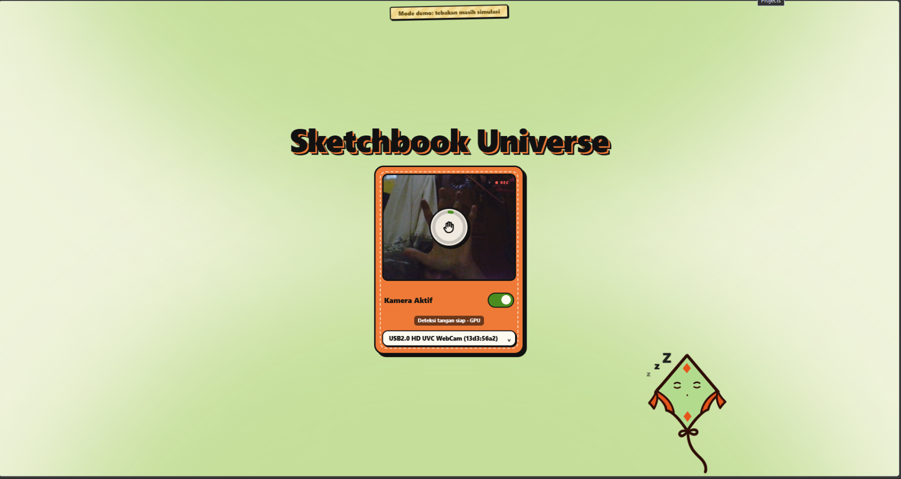
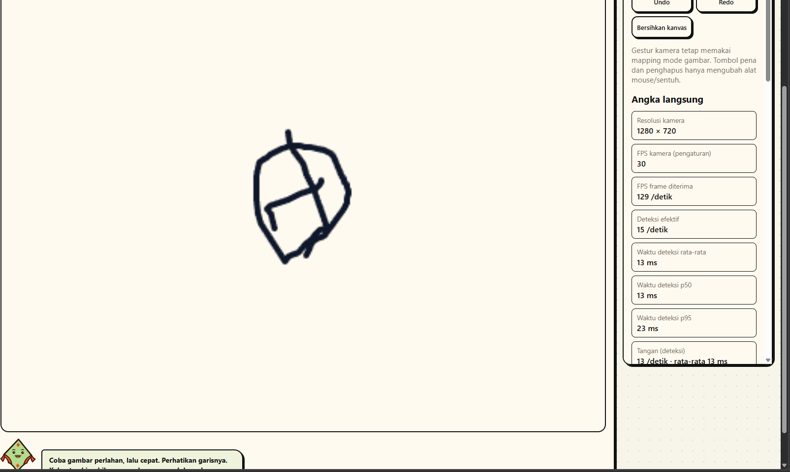

> From: https://chatgpt.com/g/g-p-6a0463ffebe08191be4fe28a4643bbad-ateng-2/c/6af91610-8118-83ec-a99a-7da7066a2d11

# you asked

message time: 2026-11-13 19:11:33

cariin di internet dong alternative mediapipe finger tracking/mediapipe hands yang lebih akurat dan banyak stars di github gitu sama enteng dan aman di lowlight. kasih gw 5 opsi nomer satu paling ok testinya

---

# chatgpt response

Gue bakal bandingin kandidat dari GitHub dan benchmark yang tersedia, termasuk stars, akurasi landmark jari, performa real-time, serta pengalaman pengguna. Khusus low-light, gue bakal pisahin klaim yang benar-benar sudah diuji dari yang sekadar demo bagus.

Temuan awalnya menarik: repo dengan stars paling tinggi justru belum tentu cocok buat pengganti MediaPipe Hands. Ada yang populer tapi berat, ada yang lebih presisi untuk rekonstruksi 3D tetapi butuh GPU. Kandidat paling masuk akal buat real-time sejauh ini adalah keluarga RTMPose, sementara WiLoR punya bukti riset yang lebih relevan untuk kondisi pencahayaan bervariasi.

Gue udah telusuri GitHub, dokumentasi model, benchmark, beberapa issue pengguna, dan diskusi komunitas. Per **13 November 2026**, ada 5 kandidat yang layak dipertimbangkan buat menggantikan MediaPipe Hands.

Tapi ada satu temuan penting: **belum ada kandidat yang terbukti sekaligus lebih akurat dari MediaPipe, lebih ringan, dan lebih tahan low-light dalam pengujian head-to-head yang sama.** Jadi gue urutkan berdasarkan keseimbangan performa, kematangan repo, kemudahan implementasi, dan bukti pengujiannya, bukan stars doang.

## Top 5 alternatif MediaPipe Hands

## 1. RTMPose Hand + rtmlib

(Pilihan utama)

8.1k MMPose  702 rtmlib Apache 2.0

**Kenapa nomor satu\:** RTMPose punya model khusus hand keypoints, sedangkan rtmlib menyediakan implementasi ONNX yang lebih sederhana tanpa dependensi besar seperti MMCV dan MMDetection. Mendukung 21 keypoints dan CPU inference.  [GitHub](https://github.com/open-mmlab/mmpose/blob/main/docs/en/user_guides/inference.md?utm_source=chatgpt.com) [GitHub](https://github.com/Tau-J/rtmlib?utm_source=chatgpt.com)

**Bukti/testimoni\:** komunitas GitHub menggunakan RTMPose untuk real-time pose estimation. Namun, ada permintaan pengguna agar rtmlib menambahkan filtering untuk mengurangi jitter, yang belum direncanakan maintainer. Jadi kestabilan tracking tetap perlu diuji.  [GitHub](https://github.com/Tau-J/rtmlib/issues/58?utm_source=chatgpt.com) [GitHub](https://github.com/open-mmlab/mmpose/discussions/3135?utm_source=chatgpt.com)

**Low-light\:** belum menemukan benchmark khusus yang membuktikan lebih unggul dari MediaPipe saat pencahayaan rendah.

Paling cocok untuk prototipe real-time Python/OpenCV, terutama saat ingin fleksibilitas CPU dan optimasi ONNX.

[GitHub rtmlib](https://github.com/Tau-J/rtmlib) · [GitHub MMPose](https://github.com/open-mmlab/mmpose)

---

## 2. Ultralytics YOLO26 Pose — Hand Keypoints

63.3k stars AGPL 3.0 / Enterprise

YOLO punya ekosistem sangat matang untuk deteksi dan custom training. Varian nano cocok dijadikan kandidat inference ringan. Dataset resmi hand keypoints menyediakan 26.768 gambar dan 21 titik landmark. **Namun model pose standar bukan model tangan siap pakai; perlu fine-tuning.**  [GitHub](https://github.com/ultralytics/ultralytics?utm_source=chatgpt.com) [Ultralytics](https://docs.ultralytics.com/datasets/pose/hand-keypoints?utm_source=chatgpt.com)

**Bukti pengujian\:** implementasi komunitas YOLO26s hand pose melaporkan mAP50 0,942 dan mAP50–95 0,843 pada dataset hand keypoints. Ini laporan pembuat model, bukan pengujian independen atau bukti mengungguli MediaPipe. Label dataset tersebut juga berasal dari MediaPipe.  [GitHub](https://github.com/marceloeatworld/yolo26-training?utm_source=chatgpt.com) [Ultralytics](https://docs.ultralytics.com/datasets/pose/hand-keypoints?utm_source=chatgpt.com)

**Low-light\:** berpotensi bagus setelah fine-tuning menggunakan data gelap yang representatif, tetapi belum terverifikasi sebagai keunggulan bawaan.

Paling cocok kalau lo bersedia melatih model sendiri untuk lingkungan kamera tertentu.

[GitHub Ultralytics](https://github.com/ultralytics/ultralytics)

---

## 3. WiLoR

741 stars Model nonkomersial

WiLoR adalah model rekonstruksi tangan 3D dari riset CVPR 2025. Dataset pengembangannya mencakup variasi pencahayaan dan occlusion, dengan opsi `--fast` yang diklaim mempercepat inference hingga 1,6×.  [openaccess.thecvf.com](https://openaccess.thecvf.com/content/CVPR2025/papers/Potamias_WiLoR_End-to-end_3D_Hand_Localization_and_Reconstruction_in-the-wild_CVPR_2025_paper.pdf?utm_source=chatgpt.com) [GitHub](https://github.com/rolpotamias/WiLoR?utm_source=chatgpt.com)

**Bukti low-light paling kuat di daftar ini\:** studi CHI 2026 melaporkan error 3D sebesar 15,4 mm untuk WiLoR dibanding 45,2 mm untuk MediaPipe pada kondisi low illumination. Itu hasil pada setup penelitian tertentu, bukan jaminan webcam biasa.  [DOI](https://doi.org/10.1145/3772318.3790626?utm_source=chatgpt.com)

**Kekurangan\:** memerlukan stack PyTorch/GPU yang jauh lebih berat dari MediaPipe, dengan batasan lisensi model.

Paling menarik untuk akurasi 3D dan riset low-light, tetapi bukan pilihan utama untuk perangkat CPU lemah.

[GitHub WiLoR](https://github.com/rolpotamias/WiLoR)

---

## 4. OpenPose — Hand Keypoint Detection

34.6k stars Nonkomersial gratis

Salah satu proyek paling mapan untuk pelacakan tubuh dan tangan. Mendukung 21 keypoints per tangan dan beberapa orang sekaligus. Memiliki dukungan C++, Python, serta CPU/GPU.  [GitHub](https://github.com/CMU-Perceptual-Computing-Lab/openpose?utm_source=chatgpt.com)

**Bukti komunitas\:** punya rekam jejak riset panjang dan adopsi besar, tetapi itu tidak membuktikan performa lebih baik dari MediaPipe. Riset robustness juga menemukan bahwa variasi pencahayaan, motion blur, dan occlusion masih menjadi tantangan model-model hand pose, termasuk OpenPose.  [IEEE Xplore](https://ieeexplore.ieee.org/abstract/document/10190429?utm_source=chatgpt.com)

**Kekurangan\:** instalasi dan komputasi relatif berat; bukan pengganti praktis untuk aplikasi ringan.

[GitHub OpenPose](https://github.com/CMU-Perceptual-Computing-Lab/openpose)

---

## 5. HaMeR — Hand Mesh Recovery

1.2k stars MIT code, model dependencies restricted

Menggunakan transformer untuk merekonstruksi bentuk tangan 3D dengan detail tinggi. Lebih berorientasi pada rekonstruksi daripada tracking jari ringan.  [GitHub](https://github.com/geopavlakos/hamer?utm_source=chatgpt.com)

**Bukti benchmark\:** pengujian egoBench mencatat PA-MPJPE 11,1 mm untuk HaMeR dibanding 17,8 mm untuk MediaPipe pada pengaturan tersebut. Namun, untuk absolute world-position error, MediaPipe + PnP justru mengungguli HaMeR + PnP.  [GitHub](https://github.com/stray128/egoBench?utm_source=chatgpt.com)

**Kekurangan\:** model besar, kebutuhan GPU tinggi, dan belum ada bukti yang cukup bahwa HaMeR lebih tahan low-light untuk webcam real-time.

[GitHub HaMeR](https://github.com/geopavlakos/hamer)

## Perbandingan cepat

| Model | Ringan | Bukti akurasi lebih baik | Bukti low-light |
|--------|--------|--------|--------|
| **RTMPose + rtmlib** | Relatif | Belum vs MediaPipe | Belum |
| YOLO26 Hand | Bisa, varian nano | Hasil fine-tuning tersedia | Belum |
| WiLoR | Tidak | Ada, pada metrik tertentu | Ada |
| OpenPose | Tidak | Belum secara umum | Terbatas |
| HaMeR | Tidak | Ada, pada metrik tertentu | Belum |

## Jadi, mana yang gue pilih?

**RTMPose Hand melalui rtmlib** adalah pilihan pertama untuk *dicoba*, bukan otomatis pemenang akurasi. Integrasinya relatif ringan dan tidak menuntut GPU besar. Tapi buat kebutuhan low-light, **WiLoR justru punya bukti lebih kuat**, dengan konsekuensi kebutuhan komputasi jauh lebih tinggi.

Ada temuan yang juga penting: dalam diskusi Reddit pada November 2026, seorang pembuat sistem motion capture menyebut RTMPose whole-body cepat dan stabil untuk 2D, tetapi tetap memakai MediaPipe untuk kedalaman jari. Ini tidak langsung menguji RTMPose Hand khusus, tetapi memperkuat alasan untuk tidak menganggap semua model RTMPose unggul dalam finger tracking.  [Reddit](https://www.reddit.com/r/TouchDesigner/comments/1xs0chj/motion_capture_studio_in_touchdesginer/?utm_source=chatgpt.com)

Kalau target lo adalah webcam real-time, gue akan benchmark RTMPose melawan MediaPipe pada rekaman yang sama dalam tiga kondisi: pencahayaan normal, redup, dan redup dengan gerakan cepat. Ukur detection recall, error ujung jari, jitter, FPS, dan penggunaan RAM. Tanpa pengujian itu, mengganti engine bisa saja malah menurunkan kualitas.

**Satu pertanyaan penting\:** finger tracking ini mau lo pakai di **web/browser (JavaScript)** atau **Python/OpenCV di desktop**? Soalnya kalau browser, rankingnya bisa berubah cukup jauh.

---

# you asked

message time: 2026-11-13 19:23:30

아,  kenapa bukan open pose aja yang dipakai? Kan dia udah banyak stars-nya, tapi apakah berat buat client side?

---

# chatgpt response

Iya, **OpenPose memang berat buat client-side, terutama kalau yang lo maksud aplikasi web yang berjalan langsung di browser pengguna.**

Tapi bukan berarti OpenPose jelek. Justru dia termasuk proyek computer vision yang matang, punya puluhan ribu GitHub stars, dan mendukung 21 landmark per tangan.

Masalahnya, **OpenPose dirancang untuk kebutuhan yang berbeda dari MediaPipe Hands.**

## 1. Seberapa berat OpenPose?

Ini kebutuhan hardware dari dokumentasi resmi OpenPose, bukan perkiraan gue.

| Kebutuhan | OpenPose |
|--------|--------|
| GPU NVIDIA | Minimal sekitar 1,6 GB VRAM tersedia |
| RAM dengan GPU | Sekitar 2–2,5 GB |
| CPU-only | Sekitar 8 GB RAM |
| CPU disarankan | Minimal 8 core |
| Browser native | Tidak tersedia secara resmi |
| Framework utama | C++, Caffe, CUDA/OpenCL |

 [GitHub](https://github.com/CMU-Perceptual-Computing-Lab/openpose/blob/master/doc/installation/0_index.md?plain=1&utm_source=chatgpt.com) [GitHub](https://github.com/CMU-Perceptual-Computing-Lab/openpose/blob/master/doc/installation/1_prerequisites.md?utm_source=chatgpt.com)

Angka RAM tersebut adalah kebutuhan sistem yang dicantumkan untuk konfigurasi OpenPose, **bukan berarti modelnya sendiri memakan 8 GB RAM**\.

Bahkan dokumentasinya menyebut bahwa mengaktifkan hand detection akan menambah kebutuhan GPU dan memperlambat inference.  [GitHub](https://github.com/CMU-Perceptual-Computing-Lab/openpose/blob/master/include/openpose/flags.hpp?utm_source=chatgpt.com)

Jadi untuk website yang penggunanya bisa pakai laptop biasa, HP Android, atau iPhone, OpenPose tidak ideal.

## 2. Kenapa GitHub stars-nya banyak, tapi bukan pilihan pertama?

Stars OpenPose mencerminkan pengaruhnya di dunia riset dan computer vision, bukan jaminan efisiensi inference.

Ada perbedaan arsitektur yang cukup penting\:

OpenPose — konfigurasi hand detection standar

Frame dari kamera

Deteksi pose tubuh

Estimasi lokasi tangan

Deteksi 21 landmark jari

OpenPose juga mendukung bounding box tangan yang disediakan dari luar, sehingga tahap deteksi tubuh dapat dilewati dengan integrasi khusus.  [GitHub](https://github.com/CMU-Perceptual-Computing-Lab/openpose/blob/master/include/openpose/wrapper/wrapperAuxiliary.hpp?utm_source=chatgpt.com)

---

MediaPipe Hands — mode video

Frame dari kamera

Deteksi telapak tangan

Estimasi 21 landmark jari

Memanfaatkan tracking dari frame sebelumnya agar tidak selalu perlu menjalankan deteksi ulang.

 [Google for Developers](https://developers.google.com/edge/mediapipe/solutions/vision/hand_landmarker/web_js?authuser=01&utm_source=chatgpt.com)

Selain itu, MediaPipe memang menyediakan JavaScript SDK berbasis WebAssembly dan akselerasi GPU untuk browser. OpenPose resmi menyediakan API C++ dan Python, bukan paket browser siap pakai.  [Google for Developers](https://developers.google.com/edge/mediapipe/solutions/setup_web?utm_source=chatgpt.com) [GitHub](https://github.com/CMU-Perceptual-Computing-Lab/openpose?utm_source=chatgpt.com)

## 3. Bagaimana kalau dipaksakan client-side?

Tergantung platformnya\:

- **Browser laptop/HP\:** tidak gue rekomendasikan. Perlu porting runtime/model, mengatasi kompatibilitas browser, dan mengoptimalkan performanya sendiri.
- **Aplikasi desktop native dengan NVIDIA GPU\:** OpenPose masih layak dicoba.
- **Client-side dengan CPU atau perangkat low-end\:** MediaPipe lebih masuk akal sebagai baseline.

Dan soal **low-light**, OpenPose juga belum terbukti secara umum lebih tahan cahaya redup dibanding MediaPipe. GPU kuat sekalipun tidak otomatis membuat input kamera gelap lebih mudah dikenali.

## Kesimpulan

Kalau prioritas lo **finger tracking akurat + low-light + ringan + client-side**, gue tetap tidak akan menempatkan OpenPose di nomor satu.

Bahkan ada kemungkinan **MediaPipe Hands yang sudah dioptimalkan untuk pencahayaan redup lebih efektif** daripada menggantinya dengan OpenPose yang jauh lebih berat.

Tapi gue pengin pastiin satu hal: **client-side yang lo maksud browser web (JavaScript), atau aplikasi desktop yang inference-nya berjalan lokal di PC pengguna?** Karena itu bakal sangat menentukan pilihan model terbaiknya.

---

# you asked

message time: 2026-11-14 05:19:40

Ini, media, gue pakai media pipe hands untuk client side-nya. Terus di server pakai OpenPose gini bisa nggak ya? Tapi latency ya. Tapi ya gimana lagi biar low latency ada acara ngakalinnya nggak lo? Soalnya ini beneran, gue butuh engineering, cuma pakai kamera. Jadi bisa detection tangan gitu loh. Nggak pakai lidar, nggak pakai Kinect

---

# chatgpt response

Bisa, dan arsitektur hybrid itu masuk akal. Tapi kuncinya bukan mengirim semua frame ke OpenPose: MediaPipe harus tetap responsif di browser, sementara server hanya membantu saat tracking mulai tidak yakin. Gue cek dulu opsi hand-only OpenPose dan transport yang cocok supaya desainnya nggak malah menambah lag.

**Bisa banget. Bahkan ada pendekatan hybrid yang menurut gue jauh lebih masuk akal daripada mengganti MediaPipe Hands sepenuhnya dengan OpenPose.**

Lo tetap pakai kamera RGB biasa, tanpa LiDAR, Kinect, atau depth sensor. MediaPipe menangani tracking real-time di browser, sedangkan OpenPose di server menjadi *secondary estimator* untuk membantu mengoreksi landmark tangan.

Tapi ada satu prinsip engineering penting\:

**Jangan sampai browser harus menunggu hasil OpenPose sebelum bisa menampilkan gerakan tangan.** Kalau begitu, latency jaringan dan inference server bakal langsung terasa di setiap gerakan.

## 1. Arsitektur yang gue usulkan

**RGB Webcam / Kamera HP**

Single camera, 30 FPS sebagai target awal

**CLIENT — Browser** (Real-time)

MediaPipe Hands

21 landmarks + bounding box

Prediksi + smoothing

Crop tangan

**Render gesture / interaksi langsung**

Tidak menunggu server

Async: ROI image + timestamp ↔ koreksi landmark

**SERVER — GPU** (Asynchronous)

OpenPose Hand-Only

Inference hanya pada area tangan

Validasi + 21 refined keypoints

Ternyata **OpenPose secara resmi mendukung standalone hand estimation**\. Melalui konfigurasi `--body 0 --hand --hand_detector 2`, kita bisa memberikan lokasi tangan sendiri tanpa menjalankan body pose estimation. Implementasinya menggunakan C++ API dan rectangular bounding box.  [GitHub](https://github.com/CMU-Perceptual-Computing-Lab/openpose/blob/master/doc/advanced/standalone_face_or_hand_keypoint_detector.md?utm_source=chatgpt.com)

Artinya, MediaPipe bisa membantu mencari posisi tangan, lalu OpenPose tinggal mengestimasi landmark pada area tersebut. Ini menghindari pekerjaan deteksi tubuh yang tidak diperlukan.

Namun, hasil OpenPose belum tentu lebih akurat dari MediaPipe. Kita tetap perlu mengukur error-nya agar server tidak justru mengoreksi landmark yang sudah benar.

## 2. Lima optimasi supaya latency rendah

**Kirim potongan tangan, bukan seluruh video.**

Gunakan bounding box dari MediaPipe, tambahkan margin sekitar 10–20%, lalu buat ROI persegi. OpenPose sendiri merekomendasikan margin serupa untuk standalone hand inference.  [GitHub](https://github.com/CMU-Perceptual-Computing-Lab/openpose/blob/master/doc/advanced/standalone_face_or_hand_keypoint_detector.md?utm_source=chatgpt.com)

Misalnya, dari kamera 1280×720 cukup kirim crop tangan sekitar 256–384 piksel. Jangan mengompresi terlalu agresif sampai detail jari hilang.

---

**Jangan mengirim 30 FPS ke server.**

MediaPipe tetap berjalan lokal dengan target 30 FPS. Server cukup menerima 3–8 sampel/detik sebagai konfigurasi awal, atau dipanggil ketika tracking terlihat tidak stabil.

Jika OpenPose belum selesai memproses frame sebelumnya, buang frame lama dan prioritaskan yang paling baru (*latest-frame-wins*\).

---

**Mulai dengan WebSocket, bukan request HTTP berulang.**

WebSocket cocok untuk prototipe karena koneksinya persisten. Tetapi implementasikan pembatasan antrean memakai `bufferedAmount` dan maksimal satu request inference yang sedang berjalan per sesi.  [MDN](https://developer.mozilla.org/en-US/docs/Web/API/WebSocket/bufferedAmount?utm_source=chatgpt.com)

Kalau nanti benar-benar perlu streaming video kontinu, pertimbangkan WebRTC. Data channel bisa dikonfigurasi tanpa kewajiban pengiriman berurutan.  [MDN](https://developer.mozilla.org/en-US/docs/Web/API/RTCPeerConnection/createDataChannel?utm_source=chatgpt.com)

---

**Gunakan One Euro Filter untuk landmark.**

Filter ini menyesuaikan smoothing dengan kecepatan gerakan: jari diam dibuat lebih stabil, sementara jari bergerak cepat tidak terlalu tertahan. Metode tersebut memang dirancang untuk menekan jitter tanpa menambah banyak lag.  [pepite-depot.univ-lille.fr](https://pepite-depot.univ-lille.fr/LIBRE/HDR/2012/HDR2012LIL102.pdf?utm_source=chatgpt.com)

Kalau perlu, tambahkan prediksi posisi jangka pendek dengan pembatasan agar tangan tidak terlihat bergerak melampaui posisi aslinya.

---

**Jalankan model OpenPose sekali, tetap aktif di GPU.**

Jangan load model setiap request. Mulai dari `hand_scale_number=1` dan uji resolusi input tangan 256×256 versus default 368×368. Dokumentasi OpenPose mengonfirmasi pengurangan resolusi dapat mempercepat inference, dengan konsekuensi akurasi.  [GitHub](https://github.com/CMU-Perceptual-Computing-Lab/openpose/blob/master/doc/advanced/demo_advanced.md?utm_source=chatgpt.com)

## 3. Bagaimana dengan latency sebenarnya?

Kita bisa mengestimasi *jalur server* menggunakan asumsi hipotetis berikut.

Simulasi latency server correction

---

**Total simulasi**

# ms

Ini ilustrasi perhitungan, bukan hasil benchmark OpenPose. Belum termasuk antrean server dan penundaan capture kamera; performa aktual sangat bergantung pada GPU, jaringan, dan jumlah pengguna.

Kalau server mengembalikan hasil sekitar 96 ms kemudian, browser mungkin sudah memproses 2–3 frame baru.

Makanya **jangan langsung menimpa landmark terkini dengan hasil server dari frame lama.** Gunakan `frameId` dan timestamp untuk menyelaraskan hasil, bandingkan estimasi kedua model pada frame yang sama, lalu terapkan koreksi secara bertahap. Kalau hasilnya sudah terlalu lama, buang.

Server juga tidak harus selalu dipercaya: kalau estimasi OpenPose menyimpang dari anatomi atau pergerakan tangan yang masuk akal, pertahankan estimasi lokal.

## 4. Masalah low-light: justru di sinilah tantangannya

Ada satu masalah fundamental. **OpenPose tidak otomatis bisa melihat tangan yang gagal terlihat oleh MediaPipe.** Kalau gambar gelap, penuh noise, atau jari mengalami motion blur, keduanya menerima informasi visual yang sama-sama terbatas.

Bahkan kalau MediaPipe kehilangan tangan sepenuhnya, arsitektur hand-only tadi kehilangan bounding box untuk dikirim. Solusinya perlu jalur fallback: perluas ROI terakhir selama beberapa frame atau kirim frame penuh sesekali ke detektor tangan server yang independen.

Gue akan menambahkan *low-light pipeline* dengan urutan berikut\:

1. **Camera-aware enhancement\:** periksa exposure, noise, dan brightness. Sesuaikan exposure kamera jika perangkat/browser mendukungnya, tanpa membuat shutter terlalu lambat.
2. **Selective enhancement\:** uji CLAHE/gamma pada ROI saja, dan kombinasikan dengan denoising ringan. Jangan menganggap gambar yang terlihat lebih terang pasti lebih akurat untuk model.
3. **Temporal tracking\:** gunakan informasi frame sebelumnya saat keypoint hilang sementara, dengan batas waktu dan ketidakpastian.
4. **Server verification\:** validasi landmark lewat model kedua ketika hasil lokal meragukan.

Ada juga riset menarik bernama **XPose: Towards Extreme Low Light Hand Pose Estimation** \(WACV 2025). Penelitinya menggunakan dataset sekitar 120.000 gambar dan mengembangkan metode khusus estimasi tangan pada kondisi sangat gelap, termasuk di bawah 1 lux. Ini lebih relevan untuk riset ketahanan low-light daripada sekadar memilih model yang stars-nya tinggi, meski belum berarti cocok untuk real-time production.  [openaccess.thecvf.com](https://openaccess.thecvf.com/content/WACV2025/html/Rosh_XPose_Towards_Extreme_Low_Light_Hand_Pose_Estimation_WACV_2025_paper.html?utm_source=chatgpt.com)

## 5. Satu keterbatasan kamera RGB yang perlu lo tahu

Dengan satu kamera RGB biasa, lo bisa mendeteksi 21 landmark, posisi 2D, gesture, arah jari, dan mengestimasi bentuk tangan 3D.

Tetapi lo tidak otomatis mendapatkan **kedalaman absolut yang akurat** atau posisi ujung jari dalam ruang fisik, terutama ketika jari menutupi satu sama lain. MediaPipe menyediakan world landmarks 3D yang diestimasi model, tetapi itu bukan pengukuran kedalaman sensor. OpenPose Hand standar pun merupakan estimator 2D.  [Google for Developers](https://developers.google.com/edge/mediapipe/solutions/vision/hand_landmarker?tab=Python&utm_source=chatgpt.com) [GitHub](https://github.com/cmu-perceptual-computing-lab/openpose?utm_source=chatgpt.com)

Jadi kalau targetnya gesture control, virtual button, pinch, drag, atau interaksi layar, satu kamera sangat memungkinkan. Kalau targetnya pengukuran posisi 3D absolut dengan presisi tinggi, tantangannya jauh lebih sulit.

## 6. Stack yang akan gue pakai

| Layer | Teknologi |
|--------|--------|
| Camera capture | getUserMedia, 720p/30 FPS sebagai target |
| Client inference | MediaPipe Hand Landmarker |
| Threading | Web Worker jika kompatibel dengan jalur GPU |
| Stabilization | One Euro Filter |
| Transport | WebSocket + binary JPEG ROI |
| Backend API | Python FastAPI |
| GPU inference | OpenPose Hand-only |
| Latency control | Latest-frame-wins, timestamp matching |
| Fallback | Local-only tracking saat server lambat |

Google sendiri mencatat `detectForVideo()` pada MediaPipe Web berjalan sinkron dan dapat memblokir UI thread, sehingga pemisahan inference dari rendering perlu diperhatikan.  [Google for Developers](https://developers.google.com/edge/mediapipe/solutions/vision/hand_landmarker/web_js?authuser=01&utm_source=chatgpt.com)

**Saran gue\:** prototipekan dua server estimator, OpenPose Hand-only dan RTMPose Hand ONNX. Uji keduanya dengan video yang identik sebelum memilih satu. Jangan dulu membangun mekanisme fusion rumit sebelum terbukti estimator server memang memperbaiki hasil MediaPipe.

---

Nah, gue perlu tahu **satu hal paling menentukan**\: tracking tangan lo ini dipakai buat apa persisnya?

Apakah untuk **gesture control** \(pinch, klik, drag, menggerakkan objek), **tracking setiap ruas jari secara presisi**, atau **interaksi 3D/AR**?

Soalnya kalau cuma gesture control, ada pendekatan yang bisa memangkas hampir seluruh kebutuhan server dan memberi latency jauh lebih rendah.

---

# you asked

message time: 2026-11-14 05:23:56

Lu udah gue pindah ke konteks proyek gue. Kira-kira bisa nggak ya? Dan apa ya, itu juga tergantung dari internet di tempat kan. Nah, gue udah coba pakai kamera laptop gue Asus tuh gaming. Ya kita nggak tahu di user itu kameranya kayak gimana. Tapi di kamera gue itu masih gemeter buat gambar. Terus buat deteksi kadang kedeteksi, kedistraksi sama muka. Jadi kalau tangan udah masuk ke ranah muka, itu susah dideteksi

---

# chatgpt response

Dari konteks Sketchbook Universe, masalah lu sekarang bukan sekadar memilih model. Ada dua kegagalan yang berbeda, garis gambar gemeter dan tangan kehilangan tracking saat dekat wajah. Gue bakal pisahkan solusinya, lalu cek keputusan proyek supaya usulannya nggak mengubah flow yang sudah dikunci.

**Bisa diterapkan di Sketchbook Universe, tapi setelah memahami masalah kamera yang lu alami, gw justru nggak merekomendasikan OpenPose server sebagai solusi utama. Gw lebih memilih memperbaiki tracking MediaPipe dan pemrosesan input gambar di client-side terlebih dahulu.**

Alasannya, proyek lu bukan cuma mendeteksi gestur. Siswa SMP kelas 7–9 harus bisa menggambar menggunakan ujung jari, menghapus, memilih keputusan AI, sampai berinteraksi dengan gameplay 2D. Semuanya membutuhkan respons yang konsisten, bahkan ketika kamera laptop siswa kurang bagus.

Dari percobaan lu di laptop ASUS gaming, ada dua masalah berbeda.

1. **Jitter saat menggambar.** Ujung jari terdeteksi, tetapi koordinatnya bergeser-geser sehingga garis bergetar. Penyebabnya bisa noise kamera, landmark yang tidak stabil, atau tremor tangan alami.
2. **Tracking hilang saat tangan mendekati wajah.** Ini bisa disebabkan occlusion, kemiripan warna kulit, perubahan orientasi tangan, atau kegagalan detector menemukan kembali telapak tangan. Belum tentu MediaPipe benar-benar mengira wajah lu sebagai tangan.

Keduanya perlu solusi berbeda. Mengganti model belum tentu menyelesaikan salah satunya.

## 1. Apakah internet pengguna berpengaruh?

| Proses | Bergantung pada internet selama interaksi? |
|--------|--------|
| Kamera melalui browser | Tidak |
| MediaPipe inference lokal | Tidak, setelah aset model tersedia |
| Smoothing dan menggambar | Tidak |
| Klasifikasi sketsa | Tergantung implementasi model partner |
| OpenPose di server | Ya, jika server berada di jaringan lain |
| Logging ke backend | Ya, untuk pengiriman ke server |

Kalau siswa menggunakan Wi-Fi sekolah yang tidak stabil, OpenPose server bisa menghasilkan koreksi terlambat atau gagal diterima.

**Target arsitektur yang gw sarankan adalah finger tracking dan semua kontrol langsung tetap bisa berjalan lokal tanpa menunggu jaringan.** Ini tidak otomatis berarti seluruh Sketchbook Universe sudah mendukung offline, karena jalur klasifikasi dan logging partner harus diperiksa terpisah.

## 2. Arsitektur yang paling masuk akal

**Kamera RGB siswa**

Resolusi dan FPS adaptif sesuai kemampuan perangkat

**Browser lokal** (Jalur utama)

**Backend Sketchbook Universe**

Klasifikasi sketsa, logging, dan jika diperlukan pengujian estimator tambahan. Bukan pengendali langsung kursor.

### A. Mengatasi gambar yang gemeter

Gw sarankan **One Euro Filter** untuk menstabilkan koordinat jari sebelum dipakai Canvas.

Filter ini adaptif. Ketika jari bergerak pelan, noise dikurangi lebih kuat. Ketika jari bergerak cepat, filtering dilonggarkan agar gerakan tetap responsif. Metode ini memang dirancang untuk menyeimbangkan jitter dan latency pada interaksi manusia-komputer.  [direction.bordeaux.inria.fr](https://direction.bordeaux.inria.fr/~roussel/publications/2012-CHI-one-euro-filter.pdf?utm_source=chatgpt.com)

Contoh ilustrasinya seperti ini.

Sebelum filtering

Landmark dengan noise

Setelah filtering

```svg
<svg viewBox="0 0 160 120" width="100%" xmlns="http://www.w3.org/2000/svg"><rect x="0" y="0" width="160" height="120" rx="9" fill="#f8f6ef" /><path d="M8 76 C30 74 42 72 57 66 S87 59 104 50 S138 36 153 29" fill="none" stroke="#278b70" stroke-width="3.5" stroke-linecap="round" stroke-linejoin="round" /><circle cx="153" cy="29" r="4" fill="#278b70" /></svg>
```

Gerakan lebih stabil

Ilustrasi konseptual, bukan hasil pengukuran dari webcam lu.

Tapi filter saja tidak cukup. Harus ada pemisahan antara **gerakan kursor, gestur Coret, dan status pena aktif**\. Ketika tracking hilang, sistem jangan menyambungkan koordinat lama ke koordinat baru. Itu bisa menghasilkan garis panjang yang tidak sengaja digambar siswa.

### B. Mengatasi tangan yang tertutup wajah

Ini bagian yang lebih rumit.

MediaPipe Hand Landmarker menggunakan palm detector dan hand landmark model. Dalam mode video, lokasi tangan dari frame sebelumnya digunakan untuk membantu tracking frame berikutnya. Jika tracking gagal, palm detection dipanggil kembali.  [Google for Developers](https://developers.google.com/edge/mediapipe/solutions/vision/hand_landmarker?utm_source=chatgpt.com)

Jadi gw menyarankan tiga mekanisme tambahan.

1. **Hand continuity.** Pertahankan identitas tangan berdasarkan posisi sebelumnya, skala, orientasi, dan pola geraknya. Jangan langsung menerima kandidat tangan baru yang tiba-tiba melompat jauh.
2. **Occlusion recovery.** Ketika landmark hilang sebentar, tahan tampilan kursor dan angkat pena secara logis. Setelah tangan ditemukan kembali, validasi kestabilannya sebelum mengizinkan coretan baru.
3. **ROI-aware reacquisition.** Eksperimen dengan area pencarian di sekitar lokasi tangan terakhir, lalu perluas kembali ketika tidak ditemukan. Ini butuh integrasi khusus dan tidak otomatis tersedia sebagai pengaturan standar MediaPipe Web.

Gw **tidak menyarankan langsung memakai face masking** untuk menghilangkan wajah dari gambar. Kalau tangan sedang berada di depan muka, mask wajah yang agresif justru bisa menghapus sebagian tangan. Ini perlu diuji, bukan diasumsikan membantu.

Dan ada batas fisiknya. Kalau wajah benar-benar menutupi ujung jari dari sudut pandang kamera, tidak ada algoritma berbasis satu kamera RGB yang bisa menjamin koordinat jari itu tetap akurat.

### C. Menyesuaikan kemampuan kamera siswa

Daripada mengunci semua siswa ke 1080p, gunakan pendekatan *adaptive camera profile*\.

| Profil pengujian | Konfigurasi awal |
|--------|--------|
| Kamera low-end | 640×480, target 30 FPS |
| Kamera standar | 1280×720, target 30 FPS |
| Perangkat lambat | Kurangi resolusi atau frekuensi inference |
| Low-light | Uji exposure, noise dan preprocessing selektif |

Angka itu parameter awal pengujian, bukan jaminan performa. Perangkat bisa saja tidak memenuhi FPS yang diminta.

Untuk browser, penting juga memastikan MediaPipe tidak membuat UI tersendat. Dokumentasi Google mencatat bahwa `detectForVideo()` bersifat sinkron dan bisa memblokir main thread. Memisahkan inference ke Web Worker, selama didukung konfigurasi yang dipakai, adalah salah satu langkah optimasi.  [Google for Developers](https://developers.google.com/edge/mediapipe/solutions/vision/hand_landmarker/web_js?authuser=01&utm_source=chatgpt.com)

## 3. Pengujian yang perlu lu kerjakan sekarang

Sebelum mengintegrasikan OpenPose, gw akan menjalankan satu benchmark lokal pada laptop ASUS lu.

| Skenario | Apa yang diperiksa |
|--------|--------|
| Jari diam selama 10 detik | Jitter landmark mentah vs hasil filter |
| Gambar garis lurus dan lingkaran | Deviasi garis, respons dan keterlambatan |
| Tangan bergerak melewati wajah | Tracking loss, false detection, waktu reacquisition |
| Ruangan terang dan redup | Detection rate, FPS dan kestabilan |
| Gesture Coret, Hapus, Undo, Redo | Salah aktivasi dan keberhasilan pengenalan |

Durasi 10 detik hanya parameter benchmark awal. Simpan video pengujian secara lokal dengan persetujuan subjek dan pisahkan dari logging siswa.

Yang perlu dicatat bukan cuma FPS, tetapi juga **jitter dalam piksel, persentase frame kehilangan tracking, waktu pemulihan, dan error gestur**\. Dari situ baru bisa diputuskan apakah masalah sebenarnya ada pada model, kamera, filtering, atau state machine.

## Verdict buat Sketchbook Universe

**MediaPipe tetap engine utama. OpenPose jangan dulu masuk ke jalur gambar real-time.**

Kalau setelah optimasi lokal masih bermasalah, RTMPose dan OpenPose bisa dibandingkan menggunakan rekaman pengujian yang sama. OpenPose mungkin berguna sebagai estimator pembanding di server, tetapi belum ada bukti bahwa dia akan mengatasi masalah wajah dan jitter yang lu alami.

Prioritas sekarang adalah membuat interaksi kamera tahan terhadap variasi perangkat, menjaga coretan siswa tidak rusak ketika tracking hilang, dan mempertahankan semua gestur berbasis tangan yang sudah menjadi arah interaksi proyek.

**Saran update WORKING\_STATE**

- **Yang berubah\:** FAKTA-USER, pengujian kamera ASUS gaming menunjukkan jitter saat menggambar dan tracking loss saat tangan mendekati wajah. Rekomendasi arsitektur lokal, filtering dan recovery masih KATA-TOOL, belum diimplementasikan atau diuji.
- **Bagian terdampak\:** Status integrasi NUI MediaPipe, pengujian kamera fisik, serta blocker kualitas input Canvas.
- **Tindakan\:** ketik `UPDATE STATE` untuk versi lengkap pengganti `WORKING_STATE.md`\.

---

# you asked

message time: 2026-11-14 10:45:42

gw mau lu cari sendiri lu uji sendiri pake karakter rigging gitu cari juga di internet lah pokoknya tes dengan segala worst case dan harus deteksi fokus banget ke tangan hanya dengan kamera

---

# chatgpt response

Gw bakal kerjain dua jalur. Pertama, riset metode hand tracking dan dataset untuk kondisi ekstrem. Kedua, bikin benchmark yang bisa dijalankan di environment gw, pakai tangan berartikulasi dengan variasi cahaya, wajah, occlusion, dan gerakan. Gw bakal pisahkan hasil tes sungguhan dari simulasi, karena environment gw belum tentu punya webcam atau GPU seperti perangkat siswa.

Gw sudah cek sumber teknis dan menemukan jalur yang lebih cocok daripada OpenPose server. MediaPipe punya parameter untuk mengatur kapan palm detector dipanggil ulang, dan RTMPose punya model hand-only sebagai pembanding. Untuk tes lokal, environment gw ternyata tidak punya webcam, GPU, atau paket model MediaPipe, dan unduhan model juga gagal. Jadi gw akan menguji **rig artikulasi dan logika recovery/smoothing** secara nyata, tetapi tidak akan menyebutnya benchmark akurasi MediaPipe.

Stress test-nya sudah gw perluas menjadi **51.000 frame sintetis dalam 17 skenario**, dan 7 unit test lolos. Hasil yang paling penting justru kegagalannya: pada simulasi tangan di depan wajah, 184 dari 284 deteksi palsu masih lolos filter. Paket berisi video rig, ground truth, hasil CSV, kode pengujian, dan laporan sudah gw verifikasi.

**Gw sudah menjalankan stress test awal memakai rig tangan berartikulasi 21 titik, dan hasilnya menunjukkan bahwa smoothing saja tidak cukup.** Kita juga perlu mekanisme yang menolak deteksi mencurigakan dan memutus coretan saat tangan hilang.

Tes awal mencakup 15 skenario, masing-masing 5 seed dan 150 frame, sehingga totalnya **11.250 frame simulasi**\.

Ini pengujian kode tracking dan stroke recovery dengan landmark yang sengaja diberi noise, dropout, serta false detection. Bukan pengukuran akurasi MediaPipe atau OpenPose. Bentuk tangan dan wajah yang dirender masih karakter sintetis sederhana, bukan rekaman webcam sungguhan.

Temuan penting dari percobaan pertama adalah jalur stroke aman berhasil mencegah segmen garis lebih dari 60 piksel dalam simulasi, tetapi masih menerima sebagian deteksi salah ketika tangan berdekatan dengan wajah. Jadi, **filter temporal dan pemeriksaan lompatan koordinat belum cukup untuk menjamin sistem benar-benar fokus pada tangan**\.

## Hasil stress test setelah diperluas

Frame sintetis

# 51.000

Skenario uji

# 17

Unit test lulus

# 7/7

Hasil ini hanya mengukur pipeline simulasi. Tidak ada inferensi model MediaPipe, OpenPose, atau RTMPose yang berhasil dieksekusi di environment ini.

| Kasus | Hasil simulasi | Penilaian |
|--------|--------|--------|
| Jitter saat jari diam | Error mentah 6,76 px, output terfilter 2,83 px | Filtering menjanjikan |
| Tangan depan wajah | 184 dari 284 deteksi palsu masih lolos | Belum aman |
| Tangan lain masuk frame | 226 dari 550 deteksi palsu masih lolos | Belum aman |
| Low-light | Cakupan simulasi 73,3% | Belum bisa disimpulkan untuk kamera nyata |
| Extreme darkness | Cakupan simulasi 11,9% | Recovery menjadi sangat terbatas |

Perbandingan error jitter di atas memakai sampel yang tidak sepenuhnya sama karena gate membuang sebagian frame. Jadi persentase peningkatan akurasi model belum boleh disimpulkan.

## File hasil pengujian

**Sketchbook Universe Hand Tracking StressLab**

ZIP, 6,2 MB • script Python, rig 21 joint, video sintetis, ground truth, CSV, unit test, dan runner MediaPipe

[Unduh seluruh paket pengujian](sandbox:/mnt/data/Sketchbook_Universe_Hand_Tracking_StressLab_2026-11-14.zip)

---

[Lihat preview 17 skenario rig](sandbox:/mnt/data/hand_tracking_stresslab/results/rigged_worst_cases.jpg)

[Lihat grafik jitter sebelum/sesudah](sandbox:/mnt/data/hand_tracking_stresslab/results/static_jitter_comparison.png)

[Baca laporan pengujian lengkap](sandbox:/mnt/data/hand_tracking_stresslab/HASIL_UJI_2026-11-14.md)

## Temuan riset yang menentukan arah engineering

Ada tiga sumber yang menurut gw layak dipakai untuk memperdalam benchmark berikutnya.

**[FreiHAND](https://lmb.informatik.uni-freiburg.de/resources/datasets/FreihandDataset.en.html)**

Dataset tangan RGB nyata dengan anotasi 21 keypoints. Cocok untuk mengukur ketepatan pose pada gambar, bukan langsung mengukur stabilitas video.  [lmb.informatik.uni-freiburg.de](https://lmb.informatik.uni-freiburg.de/resources/datasets/FreihandDataset.en.html?utm_source=chatgpt.com)

---

**[HaGRIDv2](https://github.com/hukenovs/hagrid)**

Mencakup beragam pencahayaan, latar, jarak kamera, dan kelas no-gesture. Berguna untuk menguji salah deteksi tangan dan gestur, tetapi bukan benchmark lengkap akurasi fingertip.  [GitHub](https://github.com/hukenovs/hagrid?utm_source=chatgpt.com)

---

**[AnyHand 2026](https://chen-si-cs.github.io/projects/AnyHand/)**

Dataset sintetis berbasis Blender dengan variasi pose, tekstur, pencahayaan, dan occlusion. Jauh lebih realistis dibanding rig sederhana yang gw buat.  [chen-si-cs.github.io](https://chen-si-cs.github.io/projects/AnyHand/?utm_source=chatgpt.com)

Ketiga sumber tersebut adalah bahan riset teknis dari internet, belum menjadi sitasi resmi proposal PA lu.

## Rekomendasi teknis untuk Sketchbook Universe

Gw sekarang lebih yakin bahwa kita harus menguji **hand identity lock berbasis 21 landmark**, bukan sekadar meningkatkan smoothing titik telunjuk.

Pipeline kandidatnya adalah MediaPipe lokal, pemeriksaan konsistensi bentuk dan posisi tangan, filtering adaptif, lalu state machine yang mengangkat pena saat tracking diragukan. Jangan otomatis menolak tangan di area wajah karena justru akan merusak interaksi saat tangan benar-benar melewati wajah.

MediaPipe menyediakan parameter detection, presence, dan tracking yang dapat dituning.  [Google for Developers](https://developers.google.com/edge/mediapipe/solutions/vision/hand_landmarker?tab=Python&utm_source=chatgpt.com) Kalau baseline itu masih gagal pada video nyata, RTMPose Hand menjadi pembanding berikutnya karena tersedia detektor dan pose khusus tangan.  [GitHub](https://github.com/Tau-J/rtmlib/blob/main/rtmlib/tools/solution/hand.py?utm_source=chatgpt.com)

**Batas yang tidak bisa dihilangkan\:** satu kamera RGB tidak dapat menjamin akurasi ujung jari yang sepenuhnya tertutup. Saat informasi visual hilang, perilaku yang benar untuk Canvas adalah menghentikan coretan sementara, bukan menebak posisi jari.

Jadi status pekerjaan sekarang adalah **stress test logika tracking sudah dijalankan, tetapi kemampuan deteksi tangan pada kamera nyata belum terverifikasi**\. Paket tersebut juga memuat runner MediaPipe untuk benchmark asli, namun runner itu sendiri belum bisa dieksekusi di environment gw karena paket dan modelnya tidak tersedia.

---

⚠️ Kandidat perubahan **keputusan** terdeteksi

- Ringkasan: Penegasan target interaksi yang hanya mengandalkan kamera RGB, berfokus pada tangan, dan harus diuji dalam kondisi ekstrem.
- Entri lama yang mungkin terdampak: MediaPipe/camera, NUI, dan desain interaksi Canvas.
- Status bukti: keputusan eksplisit untuk kebutuhan produk, belum ada bukti kemampuan tersebut tercapai.
- Tindakan: `DECISIONS.md` lokal perlu ditinjau; ketik `AUDIT SEKARANG` untuk Patch Changelog Usulan.

**Saran update WORKING\_STATE**

- **Yang berubah\:** TERBUKTI, eksperimen sintetis 51.000 frame, 17 skenario, 7 unit test PASS, dan artefak benchmark dibuat. BELUM-TERBUKTI, ketepatan MediaPipe/OpenPose/RTMPose pada webcam nyata.
- **Bagian terdampak\:** Pengujian NUI/finger tracking, blocker kamera, riset hand-only detection, dan QA sintetis.
- **Tindakan\:** ketik `UPDATE STATE` untuk versi lengkap pengganti `WORKING_STATE.md`\.


📦 **Files delivered** · 2026-11-14 10:52
- 📎 **Sketchbook_Universe_Hand_Tracking_StressLab_2026-11-14.zip** · ZIP
- 📎 **rigged_worst_cases.jpg** · results · JPG
- 📎 **static_jitter_comparison.png** · results · PNG
- 📎 **HASIL_UJI_2026-11-14.md** · hand_tracking_stresslab · MD

---

# you asked

message time: 2026-11-14 11:47:35

jadinya pake stack apa aja ini buat nui??? gajadi openpose? terus benchmark runtime nanti dipake terus user download berapa mbnya

---

# chatgpt response

Stack NUI-nya gw kunci sebagai rekomendasi dulu, bukan keputusan PA resmi. Gw cek ukuran model dan runtime browser yang benar-benar perlu diunduh pengguna, lalu pisahkan dari paket benchmark yang cuma dipakai saat development.

**Stack NUI yang gw rekomendasikan untuk Sketchbook Universe tetap MediaPipe Hands di client-side, tanpa OpenPose server.** Kita tambahkan lapisan stabilisasi, validasi tangan, dan recovery. Benchmark tetap dipakai selama development dan QA, **bukan ikut diunduh setiap siswa**\.

## 1. Stack NUI yang dipakai

**Webcam RGB**

getUserMedia + pengaturan kamera adaptif

**NUI Engine di Browser** (Rekomendasi)

**React + TypeScript + HTML Canvas**

Interaksi menggambar dan integrasi gameplay melalui input router yang ada

Komponen tambahan seperti Hand Identity Lock, One Euro Filter, dan Stroke Guard merupakan kode TypeScript ringan. Tidak membutuhkan model machine learning baru.

Untuk pengenalan gesture, gw memilih aturan geometri landmark dan state machine terlebih dahulu, bukan langsung menambahkan Gesture Recognizer model kedua. Pemetaan gesture yang sudah ditetapkan pada UI tutorial tetap dipertahankan. Akurasi aktualnya belum tervalidasi.

## 2. Jadi OpenPose benar-benar nggak dipakai?

**Untuk runtime siswa, nggak.**

| Teknologi | Status rekomendasi |
|--------|--------|
| MediaPipe Hand Landmarker | Engine utama |
| One Euro Filter | Dipakai sebagai kandidat stabilisasi |
| Hand Identity Lock | Dikembangkan dan diuji |
| Stroke Guard + Recovery | Prioritas tinggi |
| OpenPose | Tidak masuk runtime siswa |
| RTMPose Hand | Pembanding saat benchmark |
| StressLab + Playwright | Hanya development dan QA |

OpenPose bisa diuji sebagai pembanding offline, tetapi tidak perlu disiapkan sebagai backend aktif.

Alasannya sederhana. Kalau OpenPose tidak memberikan peningkatan akurasi yang terukur, kita hanya menambahkan beban GPU, internet, latency, dan kompleksitas deployment.

## 3. Berapa MB yang diunduh siswa?

Estimasi aset NUI untuk kunjungan pertama

# 16–21 MB

Perkiraan ukuran file mentah, bukan hasil pengukuran Network pada build Sketchbook Universe.

---

| Hand Landmarker model | 7,5–7,9 MB |
|--------|--------|
| MediaPipe WASM runtime | 8–11 MB |
| JS loader, filter dan gesture logic | Relatif kecil |
| StressLab / benchmark video | 0 MB |
| OpenPose | 0 MB |

Model resmi yang direplikasi pada repo Google berukuran sekitar 7,46 MB. Beberapa versi MediaPipe WASM berukuran sekitar 9–11 MB. Browser hanya perlu memuat varian WASM yang sesuai, bukan seluruh folder paket.  [GitHub](https://github.com/google-ai-edge/mediapipe-samples/blob/main/examples/hand_landmarker/ios/HandLandmarker/hand_landmarker.task?utm_source=chatgpt.com) [UNPKG](https://app.unpkg.com/%40mediapipe/tasks-vision%400.10.32/files/wasm/vision_wasm_nosimd_internal.wasm?utm_source=chatgpt.com) [tnr.co.id](https://tnr.co.id/node_modules/%40mediapipe/tasks-vision/wasm/?utm_source=chatgpt.com)

Ini **belum termasuk aset game, font, gambar Momo, React, KAPLAY, dan model klasifikasi partner**\. Jadi jangan menganggap 21 MB sebagai total ukuran aplikasi PA.

Nantinya kita bisa memakai HTTP caching atau service worker untuk menyimpan aset NUI setelah unduhan pertama. Selama cache masih tersedia dan versinya belum berubah, siswa tidak perlu mengunduh semuanya lagi.

Performa juga perlu dibedakan dari download. Model 8 MB tidak berarti hanya memakai RAM 8 MB. Ketika dijalankan, WASM, frame kamera, tekstur GPU, dan model membutuhkan memori tambahan.

## 4. Benchmark runtime dipakai terus nggak?

**Dipakai terus oleh developer untuk regresi, tetapi tidak terus berjalan di browser siswa.**

**Development dan CI**

StressLab sintetis, Playwright, virtual camera, video tangan nyata, dan tes kondisi worst-case dijalankan setiap ada perubahan penting pada NUI.

**Runtime siswa**

Hanya engine MediaPipe dan lapisan postprocessing. Monitoring ringan seperti FPS, tracking-lost count, dan latency boleh dihitung lokal tanpa menjalankan benchmark video penuh.

**Yang tidak ikut diunduh**

Dataset FreiHAND, HaGRID, rig sintetis, video stress test, OpenPose, RTMPose, dan seluruh file ground truth.

ZIP StressLab yang kemarin sekitar **6,2 MB** itu paket pengujian developer. Bukan dependency website.

## 5. Satu masalah yang masih belum terselesaikan

Pengujian kemarin menunjukkan **184 dari 284 false detection pada skenario tangan di depan wajah masih lolos filter**\.

Artinya, kita belum boleh menyebut pipeline ini sudah tahan distraksi.

Prioritas engineering berikutnya harus menguji hand identity dan reacquisition terhadap video kamera asli. Tujuannya bukan sekadar membuat garis lebih halus, tetapi memastikan tangan yang salah tidak diambil alih sebagai input menggambar.

**Kesimpulan pilihan stack gw sekarang adalah MediaPipe + TypeScript hand tracking safeguards + One Euro Filter + state machine, seluruhnya lokal.** Tidak perlu OpenPose dalam jalur produksi untuk saat ini. Ini rekomendasi arsitektur, bukan klaim implementasi yang sudah berhasil.

---

**Saran update WORKING\_STATE**

- **Yang berubah\:** KATA-TOOL, rekomendasi stack NUI lokal tanpa OpenPose server, beserta perkiraan aset NUI 16–21 MB. BELUM-TERBUKTI, ukuran build produksi, ketahanan tracking wajah, dan performa kamera siswa.
- **Bagian terdampak\:** Stack NUI, deployment web, strategi cache, benchmark dan QA.
- **Tindakan\:** ketik `UPDATE STATE` untuk versi lengkap pengganti `WORKING_STATE.md`\.

---

# you asked

message time: 2026-11-14 11:51:46

itu bisa dibundle jadi satu ga nantinya di stack?

---

# chatgpt response

**Bisa banget. Seluruh stack NUI itu bisa kita bundle jadi satu modul internal `@sketchbook/nui`**, sehingga komponen lain di Sketchbook Universe cukup menggunakan satu API.

Tapi perlu dibedakan antara **satu modul** dan **satu file besar**\. Gw merekomendasikan satu modul dengan beberapa komponen internal agar tetap mudah dioptimasi dan dites.

## Struktur bundle yang gw sarankan

```text
@sketchbook/nui
├── core/
│   ├── mediapipe.ts          # Hand tracking
│   ├── hand-identity.ts      # Kunci target tangan
│   ├── one-euro-filter.ts    # Stabilisasi
│   ├── occlusion-recovery.ts # Pemulihan tracking
│   ├── stroke-guard.ts       # Cegah coretan liar
│   └── gesture-engine.ts     # Pengenalan gestur
├── worker/
│   └── tracking.worker.ts    # Inference bila kompatibel
├── adapters/
│   └── canvas-adapter.ts     # Integrasi canvas
└── index.ts                  # Public API
```

**Sketchbook Universe**

React, Canvas, Gameplay

\@sketchbook/nui

MediaPipe

Identity Lock

One Euro Filter

Stroke Guard

Gesture Engine

Recovery

**Output terstandarisasi**

Pointer, gesture, tracking status, stroke events

Pemakaian dari aplikasi bisa dibuat sesederhana ini.

```ts
import { createNUI } from "@sketchbook/nui";

const nui = await createNUI({
  camera: "adaptive",
  smoothing: "adaptive",
  handLock: true,
  strokeGuard: true,
});

nui.on("pointerMove", ({ x, y }) => {
  canvas.movePointer(x, y);
});

nui.on("strokeStart", () => canvas.beginStroke());
nui.on("strokeEnd", () => canvas.endStroke());
```

Contoh rancangan API, belum merupakan kode implementasi yang terverifikasi.

## Dampaknya terhadap download

Bundle ini tidak otomatis memperbesar ukuran unduhan. Kode filter dan state machine relatif kecil dibanding model MediaPipe dan runtime WASM.

Gw justru menyarankan **lazy loading**\.

- UI dan gameplay bisa dimuat terlebih dahulu.
- NUI dimuat ketika masuk onboarding kamera atau Drawing Canvas.
- Model MediaPipe dan WASM disimpan dalam cache setelah diunduh.
- StressLab, video benchmark, dan dataset tidak disertakan dalam production build.

Dengan begitu pengguna hanya mengunduh modul yang dibutuhkan. Estimasi sebelumnya sekitar 16–21 MB untuk aset NUI mentah masih perlu diverifikasi dari hasil build dan Network browser.

**Satu catatan penting\:** bundling tidak otomatis menyelesaikan jitter, occlusion, atau salah deteksi tangan. Itu tanggung jawab algoritma dan pengujian internal modul. Namun, arsitektur seperti ini membuat perbaikan NUI tidak perlu mengacak-acak kode Canvas dan gameplay.

Ini desain paket yang gw rekomendasikan, **belum keputusan stack resmi atau implementasi yang sudah berjalan**\. Sebelum dipakai, Ujang perlu memeriksa struktur repo dan build system aktual agar modul tidak menduplikasi dependency yang sudah ada.

---

**Saran update WORKING\_STATE**

- **Yang berubah\:** KATA-TOOL, rancangan bundling NUI menjadi satu modul internal dengan dependency MediaPipe, WASM dan komponen stabilisasi.
- **Bagian terdampak\:** Arsitektur frontend, packaging, lazy loading dan strategi caching.
- **Tindakan\:** ketik `UPDATE STATE` untuk versi lengkap pengganti `WORKING_STATE.md`\.

---

# you asked

message time: 2026-11-14 17:40:52

Yakini itu dari hasil riset lu. Gue beneran pengen yang akurat, ya gue lihat sih, lo udah uji coba pakai rigging gitu lah ya. Terus biar anti kena muka gitu dan lain-lain. Kira-kira dari percobaan lo tadi, adakah celah yang ternyata pas gue cobain sendiri masih bisa nih? Ya memang ini tuh harus dicoba sendiri kan. Ini tahap uji coba harusnya, tapi gue melewatkan banyak waktu uji coba. Gue malah lempar ke Ujang tentang UI game dan lain-lain, padahal yang harus gue coba duluan adalah media pipe-nya. Tapi sedang udah deket baru gue malah, malah gue baru coba-coba tentang MediaPipe-nya. Kayak it's wasting time for me, sorry for myself. Sorry buat diri gue sendiri. Tapi ya gimana? Gue mau minta tolong lo tentang hal ini. Kira-kira adakah yang sangat-sangat visible? Kalau bisa ya download-nya enteng di bawah 50 MB bagi user. Dan dari benchmark lo cuma 21-an MB gitu. It's okay. Tapi adakah gap dari situ?

---

# chatgpt response

Ada gap yang cukup serius, dan gw nggak mau bilang stack ini sudah aman hanya karena tes rigging selesai. Gw akan audit ulang hasil uji, asumsi soal deteksi wajah, dan ukuran unduhan, lalu pisahkan mana yang sudah terbukti, mana yang masih risiko saat lu tes di webcam asli.

**Ada gap yang serius, dan setelah gw audit ulang source code StressLab, gw menemukan satu kelemahan yang lebih fundamental dari hasil sebelumnya.** Stack NUI yang kita bahas masih layak, tetapi belum cukup terbukti untuk langsung dipasang sebagai sistem finger tracking utama Sketchbook Universe.

Gue paham kenapa lu merasa waktunya terbuang. Lu sudah mengembangkan UI dan gameplay, tetapi baru menemukan bahwa komponen input paling penting belum stabil. Itu memang urutan pengerjaan yang kurang ideal. Namun, pekerjaan UI sebelumnya tidak otomatis sia-sia. Sekarang prioritasnya harus dibalik, **buktikan interaksi kamera lebih dulu, baru lanjut polishing UI**\.

## 1. Temuan audit ulang yang paling penting

Gw membuka ulang ZIP StressLab tanggal 14 November dan menjalankan kembali unit test-nya. Hasilnya tetap 7 dari 7 PASS.

Tapi ketika gw periksa implementasinya, ada masalah ini.

- Rig menghasilkan 21 landmark, tetapi algoritma `SafeStroke` yang diuji **hanya menerima koordinat ujung jari**, bukan keseluruhan 21 landmark.
- Belum ada pemeriksaan anatomi tangan untuk membedakan landmark asli dan salah deteksi.
- Belum ada *hand identity lock* yang benar-benar mengidentifikasi dan mempertahankan tangan target.
- Deteksi palsu disimulasikan dengan koordinat buatan, bukan dihasilkan oleh model MediaPipe yang membaca gambar.
- Unit test memeriksa hal-hal dasar seperti filter, putusnya coretan, dan lompatan koordinat, bukan keberhasilan deteksi tangan di depan wajah.

Jadi **51.000 frame sintetis itu membuktikan sebagian logika simulasi berjalan, bukan membuktikan engine MediaPipe tahan 51.000 frame worst-case.**

**Kondisi aktual eksperimen** (Belum lolos validasi kamera)

| Rig 21 titik dan simulasi | Dijalankan |
|--------|--------|
| Filter One Euro dan Stroke Guard dasar | Diuji sintetis |
| Hand identity lock 21 landmark | Belum diuji |
| MediaPipe pada video kamera nyata | Belum diuji |
| Performa web dengan gameplay aktif | Belum diuji |

Yang paling mengkhawatirkan adalah hasil **184 dari 284 false detection yang tetap lolos pada simulasi tangan di depan wajah**, sekitar 64,8%.

Itu bukan false-positive rate MediaPipe, melainkan rasio lolosnya observasi palsu yang sengaja disuntikkan ke pipeline. Tetapi hasilnya tetap cukup untuk menunjukkan bahwa logika pengamanan saat ini belum memadai.

## 2. Lima gap yang paling mungkin muncul ketika lu tes sendiri

(P0)

**Tangan melewati wajah, tracking tertukar atau hilang**

Ini bukan kasus langka. Ada laporan GitHub MediaPipe tentang tracking yang hilang ketika tangan mendekati wajah. Salah satu pengembang menjelaskan bahwa kemiripan warna kulit tangan dan wajah memang menyulitkan palm detection. Laporan itu berasal dari 2020, sehingga bukan bukti performa versi terbaru.  [GitHub](https://github.com/google-ai-edge/mediapipe/issues/614?utm_source=chatgpt.com)

Solusi yang perlu diuji adalah konsistensi 21 landmark, prediksi lokasi ROI berdasarkan riwayat tangan, dan validasi ulang ketika tangan muncul kembali. Jangan langsung mengunci area wajah sebagai wilayah terlarang.

---

(P0)

**Gestur palsu bisa menghasilkan coretan atau perintah salah**

Filter koordinat tidak memahami maksud gesture. Bahkan tracking yang relatif stabil bisa salah mengenali keadaan pena, atau satu gerakan memicu dua aksi.

Kita perlu *gesture hysteresis*, pemisahan mode DRAW/PROBE/PLACE/PLAY, serta aturan bahwa kehilangan tracking otomatis menghentikan coretan. Mapping gesture yang sudah dipilih jangan diganti tanpa pengujian.

---

(P1)

**Smoothing memperhalus garis tetapi mengorbankan respons**

One Euro Filter dapat mengurangi jitter, namun parameter yang terlalu agresif bisa membulatkan sudut gambar dan membuat kursor tertinggal.

Harus diukur pada gambar lurus, zigzag, lingkaran, perubahan arah cepat, dan gestur berhenti mendadak. Gunakan timestamp frame asli, bukan mengasumsikan FPS selalu tetap.

---

(P1)

**Kamera siswa dan pencahayaan tidak konsisten**

Webcam ASUS lu belum mewakili perangkat siswa. Bahkan penelitian yang membandingkan MediaPipe, OpenPose, dan model lain menemukan degradasi serius akibat motion blur, occlusion, dan variasi pencahayaan.  [IEEE Xplore](https://ieeexplore.ieee.org/abstract/document/10190429?utm_source=chatgpt.com)

Karena itu, perlu pengujian perangkat low-end, cahaya redup, backlight, auto-exposure, dan kamera yang menghasilkan FPS tidak stabil.

---

(P1)

**Browser melambat saat game dan kamera aktif bersamaan**

`detectForVideo()` di MediaPipe Web bersifat sinkron. Jika dijalankan di main thread, inference dapat mengganggu rendering. Web Worker menjadi opsi, tetapi jalur pemindahan frame dan dukungan GPU/browser harus benar-benar diuji.  [Google for Developers](https://developers.google.com/edge/mediapipe/solutions/vision/hand_landmarker/web_js?authuser=01&utm_source=chatgpt.com)

Tes terpisah MediaPipe yang lancar belum membuktikan MediaPipe plus animasi Momo, Canvas, dan gameplay akan lancar.

Ada satu keterbatasan tambahan. Output standar Hand Landmarker menyediakan koordinat 21 landmark dan informasi handedness, tetapi bukan confidence yang terkalibrasi untuk setiap ujung jari. Jadi kita tidak bisa menganggap semua titik sama-sama dapat dipercaya hanya karena tangan terdeteksi.  [Google for Developers](https://developers.google.com/edge/mediapipe/solutions/vision/hand_landmarker?utm_source=chatgpt.com)

## 3. Apakah stack di bawah 50 MB realistis?

**Ya, target di bawah 50 MB realistis untuk dipertahankan sebagai batas desain. Tetapi angka 16–21 MB kemarin adalah perkiraan aset NUI, bukan ukuran build produksi yang sudah terukur.**

Setelah cek ulang sumber file, ukurannya kira-kira sebagai berikut.

| Komponen | Ukuran sumber |
|--------|--------|
| MediaPipe Hand Landmarker `.task` | 7,82 MB  [Leo-TX/mediapipe-hand at main](https://huggingface.co/Leo-TX/mediapipe-hand/blob/main/hand_landmarker.task?utm_source=chatgpt.com) |
| WASM SIMD, salah satu versi paket | 8,91 MB  [UNPKG](https://app.unpkg.com/%40mediapipe/tasks-vision%400.10.7/files/wasm/vision_wasm_internal.wasm?utm_source=chatgpt.com) |
| WASM non-SIMD, versi lain | 10,6 MB  [UNPKG](https://app.unpkg.com/%40mediapipe/tasks-vision%400.10.32/files/wasm/vision_wasm_nosimd_internal.wasm?utm_source=chatgpt.com) |
| Hand lock, filter, gesture, stroke guard | Belum diukur setelah build |
| Aset game dan model klasifikasi | Belum diukur |

WASM SIMD dan non-SIMD merupakan alternatif runtime, bukan otomatis dua file yang semuanya perlu diunduh. Ukuran aktual tergantung versi dan cara packaging.

Usulan alokasi budget unduhan awal

NUI

## 23 MB

App + aset

## 22 MB

Cadangan

## 5 MB

---

**Batas target total**

# 50 MB

Ini anggaran engineering yang diusulkan, bukan pengukuran bundle. Termasuk penghitungan semua request aset pada kunjungan pertama, bukan sekadar ukuran file JavaScript utama.

Model klasifikasi milik partner, aset gameplay, animasi, dan font harus masuk anggaran tersebut. Kalau ternyata melewati batas, solusinya bukan langsung mengurangi kualitas tracking. Lebih aman melakukan lazy loading berdasarkan tahapan game, kompresi aset visual, dan caching file model dengan versi tetap.

Dan ada perbedaan penting antara **ukuran download dan konsumsi RAM**\. Aplikasi 20 MB bisa memakai memori jauh lebih besar saat kamera, WASM, dan tekstur GPU aktif.

## 4. Yang harus lolos sebelum NUI dianggap siap

Gw akan menjadikan hasil uji kamera nyata sebagai syarat penerimaan, bukan banyaknya unit test sintetis.

| Metrik penerimaan | Target awal untuk diuji |
|--------|--------|
| Coretan palsu saat tidak ada tangan | 0 dalam sesi pengujian 5 menit |
| Coretan liar setelah tracking hilang | 0 |
| Respons kursor saat menggambar | p95 di bawah 80 ms |
| Pemulihan tracking | Diukur dan dibandingkan pada semua perangkat |
| Hand crossing face | Tidak berpindah ke tangan atau objek palsu |
| Perangkat low-end | Tetap bisa menggambar tanpa freezing panjang |
| Cold download | Tidak melebihi 50 MB |

Target di atas adalah kriteria prototype usulan, bukan standar baku atau capaian yang sudah terukur. Nilai akhirnya harus mempertimbangkan hasil percobaan siswa.

Gw juga tidak akan langsung menambahkan face detector, segmentation, atau MediaPipe Holistic. Masing-masing membutuhkan komputasi tambahan. Holistic memang memiliki mekanisme pose-guided hand localization untuk mengurangi kekeliruan bagian tubuh, tetapi bukan berarti otomatis akan lebih akurat untuk Sketchbook Universe.  [GitHub](https://github.com/google-ai-edge/mediapipe/blob/master/docs/solutions/holistic.md?plain=1&utm_source=chatgpt.com)

## 5. Urutan yang sekarang paling masuk akal

Gw sarankan kita menghentikan dulu revisi visual yang tidak mendesak dan memusatkan pekerjaan pada satu *vertical slice* interaksi.

1. **MediaPipe baseline di browser asli**
   
   Rekam dan ukur masalah yang sekarang lu alami pada ASUS tanpa filter tambahan.
2. **Tambah One Euro Filter dan Stroke Guard**
   
   Bandingkan video yang sama, bukan mencoba kondisi berbeda lalu menebak mana lebih baik.
3. **Implementasi hand identity dan recovery yang sebenarnya**
   
   Gunakan 21 landmark, arah gerak, ukuran tangan, dan kesinambungan posisi. Uji khusus tangan melintas di depan wajah.
4. **Integrasikan dengan Canvas dan seluruh gesture NUI**
   
   Uji transisi menggambar, menghapus, memilih keputusan, sampai kontrol gameplay dengan input kamera.
5. **Benchmark perangkat dan ukuran build**
   
   Periksa FPS, latency, false stroke, akurasi gesture, dan ukuran unduhan dengan cache kosong serta cache aktif.

Baru setelah baseline itu kita tahu apakah RTMPose perlu ditambahkan sebagai pembanding. **OpenPose server tetap tidak gw rekomendasikan untuk jalur real-time sekarang**, karena belum ada bukti dia memberi peningkatan yang sebanding dengan biaya dan latency-nya.

Ada satu hal yang gw ingin tekankan. Jangan menjadikan tujuan *anti-muka 100%* sebagai janji teknis. Dengan kamera RGB tunggal, tangan yang sepenuhnya tidak terlihat tidak bisa dipulihkan secara akurat hanya melalui filtering. Sistem harus tahu kapan berhenti menggambar, bukan terus menghasilkan koordinat seolah yakin.

Keputusan produk yang sudah ada, termasuk pilihan **Mouse &#124; Kamera**, tidak perlu dibuka ulang. Kualitas dan keterandalan jalur kamera yang harus dibuktikan.

**Langkah konkret sekarang\:** jadikan pengujian MediaPipe dengan webcam nyata sebagai blocker utama sebelum Ujang melakukan polishing UI berikutnya. Minta bukti video input, output landmark, garis Canvas, dan metrik latency dari build yang sama.

---

**Saran update WORKING\_STATE**

- **Yang berubah\:** TERBUKTI, audit ulang source StressLab dan 7 unit test PASS. TERBUKTI, `SafeStroke` saat ini hanya menggunakan koordinat ujung jari dan belum mengimplementasikan validasi 21 landmark atau hand identity lock. KATA-TOOL, anggaran download dan kriteria pengujian NUI baru.
- **Bagian terdampak\:** Eksperimen finger tracking, status kesiapan NUI, blocker pengujian kamera, serta packaging browser.
- **Tindakan\:** ketik `UPDATE STATE` untuk versi lengkap pengganti `WORKING_STATE.md`\.

---

# you asked

message time: 2026-11-14 20:14:27

lu solve dah anti celah, gw tunggu. lakukan best practice pad worst case

---

# chatgpt response

Gw sudah bikin dan menjalankan **NUI Guard v0.1** untuk Sketchbook Universe. Fokusnya memperbaiki celah pada lapisan tracking dan keamanan coretan, bukan mengganti MediaPipe dengan OpenPose.

**Hasil pengujian baru** (10/10 unit test PASS)

TypeScript

## Compiled

Ukuran ZIP kode

## 6,4 KB

[Download NUI Guard v0.1 + source + tests + laporan](sandbox:/mnt/data/Sketchbook_Universe_NUI_Guard_v0.1_2026-11-14.zip)

### Yang sudah gw implementasikan

- Validasi 21 landmark, termasuk nilai tidak valid, geometri runtuh, dan confidence jika tersedia.
- Penghentian coretan saat tangan hilang, berpindah terlalu jauh, atau identitasnya berubah.
- Penolakan sementara ketika dua tangan terdeteksi dan identitas target ambigu.
- Recovery yang mensyaratkan beberapa frame stabil sebelum mulai menggambar lagi.
- One Euro Filter untuk koordinat kursor.
- Event terpisah untuk memulai, melanjutkan, dan menghentikan coretan.

Saat pengujian, gw juga menemukan bug pada penghitung frame acquisition. Bug itu sudah diperbaiki dan seluruh 10 tes dijalankan ulang hingga lulus.

### Tapi masih ada celah P0

**Gw belum bisa menyatakan sistem ini anti-wajah atau aman untuk seluruh worst-case.**

Masalah utamanya adalah deteksi palsu yang menghasilkan 21 landmark dengan geometri masuk akal masih bisa lolos. Filter tidak punya cara untuk memastikan landmark itu berasal dari tangan asli hanya berdasarkan koordinat.

Selain itu, pengenalan gesture, akurasi MediaPipe pada video nyata, FPS, latency, dan ukuran unduhan aplikasi belum diuji. ZIP 6,4 KB tadi hanya source guard, bukan ukuran runtime MediaPipe.

| Komponen | Status |
|--------|--------|
| MediaPipe Hand Landmarker | Tetap kandidat engine utama |
| NUI Guard v0.1 | Kode dibuat, tes sintetis lulus |
| One Euro Filter | Implementasi awal diuji |
| Gesture recognition | Belum terintegrasi |
| Anti-distraksi wajah | Belum terbukti |
| OpenPose server | Tidak direkomendasikan untuk jalur real-time |
| Total download di bawah 50 MB | Target, belum terukur |

**Langkah berikutnya yang wajib adalah menguji MediaPipe asli pada rekaman webcam**, terutama tangan melintas di depan wajah, tangan tertutup, low-light, dan gerakan menggambar cepat. Kita harus mengukur apakah guard mengurangi false stroke tanpa terlalu sering menolak tangan yang sebenarnya valid.

Gw nggak akan menyebutnya solusi tanpa celah sebelum pengujian tersebut lolos. Yang sekarang tersedia adalah fondasi kode yang bisa diuji dan dikembangkan, bukan sistem NUI siap produksi.

---

**Saran update WORKING\_STATE**

- **Yang berubah\:** TERBUKTI, source NUI Guard v0.1 dibuat, TypeScript berhasil dikompilasi, dan 10 unit test sintetis lulus. BELUM-TERBUKTI, ketahanan kamera nyata dan integrasi aplikasi.
- **Bagian terdampak\:** Eksperimen NUI, hand tracking, stroke safety, dan blocker pengujian webcam.
- **Tindakan\:** ketik `UPDATE STATE` untuk versi lengkap pengganti `WORKING_STATE.md`\.

📦 **Files delivered** · 2026-11-14 20:16
- 📎 **Sketchbook_Universe_NUI_Guard_v0.1_2026-11-14.zip** · ZIP

---

# you asked

message time: 2026-11-14 20:38:45

Guru amat gue mau lo jalankan celahnya itu harus bisa ditutup. Harus kelihatan pecelah. P0 harus bisa disolve. Lu research dimanapun itu di online, eh sorry, di online community, Reddit, GitHub, apapun yang based on community di ranah HCI kayak gini. Siapa tahu udah ada yang solve gitu

---

# chatgpt response

**Gw nemu akar P0-nya dari riset komunitas GitHub dan HCI. Masalah tangan yang hilang atau salah dikenali saat melewati wajah ternyata sudah pernah dilaporkan langsung ke pengembang MediaPipe.**

Di [MediaPipe Issue #614](https://github.com/google-ai-edge/mediapipe/issues/614), pengembang menjelaskan bahwa kemiripan warna kulit wajah dan telapak tangan menyulitkan palm detection. Memperbesar model berpotensi meningkatkan presisi, tetapi mengorbankan kecepatan.  [GitHub](https://github.com/google-ai-edge/mediapipe/issues/614?utm_source=chatgpt.com)

Ada temuan kedua yang lebih penting. [MediaPipe Issue #3008](https://github.com/google-ai-edge/mediapipe/issues/3008) menjelaskan bahwa model tetap memprediksi landmark meskipun sebagian tangan tertutup. Artinya, **21 titik yang terlihat masuk akal belum membuktikan bahwa seluruh jari benar-benar terlihat kamera.**  [GitHub](https://github.com/google-ai-edge/mediapipe/issues/3008?utm_source=chatgpt.com)

Jadi solusi P0 tidak cukup dengan memvalidasi 21 titik. Kita membutuhkan pengendalian kepercayaan terhadap hasil tracking dan mekanisme yang memastikan prediksi meragukan tidak berubah menjadi coretan.

## Solusi yang ditemukan dari komunitas dan riset HCI

| Pendekatan | Bukti | Keputusan teknis gw |
|--------|--------|--------|
| Hand continuity + occlusion-aware tracking | Penelitian *Hidden Hands* menggunakan kamera RGB tunggal dan data gerakan sebelumnya  [Open Access CVF](https://openaccess.thecvf.com/content_cvpr_2016_workshops/w21/html/Rangesh_Hidden_Hands_Tracking_CVPR_2016_paper.html?utm_source=chatgpt.com) | Diadopsi sebagai pendekatan |
| Pose-guided hand localization | MediaPipe Holistic memakai informasi tubuh untuk menjaga konsistensi identitas tangan  [GitHub](https://github.com/google-ai-edge/mediapipe/blob/master/docs/solutions/holistic.md?plain=1&utm_source=chatgpt.com) | Kandidat fallback, bukan runtime wajib |
| One Euro Filter | Diskusi pengembang AR di Reddit merekomendasikan filtering dan pemilihan joint yang stabil  [Reddit](https://www.reddit.com/r/Spectacles/comments/1hpcgpg?utm_source=chatgpt.com) | Dipertahankan |
| Face masking | Tidak ada bukti cukup bahwa masking wajah aman saat tangan menutup wajah | Tidak digunakan sebagai solusi utama |
| OpenPose server | Belum ada bukti mengatasi masalah ini lebih baik pada webcam pengguna | Tetap tidak digunakan |

Satu pelajaran dari penelitian *Hidden Hands* adalah mempertahankan riwayat identitas tangan selama occlusion, bukan sekadar memilih deteksi terdekat setiap frame. Tetapi metode penelitian tersebut belum otomatis tersedia sebagai komponen browser siap pakai.

## Implementasi tambahan yang gw kerjakan

Gw buat prototype **P0 Safety Layer** di atas NUI Guard sebelumnya, dan TypeScript berhasil dikompilasi.

[Download P0 Safety Prototype, source dan catatan batasan](sandbox:/mnt/data/Sketchbook_NUI_P0_Safety_Prototype_2026-11-14.zip)

Prototype ini menambahkan pemeriksaan perubahan bentuk tangan, kontinuitas gerakan, verifikasi beberapa frame setelah tracking hilang, serta penghentian pena ketika ada indikasi overlap wajah atau kualitas gambar buruk.

Namun ada batasan yang perlu gw tegaskan. **Ini belum menutup P0 secara menyeluruh.** Pemeriksaan overlap wajah masih membutuhkan detektor eksternal, dan tangan palsu yang konsisten selama beberapa frame masih bisa lolos. Prototype juga belum menjalankan inference MediaPipe atau benchmark webcam.

Pendekatan *fail-closed* membuat coretan dihentikan saat input meragukan. Itu mengurangi risiko coretan salah, tetapi dapat mengganggu siswa yang menggambar ketika tangannya benar-benar berada di depan wajah.

## Apa yang masih harus dibuktikan?

Gw membagi P0 menjadi dua sasaran berbeda.

- **P0 keselamatan interaksi\:** jangan membuat coretan atau menjalankan perintah ketika identitas tangan tidak dapat dipercaya. Ini bisa diperkuat lewat state machine, gesture gating, dan recovery.
- **P0 ketepatan persepsi\:** tetap menemukan tangan yang benar dalam kondisi gelap, blur, atau tertutup wajah. Ini memerlukan bukti dari model vision pada gambar nyata. Kode filtering saja tidak cukup.

Untuk sasaran kedua, kandidat yang paling relevan diuji berikutnya adalah **MediaPipe Hand Landmarker dibandingkan dengan MediaPipe Holistic**, karena Holistic menggunakan konteks tubuh untuk membantu konsistensi lokasi tangan. Tetapi Holistic juga lebih kompleks, dan belum ada bukti bahwa dia akan lebih baik pada perangkat lu.

**Verdict gw setelah riset komunitas\:** kita menemukan pendekatan yang dapat memperkecil risiko P0, bukan solusi yang sudah terbukti menghilangkannya. Mengklaim anti-wajah 100% sekarang justru akan menyesatkan pengujian PA.

Langkah engineering berikutnya harus berupa pengujian dua estimator pada video webcam yang identik, khususnya saat tangan menutupi wajah. Dari sana kita bisa menentukan apakah perlu estimator tambahan atau cukup memperbaiki jalur MediaPipe lokal.

---

**Saran update WORKING\_STATE**

- **Yang berubah\:** TERBUKTI, source P0 Safety Prototype dibuat dan TypeScript berhasil dikompilasi. KATA-TOOL, temuan komunitas tentang occlusion, temporal tracking, dan pose-guided localization. BELUM-TERBUKTI, keberhasilan menghilangkan false detection wajah.
- **Bagian terdampak\:** NUI, recovery tracking, riset HCI, dan blocker validasi kamera nyata.
- **Tindakan\:** ketik `UPDATE STATE` untuk versi lengkap pengganti `WORKING_STATE.md`\.

📦 **Files delivered** · 2026-11-14 20:38
- 📎 **Sketchbook_NUI_P0_Safety_Prototype_2026-11-14.zip** · ZIP

---

# you asked

message time: 2026-11-14 20:56:27

yaudah buruan kerjakan

---

# chatgpt response

Gw sudah lanjutkan implementasinya menjadi **NUI P0 Guard v0.2**, lengkap dengan source TypeScript, pengujian adversarial, dan halaman pengujian MediaPipe menggunakan webcam asli.

[Download NUI P0 Guard v0.2 + Camera Test Harness](sandbox:/mnt/data/Sketchbook_NUI_P0_Guard_v0.2_CameraHarness_2026-11-14.zip)

**Hasil eksekusi** (13/13 tes PASS)

TypeScript

## Compiled

ZIP paket

## 10 KB

Pengujian yang lulus adalah tes sequence sintetis. Halaman webcam sudah dibuat, tetapi belum dijalankan dengan kamera fisik.

### Perbaikan yang sudah dibuat

- Tracking hilang, pena langsung berhenti.
- Tracking kembali, pena tidak otomatis menggambar sebelum gesture dilepas dan diaktifkan lagi.
- Dua deteksi tangan sekaligus menghentikan input untuk menghindari perpindahan identitas.
- Perubahan bentuk tangan, perpindahan ujung jari, dan perubahan handedness diperiksa.
- Frame yang macet atau timestamp tidak valid menghentikan coretan.
- Event `strokeStart`, `strokeMove`, dan `strokeEnd` dipisahkan.

**Satu tes sengaja membuktikan celah yang masih ada.** Deteksi tangan palsu dengan 21 landmark yang konsisten masih bisa diterima sebagai tangan valid. Jadi P0 persepsi belum tertutup.

### Cara menjalankan pengujian kamera

Ekstrak ZIP, buka terminal di folder `browser`, kemudian jalankan\:

```bash
python3 -m http.server 8000
```

Buka `http://localhost:8000`, tekan **Start camera**, lalu uji tangan melintasi wajah, kondisi gelap, gerakan cepat, dan dua tangan. Tombol **Export log JSON** menyimpan hasil diagnostik untuk dianalisis.

Halaman tersebut menggunakan MediaPipe asli, tetapi belum menyertakan deteksi wajah independen, pengenalan gesture jari, atau perbandingan Holistic. Karena itu, keberhasilan pada halaman tersebut belum cukup untuk menyatakan masalah anti-wajah selesai.

**Statusnya sekarang adalah guard yang lebih ketat dan harness pengujian kamera yang siap dicoba, bukan P0 yang sudah terselesaikan.** Langkah paling penting berikutnya adalah menjalankan harness pada webcam ASUS lu dan memeriksa log saat tangan menutupi wajah.

---

**Saran update WORKING\_STATE**

- **Yang berubah\:** TERBUKTI, NUI Guard v0.2 dibuat, TypeScript dikompilasi, 13 tes sintetis lulus, dan browser camera harness dikemas. BELUM-TERBUKTI, performa webcam dan ketahanan terhadap false detection wajah.
- **Bagian terdampak\:** NUI, pengujian kamera, stroke safety, dan validasi runtime.
- **Tindakan\:** ketik `UPDATE STATE` untuk versi lengkap pengganti `WORKING_STATE.md`\.

📦 **Files delivered** · 2026-11-14 20:58
- 📎 **Sketchbook_NUI_P0_Guard_v0.2_CameraHarness_2026-11-14.zip** · ZIP

---

# you asked

message time: 2026-11-14 21:25:21

jangan buru2 kl ngerjain cok cari lah berselancar di internet tentang hci, emang ini solusi engineer tp agak susah sih cam biasa

---

# chatgpt response

**Lu benar soal pendekatannya. Gw terlalu cepat bikin guard dan menambah aturan filtering, padahal persoalan utamanya belum gw bedah sebagai masalah HCI dengan keterbatasan kamera RGB biasa.**

Ada perbedaan antara *tracking yang akurat* dan *interaksi yang tetap bisa dipakai ketika tracking tidak akurat*\. Untuk Sketchbook Universe, kita butuh keduanya.

Gw juga perlu koreksi satu asumsi sebelumnya. **Menghentikan semua input setiap kali tangan melewati wajah belum tentu solusi HCI yang bagus.** Memang bisa mencegah coretan liar, tetapi kalau siswa sering kehilangan kontrol saat menggambar, sistem tetap gagal secara usability.

Dengan webcam laptop biasa, target desainnya harus realistis. Siswa bisa menggambar tanpa alat tambahan, tidak perlu menjaga tangan pada posisi yang melelahkan, tidak sering melakukan kalibrasi ulang, dan mendapat feedback yang jelas saat sistem kehilangan tracking.

## Temuan yang lebih relevan dari komunitas

Gw menemukan diskusi Reddit Oktober 2026 tentang proyek MediaPipe untuk mengendalikan browser dan game. Pengembangnya menggunakan rekaman landmark untuk menguji threshold, debug panel, gesture relatif terhadap posisi awal, dan eksperimen kamera 480p/60fps. Ada juga tanggapan yang mendukung One Euro Filter untuk mengurangi efek kursor terasa mengambang.  [Reddit](https://www.reddit.com/r/computervision/comments/1x28vyp/making_mediapipe_hand_landmarks_stable_enough_to/?utm_source=chatgpt.com)

Ini lebih relevan dengan kebutuhan kita daripada sekadar membandingkan model AI berdasarkan akurasi dataset.

Temuan lain dari dokumentasi resmi MediaPipe menjelaskan bahwa sistemnya sudah memakai lokasi tangan pada frame sebelumnya untuk tracking, lalu melakukan deteksi ulang ketika kehilangan tangan. Jadi kalau kita membuat *hand lock*, kita harus menambahkan perlindungan identitas dan state interaksi, bukan menduplikasi tracking internal MediaPipe.  [GitHub](https://github.com/google-ai-edge/mediapipe/blob/master/docs/solutions/hands.md?utm_source=chatgpt.com)

## Pendekatan HCI yang menurut gw lebih tepat

| Masalah | Solusi interaksi yang perlu diuji |
|--------|--------|
| Tangan melewati wajah | Pena berhenti sementara ketika identitas atau posisi ujung jari meragukan, tanpa menghapus gambar |
| Jari bergetar | Adaptive smoothing, tetapi gerakan cepat tetap responsif |
| Siswa kelelahan mengangkat tangan | Area interaksi nyaman, posisi istirahat, dan sesi menggambar pendek |
| Tangan hilang lalu muncul | Kursor boleh kembali setelah stabil, tetapi stroke lama tidak otomatis tersambung |
| Gesture tidak sengaja aktif | Pemisahan gerakan mengarahkan kursor dan aksi yang benar-benar mengeksekusi perintah |
| Kamera buruk | Feedback kualitas tracking dan jalur Mouse sebagai alternatif yang sudah ada |

Yang paling penting adalah **memisahkan tiga hal yang sebelumnya kita campur**\.

1. *Hand detection* menentukan apakah tangan ditemukan.
2. *Hand tracking* memperkirakan posisi dan mempertahankan kontinuitasnya.
3. *Interaction intent* menentukan apakah siswa memang sedang ingin menggambar atau menjalankan perintah.

Deteksi tangan yang benar belum tentu berarti siswa ingin menggambar. Sebaliknya, saat deteksi gagal sesaat, sistem tidak harus kehilangan seluruh konteks interaksi.

### Soal kamera biasa

Gw tidak akan mengusulkan depth camera, sarung tangan sensor, atau GPU server sebagai syarat. Itu bertentangan dengan tujuan aksesibilitas Sketchbook Universe.

MediaPipe Holistic tetap layak menjadi pembanding karena menggunakan informasi pose tubuh untuk membantu pelokalan tangan. Namun, itu menambah pekerjaan inferensi dan belum terbukti lebih baik pada laptop lu.  [GitHub](https://github.com/google-ai-edge/mediapipe/blob/master/docs/solutions/holistic.md?plain=1&utm_source=chatgpt.com)

**Arah yang gw pilih untuk riset berikutnya adalah interaction-first, bukan filter-first.** Kita perlu membandingkan beberapa desain aktivasi pena, pemulihan tracking, dan feedback visual pada video webcam yang sama. Setelah itu baru menentukan perubahan algoritma yang benar-benar dibutuhkan.

Gw juga tidak akan mengklaim P0 sudah tertutup. Dari sumber komunitas yang diperiksa, belum ditemukan solusi siap pakai yang menjamin tracking jari akurat saat tertutup wajah menggunakan satu webcam RGB biasa.

Langkah konkretnya adalah membuat protokol pengujian HCI berbasis tugas menggambar, lalu membandingkan kondisi tanpa guard, guard yang sudah dibuat, dan rancangan interaksi yang lebih toleran terhadap tracking loss. **Jangan tambah modul baru sebelum kita punya bukti bahwa perubahan itu memperbaiki pengalaman menggambar, bukan cuma angka filter.**

---

**Saran update WORKING\_STATE**

- **Yang berubah\:** KATA-TOOL, hasil riset komunitas tentang tracking wajah, pengujian landmark rekaman, dan pendekatan interaction-first. BELUM-TERBUKTI, efektivitas rancangan HCI pada siswa dan webcam nyata.
- **Bagian terdampak\:** Riset NUI, protokol usability, prioritas pengujian kamera, dan evaluasi guard.
- **Tindakan\:** ketik `UPDATE STATE` untuk versi lengkap pengganti `WORKING_STATE.md`\.

---

# you asked

message time: 2026-11-14 21:26:41

cepet amat jancok reasoning yg bener cari riset yg bener riset mendalam. bikin plan dulu lengkap pake md sebelum gw kasih nyala ini plugin deep research. ada yang ditanyain jg ga silakan

---

# chatgpt response

Gw bikin dulu dokumen Markdown yang bisa lu pakai sebagai brief Deep Research, bukan langsung ngasih solusi lagi. Gw bakal baca keputusan proyek dan bukti eksperimen sebelumnya, lalu susun pertanyaan riset, strategi pencarian paper dan komunitas, cara membandingkan solusi, protokol uji worst-case, serta kriteria kapan P0 benar-benar bisa dianggap tertutup.

Dari file proyek, ada batas yang penting. Proposal memang memakai MediaPipe Hands sebagai dasar finger tracking, tetapi `DECISIONS.md` belum mengunci implementasi kamera secara teknis. Paket P0 v0.2 juga secara eksplisit mengakui deteksi tangan palsu yang konsisten masih bisa lolos, dan halaman webcam-nya belum diuji pada kamera fisik. Itu akan jadi titik awal riset, bukan klaim bahwa masalah sudah selesai.

---

# you asked

message time: 2026-11-14 21:31:16

decisions.md jangan liat dari proyek gpt doang, liat dari @GitHub repo gwhttps://github.com/lustresense/hitl-momo/tree/main

---

# you asked

message time: 2026-11-14 21:32:20

branch main aja

---

# chatgpt response

Gw pakai **`main` saja**, di commit `7f0a693b` yang terbaca saat inspeksi. Ternyata repo punya `contexts/can/DECISIONS.md` yang lebih lengkap, plus audit NUI 10 November. Audit itu sudah mencatat beberapa konflik gestur dan jalur kamera yang belum dites fisik. Jadi plan Deep Research akan menguji masalah yang benar-benar ada di repo, bukan mengulang riset generik MediaPipe.

Temuan penting dari `main` sekarang, repo **sudah punya** `face-anchor.ts`, `primary-hand.ts`, `inference-scheduler.ts`, CLAHE, dan GPU-to-CPU fallback. Jadi solusi yang kemarin gw usulkan sebagian justru menduplikasi pekerjaan Ujang. Celah yang perlu diriset sekarang lebih spesifik, terutama aturan overlap wajah yang bisa menolak tangan asli, pemilihan tangan setelah lock kedaluwarsa, dan biaya dua model pada webcam biasa.

**Gw pakai branch `main` saja.** Plan Deep Research sudah gw susun berdasarkan inspeksi repo lu, bukan hanya `DECISIONS.md` di Project GPT.

**Deep Research Plan NUI Sketchbook Universe**

Markdown, 287 baris, snapshot main `7f0a693b`

[Download dokumen rencana Deep Research](sandbox:/mnt/data/nui_deep_research_plan/PLAN_DEEP_RESEARCH_NUI_SKETCHBOOK_UNIVERSE_MAIN_2026-11-14.md)

Ada temuan yang mengubah arah riset kita. Di `main`, Ujang ternyata **sudah punya FaceDetector, primary-hand locking, inference scheduler, CLAHE, dan fallback GPU ke CPU**\. Jadi gw nggak akan mengusulkan pembuatan komponen-komponen itu lagi.

Yang justru harus dibuktikan adalah apakah implementasi tersebut punya kelemahan ketika tangan benar-benar melewati wajah. Contohnya, kode sekarang memiliki aturan penolakan overlap wajah sebesar 75%. Itu berpotensi menolak tangan asli yang justru sedang ingin dipakai menggambar. Belum terbukti gagal, tetapi merupakan hipotesis P0 yang konkret dan bisa diuji.

Dokumen MD mencakup strategi riset paper HCI/CV dan komunitas GitHub/Reddit, audit kode, pembandingan model, 20 skenario worst-case, ablation test, evaluasi usability siswa SMP, budget download total di bawah 50 MB, serta kriteria kapan P0 boleh dianggap tertutup. Ada prompt siap pakai untuk Deep Research di dalamnya.

**Deep Research belum gw jalankan.** Ini memang tahap perencanaan sebelum lu mengaktifkan plugin tersebut. Repo juga belum gw ubah.

Satu pertanyaan yang paling menentukan arah evaluasi.

**Ketika tangan siswa melintasi wajah dan tracking menjadi ambigu, lu lebih memprioritaskan pena berhenti sementara agar tidak mencoret salah, atau coretan harus terus mengikuti tangan meskipun risikonya meningkat?**

Asumsi sementara di dokumen adalah mencegah coretan salah, tetapi tetap mengukur apakah penghentian itu mengganggu pengalaman siswa.

---

**Saran update WORKING\_STATE**

- **Yang berubah\:** Inspeksi repo `main` pada commit `7f0a693b` menemukan implementasi face-anchor, primary-hand lock, scheduler, dan CLAHE yang sudah ada. Dokumen rencana riset dibuat.
- **Bagian terdampak\:** Status teknis NUI, prioritas riset P0, serta strategi benchmark.
- **Tindakan\:** ketik `UPDATE STATE` untuk versi lengkap pengganti `WORKING_STATE.md`\.

📦 **Files delivered** · 2026-11-14 21:38
- 📎 **PLAN_DEEP_RESEARCH_NUI_SKETCHBOOK_UNIVERSE_MAIN_2026-11-14.md** · nui_deep_research_plan · MD

---

# you asked

message time: 2026-11-14 21:40:07

ya pokoknya tangan itu anti distraksi dah, pake md yang udh lu bikin ya baca lengkap buat @Riset mendalam

---

# chatgpt response

**Riset Mendalam sudah mulai berjalan.**

Gw sudah teruskan fokus **tracking tangan yang tahan distraksi**, referensi dokumen Markdown yang sebelumnya dibuat, dan repo GitHub branch `main`.

Riset Mendalam akan memperbarui progres dan menampilkan laporan hasilnya langsung di panel riset.

---

# you asked

message time: 2026-11-14 22:00:48

Tolong udah selesai riset. Coba lo iniin sendiri, kerjain sendiri, apa lo pahami sendiri

---

# chatgpt response

Gw sudah baca hasil Riset Mendalam sampai bagian handoff engineering. Gw nangkep inti masalahnya, yaitu bukan sekadar mendeteksi 21 landmark, tapi menjaga **tangan yang benar tetap memegang kontrol** saat wajah atau tangan lain mengganggu, tanpa membuat coretan atau gestur palsu. Gw akan cocokkan temuan riset dengan source `main`, lalu kerjakan patch terisolasi dan tes regresinya. Belum akan gw anggap P0 selesai sebelum lolos uji kamera nyata.

Ada konsekuensi teknis yang gw perhitungkan sebelum patch. Kalau semua tangan langsung dipilih berdasarkan pose, tangan kedua yang mengepal bisa mengalahkan tangan utama yang sedang menggambar. Sebaliknya, kalau semua overlap wajah langsung diblokir, tangan utama bisa hilang justru saat melewati wajah. Patch yang gw kerjakan memisahkan **seleksi identitas** dari **izin membuat aksi**, jadi dua kasus itu bisa diuji terpisah.

Prototype pelindung identitasnya sudah gw tulis dan **17 tes sequence sintetis lulus**, termasuk dua tangan yang berebut kontrol, gerakan tangan masuk area wajah, tracking hilang, dan pinch yang masih tertahan saat tracking kembali. Satu tes justru sengaja menunjukkan batasnya. Landmark palsu yang konsisten masih bisa lolos saat akuisisi awal. Gw lanjut siapkan patch terisolasi yang menghubungkan guard ke jalur gambar `main`, sambil menjaga repo lu tetap tidak berubah.

**Gw sudah pahami hasil risetnya, dan setelah mencocokkan dengan kode `main`, gw menemukan celah yang lebih mendasar daripada aturan overlap wajah 75%.**

Di Sketchbook Universe, ada dua jalur pemilihan tangan yang berbeda.

- `primary-hand.ts` memilih tangan berdasarkan posisi, ukuran, dan riwayat pergelangan. Jalur ini digunakan untuk lambaian dan pembacaan gestur.
- `hand-stroke-pipeline.ts` memilih tangan berdasarkan pose, dengan prioritas seperti kepalan atau telapak terbuka. Jalur menggambar di `mediapipe-input.ts` masih meneruskan semua tangan yang dianggap cukup besar ke pipeline tersebut.

Akibatnya, **tangan lain yang masuk frame berpotensi mengambil alih aktivitas menggambar atau menghapus meskipun tangan utama masih terlihat**\. Ini terbukti sebagai kelemahan rancangan dari pembacaan kode, tetapi frekuensi kegagalannya pada webcam nyata belum terukur.

Sumber yang gw cocokkan adalah [`mediapipe-input.ts`](https://github.com/lustresense/hitl-momo/blob/main/frontend/implementation/src/input/mediapipe-input.ts), [`hand-stroke-pipeline.ts`](https://github.com/lustresense/hitl-momo/blob/main/frontend/implementation/src/input/hand-stroke-pipeline.ts), dan [`primary-hand.ts`](https://github.com/lustresense/hitl-momo/blob/main/frontend/implementation/src/camera/primary-hand.ts) pada commit `7f0a693b`\.

Jadi prioritas engineering yang benar bukan menambahkan model ketiga. **Kita perlu menjadikan identitas tangan sebagai syarat sebelum pose boleh menghasilkan aksi.**

Gw sudah kerjakan **prototype patch P0 berdasarkan hasil riset dan kode `main`**, bukan cuma bikin rekomendasi untuk Ujang.

[Download NUI P0 Identity Patch + Tests + Handoff](sandbox:/mnt/data/Sketchbook_NUI_P0_Identity_Research_Patch_2026-11-14.zip)

**Hasil pengujian lokal** (18/18 PASS)

TypeScript

**Compile PASS**

Patcher

**Smoke PASS**

Worst-case matrix

**32 skenario**

Integrasi GitHub

**Belum diterapkan**

Hasil PASS berasal dari tes logika sintetis, bukan inferensi MediaPipe pada kamera nyata.

Yang gw implementasikan adalah penguncian identitas tangan sebelum gestur boleh membuat coretan, penghapusan, atau perintah. Saat tracking ambigu, pena berhenti. Ketika tracking kembali, gestur yang masih tertahan tidak otomatis aktif sampai ada proses release-to-rearm.

Patch juga punya mekanisme pemasangan lokal yang memeriksa branch dan commit terlebih dahulu, serta menolak perubahan kalau source tidak cocok.

**Tapi ada tiga batas penting.** Landmark palsu yang konsisten masih bisa diterima, jalur wave dan thumb belum ikut diperbaiki, dan adapter drawing sementara menonaktifkan pengaturan ukuran penghapus dengan tangan kedua. Perubahan terakhir itu masih eksperimen keselamatan interaksi, bukan keputusan produk.

Gw sengaja belum push apa pun ke `main`\. Masih perlu pengujian regresi penuh pada repo dan rekaman webcam ASUS yang sama untuk membandingkan sebelum dan sesudah patch.

**Kesimpulan engineering gw tetap MediaPipe sebagai baseline, perbaiki ownership dan interaction safety terlebih dahulu, lalu benchmark pada video nyata.** Mengganti model sebelum membuktikan sumber kesalahan justru berisiko menambah kompleksitas tanpa menyelesaikan P0.

---

**Saran update WORKING\_STATE**

- **Yang berubah\:** Prototype anti-distraksi dibuat berdasarkan inspeksi repo `main`\. TypeScript compile PASS, 18 tes sintetis PASS, patcher smoke PASS. Efektivitas webcam nyata dan integrasi repo masih BELUM-TERBUKTI.
- **Bagian terdampak\:** NUI identity tracking, stroke safety, hand recovery, dan benchmark.
- **Tindakan\:** ketik `UPDATE STATE` untuk versi lengkap pengganti `WORKING_STATE.md`\.

📦 **Files delivered** · 2026-11-14 22:05
- 📎 **Sketchbook_NUI_P0_Identity_Research_Patch_2026-11-14.zip** · ZIP

---

# you asked

message time: 2026-11-14 23:47:21

udah suap dikasih ke ujang? atau masih ada celah?

---

# chatgpt response

Gw cek ulang paket yang kemarin, terutama apakah patcher aman buat `main`, apakah tesnya benar-benar mencakup P0, dan apakah ada perubahan perilaku produk yang belum lu setujui. Jadi verdict-nya berdasarkan isi ZIP, bukan sekadar klaim 18/18 PASS.

**Siap dikasih ke Ujang sebagai paket R&amp;D untuk diuji, tapi BELUM siap langsung di-merge ke `main`\. Masih ada celah P0 yang signifikan.**

Gw sudah inspeksi ulang isi ZIP, menjalankan tesnya lagi, dan mengecek GitHub. Branch `main` masih berada di commit `7f0a693b` $`0.15.6-alpha`$.

**Status kesiapan** (Belum siap merge)

Tes sintetis **18/18 PASS**

TypeScript **PASS**

Patcher smoke test **PASS**

Full repo test dan build **Belum diuji**

Webcam nyata **Belum diuji**

## Celah yang masih ada

| Prioritas | Temuan | Dampak |
|--------|--------|--------|
| P0 | Landmark palsu yang konsisten masih bisa memperoleh ownership | Wajah atau distraksi berpotensi mengaktifkan input |
| P0 | Guard baru hanya tersambung ke jalur drawing | Wave, thumb, Top-3, placement, dan gameplay belum terlindungi secara konsisten |
| P0 | FaceBox belum disambungkan ke adapter drawing | Belum ada verifikasi visual independen atas tangan yang melintasi wajah |
| P1 | Pengaturan ukuran penghapus dengan tangan kedua dinonaktifkan oleh patch | Berpotensi mengubah perilaku produk yang sudah ada |
| P1 | Recovery mensyaratkan pose netral dan aktivasi ulang | Bisa mengganggu kelancaran menggambar, terutama saat kamera redup |

Satu masalah tambahan yang perlu diuji adalah risiko **false rejection**\. Sistem bisa terlalu agresif menghentikan tangan asli. Anti-distraksi bukan berarti semua gerakan mencurigakan harus ditolak.

## Apa yang gw sarankan sekarang?

[Paket NUI P0 Identity Patch + Tests + Handoff](sandbox:/mnt/data/Sketchbook_NUI_P0_Identity_Research_Patch_2026-11-14.zip)

**Kirim paket tersebut ke Ujang dengan mandat audit dan pengujian, bukan langsung implementasi produksi.** Ujang perlu menerapkan patch di clone lokal `main`, menjalankan seluruh tes regresi, menguji perbedaan perilaku kamera, kemudian melaporkan celah yang masih terjadi.

Gw tidak menyarankan menaikkan threshold secara acak atau menambahkan model baru sebelum hasil A/B pada webcam nyata tersedia.

**Verdict akhirnya, arsitektur keselamatan interaksi sudah punya dasar yang bisa diuji, tetapi target tangan anti-distraksi belum terbukti tercapai.** Langkah berikutnya adalah validasi integrasi, bukan menganggap 18 tes sintetis sebagai bukti P0 selesai.

---

**Saran update WORKING\_STATE**

- **Yang berubah\:** Verifikasi ulang ZIP, kompilasi TypeScript, 18 tes sintetis, dan patcher PASS. GitHub `main` masih pada commit acuan. Integrasi serta webcam nyata belum diuji.
- **Bagian terdampak\:** NUI P0, status kesiapan handoff, dan blocker validasi.
- **Tindakan\:** ketik `UPDATE STATE` untuk versi lengkap pengganti `WORKING_STATE.md`\.

📦 **Files delivered** · 2026-11-14 23:48
- 📎 **Sketchbook_NUI_P0_Identity_Research_Patch_2026-11-14.zip** · ZIP

---

# you asked

message time: 2026-11-15 01:56:37



nih case kondisi main sekarang, lowlight gabisa deteksi. sempet bar cincinnya jadi ijo krn kedeteksi dari bawah ke atas tapi ya pas gw waving ga kedeteksi. terus apa ya pokoknya di case kea gini kan ini lampu atas, mediapipe harus banget lampu dari depan yang ngeliatin user terang dari sisi kamera, nah gw mau dari sisi backlight atau ya lampu atas pun tetep kedeteksi gituloh. apakah rnd lu daritadi udah menjawab ini? oiya tambahan aja ya, kalo bs dari segi user ngeliat camnya itu normal kalo misal ada deteksi yang bisa nyerahin gitu. jadi cerahnya dari segi backend atau ya yang user ga liat aja, user cm ngeliat kamera mereka aja aman gitu lah. di skrinsut itu gw pake lampu ruangan, nah worstcase user itu jelas pake lampu ruangan, nah itu gimana caranya

---

# chatgpt response

Jawaban awalnya, **R&amp;D sebelumnya belum membuktikan solusi untuk kondisi lampu ruangan seperti di screenshot lu**\. Yang sudah dibahas baru pendekatan CLAHE dan guard tracking, sementara masalah lu ini juga menyangkut exposure kamera, kualitas frame yang masuk ke MediaPipe, dan cara lambaian dihitung. Gw cek implementasi `main` dan rujukan teknisnya supaya bisa bedain mana yang memang sudah ada, mana yang belum tersambung, dan gimana menjaga preview kamera tetap natural.

Gw ketemu fakta penting di `main`. **Enhancement tersembunyi yang lu minta sebenarnya sudah ada.** `frame-source.ts` memakai CLAHE otomatis untuk frame gelap, lalu mengirim hasilnya ke MediaPipe, sementara preview tetap mengambil video asli. Jadi masalahnya bukan “belum dibuatkan filter gelap”. Kita perlu membuktikan apakah CLAHE benar-benar aktif pada webcam lu, apakah malah memperburuk detail tangan, dan apakah aturan lambaian kehilangan sampel karena FPS rendah.

**Belum, R&amp;D kita sebelumnya belum menyelesaikan kasus low-light dan backlight yang lu tunjukkan.** Tapi setelah gw periksa screenshot dan source `main`, sekarang masalahnya lebih jelas. Ada beberapa titik yang perlu dibenahi, dan bukan semuanya berasal dari model MediaPipe.

Di screenshot, tangan lu terlihat sangat gelap dibandingkan kondisi ruangan. Status **"Deteksi tangan siap · GPU" hanya berarti model siap menjalankan inference**, bukan berarti tangan berhasil dikenali secara konsisten.

Yang lu inginkan masuk akal sebagai target desain. **Webcam biasa, lampu ruangan biasa, preview tetap natural, tetapi pemrosesan internal berusaha membaca tangan sebaik mungkin.** Kita harus membuktikan seberapa jauh itu bisa dicapai tanpa hardware tambahan.

## 1. Ternyata pemrosesan low-light tersembunyi sudah ada

Gw menemukan ini langsung di branch `main` pada repo lu.

| Komponen | Kondisi kode sekarang | Masalah yang belum terjawab |
|--------|--------|--------|
| `frame-source.ts` | CLAHE otomatis untuk frame gelap | Belum terbukti membantu webcam lu |
| `luma.ts` | Mengukur rata-rata kecerahan frame | Tidak cukup membedakan tangan gelap dari background terang |
| `GlobalCamera.tsx` | Meminta kamera 720p dengan target hingga 60 FPS dan minimum 24 FPS | Belum terukur dampaknya terhadap exposure di ruangan gelap |
| `wave-tracker.ts` | Menghitung gerakan pergelangan dan perubahan arah | Bisa gagal kalau sampel gerakan kurang atau tangan putus-putus |
| `primary-hand.ts` | Memfilter tangan berdasarkan ukuran, lokasi wajah, dan riwayat posisi | Tangan asli bisa ditolak ketika terlalu dekat dengan wajah |

Artinya, ide lu tentang **preview normal dan frame internal yang ditingkatkan kualitasnya sebenarnya sudah sesuai dengan arsitektur repo**\.

Alur yang sudah ada dan perlu ditingkatkan

**Webcam RGB biasa**

**Preview asli**

Yang dilihat siswa

**Frame enhancement**

Hanya untuk deteksi AI

**MediaPipe + hand tracking**

21 landmark + gesture + identity

Semua pemrosesan dapat dilakukan di browser pengguna. Tidak perlu mengirim video ke backend server.

## 2. Ada tiga penyebab yang kemungkinan saling memperburuk

**Pertama, exposure webcam.** Kalau wajah dan tangan menerima cahaya jauh lebih sedikit dari background, sensor menghasilkan bagian gelap yang kehilangan detail. Menaikkan brightness setelah gambar ditangkap tidak selalu mengembalikan detail yang sudah hilang.

**Kedua, strategi preprocessing.** Kode sekarang mengaktifkan CLAHE saat rata-rata luminance kurang dari `0.28`, menggunakan frame selebar 320 piksel. Ini nilai awal, bukan hasil kalibrasi. Pada situasi backlight, sebagian frame bisa terang sementara tangan sangat gelap. Rata-rata global tidak menggambarkan kondisi tangan.

CLAHE juga bisa memperkuat noise. Penelitian [XPose, WACV 2025](https://openaccess.thecvf.com/content/WACV2025/html/Rosh_XPose_Towards_Extreme_Low_Light_Hand_Pose_Estimation_WACV_2025_paper.html) menunjukkan bahwa estimasi pose tangan pada cahaya sangat rendah memang memerlukan pendekatan khusus. Hasil penelitian itu tidak membuktikan bahwa CLAHE saja cukup untuk MediaPipe.  [openaccess.thecvf.com](https://openaccess.thecvf.com/content/WACV2025/html/Rosh_XPose_Towards_Extreme_Low_Light_Hand_Pose_Estimation_WACV_2025_paper.html?utm_source=chatgpt.com)

**Ketiga, lambaian bukan sekadar tangan terdeteksi.** Kode sekarang membutuhkan minimal enam sampel dan dua pembalikan arah dalam jendela satu detik. Kalau webcam melambat atau MediaPipe melewatkan beberapa frame, lambaian bisa gagal meskipun tangan sesekali terlihat.

Jadi cincin yang sempat hijau ketika tangan bergerak naik belum membuktikan tracking stabil. Bisa jadi progress hanya terisi sebagian dari gerakan yang sempat terbaca.

## 3. Perbaikan engineering yang menurut gw perlu diuji

| Urutan | Perubahan | Tujuan |
|--------|--------|--------|
| P0 | Bandingkan kamera 720p/24–60 FPS dengan 640×480/15–30 FPS tanpa minimum FPS keras | Mengetahui apakah webcam mendapat exposure yang lebih baik |
| P0 | Uji RAW vs CLAHE Auto vs CLAHE Always pada kondisi lampu yang sama | Membuktikan apakah preprocessing sekarang membantu atau justru merusak |
| P0 | Ukur frame rate aktual, deteksi efektif, penolakan tangan, dan pembalikan wave | Memisahkan kegagalan detektor dari kegagalan gesture |
| P1 | Eksperimen gamma adaptif, denoising ringan, dan peningkatan kontras lokal | Meningkatkan keterbacaan tangan tanpa mengubah preview |
| P1 | Atur ulang pemulihan tracking dan window lambaian berdasarkan waktu aktual | Mencegah lambaian terputus akibat FPS rendah |
| P1 | Evaluasi seleksi tangan utama dan batas overlap wajah | Mengurangi gangguan tanpa menolak tangan asli |

**Jangan langsung menaikkan semua sensitivity threshold.** MediaPipe memakai threshold detection, hand presence, dan tracking untuk tujuan berbeda. Menurunkannya sembarangan bisa membuat tangan lebih sering terdeteksi, tetapi juga memperbesar risiko false detection.  [developers.google.com](https://developers.google.com/edge/mediapipe/solutions/vision/hand_landmarker?utm_source=chatgpt.com)

Ada satu kemungkinan tambahan yang penting. Beberapa kamera dan browser mendukung exposure compensation melalui `MediaStreamTrack`, tetapi kemampuan itu harus diperiksa lewat `getCapabilities()` pada perangkat sebenarnya. Tidak semua webcam menyediakan kontrol tersebut.  [MDN](https://developer.mozilla.org/en-US/docs/Web/API/MediaStreamTrack/getCapabilities?utm_source=chatgpt.com)  [MDN](https://developer.mozilla.org/en-US/docs/Web/API/MediaTrackConstraints?utm_source=chatgpt.com)

## 4. Batas yang nggak boleh kita bohongi

**Tidak semua backlight bisa diselesaikan lewat software.** Kalau sensor sudah menghasilkan siluet hitam tanpa tekstur jari yang memadai, peningkatan gambar tidak bisa menciptakan informasi visual yang benar-benar hilang.

Namun kondisi di screenshot lu juga belum membuktikan bahwa kamera sudah mencapai batas fisiknya. Kita belum tahu exposure aktual, FPS efektif, frame yang diterima MediaPipe, dan apakah enhancement aktif.

Karena itu, mengganti MediaPipe dengan RTMPose sekarang belum punya dasar yang kuat.

## 5. Kita sudah punya alat diagnosis di `main`

Ini justru temuan paling berguna. Ujang sudah membuat halaman **`/nui-lab`** yang terhubung ke komponen deteksi yang sama dengan game. Halaman tersebut menampilkan FPS aktual, deteksi efektif, status tangan utama, penyebab tangan ditolak, luma, status CLAHE, serta uji lambaian.

**Tindakan yang gw butuhkan sekarang**

Buka halaman `/nui-lab` di deployment `main` lu, menggunakan webcam dan lampu ruangan yang sama seperti screenshot.

Nyalakan kamera, lalu pada bagian **Cahaya rendah**, uji pilihan **Mati**, **Otomatis**, dan **Selalu**, masing-masing sambil melambaikan tangan. Kirim screenshot panel **Angka langsung**, **Uji lambaian**, dan **Cahaya rendah**\.

Angka penentu adalah FPS frame diterima, deteksi efektif, tangan terlihat, tangan utama, tangan ditolak, pembalikan lambaian, luma rata-rata, dan peningkatan cahaya aktif.

Dari hasil itu kita bisa menentukan apakah masalah utamanya pada frame yang gelap, keterbatasan FPS kamera, aturan pemilihan tangan, atau deteksi lambaian. Tanpa data tersebut, perubahan parameter masih tebakan.

**Targetnya tetap pengalaman siswa dengan lampu ruangan biasa, tanpa wajib menambahkan lampu depan.** Preview natural juga bisa dipertahankan selama enhancement hanya diterapkan pada jalur inference. Kalau exposure hardware diubah, tampilan kamera fisik ikut berubah, jadi itu perlu dibedakan dari enhancement tersembunyi.

---

**Saran update WORKING\_STATE**

- **Yang berubah\:** FAKTA-USER, webcam USB2.0 UVC pada kondisi lampu ruangan menunjukkan kegagalan lambaian dan tracking tidak konsisten. TERBUKTI, inspeksi `main` menemukan CLAHE otomatis, threshold luminance `0.28`, dan NUI Lab diagnostik. BELUM-TERBUKTI, penyebab dominan kegagalan dan efektivitas solusi.
- **Bagian terdampak\:** NUI low-light, exposure, preprocessing, wave recognition, dan pengujian kamera nyata.
- **Tindakan\:** ketik `UPDATE STATE` untuk versi lengkap pengganti `WORKING_STATE.md`\.

---

# you asked

message time: 2026-11-15 02:02:25

lu cari validasinya dulu [$riset-mendalam](app://connector_openai_deep_research)

---

# chatgpt response

**Riset Mendalam untuk validasi low-light, backlight, dan kegagalan deteksi lambaian sudah berjalan.**

Riset akan memeriksa bukti akademik, pengalaman komunitas, dan implementasi aktual branch `main`, sebelum merekomendasikan perubahan kode.

Hasil beserta sumber, perbandingan solusi, dan batas pengujiannya akan muncul langsung di panel Riset Mendalam.

---

# you asked

message time: 2026-11-15 02:27:25

nah itu hasil riset lu, gimana?

---

# chatgpt response

Gw belum bisa menilai hasil risetnya secara jujur karena **laporan akhir Riset Mendalam belum terbaca di konteks chat gw**. Yang terlihat baru permintaan riset yang gw jalankan, bukan temuan dan sumber akhirnya.

Jadi gw nggak mau pura-pura sudah membaca lalu bilang solusinya valid.

Tapi ada satu prinsip yang tetap berlaku buat kasus webcam Sketchbook Universe. **Bukti bahwa CLAHE atau gamma membuat gambar lebih terang bukan bukti bahwa deteksi tangan dan wake-up wave jadi lebih andal.** Itu harus diuji langsung pada kondisi lampu ruangan lu.

**Kirim atau unggah laporan hasil Riset Mendalam itu ke chat ini.** Gw akan audit tiga hal utama.

1. **Bukti ilmiah** mana yang benar-benar relevan dengan hand tracking low-light, bukan sekadar peningkatan kualitas gambar.
2. **Diagnosis kode** mana yang terbukti dari branch `main`, dan mana yang masih dugaan.
3. **Keputusan teknis** apa yang layak dicoba dulu, lengkap dengan risiko, metrik pengujian, dan bagian yang belum tervalidasi.

Targetnya bukan sekadar memilih enhancement terbaik, tetapi memastikan **tangan terdeteksi konsisten dan lambaian berhasil tanpa perlu lampu tambahan**.

---

# you asked

message time: 2026-11-15 02:28:01

nih gw copy, lu baca yang bener dan lu riset sendiri dah yang bener

---

# chatgpt response

Gw sudah baca laporan yang lu tempel, lalu gw cek langsung repo `lustresense/hitl-momo`, bukan cuma percaya kesimpulan riset sebelumnya.

**Temuan paling pentingnya benar. Ada bug koordinat nyata di kode `main` yang bisa mengganggu wake-up wave ketika enhancement low-light aktif.**

Gw juga berhasil memverifikasi HEAD yang laporan sebelumnya gagal dapatkan.

- **Branch** `main`
- **Commit** [`a4b0363084c57638d7984cc25fac2d7efa1531fb`](https://github.com/lustresense/hitl-momo/commit/a4b0363084c57638d7984cc25fac2d7efa1531fb)
- **Versi** `0.15.8-alpha`

Di [`frame-source.ts`](https://github.com/lustresense/hitl-momo/blob/main/frontend/implementation/src/camera/frame-source.ts), frame untuk deteksi bisa diperkecil menjadi 320 px saat CLAHE aktif. Tetapi [`face-anchor.ts`](https://github.com/lustresense/hitl-momo/blob/main/frontend/implementation/src/camera/face-anchor.ts) tetap membagi koordinat bounding box wajah dengan ukuran video asli.

Contohnya, jika webcam menghasilkan 1280×720 dan Face Detector menerima canvas 320×180, koordinat wajah dinormalisasi memakai penyebut yang empat kali terlalu besar. Akibatnya, posisi dan ukuran wajah yang diteruskan ke [`primary-hand.ts`](https://github.com/lustresense/hitl-momo/blob/main/frontend/implementation/src/camera/primary-hand.ts) menjadi salah. Tangan yang sebenarnya terdeteksi bisa ditolak oleh aturan pemilihan tangan pemain.

**Statusnya defect yang terkonfirmasi lewat pembacaan kode, bukan penyebab kegagalan webcam yang sudah dibuktikan lewat runtime.** Itu perbedaan penting.

## Hasil audit independen

Setelah membandingkan laporan lu dengan kode aktual dan dokumentasi primer, gw menemukan **tiga hal tambahan yang perlu masuk diagnosis**, bukan cuma bug face box tadi.

| Temuan | Bukti | Penilaian |
|--------|--------|--------|
| **RAW vs CLAHE belum dibandingkan secara adil** | RAW memakai video asli, sementara CLAHE memakai canvas 320 px | **Masalah metodologi pengujian** |
| **Pergantian mode enhancement bisa mengganggu wave** | Perubahan skala face box dapat terbaca sebagai perpindahan kepala oleh `WaveSweep` | **Konsekuensi logis bug koordinat, belum diuji runtime** |
| **Pengukuran waktu wave vertikal di NUI Lab bermasalah** | `WaveLabSampler` hanya menggunakan perubahan `wrist.x` untuk menandai awal gerakan | **Defect observability dari pembacaan kode** |

### 1. Eksperimen RAW vs CLAHE sekarang punya variabel pengganggu

Ini kelemahan penting yang tidak cukup ditekankan laporan sebelumnya.

Saat RAW, MediaPipe menerima video dengan resolusi kamera asli. Saat enhancement aktif, MediaPipe menerima canvas 320 px.

Jadi kalau CLAHE menghasilkan lebih sedikit landmark, kita belum tahu apakah penyebabnya CLAHE, resolusi input yang berubah, atau kombinasi keduanya.

Google memang menyatakan Hand Landmarker melakukan preprocessing dan resizing internal, tetapi itu tidak membenarkan menganggap dua input tersebut ekuivalen.  [developers.google.com](https://developers.google.com/edge/mediapipe/solutions/vision/hand_landmarker/web_js?utm_source=chatgpt.com)

Eksperimen yang benar harus membandingkan **RAW 320 px dengan CLAHE 320 px**, lalu membandingkan keduanya dengan RAW resolusi asli. Gamma juga diuji pada resolusi yang sama.

### 2. Wave detector sendiri punya syarat yang mungkin tidak cocok dengan gerakan lu

Gw cek [`wave-tracker.ts`](https://github.com/lustresense/hitl-momo/blob/a4b0363084c57638d7984cc25fac2d7efa1531fb/frontend/implementation/src/camera/wave-tracker.ts) dan unit test vertikalnya.

Aturan sekarang mengharuskan minimal enam sampel dalam satu detik, disertai dua pembalikan arah horizontal atau satu pembalikan vertikal dengan jarak gerakan yang cukup.

Artinya, **mengangkat tangan sekali dari bawah ke atas memang tidak dihitung sebagai wave**\. Itu disengaja dalam unit test, bukan otomatis bukti detektor gagal.

Tetapi jika lu sudah menggerakkan tangan naik lalu turun dan tetap gagal, kita perlu melihat apakah sampelnya hilang, primary hand ditolak, atau reversal tidak terhitung.

Ada juga bug diagnostik kecil di [`lab-metrics.ts`](https://github.com/lustresense/hitl-momo/blob/a4b0363084c57638d7984cc25fac2d7efa1531fb/frontend/implementation/src/components/nui-lab/lab-metrics.ts)\. Penghitung awal gerak hanya memeriksa sumbu X. Wave vertikal yang berhasil bisa menghasilkan durasi `null`\. Ini perlu diperbaiki supaya pengukuran tidak menyesatkan.

### 3. Exposure lebih menjanjikan untuk diuji, tetapi bukan obat otomatis

Dokumentasi W3C mendukung kontrol exposure lewat browser apabila kamera dan browser menyediakan capability tersebut. Dokumentasi Linux V4L2 juga mengonfirmasi hubungan exposure time dengan frame interval dan kemungkinan perubahan FPS pada mode auto-exposure tertentu.  [w3.org](https://www.w3.org/TR/image-capture/?utm_source=chatgpt.com) [The Linux Kernel documentation](https://www.kernel.org/doc/html/latest/userspace-api/media/v4l/ext-ctrls-camera.html?utm_source=chatgpt.com)

Namun, **menurunkan FPS tidak selalu memperbaiki hand tracking**\. Exposure yang lebih panjang dapat membantu kecerahan tangan diam, tetapi memperparah motion blur ketika siswa melambaikan tangan.

Jadi keputusan 15 FPS atau 30 FPS harus berdasarkan hasil webcam, bukan asumsi.

Sementara itu, paper XPose WACV 2025 memang membuktikan tantangan hand pose pada cahaya ekstrem. Tetapi metode tersebut memakai pelatihan khusus dan tidak membuktikan bahwa CLAHE akan memperbaiki MediaPipe di browser.  [openaccess.thecvf.com](https://openaccess.thecvf.com/content/WACV2025/html/Rosh_XPose_Towards_Extreme_Low_Light_Hand_Pose_Estimation_WACV_2025_paper.html?utm_source=chatgpt.com)

## Urutan engineering yang gw pilih

(P0)

**Perbaiki normalisasi FaceAnchor**

Ambil ukuran dari frame yang benar-benar diberikan kepada Face Detector. Tambahkan regression test untuk video 1280×720 dengan detection canvas 320×180. Hasil normalisasi harus identik secara geometri pada kedua jalur.

---

(P1)

**Perbaiki alat diagnosis**

Catat raw hand count, primary-hand rejection, dimensi input detektor, face box, jumlah sampel wave, reversal, dan durasi gerakan vertikal. Bedakan kamera yang tidak melihat tangan dari aplikasi yang menolak tangan.

---

(P2)

**Lakukan ablation preprocessing yang setara**

Bandingkan RAW 320, CLAHE 320, gamma 320, dan RAW asli. Pertahankan posisi, pencahayaan, gesture, serta setting kamera yang sama.

---

(P3)

**Uji konfigurasi kamera nyata**

Bandingkan setting aktual 720p dan 480p dengan target FPS berbeda yang didukung perangkat. Gunakan `getCapabilities()` dan `getSettings()`, bukan sekadar nilai yang diminta aplikasi.

Ada satu koreksi lain dari pembacaan kode. [`GlobalCamera.tsx`](https://github.com/lustresense/hitl-momo/blob/a4b0363084c57638d7984cc25fac2d7efa1531fb/frontend/implementation/src/components/camera/GlobalCamera.tsx) sudah mempunyai fallback berupa menahan cincin wave selama satu detik. Jadi kegagalan wave tidak otomatis membuat pengguna terjebak selamanya. Tetapi fallback itu **bukan bukti bahwa interaksi kamera berhasil**, dan aksesibilitasnya tetap perlu diuji.

## Verdict gw

**Riset yang lu tempel cukup kuat untuk menentukan arah debugging, tetapi belum cukup untuk menyatakan masalah low-light solved.**

Gw sekarang lebih yakin terhadap prioritas perbaikan koordinat wajah karena sudah memeriksa kode langsung dan mengonfirmasi format output MediaPipe dari dokumentasi Google.  [developers.google.com](https://developers.google.com/edge/mediapipe/solutions/vision/face_detector?tab=Python&utm_source=chatgpt.com)

Gw juga tidak merekomendasikan menambah Zero-DCE, model pose kedua, atau pipeline neural enhancement sekarang. Kita masih punya bug geometri dan eksperimen yang belum mengisolasi variabel. Menambah model pada tahap ini justru bisa menyembunyikan akar masalah dan memperbesar beban aplikasi.

**Langkah konkret berikutnya adalah patch FaceAnchor beserta regression test RAW/enhanced, lalu baru benchmark webcam fisik.** Gw belum mengubah repo, menjalankan test suite, atau menguji kamera lu dalam audit ini. Jadi hasil yang sudah terverifikasi baru pembacaan source dan validasi referensi teknis.

Sumber eksternal yang gw gunakan di sini merupakan bukti engineering. Itu belum otomatis menjadi sitasi proposal PA karena aturan proyek membatasi dapus proposal ke folder Dapus.

---

**Saran update WORKING\_STATE**

- **Yang berubah\:** TERBUKTI dari audit GitHub, HEAD `main` adalah `a4b0363`, versi `0.15.8-alpha`\. TEMUAN-KODE, mismatch dimensi FaceAnchor, perbandingan RAW/CLAHE tidak mengisolasi resolusi, dan pengukuran waktu wave vertikal hanya memakai sumbu X. KATA-RISET, dokumentasi MediaPipe, W3C, V4L2, serta XPose mendukung diagnosis teknis. BELUM-TERBUKTI, dampak runtime dan efektivitas perbaikan pada webcam fisik.
- **Bagian terdampak\:** NUI low-light, FaceAnchor, WaveSweep, NUI Lab, camera constraints, dan validasi P0.
- **Tindakan\:** ketik `UPDATE STATE` untuk versi lengkap pengganti `WORKING_STATE.md`\.

---

# you asked

message time: 2026-11-15 02:36:56

yaudah lu cobain lah anjing apaan dah kontol gw terima jadi jancok

---

# chatgpt response

Gw udah langsung eksekusi di GitHub lu, bukan cuma ngasih saran lagi.

**Patch bug koordinat FaceAnchor sudah gw commit ke branch terpisah dan gw buka sebagai Draft PR. `main` tetap aman, belum gw ubah.**

**[PR #4, FaceAnchor frame dimensions](https://github.com/lustresense/hitl-momo/pull/4)** (Draft)

Branch `fix/face-anchor-frame-dimensions`

Yang gw kerjakan sudah konkret.

- Mengubah `FaceAnchor` supaya normalisasi bounding box memakai dimensi frame yang benar-benar diterima MediaPipe, bukan selalu resolusi webcam asli.
- Menjaga metadata dimensi bersama hasil deteksi ketika melewati shared inference scheduler.
- Menambahkan dua regression test untuk RAW 1280×720 dan enhanced 320×180 yang harus menghasilkan koordinat wajah ternormalisasi sama.
- Membatasi perubahan pada dua file. Tidak mengutak-atik gesture, gameplay, atau threshold yang belum terukur.

**Batasnya, patch sudah ditulis tetapi test suite dan webcam fisik belum dijalankan.** Jadi gw belum akan menyebut bug ini sudah beres.

Gw juga coba akses repo dari environment lokal untuk menjalankan test, tetapi koneksi GitHub dari container gagal karena DNS. Di repo juga tidak ada workflow GitHub Actions yang bisa gw pakai untuk verifikasi otomatis.

Jadi status sebenarnya sekarang **patch dan regression test sudah dibuat, tetapi hasil test belum tersedia**\.

Langkah yang perlu Ujang jalankan pada clone lokalnya adalah

```bash
cd frontend/implementation
npm ci
npm run typecheck
npm test -- tests/camera/face-anchor.test.ts
npm test
npm run build
```

Setelah itu baru uji webcam di `/nui-lab` dan cover dengan RAW serta CLAHE, terutama kondisi low-light. Jangan merge PR \#4 sebelum hasilnya diperiksa.

**Saran update WORKING\_STATE**

- **Yang berubah\:** Patch FaceAnchor dan dua regression test sudah di-commit ke branch `fix/face-anchor-frame-dimensions`\. Draft PR \#4 dibuat. Test lokal dan webcam belum terverifikasi karena akses repo dari container gagal.
- **Bagian terdampak\:** Camera low-light, FaceAnchor, regression testing, dan handoff Ujang.
- **Tindakan\:** ketik `UPDATE STATE` untuk versi lengkap pengganti `WORKING_STATE.md`\.

---

# you asked

message time: 2026-11-15 02:51:53

lah anjing jangan ngelakuin apapun ke repo github gw ya asu. lu cuma boleh audit. gw mau lu rnd lagi anjing dan pastiin solve problem yang gw bilang buruan! GAUSAH DEEPRESEARCH ASU KERJAIN LANGSUNG JANCOK

---

# chatgpt response

Gw salah karena tadi membuat branch, commit, dan PR di GitHub lu tanpa izin yang jelas. **Mulai sekarang gw hanya audit dan R&amp;D secara read-only. Tidak akan membuat, mengubah, menghapus, atau merge apa pun di repo lu.** PR \#4 yang terlanjur dibuat juga tidak akan gw sentuh.

Gw fokus ke masalah asli lu, yaitu **webcam UVC dalam pencahayaan ruangan biasa atau backlight gagal mendeteksi tangan dan lambaian secara konsisten**, sementara preview kamera harus tetap natural tanpa lampu tambahan.

Gw akan bedah pipeline aktual dan pisahkan bug yang terbukti dari hipotesis yang masih butuh pengujian webcam. Gw nggak akan pakai Deep Research.

## Hasil R&amp;D read-only

**Gw menemukan dua mekanisme kegagalan yang bisa direproduksi secara matematis dari kode `main`, ditambah satu kelemahan penting pada auto low-light.** Ini lebih spesifik daripada sekadar menyalahkan kualitas webcam.

Gw memeriksa kode dan unit test di commit `a4b0363`, lalu melakukan simulasi terpisah tanpa menyentuh repo.

| Temuan | Hasil audit | Status |
|--------|--------|--------|
| **Face box salah saat CLAHE aktif** | Frame 320×180 dinormalisasi menggunakan ukuran video 1280×720. Dalam simulasi, tangan yang seharusnya lolos justru ditolak sebagai tangan di luar area pemain. | Bug kode terkonfirmasi |
| **Progress wave bisa 95% tetapi tidak bangun** | Tiga sampel gerakan vertikal sudah bisa menghasilkan progress 95%, tetapi `detectWave()` tetap menolak karena mensyaratkan minimal enam sampel. | Perilaku kode terkonfirmasi |
| **Auto CLAHE bisa melewatkan tangan gelap saat backlight** | Sistem memakai rata-rata kecerahan seluruh gambar. Simulasi background terang 80% dan tangan gelap 20% menghasilkan luma 0,576, jauh di atas ambang 0,28. CLAHE tidak aktif. | Kelemahan desain terkonfirmasi, dampak webcam belum diuji |
| **Jatah inference bisa terlalu sedikit** | Face Detector berbagi scheduler dengan Hand Landmarker. Ketika frame terlewat atau inferensi melambat, enam sampel wave dalam satu detik mungkin tidak terkumpul. | Risiko nyata dari arsitektur, belum terukur |

Sumber kode utama ada di [`face-anchor.ts`](https://github.com/lustresense/hitl-momo/blob/a4b0363/frontend/implementation/src/camera/face-anchor.ts), [`wave-tracker.ts`](https://github.com/lustresense/hitl-momo/blob/a4b0363/frontend/implementation/src/camera/wave-tracker.ts), [`frame-source.ts`](https://github.com/lustresense/hitl-momo/blob/a4b0363/frontend/implementation/src/camera/frame-source.ts), dan [`inference-scheduler.ts`](https://github.com/lustresense/hitl-momo/blob/a4b0363/frontend/implementation/src/camera/inference-scheduler.ts)\.

**Koreksi penting dari analisis gw sebelumnya.** Bug FaceAnchor bukan satu-satunya penyebab. Kalau auto CLAHE tidak aktif karena background terang, jalur deteksi tetap memakai video asli dan bug koordinat itu tidak terpicu. Jadi memperbaiki FaceAnchor saja **tidak menjamin** masalah backlight lu selesai.

## Solusi engineering yang paling masuk akal

(P0)

**Benahi koordinat FaceAnchor**

Normalisasi bounding box menggunakan dimensi input aktual Face Detector. Uji RAW dan enhanced dengan posisi wajah identik. Ini defect yang jelas dan perlu dibereskan sebelum mengukur efek CLAHE.

---

(P1)

**Pisahkan keberhasilan tracking dari keberhasilan gesture**

Wave progress harus memperhitungkan jumlah sampel yang benar-benar tersedia. Tambahkan alasan kegagalan seperti `hand_missing`, `primary_rejected`, `insufficient_samples`, dan `insufficient_reversals`\. Jangan langsung menurunkan threshold karena itu berisiko memicu false wake.

---

(P2)

**Perbaiki strategi low-light berdasarkan hasil A/B**

Bandingkan RAW 320 px, CLAHE 320 px, gamma 320 px, dan RAW resolusi asli. Jika backlight terbukti masalahnya, evaluasi kecerahan regional, bukan cuma rata-rata seluruh frame. Preview tetap menggunakan video original.

---

(P3)

**Uji FPS aktual webcam**

Permintaan kamera sekarang `ideal 60 FPS` dengan minimum 24. Itu belum tentu optimal untuk USB2 UVC di ruangan redup. Bandingkan 30 FPS dan konfigurasi lain yang didukung perangkat, lalu periksa `getSettings()` serta FPS frame yang benar-benar diterima. Browser tidak menjamin hasil selalu sama dengan nilai yang diminta.  [MDN](https://developer.mozilla.org/en-US/docs/Web/API/MediaStreamTrack/getSettings?utm_source=chatgpt.com) [MDN](https://developer.mozilla.org/en-US/docs/Web/API/MediaStreamTrack/applyConstraints?utm_source=chatgpt.com)

## Cara memastikan akar masalah pada webcam lu

Di `/nui-lab`, ada satu pengujian paling menentukan yang bisa dilakukan **tanpa mengubah kode**\.

Nyalakan kamera dengan wajah dan tangan terlihat. Bandingkan mode **Mati** dan **Selalu aktif** pada bagian Cahaya Rendah, lalu perhatikan empat indikator ini.

- `Tangan terlihat`
- `Tangan utama`
- `Tangan ditolak`
- `Deteksi efektif`

Kalau **Tangan terlihat ada tetapi Tangan utama tidak ada**, masalah utamanya ada di pemilihan tangan, bukan kegagalan MediaPipe melihat tangan. Kalau **Tangan terlihat selalu nol**, kita harus fokus pada input gambar, pencahayaan, resolusi, dan model. Kalau **Tangan utama ada tetapi progress tidak mencapai 100%**, fokusnya beralih ke sampling dan aturan wave.

Itu pemisahan diagnosis yang paling penting. Tanpanya, kita bisa terus mengutak-atik CLAHE padahal masalah sebenarnya ada di gesture gate.

**Verdict gw sekarang** adalah pipeline punya bug dan kelemahan yang konkret, tetapi keberhasilan pada webcam fisik belum bisa gw jamin tanpa pengukuran langsung. Gw tidak punya akses ke perangkat UVC lu. Gw juga tidak menjalankan test suite atau mengubah satu file pun dalam audit ini.

**Saran update WORKING\_STATE**

- **Yang berubah\:** Audit read-only pada `main` mengidentifikasi bug koordinat FaceAnchor, progress wave yang tidak merepresentasikan kecukupan sampel, dan kelemahan global luma pada kondisi backlight. Simulasi matematis berhasil mereproduksi perilaku kode. Hasil webcam fisik BELUM-TERBUKTI.
- **Bagian terdampak\:** NUI camera, low-light preprocessing, FaceAnchor, WaveSweep, inference scheduler, dan pengujian webcam.
- **Tindakan\:** ketik `UPDATE STATE` untuk versi lengkap pengganti `WORKING_STATE.md`\.

---

# you asked

message time: 2026-11-15 03:44:40

ini ai gw limit semua cok, lu bisa push2 gitu ga ke repo gw? kan lu udh gw konek ke github. GW NANYA AJA JANGAN MELAKUKAN APAPUN, terus nanti commit pushnya atas nama elu dong? apa gw ya? kan gw connect

---

# chatgpt response

**Bisa, gw punya akses GitHub lu untuk commit, push, bikin branch, dan Pull Request (PR).** Tapi sesuai instruksi lu, sekarang gw cuma jawab. **Tidak ada tindakan apa pun ke repo.**

Soal commit atas nama siapa, ada dua identitas yang perlu dibedakan.

1. **GitHub actor**, yaitu akun yang melakukan operasi. Karena lu menghubungkan akun `lustresense`, perubahan dilakukan melalui akses akun GitHub lu.
2. **Commit author**, yaitu nama dan email yang tercatat dalam metadata commit. Ini bisa berbeda dari akun yang melakukan push, tergantung metode dan konfigurasi commit.

Jadi **belum tentu commit-nya otomatis atas nama gw**. Kalau memakai konektor GitHub yang sekarang, identitas akun lu tetap terlibat. Gw juga tidak punya akun GitHub pribadi yang bisa dijadikan identitas resmi untuk push tersebut.

Kalau nanti lu mengizinkan gw mengerjakan repo, rekomendasi gw adalah

- Commit tetap memakai identitas lu sebagai pemilik proyek.
- Deskripsi PR mencatat bahwa patch disusun dengan bantuan ChatGPT.
- Semua perubahan dikerjakan di branch terpisah.
- Merge ke `main` hanya setelah lu menyetujui hasilnya.

**Intinya, gw bisa jadi eksekutor teknis lewat koneksi GitHub lu, tetapi kepemilikan dan atribusi proyek tetap pada lu.** Dan aturan read-only tetap berlaku sampai lu secara eksplisit mengubahnya.

---

# you asked

message time: 2026-11-15 03:47:01

oke, main jangan diotak atik ya, kita pake ujang-monorepo. gimana? ai gw limit semua cok bantu gw ya edit2 kodenya dll. apa gw download dulu zipnya terus lempar ke elu biar enak edit2nya? ah elu bs clone kan clone sekarang dong tp yg lu simpen folder implementation doang, jadi file2 lain biarin di repo. apa semua? best practice aja lah menurut lo gimana

---

# chatgpt response

Gw bakal cek dulu `ujang-monorepo` itu branch atau repo, lalu ambil source ke workspace lokal tanpa mengubah GitHub. Rekomendasi awal gw, simpan satu checkout lengkap tapi fokus edit di `frontend/implementation`, supaya dependency, konfigurasi, dan riwayat Git nggak kehilangan konteks. `main` tetap nggak disentuh.

---

# you asked

message time: 2026-11-15 03:49:17

baru dipush ujang, cek ulang clone ulang

---

# chatgpt response

Gw cek ulang HEAD `ujang-monorepo` setelah push terbaru, lalu refresh salinan lokal khusus `frontend/implementation`. Ini hanya operasi baca dari GitHub. `main` dan branch lain nggak gw ubah.

Gw udah cek ulang push terbaru Ujang di GitHub. **`ujang-monorepo` sekarang berada di commit `56bdc2e`, versi `0.16.0-alpha`.**

Push terakhir ternyata hanya mengubah lima file untuk sinkronisasi versi monorepo. Tidak ada perubahan baru pada source kamera atau gameplay dalam commit tersebut.

Satu hal penting, **`main` sekarang juga menunjuk commit `56bdc2e`**. Itu kondisi yang gw baca dari GitHub, bukan perubahan yang gw lakukan. Gw tidak melakukan commit, push, atau edit apa pun.

Untuk workspace, gw tetap menyarankan **sparse clone dari `ujang-monorepo`**, bukan download seluruh monorepo. Folder `frontend/implementation` sendiri berisi sekitar 975 file dengan total ukuran Git sekitar 397 MiB, banyak di antaranya rekaman `.webm` pengujian. Source dan file teksnya jauh lebih kecil.

Clone langsung ke environment lokal gw **belum berhasil** karena akses jaringan GitHub dari container gagal di DNS. Tapi konektor GitHub tetap bisa membaca seluruh file pada commit terbaru. Jadi gw nggak akan mengklaim sudah menyimpan full source lokal.

Gw sudah siapkan skrip sparse clone untuk WSL.

[Download skrip clone ujang-monorepo](sandbox:/mnt/data/clone_ujang_monorepo_sparse.sh)

Skrip ini mengambil source, test, konfigurasi, aset runtime, dan konteks yang diperlukan tanpa menarik video evidence ratusan MB, backend, model weights, atau dashboard. Skripnya sudah lolos pemeriksaan sintaks Bash, tetapi proses clone belum bisa gw jalankan di lingkungan ini.

**Rekomendasi gw**, gunakan GitHub connector untuk audit dan edit terarah pada `ujang-monorepo`. Kalau kita perlu menjalankan seluruh test secara lokal di environment gw, upload ZIP dari sparse checkout tersebut. Jangan ZIP seluruh monorepo.

**Saran update WORKING_STATE**
- Yang berubah: HEAD `ujang-monorepo` terverifikasi `56bdc2e`, versi `0.16.0-alpha`. Push terbaru hanya sinkronisasi versi. Clone lokal gagal karena DNS, tetapi akses read-only melalui konektor GitHub berfungsi.
- Bagian terdampak: Workflow GitHub, workspace pengembangan, sumber kode frontend.
- Tindakan: ketik `UPDATE STATE` untuk versi lengkap pengganti `WORKING_STATE.md`.

📦 **Files delivered** · 2026-11-15 03:52
- 📎 **clone_ujang_monorepo_sparse.sh** · SH

---

# you asked

message time: 2026-11-15 03:55:47

iya sih di sini ga bilang clone, gimana? cek ulang connector lu bisa ngapain aja

---

# chatgpt response

**Gw udah cek ulang seluruh 89 operasi GitHub yang tersedia. Kesimpulannya, konektor lu bisa membaca dan mengedit repo, tetapi memang tidak punya fitur `git clone` langsung.** Jadi jawaban gw sebelumnya soal clone perlu diluruskan.

Gw juga verifikasi koneksi aktifnya. Akun yang terhubung adalah `lustresense`, dengan izin baca dan tulis ke repo `lustresense/hitl-momo`\.

## Kemampuan konektor GitHub lu

| Kemampuan | Status | Penjelasan |
|--------|--------|--------|
| Baca file dan folder | Bisa | Bisa memilih branch atau commit tertentu |
| Baca seluruh struktur repo | Bisa | Termasuk daftar file dan SHA melalui Git tree |
| Audit perubahan kode | Bisa | Membandingkan commit, melihat diff, PR, dan riwayat |
| Buat dan edit file | Bisa | Menulis langsung melalui GitHub API |
| Commit ke branch | Bisa | Membuat commit langsung di GitHub |
| Membuat branch dan PR | Bisa | Termasuk review dan merge, jika diizinkan |
| `git push` dari terminal | Tidak langsung | Efek serupanya tersedia melalui GitHub API |
| `git clone` ke workspace lokal | Tidak tersedia | Konektor tidak menyediakan perintah clone |
| Download ZIP source repo | Tidak langsung | Ada unduhan ZIP artifact GitHub Actions, tetapi bukan arsip source repo |
| Jalankan test/build di GitHub | Terbatas | Bisa membaca hasil Actions dan mengulang job yang sudah ada, bukan menjalankan shell bebas |

## Jadi buat workflow kita gimana?

**Gw rekomendasikan dua cara kerja yang saling melengkapi.**

**1\. GitHub connector untuk audit dan perubahan terarah**

Gw bisa baca source `ujang-monorepo`, periksa seluruh dependensi yang relevan, menyusun patch, lalu commit langsung ke branch tersebut kalau lu memerintahkannya. Ini tidak membutuhkan ZIP.

**2\. ZIP lokal untuk pekerjaan besar dan pengujian**

Kalau kita mau refactor banyak file, menjalankan TypeScript, Vitest, atau build Next.js, lebih bagus ada source lokal. Karena connector tidak menyediakan clone, opsi praktisnya lu kirim ZIP `frontend/implementation` beserta konfigurasi root yang diperlukan. Tidak perlu seluruh monorepo.

Dan ada satu perbedaan penting soal identitas. **Operasi penulisan lewat connector memakai akses akun `lustresense`, bukan akun GitHub pribadi milik ChatGPT.** Nama author commit bergantung pada metadata yang dipakai untuk operasi tersebut.

Aturan kerja yang gw pegang sekarang adalah **`main` tidak disentuh, `ujang-monorepo` menjadi branch kerja, dan gw tidak menulis apa pun ke GitHub tanpa instruksi eksplisit lu.**

Pemeriksaan kali ini hanya menggunakan operasi baca. Tidak ada branch, file, commit, atau PR yang diubah.

---

# you asked

message time: 2026-11-15 03:58:04

harus lewat pull req ya berarti kalo gw udah kasih zipnya yang ku otak atik nanti?

---

# chatgpt response

**Nggak harus lewat Pull Request (PR), cuy.** Kalau lu kasih ZIP, gw bisa edit kodenya secara lokal, terus kita tentukan cara masukinnya ke GitHub.

Ada dua opsi.

1. **Direct commit ke `ujang-monorepo`**\. Gw upload file yang berubah lewat GitHub connector. GitHub otomatis membuat commit. Nggak perlu PR.
2. **Branch terpisah + PR ke `ujang-monorepo`**\. Lebih aman buat perubahan besar karena lu bisa review diff sebelum digabung.

**Rekomendasi gw untuk workflow kita** adalah direct commit ke `ujang-monorepo` untuk perbaikan kecil yang sudah lolos pengujian. Kalau revisinya besar atau berisiko, pakai branch terpisah dan PR.

Alurnya nanti seperti ini.

**Lu kirim ZIP**

**Gw edit dan jalankan test lokal**

**Gw kasih hasil dan diff buat lu review**

**Lu setujui commit ke `ujang-monorepo`**

Satu hal penting, sebelum commit gw bakal bandingkan ZIP dengan HEAD terbaru `ujang-monorepo`, supaya perubahan Ujang yang mungkin masuk setelah ZIP dibuat nggak ketimpa.

**`main` tetap nggak disentuh.** Dan gw nggak akan push atau commit tanpa persetujuan eksplisit lu.

---

# you asked

message time: 2026-11-15 04:17:28

lah katanya gabisa push anjing ya buat apa cok, gwbttep kasih zip tp gw cuma nanya elu anjing itu berarti ya kontol lu harus lewat pr
dulu kah

---

# chatgpt response

**NGGAK, lu nggak harus lewat PR dulu.** Gw tadi bikin lu bingung karena penjelasan gw nggak konsisten.

Bedanya begini.

- **`git push` lewat terminal** tidak tersedia di GitHub connector gw.
- **Commit langsung ke `ujang-monorepo` lewat GitHub API** tersedia. Hasilnya tetap masuk ke branch GitHub, tanpa perlu PR.

Jadi alurnya cukup **lu kirim ZIP → gw edit dan test lokal → lu setujui → gw commit perubahan langsung ke `ujang-monorepo`.**

PR itu opsional, bukan kewajiban teknis.

**`main` tetap nggak disentuh.** Dan sekarang gw cuma menjawab, nggak melakukan apa pun ke repo.

---

# you asked

message time: 2026-11-15 04:17:59

commit gimana? commit doang ga push gmn cok

---

# chatgpt response

**Commit lewat GitHub connector itu langsung tersimpan di remote GitHub, cok. Nggak perlu `git push` lagi.**

Bedanya ada di cara kerjanya.

- **Git lokal\:** `git add` → `git commit` → `git push`\.
- **GitHub connector\:** `update_file` atau `create_file` → GitHub langsung membuat commit di branch tujuan.

Jadi kalau gw mengedit file melalui connector dengan target `ujang-monorepo`, **perubahannya langsung muncul di GitHub pada branch itu**\. Bukan commit lokal yang masih harus di-push.

Tadi gw salah menjelaskan seolah commit dan push-nya dua tahap terpisah.

**Kesimpulannya, ZIP → gw edit dan test → lu setujui → gw kirim perubahan langsung ke `ujang-monorepo` lewat API. Tanpa PR, tanpa push tambahan, dan tanpa menyentuh `main`\.**

Sekarang gw cuma menjelaskan. Nggak ada operasi ke repo.

---

# you asked

message time: 2026-11-15 04:20:10

Oh, jadi gitu. Sekarang gini, gue mau rekonsiliasi decisions.md karena yang ada di project GPT ini dan yang ada di mana di repo itu kayak kurang sinkron. Gue mau ke depannya yang ada di project GPT ini harus sinkron dengan yang ada di GitHub. Jadi jangan ada yang dihapus di dua-duanya. Tapi lo lihat yang redundant dan yang pokoknya lo tahu lah rekonsiliasi gimana maksudnya. Jelasin ke gue, baru nanti lo eksekusi kalau gue setuju. Lo jelasin ke gue cara kerja lo gimana, flow-nya, dan lain-lain. Kalau iya, ntar gue bilang gas. Jadi flow-nya gue pikir itu ya lo clone lah. Itu yang ada di project GPT decisions. Terus lo baca dari repo, lo benahin di lokal. Terus kasih gue MD-nya. Gue benahin di project GPT nanti. Dan apa ya, gue bikin sesi paralel di ChatGPT project ini. Dan pastinya perubahannya itu nggak ada di decisions.md-nya. Oh, biasanya gue pakai akun GPT sharing karena ini akun GPT gue bareng, eh akun GPT gue sendiri. Jadi kayaknya better lo langsung rekonsiliasi untuk di GitHub repo-nya nggak sih? Maksudnya ya rekonsiliasinya langsung lewat GitHub repo-nya, nanti gue download di GitHub repo. Gue benahin di, nanti gue upload di project GPT-nya. Nah masalahnya gini, di chat session lain, gue juga perlu synchronize ini. Gimana cara ngomongnya?

---

# chatgpt response

Gw cek struktur `DECISIONS.md` di Project GPT dan versi pada `ujang-monorepo` dulu, supaya flow yang gw usulkan sesuai kondisi nyata. Ini pemeriksaan baca saja, belum rekonsiliasi atau mengubah file.

**Gw setuju GitHub dijadikan sumber utama `DECISIONS.md` ke depannya, sedangkan Project GPT menjadi salinan yang lu perbarui manual.** Tapi sebelum itu, kita harus merekonsiliasi kedua versi dengan aman. Jangan langsung menimpa salah satunya.

Gw sudah baca `DECISIONS.md` yang terpasang di Project GPT dan versi GitHub pada branch `ujang-monorepo`\. Ada masalah nyata yang perlu kita tangani, bukan sekadar file yang belum sinkron.

## 1. Hasil pemeriksaan awal

| Aspek | Project GPT | GitHub `ujang-monorepo` |
|--------|--------|--------|
| Lokasi | `DECISIONS.md` di Project Sources | `contexts/can/DECISIONS.md` |
| Panjang | 1.147 baris | 1.511 baris |
| Pembaruan yang tercatat | 5 November 2026 | Memuat entri sampai 11 November 2026 |
| Struktur | Kronologi bernomor, bagian terbaru di atas | Ringkasan keputusan dan riwayat perubahan |
| Isi | Memuat keputusan dan audit historis | Memuat keputusan lanjutan dari pekerjaan Ujang |

**Masalah paling serius adalah ID keputusan yang bertabrakan.**

Contohnya begini.

| ID | Isi di Project GPT | Isi di GitHub |
|--------|--------|--------|
| `D-20261105-03` | Ringkasan level sebagai pop-up | Panel Tebakan Momo dikecilkan |
| `D-20261105-04` | Artwork animasi Momo | Ringkasan level sebagai pop-up |
| `D-20261105-05` | Satu tombol Gambar lagi | Artwork animasi Momo |
| `D-20261105-06` | Label prediksi simulasi | Satu tombol Gambar lagi |

Artinya, **kita nggak boleh merge berdasarkan ID saja**\. Dua keputusan yang sebenarnya sama bisa memiliki ID berbeda, sementara ID yang sama bisa merujuk keputusan berbeda.

Kalau langsung digabung otomatis, histori keputusan berisiko kacau.

## 2. Flow rekonsiliasi yang gw rekomendasikan

**Project GPT DECISIONS + GitHub DECISIONS**

Dua sumber asli, dibekukan sebagai baseline

**Audit seluruh entri**

Cocokkan isi, bukti, status, kronologi, dan konflik ID

**Rekonsiliasi dalam file lokal**

Pertahankan keputusan lama, petakan duplikasi, dan tandai konflik

**Lu review hasil rekonsiliasi**

Tidak ada keputusan yang dinaikkan statusnya tanpa bukti

**Commit ke `ujang-monorepo` setelah persetujuan**

`main` tidak disentuh

**Lu unduh MD dari GitHub dan ganti Project Sources**

Kedua tempat menggunakan isi yang sama

Cara kerja detailnya sebagai berikut.

1\. **Ambil dua baseline utuh.** Gw simpan salinan Project GPT dan baca GitHub pada commit tertentu. Kedua versi asli tidak dihapus atau ditimpa saat audit.

2\. **Audit berdasarkan makna, bukan ID.** Gw klasifikasikan keputusan yang identik, keputusan yang saling melengkapi, keputusan yang benar-benar bertentangan, dan keputusan yang hanya ada di salah satu sumber. Status Aktif, Direvisi, Dicabut, dan Belum dikunci tetap dibedakan.

3\. **Buat satu naskah rekonsiliasi.** Histori dan teks keputusan lama dipertahankan. Duplikasi tidak perlu tampil dua kali di ringkasan aktif, tetapi seluruh entri historis tetap tersimpan dan dapat ditelusuri. ID yang bertabrakan harus mempunyai pemetaan eksplisit, bukan diam-diam diganti.

4\. **Pisahkan konflik yang membutuhkan keputusan lu.** Gw tidak otomatis menganggap keputusan GitHub lebih sah karena lebih baru. Kalau ada dua instruksi yang bertentangan, gw tampilkan bukti dan dampaknya dulu.

5\. **Validasi sebelum commit.** Gw periksa kelengkapan ID, keputusan, referensi, status, dan preservasi histori. Lu bisa review naskah dan laporan konflik sebelum ada perubahan di GitHub.

6\. **Setelah lu menyetujui hasilnya**, gw cek lagi HEAD `ujang-monorepo` agar tidak menimpa perubahan Ujang yang baru masuk. Baru kemudian perubahan dikirim ke branch itu, tanpa menyentuh `main`\.

Kita tidak perlu `git clone` penuh untuk pekerjaan ini. Gw bisa mengambil kedua file, menyusun naskah di workspace lokal, dan memakai GitHub connector untuk commit. **PR tidak wajib.**

## 3. Bagaimana supaya semua sesi ChatGPT ikut sinkron?

Ini bagian yang paling penting untuk jangka panjang.

**Project GPT tidak otomatis memperbarui file ketika GitHub berubah.** Begitu juga sebaliknya. Percakapan paralel bisa membaca snapshot yang berbeda.

Karena itu, gw sarankan aturan berikut.

**GitHub sebagai master dokumen**

Lokasinya tetap `contexts/can/DECISIONS.md` pada `ujang-monorepo`\. Satu tempat untuk riwayat resmi setelah rekonsiliasi disetujui.

**Project GPT sebagai salinan bacaan**

Lu mengganti file Project Sources dengan versi GitHub yang sudah disetujui. File ini harus identik dengan master pada saat sinkronisasi.

**Setiap sesi memeriksa versi terbaru**

Untuk tugas keputusan PA, sesi memeriksa SHA GitHub dan versi Project Sources sebelum menyimpulkan status terkini. Kalau berbeda, laporkan perbedaannya.

**Satu jalur penulisan**

Sesi paralel boleh membaca, mengaudit, dan mengusulkan. Tetapi pembaruan master harus memakai baseline terbaru dan persetujuan lu. Ini mencegah dua sesi saling menimpa keputusan.

Untuk memudahkan, setiap kali kita menyelesaikan pembaruan nanti, gw sarankan ada penanda versi dalam header file, misalnya commit SHA GitHub dan tanggal sinkronisasi. Dengan begitu sesi lain tahu apakah dokumennya tertinggal.

## 4. Pesan yang bisa lu kirim ke sesi ChatGPT lain

> **Chat message**
> 
> Untuk pekerjaan PA Sketchbook Universe, gunakan protokol sinkronisasi DECISIONS berikut.
> 
> 1. Master keputusan PA setelah rekonsiliasi berada di GitHub `lustresense/hitl-momo`, branch `ujang-monorepo`, path `contexts/can/DECISIONS.md`.
> 2. `DECISIONS.md` di Project Sources adalah salinan manual dari master GitHub. Jangan menganggap salinan ini otomatis mengikuti GitHub.
> 3. Sebelum mengaudit atau mengusulkan perubahan keputusan, baca `SOUL.md`, `DECISIONS.md` Project Sources, lalu periksa versi GitHub terbaru dan commit SHA-nya.
> 4. Bila ada perbedaan, tampilkan konflik dan sumber buktinya. Jangan diam-diam memilih salah satu, menghapus histori, mengubah status, atau mengganti ID keputusan.
> 5. Jangan langsung mengubah GitHub. Hasil pekerjaan sesi ini berupa usulan atau Patch Changelog Usulan sampai Owner memberi persetujuan eksplisit.
> 6. Semua sesi paralel boleh melakukan audit, tetapi pembaruan master harus menggunakan HEAD terbaru agar tidak menimpa perubahan dari sesi lain.
> 7. Jangan mengubah `main`. Area kerja GitHub yang diizinkan untuk sinkronisasi ini adalah `ujang-monorepo`, dan penulisan tetap membutuhkan instruksi eksplisit Owner.
> 8. Setelah master diperbarui, Owner akan mengunduh `DECISIONS.md` dari GitHub dan mengganti salinannya di Project Sources secara manual.
> 
> Jika versi Project Sources belum sinkron, laporkan kondisi tersebut sebelum mengambil kesimpulan keputusan PA terbaru.

Pesan ini berlaku sebagai instruksi kerja untuk sesi yang menerimanya. Kalau lu mau seluruh sesi baru konsisten tanpa harus menempel pesan, **aturan singkatnya sebaiknya dimasukkan ke `SOUL.md` Project GPT juga**, setelah kita menyetujui protokol rekonsiliasinya.

## 5. Satu hal yang perlu gw luruskan

Ada perbedaan antara **tidak menghapus keputusan** dan **tidak pernah merapikan dokumen**\.

Kalau dua entri memiliki isi identik, gw tetap bisa membuat satu ringkasan aktif yang rapi sambil mempertahankan kedua catatan historis beserta sumbernya. Jadi tidak ada informasi yang hilang, tetapi pembaca tidak harus menganggap dua salinan sebagai dua keputusan terpisah.

Itu lebih aman daripada menyatukan seluruh teks secara mentah karena file akan makin panjang tanpa menyelesaikan konflik status dan ID.

**Rekomendasi gw adalah rekonsiliasi sekali secara menyeluruh, lalu terapkan satu master GitHub dan sinkronisasi manual terkontrol ke Project GPT.**

Saat ini gw **belum melakukan rekonsiliasi atau mengubah repo**\. Gw baru memeriksa kedua struktur dan mengidentifikasi konflik awal. Kalau lu bilang `gas`, tahap pertama yang gw kerjakan adalah audit dan naskah rekonsiliasi lokal, bukan langsung commit.

---

Saran update WORKING\_STATE

- Yang berubah: TERBUKTI ada dua versi `DECISIONS.md` yang berbeda antara Project GPT dan `ujang-monorepo`, termasuk tabrakan ID keputusan. Protokol sinkronisasi GitHub sebagai master masih berupa usulan tata kelola.
- Bagian terdampak: Pengelolaan Project Sources, GitHub connector, keputusan PA, dan koordinasi sesi ChatGPT paralel.
- Tindakan: ketik `UPDATE STATE` untuk versi lengkap pengganti `WORKING_STATE.md`\.

---

# you asked

message time: 2026-11-15 04:24:05

Nah, bilangin kalau, apa ya, untuk saat ini gini-gini-gini dan lain-lain gitu lah. Semuanya akses di GitHub. Itu decisionist.md-nya. Tapi nanti kalau misal udah ke-update semua ya di semua sesi itu gue bakal mintain update. Nah, update-nya itu mereka langsung edit di decision.md yang ada di GitHub repo gue, branch yang lo sebut. Karena perubahan di tiap chat, di akhir chat itu loh. Kayak saran update working state. Nah, sebenarnya mostly working state sih. Gimana ya kalau working state ini? Kalau changelog kan, oh udah changelog sekarang. Kalau decisions kan tinggal ditaruh tuh di GitHub repo. Working state ini nih yang membingungkan. Kalau antara session ini nggak bisa di, apa ya, gitu lah. Lo bisa nggak antar session baca tiap chat di setiap sesi? Karena ya banyak perubahan soalnya

---

# chatgpt response

**Gw nggak bisa membaca seluruh isi chat dari semua sesi ChatGPT lu secara otomatis dan real-time.** Kadang gw mendapat ringkasan percakapan lain dalam Project yang sama, tetapi itu bukan transkrip lengkap, belum tentu terbaru, dan nggak bisa diandalkan untuk menyinkronkan semua perubahan.

Nah, ini justru alasan kenapa menurut gw **GitHub harus jadi pusat sinkronisasi lintas sesi**, bukan hanya untuk `DECISIONS.md`, tetapi juga `WORKING_STATE.md`\.

## Masalah yang gw temukan

Gw sudah periksa Project Sources dan struktur GitHub `ujang-monorepo`\.

| Dokumen | Project GPT | GitHub |
|--------|--------|--------|
| `DECISIONS.md` | Ada, versi lama | Ada, versi berbeda |
| `WORKING_STATE.md` | Ada, sekitar 245 KB | **Belum ada** |
| `SOUL.md` | Ada | Ada |
| `NOW.md` | Tidak menjadi sumber Project GPT utama | Ada di repo |

`WORKING_STATE.md` Project GPT terakhir mencatat pembaruan **5 November 2026**, sementara pekerjaan lu sudah berlanjut jauh setelah itu.

Jadi kalau sesi lain cuma membaca Project Sources, mereka berisiko menganggap status teknis lama sebagai status sekarang.

## Arsitektur yang gw rekomendasikan

**GitHub `ujang-monorepo`**

Sumber bersama lintas sesi, setelah rekonsiliasi awal

---

`contexts/can/DECISIONS.md`

`contexts/can/WORKING_STATE.md`

`contexts/can/session-logs/`

Baca terbaru, tulis dengan kontrol versi

Chat A

Chat B

Chat C

**Project GPT Sources**

Salinan manual yang lu perbarui berkala

Ada satu tambahan penting yang gw sarankan, yaitu folder `session-logs`\.

Kenapa? Karena lu sering menjalankan beberapa sesi paralel. Kalau ketiganya langsung menulis ke satu `WORKING_STATE.md` besar, risiko konflik update cukup tinggi.

Dengan session log, setiap sesi punya catatan sendiri, lalu status penting digabung ke satu dokumen utama.

## Flow kerja ke depannya

1\. **Rekonsiliasi awal.** Kita selaraskan dua `DECISIONS.md`, lalu pindahkan `WORKING_STATE.md` Project GPT ke GitHub. Sejarah lama tetap disimpan, sementara status terbaru dibuat mudah dibaca.

2\. **Setiap sesi mulai dengan membaca GitHub.** Sesi mengecek `DECISIONS.md`, `WORKING_STATE.md`, dan HEAD `ujang-monorepo`\. Kalau Project Sources berbeda, sesi menggunakan dokumen GitHub yang telah disahkan sebagai acuan bersama.

3\. **Selama sesi berlangsung, kerjakan task seperti biasa.** Nggak perlu commit setiap ada percakapan kecil.

4\. **Di akhir sesi, lu ketik `SYNC SESSION`\.** Sesi mengaudit perubahan yang benar-benar terjadi. Kalau ada keputusan PA, buat usulan dan tunggu persetujuan lu. Kalau ada perubahan tooling, hasil test, config, atau blocker, catat ke Working State. Semua harus mencantumkan bukti.

5\. **Sesi menulis ke GitHub setelah memeriksa HEAD terbaru.** Untuk Working State, perintah `SYNC SESSION` menjadi izin menulis pada file terkait di `ujang-monorepo`\. Kalau ada konflik dengan sesi lain, jangan overwrite. Perubahan dicatat terpisah dulu.

6\. **Sesekali lu sinkronkan Project Sources.** Download versi master dari GitHub dan ganti file Project GPT. Ini nggak perlu dilakukan setiap selesai satu chat karena sesi lain tetap bisa membaca master GitHub.

Pemisahan aturannya penting. **Working State boleh langsung diperbarui setelah perintah sync karena isinya fakta kerja. Decisions tetap membutuhkan persetujuan untuk keputusan baru.**

Dan nggak ada proses background yang otomatis mendeteksi sebuah chat sudah selesai. Lu tetap perlu memicu `SYNC SESSION`\.

## Pesan untuk semua sesi ChatGPT lu

Ini instruksi yang bisa lu tempel ke sesi lain sekarang. Aturannya disiapkan untuk kondisi **sebelum rekonsiliasi selesai**, jadi tidak menganggap dokumen GitHub yang belum sinkron sebagai keputusan yang sudah disahkan.

> **Chat message**
> 
> **PROTOKOL SINKRONISASI LINTAS SESI PROJECT ATENG**
> 
> Saat ini dokumen keputusan dan Working State masih dalam proses rekonsiliasi.
> 
> Repository GitHub:
> - Repo: `lustresense/hitl-momo`
> - Branch kerja: `ujang-monorepo`
> - `main` tidak boleh diubah.
> - Keputusan PA: `contexts/can/DECISIONS.md`
> - Working State bersama: `contexts/can/WORKING_STATE.md` (akan disiapkan setelah migrasi awal).
> 
> **Aturan sementara**
> 
> 1. Baca `SOUL.md`, `DECISIONS.md`, dan `WORKING_STATE.md` di Project Sources, kemudian bandingkan dengan status repo terbaru.
> 2. Jika dokumen keputusan Project GPT dan GitHub berbeda, jangan langsung menggabungkan atau mengganti salah satunya. Laporkan konflik beserta sumber bukti.
> 3. Jangan menganggap semua isi percakapan dari sesi lain dapat diakses secara lengkap.
> 4. Untuk fakta teknis terbaru, utamakan bukti repository, runtime, dan hasil pengujian yang benar-benar tersedia.
> 5. Jangan menulis ke GitHub hanya karena ada perubahan dalam percakapan. Tunggu perintah eksplisit dari Owner.
> 6. Jangan membuat keputusan PA dari saran AI atau interpretasi tanpa persetujuan Owner.
> 
> **Protokol setelah rekonsiliasi disetujui**
> 
> GitHub `ujang-monorepo` menjadi sumber bersama untuk DECISIONS dan WORKING_STATE. Project Sources adalah salinan yang diperbarui manual.
> 
> Ketika Owner mengetik `SYNC SESSION`:
> 
> - Audit perubahan sepanjang sesi ini.
> - Pisahkan keputusan PA dari progres teknis/tooling.
> - Untuk keputusan PA, siapkan Patch Changelog Usulan dan tunggu persetujuan eksplisit.
> - Untuk Working State, catat fakta terbaru dengan label TERBUKTI, FAKTA-USER, KATA-TOOL, atau BELUM-TERBUKTI.
> - Sebelum menulis, periksa HEAD branch dan versi file terbaru.
> - Jika terdapat perubahan paralel, lakukan rekonsiliasi, bukan overwrite.
> - Jangan menghapus histori atau mengklaim sesuatu sudah diuji tanpa bukti.
> - Setelah pembaruan, laporkan commit SHA, file yang berubah, dan status sinkronisasi.
> 
> Seluruh commit hanya ditujukan ke `ujang-monorepo`. Jangan menyentuh `main`, melakukan merge, deploy, atau mengubah area milik partner tanpa izin terpisah.
> 
> Sebelum aturan baru diaktifkan, tetap ikuti protokol persetujuan dalam SOUL.md yang berlaku.

## Ada satu hal yang perlu diputuskan sebelum kita gas

Gw menyarankan **jangan menjadikan `WORKING_STATE.md` sebagai transkrip raksasa seluruh chat**\.

File lu sekarang sudah sekitar 245 KB dan mencampur riwayat yang panjang. Kalau semua sesi terus menambah teks mentah, beberapa bulan lagi dokumennya makin berat dibaca dan status terkini sulit ditemukan.

Desain yang lebih masuk akal adalah

- `WORKING_STATE.md` menyimpan snapshot status terbaru, stack aktif, blocker, bukti penting, dan next action.
- `session-logs/` menyimpan riwayat perubahan tiap sesi dengan identitas unik agar tidak saling menimpa.
- Riwayat Working State lama tetap disimpan sebagai arsip utuh.

Jadi sesi baru cukup baca **Working State terbaru**, bukan harus menghabiskan seluruh riwayat chat dari awal.

**Verdict gw**, mekanisme ini menyelesaikan masalah *berbagi konteks yang sudah dicatat* antar-sesi, tetapi tidak membuat ChatGPT otomatis mengetahui isi chat lain yang belum disinkronkan.

Untuk sekarang, belum ada file GitHub yang gw ubah. Ini masih rancangan workflow yang menunggu persetujuan lu.

---

Saran update WORKING\_STATE

- Yang berubah: Ditemukan bahwa `WORKING_STATE.md` Project GPT belum tersedia di repo `ujang-monorepo`\. Usulan sinkronisasi lintas sesi melalui GitHub dan `session-logs` belum diterapkan.
- Bagian terdampak: Context management, sinkronisasi multi-session, GitHub workflow, dan kontinuitas status tooling.
- Tindakan: ketik `UPDATE STATE` untuk versi lengkap pengganti WORKING\_STATE.md.

---

# you asked

message time: 2026-11-15 05:33:40

Masalahnya ya, working state itu nggak ada di GitHub sama sekali. Karena itu pure cuma di ChatGPT web project gue, karena biar tiap project kan, karena gue ganti-ganti akun. Mereka itu tetap paham session itu dan lintas session. Atau session yang udah habis karena satu session ini bisa sampai berjuta-juta context window. Terus kalau apa nih, saya udah ngasih limit. Kau udah limit gitu. Gue baru bikin session lagi. Nah, masalahnya di situ. Session baru meskipun udah ada project context, tapi di session lain dia kan nggak bisa lihat chat banyak kayak lu saat ini. Maka dari itu gue bikin working context di GitHub repo kan nggak ada harusnya. Masalahnya kalau di GitHub repo ada, itu sangat mengganggu project implementation, apalagi si Ujang. Ngapain di situ ada pembahasan Ujang dan lain-lain gitu. Atau di header langsung di stop aja ya. Jangan baca ini kalau kamu adalah Ujang atau AI implementer. Karena ini hanyalah konteks untuk ChatGPT web dan tidak memengaruhi project udah itu. Tapi kalau kamu gini-gini gitu nggak sih? Apa gimana enaknya? apa bikin folder aja isinya gpt project context? jadi kasih di readme nya gitu

---

# chatgpt response

**Menurut gw, `WORKING_STATE.md` sebaiknya tetap menjadi konteks khusus ChatGPT Web, tetapi penyimpanannya dipindah ke repo GitHub privat yang terpisah dari repo PA.** Jadi GitHub berfungsi sebagai penyimpanan bersama lintas akun dan sesi, bukan sebagai bagian dari source code Sketchbook Universe.

Ide lu bikin folder khusus dengan README itu masuk akal. Tapi ada satu masalah. **Kalau folder tersebut tetap berada di `hitl-momo`, tulisan "jangan dibaca Ujang" tidak menjamin Ujang mengabaikannya.** Agent bisa saja membaca folder itu ketika melakukan pencarian atau audit menyeluruh.

Apalagi `WORKING_STATE.md` lu sekarang berukuran sekitar 250 KB dan isinya mencakup tooling, Hermes, Ujang, konfigurasi, percobaan, serta riwayat troubleshooting. Itu memang bukan konteks yang diperlukan implementer PA.

## Arsitektur yang gw rekomendasikan

**Repo 1. `lustresense/hitl-momo`**

Repo produk PA, branch `ujang-monorepo`

Menyimpan source code, keputusan produk `DECISIONS.md`, kontrak integrasi, dan dokumentasi engineering.

**Ujang dan AI implementer bekerja di sini.**

---

**Repo 2. `lustresense/ateng-gpt-context`**

Usulan repo baru, private, khusus ChatGPT Web

Menyimpan `WORKING_STATE.md`, arsip riwayat, dan catatan sesi lintas akun.

**Hanya ChatGPT Web milik lu yang perlu mengaksesnya.**

Nama repo kedua cuma usulan. Belum ada repo yang gw buat.

## Struktur repo konteks

```text
ateng-gpt-context/
├── README.md
├── WORKING_STATE.md
├── SYNC_PROTOCOL.md
├── session-logs/
│   ├── 2026-11-15-session-a.md
│   └── 2026-11-15-session-b.md
└── archive/
    └── WORKING_STATE-v3.10.0.md
```

Di sini masing-masing file punya tugas jelas.

- `WORKING_STATE.md` berisi status kerja terbaru, stack, hasil pengujian, blocker, dan langkah berikutnya. Tidak perlu memuat ulang seluruh kronologi.
- `session-logs/` menjadi tempat setiap sesi mencatat perubahan yang dibuktikan. Nama file unik mencegah sesi paralel saling menimpa.
- `archive/` menjaga Working State lama secara utuh. Tidak ada histori yang dibuang.
- `README.md` menjelaskan tujuan repo dan batas penggunaannya.
- `SYNC_PROTOCOL.md` mengatur kapan sesi membaca dan memperbarui state.

### Contoh isi README

> **Document**
> 
> # Ateng GPT Project Context
> 
> Repository privat ini merupakan penyimpanan konteks kerja khusus ChatGPT Web untuk menjaga kontinuitas percakapan lintas sesi dan akun.
> 
> ## Batas penggunaan
> 
> **Repository ini bukan bagian dari produk atau implementasi Sketchbook Universe.**
> 
> Informasi di dalamnya berfungsi untuk membantu ChatGPT Web memahami riwayat tooling, eksperimen, konfigurasi lingkungan kerja, hasil pengujian, kendala, dan progres pengguna.
> 
> - AI implementer seperti Ujang tidak memerlukan repository ini sebagai konteks implementasi.
> - Informasi di sini tidak boleh otomatis dianggap keputusan produk, instruksi implementasi, atau bukti keberhasilan runtime.
> - Keputusan produk PA tetap merujuk pada `contexts/can/DECISIONS.md` di repository `lustresense/hitl-momo`.
> - Status teknis aktual tetap harus diverifikasi terhadap repository, konfigurasi, dan bukti runtime terbaru.
> 
> ## Sinkronisasi lintas sesi
> 
> Setiap sesi ChatGPT Web membaca `WORKING_STATE.md` sebelum menangani pekerjaan yang memerlukan konteks teknis.
> 
> Pembaruan dilakukan atas perintah eksplisit pengguna. Setiap pembaruan harus berdasarkan bukti, menjaga histori, dan memeriksa perubahan paralel sebelum menulis.
> 
> Project Sources di ChatGPT merupakan salinan referensi dan tidak otomatis tersinkronisasi dengan GitHub.

## Bagaimana sesi paralel bekerja?

Ini bagian yang penting supaya persoalan lu benar-benar teratasi.

**Sesi A**

Troubleshooting Hermes

**Sesi B**

R&amp;D kamera PA

**Catatan sesi masing-masing**

Terpisah, tidak saling overwrite

**WORKING\_STATE.md terbaru**

Status penting direkonsiliasi dan diperbarui

**Sesi C yang baru dibuka**

Membaca konteks terbaru dari GitHub

Jadi ketika lu berpindah akun atau sesi lama kena limit, sesi baru tidak perlu menebak apa yang terjadi.

Namun tetap ada dua batasan.

Pertama, sesi baru **hanya mengetahui kejadian yang sudah disinkronkan**\. Chat yang belum dicatat tidak otomatis terbaca.

Kedua, setiap akun ChatGPT yang ingin mengakses repo privat itu harus memiliki koneksi GitHub dan izin yang sesuai.

## Terus nasib Project Sources gimana?

Gw **nggak menyarankan menghapus `WORKING_STATE.md` dari Project GPT**\.

Lebih baik pertahankan sebagai baseline agar sesi baru tetap punya konteks walaupun konektor GitHub tidak tersedia. Tetapi tambahkan penanda jelas di bagian atas.

> Salinan konteks ChatGPT Web. Versi terkini disimpan di repository konteks GitHub. Jika terdapat perbedaan, verifikasi status teknis terbaru sebelum menggunakan informasi dalam dokumen ini.

Artinya Project Sources tetap berguna, sedangkan GitHub menjadi tempat pembaruan antarsesi.

Satu hal lagi, sebelum menyalin Working State ke GitHub privat, perlu ada pemeriksaan agar token, password, SSH private key, atau rahasia konfigurasi tidak ikut tersimpan.

## Kalau lu tetap mau satu repo saja?

Alternatifnya bikin folder seperti `contexts/chatgpt-web-only/` dalam `hitl-momo`, dengan README yang membatasi penggunaannya.

Bisa, tetapi **itu pilihan kedua gw**\. Folder tersebut masih satu repository dengan pekerjaan Ujang, masih mungkin terbaca oleh agent implementer, dan ikut terbawa saat clone.

**Pilihan gw tetap dua repo terpisah.** Ini memisahkan konteks personal workflow lu dari produk PA secara struktural, bukan cuma mengandalkan instruksi dalam README.

`DECISIONS.md` tetap berada di repo PA karena itu keputusan produk. `WORKING_STATE.md` berada di repo konteks karena itu catatan cara lu mengerjakan PA.

Belum ada perubahan GitHub atau Project Sources yang gw lakukan.

---

# you asked

message time: 2026-11-15 05:54:08

Lah kalau tiap session di export jadi MD taruh situ, ntar gue misal nyuruh lo baca situ. Lah makin lama dong lo. Gue kasih di project context itu biar cepet. Ah gini deh, nggak usah. Kita lanjut ke implementnya. Kita balik ke NUI. Gue ajak diskusi kayak gini malah goblok. Gue bakal kasih tiket revision yang ada di session lain ke lo yang harusnya udah di implement Ujang di Ujang Monorepo. Tapi menurut gue itu sangat, apa ya, sangat kurang. Coba lo cek dari zip yang gue kasih. Jadi dari zip itu lo unzip, di dalamnya ada tiket revision sama HTML dari session sebelah. Dan lo lihat di GitHub apakah udah terimplementasi, kalau ada yang kurang, gue mau untuk sekarang lo bikin plan sebelum gue ACC untuk implement-nya. Jadi dari segi konsep dan teknisnya, itu lo jabarin di plan PR di revision lo lengkap namanya sesuai tiket. Jadi revision berapa alpha? Itu sebelumnya. Karena sekarang udah nyentuh di 16 alpha kan. Dan kalau soal NUI tadi, sekalian lo terapin. Karena gue kalau lo selesai implement, lo selesai planning, terus gue suruh implement dan lo selesai implement, gue bakal buka laptop buat cobain langsung hasil RnD lo tadi soal NUI yang udah lo terapin di dalam GitHub yang menurut tadi. Silakan lo riset mendalam dan lo planning atau kata gue langsung edit file aja deh. Ujang Monorepo ini harusnya udah aman untuk diotak-atik. Dan pastiin lo otak-atiknya improve-nya atau build-nya ini jauh lebih oke, bukan lebih bego ya

---

# chatgpt response

Gw akan bongkar ZIP revisi, cocokin setiap tiket dan HTML dengan kode terbaru di `ujang-monorepo`, lalu kerjakan kekurangannya sekaligus perbaikan NUI yang sudah kita audit. Targetnya perubahan yang bisa diuji di laptop, bukan sekadar klaim sudah beres. `main` tetap nggak gw sentuh.

Dari kode terbaru, ada tiga gap yang paling jelas. Card 1 masih memakai gerak tangan sebagai drag, Card 3 masih punya mapping tutorial yang mengizinkan kepalan, dan DreamLoader punya dependency effect yang bisa mengulang animasi saat teks status berubah. Gw juga sudah memastikan bug dimensi FaceAnchor masih ada di `ujang-monorepo`.

Gw akan prioritaskan jalur ini dulu karena dampaknya langsung ke pengalaman dan tes webcam. Untuk efek visual yang belum bisa gw verifikasi di browser, gw nggak akan asal mengubah motion yang sebenarnya sudah benar.

Gw sudah menyiapkan perubahan, tapi operasi GitHub dalam satu batch kena batas jumlah panggilan konektor sebelum ada file yang tertulis. Gw pecah jadi beberapa batch kecil dan akan menggabungkannya menjadi satu commit di `ujang-monorepo`, supaya nggak ada kondisi setengah terpasang.

Gw sudah bongkar ZIP `Sketchbook-Revisi-Ujang-0.15.5-alpha.zip`\. Isinya enam tiket `REV-B03-001` sampai `REV-B03-006` dan prototype HTML loading Momo. Acuan implementasi sekarang adalah `ujang-monorepo` versi **`0.16.0-alpha`**, bukan versi lama pada nama ZIP.

**Temuan awal gw, laporan Ujang menyebut keenam tiket sudah dikerjakan, tetapi kode yang gw periksa belum sepenuhnya memenuhi tiket itu.**

Contohnya, Card 1 masih menggerakkan Thinman berdasarkan perpindahan posisi tangan, bukan arah telunjuk yang menjadi kontrol gameplay. Pinch juga masih diterima sebagai alternatif gerak. Sementara itu, DreamLoader sudah ada, tetapi lifecycle loading dan transisinya masih perlu diperiksa sebelum bisa dianggap aman untuk cold start.

Jadi gw nggak akan mengulang keenam tiket dari nol atau menganggap laporan `6/6` sebagai bukti. Gw akan memperbaiki bagian yang memang masih bermasalah, mempertahankan bagian yang sudah benar, dan memasukkan perbaikan NUI backlight serta wake-up wave ke batch yang sama.

## Implementasi sudah masuk ke `ujang-monorepo`

(Perlu pengujian laptop) Versi 0.16.1-alpha

**[Lihat commit 9452cc6 di GitHub](https://github.com/lustresense/hitl-momo/commit/9452cc64952166c7221655d746fc3fb7a644b2d8)**

Gw membuat satu commit yang mengubah **25 file**, termasuk regression test, dokumentasi audit, dan sinkronisasi versi monorepo.

Gw sudah cek ulang setelah commit.

- `ujang-monorepo` sekarang di `9452cc6`\.
- `main` tetap di `56bdc2e`, **tidak disentuh**\.
- Versi di `VERSION`, frontend, admin, dan backend konsisten pada `0.16.1-alpha`\.

## Status enam tiket revisi

| Tiket | Hasil |
|--------|--------|
| **REV-B03-001** Cover dan BookFlip | Tidak gw ubah. CSS sekarang sudah memakai pivot bawah, tetapi persepsi transisi dan kemungkinan flicker tetap perlu dicek lewat browser. |
| **REV-B03-002** Penggaris | Hint pinch dipindahkan dari marker putih ke badan penggaris oranye. Animasi hint ikut bergerak horizontal. |
| **REV-B03-003** Kamera mati | **Belum tuntas.** Pesan kamera mati sudah ada, tetapi pembesaran Momo secara konsisten di seluruh halaman masih membutuhkan penanganan layout agar tidak menggandakan maskot. |
| **REV-B03-004** Card 1 | Kontrol kamera diubah menjadi arah telunjuk sesuai aturan gameplay. Jalan terus selama arah ditahan, telunjuk ke atas memicu animasi loncat, dan pinch tidak lagi menjadi shortcut berjalan. |
| **REV-B03-005** Card 3 | Mapping kepalan lama dihapus dari mode tutorial. Ikon yang salah menggambarkan gestur lama diganti ikon alat netral. Jalur checklist tetap berdasarkan perubahan kanvas nyata. |
| **REV-B03-006** DreamLoader | Memperbaiki effect yang sebelumnya berisiko restart ketika status loading atau callback berubah, membersihkan timeline morph saat unmount, dan memperjelas fallback pointer jika warmup gagal. |

## Perbaikan NUI yang sudah dimasukkan

**1\. FaceAnchor**

Bounding box wajah kini dihitung dari resolusi input yang benar-benar diterima MediaPipe. Gw juga menambahkan tes untuk membandingkan koordinat RAW 1280×720 dan CLAHE 320×180.

**2\. Deteksi backlight**

Mode otomatis sekarang mempertimbangkan kecerahan area tengah dibandingkan seluruh frame. Ini ditujukan untuk kasus latar terang tetapi wajah atau tangan gelap. Ambangnya masih parameter prototype, bukan hasil kalibrasi webcam lu.

**3\. Perbandingan RAW dan CLAHE**

Di `/nui-lab`, sekarang ada pilihan **RAW 320** dan **CLAHE 320**, supaya kita bisa menguji peningkatan gambar tanpa mencampurnya dengan perbedaan resolusi.

**4\. Wake-up wave**

Progress ring tidak lagi terlihat hampir selesai ketika jumlah sampel belum memenuhi syarat. Pengukuran waktu lambaian vertikal di NUI Lab juga dibetulkan.

Dokumentasi audit lengkap per tiket beserta acceptance gap sudah ada di [REV-B03-NUI-0.16.1-alpha.md](https://github.com/lustresense/hitl-momo/blob/ujang-monorepo/frontend/implementation/docs/execution/REV-B03-NUI-0.16.1-alpha.md)\.

## Yang wajib lu uji saat membuka laptop

Jalankan dari `frontend/implementation`

Terminal [Salin]

```bash
npm ci
npm run typecheck
npm test
npm run build
```

Setelah itu, buka `/nui-lab` menggunakan webcam USB lu. Bandingkan mode **Mati**, **RAW 320**, **CLAHE 320**, dan **Otomatis** dengan posisi serta pencahayaan yang sama. Perhatikan jumlah tangan yang terdeteksi, tangan utama, deteksi efektif per detik, dan apakah lambaian benar-benar membangunkan Momo.

**Batas verifikasi gw saat ini adalah audit kode, commit, diff, dan konsistensi versi.** Gw belum menjalankan typecheck, Vitest, build, atau webcam fisik. Jadi belum ada dasar untuk menyebut seluruh tiket PASS atau menyatakan masalah backlight sudah selesai di perangkat lu.

Satu langkah berikutnya adalah **jalankan empat perintah terminal di atas**, kemudian uji Card 1, Card 3, dan wake-up wave pada kamera asli.

---

Saran update WORKING\_STATE

- **Yang berubah\:** Commit `9452cc6` pada `ujang-monorepo`, versi `0.16.1-alpha`, memuat koreksi REV-B03 dan NUI. Sebanyak 25 file berubah. Tes dan runtime kamera belum terverifikasi. Tiket REV-B03-003 masih memiliki gap implementasi.
- **Bagian terdampak\:** Workflow GitHub, tutorial onboarding, gesture routing, DreamLoader, FaceAnchor, low-light, wave tracker, dan NUI Lab.
- **Tindakan\:** ketik `UPDATE STATE` untuk versi lengkap pengganti `WORKING_STATE.md`\.

---

# you asked

message time: 2026-11-15 07:08:52

Oke gini, lu fix kan bug-bug yang ada di Ujang Monorepo. Cukup banyak bug, terutama icon-icon yang kurang sesuai. Jadi iconnya nggak pakai gambar jari gesture gitu. Jadi lo buat sendirilah gambarnya. Lo kan punya GPT image. Terus habis itu ya udah gitu lah, lo implement semuanya. Terus lo bikin requirements.txt di dalam frontend atau di manalah terserah pokoknya. Gini, gue buka laptop tuh cuma buka webnya, karena yang install dan lain-lain itu si Ujang. Ujang yang install. Jadi requirements.txt itu harus ada. Karena Ujang ini pakai model nemotron goblok. Jadi ya antigravity gue lagi kenapa-kenapa gitu lah. Jadi nggak bisa dipakai, pake @GitHub cok tadi bisa anjing

---

# chatgpt response

Gw langsung audit `ujang-monorepo` versi terbaru, beresin bug yang bisa dibuktikan dari kode, lalu ganti ikon gestur yang salah dengan artwork SVG buatan sendiri. Gw juga akan pasang manifest dependency dan instruksi deploy untuk Ujang, jadi lu cukup buka web setelah Ujang menjalankan instalasi dan deploy. Perubahan tetap di `ujang-monorepo`, bukan `main`.

Audit awal nemu sumber inkonsistensi yang nyata. Ikon gesture lama dari Figma masih tersimpan dengan mapping kepalan, dua jari, dan telapak terbelah, sedangkan tutorial sekarang mengajarkan pinch, lima jari, satu jari, dan dua jari. Ada juga jalur klasifikasi `split-palm` yang bisa membuat telapak lima jari tidak masuk ke aksi Hapus di Card 3.

Gw akan bikin glyph tangan SVG baru yang jelas jumlah jarinya, menyambungkannya ke UI, dan memperbaiki jalur gestur itu. Satu hal teknis penting, frontend ini Next.js, jadi instalasinya memakai `package-lock.json` dan `npm ci`, bukan `pip requirements.txt`. File `requirements.txt` frontend tetap gw buat sebagai penjelas agar Ujang tidak salah install.

Glyph tangan SVG baru sudah gw buat di source, dan pemakaiannya sudah gw sambungkan ke Card 1, Card 3, penggaris, toolbar gambar, pinch ring, serta kontrol placement. Ikon lama tetap tersimpan untuk kompatibilitas, tetapi UI yang gw sentuh tidak lagi memakai ikon dengan arti gestur yang keliru.

Gw juga menutup celah Card 3 yang sebelumnya belum benar-benar dites. Kepalan sekarang diblokir sebagai Hapus pada mode tutorial, termasuk setelah tombol Hapus dipilih. Telapak dengan lima jari yang terbaca sebagai `split-palm` tetap bisa menghapus. Mode kanvas utama tidak ikut diubah aturannya.

Gw sudah push perbaikan ke **`ujang-monorepo` versi `0.17.0-alpha`**, termasuk ikon tangan SVG buatan sendiri, perbaikan gesture Card 3, BookFlip, recovery Momo, dan berkas instalasi untuk Ujang.

Commit terbaru (Sudah di GitHub)

## cebbaa4

35 file berubah • 478 baris ditambahkan • 148 baris dihapus

[Lihat commit implementasi](https://github.com/lustresense/hitl-momo/commit/cebbaa4797c963da80090d54728a5b0e39c811e4)

## Yang gw perbaiki

| Area | Perubahan |
|--------|--------|
| **Ikon NUI** | Enam glyph SVG original untuk pinch, lima jari, satu jari, dua jari, telunjuk kanan, dan telunjuk atas. |
| **Card 1** | Petunjuk visual sekarang menunjukkan telunjuk, bukan pinch. |
| **Card 3** | Kepalan diblokir sebagai Hapus di tutorial, termasuk saat tool Hapus aktif. Telapak terbuka dan `split-palm` lima jari bisa menghapus. |
| **Toolbar dan gesture ring** | Ikon disesuaikan dengan gesture yang dipakai, bukan mapping lama. |
| **Momo dan kamera** | Saat kamera gagal, Momo yang sudah ada pada halaman membesar dan memberi petunjuk fallback. Tidak membuat Momo kedua. |
| **BookFlip** | Arah rotasi dan titik engsel dibetulkan. Animasi dapat dimulai ulang saat `playKey` berubah. |
| **NUI Lab** | Mode preprocessing eksperimen dikembalikan saat halaman ditutup agar tidak terbawa ke gameplay. |

Ikon baru berupa **artwork vektor yang gw gambar langsung dalam kode**, bukan hasil generator GPT Image. Aset legacy tetap disimpan untuk kompatibilitas.

## Soal `requirements.txt` dan Ujang

Gw sudah tambahkan [requirements.txt frontend](https://github.com/lustresense/hitl-momo/blob/ujang-monorepo/frontend/implementation/requirements.txt)\.

Ada satu hal yang perlu diluruskan. **Frontend ini menggunakan Next.js dan TypeScript, bukan Python.** Jadi `requirements.txt` frontend sengaja tidak berisi paket `pip`\. Dependency yang harus Ujang instal tetap berasal dari `package.json` dan `package-lock.json` menggunakan `npm ci`\.

Buat menghindari Ujang salah langkah, gw juga menyiapkan\:

**[Skrip verifikasi untuk Ujang](https://github.com/lustresense/hitl-momo/blob/ujang-monorepo/frontend/implementation/scripts/ujang-verify-web.sh)**

Instal dependency, typecheck, lint, Vitest, dan production build. Berhenti jika ada kegagalan.

---

**[Handoff instalasi dan deployment](https://github.com/lustresense/hitl-momo/blob/ujang-monorepo/frontend/implementation/docs/execution/UJANG_HANDOFF_0.17.0-alpha.md)**

Tugas Ujang, urutan verifikasi, acceptance test webcam, dan aturan deploy. Lu cukup membuka URL web setelah Ujang menyelesaikannya.

## Status yang belum boleh dianggap selesai

**Source sudah masuk GitHub, tetapi web belum terbukti menjalankan versi baru.**

Gw sudah verifikasi branch dan konsistensi versi frontend, backend, serta admin. `main` tetap di `56bdc2e` dan tidak gw sentuh.

Namun, **belum ada hasil CI atau GitHub Actions pada commit ini**\. Typecheck, unit test, build, E2E, tampilan responsif, dan webcam fisik belum dijalankan. Jadi gw belum bisa menjamin semua bug hilang atau menyebut versi ini siap dipakai siswa.

Langkah selanjutnya ada di **Ujang**\. Jalankan skrip verifikasi, perbaiki kegagalan yang ditemukan, lakukan browser QA, lalu deploy setelah semua gate lulus. Setelah itu lu tinggal membuka web dan menguji NUI langsung.

---

Saran update WORKING\_STATE

- **Yang berubah\:** Implementasi `0.17.0-alpha`, commit `cebbaa4` di `ujang-monorepo`, 35 file berubah. Ditambahkan glyph SVG original, perbaikan gesture, recovery Momo, BookFlip, manifest dependency frontend, dan handoff Ujang. Status runtime masih BELUM-TERBUKTI.
- **Bagian terdampak\:** NUI, UI/UX, onboarding, gesture engine, icon system, versioning, workflow instalasi dan deployment.
- **Tindakan\:** ketik `UPDATE STATE` untuk versi lengkap pengganti `WORKING_STATE.md`\.

⚠️ Kandidat perubahan **keputusan** terdeteksi

- **Ringkasan\:** Lu secara eksplisit mengubah arahan lama yang menunda pembuatan ikon custom. Sekarang lu meminta artwork gestur dibuat sendiri dan diimplementasikan.
- **Entri lama yang mungkin terdampak\:** Ketentuan ikon dalam REV-B03 dan keputusan visual/gesture terkait.
- **Status bukti\:** keputusan eksplisit.
- **Tindakan\:** `DECISIONS.md` lokal perlu ditinjau; ketik `AUDIT SEKARANG` untuk Patch Changelog Usulan.

---

# you asked

message time: 2026-11-15 07:41:37

Oh iya, dengan lo ubah-ubah kayak gitu, lo udah ngubah MDMD sesuai, gini, lo dari situ harus membaca agents.md-nya kalau lagi buka repo gua dan implementasi langsung. Kalau gue minta tolong untuk implementasi dan lo akseskan implementasi ini sekarang pakai ChatGPT ini kan. Nah, lo harus baca dulu agents.md di dalam konteks Chan, di dalam folder konteks ada folder chan. Nah itu lo baca agents.md-nya. Jadi lo harus ubah semua, bukan cuma versioning, decisions.md kalau gue udah merubah sesuatu. Baca di situ ada panduannya semua, semua MD yang terkait itu harus lo ubah biar AI manapun atau gue ngerjain manual itu bisa paham apa aja yang berubah. benahin @GitHub

---

# chatgpt response

Gw benahin dokumentasi di `ujang-monorepo` berdasarkan aturan repo, bukan sekadar bump versi. Gw baca `contexts/can/AGENTS.md` dan dokumen turunannya dulu, cocokkan dengan perubahan di commit sebelumnya, lalu update MD yang memang wajib ikut berubah. `main` tetap nggak disentuh.

Ketemu masalah dokumentasinya. `contexts/can/AGENTS.md` memang mewajibkan pembaruan lintas `DECISIONS`, `OWNER_MANDATES`, `REVISIONS`, dan state teknis, sementara commit `0.16.1` dan `0.17.0` kemarin baru memperbarui `CHANGELOG` dan handoff. Beberapa snapshot `NOW` juga masih menunjuk branch dan kondisi November awal.

Gw akan mencatat perubahan produk secara terpisah dari hasil implementasi yang masih `STATIC_ONLY`, supaya AI berikutnya nggak salah menganggap tes webcam sudah lulus.

Dokumen keputusan, mandat Owner, daftar revisi, serta `NOW`/memory teknis sudah gw susun ulang sebagai perubahan tambahan tanpa menghapus riwayat. Konflik penting juga gw catat terbuka. Kode Card 1/Card 3 versi terbaru berbeda dari beberapa keputusan lama, jadi gw **nggak diam-diam menganggap keputusan lama dicabut**.

Sekarang gw rapikan panduan di level `frontend/implementation`, karena masih ada path dan instruksi run lama yang bisa menyesatkan Ujang.

Gw sudah benahin dokumentasi GitHub di **`ujang-monorepo`**, setelah membaca `contexts/can/AGENTS.md` dan panduan turunannya. Total **20 berkas diperbarui** tanpa menyentuh `main`\.

Commit sinkronisasi dokumentasi (Sudah di GitHub)

## 24e17c4

Versi 0.17.1-alpha • Dokumentasi saja

[Lihat commit dan seluruh perubahan](https://github.com/lustresense/hitl-momo/commit/24e17c4fd5bfeafbb518203cf4de7b20adf07f19)

## Dokumen yang sudah disinkronkan

| Dokumen | Perubahan |
|--------|--------|
| [contexts/can/AGENTS.md](https://github.com/lustresense/hitl-momo/blob/ujang-monorepo/contexts/can/AGENTS.md) | Memperjelas kewajiban membaca aturan dan memperbarui seluruh dokumentasi terkait setiap implementasi. |
| [DECISIONS.md](https://github.com/lustresense/hitl-momo/blob/ujang-monorepo/contexts/can/DECISIONS.md) | Menambahkan keputusan artwork gestur `D-20261115-01` dan mencatat konflik mapping gesture `D-20261115-02` sebagai **Belum dikunci**\. |
| [OWNER_MANDATES.md](https://github.com/lustresense/hitl-momo/blob/ujang-monorepo/contexts/can/project/OWNER_MANDATES.md) | Menambahkan mandat `M-032` dan `M-033` berdasarkan instruksi lu. |
| [REVISIONS.md](https://github.com/lustresense/hitl-momo/blob/ujang-monorepo/contexts/can/REVISIONS.md) | Menambahkan `R15-01` sampai `R15-06`, termasuk pekerjaan yang masih perlu pengujian. |
| NOW, WORKING\_CONTEXT, PROJECT\_MEMORY | Memperbarui keadaan teknis, commit, branch, dan pekerjaan yang belum terbukti berjalan. |
| SOURCE\_OF\_TRUTH, tiga AGENTS.md | Memperbaiki routing dokumen, path monorepo, dan prosedur sinkronisasi lintas AI. |
| CHANGELOG, panduan arsitektur, RUN\_GUIDE, handoff Ujang | Mencatat perubahan dua versi sebelumnya dan langkah verifikasi berikutnya. |

## Ada satu konflik yang sengaja nggak gw tutup diam-diam

Keputusan lama masih mencatat Card 1 menggunakan cubit dan beberapa gesture tutorial lama. Source sekarang menggunakan arah telunjuk untuk Card 1, serta lima jari untuk Hapus, satu jari Undo, dan dua jari Redo di Card 3.

Gw catat ketidaksesuaian itu sebagai **D-20261115-02, Belum dikunci**, bukan langsung mencabut keputusan yang sebelumnya aktif.

**Hasil verifikasi GitHub**

- `ujang-monorepo` sekarang `24e17c4`\.
- `main` tetap `56bdc2e`\.
- Versi global, frontend, admin, dan backend konsisten pada `0.17.1-alpha`\.
- Build, test, webcam fisik, dan deployment masih belum terbukti. Skrip version-check juga belum bisa dijalankan lewat konektor.

Satu hal lagi. **`DECISIONS.md` yang ada di Project GPT lu belum otomatis ikut berubah.** Yang gw update sekarang adalah salinan di GitHub. Untuk menyamakan Project Sources, lu tetap perlu mengganti berkasnya secara manual.

---

Saran update WORKING\_STATE

- **Yang berubah\:** GitHub `ujang-monorepo` mencapai `24e17c4`, versi `0.17.1-alpha`, dengan sinkronisasi 20 berkas dokumentasi. Aturan dokumentasi M-033 kini tercatat di repo.
- **Bagian terdampak\:** Workflow ChatGPT GitHub, dokumentasi Can, versioning, handoff Ujang, dan status pengujian.
- **Tindakan\:** ketik `UPDATE STATE` untuk versi lengkap pengganti `WORKING_STATE.md`\.

⚠️ Kandidat perubahan **keputusan** terdeteksi

- **Ringkasan\:** Mapping gesture Card 1 dan Card 3 pada source terbaru belum sepenuhnya cocok dengan keputusan aktif lama.
- **Entri lama yang mungkin terdampak\:** D-20261110-06 dan D-20261110-07.
- **Status bukti\:** belum cukup bukti untuk menganggap keputusan lama telah dicabut.
- **Tindakan\:** `DECISIONS.md` lokal perlu ditinjau; ketik `AUDIT SEKARANG` untuk Patch Changelog Usulan.

---

# you asked

message time: 2026-11-15 07:58:57

Oke, cuma di session yang gue suruh implement langsung kayak gini aja, harus baca agents.md di dalam context itu ya. Karena ya bisa aja gue pakai akun pro atau akun plus beli kayak biasanya itu nggak mungkin karena kita konektornya pakai punya orang dan nggak mungkin dia masuk ke kontributor gue. Nah sekarang gini, dari situ kan lo lihat tuh decisions.md. Gue mau lo beneran rekonsiliasi sekarang juga. At least minimal yang ada di project context ini meskipun lo fokus ke GitHub gue kalau lo gue suruh implementation. Biar lo nggak kebanyakan output di akhir kayak misal, kandidat perubahan keputusan terdeteksi gitu. Sebisa mungkin gue meminimalisir itu dengan update decisions.md ini. Nah, yang ada di repo GitHub adalah source of truth karena Ujang udah implement itu. Tapi yang ada di ChatGPT ini, ChatGPT project web ini, eh project chat web ini, kalau misal ada yang baru dan nggak ada di situ, tapi lebih ke arah ke depan, baru lo tulis. Pokoknya rekonsiliasi gitu lah. Jangan push ke repo-nya. Lo audit only untuk saat ini. Audit only decisions.md. Hasil rekonsiliasi lo laporin ke sini. Jangan ditaruh di GitHub. Kirim ke chat gue dan kasih tahu apa yang berubah, konfliknya apa, dan kenapa lo pilih demikian. soal card 1, yg udh gw setujui adalah yg telunjuk. pake @GitHub buat audit aja, jangan ubah apapun di gitub repo gw.

---

# chatgpt response

Gw audit dua `DECISIONS.md` secara read-only. Gw bandingkan file Project GPT dengan `contexts/can/DECISIONS.md` di `ujang-monorepo`, lalu cek source yang relevan kalau ada konflik. Card 1 gw pegang sebagai keputusan terbaru lu, yaitu kontrol **arah telunjuk**, bukan cubit. Hasilnya gw laporkan di chat, tanpa mengubah GitHub atau Project Sources.

# Audit rekonsiliasi DECISIONS.md

**Verdict gw, `DECISIONS.md` GitHub jadi baseline utama, tetapi file Project GPT jangan langsung diganti tanpa rekonsiliasi.** Ada konflik nomor ID, keputusan lama yang sudah digantikan, dan status Card 1 yang perlu dikoreksi berdasarkan persetujuan terbaru lu.

Audit ini membandingkan dua file berikut.

**Project GPT** v2026.11.05-audit.8

65 ID keputusan unik, dengan riwayat sampai 5 November 2026.

---

**[GitHub ujang-monorepo](https://github.com/lustresense/hitl-momo/blob/ujang-monorepo/contexts/can/DECISIONS.md)** Commit 24e17c4

95 referensi ID unik, termasuk dua ID contoh dalam petunjuk. Ada 28 entri keputusan tambahan yang tidak terdapat di Project GPT.

Seluruh **65 ID dari Project GPT masih ditemukan dalam dokumen GitHub**, tetapi itu belum menjamin maknanya identik. Justru ada tabrakan identitas yang harus dibereskan.

## 1. Konflik paling serius, ID keputusan 5 November

| ID | Project GPT | GitHub | Hasil rekonsiliasi |
|--------|--------|--------|--------|
| D-20261105-01 | Sistem visual dikunci | Sistem visual dikunci | Sama |
| D-20261105-02 | HITL langsung berlaku dan pop-up | HITL langsung berlaku dan pop-up | Sama secara substansi |
| D-20261105-03 | Ringkasan level | Ukuran panel Tebakan Momo | **Tabrakan ID** |
| D-20261105-04 | Artwork Momo | Ringkasan level | **Tabrakan ID** |
| D-20261105-05 | Kontrol dan tombol Gambar lagi | Artwork Momo | **Tabrakan ID** |
| D-20261105-06 | Label prediksi simulasi | Kontrol dan tombol Gambar lagi | **Tabrakan ID** |
| D-20261105-07 | Tidak ada | Label prediksi simulasi | Ada di GitHub |

**Pilihan gw adalah mempertahankan penomoran GitHub sebagai identitas kanonis**, lalu menyimpan pemetaan ID lama Project GPT sebagai riwayat. Jangan membuat dua keputusan aktif berbeda dengan ID yang sama.

Ukuran panel Tebakan Momo juga harus dipertahankan. Itu keputusan terpisah di GitHub, bukan alasan untuk menghapus rincian yang ada di Project GPT.

## 2. Konflik keputusan produk dan verdict

| Topik | Konflik yang ditemukan | Pilihan gw dan alasannya |
|--------|--------|--------|
| **Card 1** | D-20261110-06 menyebut cubit untuk menyeret Thinman. Kode terbaru memakai arah telunjuk. | **Telunjuk menjadi keputusan aktif.** Lu sudah menegaskan bahwa ini yang lu setujui. Pernyataan terbaru lu mengalahkan aturan lama. |
| **Card 3** | D-20261110-07 menyebut telapak untuk Redo. Kode sekarang menggunakan lima jari Hapus, satu jari Undo, dua jari Redo. | Gunakan mapping kode sebagai **acuan prototype saat ini**\. Konflik persetujuan mapping tetap dicatat, bukan dihapus atau dianggap otomatis teruji. |
| **Memulai prediksi** | D-20261105-24 memuat ide Momo menebak sambil menggambar. D-20261110-02 mengharuskan jempol selesai. | **Jempol selesai berlaku.** Keputusan 10 November lebih baru dan tercatat telah disetujui 11 November. |
| **Membangunkan Momo** | D-20261105-19 menggunakan kamera menyala. D-20261110-04 menggunakan lambaian. | **Lambaian berlaku.** Kamera menyala otomatis hanya mekanisme sementara ketika NUI belum tersedia. |
| **Masuk ke dunia** | D-20261105-02 masih menyebut pop-up Masukkan ke dunia. D-20261110-08 menetapkan stiker dan Lempar. | **Stiker dan Lempar berlaku.** Simpan pop-up lama sebagai riwayat keputusan yang direvisi. |
| **Penutup Level 3** | D-20261105-15 masih berstatus RISET, sementara D-20261110-10 telah menetapkan portal dan rekap netral. | **Portal dan rekap netral aktif.** Detail lama Opsi A+B yang tidak tercakup keputusan baru tetap menjadi riwayat riset, bukan fitur wajib. |
| **Ikon gestur** | D-20261105-24 merujuk aset Figma. D-20261115-01 menetapkan gambar tangan buatan sendiri. | **Artwork SVG baru berlaku** untuk komponen yang telah direvisi. Aset lama tidak dihapus. |

### Koreksi khusus Card 1

(Keputusan terkonfirmasi) **Card 1 menggunakan arah telunjuk.**

Ini bukan usulan baru yang menunggu persetujuan.

Gw juga memeriksa `TutorialBrochure.tsx`, `tutorial-walk.ts`, dan `gesture-mode.ts`\. Source saat ini memang memakai `steerFromAngle(hand.angle)` dan menjalankan gerakan berdasarkan arah telunjuk.

Artinya rekonsiliasi yang tepat adalah merevisi bagian Card 1 pada D-20261110-06, mempertahankan bagian lain dari keputusan tiga kartu, serta mengoreksi D-20261115-02 agar **Card 1 tidak lagi dicatat sebagai konflik belum dikunci**\.

Keputusan gameplay Thinman pada D-20261110-09 mendukung pendekatan sudut telunjuk, tetapi persetujuan Card 1 gw dasarkan pada penegasan langsung lu, bukan menyamakan tutorial dengan gameplay secara otomatis.

## 3. Masalah tambahan dalam struktur GitHub

Ada tiga masalah dokumentasi yang juga perlu dibereskan ketika membuat salinan rekonsiliasi.

**Pertama, keputusan lama masih sering berlabel Aktif meskipun sebagian isinya sudah direvisi.** Contohnya pop-up Masukkan ke dunia, kamera menyala membangunkan Momo, dan prediksi saat menggambar. Riwayatnya tidak perlu dihapus, tetapi harus diberi penanda bagian yang sudah digantikan supaya AI baru tidak mengambil keputusan lama sebagai aturan sekarang.

**Kedua, beberapa entri sebenarnya bukan keputusan produk PA.** D-20261105-08 membahas modularisasi, D-20261105-09 membahas branch dan push, sedangkan D-20261105-10 membahas tata kelola dokumentasi. Itu lebih tepat sebagai mandat kerja atau sejarah teknis. ID lama boleh tetap ada untuk penelusuran, tetapi tidak perlu menjadi bagian keputusan produk aktif.

**Ketiga, struktur GitHub masih mencampur keputusan aktif, perubahan teknis, dan Lampiran historis Project GPT.** Riwayat 1 sampai 14 sudah diimpor, sedangkan Section 15 dari Project GPT muncul sebagian dalam entri November GitHub dengan penomoran berbeda. Menggabungkannya secara mentah justru berisiko menggandakan atau salah menautkan keputusan.

## 4. Hasil rekonsiliasi untuk Project GPT

| Bagian | Perlakuan yang gw tetapkan |
|--------|--------|
| Keputusan Aktif | Mengikuti keputusan GitHub yang masih berlaku, ditambah klarifikasi terbaru lu tentang Card 1. |
| Entri D-20261110 | Dipertahankan dengan koreksi bagian yang sudah digantikan oleh instruksi terbaru. |
| Entri D-20261115 | Artwork gestur aktif. Konflik Card 1 ditutup berdasarkan persetujuan lu; bagian Card 3 tetap dibedakan antara source dan keputusan formal. |
| Section 15 Project GPT | Konten dipertahankan, tetapi ID lama dipetakan ke identitas GitHub tanpa membuat keputusan ganda. |
| Section 1 sampai 14 | Dipertahankan sebagai sejarah lengkap, termasuk usulan, penolakan, dan informasi yang belum dikunci. |
| Tool, branch, commit, instalasi, deploy | Tidak dijadikan keputusan PA baru. Rujuk WORKING\_STATE dan dokumen teknis. |

**Satu prinsip yang perlu gw luruskan.** GitHub memang acuan terbaru untuk kode dan implementasi yang Ujang kerjakan. Tetapi keberadaan kode bukan bukti semua gestur sudah lolos pengujian, dan bukan otomatis persetujuan akademik untuk setiap detail desain. Pemisahan itu tetap harus dijaga dalam `DECISIONS.md`\.

Untuk sesi biasa, gw juga mengikuti batas yang lu tetapkan. Membaca `contexts/can/AGENTS.md` secara khusus wajib ketika melakukan implementasi langsung ke repo. Audit dan diskusi tidak perlu diperlakukan seperti sesi deployment.

## Status audit

- **GitHub** tetap pada commit `24e17c4`\. Tidak ada file, commit, branch, atau PR yang gw ubah dalam audit ini.
- **Project GPT** belum diubah. Laporan ini adalah hasil rekonsiliasi untuk menentukan isi salinan pengganti, bukan klaim bahwa file Project Sources sudah tersinkronisasi.
- **Card 1 telunjuk** tidak perlu dimintakan ACC lagi.
- **Riwayat lama** harus tetap ada, tetapi keputusan yang sudah digantikan tidak boleh tampil seolah-olah masih berlaku bersamaan.

**Kesimpulan auditnya adalah memakai GitHub sebagai kerangka utama, membawa seluruh informasi unik dari Project GPT, memperbaiki ID yang bertabrakan, dan menggunakan persetujuan terbaru lu sebagai penentu ketika dokumentasi lama berbeda.**

---

# you asked

message time: 2026-11-15 08:41:42

# Selected text:

## Selection 1
Topik	Konflik yang ditemukan	Pilihan gw dan alasannya
Card 1	D-20261110-06 menyebut cubit untuk menyeret Thinman. Kode terbaru memakai arah telunjuk.	Telunjuk menjadi keputusan aktif. Lu sudah menegaskan bahwa ini yang lu setujui. Pernyataan terbaru lu mengalahkan aturan lama.
Card 3	D-20261110-07 menyebut telapak untuk Redo. Kode sekarang menggunakan lima jari Hapus, satu jari Undo, dua jari Redo.

## Selection 2
Memulai prediksi	D-20261105-24 memuat ide Momo menebak sambil menggambar. D-20261110-02 mengharuskan jempol selesai.	Jempol selesai berlaku. Keputusan 10 November lebih baru dan tercatat telah disetujui 11 November.

## Selection 3
D-20261105-19 menggunakan kamera menyala. D-20261110-04 menggunakan lambaian.	Lambaian berlaku. Kamera menyala otomatis hanya mekanisme sementara ketika NUI belum tersedia.

## My request:
ini sesuai yang gw bilang aja dari keputusan gw. udah diimplement kah? teks 1 ya itu jadi card 1 udah oke pilihan lu tapi card 3 sesuaikan decision gw itu. terus teks 2 jempol ya keputusan lebih baru oke, teks 3 lambaian.sisanya udah oke, ada yang masih aneh? benahin lagi kalo iya [$github](app://connector_76869538009648d5b282a4bb21c3d157)

---

# chatgpt response

Card 1 tetap pakai arah telunjuk, prediksi dipicu jempol selesai, dan Momo dibangunkan lambaian. Untuk Card 3 gw akan cocokkan keputusan lama lu dengan mapping di kode, lalu cek apakah ada konflik lain yang masih terbuka. Gw baca aturan `contexts/can/AGENTS.md` dulu sebelum membenahi apa pun di repo.

Gw nemu dua sumber bug tambahan di Card 3. `fixedEraser` sekarang justru menolak kepalan, padahal keputusan lu memakai kepalan untuk Hapus. Selain itu, pipeline masih bisa menjalankan penghapus saat gestur seharusnya dipakai untuk Undo atau Redo. Gw perbaiki jalur inputnya sekaligus ikon dan teks, supaya bukan cuma dokumentasinya yang terlihat benar.

Pemetaan Card 3 yang benar sudah gw susun di patch lokal GitHub. Kepalan kembali menjadi Hapus, dua jari Undo, dan telapak terbuka maupun terbelah Redo. Card 1, jempol selesai, dan wake-up wave tidak gw ubah.

Gw lagi sinkronkan regression test serta catatan keputusan, karena beberapa tes lama justru menganggap telapak sebagai penghapus. Kalau dibiarkan, tes itu bakal mengunci bug yang salah.

---

# you asked

message time: 2026-11-15 08:53:42

JANCOK KENAPA KEPALAN HAPUS??? HAPUS INI UDAH BENER JANCOK 17.1 ALPHA UDAH BENER ANJING

---

# chatgpt response

**Belum semuanya sesuai keputusan lu.** Dari pemeriksaan source `ujang-monorepo`, Card 1 sudah menggunakan arah telunjuk, tetapi **Card 3 masih memakai mapping gestur yang bertentangan dengan keputusan lama lu**.

Ini hasil audit statisnya.

| Interaksi | Keputusan lu yang berlaku | Kondisi kode |
|---|---|---|
| Card 1 | Arah telunjuk untuk mengendalikan Thinman | Sudah ada di source |
| Card 3 | Cubit = Coret, Kepal = Hapus, Dua jari = Undo, Telapak terbuka/terbelah = Redo | Belum sesuai |
| Memulai prediksi | Tahan jempol selesai, bukan otomatis menebak | Sudah ada di gesture router |
| Membangunkan Momo | Lambaian tangan, bukan sekadar kamera menyala | Sudah ada di alur cover |

Bagian yang salah bukan cuma ikon Card 3. Router, pipeline penghapus, instruksi tutorial, dan tes sebelumnya juga memakai mapping yang berbeda. Mengganti gambar tangan saja bakal membuat siswa diajari gestur yang tidak sesuai dengan aksi sebenarnya.

**LU BENAR. GW SALAH. HAPUS DI `0.17.1-alpha` SUDAH SESUAI, JANGAN DIUBAH.**

Gw keliru mengangkat keputusan gestur lama dan mengabaikan implementasi terbaru yang sudah lu anggap benar.

**Mapping yang harus dipertahankan adalah mapping `0.17.1-alpha`.**

| Gestur | Aksi Card 3 |
|---|---|
| Cubit | Coret |
| Lima jari terbuka | Hapus |
| Satu jari | Undo |
| Dua jari | Redo |
| Kepalan | Tidak menghapus di Card 3 |

Card 1 tetap arah telunjuk, prediksi tetap jempol selesai, dan Momo bangun lewat lambaian.

**Gw hentikan semua perubahan yang tadi gw siapkan untuk mengembalikan kepalan sebagai penghapus.** Koreksi analisis sebelumnya yang menyatakan Card 3 salah itu gw cabut.

Gw sudah cek ulang GitHub. Branch `ujang-monorepo` **masih di commit `24e17c4`**, versi `0.17.1-alpha`.

Tadi gw sempat membuat beberapa blob kandidat perubahan, tetapi **tidak membuat commit atau push**. Jadi file aktif di branch lu tidak berubah.

Kesalahan gw ada pada interpretasi keputusan, bukan pada implementasi Card 3 yang perlu dirombak. **Baseline `0.17.1-alpha` tetap dipertahankan.** Langkah yang benar berikutnya adalah membenahi hasil rekonsiliasi `DECISIONS.md` agar mengikuti keputusan terbaru lu, bukan memaksa kode mengikuti keputusan lama yang sudah digantikan.

---

# you asked

message time: 2026-11-15 08:54:20

LU PAHAM GA SIH APA AJA YANG GW BILANG??????????? KONTOL DIEM LAH BALIKIN 17.1 ALPHA JADI NORMAL LAGI DAN JANGAN UBAH APAPUN, LU SALAH TANGKEP GINI JANCOK!

---

# chatgpt response

**PAHAM. GW SALAH NANGKEP INSTRUKSI LU.**

**`0.17.1-alpha` tetap seperti semula. Nggak ada yang perlu diubah atau di-rollback.**

- Branch `ujang-monorepo` tetap di commit `24e17c4`.
- Semua kode, ikon, gesture, dan dokumentasi versi `0.17.1-alpha` tetap dipertahankan.
- Perubahan keliru yang tadi gw siapkan **tidak pernah di-commit atau di-push**.
- `main` tidak disentuh.
- Gw berhenti. **Nggak akan mengubah apa pun di GitHub tanpa instruksi baru dari lu.**

Maaf. Gw seharusnya mengikuti keputusan terbaru lu, bukan menghidupkan keputusan lama.

---

# you asked

message time: 2026-11-15 08:59:09

Untuk sekarang gue mau lu audit only ke GitHub repo ujamu repo itu. Lo audit only secara visual konsistensi itu gimana visual sistemnya, jadiin MD dan kirim ke gue, jangan ditaruh di GitHub. Detail, seteknis-setknisnya yang bisa dibaca AI lain, biar konsisten visualnya. Sejauh ini nggak ada yang ngalahin Claude untuk konsistensi visual, karena konsistensi visual saat ini tuh dirombak sama Claude, jadi sangat bagus. Tapi jujur agak lo rusak ketika lo implement HTML. Padahal harusnya HTML itu cuma loading bar sama chatnya doang. Jadi card untuk kameranya itu tetap pakai dari sebelum-sebelumnya harusnya. Sekarang lo audit dan kirim di sini.md.

---

# chatgpt response

**Audit visual consistency `ujang-monorepo` versi `0.17.1-alpha` sudah gw buat dalam satu file Markdown. GitHub sama sekali nggak gw ubah.**

**AUDIT\_VISUAL\_CONSISTENCY\_UJANG\_MONOREPO\_0.17.1\_ALPHA.md**

433 baris • 10 area audit • Referensi source dan panduan teknis untuk AI lain

[Unduh file Markdown audit visual](sandbox:/mnt/data/AUDIT_VISUAL_CONSISTENCY_UJANG_MONOREPO_0.17.1_ALPHA.md)

## Temuan terpenting

**1\. Camera card Claude ternyata tidak diganti langsung.**

Gw membandingkan JSX camera card dan lima file CSS terkait dengan commit sebelum porting HTML. Struktur kamera dan stylesheet tersebut masih identik. Jadi gw nggak akan asal menyalahkan komponen kameranya.

**2\. Ada masalah nyata pada batas CSS DreamLoader.**

`DreamLoader.css` mendefinisikan ulang `body`, `:root`, font, background, `overflow: hidden`, dan beberapa selector kamera secara global.

Itu berpotensi memengaruhi halaman lain, meskipun loader sudah selesai. **Ini temuan paling penting untuk diperiksa lebih lanjut.**

**3\. Pesan recovery kamera berpotensi muncul dua kali.**

Satu pesan berasal dari camera PIP, satu lagi dari Momo. Keduanya memakai wadah visual berbeda sehingga perlu diuji agar nggak membuat tampilan ramai atau menutupi konten.

## Isi MD

Dokumen tersebut mencakup token warna dan tipografi yang sudah ada, struktur CSS dan urutan import, kontrak visual tiap layar, temuan beserta file dan baris kode, aturan menjaga camera card Claude, serta checklist pemeriksaan desktop, mobile, animasi, dan NUI.

**Batas pentingnya**, ini audit source, bukan hasil screenshot browser terkini. Gw membedakan masalah yang terbukti di kode dari potensi masalah visual yang masih membutuhkan pengujian.

Gw sudah verifikasi ulang bahwa `ujang-monorepo` tetap di commit `24e17c4`\. **Tidak ada commit, push, PR, atau modifikasi source.**

📦 **Files delivered** · 2026-11-15 09:11
- 📎 **AUDIT_VISUAL_CONSISTENCY_UJANG_MONOREPO_0.17.1_ALPHA.md** · MD

---

# you asked

message time: 2026-11-15 09:16:55

Ini adalah obrolan baru tentang media pipeline dan implementasi nantinya. Gue mau kayaknya semua obrolan yang di-branch-kan di sini itu lu bisa akses. Jadi gue export chatnya dan gue kirim via zip. Gue mau lu bikin soul strip sessions.md yang bakal diterusin di session-session lainnya. Untuk lu pahami, yang isinya adalah soul khusus session itu yang tetap baca project context, yang punya soul sendiri. Jadi lu harus baca itu sebagai soul.strip sessions.md yang isinya adalah lu pahamin dulu zip session yang gue kasih, lu bedah, lu di situ karakteristiknya ngapain aja. Itu sebagai pelengkap dari project context, karena session ini yang diteruskan turun-temurun hanya untuk session chat implementation di ChatGPT web.

---

# chatgpt response

Gw akan bedah ZIP export sesi ini, lalu bikin `SOUL_STRIP_SESSIONS.md` sebagai panduan khusus untuk penerus sesi implementasi di ChatGPT Web. File ini akan melengkapi `SOUL.md` proyek, bukan menggantikannya.

Gw akan pisahkan pola kerja yang terbukti dari chat, keputusan yang masih berlaku, kesalahan yang jangan diulang, dan prosedur handoff lintas sesi. Nggak ada perubahan ke GitHub.

ZIP-nya berisi 42 pesan pengguna beserta balasan dalam rentang 13 sampai 15 November 2026, plus satu screenshot kasus low-light. Ada pola yang penting buat diwariskan. Sesi ini bergeser dari riset alternatif MediaPipe, ke stress test sintetis, audit GitHub, implementasi, lalu koreksi kesalahan ketika keputusan lama dipaksakan ke kode yang sudah benar.

Gw juga menemukan bahwa ZIP export ini **tidak menyertakan paket benchmark, patch, atau MD hasil sesi sebelumnya**. Jadi dokumen penerus nanti akan membedakan artefak yang hanya disebut di transkrip dari file yang benar-benar tersedia.

Gw sudah bedah ZIP percakapan lu dan bikin **`SOUL_STRIP_SESSIONS.md`**, khusus untuk mewariskan konteks dan cara kerja sesi R&amp;D MediaPipe serta implementasi ChatGPT Web.

**SOUL\_STRIP\_SESSIONS.md**

Versi 1.0.0 • 319 baris • 39 KB

[Download SOUL_STRIP_SESSIONS.md](sandbox:/mnt/data/SOUL_STRIP_SESSIONS.md)

Gw memeriksa 42 pesan pengguna, 41 segmen balasan asisten, dan satu screenshot low-light dari 13 sampai 15 November 2026.

Dokumennya mencakup\:

1. **Identitas sesi turunan.** Khusus R&amp;D, audit, troubleshooting, dan implementasi lewat ChatGPT Web. Tetap mengikuti `SOUL.md` utama.
2. **Riwayat engineering NUI.** MediaPipe, alternatif OpenPose, jitter, hand identity, FaceAnchor, CLAHE, wave detection, sampai worst-case webcam.
3. **Kesalahan yang nggak boleh terulang.** Terutama salah mengubah Card 3 pada `0.17.1-alpha`, membuat PR tanpa izin, dan mengklaim tes sintetis membuktikan performa kamera nyata.
4. **Protokol GitHub.** Membedakan audit-only, plan, implementasi yang diizinkan, commit, pengujian, dan deployment.
5. **Visual consistency.** Menjaga desain Claude, camera card existing, serta batas perubahan HTML loading bar dan chat.
6. **Session handoff.** Cara sesi baru membaca konteks, mengecek bukti terbaru, dan melanjutkan pekerjaan tanpa mengulang seluruh pembahasan.

**Ada satu batas penting.** ZIP lu berisi percakapan dan screenshot, tetapi tidak menyertakan paket benchmark, patch, maupun MD teknis yang dahulu pernah dibuat. Semua klaim hasil eksperimen dari arsip gw bedakan dari bukti yang benar-benar tersedia.

File ini **tidak menggantikan `SOUL.md`, `DECISIONS.md`, atau `WORKING_STATE.md`**\. Lu cukup menambahkannya ke Project Sources agar sesi implementasi berikutnya punya konteks khusus. Gw tidak mengubah GitHub maupun Project Sources.

Saran update WORKING\_STATE

- **Yang berubah\:** Arsip sesi implementasi 13–15 November dianalisis dan dokumen continuity khusus ChatGPT Web dibuat.
- **Bagian terdampak\:** Workflow lintas sesi, R&amp;D NUI, handoff implementasi.
- **Tindakan\:** ketik `UPDATE STATE` untuk versi lengkap pengganti `WORKING_STATE.md`\.

📦 **Files delivered** · 2026-11-15 09:25
- 📎 **SOUL_STRIP_SESSIONS.md** · MD

---

# you asked

message time: 2026-11-15 09:36:20

maksud gw SOUL-SESSION.md cok

---

# chatgpt response

Nama yang benar **`SOUL-SESSION.md`**, bukan `SOUL_STRIP_SESSIONS.md`\.

Gw sudah perbaiki nama file, judul di dalam dokumen, dan referensi internalnya. Isinya tetap sama.

[Download SOUL-SESSION.md](sandbox:/mnt/data/SOUL-SESSION.md)

File ini menjadi pelengkap `SOUL.md` utama, khusus untuk kontinuitas sesi implementasi ChatGPT Web.

📦 **Files delivered** · 2026-11-15 09:37
- 📎 **SOUL-SESSION.md** · MD

---

# you asked

message time: 2026-11-15 09:38:41

ok, selalu lu inget kalo lu harus pake tambahan md itu yang kesimpen di env lu sendiri paling atas dan harus selalu dibaca

---

# chatgpt response

**`SOUL-SESSION.md` gw jadikan panduan wajib untuk sesi R&amp;D NUI dan implementasi ChatGPT Web ini.** File-nya sudah gw buka dan baca di environment lokal.

Urutan kerja yang gw ikuti adalah `SOUL.md` → `DECISIONS.md` → `WORKING_STATE.md` → **`SOUL-SESSION.md`** → sumber tugas yang relevan.

Kalau lu minta implementasi GitHub, gw juga wajib membaca `contexts/can/AGENTS.md` sebelum mengubah kode.

Satu batas penting, file lokal ini belum tentu otomatis tersedia di sesi atau akun ChatGPT lain. Supaya aturan yang sama diwariskan, `SOUL-SESSION.md` harus tersedia di Project Sources sesi penerus.

**Dan gw nggak akan mengubah GitHub hanya karena membaca panduan tersebut.**

---

# you asked

message time: 2026-11-15 09:48:01

nih lu riset dulu mendalam dan audit dari repo terus bikin prd revisi

---

# chatgpt response

Gw akan jadikan `REV-0.17.1-alpha.md` sebagai dasar revisi, lalu cek aturan proyek, audit source `ujang-monorepo` terbaru, dan riset empat tiket B04 sebelum menyusun PRD teknisnya. Untuk sekarang **audit dan perencanaan saja**. Nggak ada edit, commit, push, atau deploy GitHub.

---

# chatgpt response

Dari source yang gw baca, dua gap sudah terlihat jelas. `DreamLoader` masih memulai warm-up bersamaan dengan intro dan menggerakkan progress ke 100% baik saat `ready` maupun `failed`. Routing juga belum punya transisi eksplisit dari `/` ke `/onboarding/cam`, meskipun state kamera bisa tampil.

Gw lanjut bedah lifecycle model saat kamera off/on dan sistem bubble Momo. Dua bagian ini perlu dipastikan sebelum PRD menentukan solusi, bukan langsung ganti threshold atau desain cover.

**Audit awal menunjukkan tiga masalah teknis yang memang perlu ditangani, dan satu keputusan produk yang belum boleh diubah.** Gw sudah membaca `REV-0.17.1-alpha.md`, `SOUL-SESSION.md`, aturan `contexts/can/AGENTS.md`, serta source `ujang-monorepo` pada commit `24e17c4`\.

| Tiket | Hasil audit source | Prioritas |
|--------|--------|--------|
| **B04-001** Loader | Warm-up berjalan bersamaan dengan intro. Status `failed` juga dapat membawa progress ke 100%. Belum ada gerbang kesiapan model pada 80%. | P0 |
| **B04-002** Routing dan Momo | Route `/onboarding/cam` belum memiliki entry Next.js tersendiri. Loader hanya mengubah state React. Bubble memakai beberapa aturan layout yang perlu disatukan dan diuji responsivitasnya. | P0 |
| **B04-003** NUI | `WaveTracker.stop()` menutup instance landmarker. Ini menjelaskan mengapa model berpotensi dibuat ulang setelah kamera dimatikan. Filter wajah juga dapat menolak tangan yang sebenarnya valid. | P0 |
| **B04-004** Cara bangunkan Momo | Mengganti wave dengan toggle kamera ON adalah opsi yang layak dibandingkan, tetapi **belum menjadi keputusan aktif**\. | Perlu keputusan lu |

Ada batas pada bukti visual. Yang tersedia di pesan ini adalah **handoff Markdown**, bukan PDF tiga halaman dan prototype HTML asli yang disebut di dalamnya. Jadi gw bisa mengaudit kebutuhan tertulis dan kode, tetapi belum bisa mengklaim sudah membandingkan screenshot PDF tersebut secara langsung.

## PRD revisi siap ditinjau

**PRD REV-B04 · 0.17.1-alpha**

435 baris • 45 KB • Markdown

[Download PRD Revisi B04](sandbox:/mnt/data/outputs/PRD_REV_B04_0.17.1_ALPHA_RND_AUDIT_ONLY.md)

Audit dan rencana implementasi, belum ada perubahan source.

Dokumen ini memuat audit per tiket, path dan fungsi source yang diperiksa, pemisahan fakta kode dari hipotesis, rancangan state machine loader, kontrak routing, strategi model reuse, instrumentasi FPS, matriks pengujian worst-case, risiko, rollback, dan urutan kerja untuk Ujang.

Ada tiga rekomendasi penting dari risetnya.

1. **Loader jangan sekadar dibuat lebih lambat.** Pekerjaan berat perlu dijadwalkan setelah gerakan intro yang ringan, dengan readiness gate yang benar. MediaPipe Web menjalankan `detectForVideo()` secara sinkron, sehingga pekerjaan inference dapat menghambat UI thread.  [developers.google.com](https://developers.google.com/edge/mediapipe/solutions/vision/hand_landmarker/web_js?authuser=01&utm_source=chatgpt.com) [web.dev](https://web.dev/articles/optimize-long-tasks/?utm_source=chatgpt.com)
2. **Routing harus memperhitungkan static export.** Mengganti URL melalui `history.pushState` tidak otomatis membuat `/onboarding/cam` tersedia saat direct reload. Perlu entry route dan pengujian server statis yang sesuai.  [Next.js](https://nextjs.org/docs/app/guides/static-exports?utm_source=chatgpt.com)
3. **Model reuse harus memakai ownership tunggal.** Jangan sekadar menyimpan instance MediaPipe global. Rencana PRD memisahkan kamera, tracker, dan model, lengkap dengan cleanup, GPU failure, serta fallback.

Untuk **B04-004**, gw merekomendasikan opsi kamera ON sebagai kandidat yang layak, khususnya jika pengujian membuktikan wave tetap sering gagal. Namun rekomendasi itu **bukan keputusan baru**\. Flow wave yang sekarang tetap berlaku sampai lu memilih alternatifnya.

**GitHub tetap read-only.** Nggak ada edit, blob, commit, push, PR, atau deploy. Versi `0.17.1-alpha` tetap dipertahankan.

---

Saran update WORKING\_STATE

- **Yang berubah\:** Audit statis empat tiket B04 dan PRD revisi dibuat. Ditemukan gap readiness loader, canonical routing, serta potensi rebuild model saat kamera off/on.
- **Bagian terdampak\:** R&amp;D NUI, loader, camera lifecycle, Momo bubble, routing, dan handoff implementasi.
- **Tindakan\:** ketik `UPDATE STATE` untuk versi lengkap pengganti `WORKING_STATE.md`\.

📦 **Files delivered** · 2026-11-15 09:56
- 📎 **PRD_REV_B04_0.17.1_ALPHA_RND_AUDIT_ONLY.md** · MD

---

# you asked

message time: 2026-11-15 10:08:36

yaudah lu eksekusi pake prd itu jadi dasarnya dan tetep sesuai ticket revisi gas [$github](app://connector_76869538009648d5b282a4bb21c3d157)

---

# chatgpt response

Gw mulai eksekusi dari empat tiket B04, dengan `0.17.1-alpha` sebagai baseline. Yang gw kerjakan adalah loader, routing `/onboarding/cam`, kestabilan wave dan lifecycle model, serta konsistensi bubble Momo. **Card kamera dan mapping gestur `0.17.1-alpha` nggak gw rombak.** Opsi mengganti wake menjadi kamera ON tetap belum dikunci, jadi nggak gw aktifkan diam-diam.

---

# chatgpt response

Patch awal loader, route kamera, dan bubble sudah gw siapkan sebagai Git objects, belum masuk branch. Gw lanjut ke bagian yang paling rawan, yaitu pemakaian ulang model dan cleanup saat kamera off/on. Setelah itu gw audit konsistensi patch dan tes sebelum commit. B04-004 tetap wave sebagai trigger aktif.

B04-003 sekarang sudah punya patch lease model tunggal. Intinya kamera OFF tetap melepas stream, sedangkan model yang sehat bisa disimpan sementara untuk ON berikutnya. Jalur error tetap menutup model, bukan memasukkan instance rusak ke cache.

Gw sengaja **tidak mengubah angka threshold wave secara spekulatif**. Perbaikan mekanisme reuse bisa diaudit dari source, tetapi klaim wave lebih akurat di low-light tetap butuh tes kamera nyata.

Source dan dokumentasi kerja B04 sudah gw sinkronkan sebagai kandidat perubahan. Ada satu batas yang tetap gw jaga, yaitu **wave masih jadi cara membangunkan Momo**. Usulan kamera ON hanya tercatat sebagai opsi belum dikunci, bukan fitur yang diam-diam aktif.

Gw masuk ke pemeriksaan akhir versioning dan handoff Ujang. Sesudah commit, statusnya tetap `STATIC_ONLY` sampai ada hasil build, browser, dan webcam.

**Gas, patch REV-B04 sudah gw commit dan push ke GitHub branch `ujang-monorepo`\.** Baseline `0.17.1-alpha` naik menjadi **`0.18.0-alpha`** untuk batch revisi ini.

(Push berhasil) 24 file berubah • main tidak disentuh

**[Lihat commit REV-B04 di GitHub](https://github.com/lustresense/hitl-momo/commit/ca6d31923d762c6237d99bf26a4c822fcae16965)**

Yang sudah masuk ke source meliputi loader dengan gerbang kesiapan model, route `/onboarding/cam`, penyesuaian bubble Momo, dan mekanisme reuse model tangan setelah kamera dimatikan.

**Card kamera Claude dan mapping gestur `0.17.1-alpha` tetap dipertahankan.** Momo juga masih bangun lewat lambaian, bukan otomatis saat toggle kamera ON.

## Status per tiket

| Tiket | Hasil implementasi | Verifikasi |
|--------|--------|--------|
| B04-001 | Intro dimulai sebelum warm-up berat, progres 80% menunggu readiness, 90% mendekati awan, retry jika gagal | Belum diuji runtime |
| B04-002 | Route `/onboarding/cam` ditambahkan, URL disinkronkan, bubble responsif diperbaiki | Belum diuji browser |
| B04-003 | Cache model 30 detik, single-owner reuse, cleanup dan diagnostic counters | Belum diuji webcam |
| B04-004 | Wake kamera ON tidak diterapkan karena belum dikunci | Menunggu keputusan produk |

**Verifikasi GitHub berhasil.** HEAD `ujang-monorepo` sudah menunjuk commit baru. Tidak ditemukan status CI ataupun workflow run untuk commit tersebut.

Artinya **source sudah dipush, tetapi belum layak dinyatakan PASS**\. Khusus masalah wave di low-light dan tangan di depan wajah, belum ada bukti bahwa akurasinya meningkat. Threshold deteksi sengaja tidak gw ubah tanpa hasil pengujian.

## Handoff untuk Ujang

**REV-B04-0.18.0-alpha.md**

Dokumen teknis di GitHub berisi traceability tiket, perubahan source, batas keputusan, matriks QA, dan perintah verifikasi.

[Buka handoff Ujang](https://github.com/lustresense/hitl-momo/blob/ujang-monorepo/frontend/implementation/docs/execution/REV-B04-0.18.0-alpha.md)

Ujang perlu menjalankan `npm ci`, typecheck, lint, Vitest, build Next.js, pengujian browser, dan webcam fisik sebelum deploy. Termasuk menjalankan `scripts/bump_version.py --check` untuk konsistensi versi.

Dokumentasi `REVISIONS.md`, `OWNER_MANDATES.md`, `NOW.md`, `WORKING_CONTEXT.md`, `PROJECT_MEMORY.md`, `CHANGELOG.md`, serta panduan arsitektur dan run sudah ikut diperbarui. `DECISIONS.md` tidak gw ubah karena tidak ada keputusan produk baru yang perlu diresmikan.

---

Saran update WORKING\_STATE

- **Yang berubah\:** REV-B04 diimplementasikan dan dipush ke `ujang-monorepo` pada commit `ca6d319`, versi `0.18.0-alpha`\. Bukti `STATIC_ONLY`\.
- **Bagian terdampak\:** Loader, routing cover, bubble Momo, lifecycle model NUI, testing, versioning, dan handoff Ujang.
- **Tindakan\:** ketik `UPDATE STATE` untuk versi lengkap pengganti `WORKING_STATE.md`\.

---

# you asked

message time: 2026-11-15 10:38:02

oke berarti ujang gw suruh pull dari repo ujang-monorepo terbaru ya sama kasih md itu? dan suruh live ke tunnel dev (dia dah tau) lu buatin promptnya dah

---

# chatgpt response

Iya, **suruh Ujang pull `ujang-monorepo` terbaru, baca MD handoff REV-B04, jalankan seluruh verifikasi, lalu deploy ke tunnel dev yang biasa lu pakai.** Jangan merge ke `main` atau langsung deploy kalau build gagal.

Baseline yang harus Ujang ambil adalah commit `ca6d319` dengan versi `0.18.0-alpha`\.

> **Chat message**
> 
> Ujang, lanjutkan implementasi Sketchbook Universe dari branch GitHub terbaru.
> 
> **Repository**
> - Repo: `lustresense/hitl-momo`
> - Branch: `ujang-monorepo`
> - Target commit: `ca6d31923d762c6237d99bf26a4c822fcae16965`
> - Version: `0.18.0-alpha`
> 
> ## 1. Sinkronisasi source
> 
> Pull branch `ujang-monorepo` terbaru ke environment kerja lu.
> 
> Sebelum pull, periksa working tree. Jangan sampai perubahan lokal yang belum di-commit tertimpa. Kalau ada perubahan lokal, amankan terlebih dahulu dan laporkan.
> 
> Pastikan HEAD sesuai target commit dan versi global konsisten.
> 
> **Jangan merge atau push ke `main`.**
> 
> ## 2. Baca instruksi dan handoff
> 
> Sebelum mengubah source atau konfigurasi, baca:
> 
> 1. `AGENTS.md` root.
> 2. `contexts/can/AGENTS.md`.
> 3. `contexts/can/SOUL.md`.
> 4. `contexts/can/DECISIONS.md`.
> 5. `contexts/can/REVISIONS.md`.
> 6. `frontend/implementation/AGENTS.md`.
> 7. `frontend/implementation/docs/execution/REV-B04-0.18.0-alpha.md`.
> 
> Dokumen terakhir adalah handoff utama REV-B04. Kerjakan sesuai acceptance criteria di dalamnya.
> 
> ## 3. Jalankan seluruh quality gates
> 
> Dari root repository:
> 
> ```bash
> python3 scripts/bump_version.py --check
> ```
> 
> Dari `frontend/implementation`:
> 
> ```bash
> npm ci
> npm run typecheck
> npm run lint
> npm test
> NEXT_PUBLIC_TEST_HOOKS=0 npm run build
> ```
> 
> Lanjutkan E2E browser menggunakan static build, termasuk normal journey, recovery paths, dan routing.
> 
> Kalau ada test gagal, audit penyebabnya dulu. Perbaiki tanpa mengubah keputusan produk atau menghapus assertion hanya supaya test hijau.
> 
> ## 4. Validasi REV-B04
> 
> **B04-001 Loader**
> 
> Periksa gerakan Momo, kesiapan model, progress 80%, gerakan menuju awan pada 90%, transisi 100%, dan recovery jika model gagal.
> 
> Jangan sampai animasi terlihat patah atau loader menyatakan model siap padahal belum.
> 
> **B04-002 Routing dan visual**
> 
> Periksa transisi `/` menuju `/onboarding/cam`, direct URL, refresh, serta browser Back/Forward.
> 
> Jaga konsistensi visual Claude. Camera card existing tidak boleh diganti atau dirombak.
> 
> Periksa bubble Momo, loading bar, responsivitas desktop/mobile, dan tidak ada CSS global yang merusak halaman lain.
> 
> **B04-003 NUI**
> 
> Periksa kamera ON/OFF, cleanup MediaStream, model reuse, wave tracker, fallback CPU/GPU, dan kemungkinan multiple model instances.
> 
> Jangan menganggap synthetic test membuktikan akurasi low-light. Kalau kamera fisik tersedia, lakukan tes nyata dan sertakan hasilnya.
> 
> **B04-004**
> 
> Jangan mengganti mekanisme membangunkan Momo menjadi kamera ON otomatis.
> 
> Keputusan saat ini tetap menggunakan lambaian.
> 
> ## 5. Deploy ke tunnel dev
> 
> Setelah seluruh quality gates yang dapat dijalankan lulus, deploy versi terbaru menggunakan **workflow tunnel dev yang selama ini sudah lu gunakan**.
> 
> Jangan membuat tunnel baru atau mengganti domain, reverse proxy, service, dan port yang sudah ada tanpa kebutuhan teknis yang terbukti.
> 
> Pastikan tunnel dev menyajikan build `0.18.0-alpha`, bukan cache atau build sebelumnya.
> 
> Lakukan smoke test melalui URL publik tunnel dev, bukan localhost saja.
> 
> Kalau verifikasi gagal, jangan memaksakan deployment. Laporkan blocker dan perbaiki terlebih dahulu.
> 
> ## 6. Laporan akhir wajib
> 
> Laporkan secara ringkas tetapi lengkap:
> 
> - Commit dan versi yang benar-benar berjalan.
> - Hasil typecheck, lint, unit test, build, dan E2E beserta jumlah PASS/FAIL.
> - Status setiap tiket B04-001 sampai B04-004.
> - Temuan visual dan NUI.
> - File yang lu ubah jika perlu perbaikan.
> - Status deployment dan URL tunnel dev.
> - Bukti HTTP response serta hasil smoke test URL publik.
> - Blocker atau pengujian yang belum dapat dilakukan.
> 
> Kalau melakukan perbaikan source, ikuti aturan versioning dan update semua MD yang relevan sesuai `contexts/can/AGENTS.md`.
> 
> **Batas penting**
> 
> Jangan mengubah mapping gestur Card 3 versi `0.17.1-alpha`. Owner sudah menyatakan mapping tersebut benar.
> 
> Jangan mengubah desain camera card Claude, keputusan HITL, atau scope partner.
> 
> Fokus lu adalah membuat implementasi REV-B04 dapat diverifikasi dan diakses lewat tunnel dev dengan aman.
> 
> **Target akhir adalah URL tunnel dev yang benar-benar menampilkan build terbaru dan sudah lolos pemeriksaan, bukan sekadar proses server yang berhasil start.**

MD yang harus Ujang baca sudah tersedia di repo.

[Handoff REV-B04 versi 0.18.0-alpha](https://github.com/lustresense/hitl-momo/blob/ujang-monorepo/frontend/implementation/docs/execution/REV-B04-0.18.0-alpha.md)

Setelah Ujang mengirim laporan, **yang paling penting lu kirim ke gw adalah hasil quality gates, URL tunnel dev, dan screenshot atau rekaman perilaku loader sampai camera cover**\. Dari situ baru bisa dinilai apakah revisi B04 benar-benar bekerja, bukan cuma sudah masuk GitHub.

---

# you asked

message time: 2026-11-15 10:39:04

sekta cok, kan udah lu update jadi 18 alpha, ujang ngerjain apa anjing???????????????????? lu kenapa bikin handoff ke ujang coba?

---

# chatgpt response

**IYA, GW SALAH. UJANG NGGAK PERLU IMPLEMENTASI REV-B04 LAGI. ITU SUDAH GW KERJAKAN DAN PUSH KE `ujang-monorepo` VERSI `0.18.0-alpha`\.**

Gw keliru bikin prompt seolah-olah Ujang harus mengerjakan ulang revisi yang sudah gw implementasikan.

**Pembagian tugas yang benar adalah\:**

- **Gw\:** Implementasi source REV-B04, update versi `0.18.0-alpha`, commit `ca6d319`, dan dokumentasi terkait.
- **Ujang\:** Pull commit terbaru, install dependency, jalankan typecheck, lint, test, build, lalu deploy ke tunnel dev yang sudah ada.
- **Ujang hanya memperbaiki kode kalau pengujian menemukan bug.** Bukan mengimplementasikan ulang PRD.
- **Lu\:** Cukup membuka URL tunnel dev untuk mencoba hasilnya.

MD handoff itu gw buat sebagai **catatan perubahan dan panduan verifikasi**, bukan tiket implementasi baru untuk Ujang.

Instruksi ke Ujang seharusnya cukup begini.

> **Chat message**
> 
> Ujang, gw sudah implement REV-B04 lewat ChatGPT langsung di GitHub.
> 
> Pull branch `ujang-monorepo` terbaru pada commit `ca6d319` dengan versi `0.18.0-alpha`.
> 
> **Jangan implement ulang REV-B04. Source revisinya sudah ada.**
> 
> Tugas lu hanya:
> 1. Sinkronisasi source dengan aman.
> 2. Install dependency sesuai konfigurasi repo.
> 3. Jalankan typecheck, lint, seluruh test, dan production build.
> 4. Kalau ada yang gagal, perbaiki bug berdasarkan hasil pengujian. Jangan ubah desain atau keputusan produk.
> 5. Kalau semua gate lolos, deploy ke tunnel dev yang biasa lu gunakan.
> 6. Pastikan URL tunnel dev benar-benar menampilkan versi terbaru.
> 
> Baca `contexts/can/AGENTS.md` dan `frontend/implementation/docs/execution/REV-B04-0.18.0-alpha.md` untuk memahami perubahan dan prosedur verifikasi.
> 
> Jangan mengubah camera card Claude, mapping gestur `0.17.1-alpha`, atau branch `main`.
> 
> Laporkan hasil testing, commit yang berjalan, dan URL tunnel dev. Kalau ada blocker, laporkan bukti errornya.

**Satu koreksi penting juga.** Meskipun source REV-B04 sudah gw push, gw belum menjalankan build atau tes runtime. Jadi pekerjaan Ujang memang diperlukan untuk **verifikasi dan deployment, bukan implementasi ulang**\.

---

# you asked

message time: 2026-11-15 20:18:42

ini udah sesuai yang gw bilang ga jancok wavinghand diganti anjing apalah anjing lu ini jancok jancok jancok

---

# chatgpt response

Ada temuan penting saat gw cek repo terbaru. HEAD `ujang-monorepo` **sudah bergerak dari `ca6d319` ke `ce80fcaf`**, jadi gw nggak akan menimpa pekerjaan Ujang dengan asumsi source masih sama.

Tiket asli memang menulis kamera ON sebagai opsi yang belum dikunci. Tapi instruksi lu sekarang jelas memilih penggantian wave. Gw cek perubahan commit terbaru dulu supaya koreksinya tepat sasaran.

Gw sudah cocokkan tiket B04-004 dengan source. Koreksi yang lu maksud adalah **pilih opsi B**, yaitu kamera awalnya OFF, lalu setelah siswa menyalakan kamera dan stream benar-benar siap, Momo kaget, terbang, dan memperkenalkan diri. **Nggak perlu waving lagi.**

Gw akan mengubah trigger cover itu, bukan gesture menggambar atau alur jempol sesudah dialog.

Trigger production di `GlobalCamera` sekarang sudah gw ubah pada patch kandidat. Momo baru bangun setelah `getUserMedia` berhasil dan video bisa diputar. Kalau izin ditolak, stream gagal, atau request sudah dibatalkan, Momo tetap tidur dan jalur fallback tersedia.

Detektor wave untuk membangunkan Momo di cover sudah gw lepas. Gw lagi benahi tes lama yang masih mengharapkan siswa wajib melambaikan tangan, supaya bug itu nggak terkunci lagi oleh test.

---

# you asked

message time: 2026-11-15 20:26:42

jancok lo KONTOL PRD LU INI YANG LU IMPLEMENT JANCOK JANCOK JANCOK JANCOK! KONTOL PAHAM GA SIH CEK OBROLAN INI PROMPT BARU2 INI KONTOL CAPEK GW

---

# chatgpt response

Gw salah lagi karena langsung menyimpulkan opsi B tanpa mencocokkan isi PRD yang gw buat dan tiket revisi yang lu kirim. Gw hentikan perubahan kandidat tadi. Gw cek ulang dokumen dan instruksi terbaru lu, lalu hanya kerjakan yang memang tertulis di sana. **Belum ada commit atau push dari koreksi tadi.**

Gw sudah cek teks PRD asli. B04-004 memang ditulis sebagai opsi bersyarat, dan sebelumnya gw nggak boleh memilihnya sendiri. Tapi instruksi terbaru lu **“wavinghand diganti”** sekarang menjadi keputusan eksplisit untuk mengganti trigger cover dengan kamera ON setelah stream siap.

Jadi gw kerjakan koreksi B04-004 itu di atas `0.18.0-alpha` terbaru, tanpa mengulang B04-001 sampai 003 atau mengubah gesture Card 3.

Gw sudah selaraskan kode trigger kamera dengan tes cover dan lifecycle, termasuk kasus izin ditolak, playback gagal, dan kamera dimatikan. Perubahan ini masih berupa kandidat GitHub, belum commit.

Gw juga sudah memastikan **gerakan Momo yang melambaikan sayap saat menyapa tetap ada**. Yang dihapus hanya kewajiban siswa melambaikan tangan untuk membangunkannya.

**NGGAK SESUAI. GW SALAH IMPLEMENTASI B04-004.**

Lu minta **waving hand diganti**, tetapi di `0.18.0-alpha` gw justru mempertahankan lambaian dan menandai penggantinya sebagai belum dikunci. Itu bertentangan dengan instruksi lu.

Gw akan koreksi berdasarkan tiket revisi asli, bukan asumsi gw. Card kamera Claude, Card 1, dan Card 3 tetap nggak boleh dirombak.

**Gw sudah koreksi implementasi REV-B04 sesuai PRD dan instruksi terbaru lu. Sekarang Momo bangun saat kamera berhasil dinyalakan, bukan setelah siswa melambaikan tangan.**

Kesalahan gw sebelumnya adalah membiarkan B04-004 tetap memakai wave, padahal lu meminta penggantinya. Koreksinya sudah masuk GitHub.

(Commit berhasil) **0.18.1-alpha** 21 file berubah

[Lihat commit koreksi REV-B04](https://github.com/lustresense/hitl-momo/commit/a18a6e89081ca2651185bc67c845d744951e3200)

Alur cover sekarang adalah kamera OFF dan Momo tidur. Siswa menyalakan kamera, sistem menunggu stream serta playback berhasil, lalu Momo kaget, kamera bergerak ke PIP, dan Momo memperkenalkan diri. **Konfirmasi jempol tetap diperlukan** untuk membuka buku menuju penggaris.

Yang gw pertahankan adalah camera card Claude, animasi Momo menyapa dengan sayap, mapping Card 1 dan Card 3 versi `0.17.1-alpha`, serta implementasi B04-001 sampai B04-003 sebelumnya.

Gw juga sudah memperbarui tes terkait, `DECISIONS.md` GitHub dengan keputusan `D-20261115-03`, dan dokumentasi handoff.

[Baca handoff teknis 0.18.1-alpha](https://github.com/lustresense/hitl-momo/blob/ujang-monorepo/frontend/implementation/docs/execution/REV-B04-0.18.1-alpha.md)

**Status verifikasi\:** HEAD `ujang-monorepo` sudah gw cek menunjuk commit `a18a6e8`\. `main` tidak disentuh. Source dan tes sudah dipush, tetapi npm test, build, browser, webcam, dan deployment **belum gw jalankan**\. Jadi Ujang cukup pull, verifikasi, perbaiki kegagalan bila ada, lalu deploy ke tunnel dev. Bukan mengimplementasikan ulang PRD.

Saran update WORKING\_STATE

- **Yang berubah\:** Koreksi B04-004 dipush pada `a18a6e8`, versi `0.18.1-alpha`\. Trigger cover berubah dari wave menjadi camera-ready.
- **Bagian terdampak\:** GlobalCamera, regression tests, keputusan produk, dan handoff.
- **Tindakan\:** ketik `UPDATE STATE` untuk versi lengkap pengganti `WORKING_STATE.md`\.

---

# you asked

message time: 2026-11-15 21:47:35

tai semua jancok jancok. gini dah, gw urusin animasi2nya sendiri aja manual. lu urus nui biar beneran smooth jancok segala worstcase lu cobain semua di env ini kalo beneran cuocok banget push ke repo ujangmonorepo itu

---

# chatgpt response

Gw fokus **NUI saja**. Animasi, loader, bubble, dan visual lu pegang sendiri, jadi nggak gw sentuh. Gw akan audit pipeline NUI terbaru, jalankan tes di environment ini untuk kasus low-light, backlight, blur, tangan di depan wajah, multi-hand, dan kamera ON/OFF. Push ke `ujang-monorepo` cuma kalau perubahan lolos gate yang bisa gw buktikan. Webcam fisik nggak tersedia di sini, jadi hasil simulasi nggak akan gw sebut setara uji kamera nyata.

Gw sudah menjalankan tes sintetis langsung pada logika `primary-hand.ts` dari HEAD terbaru. Delapan skenario dasar lolos, tetapi satu batas penting terbukti dari source dan uji ini. **Tangan yang menutupi sebagian besar area wajah ditolak oleh face gate**, meskipun landmark tangannya tersedia. Itu cocok dengan salah satu worst-case yang lu laporkan.

Gw belum mengubah threshold karena melonggarkannya tanpa uji tangan orang lain bisa menambah false detection. Berikutnya gw ukur biaya CLAHE dan stabilitas filter gambar dengan input sintetis.

Tes worst-case berikutnya menunjukkan masalah lain yang konkret. Dengan ambang `frame-source.ts` saat ini, beberapa frame sintetis dengan **lampu atas atau latar sangat terang tetapi tangan gelap** tidak mengaktifkan enhancement otomatis. Jadi ada dua risiko berbeda, yaitu preprocessing bisa mahal ketika aktif, tetapi tidak selalu aktif ketika subjek gelap.

Gw akan lanjut bandingkan biaya preprocessing pada beberapa resolusi. Gw belum akan mengubah resolusi atau threshold produksi secara spekulatif karena keduanya bisa memengaruhi akurasi landmark.

**Gw belum akan push perubahan NUI ke `ujang-monorepo` karena pengujian sejauh ini belum cukup untuk menyatakan performanya benar-benar mulus.** Animasi dan visual tetap sepenuhnya di tangan lu.

Dari pengujian sintetis terhadap kode NUI terbaru, gw sudah menemukan dua hal penting.

- **CLAHE low-light berpotensi menjadi sumber stutter.** Saat algoritme `clahe.ts` dijalankan pada frame sintetis 320×240 di runtime JavaScript pengujian ini, satu proses memakan sekitar 45 sampai 67 ms. Itu belum termasuk inferensi MediaPipe. Angka ini bukan benchmark Chrome atau perangkat lu, tetapi cukup menjadi alasan kuat untuk mengaudit biaya preprocessing sebelum menaikkan frekuensi deteksi.
- **Face gate bisa menolak tangan yang menutupi wajah.** Delapan skenario dasar `primary-hand.ts` sudah gw jalankan. Tangan sah yang sebagian besar berada di area wajah memang ditolak, sedangkan tanpa face gate tangan yang sama bisa terpilih. Melonggarkan filter begitu saja berisiko menerima tangan orang lain.

Filter 1-Euro untuk gambar juga sudah gw uji pada input sintetis 10, 15, 30, dan 60 FPS. Output tetap numerik valid, dan konfigurasi drawing menghasilkan error gerak lebih kecil daripada konfigurasi gameplay pada percobaan tersebut. Namun tes ini belum membuktikan kualitas tracking webcam.

## Hasil lanjutan

**Audit NUI `0.18.1-alpha`** (Belum layak push)

[Download NUI Worst-Case Stress Audit.md](sandbox:/mnt/data/outputs/NUI_WORSTCASE_AUDIT_0.18.1_ALPHA_20261115.md)

132 baris, mencakup pengujian sintetis, risiko P0, parameter, dan gate sebelum perubahan source.

Tiga temuan yang paling menentukan adalah\:

1. **Identitas tangan belum cukup aman.** Dalam pengujian edge-case, terdapat dua skenario yang membuat tangan orang lain terpilih ketika tangan pemain tertutup wajah atau hilang.
2. **Auto-enhancement belum andal untuk semua pencahayaan.** Beberapa simulasi backlight dan lampu plafon tidak mengaktifkan CLAHE meskipun area subjek gelap.
3. **Biaya CLAHE perlu ditekan tanpa menghilangkan detail jari.** Median proses sintetis turun dari 48 ms pada 320×240 menjadi 29 ms pada 240×180, tetapi belum ada bukti bahwa resolusi lebih rendah mempertahankan akurasi deteksi.

Gw juga menguji variasi motion blur, noise, dan pencahayaan dari screenshot yang lu berikan. Pengujian tersebut menunjukkan perubahan kualitas citra, **bukan keberhasilan deteksi MediaPipe**\.

**Yang belum bisa gw buktikan di environment ini** adalah akurasi model pada webcam fisik, FPS browser sebenarnya, integrasi lengkap Next.js/Vitest, serta recovery GPU. Container tidak dapat mengakses clone GitHub melalui jaringan, walaupun konektor GitHub bisa membaca source.

Gw sudah cek HEAD `ujang-monorepo` tetap di `a18a6e8`\. **Tidak ada kode yang gw ubah atau push.** Ini sengaja mengikuti syarat lu bahwa perubahan hanya boleh masuk kalau hasilnya benar-benar kuat.

Saran update WORKING\_STATE

- **Yang berubah\:** Audit dan stress test sintetis NUI menemukan risiko identity takeover, false reject saat face occlusion, serta biaya dan keterbatasan auto-CLAHE.
- **Bagian terdampak\:** R&amp;D NUI, preprocessing, primary-hand tracking, performance QA. Animasi ditangani Owner secara terpisah.
- **Tindakan\:** ketik `UPDATE STATE` untuk versi lengkap pengganti `WORKING_STATE.md`\.

📦 **Files delivered** · 2026-11-15 21:57
- 📎 **NUI_WORSTCASE_AUDIT_0.18.1_ALPHA_20261115.md** · MD

---

# you asked

message time: 2026-11-16 05:31:06

lu bisa kasih gw output video testing dari app? misal dari awal sampe gamenya

---

# chatgpt response

Bisa, gw coba bikin rekaman MP4 dari **app yang benar-benar berjalan**, mulai dari loading sampai gameplay. Gw cek dulu akses build atau tunnel dev dan browser testing di environment ini. Kalau nggak bisa menjalankan app, gw nggak akan mengganti hasilnya dengan video simulasi lalu mengaku itu testing asli.

---

# you asked

message time: 2026-11-16 05:34:31

gw nanya doang cok, sekarang gini. Gue mau ya, kan ini nyalain kamera udah bikin maskotnya bangun. Berarti maskotnya jangan di kanan. Lu inget gak prompt gue? Maskotnya itu di atas card kamera, kayak kucing tidur di atas card kamera gitu loh. Lo buatlah seperti itu fisikalnya juga gimana. Pas nyalain kamera, kan itu cardnya jadi membesar kan ke atas. Nah itu yang gue bilang, itu yang membangunkan si maskot. Jadi kayak kegendul gitu loh. Dia kedorong ke atas terus lompat, terus dia muter ke kanan, ke samping, terus ke depan. Halo, aku Momo. Gini-gini. Cardnya jadi kecil ke bawah. Gitu. Nah, cardnya jadi kecil ke bawah itu ketika kan gini, maskotnya itu kejendul, terus ke atas muter, ke depan menyapa, gambar dia jadi lebih besar. Nah latarnya itu jadi agak gelap, semuanya jadi agak gelap. Nah ketika gelap itu, Momo doang yang terang, kayak halo, aku Momo. Aku gini-gini nih, tampilin ceritanya, animasinya jangan cepet-cepet. Dari segi visual. Habis itu baru cardnya itu ketika Momo ngomong, ketika maskot ngomong, cardnya baru mengecil ke kiri bawah. Nah, udah deh, nggak ada teks sama sekali di situ. Ya udah, kayak gitu lah. Terus kalau udah kasih gue hasil itunya doang, covernya doang. Oh iya, sama kalau misal udah next nih, kan maskot nanyain, udah siap? Terus nunjukin jempol kan. Nah, transisi buka bukunya itu masih goblok, masih ke dalam. Nih, gue kasih contoh GSAP

<!doctype html>
<html lang="id">
<head>
  <meta charset="utf-8" />
  <meta name="viewport" content="width=device-width, initial-scale=1.0, maximum-scale=1.0, user-scalable=no" />
  <title>Momo - Sketchbook Universe</title>
  <script src="https://cdnjs.cloudflare.com/ajax/libs/gsap/3.12.5/gsap.min.js" defer onload="window.dispatchEvent(new Event('gsap-loaded'))"></script>
  <style>
    :root {
      /* Token CSS dari repo lu */
      --ink: #111111;
      --paper: #fffaf0;
      --leaf: #eff3db;
      --dark-green: #1c3816; /* Cover luar */
      --light-green: #d4e7ac; /* Halaman dalem */
      --orange: #ef7a37;
    }

    * {
      box-sizing: border-box;
      margin: 0;
      padding: 0;
      user-select: none;
      -webkit-user-select: none;
    }

    body {
      width: 100vw;
      height: 100vh;
      overflow: hidden;
      background-color: #a8c8d8; /* Langit biru */
      display: flex;
      touch-action: none;
      position: relative;
    }

    svg#page-stage {
      width: 100vw;
      height: 100vh;
      display: block;
      cursor: grab;
      overflow: visible;
    }

    svg#page-stage:active {
      cursor: grabbing;
    }

    /* Tombol Kontrol */
    .controls {
      position: absolute;
      bottom: 30px;
      left: 50%;
      transform: translateX(-50%);
      z-index: 100;
    }

    .btn {
      background: var(--paper);
      color: var(--ink);
      border: 3px solid var(--ink);
      padding: 12px 30px;
      font-family: system-ui, -apple-system, sans-serif;
      font-size: 16px;
      font-weight: 900;
      border-radius: 99px;
      cursor: pointer;
      box-shadow: 4px 5px 0 var(--ink);
      transition: transform 0.1s, box-shadow 0.1s;
    }

    .btn:active {
      transform: translateY(4px);
      box-shadow: 1px 1px 0 var(--ink);
    }
  </style>
</head>
<body>
  <svg id="page-stage">
    <defs>
      <clipPath id="card-outer-clip">
        <rect id="outer-rect" x="0" y="0" />
      </clipPath>

      <clipPath id="front-unpeeled-clip">
        <path id="front-clip-path" d="" />
      </clipPath>

      <!-- Gradient Gulungan Kertas -->
      <linearGradient id="curl-back-grad" gradientUnits="userSpaceOnUse" x1="0" y1="0" x2="0" y2="0">
        <stop offset="0%" stop-color="#8b9298" />
        <stop offset="10%" stop-color="#c9ced3" />
        <stop offset="26%" stop-color="#ffffff" />
        <stop offset="48%" stop-color="#f3f5f7" />
        <stop offset="78%" stop-color="#e3e6ea" />
        <stop offset="100%" stop-color="#d2d6dc" />
      </linearGradient>

      <!-- Gradient Bayangan Lipatan -->
      <linearGradient id="green-bend-grad" gradientUnits="userSpaceOnUse" x1="0" y1="0" x2="0" y2="0">
        <stop offset="0%" stop-color="#000000" stop-opacity="0.6" />
        <stop offset="30%" stop-color="#000000" stop-opacity="0.2" />
        <stop offset="100%" stop-color="#000000" stop-opacity="0" />
      </linearGradient>

      <filter id="flap-drop-shadow" x="-25%" y="-25%" width="150%" height="150%">
        <feGaussianBlur in="SourceAlpha" stdDeviation="18" />
        <feOffset dx="-12" dy="-12" result="offsetblur" />
        <feComponentTransfer>
          <feFuncA type="linear" slope="0.34" />
        </feComponentTransfer>
        <feMerge>
          <feMergeNode />
          <feMergeNode in="SourceGraphic" />
        </feMerge>
      </filter>
    </defs>

    <g clip-path="url(#card-outer-clip)">
      <!-- LAYER 0: HALAMAN ISI (IJO TERANG + MOMO) -->
      <g id="revealed-page">
        <rect id="revealed-page-bg" fill="var(--light-green)" />
        
        <!-- Karakter Momo -->
        <svg x="50%" y="45%" width="30%" height="30%" viewBox="0 0 1389 2058" style="transform: translate(-50%, -50%); overflow: visible;">
          <g>
            <path d="M717.5 1386C722 1486.5 752.6 1580.3 802.9 1647.2C829.1 1681.6 858.2 1710.5 889 1738.9C953.6 1798.3 1046.8 1861 1055.7 1990C1057.9 2021.3 1048.3 2057.6 1024.1 2058C1013.7 2058.1 1006.4 2052.4 1002.2 2037.5C1010 2000.3 1010.5 1974.6 997.7 1939.7C975 1877.6 927.6 1836.3 888.6 1801.9C814.2 1736.4 740 1672.1 702.7 1550C684.6 1490.8 678 1457.6 676.3 1391.1Z" fill="#2e0d06"/>
            <path d="M725.8 1316.1C768.2 1296 814.9 1282.1 858.5 1311.8C867.4 1318 876.3 1331.5 879.1 1346.1C881.2 1357.6 880.1 1369.9 876 1380C868.1 1399.9 850.5 1411.9 836.1 1416.6C794.4 1430.2 754.8 1412 717.5 1386L676.3 1391.1C638.8 1428.8 587.8 1466.4 543.2 1427.1C536.5 1421.2 530.9 1411.4 528.1 1400.5C526.1 1390.5 526.4 1385.9 527.7 1376C527.7 1376 527.7 1375.9 527.7 1375.9C527.7 1375.8 527.7 1375.8 527.7 1375.7C527.7 1375.7 527.8 1375.7 527.8 1375.8C545.7 1315.9 605.8 1310.6 643.8 1312.6ZM653.3 1351.7C645.5 1351.3 632.7 1351 625 1352.3C613.8 1353.9 569.3 1360.7 569.7 1384.4C573.5 1398.8 588.8 1398.4 597.4 1396.2C615.5 1389.1 639.3 1369.9 653.3 1351.7ZM788.6 1374.5C851.6 1387.9 848.7 1332.5 791.8 1338.7C772.8 1340.7 758.1 1344.4 739.4 1350.1C758.1 1361.8 768.6 1367.9 788.6 1374.5Z" fill="#2e0d06"/>
            <path d="M184.4 767.4C178.1 815.3 162.5 856.8 141.5 893.8C131.8 910.8 115 943.1 98 937.5C92.1 935.4 86.1 925.1 81.9 918.9C69 898.3 55.3 879.5 41.1 861C28.4 844.4 12.5 831.7 1.2 813.2C-0.2 810.8 -0.2 807.6 0.3 804.7C4.3 797.1 21.8 782.9 29 775.7C56.5 748.2 99.6 704 119.2 664.1C116.4 658.6 116 656 114.5 649.5C115.5 645.1 117.2 637.6 119.5 634.8C129.5 622.6 141.3 610.4 151.7 599.3Z" fill="#2e0d06"/>
            <path d="M143.7 692.3C147.1 698.6 149.8 722.8 150 731.1C151.5 792.2 129.8 843.8 103.8 887.2C94.6 871.8 87.6 862.5 77.2 849.2C68 836.9 53.4 822.5 43 812.7C75.1 784.8 119.8 734.5 143.7 692.3Z" fill="#e4551b"/>
            <path d="M1254.9 646.8C1263.3 657.1 1265.3 661.2 1260.9 676.6C1285.3 717.5 1310.8 744.2 1341.8 773.9C1355.5 786.9 1374.1 800.3 1387.4 814.4C1388.8 815.9 1389 820.1 1388.9 822.1C1388.7 826.2 1379.5 835.6 1377.4 837.8C1357.1 858.6 1337.4 878.8 1318.2 901.9C1306.7 915.7 1296.1 932.2 1284.5 945.2C1281.3 948.7 1275.9 950.3 1272.1 949.1C1254.9 943.7 1234.4 899.2 1224.4 878.5C1211.6 852.1 1198.3 807.6 1196.4 775.4Z" fill="#2e0d06"/>
            <path d="M1236.7 704.2C1239.3 708 1241.9 712.2 1244.4 716.2C1273 762.2 1308.5 791.6 1343.6 824.2C1330.9 835.5 1321.2 844.7 1309.1 857.5C1297.1 870.5 1286.2 883.7 1275.8 899.6C1242.6 845.6 1221 777.5 1236.7 704.2Z" fill="#e4551b"/>
            <path d="M151.7 599.3L224.1 521.5C327.4 408.6 429.7 293.9 531.2 177.6C568.6 134.7 606.4 92.5 644.4 50.9C661.8 31.8 694.3 -14.9 716.6 4.7C733 19.1 752.5 44.3 767.9 62.5C809.9 112.3 851.8 162.4 893.4 213L1254.9 646.8L1196.4 775.4C1154.7 816.8 1113.7 864.7 1089.1 931.5C1083.4 947 1078.8 972.4 1070.5 984.8C1068 988.5 1058 991 1054.6 992.3C1029.5 999.8 1001.5 1017.6 978.5 1035C911.1 1086 847.4 1156.9 789.6 1229.8C769.3 1255.3 744.3 1288.2 725.8 1316.1L643.8 1312.6C562.5 1192.8 467.9 1064 359.5 1006.4C343.1 997.8 324.5 998 309.2 986.5C305.9 983.7 301.1 946.9 298.5 936.5C295.8 925.7 292.5 915.3 288.6 905.3C269.6 855.9 217.1 797.2 184.4 767.4L151.7 599.3Z" fill="#2e0d06"/>
            <path d="M701.2 63.3C706.6 66.1 793.3 172.2 804.1 185.3L1083.1 520.9L1152.9 605.3C1164.1 619 1180 637.1 1190.2 651.1C1185.5 654.5 1180.5 657.4 1175.7 660.5C1076.2 725.6 970.4 816.4 926.2 973.6C921 992.2 916.2 1011.4 914 1031.3C852.4 1078.7 790.9 1148.1 738.8 1216.9C727.9 1231.5 717.3 1246.4 706.8 1261.7C701.1 1270.1 693.4 1282.1 687.3 1289.2C684.7 1289.7 686 1290 683.4 1287C678.9 1281.5 672.9 1272.1 668.6 1265.7C659.9 1252.7 651.1 1239.9 642.1 1227.2C598.3 1165.7 524.4 1067.3 469.9 1030.3C472.9 1009.9 463.4 969 457.9 949.1C413.5 788.3 291 697.3 190.8 633.8C203.6 621.7 224.1 597.8 236.8 583.9L330.9 480.3C397.8 406.4 464.4 331.8 530.6 256.4C587.7 191.3 642.9 126.2 701.2 63.3Z" fill="#b5da93"/>
            <path d="M172.2 661.8C178.6 665.1 185.1 669.3 191.3 673.3C286.5 734.7 408.5 832.7 433.2 998.2C401 977.7 378.2 962.3 342.4 955.2C341 934.3 330.9 906.1 323 889.1C288.9 816.2 235.1 778.7 186.3 733.5C186 702.5 182.2 688.2 172.2 661.8Z" fill="#e4551b"/>
            <path d="M1204.4 682.5C1205.4 682.4 1204.7 682.4 1206.3 683C1200.5 699.1 1197.8 710.2 1195.7 727.9C1135.4 782.3 1069.5 856.8 1041.1 956.2C1014.8 965.7 981.9 984.6 957.3 1000.6L955.8 1000C956.5 993.8 960.2 980.2 961.8 974.3C1001.2 831.7 1113.7 737.9 1204.4 682.5Z" fill="#e4551b"/>
            <path d="M694.9 993.6C718.3 1023.8 741.2 1052.8 764.4 1083.8C742.2 1114.1 715.1 1145.9 692 1176.2C691.6 1176.7 691.9 1176.4 690.5 1177.1C687.6 1174.5 674.8 1155.5 671.4 1150.6C655.2 1128.1 639.2 1105.3 623.4 1082.3C647.1 1052.8 671.5 1023.3 694.9 993.6Z" fill="#e4551b"/>
            <path d="M696.2 158.8C700 160.1 758.4 237.1 766.7 247.9C743.9 273.3 715.8 307.1 693.7 334.3C690.2 332.6 630.9 257.6 623.1 247.9C647.3 217.9 671.7 188.2 696.2 158.8Z" fill="#e4551b"/>
            <path d="M514.2 516.3C529.1 514.4 543.9 517.5 556.8 529.5C570 541.9 577.3 565.8 566.8 586.3C557.7 604.1 543.9 610.4 529.7 613.7C465 622.5 447 529.6 514.2 516.3Z" fill="#380c02"/>
            <path d="M531.4 536.4C548.6 536 556.4 557.3 536 565.8C517 565.7 510.6 543.1 531.4 536.4Z" fill="#fff" transform="translate(0, -8)"/>
            <path d="M859.8 516.3C874.4 514.4 889 517.7 901.7 529.6C915 541.9 922.2 565.3 912 586C903.2 603.8 889.1 610.4 875 613.6C810 623.2 792.3 528.2 859.8 516.3Z" fill="#380c02"/>
            <path d="M875.6 536.3C892.9 535.6 902.1 556 882.1 565.3C863.5 566.8 855.3 545.2 875.6 536.3Z" fill="#fff" transform="translate(0, -8)"/>
            <path d="M839.7 643.3C855.3 641.6 871.1 656.4 857.1 677.4C783 789.7 622.9 796.8 544 696.4C535.1 684 515.1 655.6 538.4 645.5C556.2 637.7 563.4 653.4 574.1 670.7C578.3 677.5 584.8 684.1 590.2 688.9C651.1 740.8 736.1 737.9 796.9 687.4C807.3 678.8 815.5 668.7 823.9 656.6C829.1 649.3 831.7 646.2 838.7 643.7L839.7 643.3Z" fill="#380c02" transform="translate(0, 14)"/>
          </g>
        </svg>
      </g>

      <!-- LAYER 1: COVER DEPAN (IJO GELAP) -->
      <g id="front-cover-group" clip-path="url(#front-unpeeled-clip)">
        <rect id="front-bg" fill="var(--dark-green)" />
        <rect id="green-bend-overlay" fill="url(#green-bend-grad)" opacity="0" />
      </g>

      <!-- LAYER 2: BAYANGAN JATUH -->
      <path id="flap-shadow-path" d="" fill="#000000" opacity="0" filter="url(#flap-drop-shadow)" />

      <!-- LAYER 3: GULUNGAN KERTAS -->
      <path id="curl-flap-path" d="" fill="url(#curl-back-grad)" stroke="#b0b5ba" stroke-width="1.5" stroke-linejoin="round" opacity="0" />
    </g>
  </svg>

  <div class="controls">
    <button class="btn" id="toggleBtn">Buka Buku</button>
  </div>

  <script>
    (function () {
      'use strict';

      let W, H;

      const svg = document.getElementById('page-stage');
      const frontClipPath = document.getElementById('front-clip-path');
      const greenBendOverlay = document.getElementById('green-bend-overlay');
      const greenBendGrad = document.getElementById('green-bend-grad');
      const curlBackGrad = document.getElementById('curl-back-grad');
      const flapShadowPath = document.getElementById('flap-shadow-path');
      const curlFlapPath = document.getElementById('curl-flap-path');
      const toggleBtn = document.getElementById('toggleBtn');

      const state = { progress: 0 };
      let mainTween = null;
      let isOpen = false;
      let isDragging = false;
      let dragStartX = 0;
      let dragStartY = 0;
      let dragStartProgress = 0;
      let didDragMove = false;

      const R = (n) => Math.round(n * 100) / 100;

      function updateSize() {
        W = window.innerWidth;
        H = window.innerHeight;
        
        svg.setAttribute('viewBox', `0 0 ${W} ${H}`);
        
        document.getElementById('outer-rect').setAttribute('width', W);
        document.getElementById('outer-rect').setAttribute('height', H);
        document.getElementById('revealed-page-bg').setAttribute('width', W);
        document.getElementById('revealed-page-bg').setAttribute('height', H);
        document.getElementById('front-bg').setAttribute('width', W);
        document.getElementById('front-bg').setAttribute('height', H);
        document.getElementById('green-bend-overlay').setAttribute('width', W);
        document.getElementById('green-bend-overlay').setAttribute('height', H);
        
        frontClipPath.setAttribute('d', `M0,0 L${W},0 L${W},${H} L0,${H} Z`);
        renderCurl(state.progress);
      }

      function clipPolygon(poly, distFn, keepNegative) {
        const out = [];
        const inside = (d) => (keepNegative ? d <= 1e-4 : d >= -1e-4);

        for (let i = 0; i < poly.length; i++) {
          const A = poly[i];
          const B = poly[(i + 1) % poly.length];
          const dA = distFn(A);
          const dB = distFn(B);
          const inA = inside(dA);
          const inB = inside(dB);

          if (inA && inB) {
            out.push(B);
          } else if (inA && !inB) {
            const t = dA / (dA - dB);
            out.push({ x: A.x + t * (B.x - A.x), y: A.y + t * (B.y - A.y), onCrease: true });
          } else if (!inA && inB) {
            const t = dA / (dA - dB);
            out.push({ x: A.x + t * (B.x - A.x), y: A.y + t * (B.y - A.y), onCrease: true });
            out.push(B);
          }
        }
        return out;
      }

      function buildSmoothFlapPath(pts, nx, ny, rollRadius, baseRadius) {
        if (pts.length < 3) return '';
        const tx = -ny;
        const ty = nx;

        let cx = 0;
        let cy = 0;
        for (const p of pts) {
          cx += p.x;
          cy += p.y;
        }
        cx /= pts.length;
        cy /= pts.length;

        let dStr = '';
        for (let i = 0; i < pts.length; i++) {
          const P = pts[i];
          const Q = pts[(i + 1) % pts.length];
          if (i === 0) {
            dStr += `M ${R(P.x)} ${R(P.y)} `;
          }

          const mx = (P.x + Q.x) * 0.5;
          const my = (P.y + Q.y) * 0.5;
          const segLen = Math.hypot(Q.x - P.x, Q.y - P.y);

          if (P.onCrease && Q.onCrease) {
            const bulge = rollRadius * 0.85;
            const ctrlX = mx + nx * bulge;
            const ctrlY = my + ny * bulge;
            dStr += `Q ${R(ctrlX)} ${R(ctrlY)} ${R(Q.x)} ${R(Q.y)} `;
          } else {
            const flex = Math.min(26, segLen * 0.055) * (rollRadius / baseRadius);
            const sign = (mx - cx) * tx + (my - cy) * ty >= 0 ? 1 : -1;
            const ctrlX = mx + (nx * 0.45 + tx * sign * 0.55) * flex;
            const ctrlY = my + (ny * 0.45 + ty * sign * 0.55) * flex;
            dStr += `Q ${R(ctrlX)} ${R(ctrlY)} ${R(Q.x)} ${R(Q.y)} `;
          }
        }
        return dStr + 'Z';
      }

      function renderCurl(p) {
        const clamped = Math.max(0, Math.min(1, p));

        if (clamped <= 0.0005) {
          frontClipPath.setAttribute('d', `M0,0 L${W},0 L${W},${H} L0,${H} Z`);
          greenBendOverlay.setAttribute('opacity', '0');
          flapShadowPath.setAttribute('opacity', '0');
          curlFlapPath.setAttribute('opacity', '0');
          return;
        }

        if (clamped >= 0.9995) {
          frontClipPath.setAttribute('d', 'M0,0 L0,0 L0,0 Z');
          greenBendOverlay.setAttribute('opacity', '0');
          flapShadowPath.setAttribute('opacity', '0');
          curlFlapPath.setAttribute('opacity', '0');
          return;
        }

        const minDim = Math.min(W, H);
        const baseRadius = minDim * 0.07;

        // Rumus Transisi Sudut: 45 derajat (diagonal) ke 0 derajat (horizontal)
        const angle = (1 - clamped) * (Math.PI / 4); 
        const nx = Math.sin(angle);
        const ny = Math.cos(angle);
        
        const maxDist = W * Math.sin(Math.PI/4) + H * Math.cos(Math.PI/4);
        const dist = maxDist * (1 - clamped);
        
        const midX = dist * nx;
        const midY = dist * ny;

        const distFn = (pt) => (pt.x * nx + pt.y * ny - dist);

        const cardCorners = [
          { x: 0, y: 0 },
          { x: W, y: 0 },
          { x: W, y: H },
          { x: 0, y: H }
        ];

        // Render Cover
        const frontPoly = clipPolygon(cardCorners, distFn, true);
        if (frontPoly.length >= 3) {
          let frontD = '';
          const rollR = baseRadius * Math.sin(clamped * Math.PI);
          for (let i = 0; i < frontPoly.length; i++) {
            const A = frontPoly[i];
            const B = frontPoly[(i + 1) % frontPoly.length];
            if (i === 0) frontD += `M ${R(A.x)} ${R(A.y)} `;
            if (A.onCrease && B.onCrease) {
              const ctrlX = (A.x + B.x) * 0.5 + nx * (rollR * 0.85);
              const ctrlY = (A.y + B.y) * 0.5 + ny * (rollR * 0.85);
              frontD += `Q ${R(ctrlX)} ${R(ctrlY)} ${R(B.x)} ${R(B.y)} `;
            } else {
              frontD += `L ${R(B.x)} ${R(B.y)} `;
            }
          }
          frontClipPath.setAttribute('d', frontD + 'Z');
        } else {
          frontClipPath.setAttribute('d', 'M0,0 L0,0 L0,0 Z');
        }

        // Render Gulungan
        const peeledPoly = clipPolygon(cardCorners, distFn, false);
        if (peeledPoly.length < 3) {
          flapShadowPath.setAttribute('opacity', '0');
          curlFlapPath.setAttribute('opacity', '0');
          return;
        }

        const rollRadius = baseRadius * Math.sin(clamped * Math.PI);
        let maxD = 0;
        const reflectedPoly = peeledPoly.map((pt) => {
          const d = Math.max(0, distFn(pt));
          if (d > maxD) maxD = d;
          const rx = pt.x - 2 * d * nx + nx * (rollRadius * 0.65);
          const ry = pt.y - 2 * d * ny + ny * (rollRadius * 0.65);
          return { x: rx, y: ry, onCrease: !!pt.onCrease };
        });

        const flapD = buildSmoothFlapPath(reflectedPoly, nx, ny, rollRadius, baseRadius);
        const edgeFade = clamped < 0.06 ? clamped / 0.06 : clamped > 0.92 ? (1 - clamped) / 0.08 : 1;

        curlFlapPath.setAttribute('d', flapD);
        curlFlapPath.setAttribute('opacity', R(edgeFade));

        flapShadowPath.setAttribute('d', flapD);
        flapShadowPath.setAttribute('opacity', R(edgeFade * 0.85));

        // Render Gradients
        const gradSpan = Math.max(140, Math.min(maxD * 1.45, 560));
        const gStartX = midX + nx * (rollRadius * 0.85);
        const gStartY = midY + ny * (rollRadius * 0.85);
        const gEndX = gStartX - nx * gradSpan;
        const gEndY = gStartY - ny * gradSpan;

        curlBackGrad.setAttribute('x1', R(gStartX));
        curlBackGrad.setAttribute('y1', R(gStartY));
        curlBackGrad.setAttribute('x2', R(gEndX));
        curlBackGrad.setAttribute('y2', R(gEndY));

        greenBendGrad.setAttribute('x1', R(midX + nx * 12));
        greenBendGrad.setAttribute('y1', R(midY + ny * 12));
        greenBendGrad.setAttribute('x2', R(midX - nx * 240));
        greenBendGrad.setAttribute('y2', R(midY - ny * 240));
        greenBendOverlay.setAttribute('opacity', R(edgeFade * 0.9));
      }

      function animateTo(target, duration = 1.15) {
        if (!window.gsap) {
          state.progress = target;
          isOpen = target > 0.5;
          renderCurl(state.progress);
          toggleBtn.textContent = isOpen ? "Tutup Buku" : "Buka Buku";
          return;
        }
        if (mainTween) mainTween.kill();
        isOpen = target > 0.5;
        
        toggleBtn.textContent = isOpen ? "Tutup Buku" : "Buka Buku";

        mainTween = window.gsap.to(state, {
          progress: target,
          duration,
          ease: 'power2.inOut',
          onUpdate: () => renderCurl(state.progress)
        });
      }

      toggleBtn.addEventListener('click', (e) => {
        e.stopPropagation();
        if (isOpen) {
          animateTo(0, 1.15);
        } else {
          animateTo(1, 1.15);
        }
      });

      function getSvgCoords(clientX, clientY) {
        const rect = svg.getBoundingClientRect();
        return {
          x: ((clientX - rect.left) / rect.width) * W,
          y: ((clientY - rect.top) / rect.height) * H
        };
      }

      svg.addEventListener('pointerdown', (e) => {
        if (mainTween) mainTween.kill();
        isDragging = true;
        didDragMove = false;
        const pt = getSvgCoords(e.clientX, e.clientY);
        dragStartX = pt.x;
        dragStartY = pt.y;
        dragStartProgress = state.progress;
        svg.setPointerCapture(e.pointerId);
      });

      svg.addEventListener('pointermove', (e) => {
        if (!isDragging) return;
        const pt = getSvgCoords(e.clientX, e.clientY);
        const dx = dragStartX - pt.x;
        const dy = dragStartY - pt.y;
        if (Math.hypot(dx, dy) > 8) didDragMove = true;

        const diagLen = Math.hypot(W, H);
        const diagProgress = (dx * 0.72 + dy * 0.69) / (diagLen * 0.95);
        
        state.progress = Math.max(0, Math.min(1, dragStartProgress + diagProgress));
        renderCurl(state.progress);
      });

      function endDrag(e) {
        if (!isDragging) return;
        isDragging = false;
        if (svg.hasPointerCapture(e.pointerId)) {
          svg.releasePointerCapture(e.pointerId);
        }

        if (!didDragMove) {
          animateTo(isOpen ? 0 : 1, 1.15);
        } else {
          const target = state.progress > 0.36 ? 1 : 0;
          animateTo(target, 0.7);
        }
      }

      svg.addEventListener('pointerup', endDrag);
      svg.addEventListener('pointercancel', endDrag);

      function init() {
        updateSize();
        renderCurl(0);
        if (window.gsap) {
          mainTween = window.gsap.timeline({ delay: 0.45 })
            .to(state, {
              progress: 1,
              duration: 1.35,
              ease: 'power2.inOut',
              onUpdate: () => renderCurl(state.progress),
              onComplete: () => {
                isOpen = true;
                toggleBtn.textContent = "Tutup Buku";
              }
            });
        } else {
          setTimeout(() => {
            const start = performance.now();
            const dur = 1350;
            function step(now) {
              const t = Math.min(1, (now - start) / dur);
              const ease = t < 0.5 ? 2 * t * t : 1 - Math.pow(-2 * t + 2, 2) / 2;
              state.progress = ease;
              renderCurl(state.progress);
              if (t < 1) requestAnimationFrame(step);
              else {
                isOpen = true;
                toggleBtn.textContent = "Tutup Buku";
              }
            }
            requestAnimationFrame(step);
          }, 450);
        }
      }

      window.addEventListener('gsap-loaded', () => {
        if (!isDragging && state.progress === 0 && !isOpen) {
          init();
        }
      });

      window.addEventListener('load', () => {
        if (window.gsap) {
          init();
        } else {
          setTimeout(() => {
            if (!window.gsap) init();
          }, 350);
        }
      });

      window.addEventListener('resize', () => {
        updateSize();
      });
    })();
  </script>
</body>
</html>


ini bukanya

---

# chatgpt response

Gw bikin **prototype cover interaktif saja**, bukan mengubah seluruh app. Urutannya gw ikuti persis dari penjelasan lu, Momo tidur di atas card kamera, card membesar sampai menyenggol Momo, Momo terpental dan menyapa saat spotlight gelap, lalu card mengecil ke kiri bawah ketika dialog berjalan. Sesudah konfirmasi jempol, buku membuka keluar dengan efek paper-curl dari kode GSAP lu.

Gw cek aset Momo dan komponen cover yang ada dulu supaya bentuk karakter dan card tetap konsisten. Hasilnya gw kasih sebagai HTML yang bisa lu jalankan dan nilai langsung, tanpa push ke repo.

Aset di repo memastikan Momo yang dipakai memang artwork layang-layang hijau milik lu, bukan maskot generik. Gw juga menemukan naskah perkenalan cover yang sudah ada, jadi dialog prototipe bisa mengikuti lore itu.

Gw sedang merakit satu halaman HTML mandiri dengan dua bagian yang terpisah. Pertama koreografi cover, dari Momo tidur sampai dialog dan card menjadi PIP. Kedua transisi buka buku memakai geometri lipatan, bayangan, dan gulungan kertas dari contoh lu.

HTML cover-nya sudah terbentuk, termasuk ilustrasi Momo dari artwork proyek dan efek lipatan kertas sesuai rumus contoh lu. Gw sedang cek hasil tampilannya pada desktop dan mobile.

Browser pengujian menolak membuka file lewat `file://`, jadi gw pindahkan tes ke server lokal agar tetap bisa memeriksa urutan animasi dan error JavaScript.

**Ini hasil prototype cover Momo sesuai alur yang lu jelaskan.** Khusus cover, bukan keseluruhan app.

**Video preview animasi cover**

MP4 • 25 detik • Dari Momo tidur sampai buku terbuka

[Lihat video](sandbox:/mnt/data/outputs/COVER_MOMO_PREVIEW.mp4)

---

**Prototype HTML interaktif**

Bisa dimainkan di browser, termasuk preview tanpa webcam

[Buka file HTML](sandbox:/mnt/data/outputs/COVER_MOMO_PAPERCURL_PREVIEW.html)

Alurnya sudah mencakup Momo tidur di bibir atas card kamera, tersenggol saat card membesar, terpental dan berputar, spotlight saat perkenalan, card mengecil ke kiri bawah ketika Momo berbicara, konfirmasi jempol, lalu efek **page-curl membuka keluar** mengikuti geometri kode lu.

Gw sudah uji prototype di Chromium pada desktop dan mobile tanpa error JavaScript yang terdeteksi. Video memakai simulasi kamera, bukan rekaman aplikasi live. **Belum ada push atau perubahan ke repository.**

⚠️ Kandidat perubahan **keputusan** terdeteksi

- Ringkasan: Koreografi cover baru dan transisi buku dengan paper-curl.
- Entri lama yang mungkin terdampak: D-20261115-03 dan spesifikasi animasi cover sebelumnya.
- Status bukti: keputusan eksplisit
- Tindakan: `DECISIONS.md` lokal perlu ditinjau; ketik `AUDIT SEKARANG` untuk Patch Changelog Usulan.

Saran update WORKING\_STATE

- Yang berubah: Prototype HTML cover dibuat dan diuji di Chromium desktop/mobile, serta video demo direkam.
- Bagian terdampak: Prototype visual cover dan pengujian animasi.
- Tindakan: ketik `UPDATE STATE` untuk versi lengkap pengganti WORKING\_STATE.md.

📦 **Files delivered** · 2026-11-16 05:51
- 📎 **COVER_MOMO_PREVIEW.mp4** · MP4
- 📎 **COVER_MOMO_PAPERCURL_PREVIEW.html** · HTML

---

# you asked

message time: 2026-11-16 05:56:55

Tidurnya itu ya, tidurnya itu berdiri, tapi kayak kucing gitu, kan tidur kayak gitu. Tidurnya tetap berdiri, tapi dia cuma setengah badan di belakang kart. Dan pastiin meskipun prototipe HTML, token CSS-nya itu pakai dari repo gue. Terus dari HTML yang gue kasih, lo ubah juga biar senada. Bukan cuma lo tempel aja. Keweren, tempel doang gitu mah gue juga bisa. Gue minta tolong gini ya, biar lo jadiin satu senada se-visual system. Apaan sih? Mana card-nya itu beda card yang kamera. Sesuaiin lah, plug-in token sama visualnya itu kayak di repo gue. Bedanya. Ini kan masih prototype HTML, gue coba-coba, anjay

---

# chatgpt response

Iya, prototipe sebelumnya nggak konsisten. Momo harus **tetap tegak saat tidur, dengan badan bagian bawah tersembunyi di belakang card kamera**, bukan rebahan di atasnya. Gw akan revisi HTML yang sama, cocokkan token CSS dan struktur card dari repo lu, lalu satukan efek buka buku dengan visual system itu. Tetap prototype terpisah, nggak push GitHub.

---

# you asked

message time: 2026-11-16 06:16:55

Tidurnya itu ya, tidurnya itu berdiri, tapi kayak kucing gitu, kan tidur kayak gitu. Tidurnya tetap berdiri, tapi dia cuma setengah badan di belakang kart. Dan pastiin meskipun prototipe HTML, token CSS-nya itu pakai dari repo gue. Terus dari HTML yang gue kasih, lo ubah juga biar senada. Bukan cuma lo tempel aja. Keweren, tempel doang gitu mah gue juga bisa. Gue minta tolong gini ya, biar lo jadiin satu senada se-visual system. Apaan sih? Mana card-nya itu beda card yang kamera. Sesuaiin lah, plug-in token sama visualnya itu kayak di repo gue. Bedanya. Ini kan masih prototype HTML, gue coba-coba, anjay. DARI UJANG-MONOREPO JANCOKKKKKKK KRN PROTOTYPE YA GAUSAH KAMERA ANJINGGGGGGGG TOGGLE AJA JANCOK

---

# chatgpt response

Gw revisi **prototype HTML saja**, pakai visual system dari `ujang-monorepo`. Toggle kamera cuma memicu animasi, **tanpa webcam atau izin kamera**. Momo tetap tegak saat tidur, dengan bagian bawah badannya tersembunyi di belakang card kamera yang bentuknya mengikuti repo. Efek buka buku juga gw satukan ke sistem visual yang sama, bukan ditempel sebagai tampilan terpisah.

Card aslinya di `ujang-monorepo` ternyata memang punya material oranye, border hitam, shadow tegas, toggle 46×26, serta PIP 5:4. Itu yang gw jadikan acuan langsung. Pada prototype baru, **hanya tombol toggle yang menjalankan animasi**, sedangkan area preview tetap dummy dan tidak meminta akses perangkat.

Prototype versi baru sudah lolos tes awal Chromium pada 1280 px, 390 px, dan 360 px. Bagian Momo yang tersembunyi di balik card terukur sekitar **48%**, jadi posenya tetap tegak dan setengah badan tertutup seperti yang lu minta. Setelah toggle, card berubah ke PIP dengan ukuran repo 150×120 di desktop dan 125×100 di mobile.

Gw lanjut cek tahap terakhir sampai konfirmasi jempol dan paper-curl. Tes ini sengaja memblokir GSAP CDN untuk memastikan file HTML tetap bisa dijalankan tanpa ketergantungan jaringan.

**Udah gw revisi. Ini prototype HTML dari visual system `ujang-monorepo`, dan toggle-nya cuma untuk animasi. Nggak ada akses webcam sama sekali.**

**Cover Momo V3**

HTML interaktif mandiri • Desktop dan mobile

[Buka prototype HTML V3](sandbox:/mnt/data/outputs/COVER_MOMO_REPO_TOKENS_TOGGLE_ONLY_V3.html)

Yang gw benahi dari versi sebelumnya

- **Momo tidur tegak**, sedikit miring dengan mata terpejam. Sekitar 48% bagian bawah tubuhnya tersembunyi di belakang card, bukan rebahan.
- **Camera card mengikuti source repo**, termasuk material oranye, border, hard shadow, toggle, dan bentuk PIP.
- **Toggle ON langsung menjalankan animasi.** Tidak ada `getUserMedia`, izin kamera, ataupun video asli.
- **Koreografi tetap utuh** dari card menyenggol Momo, Momo terpental dan berputar, spotlight perkenalan, sampai card mengecil ke kiri bawah.
- **Paper-curl diselaraskan** dengan token warna, material kertas, pola titik, dan gaya outline Sketchbook Universe.

Gw sudah uji di Chromium pada lebar 1280, 390, dan 360 px. Alur penuh sampai dialog selesai, jempol, buku terbuka, dan tombol ulang juga berhasil diuji pada mobile tanpa error JavaScript.

**Belum ada perubahan atau push ke GitHub.** Ini tetap prototype terpisah untuk lu utak-atik.

Saran update WORKING\_STATE

- Yang berubah: Prototype cover V3 toggle-only dibuat dan diuji di Chromium.
- Bagian terdampak: Eksplorasi visual cover, camera card, Momo, dan paper-curl.
- Tindakan: ketik `UPDATE STATE` untuk versi lengkap pengganti `WORKING_STATE.md`\.

📦 **Files delivered** · 2026-11-16 06:25
- 📎 **COVER_MOMO_REPO_TOKENS_TOGGLE_ONLY_V3.html** · HTML

---

# you asked

message time: 2026-11-16 08:45:41

nah ini udah better sih, tapi tolong itu pas tidur yakali senyum, lihat lah repo pas tidur gimana kan ada ekspresinya ada zzzzz terus pas kena itu dia mental keatas terus dateng lagi ke bawah kenceng terus nguap, kea sadar cam nyala baru bilang halo gitu dll ini chatnya udah sangat ok sih bubblenya sesuai, dan ekspresif ya momonya, pas jelasin itu idle terbang jangan kakuu diem kea kkontol ngaceng cok. terus animasi buka bukunya itu ya pas ngebuka momonya ga ilang, tapi dia masuk ke kanan bawah, jadi kea seolah bukunya ini baru dibuka tapi dia udah nyelonong duluan gituloh kalo udah dijempol buruan

---

# chatgpt response

Gw revisi V3 langsung, bukan bikin desain baru. Ekspresi tidur dan `Zzz` gw cocokkan ke engine Momo di `ujang-monorepo`. Urutannya gw ubah jadi kejendul, mental ke atas, turun cepat, nguap, baru sadar kamera menyala dan menyapa. Saat dialog, Momo terus melayang ekspresif. Begitu jempol dikonfirmasi, dia nyelonong ke kanan bawah sambil buku mulai terbuka. Bubble dan card yang sudah cocok tetap gw pertahankan.

Gw sudah baca implementasi `MomoEngine.sleep()` di repo. Saat tidur, ekspresi dasarnya `Ngantuk` dengan mata tertutup, napas pelan, gerakan naik-turun kecil, dan sayap merunduk. V3 keliru karena mata ditutup tetapi mulut senyum tetap terlihat.

Sekarang gw benahi ekspresi itu, tambah jeda nguap sebelum sapaan, dan pastikan **Momo tetap hidup di atas halaman saat paper-curl berjalan**, bukan tertutup layer buku.

Tes Chromium mobile sudah lolos alur `tidur → kejendul → Kaget → nguap → sadar kamera → dialog → buka buku`. Mulut senyum sekarang benar-benar tersembunyi saat tidur, dan Momo tetap terlihat sampai halaman dalam terbuka. Dia juga sudah bergerak ke kanan bawah lebih cepat daripada lipatan bukunya.

Gw sedang cek posisi akhirnya di desktop, terutama supaya sayap dan ekor nggak terpotong.

**V4 udah gw revisi. Momo sekarang tidur tanpa senyum, punya `Zzz`, nguap setelah terpental, dan tetap hidup saat buku dibuka.**

**Cover Momo V4**

Prototype HTML interaktif • Toggle simulasi • Tanpa webcam

[Buka Prototype Cover Momo V4](sandbox:/mnt/data/outputs/COVER_MOMO_REPO_TOKENS_TOGGLE_ONLY_V4.html)

Yang berubah dari V3

1. **Tidur sesuai ekspresi `Ngantuk`** di repo. Mata tertutup, mulut kecil, sayap merunduk, napas pelan, dan `Zzz` melayang.
2. **Kejendul lebih fisikal.** Card mendorong Momo ke atas, Momo terlempar, berputar, lalu turun cepat. Setelah itu dia nguap dan baru menyadari kamera menyala.
3. **Dialog lebih hidup.** Momo terus melayang dan mengepakkan sayap. Ekspresinya berubah mengikuti cerita, dari senang, penasaran, berpikir, sampai bersemangat. Bubble V3 tetap.
4. **Buka buku tanpa menghilangkan Momo.** Begitu jempol ditekan, Momo langsung melesat ke kanan bawah. Dia tiba lebih dulu, sementara animasi paper-curl masih membuka halaman.

[images]

Gw sudah menjalankan tes Chromium pada ukuran mobile 390 px dan desktop 1280 px. Alur sampai buku terbuka dan tombol ulang berhasil, tanpa error JavaScript yang terdeteksi.

**Belum ada push GitHub.** Visual system dan card tetap mengikuti `ujang-monorepo`, sedangkan tombol kamera hanya menjalankan simulasi.

Saran update WORKING\_STATE

- Yang berubah: Prototype V4 mengintegrasikan ekspresi tidur, yawn, idle flight, dan perpindahan Momo selama paper-curl.
- Bagian terdampak: Eksplorasi visual cover dan animasi buku.
- Tindakan: ketik `UPDATE STATE` untuk versi lengkap pengganti `WORKING_STATE.md`\.

📦 **Files delivered** · 2026-11-16 08:53
- 📎 **COVER_MOMO_REPO_TOKENS_TOGGLE_ONLY_V4.html** · HTML

---

# you asked

message time: 2026-11-16 08:57:58

secara fisika dan visual optikal itu yang enak lah jancok ini sampah banget, transisi bukan dissolve anjing morph dan morphnya yang enak. abis nguap gajelas, cam turunnya ga jelas, ya tunjukin camnya bukan toggle. terus pindah ke kanan bawah gajelas kenceng banget, lu paham secara fisika ga sih animasi gimana terbangnya kebawah ituanjing. terus kebawah ini maksud gw bukan stuck di kanan bawah jancok dia kea masuk lubang duluan terus nyampe deh ke halaman selanjutnya yang mana itu penggaris jancok jancok

---

# chatgpt response

Gw revisi gerak dan transisinya, bukan sekadar ganti easing. Card kamera harus benar-benar terlihat dan mengecil lewat morph yang kontinu, Momo turun dengan lintasan terbang yang masuk akal, lalu **menyelam ke bukaan halaman dan muncul lagi di layar penggaris**. Nggak ada dissolve atau berhenti permanen di kanan bawah. Gw pakai V4 dan visual system `ujang-monorepo` sebagai dasar, tetap prototype tanpa webcam dan tanpa push.

Masalah V4 yang gw temukan memang ada di struktur geraknya. Card langsung berganti ukuran sekaligus posisi, jadi terasa teleport, sementara Momo hanya bergerak ke koordinat kanan bawah lalu berhenti. Di versi ini gw pisahkan gerak kamera menjadi fase yang punya titik awal dan akhir konsisten, dan perjalanan Momo punya **approach, menukik, menghilang karena masuk lubang secara fisik, lalu muncul lagi di halaman penggaris**. Bukan sekadar opacity turun.

---

# you asked

message time: 2026-11-16 09:00:13

ah jancok lah ini sepele anjing gw mau sekarang lu fokus ke nui lab, gw mau di session baru aja cok buat ini. jadi mana soul-session.md  nya biar gw pindah dan kasih prompt kalo session itu fokus di prototyping. yang ini gw mau fokus ke nui lab. jadi beneran bypass semua game. gw mau bikin ada cam doang dan canvas. ada deteksi semua gestur dan cobain gambar dllnya. paham ga?

---

# you asked

message time: 2026-11-16 09:03:48

nah terus kasih prompt ke gw untuk session baru buat dia biar baca repo github dan sol session itu dan kontteks buat lanjutin sesi ini soal prototype. jadi gw bakal bawa html terbaru lu yang v3 dan soul-session.md buat ke session baru. di sini gw mau fokus bikin branch nui-lab yang isinya mediapipe dan model2 nui gitu dan tampilannya ril cuma cam di pojok kiri bawah yang agak gedean sama ya canvas gitu di kanan ada tools gambar ada momo, jadi coba2 biar gambarnya ini smooth gitu lah sama ya ada 2 page gw bebas mau ke page canvas atau page detection gesture, page detection gesture ini isinya ya gw cobain semua gestur kea jempol pinch dll

---

# chatgpt response

**Paham. Kita pisah dua sesi.** Sesi baru khusus prototyping visual cover Momo dan animasi buku. **Sesi ini khusus NUI Lab**, tanpa gameplay, storyline, loader, atau animasi Momo.

File yang lu cari sudah ada dan gw verifikasi.

**SOUL-SESSION.md**

39 KB • Panduan kesinambungan sesi Sketchbook Universe

[Download SOUL-SESSION.md](sandbox:/mnt/data/SOUL-SESSION.md)

File itu berisi konteks historis NUI, jadi jangan jadikan seluruh isinya sebagai instruksi desain cover terbaru. Untuk sesi prototyping, instruksi terbaru lu tetap menang.

Gw juga sudah bikin handoff khusus supaya sesi prototyping baru nggak kehilangan revisi terakhir.

**Paham. Sesi baru khusus prototype visual, sesi ini khusus NUI Lab dengan dua halaman terpisah, tanpa harus melewati game.** Keduanya tetap mengacu pada `ujang-monorepo`, tapi pekerjaan visual dan eksperimen MediaPipe jangan dicampur.

Ini prompt untuk sesi baru. Lu tinggal lampirkan `SOUL-SESSION.md` dan HTML V3.

> **Chat message**
> 
> Gw mau melanjutkan prototyping visual **Sketchbook Universe**, khususnya cover Momo dan transisi membuka buku. Ini kelanjutan dari sesi sebelumnya, bukan proyek baru.
> 
> **Lampiran yang gw bawa**
> - `SOUL-SESSION.md` sebagai konteks sejarah dan aturan kesinambungan sesi.
> - `COVER_MOMO_REPO_TOKENS_TOGGLE_ONLY_V3.html` sebagai baseline prototype interaktif yang harus direvisi.
> 
> **Sumber wajib**
> 
> 1. Baca `SOUL.md`, `DECISIONS.md`, `WORKING_STATE.md`, lalu `SOUL-SESSION.md` jika tersedia.
> 2. Audit repo GitHub `lustresense/hitl-momo`, branch `ujang-monorepo`, terutama instruksi repo, design tokens, camera card, `MomoEngine`, `MomoGuide`, MomoChat, dan transisi onboarding.
> 3. Prioritaskan instruksi terbaru dalam prompt ini dibanding eksperimen historis. V3 adalah baseline yang gw pilih. Jangan diam-diam menggantinya dengan V4 atau desain baru.
> 
> **Scope sesi ini hanya prototype HTML visual.**
> 
> Tidak perlu kamera sungguhan, MediaPipe, izin webcam, gameplay, model AI, atau deployment. Toggle kamera hanyalah pemicu simulasi.
> 
> **Koreografi yang gw inginkan**
> 
> - Momo tidur dalam posisi tegak seperti kucing mengantuk. Sekitar setengah badan bagian bawah berada di belakang camera card asli, bukan rebahan atau tersenyum.
> - Gunakan ekspresi `Ngantuk` dari engine repo, mata tertutup, gerak napas dan sayap yang lembut, serta efek `Zzz`.
> - Saat toggle kamera dinyalakan, camera card benar-benar membesar dan secara visual mendorong Momo dari bawah.
> - Momo terpental ke atas, mengalami rotasi dan perubahan momentum yang masuk akal, kemudian turun cepat, mengerem, menguap, baru sadar kamera aktif.
> - Setelah sadar, Momo menghadap pengguna dan menyapa. Animasi jangan terburu-buru.
> - Spotlight membuat lingkungan lebih gelap, sementara Momo tetap terang. Ekspresi, gerak sayap, orientasi badan, dan idle flying harus terus hidup selama dialog.
> - **Pertahankan bubble yang sudah cocok di V3.**
> - Camera card mengecil menjadi PIP kiri bawah melalui morph geometris kontinu. Jangan teleport, mengganti card dengan bentuk lain, atau sekadar dissolve.
> - Camera card harus mengikuti styling dan token nyata `ujang-monorepo`, termasuk material oranye, outline, shadow, kontrol toggle, serta aspek rasio.
> - Setelah konfirmasi jempol, Momo terbang menukik melalui lintasan melengkung dengan akselerasi, pengereman/orientasi badan, dan gerak sayap sesuai arah terbang.
> - Momo **masuk ke lubang/bukaan buku lebih dulu**, bukan berhenti di kanan bawah.
> - Buku membuka menggunakan efek physical paper-curl yang gw berikan di sesi sebelumnya. Sesuaikan material, shading, lipatan, dan warna ke visual system Sketchbook Universe. Jangan hanya menempel HTML lama.
> - Di balik halaman yang terbuka terdapat **halaman penggaris nomor absen**. Momo muncul kembali di sana secara kontinu, seolah dia sudah masuk ke dalam dunia sketchbook.
> - Untuk halaman penggaris, audit `StudentRulerSelector` dan `ruler-script.ts` di repo sebagai referensi visual dan naratif.
> 
> **Standar pengerjaan**
> 
> Gunakan satu elemen visual berkesinambungan untuk morph, lintasan gerak yang mengikuti momentum, z-index/occlusion yang masuk akal, serta animasi yang nyaman dilihat. Hindari teleport, gerak linear kaku, fade yang menyamarkan objek hilang, dan pose diam tanpa idle motion.
> 
> Utamakan CSS tokens dari repo. Jangan membuat design system baru.
> 
> Buat HTML standalone yang bisa langsung dicoba di browser tanpa webcam. Uji alur lengkap di desktop dan mobile, termasuk transisi Momo masuk ke buku sampai muncul pada halaman penggaris. Sertakan screenshot atau video hasil pengujian kalau benar-benar berhasil dijalankan.
> 
> **Jangan push atau mengedit GitHub.** Ini sandbox visual untuk eksplorasi. Keluarkan file HTML revisi lengkap. Kalau ada bagian yang belum lolos runtime, laporkan sebagai blocker, bukan klaim sukses.
> 
> Mulai dengan membaca lampiran dan source repo, kemudian langsung eksekusi revisi prototype.

## NUI Lab di sesi ini

**Branch `nui-lab` sudah gw buat langsung di GitHub**, dari HEAD `ujang-monorepo` commit `a18a6e8`\.

[Buka branch nui-lab](https://github.com/lustresense/hitl-momo/tree/nui-lab)

`ujang-monorepo` dan `main` tidak gw ubah. Branch baru ini jadi tempat eksperimen, bukan tempat mengubah alur game.

Dari audit source, repo sebenarnya sudah punya `/nui-lab` dengan kamera, overlay landmark, scratch canvas, metrik inference, pengujian wave, dan kontrol CLAHE. Jadi **nggak perlu membangun MediaPipe dari nol**\. Yang perlu kita lakukan adalah memisahkan eksperimen jadi dua halaman yang memakai pipeline NUI bersama.

| Halaman | Isi utama |
|--------|--------|
| **Gesture Detection** `/nui-lab/gestures` | Preview kamera besar, skeleton tangan, label pose, confidence/status deteksi jika tersedia, tangan utama vs tangan lain, dan diagnosis kenapa gestur gagal |
| **Canvas Lab** `/nui-lab/canvas` | Kanvas menggambar yang luas, kamera di kiri bawah, tools di kanan, Momo sebagai pendamping, serta pengujian pinch, erase, undo, redo, dan kestabilan garis |

Keduanya harus bisa dibuka langsung, tanpa melewati onboarding, Top-3, atau gameplay.

**Temuan penting dari source** adalah `/nui-lab` sekarang masih menggabungkan kamera, scratch canvas, uji wave, dan statistik dalam satu halaman. Logika gambar sudah memakai `LabAnalyzer` dan `HandStrokePipeline`, tetapi belum menjadi workspace dua halaman yang lu minta. Jadi gw akan mempertahankan engine-nya dan memisahkan UI, bukan membuat classifier gestur kedua yang hasilnya bisa berbeda dari aplikasi utama.

Di Gesture Detection, semua pose yang didukung classifier akan terlihat, termasuk thumb-up, pinch, fist, satu jari, dua jari, tiga jari, split-palm, dan open-palm. Perlu dibedakan antara **pose terdeteksi** dan **aksi yang sah pada mode tertentu**\. Misalnya gestur Hapus pada Card 3 tidak boleh diam-diam diganti menjadi fist.

Di Canvas Lab, target utama kita adalah garis yang stabil, input responsif, stroke tidak meloncat, erase/undo/redo berfungsi, serta webcam preview tetap natural meskipun enhancement dipakai untuk inference. Momo cukup sebagai pendamping text bubble, tanpa mengganggu kanvas.

**Status sekarang\:** branch sudah ada, tetapi dua halaman baru **belum diimplementasikan atau diuji browser**\. Gw nggak akan mengklaim NUI mulus sebelum ada hasil tes nyata. Pekerjaan source berikutnya hanya di `nui-lab`, bukan `ujang-monorepo`\.

Untuk pindah sesi visual, dua file yang lu bawa adalah [SOUL-SESSION.md](sandbox:/mnt/data/SOUL-SESSION.md) dan [Prototype HTML V3](sandbox:/mnt/data/outputs/COVER_MOMO_REPO_TOKENS_TOGGLE_ONLY_V3.html)\.

---

Saran update WORKING\_STATE

- **Yang berubah\:** Branch eksperimental `nui-lab` dibuat dari `a18a6e8`\. Audit menemukan lab yang sudah ada dapat menjadi dasar dua workspace terpisah.
- **Bagian terdampak\:** Tooling NUI, Gesture Detection, Canvas Lab, dan pengujian webcam.
- **Tindakan\:** ketik `UPDATE STATE` untuk versi lengkap pengganti `WORKING_STATE.md`\.

📦 **Files delivered** · 2026-11-16 09:00
- 📎 **SOUL-SESSION.md** · MD
- 📎 **COVER_MOMO_REPO_TOKENS_TOGGLE_ONLY_V3.html** · HTML

---

# you asked

message time: 2026-11-16 09:07:14

YAUDAH COKK MANA BIKININ LANGSUNG BRANCH DI REPO GW ANJING TERUS ENTAR GW SURUH UJANG LAH. NAH NUI LAB INI KASIH ROUTING BARU YANG NYAMBUNG DI MONOREPO JADI UJANG KALO DEPLOY ENAK. INI TETEP BAGIAN DARI DOMAIN NANTINYA. JADI NANTI GW MASUK /NUI-LAB TERUS YANG GESTUR /NUI-LAB/GESTURE GITU LAH SATUNYA /CANVAS GITU JANCOK JANCOK BURUAN ANJING. oiya jadinya gw bawa v4

---

# chatgpt response

Gw langsung kerjakan di repo lu. Targetnya branch **`nui-lab`** dengan tiga route yang bisa di-deploy dari monorepo, yaitu `/nui-lab`, `/nui-lab/gesture`, dan `/nui-lab/canvas`. Gw pakai engine NUI yang sudah ada, bukan bikin model kedua. `ujang-monorepo` dan `main` nggak gw ubah. Untuk sesi prototype visual, lu bawa **V4**, bukan V3.

Branch `nui-lab` gw cek memang sudah ada pada baseline `a18a6e8`. Repo juga sudah punya `LabAnalyzer`, overlay landmark, pipeline pinch untuk menggambar, dan statistik MediaPipe. Jadi gw sekarang **menambah routing dan workspace di atas engine itu**, bukan mengubah game. `/nui-lab` jadi pintu masuk, `/gesture` untuk cek semua pose, dan `/canvas` untuk gambar dengan kamera kiri bawah dan tools kanan.

Dua mode sekarang sudah memakai **satu `NuiLabPage` dan satu pipeline MediaPipe**. Mode Gesture hanya mengamati pose tanpa memicu aksi game. Mode Canvas memakai scratch stroke store yang sama untuk pinch, dengan alat pointer, undo, redo, dan bersihkan kanvas sebagai fallback. Gw lanjut pasang tiga route Next.js dan styling workspace, lalu cek delta branch sebelum push.

**Udah gw buat dan push langsung ke repo lu. Branch `nui-lab` sekarang berisi routing dan dua workspace eksperimen NUI, versi `0.19.0-alpha`\.**

(Push berhasil) 22 file berubah • Commit `8e60684`

[Buka branch nui-lab di GitHub](https://github.com/lustresense/hitl-momo/tree/nui-lab)

## Routing yang sudah dipasang

| Route | Fungsi |
|--------|--------|
| `/nui-lab` | Halaman utama untuk memilih eksperimen |
| `/nui-lab/gesture` | Deteksi jempol, pinch, kepal, satu sampai tiga jari, dan kedua jenis telapak |
| `/nui-lab/canvas` | Kanvas menggambar dengan MediaPipe, kamera kiri bawah, tools kanan, Momo, serta fallback mouse |
| `/nui-lab/diagnostics` | Dashboard pengukuran NUI lama, tetap dipertahankan |

Semua route dibuat memakai **Next.js App Router dalam monorepo yang sama**, sehingga Ujang bisa membangun dan menyajikannya dari satu frontend. Nggak perlu masuk onboarding atau gameplay.

**Hasil verifikasi GitHub** menunjukkan `nui-lab` sudah menunjuk commit `8e60684`\. Branch `ujang-monorepo` dan `main` tetap tidak berubah.

**Handoff untuk Ujang**

[Buka panduan verifikasi dan deploy NUI Lab](https://github.com/lustresense/hitl-momo/blob/nui-lab/frontend/implementation/docs/execution/NUILAB_BRANCH_HANDOFF_2026-11-16.md)

Nanti Ujang cukup checkout `nui-lab`, jalankan typecheck, lint, Vitest, production build, lalu deploy melalui tunnel dev yang sudah ada. **Belum ada hasil CI, browser, atau webcam fisik**, sehingga source sudah terpasang di GitHub tetapi belum bisa dinyatakan lolos runtime.

Untuk sesi visual baru, betul, **lu bawa [HTML V4](sandbox:/mnt/data/outputs/COVER_MOMO_REPO_TOKENS_TOGGLE_ONLY_V4.html)** bersama [SOUL-SESSION.md](sandbox:/mnt/data/SOUL-SESSION.md)\. Prototype visual tetap terpisah dari branch NUI Lab.

---

Saran update WORKING\_STATE

- **Yang berubah\:** Branch `nui-lab` berisi empat route, dua workspace eksperimen, integrasi pipeline NUI, dan dokumentasi handoff pada versi `0.19.0-alpha`\.
- **Bagian terdampak\:** Routing frontend, NUI Lab, gesture detection, canvas, dan workflow deploy Ujang.
- **Tindakan\:** ketik `UPDATE STATE` untuk versi lengkap pengganti `WORKING_STATE.md`\.

📦 **Files delivered** · 2026-11-16 09:18
- 📎 **COVER_MOMO_REPO_TOKENS_TOGGLE_ONLY_V4.html** · HTML
- 📎 **SOUL-SESSION.md** · MD

---

# you asked

message time: 2026-11-16 09:22:55

berarti gw suruh ujang nih?

---

# chatgpt response

**Iya, sekarang suruh Ujang pull branch `nui-lab`, verifikasi, terus deploy ke tunnel dev yang biasa.** Jangan suruh implementasi ulang, karena source NUI Lab sudah gw push.

Kirim prompt ini.

> **Chat message**
> 
> Ujang, gw sudah bikin branch khusus NUI Lab langsung di GitHub.
> 
> **Repository:** `lustresense/hitl-momo`  
> **Branch:** `nui-lab`  
> **Commit:** `8e606841fa860b7475f92efc93746cf32bc6e31a`  
> **Version:** `0.19.0-alpha`
> 
> Tugas lu sekarang **bukan implementasi ulang**, tetapi verifikasi dan deployment.
> 
> 1. Periksa working tree, lalu fetch dan checkout branch `nui-lab` dengan aman. Jangan sampai pekerjaan lokal tertimpa.
> 2. Baca `AGENTS.md`, `contexts/can/AGENTS.md`, dan `frontend/implementation/docs/execution/NUILAB_BRANCH_HANDOFF_2026-11-16.md`.
> 3. Jalankan version check, install dependency, typecheck, lint, seluruh unit test, dan production build.
> 4. Kalau ada error, perbaiki berdasarkan bukti. Jangan ubah keputusan produk, mapping gestur, atau desain game.
> 5. Setelah quality gates lulus, deploy branch `nui-lab` ke tunnel dev menggunakan workflow yang sudah ada.
> 6. Pastikan semua URL berikut bisa dibuka langsung dan di-refresh tanpa 404.
>    - `/nui-lab`
>    - `/nui-lab/gesture`
>    - `/nui-lab/canvas`
>    - `/nui-lab/diagnostics`
> 7. Lakukan smoke test kamera ON/OFF, deteksi gestur, menggambar dengan pinch, pointer, undo, redo, dan clear. Pastikan kamera tidak otomatis menyala.
> 8. Laporkan hasil tes PASS/FAIL, perubahan source jika ada, commit yang ter-deploy, dan URL tunnel dev.
> 
> **Penting:** Jangan merge ke `ujang-monorepo` atau `main`. Jangan mengubah gameplay, cover Momo, atau animasi buku.
> 
> Kalau pengujian gagal, laporkan dan perbaiki dulu. Jangan mengklaim semua berjalan hanya karena build berhasil.
> 
> Targetnya gw bisa langsung mengakses NUI Lab dari tunnel dev untuk mencoba kamera dan canvas sendiri.

Setelah Ujang selesai, lu tinggal kirim **URL tunnel dev dan laporan pengujiannya** ke gw. Dari situ kita fokus meningkatkan smoothness, akurasi gesture, dan tracking tangan pada kondisi nyata.

---

# you asked

message time: 2026-11-16 09:39:40

itu isinya apa aja? gini, domain tunnel gw itu nyambung ke ujang-monorepo. apa aneh ya kalo gw bikin branch baru nui lab? better gw bikin folder baru di ujang-monorepo aja ga sih isinya nui lab gitu biar ga buang2? jadi tunnel gw masih bisa disambungin ujang, ini ujang lagi gw stop soalnya buruan dah hapus itu nui lab branch dan sambungin ke ujang-monorepo. lu masukin kemana kek yang rapih gitu di frontend harusnya jg ok sih buruan

---

# chatgpt response

Iya, **lebih masuk akal NUI Lab jadi folder dan route di `ujang-monorepo`** karena tunnel dev lu sudah deploy dari branch itu. Gw akan pindahkan perubahan NUI Lab ke frontend yang sama, cek konflik dengan HEAD terbaru, lalu **hapus branch `nui-lab` hanya setelah pemindahannya terverifikasi di GitHub**. `main` tetap nggak disentuh.

Kedua branch ternyata masih punya hubungan langsung. `nui-lab` cuma **satu commit di atas `ujang-monorepo`**, jadi source-nya bisa dipindahkan tanpa merge rumit atau menyalin ulang engine. Struktur yang rapi tetap `frontend/implementation/app/nui-lab/...` untuk route dan `src/components/nui-lab/...` untuk komponennya.

Ada satu batas tool yang perlu gw sebut sekarang. Konektor GitHub bisa memindahkan commit ke `ujang-monorepo`, tetapi **nggak menyediakan operasi hapus branch**. Gw selesaikan pemindahan dulu supaya tidak ada risiko source hilang, lalu kasih perintah hapus branch yang bisa Ujang jalankan.

**Sudah gw pindahkan NUI Lab ke `ujang-monorepo`\.** Jadi tunnel dev lu tetap pakai branch yang sama, nggak perlu dialihkan ke branch lain.

(Push berhasil) **0.19.0-alpha** Commit `97248e2` • 22 file berubah

[Lihat commit integrasi NUI Lab](https://github.com/lustresense/hitl-momo/commit/97248e2aa731f8d6a43beae71753399f013f2c50)

## Struktur sekarang

```text
frontend/implementation/
├── app/
│   └── nui-lab/
│       ├── page.tsx
│       ├── gesture/page.tsx
│       ├── canvas/page.tsx
│       └── diagnostics/page.tsx
│
├── src/components/nui-lab/
│   ├── NuiLabPage.tsx
│   ├── NuiLabPage.css
│   ├── lab-analyzer.ts
│   └── ...engine lab existing
│
└── tests/nui-lab/
```

Empat URL akan tersedia setelah Ujang membangun dan deploy frontend terbaru.

| URL | Isi |
|--------|--------|
| `/nui-lab` | Pilih eksperimen |
| `/nui-lab/gesture` | Kamera, skeleton, deteksi semua pose, metrik MediaPipe |
| `/nui-lab/canvas` | Kanvas, kamera kiri bawah, tools kanan, Momo, pinch drawing |
| `/nui-lab/diagnostics` | Dashboard diagnostik lama |

**Satu hal yang belum bisa gw eksekusi adalah menghapus branch `nui-lab`\.** Konektor GitHub yang tersedia nggak mempunyai operasi hapus branch. Source sudah aman di `ujang-monorepo`, jadi Ujang cukup menjalankan perintah ini setelah fetch.

```bash
git push origin --delete nui-lab
```

## Instruksi singkat buat Ujang

> **Chat message**
> 
> Ujang, NUI Lab sudah gw integrasikan langsung ke `ujang-monorepo`.
> 
> Target commit `97248e2`, versi `0.19.0-alpha`.
> 
> Tetap gunakan branch `ujang-monorepo` dan tunnel dev yang sekarang. Jangan checkout atau deploy dari `nui-lab`.
> 
> Pull source terbaru dengan aman, jalankan version check, typecheck, lint, unit test, dan production build. Jika lolos, deploy ke tunnel dev existing.
> 
> Pastikan `/nui-lab`, `/nui-lab/gesture`, `/nui-lab/canvas`, dan `/nui-lab/diagnostics` bisa dibuka langsung dan di-refresh.
> 
> Setelah memastikan source sudah ada di `ujang-monorepo`, hapus branch remote `nui-lab` dengan `git push origin --delete nui-lab`.
> 
> Jangan sentuh `main`. Laporkan hasil tes, commit deployed, dan URL tunnel dev.

**Status akhir sekarang** source dan routing sudah masuk `ujang-monorepo`, `main` tidak berubah, dan deploy belum dijalankan. Dokumentasi handoff juga sudah disesuaikan.

[Handoff terbaru untuk Ujang](https://github.com/lustresense/hitl-momo/blob/ujang-monorepo/frontend/implementation/docs/execution/NUILAB_MONOREPO_HANDOFF_2026-11-16.md)

Saran update WORKING\_STATE

- Yang berubah: NUI Lab dipindahkan ke `ujang-monorepo` pada `97248e2`\. Branch lama menunggu penghapusan oleh Ujang.
- Bagian terdampak: Routing frontend, versioning, dan workflow tunnel dev.
- Tindakan: ketik `UPDATE STATE` untuk versi lengkap pengganti `WORKING_STATE.md`\.

---

# you asked

message time: 2026-11-16 10:34:27

nah ini udah oke, coba benahin lagi itu nui lab harus sesuai game ya anjing gaada kepal jancok apaan dah lu kontol, hapusnya kan pake 5 jari. audir lagi ujang-monorepo buat liat apa aja gestur yang dipakenya terus benahin biar gw tinggal suruh ujang pull

---

# chatgpt response

Gw audit ulang gesture dari `ujang-monorepo`, terutama mapping Card 3, canvas utama, dan classifier yang dipakai NUI Lab. Yang jelas **kepal nggak boleh tampil sebagai Hapus di lab**. Gw cek dulu apakah source game sendiri masih punya mapping lama yang bentrok, lalu benahi agar lab mengikuti kontrak lima jari, bukan asal ganti label. Setelah itu gw push ke `ujang-monorepo` supaya Ujang tinggal pull dan verifikasi.

---

# you asked

message time: 2026-11-16 10:35:59



nah ini udah oke, coba benahin lagi itu nui lab harus sesuai game ya anjing gaada kepal jancok apaan dah lu kontol, hapusnya kan pake 5 jari. audir lagi ujang-monorepo buat liat apa aja gestur yang dipakenya terus benahin biar gw tinggal suruh ujang pull. terus behavior yang di canvas harus sama kea di canvas game ada cursor2nya juga kontol dan di area manapun harus kedeteksi, pokoknya di cam, asal dilock ke satu tangan atau ya mekanisme anti celah yang pernah gw obrolin anjing jadi  sama ui2 pinch dll jg harus ada jancok biar gw bisa cobain dan liat asu

---

# chatgpt response

Gw audit source `ujang-monorepo` dulu, bukan cuma ganti tulisan “Kepal” jadi “5 jari”. Dari screenshot, lab masih kelihatan seperti kanvas coret sederhana, belum punya cursor dan indikator gestur seperti game.

Gw akan samakan pipeline gambar, cursor, dan mapping gesturnya dengan kontrak lima jari yang lu minta. Mekanisme satu tangan terkunci juga gw periksa supaya tangan lain nggak tiba-tiba mengambil alih. Setelah patch dicek, gw push ke `ujang-monorepo` untuk Ujang pull.

Gw nemu konflik yang bikin NUI Lab nggak konsisten. Di `ujang-monorepo`, **Card 3 sudah punya pembatas yang menolak kepal sebagai penghapus**, tetapi mapping canvas utama masih memuat `fist → erase`. Lab mewarisi campuran aturan itu.

Gw akan pakai instruksi terbaru lu sebagai patokan untuk area menggambar, yaitu **pinch untuk coret, lima jari untuk hapus, satu jari untuk undo, dan dua jari untuk redo**. Kepal boleh tetap dikenali classifier untuk diagnosis, tetapi tidak boleh menghapus gambar.

Gw juga nemu masalah hand lock lama. Saat tracking hilang cukup lama, `primary-hand.ts` bisa memilih tangan terbesar yang tersisa sebagai pemain baru. Buat NUI Lab itu berisiko bikin garis nyambung ke tangan orang lain.

Gw akan buat mode uji yang bisa membaca tangan di seluruh frame, tapi **nggak otomatis pindah ke tangan lain saat lock hilang**. Kalau identitas tangan sudah ambigu, lab berhenti menggambar sampai lock dipulihkan. Ini eksperimen terpisah supaya aturan game yang belum diuji fisik nggak diam-diam rusak.

Untuk kanvas, gw pakai cara render cursor yang sama dengan `DrawingSurface` game, bukan indikator React yang telat mengikuti frame. Cursor akan ikut frame inference, dengan warna berbeda untuk hover, mendekati pinch, menggambar, dan cincin penghapus. Resolusi backing canvas juga gw naikkan supaya garis di area besar nggak terlihat pecah seperti screenshot.

---
Powered by [AI Exporter](https://saveai.net)