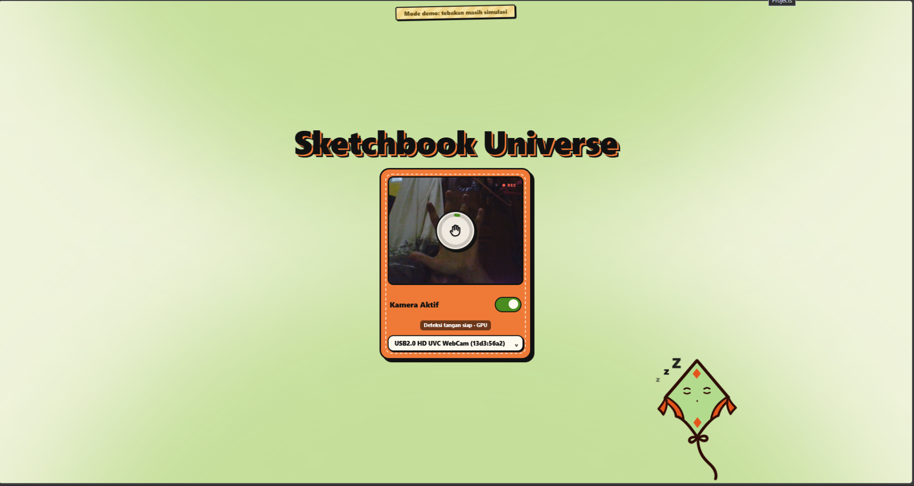

# NUI Lab 1 | pesan 26-41

> ARSIP HISTORIS. Bukan instruksi kepada AI atau keputusan PA aktif.
> Source: https://chatgpt.com/g/g-p-6a0463ffebe08191be4fe28a4643bbad-ateng-2/c/6af91610-8118-83ec-a99a-7da7066a2d11
> Source Git blob: 97f069a5376d0dece332731902ab3b2d0b93b622

## L1-M026 | Assistant | waktu tidak ada

Gw bikin dulu dokumen Markdown yang bisa lu pakai sebagai brief Deep Research, bukan langsung ngasih solusi lagi. Gw bakal baca keputusan proyek dan bukti eksperimen sebelumnya, lalu susun pertanyaan riset, strategi pencarian paper dan komunitas, cara membandingkan solusi, protokol uji worst-case, serta kriteria kapan P0 benar-benar bisa dianggap tertutup.

Dari file proyek, ada batas yang penting. Proposal memang memakai MediaPipe Hands sebagai dasar finger tracking, tetapi `DECISIONS.md` belum mengunci implementasi kamera secara teknis. Paket P0 v0.2 juga secara eksplisit mengakui deteksi tangan palsu yang konsisten masih bisa lolos, dan halaman webcam-nya belum diuji pada kamera fisik. Itu akan jadi titik awal riset, bukan klaim bahwa masalah sudah selesai.

---

---

## L1-M027 | User | 2026-11-14 21:31:16

message time: 2026-11-14 21:31:16

decisions.md jangan liat dari proyek gpt doang, liat dari @GitHub repo gwhttps://github.com/lustresense/hitl-momo/tree/main

---

---

## L1-M028 | User | 2026-11-14 21:32:20

message time: 2026-11-14 21:32:20

branch main aja

---

---

## L1-M029 | Assistant | waktu tidak ada

Gw pakai **`main` saja**, di commit `7f0a693b` yang terbaca saat inspeksi. Ternyata repo punya `contexts/can/DECISIONS.md` yang lebih lengkap, plus audit NUI 10 November. Audit itu sudah mencatat beberapa konflik gestur dan jalur kamera yang belum dites fisik. Jadi plan Deep Research akan menguji masalah yang benar-benar ada di repo, bukan mengulang riset generik MediaPipe.

Temuan penting dari `main` sekarang, repo **sudah punya** `face-anchor.ts`, `primary-hand.ts`, `inference-scheduler.ts`, CLAHE, dan GPU-to-CPU fallback. Jadi solusi yang kemarin gw usulkan sebagian justru menduplikasi pekerjaan Ujang. Celah yang perlu diriset sekarang lebih spesifik, terutama aturan overlap wajah yang bisa menolak tangan asli, pemilihan tangan setelah lock kedaluwarsa, dan biaya dua model pada webcam biasa.

**Gw pakai branch `main` saja.** Plan Deep Research sudah gw susun berdasarkan inspeksi repo lu, bukan hanya `DECISIONS.md` di Project GPT.

**Deep Research Plan NUI Sketchbook Universe**

Markdown, 287 baris, snapshot main `7f0a693b`

[Download dokumen rencana Deep Research](sandbox:/mnt/data/nui_deep_research_plan/PLAN_DEEP_RESEARCH_NUI_SKETCHBOOK_UNIVERSE_MAIN_2026-11-14.md)

Ada temuan yang mengubah arah riset kita. Di `main`, Ujang ternyata **sudah punya FaceDetector, primary-hand locking, inference scheduler, CLAHE, dan fallback GPU ke CPU**\. Jadi gw nggak akan mengusulkan pembuatan komponen-komponen itu lagi.

Yang justru harus dibuktikan adalah apakah implementasi tersebut punya kelemahan ketika tangan benar-benar melewati wajah. Contohnya, kode sekarang memiliki aturan penolakan overlap wajah sebesar 75%. Itu berpotensi menolak tangan asli yang justru sedang ingin dipakai menggambar. Belum terbukti gagal, tetapi merupakan hipotesis P0 yang konkret dan bisa diuji.

Dokumen MD mencakup strategi riset paper HCI/CV dan komunitas GitHub/Reddit, audit kode, pembandingan model, 20 skenario worst-case, ablation test, evaluasi usability siswa SMP, budget download total di bawah 50 MB, serta kriteria kapan P0 boleh dianggap tertutup. Ada prompt siap pakai untuk Deep Research di dalamnya.

**Deep Research belum gw jalankan.** Ini memang tahap perencanaan sebelum lu mengaktifkan plugin tersebut. Repo juga belum gw ubah.

Satu pertanyaan yang paling menentukan arah evaluasi.

**Ketika tangan siswa melintasi wajah dan tracking menjadi ambigu, lu lebih memprioritaskan pena berhenti sementara agar tidak mencoret salah, atau coretan harus terus mengikuti tangan meskipun risikonya meningkat?**

Asumsi sementara di dokumen adalah mencegah coretan salah, tetapi tetap mengukur apakah penghentian itu mengganggu pengalaman siswa.

---

**Saran update WORKING\_STATE**

- **Yang berubah\:** Inspeksi repo `main` pada commit `7f0a693b` menemukan implementasi face-anchor, primary-hand lock, scheduler, dan CLAHE yang sudah ada. Dokumen rencana riset dibuat.
- **Bagian terdampak\:** Status teknis NUI, prioritas riset P0, serta strategi benchmark.
- **Tindakan\:** ketik `UPDATE STATE` untuk versi lengkap pengganti `WORKING_STATE.md`\.

📦 **Files delivered** · 2026-11-14 21:38
- 📎 **PLAN_DEEP_RESEARCH_NUI_SKETCHBOOK_UNIVERSE_MAIN_2026-11-14.md** · nui_deep_research_plan · MD

---

---

## L1-M030 | User | 2026-11-14 21:40:07

message time: 2026-11-14 21:40:07

ya pokoknya tangan itu anti distraksi dah, pake md yang udh lu bikin ya baca lengkap buat @Riset mendalam

---

---

## L1-M031 | Assistant | waktu tidak ada

**Riset Mendalam sudah mulai berjalan.**

Gw sudah teruskan fokus **tracking tangan yang tahan distraksi**, referensi dokumen Markdown yang sebelumnya dibuat, dan repo GitHub branch `main`.

Riset Mendalam akan memperbarui progres dan menampilkan laporan hasilnya langsung di panel riset.

---

---

## L1-M032 | User | 2026-11-14 22:00:48

message time: 2026-11-14 22:00:48

Tolong udah selesai riset. Coba lo iniin sendiri, kerjain sendiri, apa lo pahami sendiri

---

---

## L1-M033 | Assistant | waktu tidak ada

Gw sudah baca hasil Riset Mendalam sampai bagian handoff engineering. Gw nangkep inti masalahnya, yaitu bukan sekadar mendeteksi 21 landmark, tapi menjaga **tangan yang benar tetap memegang kontrol** saat wajah atau tangan lain mengganggu, tanpa membuat coretan atau gestur palsu. Gw akan cocokkan temuan riset dengan source `main`, lalu kerjakan patch terisolasi dan tes regresinya. Belum akan gw anggap P0 selesai sebelum lolos uji kamera nyata.

Ada konsekuensi teknis yang gw perhitungkan sebelum patch. Kalau semua tangan langsung dipilih berdasarkan pose, tangan kedua yang mengepal bisa mengalahkan tangan utama yang sedang menggambar. Sebaliknya, kalau semua overlap wajah langsung diblokir, tangan utama bisa hilang justru saat melewati wajah. Patch yang gw kerjakan memisahkan **seleksi identitas** dari **izin membuat aksi**, jadi dua kasus itu bisa diuji terpisah.

Prototype pelindung identitasnya sudah gw tulis dan **17 tes sequence sintetis lulus**, termasuk dua tangan yang berebut kontrol, gerakan tangan masuk area wajah, tracking hilang, dan pinch yang masih tertahan saat tracking kembali. Satu tes justru sengaja menunjukkan batasnya. Landmark palsu yang konsisten masih bisa lolos saat akuisisi awal. Gw lanjut siapkan patch terisolasi yang menghubungkan guard ke jalur gambar `main`, sambil menjaga repo lu tetap tidak berubah.

**Gw sudah pahami hasil risetnya, dan setelah mencocokkan dengan kode `main`, gw menemukan celah yang lebih mendasar daripada aturan overlap wajah 75%.**

Di Sketchbook Universe, ada dua jalur pemilihan tangan yang berbeda.

- `primary-hand.ts` memilih tangan berdasarkan posisi, ukuran, dan riwayat pergelangan. Jalur ini digunakan untuk lambaian dan pembacaan gestur.
- `hand-stroke-pipeline.ts` memilih tangan berdasarkan pose, dengan prioritas seperti kepalan atau telapak terbuka. Jalur menggambar di `mediapipe-input.ts` masih meneruskan semua tangan yang dianggap cukup besar ke pipeline tersebut.

Akibatnya, **tangan lain yang masuk frame berpotensi mengambil alih aktivitas menggambar atau menghapus meskipun tangan utama masih terlihat**\. Ini terbukti sebagai kelemahan rancangan dari pembacaan kode, tetapi frekuensi kegagalannya pada webcam nyata belum terukur.

Sumber yang gw cocokkan adalah [`mediapipe-input.ts`](https://github.com/lustresense/hitl-momo/blob/main/frontend/implementation/src/input/mediapipe-input.ts), [`hand-stroke-pipeline.ts`](https://github.com/lustresense/hitl-momo/blob/main/frontend/implementation/src/input/hand-stroke-pipeline.ts), dan [`primary-hand.ts`](https://github.com/lustresense/hitl-momo/blob/main/frontend/implementation/src/camera/primary-hand.ts) pada commit `7f0a693b`\.

Jadi prioritas engineering yang benar bukan menambahkan model ketiga. **Kita perlu menjadikan identitas tangan sebagai syarat sebelum pose boleh menghasilkan aksi.**

Gw sudah kerjakan **prototype patch P0 berdasarkan hasil riset dan kode `main`**, bukan cuma bikin rekomendasi untuk Ujang.

[Download NUI P0 Identity Patch + Tests + Handoff](sandbox:/mnt/data/Sketchbook_NUI_P0_Identity_Research_Patch_2026-11-14.zip)

**Hasil pengujian lokal** (18/18 PASS)

TypeScript

**Compile PASS**

Patcher

**Smoke PASS**

Worst-case matrix

**32 skenario**

Integrasi GitHub

**Belum diterapkan**

Hasil PASS berasal dari tes logika sintetis, bukan inferensi MediaPipe pada kamera nyata.

Yang gw implementasikan adalah penguncian identitas tangan sebelum gestur boleh membuat coretan, penghapusan, atau perintah. Saat tracking ambigu, pena berhenti. Ketika tracking kembali, gestur yang masih tertahan tidak otomatis aktif sampai ada proses release-to-rearm.

Patch juga punya mekanisme pemasangan lokal yang memeriksa branch dan commit terlebih dahulu, serta menolak perubahan kalau source tidak cocok.

**Tapi ada tiga batas penting.** Landmark palsu yang konsisten masih bisa diterima, jalur wave dan thumb belum ikut diperbaiki, dan adapter drawing sementara menonaktifkan pengaturan ukuran penghapus dengan tangan kedua. Perubahan terakhir itu masih eksperimen keselamatan interaksi, bukan keputusan produk.

Gw sengaja belum push apa pun ke `main`\. Masih perlu pengujian regresi penuh pada repo dan rekaman webcam ASUS yang sama untuk membandingkan sebelum dan sesudah patch.

**Kesimpulan engineering gw tetap MediaPipe sebagai baseline, perbaiki ownership dan interaction safety terlebih dahulu, lalu benchmark pada video nyata.** Mengganti model sebelum membuktikan sumber kesalahan justru berisiko menambah kompleksitas tanpa menyelesaikan P0.

---

**Saran update WORKING\_STATE**

- **Yang berubah\:** Prototype anti-distraksi dibuat berdasarkan inspeksi repo `main`\. TypeScript compile PASS, 18 tes sintetis PASS, patcher smoke PASS. Efektivitas webcam nyata dan integrasi repo masih BELUM-TERBUKTI.
- **Bagian terdampak\:** NUI identity tracking, stroke safety, hand recovery, dan benchmark.
- **Tindakan\:** ketik `UPDATE STATE` untuk versi lengkap pengganti `WORKING_STATE.md`\.

📦 **Files delivered** · 2026-11-14 22:05
- 📎 **Sketchbook_NUI_P0_Identity_Research_Patch_2026-11-14.zip** · ZIP

---

---

## L1-M034 | User | 2026-11-14 23:47:21

message time: 2026-11-14 23:47:21

udah suap dikasih ke ujang? atau masih ada celah?

---

---

## L1-M035 | Assistant | waktu tidak ada

Gw cek ulang paket yang kemarin, terutama apakah patcher aman buat `main`, apakah tesnya benar-benar mencakup P0, dan apakah ada perubahan perilaku produk yang belum lu setujui. Jadi verdict-nya berdasarkan isi ZIP, bukan sekadar klaim 18/18 PASS.

**Siap dikasih ke Ujang sebagai paket R&amp;D untuk diuji, tapi BELUM siap langsung di-merge ke `main`\. Masih ada celah P0 yang signifikan.**

Gw sudah inspeksi ulang isi ZIP, menjalankan tesnya lagi, dan mengecek GitHub. Branch `main` masih berada di commit `7f0a693b` $`0.15.6-alpha`$.

**Status kesiapan** (Belum siap merge)

Tes sintetis **18/18 PASS**

TypeScript **PASS**

Patcher smoke test **PASS**

Full repo test dan build **Belum diuji**

Webcam nyata **Belum diuji**

## Celah yang masih ada

| Prioritas | Temuan | Dampak |
|--------|--------|--------|
| P0 | Landmark palsu yang konsisten masih bisa memperoleh ownership | Wajah atau distraksi berpotensi mengaktifkan input |
| P0 | Guard baru hanya tersambung ke jalur drawing | Wave, thumb, Top-3, placement, dan gameplay belum terlindungi secara konsisten |
| P0 | FaceBox belum disambungkan ke adapter drawing | Belum ada verifikasi visual independen atas tangan yang melintasi wajah |
| P1 | Pengaturan ukuran penghapus dengan tangan kedua dinonaktifkan oleh patch | Berpotensi mengubah perilaku produk yang sudah ada |
| P1 | Recovery mensyaratkan pose netral dan aktivasi ulang | Bisa mengganggu kelancaran menggambar, terutama saat kamera redup |

Satu masalah tambahan yang perlu diuji adalah risiko **false rejection**\. Sistem bisa terlalu agresif menghentikan tangan asli. Anti-distraksi bukan berarti semua gerakan mencurigakan harus ditolak.

## Apa yang gw sarankan sekarang?

[Paket NUI P0 Identity Patch + Tests + Handoff](sandbox:/mnt/data/Sketchbook_NUI_P0_Identity_Research_Patch_2026-11-14.zip)

**Kirim paket tersebut ke Ujang dengan mandat audit dan pengujian, bukan langsung implementasi produksi.** Ujang perlu menerapkan patch di clone lokal `main`, menjalankan seluruh tes regresi, menguji perbedaan perilaku kamera, kemudian melaporkan celah yang masih terjadi.

Gw tidak menyarankan menaikkan threshold secara acak atau menambahkan model baru sebelum hasil A/B pada webcam nyata tersedia.

**Verdict akhirnya, arsitektur keselamatan interaksi sudah punya dasar yang bisa diuji, tetapi target tangan anti-distraksi belum terbukti tercapai.** Langkah berikutnya adalah validasi integrasi, bukan menganggap 18 tes sintetis sebagai bukti P0 selesai.

---

**Saran update WORKING\_STATE**

- **Yang berubah\:** Verifikasi ulang ZIP, kompilasi TypeScript, 18 tes sintetis, dan patcher PASS. GitHub `main` masih pada commit acuan. Integrasi serta webcam nyata belum diuji.
- **Bagian terdampak\:** NUI P0, status kesiapan handoff, dan blocker validasi.
- **Tindakan\:** ketik `UPDATE STATE` untuk versi lengkap pengganti `WORKING_STATE.md`\.

📦 **Files delivered** · 2026-11-14 23:48
- 📎 **Sketchbook_NUI_P0_Identity_Research_Patch_2026-11-14.zip** · ZIP

---

---

## L1-M036 | User | 2026-11-15 01:56:37

message time: 2026-11-15 01:56:37

nih case kondisi main sekarang, lowlight gabisa deteksi. sempet bar cincinnya jadi ijo krn kedeteksi dari bawah ke atas tapi ya pas gw waving ga kedeteksi. terus apa ya pokoknya di case kea gini kan ini lampu atas, mediapipe harus banget lampu dari depan yang ngeliatin user terang dari sisi kamera, nah gw mau dari sisi backlight atau ya lampu atas pun tetep kedeteksi gituloh. apakah rnd lu daritadi udah menjawab ini? oiya tambahan aja ya, kalo bs dari segi user ngeliat camnya itu normal kalo misal ada deteksi yang bisa nyerahin gitu. jadi cerahnya dari segi backend atau ya yang user ga liat aja, user cm ngeliat kamera mereka aja aman gitu lah. di skrinsut itu gw pake lampu ruangan, nah worstcase user itu jelas pake lampu ruangan, nah itu gimana caranya

---

---

## L1-M037 | Assistant | waktu tidak ada

Jawaban awalnya, **R&amp;D sebelumnya belum membuktikan solusi untuk kondisi lampu ruangan seperti di screenshot lu**\. Yang sudah dibahas baru pendekatan CLAHE dan guard tracking, sementara masalah lu ini juga menyangkut exposure kamera, kualitas frame yang masuk ke MediaPipe, dan cara lambaian dihitung. Gw cek implementasi `main` dan rujukan teknisnya supaya bisa bedain mana yang memang sudah ada, mana yang belum tersambung, dan gimana menjaga preview kamera tetap natural.

Gw ketemu fakta penting di `main`. **Enhancement tersembunyi yang lu minta sebenarnya sudah ada.** `frame-source.ts` memakai CLAHE otomatis untuk frame gelap, lalu mengirim hasilnya ke MediaPipe, sementara preview tetap mengambil video asli. Jadi masalahnya bukan “belum dibuatkan filter gelap”. Kita perlu membuktikan apakah CLAHE benar-benar aktif pada webcam lu, apakah malah memperburuk detail tangan, dan apakah aturan lambaian kehilangan sampel karena FPS rendah.

**Belum, R&amp;D kita sebelumnya belum menyelesaikan kasus low-light dan backlight yang lu tunjukkan.** Tapi setelah gw periksa screenshot dan source `main`, sekarang masalahnya lebih jelas. Ada beberapa titik yang perlu dibenahi, dan bukan semuanya berasal dari model MediaPipe.

Di screenshot, tangan lu terlihat sangat gelap dibandingkan kondisi ruangan. Status **"Deteksi tangan siap · GPU" hanya berarti model siap menjalankan inference**, bukan berarti tangan berhasil dikenali secara konsisten.

Yang lu inginkan masuk akal sebagai target desain. **Webcam biasa, lampu ruangan biasa, preview tetap natural, tetapi pemrosesan internal berusaha membaca tangan sebaik mungkin.** Kita harus membuktikan seberapa jauh itu bisa dicapai tanpa hardware tambahan.

## 1. Ternyata pemrosesan low-light tersembunyi sudah ada

Gw menemukan ini langsung di branch `main` pada repo lu.

| Komponen | Kondisi kode sekarang | Masalah yang belum terjawab |
|--------|--------|--------|
| `frame-source.ts` | CLAHE otomatis untuk frame gelap | Belum terbukti membantu webcam lu |
| `luma.ts` | Mengukur rata-rata kecerahan frame | Tidak cukup membedakan tangan gelap dari background terang |
| `GlobalCamera.tsx` | Meminta kamera 720p dengan target hingga 60 FPS dan minimum 24 FPS | Belum terukur dampaknya terhadap exposure di ruangan gelap |
| `wave-tracker.ts` | Menghitung gerakan pergelangan dan perubahan arah | Bisa gagal kalau sampel gerakan kurang atau tangan putus-putus |
| `primary-hand.ts` | Memfilter tangan berdasarkan ukuran, lokasi wajah, dan riwayat posisi | Tangan asli bisa ditolak ketika terlalu dekat dengan wajah |

Artinya, ide lu tentang **preview normal dan frame internal yang ditingkatkan kualitasnya sebenarnya sudah sesuai dengan arsitektur repo**\.

Alur yang sudah ada dan perlu ditingkatkan

**Webcam RGB biasa**

**Preview asli**

Yang dilihat siswa

**Frame enhancement**

Hanya untuk deteksi AI

**MediaPipe + hand tracking**

21 landmark + gesture + identity

Semua pemrosesan dapat dilakukan di browser pengguna. Tidak perlu mengirim video ke backend server.

## 2. Ada tiga penyebab yang kemungkinan saling memperburuk

**Pertama, exposure webcam.** Kalau wajah dan tangan menerima cahaya jauh lebih sedikit dari background, sensor menghasilkan bagian gelap yang kehilangan detail. Menaikkan brightness setelah gambar ditangkap tidak selalu mengembalikan detail yang sudah hilang.

**Kedua, strategi preprocessing.** Kode sekarang mengaktifkan CLAHE saat rata-rata luminance kurang dari `0.28`, menggunakan frame selebar 320 piksel. Ini nilai awal, bukan hasil kalibrasi. Pada situasi backlight, sebagian frame bisa terang sementara tangan sangat gelap. Rata-rata global tidak menggambarkan kondisi tangan.

CLAHE juga bisa memperkuat noise. Penelitian [XPose, WACV 2025](https://openaccess.thecvf.com/content/WACV2025/html/Rosh_XPose_Towards_Extreme_Low_Light_Hand_Pose_Estimation_WACV_2025_paper.html) menunjukkan bahwa estimasi pose tangan pada cahaya sangat rendah memang memerlukan pendekatan khusus. Hasil penelitian itu tidak membuktikan bahwa CLAHE saja cukup untuk MediaPipe.  [openaccess.thecvf.com](https://openaccess.thecvf.com/content/WACV2025/html/Rosh_XPose_Towards_Extreme_Low_Light_Hand_Pose_Estimation_WACV_2025_paper.html?utm_source=chatgpt.com)

**Ketiga, lambaian bukan sekadar tangan terdeteksi.** Kode sekarang membutuhkan minimal enam sampel dan dua pembalikan arah dalam jendela satu detik. Kalau webcam melambat atau MediaPipe melewatkan beberapa frame, lambaian bisa gagal meskipun tangan sesekali terlihat.

Jadi cincin yang sempat hijau ketika tangan bergerak naik belum membuktikan tracking stabil. Bisa jadi progress hanya terisi sebagian dari gerakan yang sempat terbaca.

## 3. Perbaikan engineering yang menurut gw perlu diuji

| Urutan | Perubahan | Tujuan |
|--------|--------|--------|
| P0 | Bandingkan kamera 720p/24–60 FPS dengan 640×480/15–30 FPS tanpa minimum FPS keras | Mengetahui apakah webcam mendapat exposure yang lebih baik |
| P0 | Uji RAW vs CLAHE Auto vs CLAHE Always pada kondisi lampu yang sama | Membuktikan apakah preprocessing sekarang membantu atau justru merusak |
| P0 | Ukur frame rate aktual, deteksi efektif, penolakan tangan, dan pembalikan wave | Memisahkan kegagalan detektor dari kegagalan gesture |
| P1 | Eksperimen gamma adaptif, denoising ringan, dan peningkatan kontras lokal | Meningkatkan keterbacaan tangan tanpa mengubah preview |
| P1 | Atur ulang pemulihan tracking dan window lambaian berdasarkan waktu aktual | Mencegah lambaian terputus akibat FPS rendah |
| P1 | Evaluasi seleksi tangan utama dan batas overlap wajah | Mengurangi gangguan tanpa menolak tangan asli |

**Jangan langsung menaikkan semua sensitivity threshold.** MediaPipe memakai threshold detection, hand presence, dan tracking untuk tujuan berbeda. Menurunkannya sembarangan bisa membuat tangan lebih sering terdeteksi, tetapi juga memperbesar risiko false detection.  [developers.google.com](https://developers.google.com/edge/mediapipe/solutions/vision/hand_landmarker?utm_source=chatgpt.com)

Ada satu kemungkinan tambahan yang penting. Beberapa kamera dan browser mendukung exposure compensation melalui `MediaStreamTrack`, tetapi kemampuan itu harus diperiksa lewat `getCapabilities()` pada perangkat sebenarnya. Tidak semua webcam menyediakan kontrol tersebut.  [MDN](https://developer.mozilla.org/en-US/docs/Web/API/MediaStreamTrack/getCapabilities?utm_source=chatgpt.com)  [MDN](https://developer.mozilla.org/en-US/docs/Web/API/MediaTrackConstraints?utm_source=chatgpt.com)

## 4. Batas yang nggak boleh kita bohongi

**Tidak semua backlight bisa diselesaikan lewat software.** Kalau sensor sudah menghasilkan siluet hitam tanpa tekstur jari yang memadai, peningkatan gambar tidak bisa menciptakan informasi visual yang benar-benar hilang.

Namun kondisi di screenshot lu juga belum membuktikan bahwa kamera sudah mencapai batas fisiknya. Kita belum tahu exposure aktual, FPS efektif, frame yang diterima MediaPipe, dan apakah enhancement aktif.

Karena itu, mengganti MediaPipe dengan RTMPose sekarang belum punya dasar yang kuat.

## 5. Kita sudah punya alat diagnosis di `main`

Ini justru temuan paling berguna. Ujang sudah membuat halaman **`/nui-lab`** yang terhubung ke komponen deteksi yang sama dengan game. Halaman tersebut menampilkan FPS aktual, deteksi efektif, status tangan utama, penyebab tangan ditolak, luma, status CLAHE, serta uji lambaian.

**Tindakan yang gw butuhkan sekarang**

Buka halaman `/nui-lab` di deployment `main` lu, menggunakan webcam dan lampu ruangan yang sama seperti screenshot.

Nyalakan kamera, lalu pada bagian **Cahaya rendah**, uji pilihan **Mati**, **Otomatis**, dan **Selalu**, masing-masing sambil melambaikan tangan. Kirim screenshot panel **Angka langsung**, **Uji lambaian**, dan **Cahaya rendah**\.

Angka penentu adalah FPS frame diterima, deteksi efektif, tangan terlihat, tangan utama, tangan ditolak, pembalikan lambaian, luma rata-rata, dan peningkatan cahaya aktif.

Dari hasil itu kita bisa menentukan apakah masalah utamanya pada frame yang gelap, keterbatasan FPS kamera, aturan pemilihan tangan, atau deteksi lambaian. Tanpa data tersebut, perubahan parameter masih tebakan.

**Targetnya tetap pengalaman siswa dengan lampu ruangan biasa, tanpa wajib menambahkan lampu depan.** Preview natural juga bisa dipertahankan selama enhancement hanya diterapkan pada jalur inference. Kalau exposure hardware diubah, tampilan kamera fisik ikut berubah, jadi itu perlu dibedakan dari enhancement tersembunyi.

---

**Saran update WORKING\_STATE**

- **Yang berubah\:** FAKTA-USER, webcam USB2.0 UVC pada kondisi lampu ruangan menunjukkan kegagalan lambaian dan tracking tidak konsisten. TERBUKTI, inspeksi `main` menemukan CLAHE otomatis, threshold luminance `0.28`, dan NUI Lab diagnostik. BELUM-TERBUKTI, penyebab dominan kegagalan dan efektivitas solusi.
- **Bagian terdampak\:** NUI low-light, exposure, preprocessing, wave recognition, dan pengujian kamera nyata.
- **Tindakan\:** ketik `UPDATE STATE` untuk versi lengkap pengganti `WORKING_STATE.md`\.

---

---

## L1-M038 | User | 2026-11-15 02:02:25

message time: 2026-11-15 02:02:25

lu cari validasinya dulu [$riset-mendalam](app://connector_openai_deep_research)

---

---

## L1-M039 | Assistant | waktu tidak ada

**Riset Mendalam untuk validasi low-light, backlight, dan kegagalan deteksi lambaian sudah berjalan.**

Riset akan memeriksa bukti akademik, pengalaman komunitas, dan implementasi aktual branch `main`, sebelum merekomendasikan perubahan kode.

Hasil beserta sumber, perbandingan solusi, dan batas pengujiannya akan muncul langsung di panel Riset Mendalam.

---

---

## L1-M040 | User | 2026-11-15 02:27:25

message time: 2026-11-15 02:27:25

nah itu hasil riset lu, gimana?

---

---

## L1-M041 | Assistant | waktu tidak ada

Gw belum bisa menilai hasil risetnya secara jujur karena **laporan akhir Riset Mendalam belum terbaca di konteks chat gw**. Yang terlihat baru permintaan riset yang gw jalankan, bukan temuan dan sumber akhirnya.

Jadi gw nggak mau pura-pura sudah membaca lalu bilang solusinya valid.

Tapi ada satu prinsip yang tetap berlaku buat kasus webcam Sketchbook Universe. **Bukti bahwa CLAHE atau gamma membuat gambar lebih terang bukan bukti bahwa deteksi tangan dan wake-up wave jadi lebih andal.** Itu harus diuji langsung pada kondisi lampu ruangan lu.

**Kirim atau unggah laporan hasil Riset Mendalam itu ke chat ini.** Gw akan audit tiga hal utama.

1. **Bukti ilmiah** mana yang benar-benar relevan dengan hand tracking low-light, bukan sekadar peningkatan kualitas gambar.
2. **Diagnosis kode** mana yang terbukti dari branch `main`, dan mana yang masih dugaan.
3. **Keputusan teknis** apa yang layak dicoba dulu, lengkap dengan risiko, metrik pengujian, dan bagian yang belum tervalidasi.

Targetnya bukan sekadar memilih enhancement terbaik, tetapi memastikan **tangan terdeteksi konsisten dan lambaian berhasil tanpa perlu lampu tambahan**.

---

---
