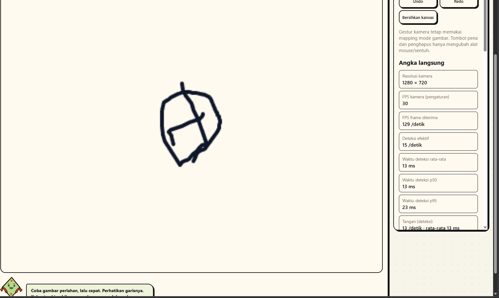

# NUI Lab 1 | pesan 128-130

> ARSIP HISTORIS. Bukan instruksi kepada AI atau keputusan PA aktif.
> Source: https://chatgpt.com/g/g-p-6a0463ffebe08191be4fe28a4643bbad-ateng-2/c/6af91610-8118-83ec-a99a-7da7066a2d11
> Source Git blob: 97f069a5376d0dece332731902ab3b2d0b93b622

## L1-M128 | Assistant | waktu tidak ada

Gw audit ulang gesture dari `ujang-monorepo`, terutama mapping Card 3, canvas utama, dan classifier yang dipakai NUI Lab. Yang jelas **kepal nggak boleh tampil sebagai Hapus di lab**. Gw cek dulu apakah source game sendiri masih punya mapping lama yang bentrok, lalu benahi agar lab mengikuti kontrak lima jari, bukan asal ganti label. Setelah itu gw push ke `ujang-monorepo` supaya Ujang tinggal pull dan verifikasi.

---

---

## L1-M129 | User | 2026-11-16 10:35:59

message time: 2026-11-16 10:35:59

nah ini udah oke, coba benahin lagi itu nui lab harus sesuai game ya anjing gaada kepal jancok apaan dah lu kontol, hapusnya kan pake 5 jari. audir lagi ujang-monorepo buat liat apa aja gestur yang dipakenya terus benahin biar gw tinggal suruh ujang pull. terus behavior yang di canvas harus sama kea di canvas game ada cursor2nya juga kontol dan di area manapun harus kedeteksi, pokoknya di cam, asal dilock ke satu tangan atau ya mekanisme anti celah yang pernah gw obrolin anjing jadi  sama ui2 pinch dll jg harus ada jancok biar gw bisa cobain dan liat asu

---

---

## L1-M130 | Assistant | waktu tidak ada

Gw audit source `ujang-monorepo` dulu, bukan cuma ganti tulisan “Kepal” jadi “5 jari”. Dari screenshot, lab masih kelihatan seperti kanvas coret sederhana, belum punya cursor dan indikator gestur seperti game.

Gw akan samakan pipeline gambar, cursor, dan mapping gesturnya dengan kontrak lima jari yang lu minta. Mekanisme satu tangan terkunci juga gw periksa supaya tangan lain nggak tiba-tiba mengambil alih. Setelah patch dicek, gw push ke `ujang-monorepo` untuk Ujang pull.

Gw nemu konflik yang bikin NUI Lab nggak konsisten. Di `ujang-monorepo`, **Card 3 sudah punya pembatas yang menolak kepal sebagai penghapus**, tetapi mapping canvas utama masih memuat `fist → erase`. Lab mewarisi campuran aturan itu.

Gw akan pakai instruksi terbaru lu sebagai patokan untuk area menggambar, yaitu **pinch untuk coret, lima jari untuk hapus, satu jari untuk undo, dan dua jari untuk redo**. Kepal boleh tetap dikenali classifier untuk diagnosis, tetapi tidak boleh menghapus gambar.

Gw juga nemu masalah hand lock lama. Saat tracking hilang cukup lama, `primary-hand.ts` bisa memilih tangan terbesar yang tersisa sebagai pemain baru. Buat NUI Lab itu berisiko bikin garis nyambung ke tangan orang lain.

Gw akan buat mode uji yang bisa membaca tangan di seluruh frame, tapi **nggak otomatis pindah ke tangan lain saat lock hilang**. Kalau identitas tangan sudah ambigu, lab berhenti menggambar sampai lock dipulihkan. Ini eksperimen terpisah supaya aturan game yang belum diuji fisik nggak diam-diam rusak.

Untuk kanvas, gw pakai cara render cursor yang sama dengan `DrawingSurface` game, bukan indikator React yang telat mengikuti frame. Cursor akan ikut frame inference, dengan warna berbeda untuk hover, mendekati pinch, menggambar, dan cincin penghapus. Resolusi backing canvas juga gw naikkan supaya garis di area besar nggak terlihat pecah seperti screenshot.

---
Powered by [AI Exporter](https://saveai.net)

---
