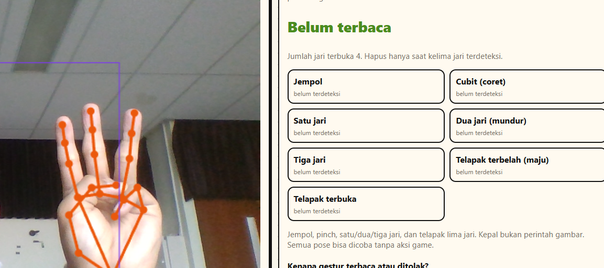

# NUI Lab 4 | pesan 15-26

> ARSIP HISTORIS. Bukan instruksi kepada AI atau keputusan PA aktif.
> Source: https://chatgpt.com/g/g-p-6a0463ffebe08191be4fe28a4643bbad-ateng-2/c/6afb0520-54b0-83ec-b789-6680fdb7cb15
> Source Git blob: e04d43f2ce0067c893759488179e9a36c826be8a

## L4-M015 | Assistant | waktu tidak ada


Gw cek dulu `AGENTS.md` yang sudah ada di repo, termasuk aturan root, folder Can, dan frontend. Terus gw bandingkan dengan `SOUL.md` proyek dan kebutuhan workflow lu sekarang, khususnya Ujang, Codex, code-server, dan pergantian akun Antigravity.

Gw fokus audit, belum mengubah file.

Repo lu ternyata sudah punya tiga lapis `AGENTS.md`, `SOUL.md`, dan delapan skill di area Can. Jadi nggak perlu bikin sistem instruksi baru dari nol.

Masalah yang gw temukan justru ada di konsistensi aturannya. Sebagian masih menyuruh kerja di `ujang-monorepo` dan melarang `main`, sementara pekerjaan NUI terbaru sudah masuk `main`. Ada juga aturan auto-promotion lama yang berpotensi bikin agent salah mengambil izin push. Gw cek satu lapis rules dan handoff terakhir sebelum kasih susunan yang paling aman buat pergantian akun.

**Menurut gw, lu nggak perlu bikin `AGENTS.md` baru. Repo lu sudah punya sistem agent yang cukup lengkap, tapi belum cukup konsisten untuk langsung dipercayakan ke Antigravity tanpa audit dan perapian.**

Gw sudah cek langsung branch `main` dan `ujang-monorepo`\. File instruksinya identik di kedua branch.

## Yang sudah ada di repo lu

**Root `AGENTS.md`**

Routing Can/Dias, ownership, keamanan Git, versioning dan deployment

**`contexts/can/AGENTS.md`**

Peran orchestrator/worker, urutan sumber, dokumentasi keputusan dan aturan delegasi

**`frontend/implementation/AGENTS.md`**

Aturan implementasi UI, gameplay, testing, build, dan boundary frontend

**`contexts/can/SOUL.md`**

Sudah memuat Mode Cermin Jujur, aturan anti-halu, audit keputusan dan tone of voice

**6 rules dan 8 agent skills**

Termasuk project bootstrap, source authority, orchestrator, memory handoff, verification loop dan parsing-optimize

Secara struktur, fondasinya sudah ada. Masalahnya ada di detail.

## Gap yang gw temukan

| Masalah | Risiko |
|--------|--------|
| Root AGENTS masih memuat auto-promotion `claude-monorepo` ke `main` | Agent bisa salah membaca izin merge |
| Instruksi November 15 mengunci kerja ke `ujang-monorepo`, tetapi NUI terbaru sudah masuk `main` | Agent bisa memilih baseline yang salah |
| `SESSION_HANDOFF.md` masih snapshot 5 November | Sesi baru bisa menganggap progres lama sebagai keadaan sekarang |
| Ada aturan bootstrap dan versioning yang berulang | Instruksi rawan bertentangan ketika diperbarui |
| `WORKING_STATE.md` lengkap dari ChatGPT Project tidak otomatis tersedia di Antigravity | Konteks tooling yang lu punya di sini belum tentu terbaca |

**Jadi apakah agent Antigravity otomatis bakal bekerja kayak gw di sini? Belum.**

`SOUL.md` memang sudah memuat perilaku yang lu mau, tetapi agent harus benar-benar membacanya. File instruksi tidak menjamin model memahami seluruh riwayat keputusan, mengingat semua chat sebelumnya, atau selalu patuh.

## Better AGENTS atau SOUL-SESSION?

Gw lebih menyarankan **rapikan AGENTS yang ada dan bikin handoff sesi pendek**, bukan `SOUL-SESSION.md` kedua.

Susunan idealnya begini.

**Repository**

`AGENTS.md` sebagai aturan utama lintas agent

`contexts/can/SOUL.md` sebagai perilaku dan gaya kerja

`contexts/can/DECISIONS.md` sebagai keputusan produk

`contexts/can/NOW.md` sebagai status teknis terkini

`SESSION_HANDOFF.md` sebagai checkpoint untuk melanjutkan sesi

Handoff cukup berisi branch dan SHA terakhir, task berjalan, perubahan yang belum di-commit, bukti QA, blocker, file ownership, serta langkah berikutnya. Bukan salinan seluruh `SOUL.md`\.

Untuk Codex dan Antigravity, pendekatan ini masuk akal karena keduanya mendukung `AGENTS.md`\. Antigravity juga mendukung `.agents/rules/`, sedangkan Codex memakai hierarki `AGENTS.md`\.  [Google Antigravity Docs](https://antigravity.google/docs/rules/?utm_source=chatgpt.com) [ChatGPT Learn](https://learn.chatgpt.com/docs/agent-configuration/agents-md?utm_source=chatgpt.com)

## Soal ganti akun Antigravity

Ini bagian yang penting buat setup lu.

Selama lu membuka checkout repo yang sama di code-server, file instruksi dan checkpoint Git tetap tersedia ketika akun agent berubah. **Tetapi histori percakapan, memori sesi, dan pekerjaan yang belum disimpan tidak otomatis ikut berpindah.**

Makanya yang diperlukan bukan bikin AI mengingat semuanya, melainkan membuat sesi baru bisa membaca keadaan proyek dengan benar dari repo. Simpan konteks kerja di file proyek, bukan hanya di chat atau profil akun. Kredensial dan token tetap di luar repo, serta ikuti aturan akses penyedia.

**Rekomendasi gw sekarang** adalah audit dan rapikan tiga `AGENTS.md` yang ada, pertahankan satu `SOUL.md`, lalu perbarui `SESSION_HANDOFF.md` yang sudah kedaluwarsa. Sesudah itu uji dengan sesi Codex atau Antigravity baru dalam mode read-only. Minta agent menyebutkan keputusan aktif, branch, batas ownership, blocker, dan apa yang tidak boleh dilakukan. Kalau jawabannya masih keliru, belum aman memberinya izin implementasi.

Belum ada file yang gw ubah.

### Saran update WORKING\_STATE

- **Yang berubah\:** Lu menjelaskan rencana menggunakan Antigravity melalui code-server dengan perpindahan akun manual. Audit repo menemukan instruksi agent sudah tersedia, tetapi terdapat konflik branch dan handoff lama.
- **Bagian terdampak\:** Tooling AI, agent bootstrap, session continuity, dan keamanan workflow Git.
- **Tindakan\:** ketik `UPDATE STATE` untuk versi lengkap pengganti `WORKING_STATE.md`\.

---

---

## L4-M016 | User | 2026-11-17 09:43:19


message time: 2026-11-17 09:43:19

menurut lu gimana? jadi buat agent apapun itu entah claude code, agy, codex itu semua bisa paaham gituloh dan langsung ngeh. nah di agents.md root itu disuruh, kalo ini user adalah can, masuk ke konteks can dan baca agents.md di dalem dan suruh ikutin semua sop nya

---

---

## L4-M017 | Assistant | waktu tidak ada


**Gw setuju dengan arah lu. Root `AGENTS.md` seharusnya jadi pintu masuk universal untuk Claude Code, Antigravity, Codex, atau agent lain.** Begitu agent tahu dia sedang mengerjakan scope CAN, dia wajib masuk ke `contexts/can/AGENTS.md` dan mengikuti seluruh SOP di dalamnya.

Tapi gw mau perbaiki sedikit konsepnya. **Jangan hanya mengandalkan identitas pengguna.** Routing harus memakai identitas *dan* scope pekerjaan, supaya agent nggak salah ketika CAN sedang meminta perubahan yang menyentuh backend milik Dias atau kontrak bersama.

Struktur yang gw sarankan seperti ini.

**Agent apa pun masuk ke repo**

Claude Code / Antigravity / Codex / lainnya

**Root `AGENTS.md`**

Deteksi peran, routing, aturan keselamatan bersama

CAN

contexts/can/AGENTS.md

SOUL, DECISIONS, SOP, state, source

DIAS

contexts/dias/AGENTS.md

SOP, backend, ML, dashboard, kontrak

**Baca konteks → audit → kerjakan → verifikasi → handoff**

Sesuai izin dan bukti, bukan asumsi agent

Jadi root hanya perlu menyuruh agent masuk ke konteks yang benar. Detail SOP tidak perlu diduplikasi ke root.

## Tapi ada satu masalah teknis penting

Setelah gw cek dokumentasi masing-masing agent, ada perbedaan cara mereka membaca instruksi.

| Agent | Cara membaca instruksi |
|--------|--------|
| **Codex** | Otomatis membaca `AGENTS.md` berdasarkan direktori kerja. File CAN yang berada di cabang folder lain tetap perlu dirujuk eksplisit.  [ChatGPT Learn](https://learn.chatgpt.com/docs/agent-configuration/agents-md?utm_source=chatgpt.com) |
| **Antigravity** | Mendukung `AGENTS.md`, tetapi tidak otomatis memuat instruksi dari subfolder di bawah workspace aktif.  [Google Antigravity Docs](https://antigravity.google/docs/rules/?utm_source=chatgpt.com) |
| **Claude Code** | Mengutamakan `CLAUDE.md`, yang bisa mengimpor `AGENTS.md` melalui `@AGENTS.md`\.  [Claude Code Docs](https://code.claude.com/docs/id/features-overview?utm_source=chatgpt.com) |

Artinya desain routing lu benar, tetapi perlu **adapter tipis untuk Claude Code** dan perintah membaca file CAN secara eksplisit di root.

Ini contoh inti aturan yang akan gw masukkan ke root.

```markdown

## Mandatory Agent Bootstrap

Applies to all agents regardless of model, IDE, or account.

Before analysis, planning, editing, or delegation:

1. Read this repository's root AGENTS.md.
2. Determine the task owner from explicit user instructions
   and the affected repository scope.
3. If the owner is CAN or the task concerns CAN's scope:
   - Read contexts/can/AGENTS.md completely.
   - Follow its mandatory bootstrap and all applicable SOPs.
   - Read SOUL.md, DECISIONS.md, source-of-truth,
     current state, and task-specific documentation.
4. If the owner is DIAS:
   - Read contexts/dias/AGENTS.md and its applicable SOPs.
5. For cross-owner work:
   - Read both contexts and the relevant shared contracts.
   - Respect separate ownership and approval boundaries.
6. Never assume nested instructions were loaded automatically.
7. Resolve conflicts using the latest explicit Owner instruction
   and the repository's source-authority rules.
8. Before modifying files, report the effective branch,
   commit SHA, task scope, constraints, and evidence gaps.

Do not edit, commit, push, merge, or deploy when the
current task authorizes audit or discussion only.
```

## Satu temuan tambahan

Empat file `.agents/rules/` CAN yang gw periksa tidak memiliki YAML frontmatter. Dokumentasi Antigravity menyatakan file rule tanpa `trigger` yang valid bisa diabaikan. Jadi **file-nya ada, tetapi belum tentu aktif di Antigravity**\.  [Google Antigravity Docs](https://antigravity.google/docs/rules/?utm_source=chatgpt.com)

Ini perlu diperbaiki juga. Bukan dengan menduplikasi isinya, tetapi membenahi cara rule diaktifkan.

## Rekomendasi susunan akhirnya

1. **Root `AGENTS.md`** sebagai universal router, aturan bersama dan pengaman.
2. **CAN/Dias `AGENTS.md`** sebagai SOP khusus pemilik scope.
3. **`SOUL.md`** tetap satu, bukan digandakan ke `SOUL-SESSION.md`\.
4. **Root `CLAUDE.md`** pendek sebagai adapter ke `AGENTS.md`\.
5. **`SESSION_HANDOFF.md`** untuk kesinambungan kerja lintas sesi dan akun.
6. **Skills dan rules** dipakai sesuai kebutuhan, dengan format yang benar untuk harness terkait.

Dan satu hal lagi yang wajib dibenahi sebelum ini dipakai adalah aturan branch. Root masih punya release flow lama yang bisa dibaca sebagai izin otomatis ke `main`, padahal repo sekarang punya beberapa branch dengan status berbeda.

**Targetnya bukan agent menghafal semua konteks, tetapi agent mana pun mengikuti prosedur yang sama, mengetahui keputusan yang berlaku, tidak menghidupkan keputusan lama, dan tidak melakukan tindakan di luar izin.**

Itu yang menurut gw paling mendekati perilaku konsisten lintas Claude Code, Antigravity, dan Codex. Semua itu tetap perlu diuji dengan sesi baru, bukan dianggap berhasil hanya karena file instruksinya sudah dibuat.

Belum ada perubahan repo dari pembahasan ini.

---

---

## L4-M018 | User | 2026-11-17 09:46:56


message time: 2026-11-17 09:46:56

claude sekarang ga hrus claude.md cok, dia pake agents.md jg udah paham, asal di session itu gw bilang selalu baca agents.md kan kelar??? pokoknya agents.md menunjuk semua file2md yang berkaitan semuanya dokumentasi lancar jancok lah auto gitu anjing benahin, rules di folder itu ngaruh apa engga gatau dah lu atur asal general itu aman. lu audit sendiri terus lu riset terus lu benahin repo gw yang main

---

---

## L4-M019 | Assistant | waktu tidak ada


Gw bakal benahin langsung di `main`, sesuai izin terbaru lu. Gw audit dulu routing `AGENTS.md`, SOP CAN/Dias, rules, handoff, dan versioning, lalu cek dokumentasi resmi Claude Code, Codex, serta Antigravity.

Targetnya satu jalur bootstrap yang jelas untuk semua agent, tanpa menduplikasi aturan atau mengandalkan memori akun. Setelah edit, gw periksa konsistensi dokumen dan verifikasi commit GitHub.

Gw sudah nemu sumber konflik utamanya. Di SOP lama, jalur `claude-monorepo → main` masih tertulis otomatis, padahal instruksi terbaru lu memberi izin khusus untuk membenahi `main` sekarang, bukan izin permanen bagi semua agent.

Gw juga cek folder dokumen tim yang benar. Path-nya `contexts/can/docs/team/`, bukan `docs/team/` di root. Gw akan rapikan rujukan ini, aktifkan rules yang valid, dan buat checkpoint sesi yang menunjuk status `0.22.0-alpha` serta draft PR `0.22.1-alpha` tanpa menganggapnya sudah lolos QA.

Gw akan pakai satu jalur SOP yang sama untuk semua agent, tanpa membuat `CLAUDE.md` atau `SOUL-SESSION.md` tambahan. Root akan memaksa routing berdasarkan owner dan scope, CAN akan menunjuk seluruh sumber wajib, lalu rules diberi format yang bisa dibaca Antigravity.

Ada satu konsekuensi versioning yang gw jaga. Draft PR #5 sudah memakai `0.22.1-alpha`, jadi perubahan SOP ini akan dicatat sebagai batch revisi Owner berikutnya, tanpa menimpa PR atau menggabungkan kode NUI-nya.

---

---

## L4-M020 | User | 2026-11-17 09:52:45


message time: 2026-11-17 09:52:45

ubah folder contexts jadi owners ga sih biar enak dan paham itu semu agent

---

---

## L4-M021 | Assistant | waktu tidak ada


Riset dokumentasi resmi sudah mengonfirmasi dua hal. Antigravity membaca `AGENTS.md` berdasarkan scope direktori, dan file modular `.agents/rules/*.md` membutuhkan frontmatter `trigger` yang valid. Claude Code versi baru juga bisa memakai `AGENTS.md` langsung, jadi gw nggak akan menambah `CLAUDE.md`\.  [Google Antigravity Docs](https://antigravity.google/docs/rules/?utm_source=chatgpt.com) [Google Antigravity Docs](https://antigravity.google/docs/build-plugins/?utm_source=chatgpt.com) [Claude Code Docs](https://t.co/dnc98oxXhg?utm_source=chatgpt.com)

Sekarang gw rapikan router dan aturan hidupnya. Folder tetap `contexts/`, dengan penamaan konsep *Owner Context Registry*\. Arsip aturan lama dipertahankan lewat riwayat Git, bukan dijadikan instruksi aktif yang saling bertentangan.

Patch sudah masuk ke `main` sebagai satu commit, tanpa rename folder. Root `AGENTS.md` sekarang menjelaskan `contexts/` sebagai registry CAN/Dias, dan aturan branch lama tidak lagi dibaca sebagai izin merge otomatis.

Gw sedang cek ulang commit remote, rujukan file, frontmatter rules, dan konsistensi versi. PR NUI #5 tetap terpisah.

**Audit awal nemu tiga masalah yang memang perlu diberesin di repo, bukan bikin sistem agent baru.**

1. Root `AGENTS.md` sudah mengarahkan pekerjaan CAN ke `contexts/can/AGENTS.md`, tetapi masih memuat aturan branch lama dan prosedur auto-merge yang bisa salah dibaca sebagai izin.
2. Enam file di `contexts/can/.agents/rules/` belum punya frontmatter aktivasi. Dokumentasi Antigravity saat ini menyatakan rule seperti itu bisa diabaikan.  [Google Antigravity Docs](https://antigravity.google/docs/rules/?utm_source=chatgpt.com)
3. Beberapa petunjuk memakai path dokumentasi lama, sementara repo sudah menggunakan struktur monorepo.

Desain yang gw terapkan adalah **root sebagai router universal, CAN/Dias sebagai pemilik SOP, dan handoff sebagai catatan sesi**, tanpa `SOUL-SESSION.md` baru. Agent harus membaca file yang ditunjuk secara eksplisit, bukan menganggap semua instruksi otomatis sudah termuat.

**Menurut gw, jangan rename `contexts/` jadi `owners/` sekarang.** Nama `owners/` memang lebih jelas buat manusia, tapi seluruh routing dan SOP repo lu sudah memakai `contexts/can/` dan `contexts/dias/`\.

Memindahkannya sekarang berarti harus memperbaiki semua referensi MD, script, skill, dan kemungkinan konfigurasi tooling. Risiko ada referensi yang putus lebih besar daripada manfaat mengganti nama folder.

**Solusi yang lebih aman** adalah tetap menggunakan `contexts/`, tetapi membuat root `AGENTS.md` menjelaskannya sebagai *Owner Context Registry*\. Jadi agent langsung paham bahwa CAN dan DIAS adalah dua scope kepemilikan, bukan dua proyek terpisah.

Gw pertahankan struktur folder itu dalam pembenahan `main` yang sedang berjalan.

**Pembenahan sudah berhasil di-push ke `main` dan gw verifikasi langsung dari GitHub.**

**Commit `093947defca0`**

| Detail | Hasil |
|--------|--------|
| Repository | `lustresense/hitl-momo` |
| Branch | `main` |
| Versi baru | `0.23.0-alpha` |
| File berubah | 23 |
| Enam CAN rules | Frontmatter valid |
| Root Antigravity rule | Ditambahkan |
| `DECISIONS.md` | Tidak diubah |
| PR \#5 | Tetap Draft, belum merge |

[Lihat seluruh perubahan GitHub](https://github.com/lustresense/hitl-momo/commit/093947defca0add6237bdf2ca083bee14a87dd1b)

Yang gw benahi meliputi root `AGENTS.md`, router CAN dan frontend, `SOURCE_OF_TRUTH.md`, tujuh rules Antigravity, serta handoff sesi baru di `contexts/can/SESSION_HANDOFF.md`\.

Agent sekarang diarahkan melalui jalur berikut.

**Root AGENTS → konteks CAN/Dias → SOP lengkap → keputusan dan state → source aktual → verifikasi → handoff.**

Aturan auto-merge lama juga tidak lagi berlaku sebagai izin permanen. Perintah kerja di `main` untuk satu tugas tidak otomatis mengizinkan agent berikutnya mengubah `main`\.

Versi global dinaikkan ke `0.23.0-alpha` agar batch dokumentasi ini tidak memakai nomor `0.22.1-alpha` yang sudah digunakan draft PR \#5. Versi frontend, admin dan metadata FastAPI sudah konsisten. Logika aplikasi tidak diubah.

**Batas verifikasi\:** commit GitHub, struktur file, rujukan utama dan frontmatter rules sudah diperiksa. Script pemeriksaan struktural juga dibuat, tetapi belum dieksekusi di code-server. Kepatuhan Claude Code, Antigravity dan Codex dalam sesi baru juga belum diuji. Jadi belum gw klaim semuanya otomatis patuh.

### Saran update WORKING\_STATE

- **Yang berubah\:** Universal agent bootstrap telah di-commit ke `main`\. Folder `contexts/` dipertahankan sebagai Owner Context Registry. SOP, rules, versioning dan handoff lintas akun diperbarui.
- **Bagian terdampak\:** Tooling AI, Git workflow, agent routing, session continuity dan QA.
- **Tindakan\:** ketik `UPDATE STATE` untuk versi lengkap pengganti `WORKING_STATE.md`\.

---

---

## L4-M022 | User | 2026-11-17 10:05:43


message time: 2026-11-17 10:05:43

oke, di sini gw cuma riste nui sama elu, dan revisi2nya gitu. lu yang ubah jadi 1 md ticket revisi buat agent yang ada di codeserver gw

---

---

## L4-M023 | Assistant | waktu tidak ada


Sip. Mulai sekarang chat ini fokus buat riset NUI dan ngumpulin revisi dari lu. Gw yang akan mengubahnya jadi satu tiket Markdown siap eksekusi untuk agent di code-server, bukan langsung mengedit source.

Gw bikin tiket pertama berdasarkan audit NUI `0.22.0-alpha`, draft PR #5, dan status repo terbaru. Gw cek dulu dokumen dan keputusan yang berlaku supaya agent nggak mengulang patch lama atau salah merge.

Baseline terbaru sudah cocok. `main` ada di commit `093947d` versi `0.23.0-alpha`, sementara PR #5 masih Draft dengan patch NUI `0.22.1-alpha`. Itu akan gw tulis sebagai konflik versi yang harus diperiksa agent, bukan perintah merge otomatis.

Tiketnya gw buat satu file dengan tiga bagian utama, yakni pekerjaan yang memang perlu dieksekusi, riset yang belum jadi keputusan, dan bukti QA yang wajib dikembalikan ke chat ini.

---

---

## L4-M024 | User | 2026-11-17 10:07:11


message time: 2026-11-17 10:07:11



bentar jancok gw cuma briefing, belum revisi anjing. ini sih, masih ga kedetek kalo 3 jari, soal plan rnd yang gw bilang gimana? jadi kea retrain dan model2nya gitu

---

---

## L4-M025 | Assistant | waktu tidak ada


**Oke, gw salah nangkep. Lu tadi baru briefing cara kerja chat ini, belum ngasih revisi untuk agent.** Jadi belum perlu bikin tiket MD atau mengubah repo.

Soal tiga jari, ini memang masuk ke R&amp;D yang sebelumnya lu minta. Target lu bukan sekadar mengganti threshold gesture, tetapi bikin **deteksi tangan dan pengenalan gesture lebih robust**, termasuk tiga jari, tangan berotasi, low-light, backlight, dan background ramai.

Berdasarkan status terakhir yang kita audit, `0.22.0-alpha` sudah punya eksperimen classifier untuk tiga jari, tetapi **belum ada custom model yang dilatih dengan dataset baru**\. Jadi rencana retraining yang lu maksud belum terealisasi.

Ada satu perbedaan penting. MediaPipe gagal menemukan landmark tangan dan classifier gagal mengenali tiga jari itu dua masalah berbeda. Kalau landmark-nya tidak ditemukan, model gesture tambahan saja belum tentu menyelesaikannya.

## Kenapa tiga jari masih gagal?

Gw cek ulang source `main` terbaru, khususnya `hand-gesture.ts`\.

Classifier sekarang masih memakai aturan geometris. Gesture tiga jari mengharuskan telunjuk, tengah, dan manis terbuka, kelingking terlipat, serta jempol tidak terbuka.

Masalah potensialnya ada di **jari manis**\. Kalau jari manis terbaca setengah terlipat (`between`\), sistem bisa mengklasifikasikan pose sebagai dua jari. Mode eksperimen memang sudah memberi toleransi tambahan, tetapi masih bergantung pada sudut sendi tertentu.

Jadi ada indikasi logika classifier masih terlalu kaku. Namun dari screenshot saja, gw belum bisa memastikan apakah penyebabnya classifier, landmark yang tidak stabil, atau tracking.

## Bagaimana dengan rencana retraining?

Rencana R&amp;D-nya masih masuk akal. Gw membaginya menjadi tiga lapisan.

**1\. MediaPipe Hand Landmarker**

Mendeteksi tangan dan menghasilkan 21 landmark

**2\. Custom Gesture Classifier**

Dilatih dengan dataset gesture, rotasi, variasi tangan, dan kondisi nyata

**3\. Gesture State Machine**

Stabilisasi, durasi gesture, pencegahan false positive, dan pengiriman aksi ke game

Google memang menyediakan pendekatan untuk melatih custom gesture classifier berbasis MediaPipe. Namun **MediaPipe Model Maker sekarang berstatus deprecated dan tidak lagi aktif dipelihara**, jadi gw nggak akan langsung mengunci tool tersebut sebagai solusi.  [developers.google.com](https://developers.google.com/edge/mediapipe/solutions/customization/gesture_recognizer?utm_source=chatgpt.com) [developers.google.com](https://developers.google.com/edge/mediapipe/solutions/vision/gesture_recognizer?utm_source=chatgpt.com)

Arah yang lebih aman buat R&amp;D kita adalah menguji classifier ringan berbasis landmark, membandingkannya dengan heuristik sekarang, lalu menentukan apakah layak diintegrasikan.

Dataset training-nya harus mewakili gesture yang benar, gesture yang mirip tetapi salah, dan variasi kondisi tangan. Sementara frame yang gagal menghasilkan landmark perlu dievaluasi terpisah untuk perbaikan tahap deteksi.

**Urutannya harus diagnosis dulu, baru dataset dan training.** Kalau kita langsung melatih model tanpa tahu tahap yang gagal, risiko besarnya adalah menghabiskan waktu membuat classifier yang tidak menyelesaikan masalah lu.

Status proyek tetap seperti sebelumnya.

- P0 sampai P2 sudah memiliki source eksperimen, tetapi belum terbukti pada webcam nyata.
- P3/P4 pengumpulan dataset dan retraining lightweight classifier masih **BELUM DIMULAI**\.
- MediaPipe tetap fondasi utama.
- Belum ada keputusan untuk mengganti model deteksi tangan.

Untuk sekarang gw catat kegagalan tiga jari ini sebagai **temuan pengujian dari lu**, bukan keputusan revisi. Belum gw buatkan tiket agent atau mengubah repo.

### Saran update WORKING\_STATE

- **Yang berubah\:** Lu melaporkan gesture tiga jari masih gagal terdeteksi pada pengujian NUI Lab. Pemeriksaan source menunjukkan kemungkinan konflik klasifikasi dua jari versus tiga jari, tetapi akar masalah belum terverifikasi.
- **Bagian terdampak\:** NUI Lab, gesture classifier, rencana dataset robustness dan R&amp;D training.
- **Tindakan\:** ketik `UPDATE STATE` untuk versi lengkap pengganti `WORKING_STATE.md`\.

---

---

## L4-M026 | User | 2026-11-17 10:20:28


message time: 2026-11-17 10:20:28

lu masih inget rnd yang ada di session2 sebelumnya? kalo ga salah ada opsi2 tuh biar lebih akurat. ada di zip, pls jancok ini gw di cahaya terang soalnya pls bantu gw jancokk jancok lu ga membantu sama sekali. cek zipnya asu

---

---
