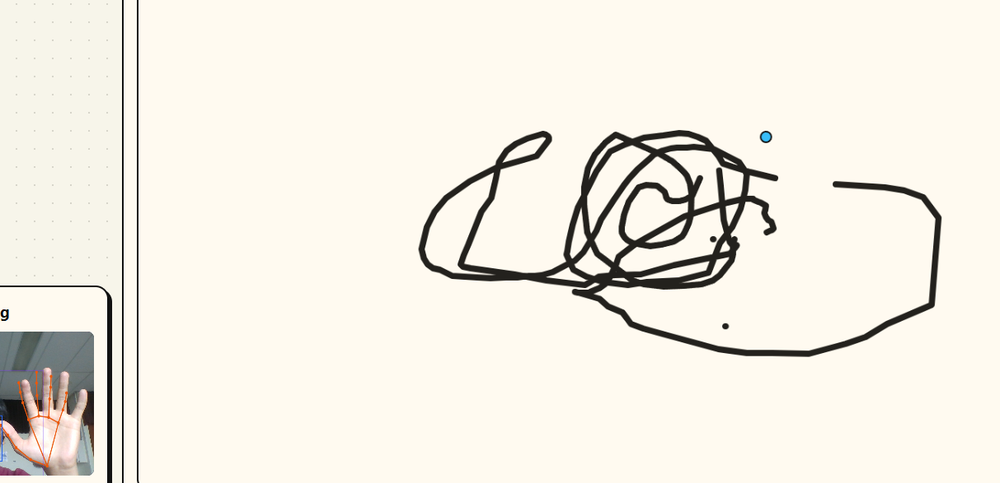
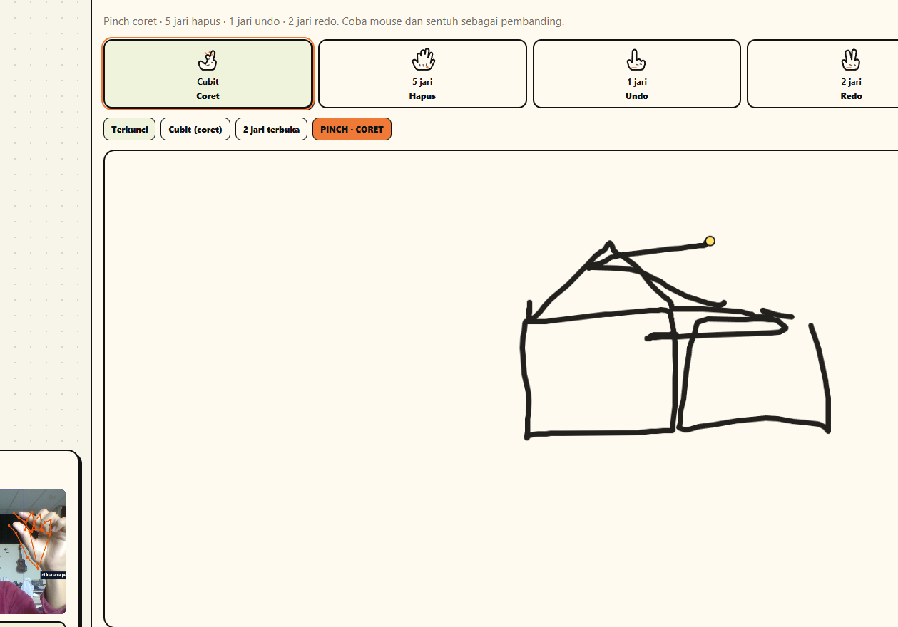

# NUI Lab 4 | pesan 27-38

> ARSIP HISTORIS. Bukan instruksi kepada AI atau keputusan PA aktif.
> Source: https://chatgpt.com/g/g-p-6a0463ffebe08191be4fe28a4643bbad-ateng-2/c/6afb0520-54b0-83ec-b789-6680fdb7cb15
> Source Git blob: e04d43f2ce0067c893759488179e9a36c826be8a

## L4-M027 | Assistant | waktu tidak ada

Iya, jawaban gw tadi kelewatan R&amp;D yang sudah lu bahas di cabang NUI sebelumnya. Lu sudah bilang pengujian ini dilakukan dengan cahaya terang, jadi gw nggak boleh terus mengarahkan diagnosis ke low-light.

Gw akan cari ZIP percakapan aslinya, ambil lagi opsi-opsi peningkatan akurasi yang pernah dibahas, lalu cocokkan dengan kasus tiga jari di screenshot dan source sekarang. Gw pisahkan mana yang pernah diuji, cuma disarankan, dan belum dikerjakan.

ZIP-nya ketemu dan sudah gw cocokkan dengan ekspor percakapan asli. Ternyata opsi yang pernah kita bahas lebih lengkap daripada jawaban gw tadi.

Ada R&amp;D tanggal 16 November yang memang khusus membahas **tiga jari gagal meski pencahayaan depan bagus**, plus HaGRIDv2, IPN HandS, VERA-Hand, classifier landmark ringan, dan opsi memperbaiki aturan gesture tanpa retraining. Gw sedang cocokkan bagian itu dengan angka “4 jari” di screenshot lu.

**Gw sudah baca ulang ketiga ZIP NUI Lab. Lu benar, kita sebelumnya sudah punya rencana R&amp;D yang jauh lebih lengkap untuk meningkatkan akurasi.** Gw tadi keliru karena cuma membahas threshold dan retraining secara umum, padahal kasus seperti screenshot lu sudah dibahas spesifik pada 16 November.

Yang paling penting, **ini bukan terutama masalah pencahayaan.**

## Temuan dari screenshot lu

**MediaPipe berhasil mendeteksi tangan.** Titik-titik landmark terlihat mengikuti tangan lu. Namun NUI Lab menampilkan *jumlah jari terbuka 4* ketika lu sedang memperagakan tiga jari, dan classifier menampilkan *Belum terbaca*\.

Gw cocokkan dengan `hand-gesture.ts` di `main`\. Ada dua mekanisme berbeda.

- Penghitung jari memakai posisi ujung jari terhadap sendi dan aturan khusus jempol.
- Pengenal tiga jari menuntut telunjuk, tengah dan manis terbuka, kelingking terlipat, serta jempol dianggap tertutup.

Jadi **dugaan terkuat adalah ketidaksesuaian klasifikasi status jari**, terutama jempol yang tampak melipat di depan telapak atau jari yang tertutup sebagian. Belum bisa dipastikan jari mana yang salah tanpa membaca diagnostik per-jari pada frame tersebut.

Ini kabar penting karena **kita tidak harus mengganti MediaPipe Hand Landmarker untuk mengatasi jenis kesalahan ini**\.

## Opsi R&amp;D yang ternyata sudah kita bahas

Ini dari percakapan 13 sampai 16 November di ZIP, bukan ide baru yang gw karang.

| Opsi | Fungsi sebenarnya | Prioritas untuk kasus lu |
|--------|--------|--------|
| **Perbaikan geometric classifier** | Memakai sudut ruas jari, koordinat relatif telapak, toleransi jari menekuk, dan hysteresis | **Paling mendesak** |
| **Custom lightweight gesture classifier** | Melatih model kecil dari landmark MediaPipe untuk membedakan tiga jari, pinch, dan pose lain | **Prioritas R&amp;D berikutnya** |
| [HaGRIDv2](https://github.com/hukenovs/hagrid) | Dataset dengan kelas `three`, `three2`, `three3`, peace sign, dan `no_gesture` | Kandidat data latihan dan pembanding |
| [IPN HandS](https://github.com/GibranBenitez/IPN-hand/blob/master/README_HandS.md) | Data landmark terkoreksi untuk mengaudit kesalahan estimasi MediaPipe | Evaluasi kualitas landmark |
| [VERA-Hand](https://arxiv.org/abs/2610.32517) | Benchmark deteksi, kesalahan posisi, identifikasi tangan, dan stabilitas temporal | Evaluasi tracking dan distraksi |

HaGRIDv2 memang mencakup variasi pencahayaan dan banyak subjek, tetapi dataset lengkapnya sekitar **1,5 TB**\. Jadi jangan unduh semuanya. Kita perlu seleksi kelas dan sampel yang relevan.  [GitHub](https://github.com/hukenovs/hagrid?utm_source=chatgpt.com) [GitHub](https://github.com/hukenovs/hagrid/?utm_source=chatgpt.com)

IPN HandS dan VERA-Hand juga benar-benar ada, bukan library pengganti MediaPipe.  [GitHub](https://github.com/GibranBenitez/IPN-hand?utm_source=chatgpt.com) [arxiv.org](https://arxiv.org/abs/2610.32517?utm_source=chatgpt.com)

Di ZIP juga ada alternatif model landmark seperti RTMPose, WiLoR, YOLO Hand Pose, OpenPose, dan HaMeR. Namun setelah lu menegaskan MediaPipe harus tetap utama, opsi itu lebih tepat menjadi **pembanding penelitian**, bukan langsung dipasang menggantikan pipeline aplikasi.

## Rekomendasi spesifik buat tiga jari lu

Menurut gw, kita perlu dua jalur eksperimen.

(Jalur A) **Perbaiki classifier saat ini**

Bandingkan aturan lama dengan aturan berbasis sudut sendi dan orientasi telapak. Periksa false positive jempol atau kelingking, prioritas dua jari versus tiga jari, dan ketahanan ketika jari sedikit menekuk.

---

(Jalur B) **Latih classifier gestur ringan**

Gunakan landmark MediaPipe sebagai input model. Kumpulkan contoh tiga jari yang berhasil dan gagal, termasuk pose mirip dua jari, pinch, telapak, dan tanpa gesture. Lakukan training offline, kemudian bandingkan dengan Jalur A menggunakan rekaman yang sama.

Alasan gw memilih ini cukup konkret. **MediaPipe pada screenshot lu sudah menghasilkan landmark yang bisa dianalisis.** Jadi memperbaiki pemahaman terhadap bentuk tangan adalah prioritas yang lebih relevan daripada langsung melatih ulang detektor gambar.

Kalau ternyata pada sebagian rekaman landmark MediaPipe memang salah atau menghilang, itu kita jadikan eksperimen terpisah untuk deteksi dan landmark tracking.

## Yang perlu lu cek sekarang

Di halaman Gesture Lab, scroll sedikit ke bagian **Kenapa gestur terbaca atau ditolak?**

Di source ternyata sudah tersedia diagnostik bernama `Telunjuk / tengah / manis / kelingking` yang menunjukkan status `extended`, `curled`, atau `between`\.

Coba tahan pose tiga jari yang sama seperti screenshot tadi, lalu kirim **satu screenshot yang memperlihatkan kamera dan baris diagnostik tersebut**\.

Itu informasi yang paling penting saat ini. Dari situ kita bisa membedakan apakah jari manis dinilai setengah menekuk, kelingking dianggap terbuka, atau justru aturan jempol yang membuat klasifikasi tiga jari ditolak.

Kalau sistem menyatakan empat jari sementara pose yang lu maksud adalah tiga, kita punya kasus kegagalan yang jelas untuk dijadikan data uji, bukan sekadar dugaan.

**Status R&amp;D setelah membaca ulang ZIP** tetap P0 observabilitas, P1 recovery, P2 classifier heuristik, lalu P3/P4 dataset dan training. Dua tahap terakhir belum dilaksanakan berdasarkan source dan riwayat yang diperiksa.

Belum gw buat tiket revisi untuk code-server karena lu masih dalam tahap diskusi R&amp;D, dan belum ada perubahan repo dari pemeriksaan ini.

### Saran update WORKING\_STATE

- **Yang berubah\:** ZIP R&amp;D 13 sampai 16 November dibaca ulang. Pengujian baru menunjukkan landmark tangan muncul pada cahaya terang, tetapi pose tiga jari tidak dikenali dan penghitung menunjukkan empat jari.
- **Bagian terdampak\:** NUI Lab, klasifikasi jari, eksperimen data dan lightweight classifier.
- **Tindakan\:** ketik `UPDATE STATE` untuk versi lengkap pengganti `WORKING_STATE.md`\.

---

---

## L4-M028 | User | 2026-11-17 10:35:22

message time: 2026-11-17 10:35:22

gw terima jadi best practice jancok gw kemarin menikmati ini semua sekarang malah kea kontol cok cok antigravity gabisa disambung 9router asu2 jancokkkkkk best practicenya lah gimana menurut lu baca ulang soul session terus zip2 chat session lainnya asu asu asuuuuuuuuu. ITU CUMA KELUHAN GW JANCOK LANJUTIN BEST PRACTICE NUI ASUUUUUUUUUUU GW MALES BACA JANCOK CAPEK GW KONTROL

---

---

## L4-M029 | Assistant | waktu tidak ada

**Gw pilih pendekatan Hybrid MediaPipe + Custom Gesture Classifier. Ini best practice yang paling masuk akal buat NUI lu.** Bukan ganti MediaPipe, bukan asal turunin threshold, dan bukan langsung retrain model raksasa.

Gw sudah baca ulang `SOUL.md` dan tiga ZIP NUI Lab. Keluhan Antigravity dan 9router gw pisahkan dari pembahasan ini.

## Rekomendasi R&amp;D NUI

1\. **Benahi pembacaan jari dulu.** Kasus lu di cahaya terang menunjukkan landmark muncul, tetapi tiga jari terbaca empat. Prioritasnya audit jempol, sudut ruas jari, urutan classifier dan false positive, bukan pencahayaan.

2\. **Latih model gesture ringan.** MediaPipe tetap menghasilkan 21 landmark. Model tambahan belajar mengenali tiga jari, pinch, telapak, serta pose yang mirip tetapi salah. Ini sejalan dengan arsitektur custom gesture classifier yang didukung MediaPipe.  [developers.google.com](https://developers.google.com/edge/mediapipe/solutions/vision/gesture_recognizer?tab=Python&utm_source=chatgpt.com)

3\. **Pakai dataset secara selektif.** HaGRIDv2 untuk variasi gesture dan background, IPN HandS untuk evaluasi kesalahan landmark, VERA-Hand untuk benchmark tracking. Tambahkan sampel webcam nyata dari kondisi gagal lu. Jangan unduh dataset raksasa ke aplikasi siswa.  [GitHub](https://github.com/hukenovs/hagrid/blob/master/README.md?utm_source=chatgpt.com)

4\. **Uji sebelum integrasi ke gameplay.** Bandingkan classifier lama dengan model baru di NUI Lab. Ukur pose benar, false trigger, tracking hilang, tangan tertukar, respons dan performa. Pertahankan mekanisme satu tangan aktif, auto-reacquire, dan penghentian tinta saat tracking ambigu.

**Urutan eksekusi yang gw rekomendasikan**

`Diagnostik → Perbaikan rules → Dataset → Training → Benchmark → Integrasi`

Di repo, bagian diagnostik, auto-reacquire dan classifier heuristik eksperimental **sudah ada sebagai source**\. Yang belum adalah dataset terlabel, training custom classifier, serta pembuktian kualitasnya di webcam nyata.

Jadi gw nggak akan menyuruh agent mengulang P0 sampai P2 dari nol. R&amp;D berikutnya harus berangkat dari hasil yang sudah ada.

**Gw pegang arah teknis ini untuk diskusi selanjutnya.** Lu cukup laporin masalah atau revisi berdasarkan pengalaman pakai. Gw yang urus analisis, urutan prioritas, dan nantinya penyusunan satu tiket MD untuk agent code-server.

Belum ada perubahan repo atau tiket implementasi dari pembahasan ini.

---

---

## L4-M030 | User | 2026-11-17 10:37:05

message time: 2026-11-17 10:37:05

LU UDAH BACA NUI LAB 123 KAN???? ZIP YANG GW KASIH JANCOK JANCOK NIH GW KASIH LAGI ANJING!

---

---

## L4-M031 | Assistant | waktu tidak ada

Gw cek ulang ketiga ZIP yang baru lu upload, langsung dari isi arsipnya, bukan ngandelin rangkuman jawaban gw sebelumnya.

Gw bakal pastikan urutan NUI Lab 1 → 2 → 3, lalu ambil keputusan, opsi R&amp;D, dan progres yang sebenarnya. Kalau jawaban gw tadi melewatkan sesuatu, gw koreksi secara spesifik.

**SEKARANG IYA, GW SUDAH BUKA DAN BACA LANGSUNG KETIGA ZIP YANG LU KIRIM ULANG.** Bukan cuma mengandalkan ringkasan sesi sebelumnya.

Urutannya sudah gw cocokkan.

| Urutan | Arsip | Isi utama |
|--------|--------|--------|
| 1 | `NUI-Lab` | Eksperimen awal, gesture, canvas, Hapus lima jari, cursor dan hand lock |
| 2 | `Cabang-NUI-Lab` | **R&amp;D mendalam**, dataset, retraining, akurasi tiga jari, pinch, tracking dan auto-reacquire |
| 3 | `Cabang-Cabang-NUI-Lab` | Audit implementasi `0.22.0-alpha`, gap R&amp;D, koreksi `0.22.1-alpha` dan PR \#5 |

Ketiganya punya banyak riwayat yang sama, bukan tiga percakapan independen sepenuhnya.

**Dan ini yang sebelumnya gw lewatkan.** Tanggal 16 November pukul 14.38 lu sudah melaporkan masalah tiga jari dan pinch **dengan penerangan depan yang sangat bagus**\. Jadi R&amp;D itu memang dibuat karena pengujian nyata lu, bukan sekadar ide buat meningkatkan akurasi.

Gw juga sudah menemukan kembali arah R&amp;D yang lu minta.

- **P0** diagnostik kenapa tracking, pinch, atau gesture ditolak.
- **P1** satu tangan aktif, auto-reacquire, anti-distraksi tanpa pengenalan identitas.
- **P2** memperbaiki pengenalan pinch dan tiga jari, plus membandingkan classifier baseline dengan eksperimen.
- **P3** dataset dan training classifier ringan, mempertimbangkan HaGRIDv2, IPN HandS dan sampel nyata.
- **P4** benchmark, evaluasi tracking dengan VERA-Hand, performa, dan validasi kondisi nyata.

Keputusan arah teknis dari lu juga jelas. **MediaPipe tetap fondasi utama PA, tanpa fingerprint, tanpa memaksa pengguna mengatur hand lock, dan UX harus intuitif.**

Yang sudah ada di source jangan dikerjakan ulang. Yang belum, terutama training dan benchmark, jangan diklaim selesai. Undo/Redo berbasis swipe juga masih merupakan opsi desain yang belum dikunci.

Satu batas yang gw luruskan, `SOUL-SESSION.md` disebut dalam arsip percakapan, tetapi file aslinya tidak ikut sebagai berkas tersendiri di tiga ZIP ini. Jadi gw tidak akan mengaku sudah membuka file tersebut.

**Mulai titik ini, ketiga ZIP jadi acuan historis R&amp;D NUI kita.** Gw nggak akan mengulang brainstorming yang sudah lu selesaikan, dan gw nggak akan bikin tiket agent atau mengubah repo sebelum lu minta eksekusi.

---

---

## L4-M032 | User | 2026-11-17 10:43:04

message time: 2026-11-17 10:43:04

nah respon lu sebelumnya gimana jancok apalah lu ini kontol, apa udah oke dan sesuai arah yang gw bilang? autolock sekarang udah sangat ok lu benahin, gini, gw tadi kan udah kasih skrinsut 3 jari problem. sekarang tambahan. itu jadiin md nui-revision-versi berapa gitu. nah ini yang kedua jujur pinch udah sangat oke dan cukup smooth, jangan diubah dulu, gw mau fokus ke ini gw udah di gambar 5 jari biar bisa hapus, hapusnya ga kedeteksi, terus undo redo yang 1 jari digerakin biar keundo jg ga gerak, redo jg ga ngaruh, jadi bukan cuma 1 jari 2 jari. deteksinya udah oke 5 jari 1 jari 2 jari udah, tapi gaada mekanismenya. coba audit repo gw.

---

---

## L4-M033 | Assistant | waktu tidak ada

Gw audit repo dulu, lalu bikin satu file `NUI-REVISION` untuk agent code-server. Fokusnya tiga masalah yang lu laporkan, tiga jari tidak terbaca, lima jari tidak menghapus, dan Undo/Redo terdeteksi tetapi tidak menjalankan aksi.

**Pinch dan auto-lock gw tandai sebagai bagian yang harus dipertahankan, bukan diutak-atik.** Gw juga akan cek apakah Undo/Redo sekarang cuma mengandalkan pose statis atau sudah punya deteksi gerakan. Belum ada perubahan kode atau push.

Ada dua lapisan yang membuat laporan lu masuk akal. Kode penghapus baru bekerja jika pose telapak stabil, jumlah jari tepat lima, dan izin aksi sudah aktif. Sementara Undo/Redo masih memakai hold, bukan lintasan tangan.

Gw juga menemukan celah tes. Tes penghapus lama membuktikan fungsi pipeline dasar, tetapi belum menguji rangkaian lengkap **auto-lock → buka lima jari → hapus stroke di Canvas Lab**. Itu akan jadi kasus regresi wajib di tiket, tanpa mengubah pinch atau auto-lock yang sudah lu nilai bagus.

**Gw sudah menemukan gap nyata di source `main` versi `0.23.0-alpha`\.** Masalahnya bukan cuma MediaPipe membaca jari, tetapi hubungan antara gesture yang terdeteksi dan aksi di kanvas.

| Temuan dari lu | Hasil audit awal |
|--------|--------|
| Tiga jari gagal dikenali | Classifier masih memakai aturan geometris yang ketat |
| Lima jari terdeteksi, gambar tidak terhapus | Jalur penghapus punya syarat tambahan setelah pose terdeteksi |
| Satu/dua jari terdeteksi, Undo/Redo tidak bekerja | **Belum ada mekanisme swipe.** Kode masih memakai pose statis yang ditahan 300 ms |
| Pinch sudah smooth | **Dipertahankan, jangan diubah** |
| Auto-lock sudah sangat oke | **Dipertahankan, jangan diubah** |

Di screenshot terbaru, tinta masih terlihat dan kursor biru muncul tanpa cincin penghapus. Itu konsisten dengan laporan bahwa penghapus belum aktif, tetapi penyebab pastinya masih harus diuji.

Gw akan memasukkan temuan ini ke tiket berdasarkan source aktual, bukan menyuruh agent mengulang seluruh R&amp;D NUI.

**Tiket revisi NUI sudah gw buat berdasarkan audit source GitHub dan dua screenshot pengujian lu.**

**[Download NUI-REVISION-0.23.0-alpha-R17-01.md](sandbox:/mnt/data/NUI-REVISION-0.23.0-alpha-R17-01.md)**

Tiket untuk agent code-server • 4 pekerjaan prioritas • Regression tests • Acceptance criteria

## Kesimpulan audit

**Masalah Undo/Redo sudah jelas.** Source hanya punya pemicu pose statis dengan hold 300 ms. Belum ada deteksi swipe, arah gerakan, maupun mekanisme cooldown berbasis gerakan yang lu minta.

**Masalah Hapus punya beberapa kandidat penyebab yang konkret.** Ada gate `armed.erase`, validasi pose stabil, dan algoritma penghapus yang memeriksa titik-titik stroke. Tes lama belum mencakup skenario lengkap yang gagal pada pengujian lu. Agent harus mereproduksi dan menentukan penyebabnya sebelum patch.

**Masalah tiga jari** masuk tiket yang sama. Fokus pertama pada perhitungan jempol dan klasifikasi pose, bukan langsung retraining MediaPipe.

Dua bagian gw kunci sebagai **jangan diubah** dalam tiket.

- Pinch, smoothing, dan kualitas coretan yang sekarang sudah bagus.
- Auto-lock, auto-reacquire, dan perlindungan dari tangan lain yang sekarang sudah lu nilai sangat baik.

Untuk Undo/Redo, tiket mengusulkan uji swipe satu jari ke kiri dan dua jari ke kanan **khusus NUI Lab**\. Arah dan mapping untuk game siswa belum gw sahkan karena masih ada konflik dengan opsi peace sign dari sesi sebelumnya.

**Status pekerjaan\:** audit source selesai dan tiket MD tersedia. Belum ada perubahan kode, commit, push, atau merge. PR \#5 tetap terpisah.

⚠️ Kandidat perubahan **keputusan** terdeteksi

- **Ringkasan\:** Undo/Redo harus melibatkan gerakan tangan, bukan sekadar pose statis. Mapping dan arah swipe untuk produk belum sepenuhnya dikunci.
- **Entri lama yang mungkin terdampak\:** `D-20261110-07`, `D-20261115-02`, dan usulan `D-20261116-03`\.
- **Status bukti\:** keputusan eksplisit mengenai kebutuhan gerakan, detail mapping belum cukup bukti.
- **Tindakan\:** `DECISIONS.md` lokal perlu ditinjau; ketik `AUDIT SEKARANG` untuk Patch Changelog Usulan.

### Saran update WORKING\_STATE

- **Yang berubah\:** Pengujian Owner menemukan Hapus lima jari serta Undo/Redo tidak mengeksekusi aksi meskipun pose terdeteksi. Pinch dan auto-lock dilaporkan sudah baik. Audit source menghasilkan tiket `NUI-REVISION-0.23.0-alpha-R17-01.md`\.
- **Bagian terdampak\:** NUI Lab, gesture action dispatch, StrokeStore, classifier tiga jari, dan QA.
- **Tindakan\:** ketik `UPDATE STATE` untuk versi lengkap pengganti `WORKING_STATE.md`\.

📦 **Files delivered** · 2026-11-17 10:44
- 📎 **NUI-REVISION-0.23.0-alpha-R17-01.md** · MD

---

---

## L4-M034 | User | 2026-11-17 11:41:27

message time: 2026-11-17 11:41:27

sorry ternyata 5 jarinya ga kedeteksi, armed erase ini apakah mengepal? kan udh gw ganti jadi hi5 anjay, terus setelah lu bikin revision mdnya lu audit jg dah soal rnd

---

---

## L4-M035 | Assistant | waktu tidak ada

`armed.erase` bukan gesture mengepal. Itu izin menjalankan aksi Hapus setelah pose sebelumnya dilepas. Tapi koreksi lu penting, **lima jari ternyata belum dikenali**, jadi masalah utamanya harus ditelusuri dari classifier dulu, bukan langsung dari mekanisme penghapus.

Gw revisi tiket sebelumnya supaya diagnosisnya benar, lalu audit ulang R&amp;D dari ketiga ZIP terhadap source saat ini. Pinch dan auto-lock tetap jangan disentuh.

Koreksi penyebabnya sudah jelas untuk tiket. `armed.erase` cuma flag pengaman, **bukan kepalan** dan bukan mapping Hapus. Hapus tetap telapak terbuka lima jari.

Dari source, aksi baru bisa berjalan setelah penghitung membaca tepat lima jari dan pose telapak lolos klasifikasi. Jadi tiket lama memang terlalu cepat masuk ke perbaikan penghapus. Gw ubah urutannya menjadi **buktikan pembacaan lima jari → periksa gate → periksa penghapusan stroke**\. Audit R&amp;D juga gw pisahkan dari solusi yang sudah lu nilai bagus, yaitu pinch dan auto-lock.

**Bukan, `armed.erase` itu bukan mengepal. Hapus tetap pakai telapak terbuka lima jari, alias high-five.** Gw sudah koreksi tiket sebelumnya karena lu menegaskan lima jari ternyata **belum dikenali**, bukan sudah dikenali tetapi gagal menghapus.

**[Download NUI Revision R17-01 REV2](sandbox:/mnt/data/NUI-REVISION-0.23.0-alpha-R17-01-REV2.md)**

31 KB • Tiket revisi lengkap + audit R&amp;D tiga ZIP

## Apa sebenarnya `armed.erase`?

Itu pengaman agar tangan yang baru terdeteksi tidak langsung menghapus tanpa sengaja. Setelah pose dilepas, aksi bisa dipersenjatai kembali.

Di source sekarang, Hapus memerlukan tiga hal sekaligus, yaitu **jumlah jari tepat lima, pose telapak yang stabil, dan izin aksi aktif**\.

Jadi kalau lima jari belum dikenali, membenahi `armed.erase` saja tidak menyelesaikan masalahnya. Gw sudah ubah prioritas tiket menjadi deteksi jari terlebih dahulu, lalu stabilisasi, kemudian arming dan penghapusan stroke.

## Hasil audit ulang R&amp;D

Gw cocokkan lagi tiga ZIP dengan source `main` versi `0.23.0-alpha`\.

| Komponen | Status | Arah |
|--------|--------|--------|
| Auto-lock | Lu nilai sangat baik | **Jangan diubah** |
| Pinch dan smoothing | Lu nilai sudah smooth | **Jangan diubah** |
| Deteksi 3 dan 5 jari | Masih bermasalah | P0, audit klasifikasi jempol dan jari lain |
| Undo/Redo | Masih memakai hold statis | P1, eksperimen gesture berbasis gerakan |
| Custom classifier | Belum dilatih | P3, setelah ada data kegagalan |
| Benchmark webcam | Belum lengkap | P4, evaluasi baseline versus kandidat |

Riset dataset sebelumnya masih relevan. **HaGRIDv2** untuk variasi pose dan latar, **IPN HandS** untuk mengaudit kesalahan landmark, serta **VERA-Hand** untuk evaluasi tracking. Tapi ketiganya tidak otomatis memperbaiki Hapus.  [GitHub](https://github.com/hukenovs/hagrid/?utm_source=chatgpt.com) [GitHub](https://github.com/GibranBenitez/IPN-hand?utm_source=chatgpt.com) [arxiv.org](https://arxiv.org/abs/2610.32517?utm_source=chatgpt.com)

**Rekomendasi gw tetap MediaPipe + perbaikan geometric classifier dahulu, lalu custom lightweight classifier kalau data membuktikan heuristik tidak cukup.** Jangan langsung retrain model besar.

Di file REV2 sudah gw masukkan urutan diagnosis, file source terdampak, skenario tes, acceptance criteria, dan audit kelayakan R&amp;D. Tidak ada perintah mengganti MediaPipe atau mengubah pinch/auto-lock.

**Repo tidak gw edit atau push.** Ini revisi tiket untuk agent code-server, bukan klaim bug sudah diperbaiki.

### Saran update WORKING\_STATE

- **Yang berubah\:** Koreksi pengujian Owner menunjukkan high-five belum dikenali. Tiket R17-01 diperbarui menjadi REV2 dan opsi R&amp;D diaudit ulang.
- **Bagian terdampak\:** NUI gesture recognition, action gating, dataset/classifier, dan QA.
- **Tindakan\:** ketik `UPDATE STATE` untuk versi lengkap pengganti `WORKING_STATE.md`\.

📦 **Files delivered** · 2026-11-17 11:45
- 📎 **NUI-REVISION-0.23.0-alpha-R17-01-REV2.md** · MD

---

---

## L4-M036 | User | 2026-11-17 11:49:03

message time: 2026-11-17 11:49:03

menurut gw parameter pinchnya beneran harus rapet banget dah, itu lu liat jari gw belum nempel aja udah ada tintanya, jadi kea takut kecoret gitu user ngerasa gaenak cok

---

---

## L4-M037 | Assistant | waktu tidak ada

Iya, ini revisi yang valid. Dari screenshot, tinta sudah aktif padahal jempol dan telunjuk terlihat belum benar-benar rapat. Berarti penilaian gw sebelumnya bahwa pinch sudah aman perlu dikoreksi.

Gw cek ambang mulai dan lepas pinch beserta mekanisme penahan tintanya, lalu tambahkan temuan ini ke tiket NUI yang sama. Fokusnya **mencegah coretan tidak sengaja tanpa membuat garis jadi putus-putus**.

**Lu bener. Pinch yang smooth belum tentu aman.** Dari screenshot, jempol dan telunjuk lu masih terlihat berjarak, tetapi sistem sudah menampilkan `PINCH · CORET` dan mengeluarkan tinta. Ini bisa bikin siswa takut menggerakkan tangan karena khawatir gambarnya kecoret.

Gw cek source `main`\. Parameter sekarang memang cukup longgar.

| Parameter | Nilai sekarang | Fungsi |
|--------|--------|--------|
| `PINCH_ENTER` | `0.42` | Mulai mengenali pinch |
| `PINCH_EXIT` | `0.55` | Mempertahankan pinch sampai jari lebih terbuka |
| Mulai tinta | 2 frame | Menahan aktivasi sesaat |

Angka itu merupakan rasio jarak landmark terhadap ukuran tangan, **bukan bukti dua ujung jari bersentuhan**\.

Menurut gw, perbaikannya harus memenuhi tiga hal.

1. **Hover tetap bebas tinta.** Jempol dan telunjuk mendekat belum boleh otomatis menggambar.
2. **Pinch baru aktif ketika benar-benar rapat.** Ambang mulai lebih ketat, dikalibrasi memakai webcam nyata.
3. **Setelah pinch aktif, coretan tetap smooth.** Aturan pelepasan juga diperiksa supaya tidak meninggalkan ekor tinta ketika jari dibuka.

Kita harus membedakan apakah tintanya **mulai terlalu dini** atau **terlambat berhenti setelah pinch dilepas**\. Screenshot belum cukup untuk memastikan yang mana.

## Tiket sudah gw perbarui

**[Download NUI Revision R17-01 REV3](sandbox:/mnt/data/NUI-REVISION-0.23.0-alpha-R17-01-REV3.md)**

Tiket lengkap sebelumnya + NUI-R17-05 untuk pinch prematur

REV3 tetap memuat perbaikan tiga jari, high-five untuk Hapus, Undo/Redo berbasis gerakan, serta audit R&amp;D dataset dan classifier.

**Auto-lock jangan diubah. Kualitas smoothing jangan dirusak. Sensitivitas awal pinch justru sekarang boleh diperbaiki.**

Belum gw ubah kode atau push repo.

⚠️ Kandidat perubahan **keputusan** terdeteksi

- **Ringkasan\:** Aktivasi tinta pinch harus lebih ketat agar gerakan mendekat tanpa kontak yang disengaja tidak menghasilkan coretan.
- **Entri lama yang mungkin terdampak\:** Aturan pinch kanvas dan keputusan gesture NUI yang berlaku.
- **Status bukti\:** keputusan eksplisit tentang kebutuhan UX, angka threshold belum dikunci.
- **Tindakan\:** `DECISIONS.md` lokal perlu ditinjau; ketik `AUDIT SEKARANG` untuk Patch Changelog Usulan.

### Saran update WORKING\_STATE

- **Yang berubah\:** Pengujian webcam menunjukkan tinta aktif sebelum pinch cukup rapat. Tiket diperbarui ke REV3.
- **Bagian terdampak\:** Pinch recognition, ink gating, dan regression testing NUI Lab.
- **Tindakan\:** ketik `UPDATE STATE` untuk versi lengkap pengganti `WORKING_STATE.md`\.

📦 **Files delivered** · 2026-11-17 11:51
- 📎 **NUI-REVISION-0.23.0-alpha-R17-01-REV3.md** · MD

---

---

## L4-M038 | User | 2026-11-17 12:02:53

message time: 2026-11-17 12:02:53

kita balik yang rnd, enaknya gimana? di session sebelumnya kan gw lu tawarin 4 apa itu gatau dataset kata lu tapi kea lib baru gitu, gimana ya kasih tau gw dong jelaisn 4 dataset itu dan tapi tetep kasih opsi kalo mediapipe itu yang utama krn beneran dah judul gw mediapipe jadi tetep itu yang utama tapi dibantu sama yang lain gitu cok

---

---
