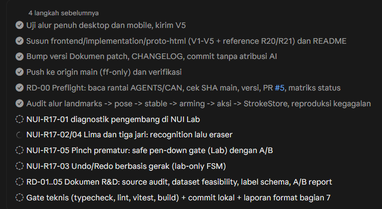
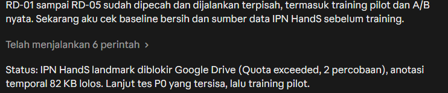
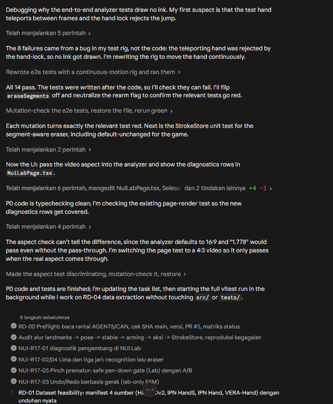

# NUI Lab 4 | pesan 39-54

> ARSIP HISTORIS. Bukan instruksi kepada AI atau keputusan PA aktif.
> Source: https://chatgpt.com/g/g-p-6a0463ffebe08191be4fe28a4643bbad-ateng-2/c/6afb0520-54b0-83ec-b789-6680fdb7cb15
> Source Git blob: e04d43f2ce0067c893759488179e9a36c826be8a

## L4-M039 | Assistant | waktu tidak ada

Gw cek ulang bagian R&amp;D di tiga ZIP, khususnya empat opsi yang dulu dibahas. Gw pisahkan mana dataset, mana library/model, lalu bandingkan kegunaannya buat tiga jari, high-five, pinch, dan tracking.

MediaPipe tetap jadi fondasi utama. Yang kita cari adalah komponen pendamping yang benar-benar membantu, bukan penggantinya.

**Gw pilih MediaPipe + Custom Gesture Classifier ringan, dibantu dataset publik.** Ini paling cocok buat PA lu karena **MediaPipe tetap teknologi utama**, sementara komponen tambahan membantu mengenali gesture dengan lebih akurat.

Gw sudah cocokkan lagi empat dataset utama dari R&amp;D di ZIP NUI Lab 1, 2, dan 3. Ternyata empat itu **bukan empat library yang harus dipasang ke aplikasi**\. Masing-masing punya fungsi berbeda.

## Empat dataset yang dulu kita bahas

**1\. [HaGRIDv2](https://github.com/hukenovs/hagrid)**

Untuk melatih pengenalan pose tangan

Punya lebih dari 1 juta gambar, termasuk pose `three`, `three2`, `three3`, `palm`, dan `no_gesture`\.

**Buat lu** membantu membedakan tiga jari, high-five, dan pose yang mirip. Nggak perlu mengunduh semuanya yang mencapai sekitar 1,5 TB.  [GitHub](https://github.com/hukenovs/hagrid/blob/master/README.md?utm_source=chatgpt.com)

---

**2\. [IPN HandS](https://github.com/GibranBenitez/IPN-hand/blob/master/README_HandS.md)**

Untuk mengaudit kesalahan landmark MediaPipe

Menyediakan landmark hasil estimasi MediaPipe dan anotasi yang diperbaiki manusia.

**Buat lu** bisa membantu mencari tahu kenapa tiga jari dihitung empat atau kenapa posisi ujung jari meleset. Bukan pengganti MediaPipe.  [mdpi.com](https://www.mdpi.com/2076-3417/15/11/6321?utm_source=chatgpt.com) [GitHub](https://github.com/GibranBenitez/IPN-hand?utm_source=chatgpt.com)

---

**3\. [IPN Hand](https://gibranbenitez.github.io/IPN_Hand/)**

Untuk mempelajari gerakan tangan

Dataset video berisi gesture berurutan, gerakan kiri/kanan, serta bagian tanpa gesture.

**Buat lu** relevan untuk riset Undo/Redo berbasis gerakan, bukan cuma pose satu atau dua jari yang diam.  [GitHub](https://github.com/GibranBenitez/IPN-hand?utm_source=chatgpt.com)

---

**4\. [VERA-Hand](https://arxiv.org/abs/2610.32517)**

Untuk menguji keandalan tracking

Benchmark yang mengevaluasi deteksi tangan, akurasi landmark, identifikasi tangan, dan stabilitas antarframe.

**Buat lu** cocok mengukur kegagalan tracking dalam kondisi tangan bertumpuk, bergerak cepat, atau ada distraksi.  [arxiv.org](https://arxiv.org/abs/2610.32517?utm_source=chatgpt.com)

Ada kandidat kelima di R&amp;D lama, **Rendered Handpose Dataset**, untuk variasi pose dan rotasi sintetis. Tetapi bukan prioritas pertama karena kita sudah punya kasus kegagalan dari webcam nyata.

## Nah, bagaimana semuanya membantu MediaPipe?

Webcam siswa

Tangan dan gerakannya

MediaPipe Hand Landmarker

Fondasi utama, menghasilkan 21 landmark tangan

Custom Gesture Classifier

Model kecil yang dilatih offline menggunakan dataset relevan dan rekaman uji sendiri

Gesture State Machine

Mengatur pinch, high-five, Undo/Redo, dan mencegah aksi tidak sengaja

Dataset dipakai ketika **riset dan training**, bukan harus dimuat setiap siswa bermain.

## Tiga opsi implementasi

| Opsi | Pendekatan | Penilaian gw |
|--------|--------|--------|
| A | MediaPipe + perbaikan geometric rules | Paling ringan, tetapi mungkin belum cukup untuk variasi tangan |
| **B** | **MediaPipe + custom classifier ringan + gesture state machine** | **Pilihan utama gw** |
| C | MediaPipe + model kedua seperti RTMPose atau WiLoR sebagai fallback | Layak diteliti, tetapi lebih kompleks dan bisa membebani browser |

Opsi B juga konsisten dengan pendekatan MediaPipe Gesture Recognizer yang mendukung classifier gesture khusus. Namun tool training MediaPipe Model Maker sudah deprecated, jadi kita bisa mengevaluasi training classifier ringan sendiri dan mengintegrasikannya dengan output landmark MediaPipe.  [developers.google.com](https://developers.google.com/edge/mediapipe/solutions/vision/gesture_recognizer?utm_source=chatgpt.com) [developers.google.com](https://developers.google.com/edge/mediapipe/solutions/customization/gesture_recognizer?utm_source=chatgpt.com)

## Best practice yang gw pilih untuk NUI lu

Kita jangan langsung menggabungkan semua dataset atau mengganti model yang sudah ada.

1. **Rekam kegagalan nyata dari NUI Lab**, terutama tiga jari, high-five, dan pinch yang belum rapat tetapi sudah menggores.
2. **Gunakan HaGRIDv2 secara selektif** untuk memperkaya data gesture. Label publik harus disesuaikan dengan pose yang memang dipakai game.
3. **Training classifier ringan secara offline**, lalu bandingkan dengan geometric classifier sekarang menggunakan rekaman uji yang sama.
4. **Gunakan IPN HandS dan VERA-Hand untuk evaluasi**, serta IPN Hand kalau desain Undo/Redo berbasis gerakan sudah dikunci.
5. **Integrasikan hanya kandidat yang terbukti lebih baik** tanpa merusak auto-lock, kenyamanan coretan, atau performa webcam.

Yang penting, classifier tambahan tidak bisa memperbaiki frame saat MediaPipe sama sekali gagal menemukan landmark. Kondisi itu harus punya jalur diagnosis tersendiri.

**Jadi keputusan teknis yang gw rekomendasikan untuk R&amp;D adalah Opsi B.** MediaPipe tetap utama, classifier tambahan menjadi pendamping, sementara empat dataset punya fungsi training dan pengujian masing-masing.

Statusnya masih **usulan R&amp;D**, belum ada model tambahan yang dilatih atau benchmark webcam yang membuktikan hasilnya lebih baik. Repo dan tiket revisi sebelumnya juga tidak gw ubah.

---

---

## L4-M040 | User | 2026-11-17 12:05:14

message time: 2026-11-17 12:05:14

kenapa ga pake ipn hands jg?

---

---

## L4-M041 | Assistant | waktu tidak ada

**Justru IPN HandS juga harus masuk kandidat training, bukan cuma buat audit landmark.** Gw tadi terlalu membatasi fungsinya.

Bahkan setelah gw cek penelitian aslinya, IPN HandS punya keunggulan yang relevan buat masalah NUI lu.

## Kenapa IPN HandS menarik?

IPN HandS menyediakan lebih dari **700.000 anotasi skeleton tangan**, menggunakan 21 landmark per tangan, dengan koreksi manual dan label gesture sepanjang video.

Penelitinya melatih model LSTM ringan dan menemukan peningkatan sekitar 12% pada *average recall* dibanding pelatihan menggunakan anotasi MediaPipe Hands dalam eksperimen mereka. **Itu bukan jaminan peningkatan 12% untuk Sketchbook Universe**, tetapi bukti bahwa anotasi yang lebih baik bisa membantu classifier gesture.  [mdpi.com](https://www.mdpi.com/2076-3417/15/11/6321?utm_source=chatgpt.com)

## Jadi kita pakai apa?

| Sumber | Peran yang gw rekomendasikan |
|--------|--------|
| **MediaPipe** | Fondasi deteksi dan 21 landmark saat aplikasi berjalan |
| **IPN HandS** | Training classifier berbasis landmark dan gerakan |
| **HaGRIDv2** | Memperkaya variasi pose statis, termasuk tiga jari dan telapak |
| **IPN Hand** | Video untuk mempelajari gesture dinamis, termasuk gerakan kiri/kanan |
| **VERA-Hand** | Benchmark kualitas tracking dan landmark |

Arsitekturnya tetap sederhana.

**Webcam → MediaPipe → Classifier ringan → Gesture State Machine → Aksi NUI**

Dataset dipakai untuk training dan evaluasi secara offline, bukan dimuat semuanya ketika siswa bermain.

Tapi ada satu batas penting. **Kelas gesture IPN HandS tidak otomatis sama dengan gesture Sketchbook Universe.** Kita harus memeriksa label, memilih contoh yang relevan, dan menambahkan data pose sendiri terutama untuk pinch rapat, high-five, dan tiga jari. Jangan asal menggabungkan label dua dataset.

**Rekomendasi gw sekarang adalah menggunakan IPN HandS dan HaGRIDv2 sebagai dua kandidat sumber training utama**, sedangkan rekaman webcam lu menjadi data evaluasi yang paling relevan untuk memutuskan apakah classifier baru benar-benar lebih baik.

Ini tetap tahap R&amp;D, belum keputusan untuk langsung memasang LSTM atau model tambahan ke game. MediaPipe tidak diganti, dan kualitas pinch serta auto-lock yang sudah baik tetap jadi batas regresi.

---

---

## L4-M042 | User | 2026-11-17 12:27:22

message time: 2026-11-17 12:27:22

yaudah gimana dari revision md itu jadiin tambahan buat ini biar dieksekusi sama agent gw nantinya, lu di sini sama gw jadi conceptor tapi tetep audit kode di repo, sedangkan nanti kalo udah fix biar dieksekusi sama agent biar lu ga cpeet limit jancok

---

---

## L4-M043 | Assistant | waktu tidak ada

Gw jadikan REV3 sebagai satu tiket lengkap yang diperbarui, lalu tambahkan paket R&amp;D MediaPipe + IPN HandS + HaGRIDv2 untuk agent code-server.

Peran kita di sini tetap conceptor dan auditor source. Agent nanti yang mengerjakan, menguji, dan melaporkan hasilnya. Gw cek dulu isi REV3, status repo terbaru, serta batas dataset supaya tiketnya bisa dieksekusi tanpa asal memasang model.

Dari audit terakhir, `main` masih di `093947d` dan PR \#5 masih Draft. Jadi basis REV3 belum bergeser.

Tambahan R&amp;D-nya akan gw buat bertahap. Agent boleh menyiapkan data, eksperimen training ringan, dan benchmark di lingkungan terpisah. **Model baru tidak boleh langsung menggantikan classifier game** sebelum hasil A/B dan uji webcam menunjukkan peningkatan. IPN HandS gw masukkan sebagai kandidat training sekaligus audit landmark, bukan cuma referensi.

**Sudah gw gabungkan ke satu tiket REV4.** REV3 tetap dipertahankan, lalu gw tambahkan paket R&amp;D yang bisa dikerjakan agent code-server nanti.

**[Download NUI-REVISION-0.23.0-alpha-R17-01-REV4.md](sandbox:/mnt/data/NUI-REVISION-0.23.0-alpha-R17-01-REV4.md)**

59 KB • Tiket lengkap revisi + R&amp;D training dan benchmark

### Apa yang ditambahkan?

| Paket | Tugas agent |
|--------|--------|
| RD-00 | Audit source dan reproduksi kegagalan |
| RD-01 | Periksa IPN HandS, HaGRIDv2, lisensi dan kecocokan label |
| RD-02 | Siapkan dataset kegagalan webcam berizin |
| RD-03 | Perbaiki dan bandingkan geometric classifier |
| RD-04 | Training custom lightweight classifier secara offline |
| RD-05 | Benchmark akurasi, false trigger, latency dan performa |
| RD-06 | Prototype classifier terbaik di NUI Lab, hanya jika lolos evaluasi |

**IPN HandS sekarang eksplisit menjadi kandidat training sekaligus evaluasi landmark**, bukan cuma bahan audit. HaGRIDv2 menjadi kandidat data pose statis. IPN Hand membantu riset gerakan dan VERA-Hand untuk benchmark tracking. MediaPipe tetap fondasi utama.  [mdpi.com](https://www.mdpi.com/2076-3417/15/11/6321?utm_source=chatgpt.com) [GitHub](https://github.com/hukenovs/hagrid?utm_source=chatgpt.com) [IPN Hand](https://gibranbenitez.github.io/IPN_Hand/?utm_source=chatgpt.com)

Yang gw pertahankan dari tiket sebelumnya adalah perbaikan tiga jari, high-five Hapus, Undo/Redo berbasis gerakan, dan pinch yang terlalu sensitif.

**Auto-lock serta smoothing yang sudah bagus tetap dilindungi dari regresi.**

Agent boleh mengerjakan eksperimen bertahap, tetapi model baru **tidak boleh langsung menggantikan classifier game** tanpa bukti dan review lu. Tidak ada push, merge, atau deploy otomatis.

Mulai sekarang alur kerja kita jelas. **Lu laporkan pengalaman NUI, gw audit source dan susun tiket, agent code-server yang eksekusi, lalu hasilnya kita audit lagi di sini.**

### Saran update WORKING\_STATE

- **Yang berubah\:** REV4 dibuat dengan paket R&amp;D MediaPipe, IPN HandS, HaGRIDv2, training ringan dan benchmark.
- **Bagian terdampak\:** R&amp;D NUI, workflow agent code-server, dataset dan QA.
- **Tindakan\:** ketik `UPDATE STATE` untuk versi lengkap pengganti `WORKING_STATE.md`\.

📦 **Files delivered** · 2026-11-17 12:30
- 📎 **NUI-REVISION-0.23.0-alpha-R17-01-REV4.md** · MD

---

---

## L4-M044 | User | 2026-11-17 12:56:19

message time: 2026-11-17 12:56:19

udah gw kasih ke claude, dia bakal retrain kah pake dataset?

---

---

## L4-M045 | Assistant | waktu tidak ada

**Iya, Claude sudah gw instruksikan untuk melakukan training model gesture menggunakan dataset, tapi bersyarat.** Jadi bukan sekadar riset, tetapi juga boleh sampai eksperimen training nyata.

Di tiket REV4, alurnya begini.

1. **RD-01** Memeriksa IPN HandS dan HaGRIDv2, termasuk dataset, lisensi, dan kecocokan label.
2. **RD-02** Menyiapkan data pengujian dan contoh gesture yang gagal.
3. **RD-03** Menguji apakah perbaikan classifier geometris sudah cukup.
4. **RD-04** Kalau data siap dan heuristik belum memadai, Claude menjalankan training classifier ringan, misalnya MLP atau Random Forest.
5. **RD-05** Membandingkan akurasi model hasil training dengan classifier sebelumnya.
6. **RD-06** Jika lebih baik dan aman, membuat prototype opsional di NUI Lab untuk diuji lu.

**Tapi ada perbedaan penting.**

- MediaPipe tetap jadi model utama untuk mendeteksi tangan dan 21 landmark.
- Yang dilatih adalah **model classifier tambahan**, bukan bobot internal MediaPipe.
- Kalau heuristik sudah cukup bagus, tiket tidak mewajibkan training.
- Model hasil training tidak boleh langsung dipasang ke gameplay tanpa review lu.

Jadi Claude **boleh dan memang diarahkan untuk sampai training**, tetapi gw belum bisa memastikan dia sudah menjalankannya hanya karena lu mengirim tiket.

**Satu hal yang perlu lu pastikan ke Claude.** Jangan berhenti di laporan rencana R&amp;D saja. Kalau prasyaratnya terpenuhi, minta dia menjalankan training pilot RD-04 dan benchmark RD-05, lalu memberikan metrik serta hasil eksperimennya. Kalau terblokir, dia harus menjelaskan penyebabnya.

### Saran update WORKING\_STATE

- **Yang berubah\:** Tiket REV4 sudah diserahkan ke Claude untuk eksekusi. Hasil training belum diterima.
- **Bagian terdampak\:** R&amp;D NUI dan workflow agent code-server.
- **Tindakan\:** ketik `UPDATE STATE` untuk versi lengkap pengganti `WORKING_STATE.md`\.

---

---

## L4-M046 | User | 2026-11-17 12:57:24

message time: 2026-11-17 12:57:24

dia bikin gini

---

---

## L4-M047 | Assistant | waktu tidak ada

**Claude sudah mulai mengerjakan REV4, tapi rencana yang terlihat di screenshot belum mencakup training model sungguhan.**

Yang gw lihat dari checklist-nya, Claude sudah menyelesaikan preflight dan audit pipeline NUI. Selanjutnya dia mengerjakan diagnostik, pengenalan tiga/lima jari, pinch, serta Undo/Redo.

**Masalahnya ada pada bagian `RD-01..05`\.** Claude menuliskannya sebagai\:

> Dokumen R&amp;D, source audit, dataset feasibility, label schema, A/B report.

Itu baru persiapan dan evaluasi R&amp;D. **Belum ada pekerjaan eksplisit untuk mengunduh data terpilih, melatih custom classifier, menyimpan model, atau mengevaluasi hasil training.**

Jadi jangan anggap IPN HandS dan HaGRIDv2 sudah digunakan untuk training hanya karena checklist R&amp;D nantinya dicentang.

Gw sudah buka ulang **REV4 yang lu kirim ke Claude**\. Ternyata tiketnya memang memuat `RD-04` untuk training offline dan `RD-05` untuk benchmark. Jadi **instruksi training-nya tidak hilang dari tiket**, tetapi belum terlihat eksplisit dalam checklist Claude.

Training dalam REV4 memang bersyarat. Kalau dataset, lisensi, dan label sudah cocok serta heuristik masih kurang memadai, Claude boleh melatih pilot model ringan. Kalau syaratnya belum terpenuhi, dia wajib melaporkan blocker, bukan mengarang hasil.

Menurut gw, kirim koreksi singkat ini supaya pekerjaan R&amp;D tidak berhenti pada laporan dokumen saja.

> **Chat message**
> 
> Lanjutkan pekerjaan yang sedang berjalan sesuai REV4. Satu koreksi untuk checklist R&D.
> 
> Jangan gabungkan RD-01 sampai RD-05 menjadi pekerjaan dokumentasi saja. Pecah dan jalankan setiap tahap sesuai prasyarat dalam tiket, khususnya:
> 
> - RD-04: Jika dataset, lisensi, label, dan baseline sudah siap serta heuristik belum memadai, lakukan training pilot classifier ringan berbasis landmark MediaPipe. Gunakan IPN HandS dan HaGRIDv2 sebagai kandidat data, sesuai kelayakannya.
> - RD-05: Bandingkan model hasil training dengan baseline dan heuristik revisi. Sertakan metrik, model artifact, script, dan bukti runtime yang benar-benar ada.
> 
> Kalau training tidak layak atau terblokir, laporkan alasan konkret dan bukti pemeriksaannya. Jangan hanya menandai R&D selesai berdasarkan laporan feasibility.
> 
> MediaPipe tetap utama. Jangan mengganti model utamanya atau memasang classifier baru ke gameplay tanpa persetujuan Owner. Pertahankan auto-lock dan kualitas smoothing.
> 
> Jangan mengulang pekerjaan yang sudah selesai. Laporkan status tiap RD secara terpisah.

**Verdict gw\:** checklist Claude masuk akal untuk tahap perbaikan gesture, tapi belum cukup eksplisit untuk memastikan training benar-benar dijalankan. Koreksi itu menutup celahnya tanpa memaksa training yang belum punya data layak.

---

---

## L4-M048 | User | 2026-11-17 13:03:55

message time: 2026-11-17 13:03:55

gini katanya

---

---

## L4-M049 | Assistant | waktu tidak ada

**Claude sudah merespons dengan arah yang benar. Tapi training pilot belum dimulai, dan IPN HandS belum berhasil diperoleh secara lengkap.**

Dari laporan yang lu kirim\:

- **RD-01 sampai RD-05** sudah dipisah menjadi pekerjaan tersendiri.
- **IPN HandS landmark** gagal diunduh karena Google Drive *quota exceeded* dalam dua percobaan.
- **Anotasi temporal 82 KB** berhasil diperoleh, tetapi itu belum membuktikan dataset landmark siap dipakai training.
- Claude masih menyelesaikan tes P0 sebelum training pilot.

**Jangan suruh Claude mengulang semuanya.** Kita perlu memastikan blocker dataset ditangani dengan benar, sambil mempertahankan progres perbaikan gesture yang sudah berjalan.

Gw cek sumber resminya. IPN HandS memang sudah merilis landmark dan anotasi yang diperbaiki pada Oktober 2026. Jadi **masalahnya akses unduhan, bukan dataset-nya belum tersedia**\.  [GitHub](https://github.com/GibranBenitez/IPN-hand?utm_source=chatgpt.com)

Arahan gw untuk Claude sekarang adalah **lanjutkan tes P0, lalu cari jalur data yang sah tanpa terjebak Google Drive**\. Kalau IPN HandS tetap tidak bisa diakses, gunakan subset dataset lain yang lisensinya sesuai atau ekstraksi landmark MediaPipe dari video IPN Hand sebagai eksperimen pembanding. Tapi jangan menyebut landmark hasil ekstraksi ulang itu sebagai anotasi terkoreksi IPN HandS.

Kirim ini ke Claude.

> **Chat message**
> 
> Lanjutkan tes P0 yang tersisa, jangan reset progres.
> 
> Untuk RD training:
> 1. Catat IPN HandS corrected landmarks sebagai BLOCKED_DOWNLOAD setelah dua percobaan quota exceeded.
> 2. Periksa alternatif distribusi resmi yang sah. Jangan terus mengulang unduhan Google Drive.
> 3. Jika tetap terblokir, lanjutkan pilot dengan data lain yang layak dan berlisensi sesuai, termasuk subset HaGRIDv2 atau landmark hasil ekstraksi MediaPipe dari IPN Hand. Bedakan tegas data asli, data terkoreksi, dan hasil ekstraksi ulang.
> 4. Jangan menganggap anotasi temporal 82 KB sudah cukup untuk training landmark classifier.
> 5. Jalankan training dan A/B hanya ketika data, label, dan baseline memenuhi syarat. Laporkan artifact, metrik, serta blocker secara terpisah.
> 
> MediaPipe tetap utama. Jangan mengganti classifier gameplay atau mengganggu auto-lock sebelum ada bukti dan persetujuan.

**Verdict gw, Claude belum salah arah.** Yang harus kita cegah adalah R&amp;D berhenti gara-gara satu tautan Google Drive, atau sebaliknya mengklaim training berhasil menggunakan data yang belum memadai.

### Saran update WORKING\_STATE

- **Yang berubah\:** KATA-TOOL Claude melaporkan dua unduhan IPN HandS gagal karena kuota, anotasi temporal 82 KB berhasil diperoleh, dan tes P0 masih berjalan.
- **Bagian terdampak\:** R&amp;D NUI, dataset acquisition, training pilot.
- **Tindakan\:** ketik `UPDATE STATE` untuk versi lengkap pengganti `WORKING_STATE.md`\.

---

---

## L4-M050 | User | 2026-11-17 13:15:28

message time: 2026-11-17 13:15:28

gw belum kirim prompt lu, tapi claude ngerjain ini

---

---

## L4-M051 | Assistant | waktu tidak ada

**Bagus, jangan kirim prompt tambahan gw dulu. Claude ternyata sudah bergerak ke arah yang benar dan progresnya lebih jauh daripada screenshot sebelumnya.** Biar dia menyelesaikan rangkaian pengujian tanpa terganggu instruksi baru.

Dari screenshot, ini hasilnya.

| Pekerjaan | Status laporan Claude |
|--------|--------|
| Audit pipeline NUI | Selesai |
| Diagnostik P0 | Selesai |
| Deteksi 3/5 jari dan Hapus | Implementasi dan tes dilaporkan selesai |
| Pinch terlalu sensitif | Implementasi dan tes dilaporkan selesai |
| Undo/Redo berbasis gerakan | Implementasi dan tes dilaporkan selesai |
| Tes end-to-end | 14 PASS setelah test rig diperbaiki |
| Mutation testing | Tes relevan berhasil menangkap perubahan yang sengaja dibuat salah |
| Dataset dan training | Masih berjalan |

## Ada dua hal yang menurut gw penting

**Pertama, Claude nggak asal bikin tes supaya hijau.**

Dia menemukan 8 kegagalan karena *test rig* membuat tangan berpindah terlalu jauh antarframe sehingga auto-lock menolak tracking. Setelah simulasi gerakan diperbaiki, 14 tes dilaporkan lulus.

Dia juga melakukan *mutation testing*, sengaja merusak perilaku tertentu untuk memastikan tes berubah merah. Itu praktik yang bagus karena tes yang selalu hijau belum tentu bisa mendeteksi bug.

Tapi ini masih **KATA-TOOL Claude**, belum gw verifikasi sendiri dari log atau commit.

**Kedua, Claude memperbaiki pengujian rasio video.**

Tes sebelumnya bisa lolos meskipun aplikasi selalu memakai rasio 16:9. Sekarang dia membuat kasus video 4:3 supaya tes benar-benar bisa membedakan implementasi yang salah. Ini relevan untuk variasi webcam siswa.

## Yang masih harus dibuktikan

Walaupun checklist revisi gesture sudah dicentang, **belum berarti semuanya berhasil di webcam lu**\.

Claude masih perlu menyelesaikan full test suite, typecheck, lint, build, lalu R&amp;D dataset dan training. Khusus IPN HandS, blocker unduhan sebelumnya juga belum terlihat terselesaikan.

**Saran gw sekarang, biarkan Claude lanjut.** Jangan tambahkan scope, jangan suruh mengulang P0, dan jangan merge dulu.

Begitu Claude mengirim laporan akhir, gw akan audit apakah hasil perbaikan gesture benar, apakah training pilot benar-benar terjadi, dan apakah ada regresi pada auto-lock maupun pinch.

### Saran update WORKING\_STATE

- **Yang berubah\:** KATA-TOOL Claude melaporkan P0 dan revisi gesture selesai di source lokal, 14 tes lulus, serta mutation testing berhasil. Full test suite dan R&amp;D data masih berjalan.
- **Bagian terdampak\:** NUI Lab, regression testing, gesture action FSM dan training pilot.
- **Tindakan\:** ketik `UPDATE STATE` untuk versi lengkap pengganti `WORKING_STATE.md`\.

---

---

## L4-M052 | User | 2026-11-17 13:43:21

message time: 2026-11-17 13:43:21

ini claude udah selesai ngerjain, bisa dipull ujang kan buat gw cobain?

---

---

## L4-M053 | Assistant | waktu tidak ada

Dari laporan Claude, perubahan sudah di-push ke `origin/main` sampai `3ef4cc3` (`0.24.1-alpha`). Jadi secara prinsip Ujang bisa pull untuk lu uji di webcam.

Gw cek HEAD GitHub dulu, lalu kasih instruksi aman buat Ujang. Ada 22 tes lama yang masih gagal dan hasil training baru terbukti di dataset, jadi ini layak dicoba di lingkungan dev, belum dianggap lolos QA kamera.

**Bisa, Ujang sudah bisa pull sekarang buat lu cobain di NUI Lab.** Gw sudah verifikasi langsung ke GitHub, bukan cuma percaya laporan Claude.

**Kode REV4 sudah ada di `origin/main`**

| Pemeriksaan | Hasil |
|--------|--------|
| Branch | `main` |
| Commit terbaru | `3ef4cc3` |
| Versi | `0.24.1-alpha` |
| Patch gesture R17 | Sudah di-push |
| Build Claude | PASS menurut laporan |
| Vitest | 2.261 PASS, 22 gagal lama |
| Webcam asli | Belum diuji |
| PR \#5 | Belum merge |

[Lihat commit terbaru](https://github.com/lustresense/hitl-momo/commit/3ef4cc3685fc64bce729c5ae54bc29689f6d3446)

## Kirim ini ke Ujang

> **Chat message**
> 
> Ujang, Claude sudah menyelesaikan implementasi NUI R17 REV4 dan push ke `origin/main`.
> 
> Tolong siapkan versi terbaru untuk pengujian webcam langsung di environment development yang biasa gw pakai.
> 
> **Target**
> - Repository `lustresense/hitl-momo`
> - Branch `main`
> - Commit `3ef4cc3685fc64bce729c5ae54bc29689f6d3446`
> - Versi `0.24.1-alpha`
> 
> **Instruksi**
> 1. Baca root `AGENTS.md`, lanjut `contexts/can/AGENTS.md` dan SOP terkait.
> 2. Periksa branch, HEAD, working tree, serta perubahan lokal sebelum pull.
> 3. Fetch dan lakukan fast-forward-only pull dari `origin/main`. Kalau ada perubahan lokal, divergensi, atau konflik, jangan reset/overwrite. Laporkan dulu.
> 4. Verifikasi SHA target, dependency, typecheck, lint, dan build frontend. Catat hasil sebenarnya.
> 5. Siapkan frontend terbaru di environment development/tunnel yang biasa dipakai untuk uji webcam. Jangan mengubah deployment produksi.
> 6. Pastikan `/nui-lab/gesture` dan `/nui-lab/canvas` bisa dibuka langsung lewat HTTPS.
> 7. Pastikan perubahan R17 tersedia untuk diuji, tanpa mengubah source atau mapping game.
> 
> **Penting**
> - Jangan merge PR #5.
> - Jangan force push, reset destruktif, atau melakukan perubahan kode tanpa izin.
> - Model LR/MLP hasil training belum dipasang ke aplikasi. Jangan klaim sudah aktif.
> - Webcam belum teruji. Pengujian fisik akan gw lakukan sendiri.
> - Ada 22 kegagalan Vitest lama dalam laporan Claude. Bandingkan dengan baseline, jangan mengklaim full suite PASS.
> 
> Setelah siap, laporkan SHA yang berjalan, versi, URL pengujian, hasil pemeriksaan, dan blocker jika ada.

## Yang akan lu coba

Fokus pengujian kita nanti adalah tiga jari, high-five untuk Hapus, Undo satu jari geser kiri, Redo dua jari geser kanan, serta pinch yang sekarang seharusnya tidak langsung menggores sebelum cukup rapat. Auto-lock juga tetap kita cek sebagai regression guard.

**Satu perhatian penting.** Dalam laporan Claude, revisi heuristik masih menghasilkan false Hapus pada 33,8% sampel `no_gesture` di dataset tertentu. Jadi jangan anggap penghapus sudah aman untuk siswa sebelum lu coba langsung. Model MLP yang hasil dataset-nya jauh lebih baik juga **belum dipasang**, sehingga yang lu uji sekarang adalah patch heuristik, bukan model hasil training.

### Saran update WORKING\_STATE

- **Yang berubah\:** KATA-TOOL Claude melaporkan penyelesaian REV4 dan training pilot. GitHub memverifikasi commit `3ef4cc3` pada `main`\. Runtime webcam belum diuji.
- **Bagian terdampak\:** Implementasi NUI Lab, QA webcam, dataset dan status model classifier.
- **Tindakan\:** ketik `UPDATE STATE` untuk versi lengkap pengganti `WORKING_STATE.md`\.

---

---

## L4-M054 | User | 2026-11-17 13:59:28

message time: 2026-11-17 13:59:28

NAH DARI LAPORAN ITU GW MAPARIN APA INI MAU BIMBINGAN BIILANG RETRAIIN APA GIMANA DLL GITUNYA???? BURUAN COKK BUATIN MD SKRIPNYA BUAT BIMBEL JADI GW NAMPILIN NUI-LABB CANVAS GITU DAN TAPI INI REDO UNDO KOK MASIH BELUM BISA YA SWIPENYA?

---

---
