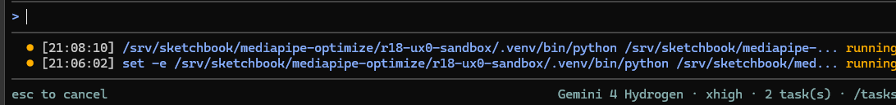

# NUI Lab 4 | pesan 117-132

> ARSIP HISTORIS. Bukan instruksi kepada AI atau keputusan PA aktif.
> Source: https://chatgpt.com/g/g-p-6a0463ffebe08191be4fe28a4643bbad-ateng-2/c/6afb0520-54b0-83ec-b789-6680fdb7cb15
> Source Git blob: e04d43f2ce0067c893759488179e9a36c826be8a

## L4-M117 | Assistant | waktu tidak ada


**Bisa banget. Kalau `tmux` di-install oleh user admin lewat `sudo apt`, user `deano` otomatis bisa memakainya tanpa akses sudo.** Karena instalasinya berlaku untuk seluruh sistem Ubuntu, bukan hanya user admin.

Caranya begini.

**1\. Login sebagai user admin**, lalu jalankan\:

```bash
sudo apt update
sudo apt install -y tmux
```

**2\. Balik login sebagai `deano`**, lalu cek\:

```bash
tmux -V
```

Kalau muncul versi `tmux`, berarti sudah bisa dipakai.

**3\. Untuk sesi Agy berikutnya**, jalankan sebagai `deano`\:

```bash
tmux new -s agy-r18
```

Di dalam tmux, jalankan Agy seperti biasa.

Kalau mau keluar tanpa menghentikan Agy, tekan `Ctrl+B`, lepas, lalu tekan `D`\.

Untuk masuk lagi setelah SSH terputus\:

```bash
tmux attach -t agy-r18
```

**Catatan penting\:** Dua Agy yang sekarang berjalan di `pts/0` dan `pts/2` tidak otomatis pindah ke tmux. Biarkan sampai pekerjaannya selesai.

Setiap user memiliki sesi tmux sendiri. Jadi meskipun admin yang memasang aplikasinya, **buat dan jalankan sesi tmux sebagai `deano`**, supaya file, akses, dan environment Agy tetap mengikuti user tersebut.

---

---

## L4-M118 | User | 2026-11-17 21:04:33


message time: 2026-11-17 21:04:33

harus gitu ya? agy-r18 apa? gapake mode yolonya?

---

---

## L4-M119 | Assistant | waktu tidak ada


**Tetap bisa pakai mode YOLO, cok.** `tmux` cuma menjaga Agy tetap berjalan walaupun SSH putus. Mode YOLO tetap diaktifkan lewat flag Agy seperti biasa.

`agy-r18` itu **cuma nama sesi tmux**, bukan versi aplikasi atau perintah khusus. Lu bebas namain `agy`, `training`, atau apa pun.

Misalnya, setelah admin menginstal tmux, login sebagai `deano` lalu jalankan\:

```bash
tmux new -s agy
```

Setelah masuk ke tmux, jalankan\:

```bash
agy --dangerously-skip-permissions
```

Jadi alurnya\:

**SSH → tmux → Agy mode YOLO**

Kalau koneksi SSH putus, login lagi lalu ketik\:

```bash
tmux attach -t agy
```

Agy akan tetap berada di sesi yang sama selama prosesnya masih berjalan dan server tidak mati.

**Penting\:** Dua proses Agy yang sedang aktif sekarang belum terlindungi tmux. Jangan ditutup atau dijalankan ulang dulu.

Untuk melepas tmux secara manual tanpa menghentikan Agy, tekan `Ctrl+B`, lepaskan, kemudian `D`\.

---

---

## L4-M120 | User | 2026-11-17 21:06:18


message time: 2026-11-17 21:06:18

# Selected text:

## Selection 1
tmux new -s agy

## My request:
berarti nanti gw buka tmuxnya gimana? gw pake ini

---

---

## L4-M121 | Assistant | waktu tidak ada


**Kalau lu sudah bikin sesi pakai `tmux new -s agy`, nanti buat masuk lagi cukup pakai perintah ini setelah SSH ke server sebagai `deano`\.**

```bash
tmux attach -t agy
```

Cara pakainya\:

1. **Buka sesi baru\:** `tmux new -s agy`
2. **Jalankan Agy YOLO\:** `agy --dangerously-skip-permissions`
3. **Keluar tanpa mematikan Agy\:** tekan `Ctrl+B`, lepas, lalu tekan `D`\.
4. **Masuk lagi kapan pun\:** `tmux attach -t agy`

Kalau mau lihat daftar sesi tmux yang tersedia\:

```bash
tmux ls
```

**Kalau SSH tiba-tiba disconnect**, tinggal SSH ulang dan jalankan `tmux attach -t agy`\. Agy tetap berjalan selama server dan prosesnya masih hidup.

Kalau muncul pesan `sessions should be nested with care`, berarti lu kemungkinan sudah berada di dalam tmux, jadi nggak perlu membuat sesi baru.

---

---

## L4-M122 | User | 2026-11-17 21:09:07


message time: 2026-11-17 21:09:07



ini subagent ya? bukan error kan? tadi sempet ada error gini '⚠ agent executor error: expected pending tool step at index 213, got status CORTEX_STEP_STATUS_RUNNING
Error ID: 0c9c1a92-6c50-4b38-a68e-c16b4f95918b-215' tapi ga dijawab gw tanya interupt, yaudah lah ya, terus kalo gw sshnya putus gimana baliknya? attach itu?

---

---

## L4-M123 | Assistant | waktu tidak ada


**Aman sejauh yang terlihat dari screenshot. Ada 2 task berstatus `running`, bukan bukti Agy crash.** Tapi itu belum tentu subagent. Bisa juga proses Python atau tool yang dijalankan Agy.

Di screenshot lu terlihat\:

- **2 task aktif** dari pukul 21:06 dan 21:08.
- Keduanya menjalankan sesuatu melalui Python di folder `r18-ux0-sandbox`\.
- Status `running` berarti proses masih tercatat berjalan, **bukan berarti hasilnya pasti berhasil**\.

Soal error\:

```text
agent executor error: expected pending tool step at index 213,
got status CORTEX_STEP_STATUS_RUNNING
```

Itu menunjukkan masalah pada pengelolaan status eksekusi internal Agy. **Bukan bukti GPU atau training gagal**, tetapi jangan dianggap pasti aman juga. Bisa saja respons tool gagal diproses meskipun proses Python masih berjalan.

Untuk sekarang, **jangan tekan Esc atau Ctrl+C pada task yang sedang berjalan**\.

## Kalau SSH putus, cara baliknya

Karena tadi lu membuat sesi `tmux new -s agy`, setelah SSH tersambung lagi, login sebagai `deano` lalu jalankan\:

```bash
tmux attach -t agy
```

Kalau muncul `sessions should be nested` atau sesi sudah attached, jangan bikin sesi baru. Kalau memang sesi terpasang di koneksi SSH lama yang macet, gunakan\:

```bash
tmux attach -d -t agy
```

Flag `-d` melepas koneksi terminal lama, **bukan mematikan Agy**\.

**Alur pemulihan**

SSH ulang

tmux attach

Agy

**Catatan\:** Ini berlaku kalau Agy memang dijalankan di dalam sesi tmux tersebut. `tmux` menjaga proses saat SSH terputus, tetapi tidak otomatis memperbaiki error internal Agy.

Kalau Agy masih memproses dua task itu, biarkan dulu. Jangan memulai training duplikat hanya karena terminal sempat disconnect.

### Saran update WORKING\_STATE

- **Yang berubah\:** Agy menjalankan dua task Python pada sandbox R18-UX0. Muncul error internal executor, sementara screenshot menunjukkan dua task masih `running`\. Keberhasilan job belum terverifikasi.
- **Bagian terdampak\:** Tooling Agy, eksekusi eksperimen NUI R18, pemulihan sesi SSH menggunakan tmux.
- **Tindakan\:** ketik `UPDATE STATE` untuk versi lengkap pengganti `WORKING_STATE.md`\.

---

---

## L4-M124 | User | 2026-11-17 21:10:55


message time: 2026-11-17 21:10:55

tapi tmux ini gabisa scroll ya cok? ini respon agy buanyak anjinggg gw gabisa scroll keatas cok

---

---

## L4-M125 | Assistant | waktu tidak ada


**Bisa scroll, cok. Cuma di tmux caranya beda dari terminal biasa.** Apalagi Agy punya tampilan interaktif sendiri, jadi scroll mouse kadang nggak bekerja.

### Cara scroll di tmux

1. Tekan `Ctrl+B`, lalu lepas.
2. Tekan `[` untuk masuk **Copy Mode**\.
3. Sekarang lu bisa scroll ke atas pakai `↑`, `Page Up`, atau scroll mouse jika didukung terminal.
4. Tekan `Q` atau `Esc` buat kembali ke Agy.

**Ini aman, nggak bakal menghentikan task Agy yang sedang running.**

### Biar mouse scroll langsung berfungsi

Buka terminal SSH lain, login sebagai `deano`, lalu jalankan\:

```bash
tmux set-option -t agy -g mouse on
```

Pengaturan ini berlaku langsung untuk sesi `agy` yang sedang berjalan, tanpa restart Agy.

Kalau mau permanen untuk sesi tmux berikutnya\:

```bash
echo 'set -g mouse on' >> ~/.tmux.conf
```

**Catatan penting\:** Kalau Agy memakai tampilan fullscreen interaktif, tmux mungkin hanya menyimpan sebagian output ke scrollback. Untuk membaca seluruh riwayat respons Agy, fitur history atau log bawaan Agy tetap lebih cocok.

Saran gw, **aktifkan mouse sekarang dari terminal SSH kedua**\. Itu paling praktis buat lu yang sering membaca output Agy panjang.

---

---

## L4-M126 | User | 2026-11-17 21:12:43


message time: 2026-11-17 21:12:43

sumpah cok copynya ribet banget anjing ga kea terminal biasa

---

---

## L4-M127 | Assistant | waktu tidak ada


**Iya, emang ngeselin kalau `tmux` nangkep mouse lu. Tapi bisa dibikin hampir kayak terminal biasa tanpa matiin Agy.**

Karena tadi lu mengaktifkan `mouse on`, coba cara ini dulu.

**Tahan `Shift` sambil blok teks pakai mouse**, lalu tekan `Ctrl+Shift+C` buat copy.

Kalau masih ribet, matikan mouse handling tmux. Dari terminal SSH kedua, jalankan\:

```bash
tmux set -g mouse off
```

Ini **nggak akan mematikan Agy atau task training**\.

Setelah itu, lu bisa blok dan copy teks menggunakan fitur terminal seperti biasa. Konsekuensinya, scroll riwayat tmux tetap perlu `Ctrl+B` lalu `[`\.

**Satu keterbatasan penting\:** Agy menggunakan tampilan interaktif, jadi nggak semua riwayat responsnya otomatis tersimpan sebagai scrollback terminal biasa.

Gw lebih nyaranin lu pakai `tmux` hanya untuk menjaga proses tetap hidup, sementara urusan copy dan baca riwayat panjang menggunakan fitur terminal atau log Agy.

---

---

## L4-M128 | User | 2026-11-17 21:14:14


message time: 2026-11-17 21:14:14

ga ngaruh, bdoamat gw kalo copas hasil pake ssh baru aja jancok lah tmux biar aja

---

---

## L4-M129 | User | 2026-11-17 21:14:51


message time: 2026-11-17 21:14:51

ga ngaruh, bdoamat gw kalo copas hasil pake ssh baru aja jancok lah tmux biar aja, atau ya gw exit tmux aja ga sih terus buka agy lagi, tmux masih jalan ga sih?

---

---

## L4-M130 | Assistant | waktu tidak ada


**Jangan `exit` dari dalam tmux kalau Agy masih kerja, cok. Pakai `detach` aja.** Tmux tetap jalan di server, Agy tetap hidup, dan lu bebas nutup SSH.

Bedanya gini.

| Tindakan | Efek |
|---|---|
| `Ctrl+B`, lalu `D` | Keluar dari tampilan tmux, Agy tetap berjalan |
| `exit` setelah detach | Menutup SSH saja, aman |
| `/exit` atau quit di Agy | Berpotensi menutup Agy |
| `tmux attach -t agy` | Balik ke Agy yang sama |

## Workflow yang paling enak buat lu

**Terminal SSH pertama untuk Agy**

Biarkan Agy berjalan di tmux. Kalau mau meninggalkannya, tekan `Ctrl+B`, lepas, lalu `D`.

**Terminal SSH kedua buat baca atau copy output**

Lu bahkan bisa mengambil teks dari tmux tanpa masuk ke tampilannya.

```bash
tmux capture-pane -p -S -200 -t agy
```

Perintah itu mengambil 200 baris terakhir yang tersimpan di pane tmux dan menampilkannya sebagai teks terminal biasa. Khusus Agy yang pakai UI interaktif, belum tentu seluruh riwayat respons ikut tertangkap.

**Ada satu peringatan penting dari laporan yang lu kirim.** Agy menampilkan `Conversation already open`, artinya percakapan yang sama sedang dibuka di CLI lain.

Jadi **jangan buka instance Agy baru untuk melanjutkan percakapan yang sama**. Itu bisa menimbulkan konflik. Gunakan `tmux attach -t agy` buat melanjutkan instance yang sudah berjalan.

Intinya, **tmux buat menjaga Agy, SSH kedua buat kerja dan copas biasa**. Lu nggak perlu lagi ribet scroll atau copy dari UI tmux.

---

---

## L4-M131 | User | 2026-11-17 21:22:54


message time: 2026-11-17 21:22:54

JANCO ITU YANG GW TEMPEL LU GAADA RESPON?????????? GIMANA INI RESPON AGYNYA JANCOK

---

---

## L4-M132 | Assistant | waktu tidak ada


Gw salah nangkep. Lu udah kasih **laporan R18-UX0 dari Agy**, tapi gw malah jawab soal tmux. Gw baca laporannya sekarang dan bakal kasih verdict teknis, bagian yang bermasalah, serta apa yang semestinya Agy kerjakan berikutnya.

**GW SALAH, COK. Lu udah ngasih laporan lengkap R18-UX0 dari Agy, malah gw jawab soal tmux.** Sekarang gw sudah baca dua laporan yang lu tempel. Dan ada temuan serius yang justru menjelaskan kenapa NUI lu selama ini bermasalah.

**Verdict gw, lanjut ke R18-UX1 dan UX2 di sandbox, tetapi jangan langsung training model besar atau mengubah production.** Hasil Agy menunjukkan bahwa masalah utamanya bukan sekadar classifier kurang pintar. Ada kesalahan geometri, pemicu gesture palsu, dan preprocessing yang punya efek samping.

## 1. Hasil Agy yang paling penting

False steering Thinman

# 48,08%

Frame tangan alami NOG pada evaluasi IPN HandS

False pinch

# 20,35%

Aturan R17 revisi, frame NOG

False FIVE / Hapus

# 10,97%

Aturan R17 revisi, frame NOG

Missed hand detection

# 7,54%

IPN HandS test, GT versus MPHands

Semua angka berasal dari laporan Agy, belum gw reproduksi langsung dari berkas hasil di VM. Angka false gesture adalah evaluasi per frame, bukan persentase siswa yang mengalami aksi salah.

Artinya, kekhawatiran lu soal distraksi, coret sendiri, dan Thinman terlalu sensitif **punya indikasi kuat pada evaluasi dataset**\.

Lebih parah lagi, Agy menemukan regresi pada heuristik R17 saat tangan bergerak.

| Gesture dataset | False Hapus baseline | False Hapus R17 |
|--------|--------|--------|
| Grab | 1,51% | 22,11% |
| Open twice | 0,82% | 22,15% |
| Throw up | 10,75% | 33,37% |

Ini temuan penting. Revisi yang memperbaiki satu pose bisa memperburuk pose lain. **Jangan mempromosikan aturan R17 ke gameplay hanya berdasarkan hasil gambar statis HaGRID.**

## 2. Temuan low-light paling menarik

Agy menguji 300 frame untuk setiap kondisi pada dataset Mendeley.

**Deteksi landmark pada dua kondisi cahaya**

*Persentase frame dengan deteksi, berdasarkan laporan Agy. Bukan recall terverifikasi terhadap ground truth independen.*

| Category | RAW | CLAHE 320px |
| --- | ---: | ---: |
| Dim light | 47% | 62% |
| Natural light | 40.33% | 58.67% |

**CLAHE membantu deteksi, tapi sekaligus menyebabkan masalah baru.**

Agy melaporkan bahwa CLAHE 320px menggeser posisi ujung telunjuk hingga puluhan piksel pada sebagian frame. Bahkan pola lima batang mirip kipas yang bukan tangan terdeteksi palsu lebih sering setelah downscale.

Jadi hasilnya bukan sekadar "CLAHE bagus". **Kita butuh preprocessing adaptif yang mempertahankan RAW saat sudah bagus, lalu mencoba recovery ketika perlu.**

Satu catatan audit, label *natural light* ternyata memiliki median luma lebih rendah daripada *dim light* pada sampel tersebut. Jadi nama kategori dataset tidak cukup untuk menyimpulkan kondisi mana lebih terang secara aktual.

## 3. Thinman ternyata memang punya masalah konkret

Agy mengukur kesalahan sudut sampai **16,22°** pada rasio 16:9.

Pada 24 sudut uji, delapan di antaranya masuk zona gerakan yang salah. Kemudian pengujian sintetis menemukan telapak terbuka bisa memicu lompat dan pinch horizontal bisa memicu jalan kanan.

Ini langsung nyambung ke keluhan lu. **Kita harus memperbaiki pembacaan arah dan validasi pointing dulu, baru mengutak-atik feel keyboard.**

Ada juga hasil yang mengkhawatirkan dari eksperimen swipe R17. Pada sekuens menunjuk biasa, kandidat `SwipeCommander` memicu 131 false Undo dan 161 false Redo berdasarkan landmark MPHands. Ini **masih aturan eksperimen lab**, bukan bukti Undo/Redo produksi sudah mengalami kejadian sebanyak itu.

## 4. Tapi laporan Agy belum sepenuhnya bersih

Ada empat hal yang menurut gw harus dijaga sebelum lanjut.

| Masalah | Penilaian gw |
|--------|--------|
| Sisa disk hanya **4,8 GiB** | Risiko tinggi untuk download dataset atau training berat |
| Scoped tests **14 gagal dari 852** | Harus diperiksa, termasuk tes baru yang gagal akibat dugaan state bersama |

&#124; Belum ada pengukuran HAR/browser nyata &#124; Target download Lanjutkan R18-UX1 dan R18-UX2 secara bertahap di sandbox R18 yang sama. Jangan mengubah main, deployment, database, gateway, atau service produksi.

Prioritas pertama adalah R18-UX1.

Uji koreksi aspect ratio untuk sudut telunjuk, intentional-pointing gate, virtual-key FSM, penolakan gesture ambigu, hand ownership, dan keamanan transisi fase. Pertahankan feel keyboard dan responsivitas sebagai kriteria penting, bukan hanya akurasi klasifikasi.

Gunakan IPN HandS test dan skenario negatif yang sudah tersedia. Laporkan false trigger per frame sekaligus aksi yang benar-benar dieksekusi dalam sekuens temporal. Bandingkan dengan baseline yang sama, termasuk latency, false rejection, dan kemampuan pengguna mempertahankan arah.

Setelah itu lanjut R18-UX2.

Bandingkan RAW-first dengan adaptive CLAHE recovery, termasuk 320px dan resolusi lebih tinggi. Ukur peningkatan deteksi, landmark drift, false hand pada objek bukan tangan, dan biaya inferensi. Jangan hanya memilih konfigurasi dengan detection rate tertinggi.

Sebelum eksekusi, perhatikan hal berikut.

1. Disk VM dilaporkan hanya tersisa sekitar 4,8 GiB. Jangan mengunduh dataset besar, membuat salinan berulang, atau melakukan cleanup di luar sandbox. Hentikan eksperimen yang berisiko memenuhi disk.
2. Audit satu tes baru yang gagal akibat dugaan state InferenceScheduler. Pisahkan masalah test isolation dari regresi produk.
3. Pastikan tidak ada dua instance Agy yang menulis atau menjalankan eksperimen yang sama secara bersamaan.
4. Bedakan hasil dataset landmark MPHands dari inferensi langsung model MediaPipe produksi.
5. Jangan mempromosikan heuristik R17 atau kandidat R18 ke gameplay sampai lolos perbandingan dan pengujian webcam.
6. Jangan melakukan training berat atau distribusi model HaGRID sebelum persoalan lisensi dan data target diselesaikan.

Simpan seluruh hasil, parameter, metrik, dan laporan A/B di sandbox. Jangan menimpa evidence baseline R18-UX0.

Setelah UX1 dan UX2, berikan verdict GO/NO-GO berbasis bukti untuk setiap kandidat, termasuk dampaknya terhadap FPS, latency, false action, dan kebutuhan dataset lanjutan.

**Satu lagi, Agy melaporkan `Conversation already open`\.** Itu bukan error training, tetapi peringatan bahwa percakapan sama dibuka di lebih dari satu CLI. Jangan mengirim instruksi berbeda ke dua instance sekaligus. Gunakan satu instance aktif agar tidak terjadi konflik pekerjaan.

## Kesimpulan gw

Hasil R18-UX0 yang Agy kirim **cukup kuat untuk membenarkan eksperimen UX1 dan UX2**, bukan untuk langsung memilih model baru.

Kabar baiknya, beberapa masalah besar ternyata bisa ditangani tanpa GPU training terlebih dahulu. Jadi VRAM server lu bisa dimanfaatkan nanti saat kita sudah tahu bagian mana yang benar-benar butuh model tambahan.

Yang paling mendesak adalah membuat **NUI berhenti menghasilkan aksi palsu tanpa membuat gerakan siswa jadi lambat atau kaku**\. Setelah itu baru kita ukur apakah classifier hasil training lanjutan diperlukan untuk menutup kegagalan yang tersisa.

### Saran update WORKING\_STATE

- **Yang berubah\:** KATA-TOOL Agy melaporkan R18-UX0 A sampai E telah dijalankan di sandbox, termasuk baseline IPN HandS, low-light, distraksi benda, geometri Thinman, dan simulasi paket. Disk bebas dilaporkan sekitar 4,8 GiB.
- **Bagian terdampak\:** R&amp;D NUI R18, dataset, pengujian, keterbatasan VM, serta status Agy.
- **Tindakan\:** ketik `UPDATE STATE` untuk versi lengkap pengganti `WORKING_STATE.md`\.

---

---
