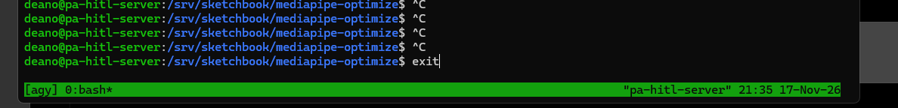

# NUI Lab 4 | pesan 133-148

> ARSIP HISTORIS. Bukan instruksi kepada AI atau keputusan PA aktif.
> Source: https://chatgpt.com/g/g-p-6a0463ffebe08191be4fe28a4643bbad-ateng-2/c/6afb0520-54b0-83ec-b789-6680fdb7cb15
> Source Git blob: e04d43f2ce0067c893759488179e9a36c826be8a

## L4-M133 | User | 2026-11-17 21:26:11


message time: 2026-11-17 21:26:11

jadi gimana? kalo train udah selesai suruh dia cobain jg cok biar bener, dim multimedia jg udah dipake?

---

---

## L4-M134 | Assistant | waktu tidak ada


**Belum, cok. Dari laporan Agy yang lu kirim, training model R18 belum dilakukan dan dataset DimHand dari ACM Multimedia 2026 juga belum dipakai.**

Yang sudah dilaporkan Agy adalah **R18-UX0**, yaitu pengukuran baseline, bukan training model baru.

| Pekerjaan | Status menurut laporan Agy |
|--------|--------|
| Pengujian IPN HandS, 200 video | Sudah dilaporkan |
| Pengujian low-light dataset Mendeley | Sudah dilaporkan |
| Pengujian distraksi benda sintetis | Sudah dilaporkan |
| Pengujian geometri Thinman | Sudah dilaporkan |
| **Penggunaan DimHand ACM Multimedia 2026** | **Belum ada bukti** |
| **Training classifier R18** | **Belum dilakukan** |
| Pengujian model hasil training di browser dan webcam | Belum dilakukan |

**Dataset Mendeley `dim_light_1.zip` yang dipakai Agy itu bukan DimHand.** Jadi jangan sampai dua dataset tersebut tertukar.

Dan gw sepakat dengan kebutuhan lu. **Setelah training, Agy wajib menguji model hasilnya secara menyeluruh**, bukan cuma melaporkan training selesai atau macro-F1 tinggi. Model yang bagus di dataset tetapi salah Coret, salah Hapus, atau bikin Thinman bergerak sendiri tetap belum layak dipakai siswa.

## Soal DimHand, gw cek lagi sumber resminya

DimHand memang cocok untuk pengujian gerakan jari di kondisi gelap. Datasetnya mencakup *finger counting*, *pinching*, dan gerakan tangan alami.

Tapi aksesnya melalui **formulir permohonan penelitian akademik**\. Jadi Agy perlu mengecek akses dan lisensinya dulu, bukan asal mengunduh.  [hanlingzhan.github.io](https://hanlingzhan.github.io/DimHand/?utm_source=chatgpt.com)

[Halaman resmi dan formulir akses DimHand](https://hanlingzhan.github.io/DimHand/)

Perlu juga diluruskan bahwa istilah `train` dalam laporan IPN HandS tadi berarti **pembagian dataset menjadi train/test**, bukan bukti bahwa Agy sudah melatih classifier R18.

## Ini instruksi lanjutan untuk Agy

> **Chat message**
> 
> Lanjutkan R&D NUI R18 berdasarkan dokumen R18-01 v0.3.0 dan evidence R18-UX0 yang sudah dihasilkan.
> 
> Prioritas tetap UX siswa, robustness kamera buruk/low-light/distraksi, akurasi gesture, stabilitas gameplay Thinman, dan efisiensi runtime browser. MediaPipe tetap menjadi fondasi utama.
> 
> **1. Lanjutkan R18-UX1 dan R18-UX2**
> 
> Eksperimen koreksi sudut telunjuk, intentional-pointing gate, virtual-key FSM, hand ownership, action safety, serta adaptive RAW/CLAHE.
> 
> Bandingkan kandidat terhadap baseline menggunakan data uji yang sama. Jangan hanya mengoptimalkan detection rate atau macro-F1. Perhatikan juga false Hapus, false Coret, false Swipe, responsivitas, dan false steering Thinman.
> 
> **2. Periksa penggunaan dataset DimHand dari ACM Multimedia 2026**
> 
> DimHand berbeda dengan dataset Mendeley `dim_light_1.zip`.
> 
> Periksa halaman resmi https://hanlingzhan.github.io/DimHand/ dan status aksesnya. Laporkan apakah dataset tersedia, memerlukan permohonan Owner, ketentuan lisensi, ukuran data, dan relevansinya untuk training maupun evaluasi.
> 
> Jika akses diperoleh, prioritaskan pengujian RGB-only dengan anotasi referensi yang sah. Jangan menjadikan depth sebagai input runtime browser.
> 
> Jangan mengklaim DimHand sudah digunakan sebelum ada bukti file, provenance, dan evaluasi aktual. Jangan mengunduh dataset besar jika kapasitas disk belum aman.
> 
> **3. Jika eksperimen UX1/UX2 menunjukkan perlunya training lanjutan**
> 
> Rancang dan jalankan training kandidat ringan hanya setelah dataset, lisensi, kapasitas disk, dan baseline siap.
> 
> Gunakan split yang mencegah kebocoran data antar-subjek atau video. Pertahankan baseline R17 sebagai pembanding, tetapi jangan mengasumsikan bobot R17 tersedia di VM.
> 
> **4. Training selesai bukan berarti pekerjaan selesai**
> 
> Setelah model terlatih, wajib lakukan pengujian otomatis menggunakan model ekspor yang benar-benar akan dipakai browser.
> 
> Uji pada data yang tidak digunakan untuk training, termasuk low-light, tangan alami, objek distraksi, pinch near/touch, swipe, hand ownership, dan gesture Thinman.
> 
> Lakukan A/B terhadap baseline menggunakan metrik aksi nyata per sekuens, bukan hanya klasifikasi per frame.
> 
> **5. Wajib uji integrasi browser**
> 
> Buat demonstrasi atau harness pengujian terisolasi yang menggunakan runtime MediaPipe dan classifier kandidat sebenarnya.
> 
> Uji pemutaran video melalui input kamera simulasi jika diperlukan. Periksa FPS, frame-time p95, latency, RAM, stabilitas setelah pemakaian berkelanjutan, dan total transfer pengalaman pertama yang harus di bawah 25 MB.
> 
> Pengujian browser dengan video rekaman tidak menggantikan webcam fisik. Siapkan skenario uji langsung untuk Owner menggunakan kamera buruk, lampu atas, backlight, latar mirip warna kulit, objek distraksi, dan movement Thinman.
> 
> Jangan mengklaim pengujian webcam fisik PASS jika hanya memakai video atau lingkungan virtual.
> 
> **6. Batas keamanan dan pelaporan**
> 
> Seluruh eksperimen tetap di sandbox. Jangan mengubah main, service produksi, atau deployment tanpa izin terpisah.
> 
> Perhatikan laporan sisa disk sekitar 4,8 GiB, hindari download dan duplikasi besar, dan jangan menjalankan pekerjaan bersamaan pada workspace yang sama.
> 
> Simpan checkpoint terbaik, konfigurasi, dataset manifest, hasil A/B, model card, ukuran model, dan evidence runtime. Jangan menghapus artefak yang diperlukan untuk reproduksi.
> 
> Laporkan secara terpisah mana yang PASS, FAIL, BLOCKED, dan NOT_TESTED. Usulkan integrasi hanya setelah lolos seluruh gerbang relevan dan pengujian langsung Owner.

**Urutan yang gw pilih adalah UX1 dan UX2, lalu training UX3 kalau memang diperlukan, kemudian pengujian offline, browser, dan webcam fisik.** DimHand ditelusuri paralel, sehingga pengajuan akses dataset tidak menghambat eksperimen yang datanya sudah tersedia.

Satu hal yang nggak boleh terlewat, **Agy di server bisa membuktikan model berjalan pada video, tetapi feel NUI di tangan siswa tetap harus diuji lewat webcam fisik**\. Terutama kontrol Thinman yang lu keluhkan terlalu cepat.

Jadi jangan terima laporan "training sukses" sebagai tanda sistem sudah siap dipakai.

---

---

## L4-M135 | User | 2026-11-17 21:33:53


message time: 2026-11-17 21:33:53

ini tmux gw mode ga copy gimana cok ah ribet gw kalo copy ssh baru aja

---

---

## L4-M136 | Assistant | waktu tidak ada


**Yaudah, nggak usah pakai Copy Mode tmux, cok. Biar tmux khusus jalanin Agy, sementara lu copas dari SSH kedua.**

Di SSH kedua, login sebagai `deano`, lalu jalankan\:

```bash
tmux capture-pane -p -S -1000 -t agy
```

Itu menampilkan sampai 1.000 baris riwayat pane `agy` sebagai teks biasa di SSH kedua. **Nggak mengganggu Agy yang sedang jalan.**

Kalau mau simpan output ke file\:

```bash
tmux capture-pane -p -S -1000 -t agy > ~/agy-output.txt
```

Catatan, karena Agy menggunakan UI interaktif, belum tentu seluruh respons lama tertangkap.

Kalau lu terlanjur masuk Copy Mode tmux, cukup tekan **`Q`** buat keluar.

**Jangan jalankan Agy kedua di SSH baru.** Cukup ambil output dari sesi tmux yang sudah ada.

---

---

## L4-M137 | User | 2026-11-17 21:35:12


message time: 2026-11-17 21:35:12

AHHH JANCOK gw bikin tmux baru pls gimana

---

---

## L4-M138 | Assistant | waktu tidak ada


**Mau bikin tmux baru? Bisa, cok. Jangan matiin sesi `agy` yang lama.**

Di terminal SSH baru, login sebagai `deano`, lalu jalankan\:

```bash
tmux new -s agy2
```

Kalau mau jalankan Agy di sesi baru\:

```bash
agy --dangerously-skip-permissions
```

**Tapi jangan buka percakapan Agy yang sama di dua instance**, karena tadi sudah muncul peringatan `Conversation already open`\. Pakai sesi baru hanya untuk pekerjaan atau percakapan yang berbeda.

Kalau mau balik ke tmux lama\:

```bash
tmux attach -t agy
```

Kalau mau balik ke tmux baru\:

```bash
tmux attach -t agy2
```

**Kalau maksud lu cuma mau keluar dari tmux lama dan pakai SSH biasa**, tekan `Ctrl+B`, lalu `D`\. Agy lama tetap berjalan, dan lu nggak perlu bikin tmux baru.

---

---

## L4-M139 | User | 2026-11-17 21:35:37


message time: 2026-11-17 21:35:37



sek cok ini gw masuk agy kan ya?

---

---

## L4-M140 | Assistant | waktu tidak ada


**Belum, cok. Lu sekarang ada di dalam tmux, tapi Agy belum berjalan.**

Dari screenshot, status bawah `0:bash*` berarti lu sedang di shell Bash dalam tmux, bukan di Agy.

Kalau mau menjalankan Agy di sini, ketik\:

```bash
agy --dangerously-skip-permissions
```

**Tapi hati-hati**, kalau Agy lama masih berjalan di sesi tmux `agy`, jangan membuka percakapan yang sama di instance baru karena bisa konflik.

Kalau tujuan lu cuma balik ke Agy lama, tekan `Ctrl+B`, lalu `D`, kemudian\:

```bash
tmux attach -t agy
```

Dan soal `exit` yang sedang lu ketik di screenshot, **jangan tekan Enter kalau ingin mempertahankan sesi tmux ini**\. `exit` akan menutup Bash dan bisa mengakhiri sesi tmux kalau itu satu-satunya window.

---

---

## L4-M141 | User | 2026-11-17 21:36:24


message time: 2026-11-17 21:36:24

maksud gw tmuxnya tmux agy jancok

---

---

## L4-M142 | Assistant | waktu tidak ada


**IYA COK, lu sekarang udah di dalam tmux yang namanya `agy`\!** Gw tadi salah nangkep.

Dari screenshot, tulisan `[agy] 0:bash*` artinya\:

- `[agy]` \= nama sesi tmux lu.
- `0:bash*` \= window aktif sedang menjalankan Bash.
- Jadi **tmux `agy` sudah kebuka**, tapi aplikasi Agy-nya nggak sedang tampil.

Kalau mau cek Agy lama masih ada atau nggak, jangan jalankan instance baru dulu. Di terminal itu ketik\:

```bash
tmux list-windows -t agy
```

Kalau cuma ada `0: bash`, berarti di sesi tmux `agy` itu sekarang hanya ada Bash, bukan Agy yang masih berjalan di window lain.

---

---

## L4-M143 | User | 2026-11-17 21:47:57


message time: 2026-11-17 21:47:57

balik ke tmux agy gimana? gw disconnect ini

---

---

## L4-M144 | Assistant | waktu tidak ada


**SSH ulang sebagai `deano`, terus jalankan ini buat balik ke tmux `agy` yang tadi.**

```bash
tmux attach -d -t agy
```

Perintah ini aman. Kalau sesi `agy` masih ada, lu langsung masuk lagi. `-d` cuma melepas koneksi terminal lama, **bukan mematikan Agy**\.

Kalau muncul `can't find session: agy`, cek\:

```bash
tmux ls
```

**Jangan pakai `tmux new` lagi**, karena lu mau masuk ke sesi lama, bukan bikin sesi baru.

---

---

## L4-M145 | User | 2026-11-18 08:08:35


message time: 2026-11-18 08:08:35

nih kata agy, kasih gw list konteks apa aja yang lu perluin kea file2 yang harus gw drop ke sini jg, json2 atau md2 yang dibilang itu apa aja

---

---

## L4-M146 | Assistant | waktu tidak ada


Gw cek laporan terbaru Agy dan cocokkan nama artefaknya. Habis itu gw pisahin file yang wajib lu drop buat audit hasil R18, file pendukung, dan yang nggak perlu dikirim.

**Gw butuh satu paket ZIP berisi laporan, hasil pengujian JSON, model hasil training, dan source kandidat R18.** Nggak perlu lu kirim seluruh folder sandbox, dataset video, `node_modules`, atau virtual environment Python.

Dari laporan terbaru Agy, statusnya sudah berubah signifikan. **R18-UX1, UX2, UX3, dan browser harness dilaporkan selesai diuji.** Training kandidat MLP juga sudah dilakukan memakai IPN HandS, bukan DimHand.

Namun semua ini masih **KATA-TOOL Agy**, belum gw verifikasi langsung dari artefak aslinya. Ada beberapa angka yang perlu diaudit sebelum kita menyatakan model siap dipasang.

## File yang gw perlu

Semua file berada di `/srv/sketchbook/mediapipe-optimize/r18-ux0-sandbox/`\.

| Prioritas | File | Kenapa gw butuh |
|--------|--------|--------|
| **Wajib** | `results/R18_MASTER_REPORT.md` | Laporan induk dan hubungan semua eksperimen |
| **Wajib** | `results/MODEL_CARD.md` | Arsitektur, kemampuan, keterbatasan dan data training |
| **Wajib** | `results/OWNER_PHYSICAL_WEBCAM_TEST_PROTOCOL.md` | Panduan uji kamera fisik lu |
| **Wajib** | `results/r18_ux1_ab.json` | Audit perbaikan gesture, Thinman, ownership dan FSM |
| **Wajib** | `results/r18_ux2_adaptive.json` | Audit low-light RAW versus CLAHE |
| **Wajib** | `results/ux3_training_metrics.json` | Akurasi, macro-F1, kalibrasi dan split pengujian |
| **Wajib** | `results/r18_ux3_exported_eval.json` | Perbandingan perilaku model ekspor dengan baseline |
| **Wajib** | `results/r18_ux4_browser_runtime.json` | FPS, latency, RAM, transfer paket dan error browser |
| **Wajib** | `results/ux3_model_mlp.json` | Model aktual hasil training, dilaporkan berukuran 123 KB |
| **Wajib** | `results/ipn_person_split.json` | Memeriksa pemisahan subjek train/validation/test |
| **Wajib** | `results/dataset_manifest.json` | Sumber dataset, lisensi dan status DimHand |

**Source dan baseline pendukung** juga gw butuh untuk memeriksa apakah angka yang dilaporkan sesuai implementasinya.

- `candidates/ux1_candidates.ts`
- `candidates/ux3_features.ts`
- `candidates/ux3_model.ts`
- `candidates/ux3_integrated.ts`
- `scripts/run_browser_harness.mjs`
- `results/r18_ux0_a_bundle.json`
- `results/r18_ux0_b_ipn_detection.json`
- `results/r18_ux0_b_ipn_rules.json`
- `results/r18_ux0_c_mendeley.json`
- `results/r18_ux0_d_geometry.json`
- `results/r18_ux0_e_n0_n1.json`

Dengan paket ini gw bisa audit hasil evaluasi, implementasi kandidat, kompatibilitas ekspor model, dan batas pengujiannya. Untuk reproduksi penuh, nantinya tetap diperlukan script training/evaluasi dan dataset yang sesuai. **Jangan kirim dataset mentah dulu.**

## Cara paling gampang, bikin satu ZIP dari SSH

Jalankan ini sebagai `deano` di SSH biasa, bukan dari dalam Agy. **Nggak menghentikan proses Agy dan nggak mengubah sandbox.**

```bash
cd /srv/sketchbook/mediapipe-optimize/r18-ux0-sandbox || exit 1

python3 - <<'PY'
from pathlib import Path
from zipfile import ZipFile, ZIP_DEFLATED

files = """
results/R18_MASTER_REPORT.md
results/MODEL_CARD.md
results/OWNER_PHYSICAL_WEBCAM_TEST_PROTOCOL.md
results/r18_ux1_ab.json
results/r18_ux2_adaptive.json
results/ux3_training_metrics.json
results/r18_ux3_exported_eval.json
results/r18_ux4_browser_runtime.json
results/ux3_model_mlp.json
results/ipn_person_split.json
results/dataset_manifest.json
results/r18_ux0_a_bundle.json
results/r18_ux0_b_ipn_detection.json
results/r18_ux0_b_ipn_rules.json
results/r18_ux0_c_mendeley.json
results/r18_ux0_d_geometry.json
results/r18_ux0_e_n0_n1.json
candidates/ux1_candidates.ts
candidates/ux3_features.ts
candidates/ux3_model.ts
candidates/ux3_integrated.ts
scripts/run_browser_harness.mjs
""".strip().splitlines()

output = Path.home() / "r18-audit-pack.zip"
with ZipFile(output, "w", ZIP_DEFLATED, compresslevel=6) as archive:
    for name in files:
        path = Path(name)
        if path.is_file():
            archive.write(path, arcname=name)
            print("OK     ", name)
        else:
            print("MISSING", name)

print(f"\nZIP: {output}")
print(f"Size: {output.stat().st_size:,} bytes")
PY
```

Setelah itu, **dari terminal laptop lu, bukan dari SSH server**, ambil ZIP-nya melalui NetBird.

```bash
scp deano@100.115.156.202:~/r18-audit-pack.zip .
```

Upload `r18-audit-pack.zip` ke chat ini. Kalau ada `MISSING`, kirim juga nama filenya supaya gw tahu bagian audit mana yang belum punya bukti.

File `SOUL.md`, `DECISIONS.md`, dan `WORKING_STATE.md` yang ada di proyek ini sudah bisa gw baca, jadi lu nggak perlu mengunggah ulang kalau belum ada perubahan.

**Yang mau gw periksa setelah ZIP masuk** adalah apakah improvement UX1 sampai UX3 benar-benar dihitung dengan perbandingan yang adil, mengapa macro-F1 keseluruhan masih 0,6156, seberapa aman false action yang tersisa, dan apakah model ekspor memang cocok untuk browser. Dari laporan Agy, DimHand masih blocked dan webcam fisik belum diuji. Itu dua batas penting yang nggak boleh ditutupi oleh hasil PASS simulasi.

### Saran update WORKING\_STATE

- **Yang berubah\:** KATA-TOOL Agy melaporkan penyelesaian eksperimen UX1, UX2, training UX3, serta browser harness terisolasi. Dataset DimHand belum digunakan, uji webcam fisik belum dilakukan, dan disk tersisa sekitar 4,1 GiB.
- **Bagian terdampak\:** R&amp;D NUI R18, artefak evaluasi, training, dataset, browser QA, dan blocker validasi.
- **Tindakan\:** ketik `UPDATE STATE` untuk versi lengkap pengganti `WORKING_STATE.md`\.

---

---

## L4-M147 | User | 2026-11-18 08:14:06


message time: 2026-11-18 08:14:06

semua result dan candidates aja ya gw zip? apa gini '> bisa ga elu hasil2 sandbox ini lu push ke github gw? ga masalah soal database, tapi setup dulu mcp ini
  'https://github.com/github/github-mcp-server' terus nanti di repo gw lu bikin folder sandbox gitu gimana?' gw bilang gitu ke agy soalnya kalo copas2 lama anjay ke sini krn jaringan wifi kampus latensinya tinggi banget jadi gw bikin aja ga sih di folder sandbox gitu di repo gw, tapi arsitekturnya gimana dan folder sandbox itu masuk mana ya enaknya?

---

---

## L4-M148 | Assistant | waktu tidak ada


Menurut gw, **GitHub lebih masuk akal daripada bolak-balik transfer ZIP lewat Wi-Fi kampus**, tapi jangan push seluruh sandbox mentah ke repo utama. Gw cek aturan proyek, struktur repo, dan cara kerja GitHub MCP dulu supaya lokasi foldernya nggak bikin repo produk berantakan.

**Gas lewat GitHub aja, tapi jangan push seluruh sandbox mentah atau langsung ke `main`\.** Gw sudah cek repo [lustresense/hitl-momo](https://github.com/lustresense/hitl-momo)\. Repo lu **public**, dan struktur utamanya sudah punya `frontend/`, `train/`, `weights/`, `docs/`, serta `scripts/`\.

Karena itu, rekomendasi gw adalah **satu folder eksperimen yang terpisah dari kode produk, di branch khusus R18**\.

## Struktur yang gw rekomendasikan

**hitl-momo** Repository

rnd/nui-r18-evidence (Branch terpisah)

frontend/ Kode aplikasi, jangan disentuh

train/ dan weights/ Struktur produk existing

**experiments/**

**nui/r18/**

**Kenapa bukan `sandbox/` di root?** Karena nama itu terlalu umum. Nanti eksperimen Momo, NUI, gameplay, dan model bisa bercampur. `experiments/nui/r18/` langsung menunjukkan domain dan versinya.

Lokasinya juga tidak berada di `frontend/implementation/`, sehingga hasil eksperimen tidak otomatis menjadi bagian aplikasi. Branch khusus menjaga artefak dari perubahan `main` sampai lu memang memutuskan akan mengintegrasikan kandidatnya.

## GitHub MCP perlu dipasang nggak?

**Nggak wajib.** Ini yang perlu lu koreksi dari instruksi ke Agy.

Kalau Agy sudah punya akses `git` dan autentikasi GitHub yang berfungsi di server, dia bisa langsung commit dan push. GitHub MCP berguna untuk operasi GitHub melalui agent, tetapi bukan syarat untuk mengunggah file.

GitHub menyediakan [GitHub MCP Server resmi](https://github.com/github/github-mcp-server) dengan opsi remote maupun lokal. Setup autentikasinya bergantung pada dukungan MCP host Agy.  [GitHub](https://github.com/github/github-MCP-server?utm_source=chatgpt.com)

Karena repo lu public, **branch eksperimen juga public**\. Jangan masukkan database, data siswa, rekaman webcam, token, `.env`, atau dataset mentah, meskipun lu merasa database bukan masalah.

Repo lu juga sudah dilaporkan GitHub berukuran sekitar 1 GiB. Jangan tambah arsip dataset ratusan MB ke Git history. GitHub sendiri merekomendasikan repositori tetap kecil.  [GitHub](https://github.com/github/docs/blob/main/content/repositories/working-with-files/managing-large-files/about-large-files-on-github.md?utm_source=chatgpt.com)

## Instruksi yang sebaiknya lu kirim ke Agy

> **Chat message**
> 
> Saya ingin mempublikasikan artefak audit R18 ke repository `lustresense/hitl-momo` agar dapat diperiksa dari GitHub tanpa perlu transfer ZIP melalui laptop.
> 
> Gunakan ketentuan berikut.
> 
> **Lokasi dan branch**
> - Repository `lustresense/hitl-momo`.
> - Branch baru `rnd/nui-r18-evidence`.
> - Folder `experiments/nui/r18/`.
> - Jangan push langsung ke `main`, merge, deploy, atau mengubah kode produk.
> - Periksa `AGENTS.md` dan SOP owner yang relevan sebelum bekerja.
> 
> **Artefak yang dipublikasikan**
> 
> Pertahankan seluruh hasil penting R18-UX0 sampai UX4.
> 
> 1. `results/` berisi laporan MD, metrik JSON, dataset manifest, model card, dan protokol physical webcam test.
> 2. `candidates/` berisi seluruh source kandidat yang diperlukan untuk audit UX1, UX2, dan UX3.
> 3. `scripts/` berisi script eksperimen, training, evaluasi, ekspor, dan browser harness yang diperlukan untuk mereproduksi hasil.
> 4. `models/` berisi model JSON hasil training yang memang boleh didistribusikan.
> 5. `README.md` berisi index artefak, commit baseline, lingkungan pengujian, status PASS/FAIL/BLOCKED/NOT_TESTED, command reproduksi, keterbatasan, dan mapping lokasi file asal.
> 6. `manifest.sha256` berisi checksum seluruh artefak yang dipublikasikan.
> 
> Jangan langsung menyalin folder secara membabi buta. Audit dulu daftar dan ukuran file serta pilih artefak yang diperlukan. Jangan mengunggah dataset mentah, video, database, secrets, virtual environment, cache, build output, atau file besar yang tidak diperlukan.
> 
> **GitHub MCP**
> 
> Periksa terlebih dahulu apakah git CLI dan autentikasi GitHub sudah berfungsi.
> 
> Kalau sudah, gunakan git CLI. Tidak perlu memasang GitHub MCP hanya untuk melakukan push.
> 
> Kalau benar-benar membutuhkan MCP untuk operasi lanjutan, gunakan proyek resmi `github/github-mcp-server`, periksa kompatibilitas Agy CLI, dan gunakan autentikasi dengan izin minimum. Jangan mencetak atau menyimpan token di repo, log, atau output percakapan.
> 
> **Keamanan perubahan**
> 
> - Jangan mengubah checkout baseline `main` yang sedang digunakan eksperimen.
> - Gunakan worktree/checkout publikasi terisolasi jika diperlukan.
> - Periksa seluruh file yang akan di-stage dan lakukan pemeriksaan secrets.
> - Lakukan commit serta push hanya ke branch eksperimen.
> - Pastikan branch remote dapat dibaca dan file serta checksum cocok.
> - Jangan membuat salinan dataset atau duplikasi repo besar karena ruang disk VM terbatas.
> - Jangan hapus artefak sandbox asli setelah push.
> 
> **Output akhir**
> 
> Laporkan URL branch dan folder GitHub, commit SHA, jumlah file, total ukuran, daftar artefak yang tidak dipublikasikan beserta alasannya, serta hasil verifikasi checksum.
> 
> Jangan klaim artefak sudah terpublikasi sebelum push remote berhasil dan isinya diverifikasi.

Setelah Agy berhasil push, lu cukup kasih gw URL branch tersebut. **Gw sudah berhasil membaca struktur repo GitHub lu lewat konektor**, jadi nanti gw bisa memeriksa file MD, JSON, dan TS langsung dari GitHub tanpa perlu lu download-upload ZIP.

Tetap ada satu batasan. Membaca artefak dari GitHub memungkinkan gw mengaudit hasil dan source, tetapi tidak otomatis membuktikan semua eksperimen dapat direproduksi tanpa dataset serta runtime server.

### Saran update WORKING\_STATE

- **Yang berubah\:** Pengguna mempertimbangkan publikasi artefak sandbox R18 ke GitHub untuk mengurangi transfer melalui koneksi kampus. Struktur `experiments/nui/r18/` dan branch `rnd/nui-r18-evidence` masih merupakan usulan, belum terbukti dibuat atau dipush.
- **Bagian terdampak\:** Workflow Agy, GitHub, penyimpanan evidence R18, serta akses audit lintas sesi.
- **Tindakan\:** ketik `UPDATE STATE` untuk versi lengkap pengganti `WORKING_STATE.md`\.

---

---
