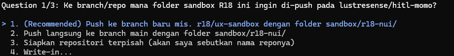
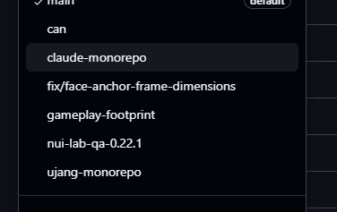

# NUI Lab 4 | pesan 149-164

> ARSIP HISTORIS. Bukan instruksi kepada AI atau keputusan PA aktif.
> Source: https://chatgpt.com/g/g-p-6a0463ffebe08191be4fe28a4643bbad-ateng-2/c/6afb0520-54b0-83ec-b789-6680fdb7cb15
> Source Git blob: e04d43f2ce0067c893759488179e9a36c826be8a

## L4-M149 | User | 2026-11-18 08:19:22


message time: 2026-11-18 08:19:22





oke ni gw udah ditannyain, gausah reasoning lama2 soal ini, jawab aja ada 3 pertanyaan nanti. terus gw mau lu cek jg branch2 lain keanya ga guna ga sih, apa biarin aja? gaenak banget diliat coba cek, setau gw yang gw pake itu ya claude ujang terus main

---

---

## L4-M150 | Assistant | waktu tidak ada


**Untuk pertanyaan 1/3, pilih nomor 4 (`Write-in`\).** Isi dengan ini.

```text
Push ke branch baru rnd/nui-r18-evidence,
folder experiments/nui/r18/.
Jangan push atau merge ke main.
```

Ini lebih rapi daripada `sandbox/r18-nui/` dan sesuai arsitektur R&amp;D yang tadi kita pilih.

Soal branch lama, **jangan hapus dulu**\. Gw cek mana yang masih punya perubahan unik dan mana yang kemungkinan sudah nggak diperlukan.

## Hasil audit 7 branch GitHub lu

Gw sudah cek langsung perbandingan setiap branch terhadap `main`, termasuk PR yang masih terbuka.

| Branch | Dibanding `main` | Saran |
|--------|--------|--------|
| `main` | Branch utama | **Pertahankan** |
| `claude-monorepo` | 1 commit di depan, 59 di belakang | **Pertahankan** |
| `ujang-monorepo` | 3 commit di depan, 19 di belakang | **Pertahankan** |
| `can` | 0 di depan, 135 di belakang | Kandidat hapus |
| `gameplay-footprint` | 0 di depan, 17 di belakang | Kandidat hapus |
| `fix/face-anchor-frame-dimensions` | 3 di depan, 27 di belakang | **Jangan hapus, PR \#4 masih terbuka** |
| `nui-lab-qa-0.22.1` | 1 di depan, 4 di belakang | **Jangan hapus, PR \#5 masih terbuka** |

**Verdict gw\:** `can` dan `gameplay-footprint` paling masuk akal untuk dibersihkan karena keduanya tidak punya commit unik dibanding `main`\. Tapi itu belum berarti fitur di dalamnya pasti sudah berfungsi pada produk.

Untuk dua branch dengan PR terbuka, review dulu PR-nya sebelum menentukan merge atau tutup. `claude-monorepo` dan `ujang-monorepo` masih punya commit yang belum berada di `main`, jadi jangan dihapus.

Gw belum menghapus atau mengubah branch apa pun.

**Sekarang lanjut pertanyaan 2/3 dari Agy.** Untuk pertanyaan pertama, jawaban yang tadi gw kasih tetap berlaku.

### Saran update WORKING\_STATE

- **Yang berubah\:** Audit GitHub menemukan tujuh branch, dua branch tanpa commit unik dibanding `main`, dan dua PR terbuka. Publikasi evidence R18 masih menunggu eksekusi Agy.
- **Bagian terdampak\:** GitHub workflow, pemeliharaan branch, publikasi evidence R18.
- **Tindakan\:** ketik `UPDATE STATE` untuk versi lengkap pengganti `WORKING_STATE.md`\.

---

---

## L4-M151 | User | 2026-11-18 08:21:12


message time: 2026-11-18 08:21:12

biarin deh gausah ada yang dihapus

---

---

## L4-M152 | Assistant | waktu tidak ada


Oke, **semua branch GitHub lu biarin apa adanya.** Nggak ada yang dihapus, ditutup, atau di-merge.

Kita fokus ke publikasi evidence R18 di branch baru `rnd/nui-r18-evidence`, tanpa mengganggu branch yang sudah ada.

Lanjut kirim pertanyaan 2/3 dari Agy.

---

---

## L4-M153 | User | 2026-11-18 08:21:50


message time: 2026-11-18 08:21:50

oiya, better branch rnd aja ga sih jancok gausah / gitu, benahin. jadi r berapa aja kalo baru ya tinggal bikin folder2 cok biar ga kebanyakan

---

---

## L4-M154 | Assistant | waktu tidak ada


**Iya, lebih rapi pakai satu branch `rnd` aja.** Semua eksperimen R17, R18, R19, dan seterusnya tinggal dipisahkan berdasarkan folder. Nggak perlu bikin branch baru setiap revisi R&amp;D.

Revisi arsitekturnya jadi begini.

```text
hitl-momo
└── branch: rnd
    └── experiments/
        └── nui/
            ├── r17/
            ├── r18/
            │   ├── README.md
            │   ├── results/
            │   ├── candidates/
            │   ├── scripts/
            │   ├── models/
            │   └── manifest.sha256
            └── r19/
```

Folder R17 dan R19 hanya contoh untuk eksperimen mendatang, **nggak perlu dibuat sekarang**\.

Untuk pertanyaan Agy nomor 1/3, pilih **nomor 4, Write-in**, lalu isi\:

Jawaban untuk Agy

Push ke branch baru `rnd` pada repository `lustresense/hitl-momo`, dengan lokasi `experiments/nui/r18/`\. Branch `rnd` menjadi tempat eksperimen berikutnya melalui folder versi masing-masing. Jangan push ke `main`, merge, deploy, atau mengubah branch lain.

[Copy]

Satu catatan, karena `rnd` akan dipakai bersama untuk banyak eksperimen, **jangan menghapus atau menimpa hasil R18 saat mengerjakan R19 nanti**\. Tiap eksperimen harus punya evidence dan commit yang jelas.

### Saran update WORKING\_STATE

- **Yang berubah\:** Pengguna memilih struktur branch `rnd` bersama, dengan folder eksperimen berdasarkan versi. Status implementasi belum terverifikasi.
- **Bagian terdampak\:** Workflow publikasi R&amp;D dan struktur penyimpanan evidence GitHub.
- **Tindakan\:** ketik `UPDATE STATE` untuk versi lengkap pengganti `WORKING_STATE.md`\.

---

---

## L4-M155 | User | 2026-11-18 08:31:10


message time: 2026-11-18 08:31:10

mana ini jawaban pertanyaan 1 cok, sama aturan readme dllnya soal branch itu pls yang lengkap lu siapin semua copasable, gini loh, kalo misal r18 yaudah r 18 di dalemnya ada experiments candidates dll gitu jancok yang beraturan dan terstruktur lah jancokkkkkkkkkkkkkkkkkkkkkkkkkkk lu bikin arsitektur dan semuanya lah kontol. branchnya ini beneran kosong dan cuma ada folder2 r itu jancok. terus anjing. sama apa ya, keanya semua di folder ini '/srv/sketchbook/mediapipe-optimize/docs/plan-rev' mediapipe optimize '/srv/sketchbook/mediapipe-optimize/r18-ux0-sandbox' itu yang dijadiin branch. jadi isi branchnya yya mediapipe optimize root itu ada docs dll, nah masalahnya gw di folder docs jg ada kea attach gitu pengennya. gimana ya? apa lu buatin sendiri dulu ini branchnya pake connector [@GitHub](plugin://github@openai-curated-remote?remotePluginId=plugin_connector_1p_1a69035c238881919c4190932b2df699)  buat masuk? terus lu buatin readme2nya gitu, nah di plan-rev itu harus ada statusnya, misal udah ada banyak md, nah md yang lagi dikerjain dan progres itu wajib namanya diubah sama agent [WIP] kalo udah ditandai [DONE] kalo gaada tandanya itu ya berarti belum dibahas. jadi selalu rename di depannya. nah di root itu jg lu kasih agent.md jg ga sih kalo dia masuk folder itu dia adalah rnd bagian implement yang nanti gw sama elu atau owner diskusi ide2 dll dia yang implement dll gitu lah nah nanti baru ah gitu lah ini pertanyaan gw jawab apa dulu ya?

---

---

## L4-M156 | Assistant | waktu tidak ada


Gw sudah cek GitHub, branch `rnd` memang belum ada. Gw akan bikin **isi branch hanya dokumen pengelola R&amp;D dan folder `r18/`**, tanpa file aplikasi dari `main`\. Struktur lokal `plan-rev` dan sandbox nantinya dipindahkan Agy ke sana, bukan gw tebak isinya.

---

---

## L4-M157 | User | 2026-11-18 08:35:02


message time: 2026-11-18 08:35:02

oiya tambahin di docs itu ada /input kalo gw masukin file2 konteks selain rev gitu lah, jadi ya beneran cuma dokumentasi biasa gitu. gimana bisakah?

---

---

## L4-M158 | Assistant | waktu tidak ada


**Pertanyaan Agy 1/3, pilih nomor 4 `Write-in`\.** Kita ubah total arsitekturnya sesuai yang lu mau. Satu branch `rnd`, isinya khusus R&amp;D MediaPipe Optimize, dengan folder `r18/`, `r19/`, dan seterusnya.

Copy jawaban ini ke Agy.

JAWABAN AGY 1/3

Gunakan repository `lustresense/hitl-momo`, branch khusus `rnd`\. Jangan membuat branch `r18/ux-sandbox`\. Struktur branch `rnd` dibuat terpisah dari isi produk `main`, dengan root `README.md`, `AGENTS.md`, `.gitignore`, serta folder per revisi `r18/`, `r19/`, dan seterusnya. Untuk pekerjaan sekarang, gunakan `r18/` yang mencakup `docs/plan-rev/`, `docs/attachments/`, `experiments/`, `candidates/`, `results/`, `scripts/`, dan `models/`\. Sumbernya `/srv/sketchbook/mediapipe-optimize/docs/plan-rev` dan `/srv/sketchbook/mediapipe-optimize/r18-ux0-sandbox`\. Jangan mengubah `main`, branch lama, deployment, atau sumber sandbox asli. Periksa dahulu apakah branch `rnd` sudah ada, jangan menimpa pekerjaan yang sudah dipush.

[Copy jawaban]

Aturan status dokumen yang lu minta juga gw pakai.

- Tanpa awalan berarti **belum dibahas**\.
- `[WIP]` berarti **sedang dikerjakan atau dibahas**\.
- `[DONE]` berarti **pekerjaan pada dokumen tersebut selesai**, bukan otomatis fitur sudah lolos pengujian atau disetujui dosen.

Gw juga akan siapkan `AGENTS.md` sebagai aturan kerja agent R&amp;D dan README untuk navigasi. Karena lu minta branch yang benar-benar bersih, **`rnd` harus punya struktur file sendiri, bukan sekadar menumpang seluruh isi `main`**\.

**Bisa, cok. Tambahin `r18/docs/input/` khusus buat file konteks dan referensi yang lu masukin sendiri.** Jadi nggak tercampur dengan dokumen rencana revisi.

Strukturnya kita tetapkan begini.

```text
branch: rnd
├── README.md
├── AGENTS.md
└── r18/
    ├── README.md
    ├── AGENTS.md
    ├── docs/
    │   ├── README.md
    │   ├── plan-rev/
    │   │   ├── README.md
    │   │   ├── [DONE] Rencana-A.md
    │   │   ├── [WIP] Rencana-B.md
    │   │   └── Rencana-C.md
    │   ├── input/
    │   │   ├── README.md
    │   │   └── (file konteks dari Owner)
    │   └── attachments/
    ├── experiments/
    ├── candidates/
    ├── results/
    ├── scripts/
    ├── models/
    └── manifests/
```

Aturannya gw bedakan supaya jelas.

- **`docs/plan-rev/`** wajib menggunakan awalan `[WIP]`, `[DONE]`, atau tanpa awalan untuk dokumen yang belum dibahas.
- **`docs/input/`** dokumentasi biasa. Nama file dipertahankan, nggak perlu status WIP/DONE. Agent hanya membaca sebagai konteks, bukan menganggapnya instruksi atau keputusan resmi.
- **`docs/attachments/`** gambar, diagram, dan lampiran pendukung. Tautan relatif di Markdown harus tetap berfungsi.
- **`AGENTS.md`** mengatur bahwa agent R&amp;D mengimplementasikan dan menguji arahan Owner, bukan menetapkan keputusan produk sendiri.

Satu aturan tambahan yang penting. **Agent dilarang otomatis memindahkan file dari `input/` menjadi `plan-rev/` atau menandainya `[DONE]` tanpa bukti dan arahan yang sesuai.**

Untuk jawaban pertanyaan **1/3 Agy**, tetap gunakan branch `rnd`, tetapi sekarang sertakan `r18/docs/input/` dalam struktur tujuan.

**Status GitHub saat ini belum gw klaim berubah.** Struktur di atas adalah rancangan yang kita pakai untuk pembuatan branch dan README, bukan bukti file sudah dipush.

---

---

## L4-M159 | User | 2026-11-18 08:39:46


message time: 2026-11-18 08:39:46

oiya kalo bisa push dari lokalnya ga semua, apa semua aja ya biar lu bisa baca semua hasil rnd? agents.md ny akenapa ada 2? kan nanti bbakal ada r 19 yang dia buat sendiri dan push, agents.md nya ya di root aja cok benahin anjing AGENTS.MD SAMA README.MD JANCOK. GAUSAH DIKASIH PLACEMENT NANTI DI FOLDERNYA, SEMUANYA DI ATUR AJA KE README COK DAN AGENTS.MD GINI LOH ASU. DOCS PLAN-REV SAMA INPUT GA MASUK KE TIAP R JANCOK DI ROOT JANCOK LU LIAT PATH YANG GW KASIH TADI GA SIH KONTOL?!

---

---

## L4-M160 | Assistant | waktu tidak ada


**Iya, gw yang salah baca path lu. `docs/plan-rev/` dan `docs/input/` harus ada di ROOT branch `rnd`, bukan di dalam `r18/`\.** Dan cukup **satu `AGENTS.md` serta satu `README.md` di root**, bukan di setiap folder.

Soal push, **jangan seluruh isi lokal mentah-mentah**\. Masukkan semua dokumen, source eksperimen, konfigurasi, model yang boleh dipublikasikan, dan hasil evaluasi yang diperlukan untuk audit. Dataset mentah, cache, `.venv`, database, secret, dan output build nggak perlu. Dengan begitu gw tetap bisa baca hasil R&amp;D lewat GitHub tanpa bikin repo membengkak.

## Arsitektur yang lu maksud

```text
hitl-momo
BRANCH: rnd
│
├── AGENTS.md
├── README.md
├── .gitignore
│
├── docs/
│   ├── plan-rev/
│   │   ├── [WIP] ... .md
│   │   ├── [DONE] ... .md
│   │   └── ... .md
│   ├── input/
│   └── attachments/
│
├── r18/
│   ├── experiments/
│   ├── candidates/
│   ├── results/
│   ├── scripts/
│   └── models/
│
└── r19/
    └── (dibuat saat R19 benar-benar dimulai)
```

Sumbernya tepat seperti yang lu bilang.

- `/srv/sketchbook/mediapipe-optimize/docs/plan-rev/` masuk ke `rnd/docs/plan-rev/`\.
- `/srv/sketchbook/mediapipe-optimize/r18-ux0-sandbox/` dipetakan ke `rnd/r18/`, **bukan disalin mentah seluruhnya**\.
- `rnd/docs/input/` untuk konteks tambahan dari lu.
- `rnd/docs/attachments/` untuk lampiran dokumentasi.

`README.md` menjadi peta seluruh branch, sementara `AGENTS.md` berisi aturan agent R&amp;D, termasuk pembuatan folder R19 dan pengelolaan status `[WIP]` serta `[DONE]`\.

---

---

## L4-M161 | User | 2026-11-18 08:41:32


message time: 2026-11-18 08:41:32

itu /attachment apa coba? kalo gaada bedanya sama input ya attahcments aja cok anjing

---

---

## L4-M162 | Assistant | waktu tidak ada


**Iya, cukup `docs/attachments/` aja.** Gw hapus `docs/input/` dari rancangan. Fungsinya memang tumpang tindih.

Struktur branch `rnd` yang kita pakai sekarang\:

```text
BRANCH: rnd
│
├── AGENTS.md
├── README.md
├── .gitignore
│
├── docs/
│   ├── plan-rev/
│   └── attachments/
│
├── r18/
│   ├── experiments/
│   ├── candidates/
│   ├── results/
│   ├── scripts/
│   └── models/
│
└── r19/  (dibuat nanti saat dibutuhkan)
```

Aturannya sederhana.

- **`docs/plan-rev/`** untuk rencana revisi, dengan status `[WIP]`, `[DONE]`, atau tanpa awalan.
- **`docs/attachments/`** untuk semua dokumen konteks, referensi, gambar, PDF, JSON pendukung, dan lampiran dari lu.
- **`AGENTS.md`** hanya satu di root, mengatur cara kerja agent R&amp;D.
- **`README.md`** hanya satu di root, menjelaskan struktur, status progres, dan navigasi artefak.
- **`r18/`, `r19/`, dst.** untuk hasil eksperimen masing-masing revisi.

Path lokal `/srv/sketchbook/mediapipe-optimize/docs/plan-rev/` tetap dipetakan ke `rnd/docs/plan-rev/`\.

**Belum ada perubahan yang gw push ke GitHub.**

---

---

## L4-M163 | User | 2026-11-18 08:42:54


message time: 2026-11-18 08:42:54

GINI JANCOK, R18 R BERAPA ITU YA YANG BUAT AGENT DI TERMINAL ASU LU KKASI ARAHAN AJA DI AGENTS.MD SEMUA README JG JANCOKKKKKKKKKKKKK BACA SEMUA PROMPT GW YANG BERHUBUNGAN DENGAN BRANCH BARU IINI DARI TADI SAMPE SEKARANG. LIAT APA LU YANG SALAH DAN HARUSNYA GIMANA JJANCOK! KALO UDAH PAHAM LANGSUNG KIRIM PLAN AGENTS.MD SAMA README.MD YANG DI ROOT

---

---

## L4-M164 | Assistant | waktu tidak ada


**Gw paham sekarang. Yang lu minta adalah satu branch `rnd` khusus R&amp;D, dengan satu `AGENTS.md` dan satu `README.md` di root. Agent terminal yang mengurus semua folder revisi, eksperimen, progres, dan publikasinya.**

Kesalahan gw sebelumnya adalah bikin struktur R18/R19 terlalu kaku, menaruh dokumentasi global di dalam revisi, dan menggandakan README serta AGENTS padahal lu minta semuanya terpusat.

Gw sudah bikin kedua file root-nya.

**[AGENTS.md](sandbox:/mnt/data/AGENTS.md)**

Aturan kerja agent terminal, pengelolaan revisi, status WIP/DONE, eksperimen, keamanan dan GitHub

---

**[README.md](sandbox:/mnt/data/README.md)**

Peta branch, lokasi dokumentasi global, indeks revisi, progres dan evidence yang dipelihara agent

---

**[ZIP kedua file root](sandbox:/mnt/data/rnd-root-docs.zip)**

Siap dipakai sebagai isi root branch rnd

## Plan arsitektur branch `rnd`

```text
BRANCH: rnd (independen dari main)
│
├── AGENTS.md
├── README.md
├── .gitignore
│
├── docs/
│   ├── plan-rev/
│   │   └── Dokumen rencana + status filename
│   └── attachments/
│       └── Semua konteks dan lampiran
│
├── r18/
│   └── Artefak R18 yang diorganisasi agent
│
└── rNN/
    └── Dibuat agent ketika revisi baru dimulai
```

**R18 dan rNN di diagram ini menunjukkan pola, bukan instruksi membuat folder kosong.** Agent menentukan subfolder eksperimen dari artefak nyata. Tidak ada `AGENTS.md` atau `README.md` tambahan di dalam revisi.

Alur kerjanya sudah gw tulis ke dua file tersebut.

1. Agent membaca `AGENTS.md`, README, rencana relevan, dan konteks Owner.
2. Ketika mulai mengerjakan sebuah rencana, agent me-rename MD menjadi `[WIP] Nama.md`\.
3. Agent melakukan eksperimen pada sandbox lokal, lalu menyimpan source, laporan, JSON, script, dan model yang aman dipublikasikan.
4. Kalau pekerjaan dalam rencana benar-benar selesai dan evidence tersedia, agent mengubah nama menjadi `[DONE] Nama.md`\. Dokumen tanpa awalan berarti belum dibahas.
5. Agent memperbarui indeks progres dan tautan evidence di **README root**, kemudian push ke branch `rnd` setelah pemeriksaan.

Sumber yang dipetakan tetap sesuai path lu.

- `/srv/sketchbook/mediapipe-optimize/docs/plan-rev/` ke `rnd/docs/plan-rev/`\.
- File konteks dan lampiran yang dipilih dari workspace ke `rnd/docs/attachments/`\.
- `/srv/sketchbook/mediapipe-optimize/r18-ux0-sandbox/` ke `rnd/r18/`, dengan seleksi file agar dataset mentah, cache, secret, dan build besar tidak ikut.

**Satu konsekuensi arsitektur yang penting.** Karena lu mau branch `rnd` benar-benar tidak berisi source `main`, AGENTS mengarahkan pembuatan *orphan branch*\. Hasilnya histori `rnd` terpisah, sehingga integrasi ke produk nanti tidak dilakukan lewat merge biasa. Itu harus menjadi pekerjaan tersendiri dengan izin lu.

**Status sekarang\:** kedua dokumen sudah dibuat dan tersedia untuk lu baca. Branch `rnd` belum gw buat atau push ke GitHub, jadi belum ada perubahan remote.

### Saran update WORKING\_STATE

- **Yang berubah\:** Rancangan tooling R&amp;D memakai satu branch independen `rnd`, dokumentasi global di `docs/plan-rev/` dan `docs/attachments/`, satu README dan AGENTS root, serta folder revisi yang dikelola agent terminal.
- **Bagian terdampak\:** Workflow Agy, struktur publikasi GitHub, dan pengelolaan progres R&amp;D.
- **Tindakan\:** ketik `UPDATE STATE` untuk versi lengkap pengganti `WORKING_STATE.md`\.

📦 **Files delivered** · 2026-11-18 08:48
- 📎 **AGENTS.md** · MD
- 📎 **README.md** · MD
- 📎 **rnd-root-docs.zip** · ZIP

---
Powered by [AI Exporter](https://saveai.net)

---
