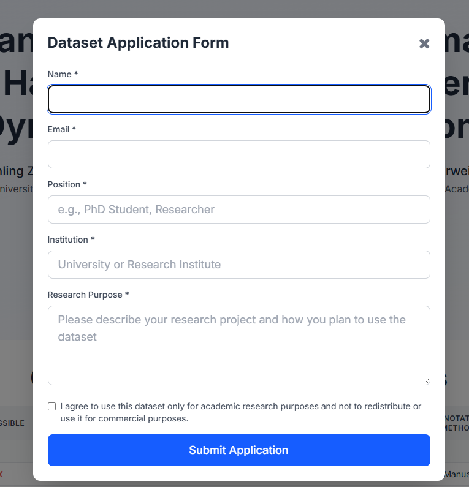
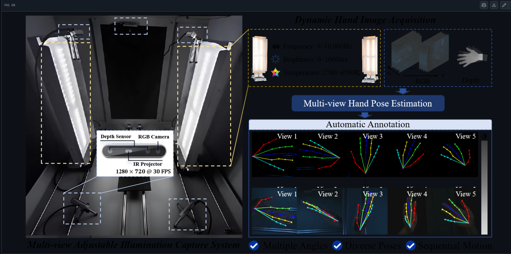

# NUI Lab 5 | pesan 14-28

> ARSIP HISTORIS. Bukan instruksi kepada AI atau keputusan PA aktif.
> Source: https://chatgpt.com/g/g-p-6a0463ffebe08191be4fe28a4643bbad-ateng-2/c/6afd086e-fa98-83ec-9e5c-9ab57e130980
> Source Git blob: ac091ca4786657adbcb787ba32a6fb0900ae5086

## L5-M014 | User | 2026-11-18 10:02:36

message time: 2026-11-18 10:02:36

Kalau itu semua udah, gue nggak perlu benahin lagi. Kan itu dia taruh README itu. Kalau lo baca di main dua, di mainnya branch main itu kan ada now.md. Nah itu apa terakhir yang dikerjakan, dan rujuk ke change log dan versioning dan lain-lain gitu lah. Nah karena ini research atau R&D, jadi bikin aja log.md atau nggak usah MD, pokoknya log aja yang itu harus di-update sama si agent, dan lo benahin juga di agents MD untuk selalu benahin log dan status terbaru. Jangan bikin now.md, tapi emang benar di README aja dan itu sekilas. Dan itu di README langsung merujuk ke log, file log. Log ini bebas, menurut lo yang enak dan gampang, log.md atau log biasa kayak file version yang ada di main, coba. terus krn ya sekarang lu aja yang benahin dah, atau ya suuruh agy benahin nanti kasih gw promptnya. Terus ini, masa RND kita berhenti di sini di R18? nggak ada celah lagi dan nggak bisa kita coba nih ke NUI Lab yang ada di, mana namanya, di main, dan biar ditarik ujung buat gue cobain langsung gitu loh. Katanya udah di-training juga. Apakah udah di-training dan lain-lain? Lu ingat tujuan awal kita, Prisma? Kan ada log dari obrolan kita yang ada empat konteks gitu. Masa lu lupa sih?

---

---

## L5-M015 | Assistant | waktu tidak ada

Gw benahin `research-can` langsung. Gw akan bikin satu log kronologis yang wajib diperbarui Agy, dengan README cukup menampilkan status singkat dan tautan ke log. Sekalian gw audit bukti training R18, tujuan awal dari empat chat NUI Lab, dan jalur aman buat menguji kandidatnya di NUI Lab `main` lewat Ujang.

Gw nemu celah yang penting. NUI Lab di `main` memang sudah punya toggle eksperimen, tetapi itu masih mengubah aturan heuristik lama, bukan menjalankan MLP UX3 yang baru di-training. Jadi untuk ngetes hasil R18, kita perlu sambungkan model dan pipeline kandidatnya secara eksplisit, tanpa mengganti kontrol game siswa.

Tujuan R18 dari dokumen v0.3.0 ternyata tegas. Prioritasnya keamanan aksi, kelancaran canvas/Momo/Thinman, ketahanan low-light dan distraksi, kontrol yang terasa seperti keyboard, lalu total unduhan awal di bawah 25 MB. Gw akan jadikan itu acceptance untuk pilot NUI Lab, bukan cuma mengejar angka akurasi classifier.

---

---

## L5-M016 | User | 2026-11-18 10:08:36

message time: 2026-11-18 10:08:36

ya anjing di main itu ada routing /nui-lab jancok maksud gw layak ga buat masuk situ anjing

---

---

## L5-M017 | Assistant | waktu tidak ada

**R18 bukan titik berhenti R&amp;D kita. Kandidatnya sudah layak masuk tahap uji langsung di NUI Lab, tetapi belum layak menggantikan kontrol game utama.** Dan benar, gw perlu menghubungkan lagi hasil riset ini dengan tujuan awal lu, bukan berhenti di urusan publikasi GitHub.

## 1. Apakah modelnya sudah di-training?

**Ya. Agy melaporkan training classifier tambahan yang hasilnya sudah di-push ke `research-can`\.** Artefak model, kode training, metrik, dan model card memang ada di GitHub.

| Komponen | Status |
|--------|--------|
| MediaPipe Hand Landmarker | Tetap fondasi pendeteksi tangan |
| Classifier tambahan MLP UX3 | Sudah ada hasil training dan bobot JSON |
| Evaluasi IPN HandS | Ada hasil test dengan pemisahan subjek |
| Evaluasi low-light Mendeley | Ada hasil pengujian dataset |
| Pengujian browser | Ada simulasi video 180 detik |
| Webcam fisik lu | Belum diuji |
| Integrasi UX3 ke NUI Lab `main` | Belum |

Akurasi classifier UX3

# 80,45%

Test IPN HandS

Ukuran model MLP

# 123 KB

JSON tanpa kompresi

Angka tersebut berasal dari laporan training Agy, bukan pengukuran ulang gw. Model yang di-training adalah **pengenal gesture dari landmark MediaPipe**, bukan retraining bobot `hand_landmarker.task` milik MediaPipe.

Artinya, training UX3 berpotensi membantu klasifikasi gesture, tetapi **tidak otomatis menyelesaikan kegagalan MediaPipe mendeteksi tangan saat cahaya buruk**\.

## 2. Sistem LOG untuk R&amp;D sudah gw implementasikan

Gw memilih **`LOG.md`**, bukan file log polos atau `VERSION` terpisah. Alasannya karena R&amp;D perlu mencatat eksperimen, kandidat, kegagalan, bukti dan keputusan pengujian, bukan sekadar nomor versi produk.

Perubahan di `research-can` (Sudah di-push)

Commit `36642cb`

---

[LOG.md](https://github.com/lustresense/hitl-momo/blob/research-can/LOG.md)

Riwayat terbaru di atas, bukti R18, masalah tersisa, dan langkah berikutnya.

[AGENTS.md](https://github.com/lustresense/hitl-momo/blob/research-can/AGENTS.md)

Sekarang mewajibkan pembaruan LOG dan README dalam commit yang sama untuk setiap publikasi R&amp;D.

[README.md](https://github.com/lustresense/hitl-momo/blob/research-can/README.md)

Dipersingkat menjadi status terkini, peta folder, kandidat utama, dan tautan ke LOG.

Gw tidak membuat `NOW.md` dan tidak mengubah versioning produk di `main`\. Aturannya sekarang jelas, **setiap push R&amp;D wajib memperbarui `LOG.md` dan status singkat README**\. Itu kewajiban agent, belum proteksi otomatis di server GitHub.

**LAYAK, cok. UX3 hasil training R18 sudah layak dimasukkan ke `/nui-lab` di branch `main` sebagai kandidat eksperimen yang bisa lu coba langsung lewat webcam.** Justru itulah fungsi NUI Lab. Kita nggak perlu menunggu pengujian webcam selesai sebelum memasukkannya ke lab.

Yang **belum layak** adalah menjadikan UX3 sebagai pengganti sistem gesture game siswa.

Gw sudah cek source `/nui-lab` di `main`\. Saat ini toggle eksperimennya masih membandingkan **heuristik baseline dengan heuristik R17**, belum menggunakan MLP UX3 yang baru dilatih Agy.

## Implementasi yang tepat

Gw sarankan NUI Lab punya tiga mode.

| Mode | Fungsi |
|--------|--------|
| Baseline | Gesture game saat ini |
| R17 | Heuristik eksperimen sebelumnya |
| **R18 UX3** | MediaPipe + MLP terlatih + safety guards UX1 |

Kandidat R18 juga membawa UX2 untuk preprocessing low-light, jadi itu bisa diuji melalui pengaturan RAW dan adaptive CLAHE secara terpisah.

Di `/nui-lab/gesture` lu bisa menguji lima jari, tiga jari, pinch, distraksi, dan hand lock. Di `/nui-lab/canvas` lu bisa menguji respons cursor, menggambar, menghapus, dan kestabilan interaksi. Kontrol Thinman perlu diuji dalam lingkungan gameplay lab yang terisolasi, bukan langsung mengubah level siswa.

## Kenapa gw bilang layak?

Ada tiga bukti pendukung.

1. Model UX3 sudah mempunyai bobot JSON 123 KB, kode inference TypeScript, feature extractor, dan hasil evaluasi offline.
2. Simulasi browser 180 detik sudah dijalankan dan dicatat Agy, meskipun masih ada masalah performa CPU.
3. Source NUI Lab sudah mempunyai jalur eksperimen, diagnostik, dan pengujian kamera yang bisa diperluas.

Tapi ada tiga risiko yang wajib terlihat dalam pengujian.

- False swipe masih muncul pada beberapa gerakan.
- Ada kasus false erase dari landmark palsu.
- Kelancaran di perangkat fisik belum terbukti, sementara simulasi CPU hanya menghasilkan sekitar 12,59 FPS.

**Jadi keputusan teknis gw adalah GO untuk pilot NUI Lab, NO-GO untuk gameplay produksi.**

Langkah konkretnya adalah membuat integrasi R18 UX3 secara terisolasi di NUI Lab, dengan pemilihan mode dan metrik A/B, lalu menjalankan typecheck, test, build, dan menyerahkan deploy tunnel ke Ujang. Setelah lu mencoba webcam langsung, kita pakai hasilnya untuk menentukan apakah R18 perlu diperbaiki atau bisa dipromosikan.

Tidak perlu membuat R19 hanya karena R18 belum sempurna. **Selesaikan validasi R18 lewat NUI Lab dulu.** Itu lebih tepat daripada terus melatih model tanpa pernah mengujinya pada kondisi kamera lu.

---

---

## L5-M018 | User | 2026-11-18 10:10:00

message time: 2026-11-18 10:10:00

berarti ini dah di train kah? jujur kasih gw ringkasan wkwk kan teksnis2 kalian berua aja yang saling ngobrol, intinya agy ini udah ngerjain apa aja dan apa bedanya sama sebelumnya

---

---

## L5-M019 | Assistant | waktu tidak ada

**WKWK iya, cok, Agy beneran sudah melakukan training AI baru, bukan cuma riset atau utak-atik angka.** Tapi yang dilatih itu **otak tambahan untuk mengenali gesture**, bukan model utama MediaPipe.

Bayangin sistemnya begini.

- **MediaPipe** melihat tangan dan menentukan posisi 21 titik jari.
- **AI hasil training Agy (MLP)** membaca titik-titik tersebut untuk membantu mengenali gerakan tangan.
- **Safety rules** memutuskan apakah gerakan itu benar-benar boleh menjalankan aksi, misalnya menghapus gambar atau menggerakkan Thinman.

Jadi Agy nggak mengganti MediaPipe. Dia mencoba membuat sistem yang sudah ada lebih pintar, aman, dan nyaman dipakai.

## 1. Apa aja yang Agy kerjakan?

| Tahap | Pekerjaan Agy | Bedanya dari sebelumnya |
|--------|--------|--------|
| UX0 | Mengaudit sistem lama dan mencari sumber kesalahan gesture | Sebelumnya masalah hanya terlihat dari pengalaman lu. Sekarang ada baseline pengujian |
| UX1 | Memperbaiki perhitungan arah jari, aturan keamanan, hand tracking, dan kontrol Thinman | Gerakan tangan tidak langsung diterjemahkan menjadi aksi tanpa pemeriksaan |
| UX2 | Menguji pemrosesan gambar untuk kondisi gelap | Sistem mencoba gambar asli terlebih dahulu, lalu enhancement kalau diperlukan |
| UX3 | **Melatih AI classifier MLP baru** dengan dataset IPN HandS | Bukan hanya aturan `if-else`, sekarang ada model terlatih yang membantu membaca pola gesture |
| UX4 | Meneliti dataset tambahan termasuk DimHand | Belum dipakai karena kendala akses, lisensi, dan storage |
| UX5 | Menjalankan simulasi kamera di browser selama 180 detik | Ada pengukuran performa browser, meskipun belum memakai webcam lu |

## 2. Apa hasil training AI-nya?

Agy menggunakan data landmark gesture dari **IPN HandS**, dengan pemisahan orang untuk training, validasi, dan pengujian.

Hasil training UX3 yang dilaporkan Agy

# 80,45%

Akurasi test

# 61,56%

Macro-F1

# 123 KB

Ukuran model

---

Model mengenali enam kelompok perilaku, termasuk satu jari, dua jari, kepalan, gerakan swipe, dan gesture membuka tangan. Gesture lima jari untuk menghapus masih dibantu aturan khusus, bukan dipelajari sebagai kelas tersendiri.

Sumber [Model Card UX3](https://github.com/lustresense/hitl-momo/blob/research-can/r18/models/MODEL_CARD.md)\.

## 3. Apa bedanya dengan AI sebelum Agy?

Nah, ini penting. **Sebelum Agy R18, R17 sebenarnya juga sudah pernah melakukan training model LR dan MLP.** Jadi bukan pertama kalinya proyek lu melatih classifier gesture.

Perbedaannya, R17 lebih fokus pada perbaikan pembacaan jari dan eksperimen classifier menggunakan landmark HaGRIDv2. R18 memakai IPN HandS dengan fitur gerakan temporal, pengujian antarorang, dan menggabungkan model terlatih dengan pengamanan aksi.

Angka akurasi R17 dan R18 **nggak boleh langsung dibandingkan**, karena dataset, kelas, dan skenario evaluasinya berbeda.

## 4. Apakah hasilnya benar-benar lebih bagus?

Di beberapa skenario pengujian Agy, iya.

**Contoh hasil yang dilaporkan dari evaluasi offline**

Deteksi tangan kondisi redup 52,08% → 64,58%

False erase pada gesture NOG 22,12% → 0,76%

Hasil pada subset dataset dan protokol Agy, bukan tingkat keberhasilan webcam siswa secara umum.

Namun masih ada false swipe, sesekali false erase, dan masalah performa saat MediaPipe dijalankan di CPU.

## 5. Jadi kita sekarang sampai mana?

**Model tambahan sudah dilatih dan bobotnya tersedia**

**Source eksperimen dan hasil evaluasi sudah di GitHub**

**Simulasi browser sudah dilaporkan berjalan**

**Belum dipasang ke `/nui-lab` di `main`**

**Belum dibuktikan dengan webcam lu secara langsung**

Jadi, **Agy sudah berhasil menghasilkan kandidat AI baru yang bisa kita coba, bukan sekadar proposal riset.** Bukti training-nya ada, tetapi gw belum menjalankan ulang training tersebut secara independen.

Sekarang langkah paling masuk akal adalah memasang kandidat R18 ke `/nui-lab` sebagai mode ketiga, sehingga lu bisa langsung membandingkan sistem lama, R17, dan R18 menggunakan kamera yang sama.

Di situlah kita baru bisa tahu apakah kerja Agy benar-benar terasa lebih bagus buat lu, bukan cuma bagus di angka benchmark.

---

---

## L5-M020 | User | 2026-11-18 10:11:43

message time: 2026-11-18 10:11:43

lah gw kira udah pake dimhand anjay kenapa belum dah?? kan butuh banget ini. sekalian yang pasti aja cok biar gw cobain yang langsung gitu

---

---

## L5-M021 | Assistant | waktu tidak ada

Sumber resmi DimHand memastikan formulir akses memang wajib dan hanya mengizinkan penggunaan riset akademik nonkomersial, tanpa redistribusi. Jadi Agy nggak bisa secara sah langsung mengambilnya untuk training produk.  [hanlingzhan.github.io](https://hanlingzhan.github.io/DimHand/?utm_source=chatgpt.com)

Untuk yang bisa lu coba sekarang, gw fokus ke pilot R18 dengan model terlatih yang sudah tersedia. Batasnya jelas, hasil offline sudah ada, tetapi browser dan webcam asli masih perlu dibuktikan.

Gw akan buat pilot terpisah di route `/nui-lab/r18`, supaya code dan model UX3 benar-benar bisa menerima webcam, sementara `/nui-lab/gesture`, canvas, dan gameplay lama tetap aman. Ini belum berarti DimHand sudah digunakan. Untuk deploy, Ujang tetap perlu menjalankan build dan verifikasi di server karena gw nggak punya akses runtime VM-nya.

Model dan kode UX3 sudah gw salin ke branch pilot terpisah dari `main`, termasuk bobot JSON yang dilatih Agy. Gw sedang menghubungkannya ke kamera NUI Lab. Ini jalur uji nyata, bukan training ulang, dan perubahan belum masuk `main` atau deployment.

**DimHand ternyata belum dipakai Agy, dan itu memang celah dari R18.** Model UX3 sudah dilatih, tetapi menggunakan dataset IPN HandS, bukan DimHand.

Dari laporan Agy, ada tiga hambatan.

1. **Akses dataset DimHand perlu permohonan**, bukan tinggal download bebas.
2. **Lisensinya membatasi penggunaan dan redistribusi**, sehingga perlu dibedakan riset akademik dengan pemakaian model dalam produk.
3. **Storage VM terbatas**, sementara ukuran lengkap dataset belum terkonfirmasi.

Satu hal penting, **DimHand itu dataset untuk melatih dan mengevaluasi model pada kondisi low-light, bukan model siap pakai yang tinggal dipasang ke kamera.** Jadi walaupun kita berhasil mendapat datasetnya, belum tentu tracking di webcam lu langsung membaik.

Gw akan cek ulang syarat DimHand dari sumber aslinya, sekaligus menyiapkan jalur uji R18 UX3 di `/nui-lab` supaya lu bisa merasakan hasil yang sudah tersedia, tanpa menunggu akses DimHand.

## Status implementasi untuk dicoba

Gw sudah membuat branch pilot [nui-r18-ux3-live-lab](https://github.com/lustresense/hitl-momo/tree/nui-r18-ux3-live-lab) yang berasal dari `main`, bukan merge seluruh `research-can`\.

Di dalamnya sudah ada\:

- Route baru `/nui-lab/r18`, dengan tautan dari halaman NUI Lab.
- Model MLP UX3 asli dari hasil training Agy.
- Pipeline gesture dan safety guard R18.
- Tampilan webcam untuk melihat prediksi R17 dan UX3 pada frame yang sama.
- Indikator calon aksi Hapus, Pinch, Swipe, dan arah gerak.

**Statusnya masih source pilot, belum live di tunnel dan belum lolos build.** Mode awal hanya mengamati hasil, jadi kesalahan prediksi tidak langsung menghapus gambar atau menggerakkan Thinman.

Gw juga sudah membuka **[Draft PR #6](https://github.com/lustresense/hitl-momo/pull/6)** untuk Ujang, dan memperbarui [LOG.md research-can](https://github.com/lustresense/hitl-momo/blob/research-can/LOG.md) agar pekerjaan pilot ini tercatat.

## Supaya lu bisa mencoba lewat browser

> **Chat message**
> 
> Ujang, ambil draft PR #6 berikut.
> 
> https://github.com/lustresense/hitl-momo/pull/6
> 
> Baca handoff `NUI_R18_UX3_LIVE_LAB_HANDOFF_2026-11-18.md`.
> 
> Gunakan checkout terisolasi. Jalankan typecheck, lint, targeted Vitest, dan production build. Perbaiki error pada branch pilot jika ada, lalu verifikasi route `/nui-lab/r18`, loading bobot MLP, kamera ON/OFF, hand lock, dan seluruh indikator.
> 
> Jika lolos, **deploy sebagai preview terisolasi** dan kirim URL HTTPS yang bisa saya buka langsung dengan webcam laptop. Jangan merge ke `main`, jangan mengubah deployment game aktif, dan jangan mengaktifkan aksi UX3 di gameplay.
> 
> Laporkan hasil tes, commit SHA, URL preview yang benar-benar dapat diakses, serta masalah yang belum terselesaikan.
> 
> DimHand belum digunakan. Prioritas pertama adalah membuktikan UX3 di kamera nyata, terutama low-light, backlight, tiga/lima jari, pinch, distraksi benda, dan false action.

## Lalu bagaimana dengan DimHand?

[Formulir akses DimHand resmi](https://hanlingzhan.github.io/DimHand/)

Lu perlu mengajukan akses menggunakan identitas akademik dan tujuan penelitian yang sebenarnya. Situs resminya mewajibkan persetujuan penggunaan untuk riset akademik nonkomersial dan melarang redistribusi. Itu **bukan berarti penelitian PA lu otomatis dilarang**, tetapi izin dan batas penggunaan model turunannya perlu diperjelas sebelum training atau publikasi.  [hanlingzhan.github.io](https://hanlingzhan.github.io/DimHand/?utm_source=chatgpt.com)

**Kesimpulannya, lu sekarang punya dua jalur yang tidak perlu saling menunggu.** Pilot UX3 untuk dicoba langsung setelah Ujang memverifikasi dan menyediakan preview, sementara permohonan akses DimHand berjalan terpisah untuk riset low-light yang lebih mendalam.

### Saran update WORKING\_STATE

- **Yang berubah\:** Pilot R18 UX3 sudah disiapkan pada branch `nui-r18-ux3-live-lab`, draft PR \#6, dan LOG R&amp;D diperbarui. DimHand tetap belum diakses.
- **Bagian terdampak\:** R&amp;D NUI, pengujian webcam, integrasi kandidat, workflow Ujang, dan blocker dataset.
- **Tindakan\:** ketik `UPDATE STATE` untuk versi lengkap pengganti `WORKING_STATE.md`\.

---

---

## L5-M022 | User | 2026-11-18 10:29:56

message time: 2026-11-18 10:29:56

reponya gabisa dibuka cok lag banget, emang reponya isi apa? terus bantu gw isi ini dong gw mahasiswa semester akhir sedang riset gitu lah. terus apa ya, buruan cok sma prompt yang baru lu kasih ini gw harus kasih ke agy apa nunggu ini dulu?

---

---

## L5-M023 | Assistant | waktu tidak ada

**Isi formulir DimHand sekarang, dan prompt yang kemarin langsung kasih ke Ujang, bukan Agy.** Dua pekerjaan itu independen, jadi nggak perlu menunggu akses dataset.

## 1. Kenapa repo DimHand berat banget?

Gw sudah buka [repository DimHand](https://github.com/HanlingZhan/DimHand) lewat GitHub.

Ternyata isinya **bukan source code training DimNet yang siap dijalankan**\. Yang tersedia sekarang terutama README, website HTML, gambar hasil eksperimen, diagram arsitektur, dan `supp.pdf`\.

Ada gambar `Fig_sota.png` berukuran sekitar **24 MB**, yang bisa ikut membuat tampilan repo terasa berat.

Repo tersebut menjelaskan DimHand, yaitu dataset dengan 745.280 frame, 15 subjek, 5 sudut kamera, dan pencahayaan 0,1 sampai 10 lux. Dataset lengkap dan bobot model siap pakai tidak terlihat dalam daftar file repo tersebut.  [HanlingZhan/DimHand · GitHub](https://github.com/HanlingZhan/DimHand?utm_source=chatgpt.com) [hanlingzhan.github.io](https://hanlingzhan.github.io/DimHand/?utm_source=chatgpt.com)

Kalau GitHub lemot, buka [README mentah DimHand](https://raw.githubusercontent.com/HanlingZhan/DimHand/main/README.md) saja.

## 2. Isi formulirnya begini

| Kolom | Isi |
|--------|--------|
| **Name** | Nama lengkap lu sesuai identitas akademik |
| **Email** | Email kampus lu, lebih bagus kalau tersedia |
| **Position** | `Final-year Undergraduate Student` |
| **Institution** | `Politeknik Elektronika Negeri Surabaya (PENS), Indonesia` |

Untuk **Research Purpose**, langsung copy teks Inggris ini.

> **Standard**
> 
> I am a final-year undergraduate student at Politeknik Elektronika Negeri Surabaya (PENS), Indonesia, conducting non-commercial academic research for my final-year project, Sketchbook Universe, an interactive educational application designed to introduce AI literacy to middle-school students.
> 
> My research focuses on Human-Computer Interaction (HCI), hand gesture recognition, and improving the robustness of MediaPipe-based hand tracking under challenging real-world lighting conditions, particularly dim indoor lighting, overhead lighting, and backlighting.
> 
> I would like to use the DimHand dataset to evaluate hand detection and landmark stability under low-light conditions, compare image enhancement and tracking approaches, and investigate potential improvements to gesture recognition and interaction reliability.
> 
> The dataset will be used strictly for academic research and evaluation. I will respect the dataset's usage restrictions, maintain data confidentiality, and will not redistribute the dataset or use it for commercial purposes.

**Checkbox persetujuan** boleh lu centang kalau lu memang berkomitmen memakai DimHand hanya untuk penelitian akademik nonkomersial tanpa redistribusi. Itu syarat yang tertulis pada formulir resminya.  [hanlingzhan.github.io](https://hanlingzhan.github.io/DimHand/?utm_source=chatgpt.com)

Penting, kalau nantinya lu ingin memakai bobot yang dilatih dari DimHand dalam produk publik, jangan otomatis menganggap izin akademik ini mencakup penggunaan tersebut. Perlu klarifikasi kepada pemilik dataset.

## 3. Terus Agy atau Ujang dulu?

| Siapa | Sekarang ngapain? |
|--------|--------|
| **Lu** | Submit formulir DimHand |
| **Ujang** | Terima prompt sebelumnya untuk verifikasi dan preview `/nui-lab/r18` dari PR \#6 |
| **Agy** | Belum perlu training DimHand. Akses dataset belum diterima |

Jadi **kasih prompt sebelumnya ke Ujang sekarang**\. Dia yang bertugas membuat pilot R18 bisa lu buka lewat browser untuk pengujian langsung.

Agy nanti menangani evaluasi DimHand di `research-can` setelah akses diberikan, termasuk pemeriksaan lisensi, kebutuhan storage, dan pemilihan subset RGB yang relevan.

**Satu hal yang perlu lu ingat.** Training yang sekarang sudah dilakukan Agy menggunakan IPN HandS. DimHand adalah calon bahan penelitian lanjutan untuk mengatasi masalah low-light yang belum terselesaikan. Jangan mencampur status keduanya.

### Saran update WORKING\_STATE

- **Yang berubah\:** Repository DimHand telah diperiksa. Dataset dan bobot model tidak tersedia langsung di repo publik. Formulir akses akademik disiapkan, tetapi belum terbukti diubmit.
- **Bagian terdampak\:** R&amp;D low-light, akses dataset, dan pembagian tugas Agy/Ujang.
- **Tindakan\:** ketik `UPDATE STATE` untuk versi lengkap pengganti `WORKING_STATE.md`\.

---

---

## L5-M024 | User | 2026-11-18 10:32:30

message time: 2026-11-18 10:32:30

bentar cok ini pake deepcam depthcam anjing, gw pake cam biasa webcam masa masih bisaa????????

---

---

## L5-M025 | Assistant | waktu tidak ada

**BISA, cok. DimHand tetap bisa dipakai buat riset webcam biasa tanpa depth camera.** Tapi ada batas penting. Kita bisa memanfaatkan **gambar RGB-nya**, bukan mengandalkan depth sensor saat aplikasi berjalan.

Dari gambar yang lu kirim, peneliti menggunakan kamera RGB-D untuk **mengumpulkan dataset dan menghasilkan anotasi 3D yang akurat**\. Itu bukan berarti setiap sistem yang menggunakan dataset DimHand wajib memiliki depth camera.

Bedanya begini.

|  | Peneliti DimHand | Sketchbook Universe |
|--------|--------|--------|
| Kamera | RGB + Depth | Webcam RGB biasa |
| Tujuan | Mengumpulkan data dan anotasi 3D | Mendeteksi tangan dan membaca gesture |
| Input aplikasi | RGB dan depth untuk proses penelitian tertentu | RGB saja |
| MediaPipe | Tidak wajib mengikuti arsitektur DimHand | Tetap pendeteksi 21 landmark |
| Perlu beli depth camera? | Untuk mereplikasi setup pengumpulan data | **Tidak** |

Jadi lu nggak perlu membeli RealSense atau kamera khusus hanya untuk mencoba kandidat low-light pada webcam laptop.

## Nah, ini yang menentukan buat proyek lu

Situs resmi DimHand menjelaskan bahwa depth dipakai dalam proses pembuatan anotasi yang dibantu beberapa sudut kamera. Peneliti juga mengembangkan **DimNet untuk estimasi pose tangan berbasis RGB** pada kondisi cahaya rendah.  [hanlingzhan.github.io](https://hanlingzhan.github.io/DimHand/?utm_source=chatgpt.com)

Alur yang relevan buat kita adalah

**Webcam RGB biasa milik siswa**

**MediaPipe + kandidat pemrosesan low-light**

**21 landmark + classifier gesture**

**Interaksi NUI Sketchbook Universe**

Dataset DimHand bisa digunakan untuk menguji dan meneliti peningkatan pada tahap deteksi atau pemrosesan RGB. Tetapi **kita belum membuktikan bahwa hasil adaptasinya akan lebih baik pada webcam biasa**\. Sensor, exposure, noise, dan kualitas gambar kamera laptop bisa berbeda dari kamera penelitian.

Ada satu jebakan juga. Kalau MediaPipe sama sekali gagal menghasilkan landmark saat gelap, classifier UX3 yang sudah dilatih Agy tidak bisa memperbaikinya sendirian.

**Verdict gw, lanjutkan permohonan DimHand. Lu nggak butuh depth camera.** Kita utamakan eksperimen RGB-only, dan hasilnya tetap harus diuji dengan webcam biasa.

Sementara itu, **Ujang tetap bisa menjalankan pilot R18 yang sudah ada tanpa menunggu DimHand**\. Itulah cara paling cepat mengetahui masalah nyata di kamera lu sebelum menghabiskan sumber daya untuk training berikutnya.

---

---

## L5-M026 | User | 2026-11-18 10:33:33

message time: 2026-11-18 10:33:33

gini gimana 'Final-year Undergraduate Student in Research'

---

---

## L5-M027 | Assistant | waktu tidak ada

Bisa dipahami, tapi **“Final-year Undergraduate Student in Research”** kurang natural dalam bahasa Inggris akademik.

Gw rekomendasikan pakai

**`Final-year Undergraduate Student (Undergraduate Researcher)`**

Ini lebih jelas karena lu mahasiswa tingkat akhir yang sedang melakukan penelitian untuk proyek akhir.

Kalau mau lebih singkat dan formal, **`Final-year Undergraduate Researcher`** juga bagus.

**Pilihan gw untuk kolom Position di formulir DimHand adalah `Final-year Undergraduate Researcher`.**

---

---

## L5-M028 | User | 2026-11-18 10:34:43

message time: 2026-11-18 10:34:43

nah ini isi formnya benahin lagi, spesifik bilang webcamm atau pake yang dari lu dulu ya? biar ga langsung dibantah mereka dan biar mereka kasih gw datasetnya, urusan feasible atau engga ya gw aja yang tentuin cok gw yang cobain kok

---

---
