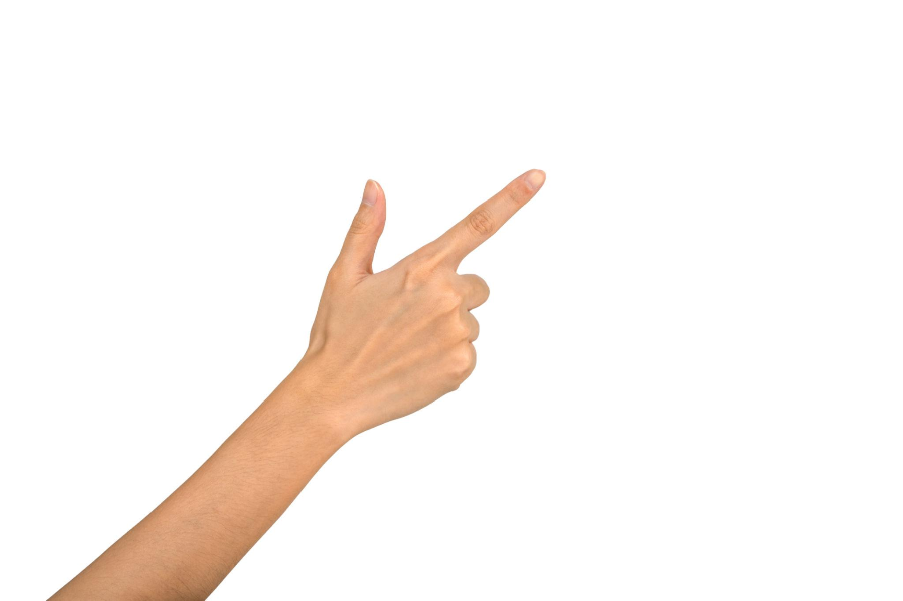

# NUI Lab 5 | pesan 53-63

> ARSIP HISTORIS. Bukan instruksi kepada AI atau keputusan PA aktif.
> Source: https://chatgpt.com/g/g-p-6a0463ffebe08191be4fe28a4643bbad-ateng-2/c/6afd086e-fa98-83ec-9e5c-9ab57e130980
> Source Git blob: ac091ca4786657adbcb787ba32a6fb0900ae5086

## L5-M053 | Assistant | waktu tidak ada

Gini cok, **gw mau Thinman terasa kayak lu pencet tombol keyboard, tapi pakai tangan di depan webcam.**

Bayangin lu main pakai keyboard.

- **Panah kanan ditekan dan ditahan** berarti Thinman jalan kanan terus.
- **Panah atas ditekan sambil kanan masih ditahan** berarti Thinman lompat sambil maju.
- **Tombol dilepas** berarti Thinman berhenti menerima perintah.
- **Panah bawah nggak perlu** karena Thinman jatuh sendiri.

Nah, usulan gw buat mengganti tombol fisik itu seperti ini.

**1\. Telunjuk pilih arah**

Telunjuk ke kanan, tapi Thinman **belum bergerak**\.

**2\. Jempol + jari tengah bersentuhan**

Ini pengganti tombol ditekan. Thinman **mulai berjalan kanan**\.

**3\. Arahkan telunjuk ke kanan atas sambil tetap menekan**

Thinman **lompat sambil maju kanan**\.

Lepas sentuhan jempol dan tengah, Thinman berhenti menerima perintah. Jadi bukan cuma nunjuk langsung jalan.

**Tapi bentuk sentuhan jempol dan tengah ini baru usulan gw.** Bisa jadi malah susah atau pegal kalau dipakai lama.

Yang mau gw pastikan dari lu cuma satu. **Lu pengin gerakan tangan harus punya aksi khusus seperti menekan tombol dulu, baru Thinman bergerak, benar?**

---

---

## L5-M054 | User | 2026-11-18 15:24:34

message time: 2026-11-18 15:24:34

OALAAAAAAAAHHH PAHAM, JALANNYA NUNGGU PINCH JEMPOL DAN JARI TENGAHNYA GITU YA????? berarti user harus ngeliatin sisi dalam tangannya terus dong? kalo misal pake tangan kanan, terus harus balik ke kiri susah loh?? biasanya kan tinggal diarahin ke kiri jadi enak tapi yang keliatan kamera ya punggung tangan

---

---

## L5-M055 | Assistant | waktu tidak ada

**NAH, ini masalah yang bikin gw berubah pikiran. Thumb-middle pinch jangan kita pakai buat kontrol Thinman.** Lu bener, kalau tangan kanan mengarah ke kiri dan punggung tangan menghadap kamera, sentuhan jempol dan jari tengah bisa tertutup. Akhirnya siswa malah harus memutar pergelangan tangan.

Gw punya alternatif yang lebih natural. **Telunjuk itu sendiri menjadi tombol yang bisa ditekan dan ditahan.**

## Konsep baru, kepal → tunjuk → tahan

**1\. Kepal atau lipat telunjuk**

Thinman diam. Tombol belum ditekan.

**2\. Luruskan telunjuk ke kiri**

Setelah pose stabil sebentar, sistem menganggap tombol kiri ditekan. Thinman mulai berjalan kiri.

**3\. Tetap tunjuk, lalu arahkan diagonal atas kiri**

Kiri tetap aktif dan tombol lompat ikut ditekan. Thinman lompat sambil maju kiri.

**4\. Lipat telunjuk kembali**

Tombol dilepas. Thinman berhenti menerima perintah.

Dengan cara ini, **nggak perlu pinch, nggak perlu membalik telapak, dan nggak perlu pakai dua tangan.**

## Terus bagaimana rasanya seperti tombol keyboard?

Rasa menekannya berasal dari dua hal.

- **KEYDOWN** ketika telunjuk sengaja diluruskan dan arah terbaca stabil, misalnya 100 ms sebagai parameter awal eksperimen.
- **KEYUP** ketika telunjuk dilipat, gesture dibatalkan, atau tracking hilang.

Saat tombol virtual sudah ditekan, lu bisa mengubah arahnya dari kanan ke kanan atas tanpa melipat jari dulu. Karakter tetap berjalan dan bisa langsung lompat.

Kita juga perlu menampilkan indikator tombol panah yang menyala saat aktif. Jadi siswa tahu kapan sistem menganggap tombol sedang ditekan.

**Tapi ada satu risiko.** MediaPipe tetap harus bisa membaca telunjuk ketika punggung tangan menghadap kamera. Secara geometri memungkinkan, tetapi keberhasilannya di webcam low-light belum terbukti.

Menurut gw ini kandidat R19 yang lebih layak diuji daripada thumb-middle pinch.

**Satu tangan, satu telunjuk, kepal untuk lepas, tunjuk untuk tekan, arahkan untuk mengendalikan.** Gerakan ke bawah tetap netral karena Thinman jatuh mengikuti gravitasi.

---

---

## L5-M056 | User | 2026-11-18 15:25:32

message time: 2026-11-18 15:25:32

sama aja dong kea speedometer yang sekarang ada di main?

---

---

## L5-M057 | Assistant | waktu tidak ada

**IYA, bener. Usulan gw tadi pada dasarnya sama kayak speedometer yang sekarang ada di `main`.** Lu nangkep celahnya, dan gw malah muter balik ke mekanisme lama.

Gw sudah cek `SteerDial.tsx` dan `gameplay-gesture.ts`. Sekarang memang sudah begini.

- Telunjuk kanan langsung jalan kanan.
- Telunjuk kiri langsung jalan kiri.
- Telunjuk atas untuk lompat.
- Diagonal untuk lompat sambil bergerak.
- Speedometer menunjukkan arah telunjuk.

Usulan gw tadi cuma menambahkan gerakan kepal sebelum menunjuk. **Itu belum menciptakan sensasi menekan tombol yang lu minta.**

Yang sebenarnya kita cari adalah dua mekanisme berbeda.

1. **Memilih tombol**, misalnya arah telunjuk menentukan kanan atau kiri.
2. **Menekan tombol**, lewat gerakan fisik yang jelas, nyaman, dan tetap terlihat kamera meskipun punggung tangan menghadap kamera.

Dan gw belum punya kandidat gestur PRESS yang cukup kuat untuk langsung direkomendasikan. Thumb-middle pinch bermasalah dengan occlusion, sementara kepal lalu tunjuk terlalu mirip sistem sekarang.

**Jadi jangan ubah speedometer atau training R19 dulu.** Langkah berikutnya adalah membandingkan beberapa gestur PRESS yang benar-benar berbeda dari steering existing, terutama dari sisi kenyamanan, kemudahan deteksi webcam, dan kemampuan menahan kanan sambil menambahkan lompat.

---

---

## L5-M058 | User | 2026-11-18 15:29:59

message time: 2026-11-18 15:29:59

lah? ga guna dong gw nyuruh lu riset

---

---

## L5-M059 | Assistant | waktu tidak ada

Iya, hasil gw tadi nggak memenuhi permintaan lu. Gw malah mengulang speedometer existing tanpa menemukan gestur PRESS yang berbeda. Gw koreksi dengan riset yang fokus pada tiga syarat lu, satu tangan, punggung tangan tetap bisa menghadap kamera, dan bisa menekan, menahan, serta menggabungkan arah seperti keyboard.

**Iya, riset gw sebelumnya nggak menjawab masalah lu. Sekarang gw nemu kandidat yang lebih masuk akal dan benar-benar beda dari speedometer existing.**

## Rekomendasi R19, telunjuk memilih arah, jari tengah menjadi tombol PRESS

**Satu jari = pilih arah, belum jalan**

Telunjuk mengarah ke kanan. Speedometer menunjukkan kanan, tapi Thinman tetap diam.

---

**Dua jari = tekan dan tahan tombol**

Lu luruskan jari tengah sambil telunjuk tetap mengarah ke kanan. Thinman langsung mulai berjalan. Selama dua jari ditahan, tombol kanan terus aktif.

---

**Dua jari diarahkan diagonal atas = kombinasi tombol**

Sambil tetap menahan dua jari, arahkan telunjuk ke kanan atas. Thinman melompat sambil maju kanan.

**Kenapa ini lebih cocok dengan kekhawatiran lu?** Karena gerakan jari tengah tidak membutuhkan sentuhan jari yang tersembunyi di balik telapak. Punggung tangan boleh menghadap kamera, termasuk ketika mengarah ke kiri. Tetap perlu pembuktian webcam karena dua jari bisa saling menutupi dari sudut tertentu.

## Apa dasar risetnya?

Gw temukan tiga hal yang relevan.

1. Studi *Push, Tap, Dwell, and Pinch* membandingkan mekanisme konfirmasi di udara. Studi itu mendukung pemisahan proses menunjuk dan mengaktifkan tindakan, tetapi **tidak membuktikan** bahwa dua jari pasti paling baik untuk Thinman.  [yorku.ca](https://www.yorku.ca/mack/iss2022.html?utm_source=chatgpt.com)
2. Implementasi webcam [HandGestureSoftware](https://github.com/Agni-glitch/HandGestureSoftware) menggunakan tindakan mengangkat jari tengah ketika sudah berada dalam mode pointing untuk memicu aksi berbeda. Ini bukti konsep teknis, bukan validasi ergonomi siswa SMP.  [GitHub](https://github.com/Agni-glitch/HandGestureSoftware?utm_source=chatgpt.com)
3. R18 kita sudah dilatih membedakan `POINT_1F` dan `POINT_2F`\. Berdasarkan model card, F1 pada locked test masing-masing sekitar **0,890** dan **0,865**\. Jadi kita punya model awal untuk eksperimen tersebut, bukan harus mulai training dari nol.

## Perbandingan kandidat PRESS hasil riset

| Kandidat | Kelebihan | Kekurangan |
|--------|--------|--------|
| **Angkat jari tengah** | Satu tangan, arah telunjuk tetap ada, pose cukup berbeda | Bisa salah ketika kedua jari saling menutupi |
| Tekuk telunjuk seperti pelatuk | Benar-benar terasa seperti menekan | Sudut telunjuk berubah dan ujung jari bisa tersembunyi |
| Dorong tangan ke kamera | Gerakan terasa seperti menekan tombol virtual | Webcam RGB biasa tidak mengukur jarak absolut secara langsung, lebih rawan salah saat tubuh bergerak |
| Thumb-middle pinch | Menyerupai tombol fisik | Occlusion dan posisi pergelangan bermasalah |

**Gw pilih angkat jari tengah untuk diuji pertama**, bukan karena sudah terbukti paling akurat, tetapi karena paling memungkinkan mempertahankan arah telunjuk sambil menambah sinyal PRESS tanpa gerakan pergelangan yang rumit.

## Mekanisme yang perlu diuji di R19

| Kondisi tangan | Virtual keyboard |
|--------|--------|
| Telunjuk kanan saja | Semua tombol OFF |
| Telunjuk + tengah ke kanan | `RIGHT DOWN` |
| Dua jari diputar kanan atas | `RIGHT HELD + UP DOWN` |
| Dua jari kembali ke kanan | `RIGHT HELD + UP RELEASED` |
| Jari tengah dilipat | `RELEASE ALL` |
| Tangan hilang | `RELEASE ALL` |

Ini **bukan** mengulang speedometer. Speedometer hanya menjadi indikator arah. Perintah gerak baru aktif setelah pose dua jari terbaca sebagai PRESS.

Ada juga perubahan teknis yang harus dilakukan. R18 sekarang sengaja menolak `POINT_2F` untuk steering, jadi R19 perlu eksperimen khusus pada input gate dan *virtual keyboard state*\. **Jangan langsung menghubungkannya ke gameplay atau training ulang sebelum diuji di NUI Lab.**

Langkah konkret berikutnya adalah membandingkan **dua jari PRESS vs tekuk telunjuk PRESS** pada webcam laptop, untuk arah kanan, kiri, atas, diagonal, dan transisi berulang. Dari situ baru kita tahu gesture mana yang layak dilatih lebih serius.

---

---

## L5-M060 | User | 2026-11-18 16:35:10

message time: 2026-11-18 16:35:10

gini aja kalo gitu, bukan dua jari tapi kea nembak. gimanaa? jalannya kalo jempol muncul. bisa ga? kalo bisa sekarang cek main gimana coba ada apa aja gesturnya di situ lu list biar klasifikasinya enak

---

---

## L5-M061 | Assistant | waktu tidak ada

Pose pistol di foto masuk akal buat kandidat R19. Telunjuk bisa memilih arah, jempol terbuka jadi PRESS, dan jempol dilipat jadi RELEASE. Gw cek `main` terbaru dulu, termasuk gestur per fase, supaya nggak bentrok dengan jempol konfirmasi, pinch, dan kontrol Thinman yang sudah ada.

**Bisa, dan pose pistol pada foto lu lebih masuk akal buat R19.** Telunjuk menentukan arah Thinman, sedangkan **jempol terbuka menjadi tombol PRESS**\. Kalau jempol dilipat, tombol dilepas.

Yang penting, ini bukan gestur *thumbs-up* biasa. Ini kombinasi telunjuk lurus dan jempol terbuka, sementara tiga jari lainnya terlipat.

## 1. Cara kontrol pistol R19

| Posisi tangan | Perintah |
|--------|--------|
| Telunjuk kanan, jempol dilipat | Pilih kanan, belum jalan |
| Telunjuk kanan, jempol terbuka | `RIGHT DOWN`, jalan kanan |
| Telunjuk kiri, jempol terbuka | `LEFT DOWN`, jalan kiri |
| Telunjuk kanan atas, jempol terbuka | `RIGHT + JUMP` |
| Telunjuk kiri atas, jempol terbuka | `LEFT + JUMP` |
| Telunjuk atas, jempol terbuka | Lompat di tempat |
| Jempol dilipat kembali | `RELEASE`, berhenti memberi input |
| Tangan hilang | Semua tombol virtual dilepas |

Jadi lu bisa tahan pose pistol sambil memutar arah telunjuk dari kanan ke kanan atas. Thinman tetap maju dan melakukan lompatan. Nggak perlu mencubit atau membalik telapak.

Tetapi keterbacaan jempol dari sisi punggung tangan, khususnya ketika mengarah kiri, masih harus diuji menggunakan kedua tangan pada webcam asli.

## 2. Hasil audit gesture di `main`

Gw cek repository `lustresense/hitl-momo`, commit `c14b1d0`, versi `0.25.0-alpha`\.

Saat ini ada **9 kelas pose pada classifier heuristik utama**\.

| Pose yang dikenali | Fungsi di aplikasi sekarang |
|--------|--------|
| `thumb-up` | Konfirmasi, selesai gambar, lempar stiker, taruh objek, selesai putar |
| `pinch` | Menggambar, geser objek, dan gambar ulang pada fase terkait |
| `one-finger` | Pilih bab 1, kandidat 1, Undo, retry, steering Thinman |
| `two-fingers` | Pilih bab 2, kandidat 2, Redo, geser objek setelah gagal |
| `three-fingers` | Pilih bab 3, kandidat 3, gambar ulang setelah gagal |
| `open-palm` | Hapus lima jari, Bukan ini, gambar lagi, putar objek |
| `split-palm` | Hapus atau putar objek pada fase tertentu |
| `fist` | Pose diagnostik, tidak untuk menghapus |
| `none` | Tidak ada pose yang memenuhi aturan |

Ada tambahan yang **bukan kelas pose statis**\.

| Gerakan | Fungsi |
|--------|--------|
| Arah telunjuk | Jalan kanan/kiri, lompat, lompat diagonal |
| Swipe satu/dua jari | Kandidat Undo/Redo eksperimental pada NUI Lab |
| Putar telapak | Rotasi objek saat mode putar |
| Wave | Masih tersedia pada modul deteksi/lab, tetapi bukan lagi syarat membangunkan Momo |
| Finger count 0 sampai 5 | Penghitungan jari untuk pemilihan dan diagnostik |

Sumber utama [gesture-mode.ts](https://github.com/lustresense/hitl-momo/blob/main/frontend/implementation/src/input/gesture-mode.ts), [hand-gesture.ts](https://github.com/lustresense/hitl-momo/blob/main/frontend/implementation/src/input/hand-gesture.ts) dan [gameplay-gesture.ts](https://github.com/lustresense/hitl-momo/blob/main/frontend/implementation/src/input/gameplay-gesture.ts)\. Mapping di router tidak otomatis membuktikan seluruh aksi lolos uji webcam.

## 3. Potensi bentrok pose pistol

Ini bagian paling penting untuk klasifikasi R19.

Di `main` sekarang, pose seperti gambar lu **belum mempunyai kelas khusus**\.

- `thumb-up` mensyaratkan empat jari lainnya terlipat, sedangkan telunjuk pistol lu lurus.
- `one-finger` mensyaratkan telunjuk lurus tetapi jempol tidak terbuka.
- `two-fingers` berarti telunjuk dan jari tengah, bukan telunjuk dan jempol.
- Penghitungan jari biasa bisa menghitung telunjuk + jempol sebagai dua, walaupun bentuknya pistol.

Jadi kalau kita hanya mengandalkan `fingerCount === 2`, nanti bisa salah dianggap dua jari atau Redo.

**Solusi yang gw rekomendasikan adalah classifier khusus `POINT_PRESS` pada fase gameplay Thinman.** Jangan mengubah pengertian `two-fingers` secara global karena bakal merusak pemilihan kandidat dan gesture canvas.

## 4. Kelas yang perlu dibedakan untuk R19

| Label kandidat | Bentuk tangan | Fungsi |
|--------|--------|--------|
| `POINT_READY` | Telunjuk lurus, jempol dilipat | Memilih arah |
| `POINT_PRESS` | Telunjuk lurus, jempol terbuka | Menekan tombol virtual |
| `THUMB_CONFIRM` | Jempol terbuka, telunjuk terlipat | Konfirmasi di fase lain |
| `PINCH` | Jempol bertemu telunjuk | Menggambar atau grab |
| `TWO_FINGERS` | Telunjuk + tengah lurus | Aksi dua jari pada fase lain |
| `OPEN_PALM` | Telapak terbuka | Aksi telapak pada fase lain |
| `NO_ACTION` | Kepal, pose ambigu, tidak sengaja menunjuk | Netral |
| `NO_HAND` | Tidak ada tangan terkunci | Lepas seluruh input |

Ini **label kandidat desain R19**, belum kelas model terlatih.

R18 yang sekarang mempunyai enam kelas MLP berbeda, yaitu `NOG`, `POINT_1F`, `POINT_2F`, `GRAB_FIST`, `THROW_SWIPE`, dan `OPEN_ZOOM`\. Artinya R19 bisa memanfaatkan hasil R18, tetapi `POINT_PRESS` belum menjadi kelas eksplisit yang dilatih.

## 5. Rekomendasi teknis gw

**Jangan langsung training seluruh dataset dulu.** Buat pendeteksi kandidat pistol berdasarkan 21 landmark MediaPipe dan uji apakah pose pada foto benar-benar dapat dibedakan ketika telunjuk berputar.

Alurnya seperti ini.

**MediaPipe 21 landmark**

**Deteksi POINT\_READY / POINT\_PRESS**

Telunjuk lurus, keadaan jempol, tiga jari terlipat

**Direction + Press State Machine**

Arah telunjuk, KEYDOWN, HELD, KEYUP

**Existing InputArbiter dan Thinman**

Jangan mensyaratkan jempol harus menunjuk ke atas layar. Deteksi terbuka atau terlipat harus dihitung relatif terhadap posisi telapak. Dengan begitu, saat tangan diputar ke kiri atau kanan, makna PRESS tetap sama.

**Kesimpulan gw, pose pistol layak jadi kandidat utama R19 untuk diuji di `/nui-lab/gesture` terlebih dahulu.** Kita perlu menguji RIGHT, LEFT, UP, diagonal, PRESS/RELEASE, tangan kanan/kiri, dan punggung tangan ke kamera. Setelah melihat jenis kesalahan yang terjadi, baru dataset R19 dikurasi untuk memperbaiki kasus yang benar-benar gagal.

---

⚠️ Kandidat perubahan **keputusan** terdeteksi

- **Ringkasan\:** Usulan mengganti aktivasi steering Thinman dengan pose pistol, telunjuk menentukan arah dan jempol terbuka untuk PRESS, jempol terlipat untuk RELEASE. Arah bawah tidak digunakan.
- **Entri lama yang mungkin terdampak\:** D-20261110-09, kontrol Thinman langsung berdasarkan sudut telunjuk.
- **Status bukti\:** Pilihan gestur pistol dinyatakan langsung oleh pengguna. Implementasi dan akurasi belum terbukti, detail klasifikasi belum dikunci.
- **Tindakan\:** `DECISIONS.md` lokal perlu ditinjau; ketik `AUDIT SEKARANG` untuk Patch Changelog Usulan.

---

---

## L5-M062 | User | 2026-11-18 16:38:31

message time: 2026-11-18 16:38:31

yaudah buruan r19 gimana dengan dataset2 tadi jancok

---

---

## L5-M063 | Assistant | waktu tidak ada

R19 gw susun sebagai eksperimen **pistol gesture + dataset terarah**, bukan langsung mencampur 20 dataset dan melatih ulang. Gw cek dulu sumber R17/R18 dan lisensi kandidat supaya jelas mana yang benar-benar bisa dipakai untuk `POINT_READY` dan `POINT_PRESS`, lalu tentukan urutan training, ukuran unduhan pengguna, dan pengujian lag.

**R19 gw arahkan ke `Pistol PRESS` dengan training khusus, bukan sekadar R18 ditambah jutaan gambar.** Ada satu dataset yang ternyata sangat cocok dengan pose pistol pada foto lu, yaitu **HandGesture-5G**, karena punya kelas `L-Sign`, tampak depan dan punggung tangan, serta variasi low-light.  [Mendeley Data](https://data.mendeley.com/datasets/wj25crzdbm/1?utm_source=chatgpt.com)

Tapi R19 harus memecahkan tiga masalah secara terpisah.

1. **Intent\:** telunjuk lurus + jempol dilipat berarti `POINT_READY`, belum bergerak. Telunjuk lurus + jempol terbuka berarti `POINT_PRESS`, mulai bergerak.
2. **Arah dan kombinasi\:** arah telunjuk menentukan kanan, kiri, atas, dan diagonal. Jempol tetap terbuka berarti input ditahan. Melipat jempol berarti melepasnya.
3. **Ketahanan kamera\:** tangan tetap terbaca saat menghadap kiri, punggung tangan ke kamera, low-light, backlight, serta ada objek atau tangan lain.

**Jangan melatih kanan, kiri, kanan+lompat, dan kiri+lompat sebagai empat kelas gambar terpisah.** Itu membuat jumlah kelas membengkak tanpa alasan. Model cukup memutuskan apakah tombol sedang ditekan. Geometri telunjuk menangani arah, lalu state machine mengubahnya menjadi input seperti keyboard.

## Dataset R19 yang benar-benar gw pilih

| Prioritas | Dataset | Dipakai untuk | Status |
|--------|--------|--------|--------|
| 1 | [HandGesture-5G](https://data.mendeley.com/datasets/wj25crzdbm/1) | `L-Sign` mirip pose pistol, punggung tangan, low-light, variasi exposure | CC BY 4.0 |
| 2 | [IPN HandS](https://gibranbenitez.github.io/IPN_Hand/) | Data temporal untuk pointing, transisi, gerakan tangan, dan non-gesture | CC BY 4.0 |
| 3 | [Natural RGB Hand Gestures](https://data.mendeley.com/datasets/n66hhk695h/1) | Menguji variasi pencahayaan dan gesture pada video RGB | CC BY 4.0 pada rilis yang diperiksa |
| 4 | [Egocentric/Exocentric Hands](https://data.mendeley.com/datasets/bxr7kx84y6/2) | Stress test cahaya redup, shadow, blur, dan distraksi | CC BY 4.0 |
| 5 | [Exocentric Hand Interaction](https://data.mendeley.com/datasets/9d37m3nfgm/2) | Stress test beberapa tangan, interaksi objek dan low-light | CC BY 4.0 |
| 6 | [HaGRIDv2](https://github.com/hukenovs/hagrid) | Negatif sulit, pose `point`, `one`, `no_gesture` dan kelas yang mendekati pistol | **Tahan training sampai lisensi ditinjau** |
| 7 | [DimHand](https://hanlingzhan.github.io/DimHand/) | Evaluasi low-light lanjutan jika akses diterima | **Blocked** |

 [Mendeley Data](https://data.mendeley.com/datasets/wj25crzdbm/1?utm_source=chatgpt.com) [IPN Hand](https://gibranbenitez.github.io/IPN_Hand/?utm_source=chatgpt.com) [data.mendeley.com](https://data.mendeley.com/datasets/n66hhk695h/1?utm_source=chatgpt.com) [Mendeley Data](https://data.mendeley.com/datasets/bxr7kx84y6/2?utm_source=chatgpt.com) [Mendeley Data](https://data.mendeley.com/datasets/9d37m3nfgm/2?utm_source=chatgpt.com) [GitHub](https://github.com/hukenovs/hagrid/?utm_source=chatgpt.com)

Ada koreksi penting dari daftar 20 dataset tadi. **HandGesture-5G menjadi kandidat pertama untuk R19**, bukan karena terbesar, tetapi karena punya `L-Sign` dengan tampak punggung tangan. Meski begitu, `L-Sign` belum boleh otomatis dianggap sama persis dengan `POINT_PRESS` lu.

Dataset publik ini juga belum menyediakan pasangan gerakan jempol buka-tutup yang spesifik untuk mekanisme R19. Itu berarti kita tetap memerlukan rekaman webcam berlabel sendiri.

### Tahapan eksperimen R19

01

**Bangun baseline pistol tanpa training**

Gunakan 21 landmark MediaPipe untuk membaca telunjuk, jempol, tiga jari terlipat, dan arah. Jalankan hanya di NUI Lab. Rekam kasus gagal supaya kita tahu apakah masalahnya pose, landmark atau state tombol.

---

02

**Kurasi dan label dataset**

Pisahkan `POINT_READY`, `POINT_PRESS`, dan `OTHER`\. Tambahkan contoh dua/tiga jari, thumbs-up, pinch, tangan beristirahat, serta objek distraksi. Rekam transisi jempol tutup-buka dan kanan-kiri pada webcam asli.

---

03

**Training beberapa kandidat ringan**

Bandingkan aturan geometri, Logistic Regression dan MLP kecil. Tuning fitur, class weighting, threshold, calibration, serta temporal confirmation. Pisahkan train, validation, dan locked test berdasarkan orang dan sesi, jangan acak frame video yang bersebelahan.

---

04

**A/B test langsung di NUI Lab**

Bandingkan steering lama, pistol heuristik, dan pistol MLP pada frame yang sama. Utamakan false PRESS, tombol tertahan, arah kiri dengan punggung tangan, kombinasi lompat, serta respons melepas tombol.

---

05

**Uji low-light terpisah**

Bandingkan RAW, AUTO/CLAHE existing, dan kandidat adaptive preprocessing R18 UX2 yang belum diintegrasikan. Kalau MediaPipe tidak menghasilkan landmark, classifier pistol tidak akan menyelesaikan masalah tersebut.

### Apa yang kita pakai ulang dari R17 dan R18?

Dari laporan repository yang gw baca, statusnya seperti ini.

| Versi | Data yang dipakai | Hasil yang bisa dipakai ulang |
|--------|--------|--------|
| R17 | HaGRIDv2 landmark untuk evaluasi dan eksperimen classifier | Aturan tiga/lima jari, pinch, diagnostik, fixture. Bobot pilot belum menjadi model produk yang terverifikasi. |
| R18 | **IPN HandS saja untuk training MLP UX3** | Feature extractor 68 dimensi, person-disjoint split, classifier dan temporal safety guard |
| R18 tambahan | Mendeley low-light | Pengujian preprocessing/distraksi, **bukan sumber training MLP UX3** |
| R19 | Dataset terkurasi + rekaman webcam berlabel | Belum dilatih. Targetnya `POINT_PRESS` dan kestabilan keyboard virtual. |

R18 memperoleh macro-F1 **0,6156** pada locked test enam kelas. Itu bukan akurasi R19 dan bukan bukti pose pistol bisa dibaca dengan benar.

## Berapa yang diunduh siswa dan apakah bakal lag?

**Siswa tidak perlu mengunduh dataset training.** Dataset hanya dipakai saat membuat model. Browser menerima bobot model hasil training.

Bobot R18 sekarang

# \~43 KB

Transfer terkompresi yang tercatat di Chromium

Inference UX3 p95

# 0,2 ms

Pengujian browser dengan video simulasi

Ini angka **R18, bukan hasil R19**\. Cold transfer gabungan pada pengujian simulasi R18 tercatat sekitar 10,81 MB. Sebagian besar beban bukan MLP kecil itu.

Masalah lag terbesar yang terukur justru ada pada MediaPipe dan jalur pemrosesan frame. Pengujian browser simulasi CPU R18 mencatat sekitar **12,59 FPS**, sehingga MLP yang lebih akurat belum tentu terasa lebih responsif.

Target prototipe R19 yang gw tetapkan untuk diuji, bukan klaim performa, adalah bobot tambahan terkompresi maksimal 200 KB, tanpa dataset mentah di browser, tanpa MediaPipe kedua, dan latency PRESS yang dibandingkan langsung terhadap keyboard. Kalau model lebih besar tidak meningkatkan hasil webcam, model itu ditolak.

## Soal lisensi CC

Iya, **CC BY 4.0 memerlukan atribusi**\. Cantumkan judul dataset, pembuat, sumber, lisensi, dan perubahan atau pemrosesan yang dilakukan. Credit bisa ditempatkan dalam dokumentasi data/model dan halaman lisensi atau attribution aplikasi, bukan harus memenuhi layar gameplay. Ketentuan untuk model hasil training perlu ditinjau menurut penggunaan dan lisensi yang berlaku.  [Creative Commons](https://creativecommons.org/using-cc-licensed-works-for-ai-training-2/?utm_source=chatgpt.com)

Untuk HaGRIDv2, lisensinya merupakan varian dengan syarat ShareAlike. Jangan dulu mencampurnya ke bobot R19 yang ingin didistribusikan sebelum konsekuensi lisensinya diperiksa. DimHand tetap dikeluarkan dari training sampai ada izin dan kejelasan penggunaan.

**Keputusan kerja yang paling masuk akal sekarang adalah memulai R19 dari dataset \#1 dan rekaman pistol webcam sendiri, memakai R18 sebagai baseline, lalu menambah dataset \#2 sampai \#5 secara bertahap hanya jika metrik menunjukkan manfaat.** Source `main` belum gw ubah untuk R19, dan belum ada training R19 yang dijalankan.

---

⚠️ Kandidat perubahan **keputusan** terdeteksi

- **Ringkasan\:** R19 menguji pose pistol dengan jempol sebagai PRESS/RELEASE dan telunjuk sebagai pengarah, tanpa panah bawah. Dataset serta model baru masih kandidat eksperimen.
- **Entri lama yang mungkin terdampak\:** D-20261110-09 tentang Thinman bergerak langsung berdasarkan sudut telunjuk.
- **Status bukti\:** Keputusan eksplisit pengguna untuk mencoba gestur pistol; kualitas deteksi, threshold, dan model belum cukup bukti untuk dikunci.
- **Tindakan\:** `DECISIONS.md` lokal perlu ditinjau; ketik `AUDIT SEKARANG` untuk Patch Changelog Usulan.

---

---
