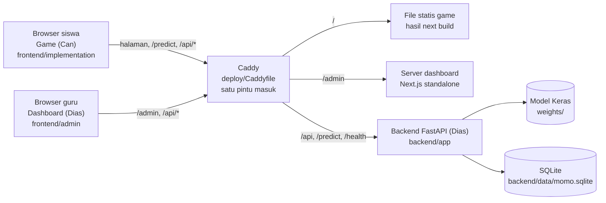
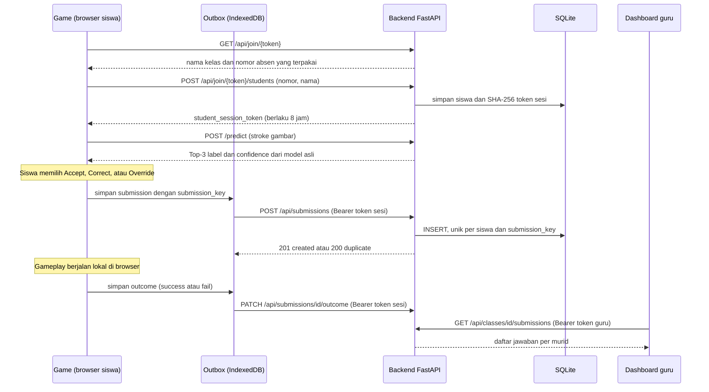
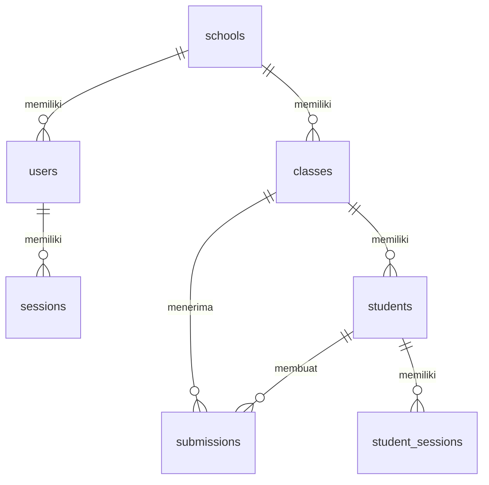

# Arsitektur Sketchbook Universe

Dokumen ini menjelaskan bagaimana game siswa (Can) dan backend serta dashboard (Dias) tersambung. Tujuannya supaya satu orang bisa membaca ini dan paham bagian mana yang ia miliki, bagian mana yang milik orang lain, dan lewat apa keduanya berbicara.

Semua klaim di sini diperiksa terhadap kode di repo ini. Yang belum terbukti diberi tanda **belum terbukti**.

## 1. Gambaran besar

Ada **satu backend HTTP**. Game dan dashboard adalah dua aplikasi browser yang sama-sama memanggil backend itu lewat REST. Tidak ada server Next.js untuk game: game dibangun sebagai file statis.

## 2. Siapa memiliki apa

| Lapisan | Folder | Owner | Berjalan di |
|---|---|---|---|
| Game: canvas, MediaPipe, KAPLAY, physics, state machine HITL, Momo | `frontend/implementation/` | Can | browser siswa |
| Klien REST di game: join kelas, outbox, submission | `frontend/implementation/src/api/` | Can | browser siswa |
| Kontrak REST | `contracts/` | Bersama | tidak berjalan; dicek oleh test dua sisi |
| API, inferensi model, database | `backend/`, `weights/`, `config.py` | Dias | server |
| Dashboard guru dan admin | `frontend/admin/` | Dias | browser guru, server Next.js |
| Training model (manual) | `train/` | Dias | mesin training, tidak jalan di produksi |
| Reverse proxy dan komposisi deploy | `deploy/`, `docker-compose.yml` | Bersama | server |

**Logika gameplay ada di browser, bukan di server.** Server tidak menjalankan KAPLAY, physics, atau state machine. Server hanya menjawab tiga hal: prediksi gambar, identitas kelas dan siswa, dan penyimpanan hasil. Ini mengikuti keputusan produk Can (lihat `contexts/can/DECISIONS.md`). Memindahkan logika game ke server adalah keputusan produk yang belum diambil, dan KAPLAY tidak bisa berjalan di server (lihat `docs/migration/UNRESOLVED.md`, B1).

## 3. Alur utama: dari link kelas sampai dashboard

Poin penting:

- **Prediksi tidak butuh login.** `/predict` terbuka. Identitas baru dipakai saat menyimpan hasil.
- **Outbox** adalah antrean di browser (IndexedDB). Keputusan siswa masuk antrean dulu, lalu dikirim. Kalau jaringan putus, pengiriman diulang dengan jeda yang makin panjang.
- **`submission_key`** dibuat di browser sekali per keputusan dan dikirim ulang apa adanya saat retry. Server menolak baris kedua dengan key yang sama dan menjawab `200 duplicate` dengan `id` yang sama. Inilah yang mencegah data ganda.
- **Outcome** (berhasil atau gagal di gameplay) dikirim setelah submission-nya diterima, karena butuh `id` dari server.
- Di luar kelas (tanpa join), keputusan **tidak dikirim** ke server.

## 4. Game: lapisan kode

Folder `frontend/implementation/`:

| Folder | Isi | Catatan |
|---|---|---|
| `app/` | Halaman Next.js (`/`, `/onboarding/*`, `/levels`, `/level1..3`) | Static export |
| `src/app/` | `SketchbookApp.tsx`, `state-machine.ts`, hooks sesi level dan kelas | State machine fase: level-entry, drawing, predicting, evaluating, falling, placing, gameplay |
| `src/domain/` | Tipe, level, aturan label menjadi perilaku objek (solid, danger, unresolved), skrip Momo | Murni, tanpa jaringan |
| `src/prediction/` | `PredictionProvider`: mock dan partner HTTP | Mock dipakai bila `NEXT_PUBLIC_PREDICTION_MODE` bukan `partner` |
| `src/api/` | `classroom-client`, `submission-client`, `submission-adapter`, `outbox`, `http-client` | Satu-satunya tempat game bicara dengan backend selain `/predict` |
| `src/game/` | KAPLAY, physics, penempatan objek | Berjalan di canvas |
| `src/input/`, `src/camera/` | Pointer, MediaPipe, gestur tangan | Kamera tidak dikirim ke server |
| `src/events/` | Pipa event telemetri | **Mati secara default.** Tanpa `NEXT_PUBLIC_EVENT_ENDPOINT`, tidak ada yang dikirim. Backend belum punya endpoint untuk ini |

Alur satu keputusan: `FlowController` (state machine) memanggil `onDecisionApplied`, lalu `SubmissionAdapter` menyusun payload dan memasukkannya ke `OutboxQueue`.

## 5. Backend: modul dan data

Folder `backend/app/`:

| File | Tugas |
|---|---|
| `main.py` | Membuat app FastAPI, CORS, `/health`, `/predict`, startup (init DB dan muat model) |
| `inference.py` | Memuat model Keras dari `MODEL_PATH`, mengubah stroke jadi tensor 28x28, mengembalikan Top-3 |
| `classroom.py` | Endpoint publik untuk siswa: join kelas, submission, outcome |
| `dashboard.py` | Endpoint guru dan admin: login, sekolah, kelas, daftar jawaban, ekspor CSV dan ZIP |
| `auth.py`, `passwords.py` | Sesi Bearer untuk guru dan admin, hash password |
| `db.py` | Skema SQLite, migrasi kolom, koneksi per request |
| `reports.py` | Ringkasan per kelas dan murid untuk dashboard |

Tabel SQLite:

- `sessions` adalah sesi guru dan admin. `student_sessions` adalah sesi siswa. Keduanya terpisah.
- `submissions` menyimpan stroke, tiga kandidat prediksi, jenis keputusan, label akhir, dan hasil gameplay (`outcome`, `behavior`).
- Unique index `(student_id, submission_key)` adalah dasar idempotensi.

## 6. Identitas dan keamanan

| Hal | Perilaku saat ini |
|---|---|
| Siswa bergabung | Lewat nomor absen dalam kelas. **Tidak ada rahasia per siswa.** Siapa pun yang memegang link kelas bisa bergabung sebagai nomor mana pun, termasuk nomor yang sudah dipakai teman |
| Token siswa | Acak 32 byte, hanya SHA-256-nya disimpan, berlaku 8 jam. Wajib untuk submission dan outcome |
| Pemeriksaan kepemilikan | Token harus milik siswa dan kelas yang disebut di request (401 bila token tidak valid atau habis, 403 bila bukan miliknya, 404 untuk outcome milik siswa lain) |
| Guru dan admin | Login email dan password, token Bearer. Token disimpan mentah di tabel `sessions` (belum di-hash) |
| CORS | Hanya origin di env `CORS_ORIGINS`, tanpa credentials. Di Caddy semua satu origin, jadi CORS tidak terpakai |
| `/predict` | Terbuka tanpa auth |
| Model | Dimuat dengan `safe_mode=False`, jadi file model dapat menjalankan kode. Muat hanya bobot tepercaya |

Dua hal di atas yang perlu keputusan pemilik: identitas siswa yang bisa ditiru, dan sesi 8 jam (lihat bagian 9).

## 7. Deployment

Caddy adalah satu-satunya pintu masuk (`deploy/Caddyfile`):

| Path | Tujuan |
|---|---|
| `/api/*`, `/predict`, `/health` | `backend:8000` |
| `/admin*` | `admin:3002` |
| selain itu | file statis game di `/srv/game`, dengan fallback ke `index.html` |

`docker-compose.yml` punya tiga service: `backend`, `admin`, `web` (game + Caddy). **Build image Docker belum terbukti**, karena lingkungan pengujian tidak punya daemon Docker. Yang sudah terbukti: `docker compose config` valid, dan Caddy 2.10.2 asli menjalankan Caddyfile ini dengan game, admin, dan backend berjalan sebagai proses biasa.

## 8. Perubahan di area Dias (untuk direview Dias)

Dibandingkan repo Dias (`MuhammadDias/HITL` @ `81bab5e`), hanya file ini yang berubah:

| File | Perubahan | Alasan |
|---|---|---|
| `backend/app/classroom.py` | Join mengembalikan `student_session_token`. `POST /api/submissions` wajib Bearer, wajib `submission_key`, idempoten. `PATCH /api/submissions/{id}/outcome` ditambahkan | Client game sudah dirancang memakai token dan memanggil endpoint outcome, tetapi backend belum menyediakannya |
| `backend/app/db.py` | Tabel `student_sessions`, kolom baru di `submissions`, unique index, fungsi `_migrate` | Mendukung perubahan di atas. Database lama dimigrasi otomatis saat startup |
| `backend/app/main.py` | CORS dari env `CORS_ORIGINS`, tanpa credentials | Sebelumnya `*` bersama credentials, yaitu mengizinkan semua origin |
| `docker-compose.yml` | Backend menerima `CORS_ORIGINS` dari `PUBLIC_URL` | Mengikuti perubahan CORS |

Tidak berubah: `frontend/admin/`, `backend/app/dashboard.py`, `auth.py`, `inference.py`, `reports.py`, `train/`, `weights/`, `deploy/`, `config.py` (isi sama; hanya akhir baris CRLF dinormalisasi Git).

Perubahan kontrak ini dikerjakan atas instruksi pemilik dan **belum disetujui formal oleh Can dan Dias**. Rincian endpoint: `contracts/API_INVENTORY.md`.

## 9. Keputusan dan risiko yang masih terbuka

Daftar lengkap: `docs/migration/UNRESOLVED.md`. Yang paling relevan untuk Dias:

- Persetujuan perubahan kontrak (bagian 8).
- `prediction_id` belum dikirim backend, jadi kolomnya selalu kosong.
- Sesi siswa habis setelah 8 jam. Submission yang masih antre setelah itu ditolak 401, tidak dicoba ulang, dan tidak terlihat di UI.
- Identitas siswa bisa ditiru (bagian 6). Perlu keputusan produk, misalnya PIN per siswa.
- `/predict` tanpa auth, token admin tersimpan mentah, `safe_mode=False`.
- Build image Docker belum diuji.
